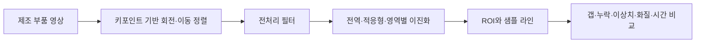

<div align="center">

<a name="카메라-모듈-갭-검출"></a>
<a name="동적-roi-정렬과-이진화-기반-카메라-모듈-갭-검출"></a>
<a name="gap-detection-for-compact-camera-modules-based-on-dynamic-roi-alignment-and-optimized-image-binarization"></a>

# 📏 Camera Module Gap Project

영상 정렬과 영역별 필터로 카메라 모듈의 틈 위치와 길이를 측정하는 연구입니다.

**기술 분류:** 컴퓨터 비전 › 기하 정렬·영상 처리 › ROI·이진화·1차원 갭 측정

`논문·연구 자료` `Document`

[원고 읽기](#quick-start) · [저장소 구성](#structure) · [자료·설정](#data)

[핵심 구성](#input-processing-output)

<details>
<summary>📄 원고 제목</summary>

Gap Detection for Compact Camera Modules Based on Dynamic ROI Alignment and Optimized Image Binarization

</details>

[📄 PDF로 읽기](%EB%85%BC%EB%AC%B8/%EC%B5%9C%EC%A2%85_%EB%85%BC%EB%AC%B8.pdf) · [📝 HWPX 원본](%EB%85%BC%EB%AC%B8/%EC%B5%9C%EC%A2%85_%EB%85%BC%EB%AC%B8.hwpx)

</div>

## 📄 내 논문 PDF

[현재 원문 PDF·공식 링크 교체 위치](docs/PAPERS.md) · [모든 실제 차수·최종본·전체 비교](docs/REVISION_INDEX.md)

- **사진 포함 최종**: [PDF 원문](%EB%85%BC%EB%AC%B8/%EC%B5%9C%EC%A2%85_%EB%85%BC%EB%AC%B8.pdf) · [편집 원본](%EB%85%BC%EB%AC%B8/%EC%B5%9C%EC%A2%85_%EB%85%BC%EB%AC%B8.hwpx)

공식 공개 URL은 아직 등록하지 않았습니다. 추후 [논문 전용 표](docs/PAPERS.md)의 교체 칸과 이 항목을 함께 갱신합니다.

## 🗂️ 모든 실제 차수와 최종본

| 단계 | 설명 | 파일 종류 | 전체 차이 |
|---|---|---|---|
| [초기 원고 · 번호 없는 원본](docs/revisions/initial.md) | 동적 ROI 정렬·6개 샘플라인·필터·이진화·갭 측정 방법을 서술한 원고입니다. 임의의 1차 번호를 붙이지 않습니다. 초록의 약1,000장과 본문의546장, 처리시간·필터 서술의 내부 차이는 원고 그대로 읽어야 합니다.나중 단계의 값으로 소급 정정하지 않습니다.라벨은 원본 폴더명과 구별한 안내명입니다.라벨 자체가 새 연구 차수는 아닙니다. | hwp·pdf | [직전 단계 비교](docs/revision-diffs/initial.diff) |
| [최종 원고 · HWP/PDF 단계](docs/revisions/final.md) | HWP 본문에서는 초기의 사사 자리표시자를 IITP-2024-00436954와 경기대학교 컴퓨터과학연구소 지원 문구로 바꾼 차이가 있습니다. 다만 함께 저장된 두 원본 PDF의 추출 본문은 동일하고 초기 사사 자리표시자가 남습니다. 파일명이 최종이라는 이유로 HWP와 PDF가 완전히 같다고 판단하지 않습니다. | hwp·pdf | [직전 단계 비교](docs/revision-diffs/final.diff) |
| [사진 포함 최종 · HWPX 단계](docs/revisions/illustrated.md) | 기존 공개 HWPX와 네이티브 변환 PDF를 보존합니다. 원고 본문·표·삽입 연구 그림 전체를 읽는 자료이며, 별도 실행 코드와 제조 원데이터는 포함하지 않습니다. | hwpx·jpeg·pdf·png | [직전 단계 비교](docs/revision-diffs/illustrated.diff) |
| [이진화 연구노트·외부 참고논문](docs/revisions/references.md) | 프로젝트의 84쪽 이진화·필터·ROI 코드 노트와 원문에 CC BY4.0이 표시된 외부 참고논문을 원문으로 보존합니다. 외부 논문의 저자를 그대로 표시하고 본인의 실적으로 합치지 않습니다. | md·pdf | [직전 단계 비교](docs/revision-diffs/references.diff) |

<a name="overview"></a>

## ✨ 연구 핵심

정렬·전처리·이진화와 ROI 측정으로 카메라 모듈 갭을 비교하는 원고입니다.

5픽셀 기준은 초기 배치 실험에서 정한 경험적 설정입니다. 환경별 적응 기준의 검증은 후속 과제입니다.

- 관심영역과 측정선을 이용한 갭 측정에서 화질 지표와 실제 갭 오차의 역할을 구분합니다.
- 초기 배치에서 5픽셀 기준을 적용했습니다. 필터 처리시간을 비교하며, 생산라인 전체 지연 평가와 학습 기반 방식은 후속 과제로 남습니다.

**자료별 안내:** [최종 원고](docs/versions/final-paper.md) · [전체 기록](docs/VERSIONS.md)

<a name="preview"></a>

<details>
<summary>📎 논문 도표와 출처</summary>

[📊 원고 도표 보기](assets/previews/paper-processing-pipeline.png)

**논문 그림** — 공개 HWPX 원고의 처리 흐름도: 정렬·전처리·이진화·ROI 기반 갭 측정 과정입니다.

[근거 파일 보기](%EB%85%BC%EB%AC%B8/%EC%B5%9C%EC%A2%85_%EB%85%BC%EB%AC%B8.hwpx)

</details>

<a name="input-processing-output"></a>

## 🔄 입력·처리·출력

| 단계 | 이 프로젝트에서 다루는 내용 |
| :--- | :--- |
| 📥 입력 | 카메라 모듈 검사 영상 |
| ⚙️ 처리 | 기준 위치 검출·ROI 정렬, 영역별 필터·임계값, 주사선 길이 측정 |
| 📤 출력 | 갭 위치·길이와 검사 지표 |


---

## ✨ 프로젝트 소개

저자: **곽윤석 · 김남기**

동적 ROI 정렬과 이진화 기반 갭 측정을 다룬 연구 원고입니다.

| 항목 | 원고에서 다루는 내용 |
|---|---|
| 동적 정렬 | YOLO 키포인트의 left_top/right_top으로 회전·이동을 보정합니다. |
| 갭 측정 | 6개 ROI 안의 샘플 라인에서 검정 픽셀 연속 구간을 분석합니다. |
| 필터 비교 | 공간·주파수·비국소 필터와 순차 조합을 비교합니다. |
| 품질·비용 분석 | 갭 편차·누락률·이상치율·PSNR·SSIM·처리시간을 설명합니다. |



<a name="structure"></a>
## 📁 저장소 구성

```text
.
├── README.md
├── CHANGELOG.md
└── 논문/
    ├── 최종_논문.pdf
    └── 최종_논문.hwpx
```

- [전체 최종 원고](%EB%85%BC%EB%AC%B8/%EC%B5%9C%EC%A2%85_%EB%85%BC%EB%AC%B8.hwpx)

## 🧩 갭 측정과 필터 비교

원고는 ROI별 6개 샘플 X좌표, 최소 5픽셀의 검정 그룹, 5픽셀 이하 간격의 그룹 병합 규칙을 설명합니다. 상단에는 Anisotropic 필터와 임계값 100, 하단에는 Wiener 필터와 임계값 130을 적용하는 예도 제시합니다. 5픽셀 기준은 초기 배치 실험에서 정한 경험적 설정입니다. 통계적 최적화나 환경별 적응 기준의 검증은 후속 과제로 남아 있으므로, 모든 제조 환경에 통용되는 기준으로 사용하지 않습니다.

Fast Global Smoother+Sharpen, Bilateral+Sharpen, Median+Sharpen 등 조합의 측정 안정성과 연산 비용을 비교합니다. ROI 그룹의 평균 차이와 표준편차 합으로 후보를 정렬하고 상위 10% 필터군을 고르는 절차도 설명합니다. PSNR·SSIM은 화질 유사도, 갭 편차·누락률·이상치율은 측정 안정성을 보는 지표이므로 서로 대신하지 않습니다. 학습 기반 denoiser는 비교 대상으로 서술한 부분과 향후 연구로 남긴 부분이 있어 실제 수행 범위를 구분해야 합니다.

<a name="quick-start"></a>
## 🚀 원고 읽기

1. 위의 최종 원고 링크를 엽니다.
2. 서론의 연구 질문과 방법을 먼저 읽습니다.
3. 결과표와 함께 한계·후속 연구를 확인합니다.

동적 ROI 정렬과 이진화를 활용한 카메라 모듈 갭 측정 방법을 담은 연구 논문을 수록했습니다.

<a name="data"></a>
## 📊 자료 구성과 결과 해석

PDF와 HWPX 원고에 제조 부품 영상, 이진화 결과, 처리 흐름도와 연구 도표를 수록했습니다. 제조 원데이터는 별도로 관리합니다.

<a name="원고가-보고한-결과와-한계"></a>

### 🔎 원고가 보고한 결과와 한계

원고 초록은 갭 편차 28.6% 감소, 누락률 3.9→1.2%, 이상치율 6.8→2.5%, PSNR 35.2dB·SSIM 0.94를 보고합니다.

본문에는 546장과 약 1,000장 실험이 함께 서술되어 있습니다. Fast Global Smoother의 처리 비용을 가장 우수하다고 설명한 문장과 가장 느린 조합이라고 설명한 문장이 병존하며, 누락률 도표와 설명에도 차이가 있습니다. 실험 조건과 수치의 일관성은 추가 정리가 필요한 부분입니다. 0.1266 s/image는 필터 처리시간이며, 장비 입출력을 포함한 생산라인 전체 지연은 별도 평가가 필요합니다.

## 🛠 문제 해결

| 상황 | 확인할 내용 |
|---|---|
| 원고를 바로 읽고 싶습니다. | 상단의 PDF 링크로 본문과 도표를 볼 수 있습니다. |
| 편집 가능한 원고가 필요합니다. | 같은 논문의 HWPX 원본을 함께 제공합니다. |
| 처리시간 단위가 혼동됩니다. | 일부 그래프 축 숫자와 본문의 초 단위가 달라 원고의 위치를 함께 확인해야 합니다. |

<div align="center">

연구 방법과 결과, 다음에 확인할 과제를 함께 살펴볼 수 있습니다.

</div>
