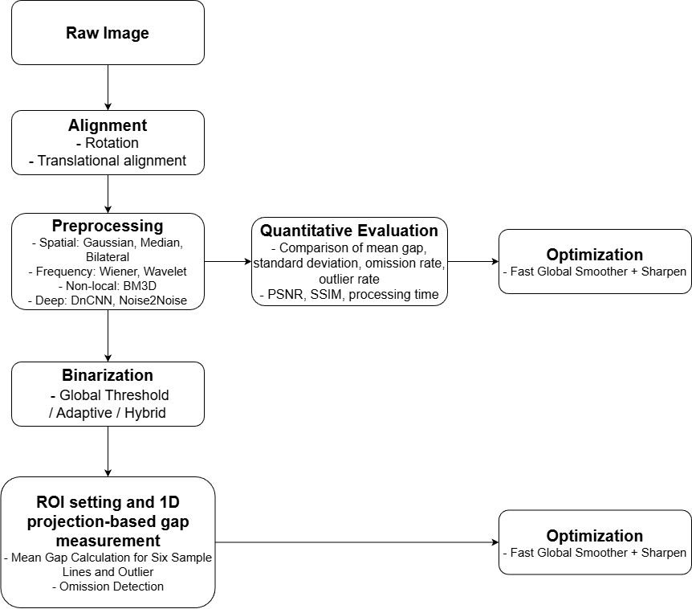
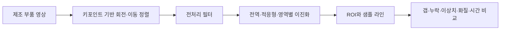

<div align="center">

# 카메라 모듈 갭 검출

**Camera-Module-Gap-Detection-Project**

**기술 분류:** 컴퓨터 비전 › 기하 정렬·영상 처리 › ROI·이진화·1차원 갭 측정

### 동적 ROI 정렬과 이진화 기반 카메라 모듈 갭 검출
### Gap Detection for Compact Camera Modules Based on Dynamic ROI Alignment and Optimized Image Binarization

**YOLO 키포인트 · 영상 정렬 · 전처리 필터 · 1D 갭 측정**

소형 카메라 모듈의 위치·회전 편차를 정렬하고, 전처리와 이진화를 통해 갭 측정의 안정성을 비교하는 연구입니다. 필터별 화질, 갭 관련 지표와 처리 비용을 함께 다룹니다.<br>

 

[원고 읽기](#quick-start) · [저장소 구성](#structure) · [자료·설정](#data)

[예시 이미지](#preview)

</div>

<a name="preview"></a>

## 🖼️ 예시로 보기

<p align="center"></p>

**논문 그림** — 공개 HWPX 원고의 처리 흐름도: 정렬·전처리·이진화·ROI 기반 갭 측정 과정입니다.

[근거 파일 보기](%EB%85%BC%EB%AC%B8/%EC%B5%9C%EC%A2%85_%EB%85%BC%EB%AC%B8.hwpx)


<a name="input-processing-output"></a>

## 🔄 입력·처리·출력

| 단계 | 이 프로젝트에서 다루는 내용 |
| :--- | :--- |
| 입력 | 카메라 모듈 검사 영상 |
| 처리 | 기준 위치 검출·ROI 정렬, 영역별 필터·임계값, 주사선 길이 측정 |
| 출력 | 갭 위치·길이와 검사 지표 |


---

## ✨ 프로젝트 소개

저자: **곽윤석 · 김남기**

원고는 개인 연구 문서 형식이며 특정 학회 게재 완료가 확인되지 않았습니다. 파일명보다 본문의 연구 제목을 사용했습니다.

| 항목 | 원고에서 다루는 내용 |
|---|---|
| 동적 정렬 | YOLO 키포인트의 left_top/right_top으로 회전·이동을 보정합니다. |
| 갭 측정 | 6개 ROI 안의 샘플 라인에서 검정 픽셀 연속 구간을 분석합니다. |
| 필터 비교 | 공간·주파수·비국소 필터와 순차 조합을 비교합니다. |
| 품질·비용 분석 | 갭 편차·누락률·이상치율·PSNR·SSIM·처리시간을 설명합니다. |



<a name="structure"></a>
## 📁 저장소 구성

```text
.
├── README.md
├── CHANGELOG.md
└── 논문/
    └── 최종_논문.hwpx
```

- [전체 최종 원고](논문/최종_논문.hwpx)

## 🧩 갭 측정과 필터 비교

원고는 ROI별 6개 샘플 X좌표, 최소 5픽셀의 검정 그룹, 5픽셀 이하 간격의 그룹 병합 규칙을 설명합니다. 상단에는 Anisotropic 필터와 임계값 100, 하단에는 Wiener 필터와 임계값 130을 적용하는 예도 제시합니다. 이러한 값은 원고의 실험 설정이며 모든 제조 환경에 통용되는 기준이 아닙니다.

Fast Global Smoother+Sharpen, Bilateral+Sharpen, Median+Sharpen 등 조합의 측정 안정성과 연산 비용을 비교합니다. 학습 기반 denoiser는 비교 대상으로 서술한 부분과 향후 연구로 남긴 부분이 있어 실제 수행 범위를 구분해야 합니다.

<a name="quick-start"></a>
## 🚀 원고 읽기

1. 위의 최종 원고 링크를 엽니다.
2. 서론의 연구 질문과 방법을 먼저 읽습니다.
3. 결과표와 함께 한계·후속 연구를 확인합니다.

이 저장소는 논문 열람을 위한 구성이므로 패키지 설치나 모델 실행 명령을 제시하지 않습니다. 원본 프로젝트 폴더에서 지정한 코드 확장자의 일반 파일을 검색했으며, 압축 파일 내부 코드는 검사하지 않았습니다. 확인하지 않은 구현의 존재 여부는 단정하지 않습니다.

<a name="data"></a>
## 📊 자료 구성과 결과 해석

최종 원고 한 개를 HWPX 형식으로 보존하는 구성입니다. 내장 그림은 제조 부품, 이진화 결과, 흐름도와 연구 도표입니다. 제조 원데이터 폴더는 포함하지 않습니다. 문서의 전체 본문과 내장 그림을 확인했으나 HWPX의 최종 페이지 배치는 렌더로 검증하지 않았습니다.

### 원고가 보고한 결과와 한계

원고 초록은 갭 편차 28.6% 감소, 누락률 3.9→1.2%, 이상치율 6.8→2.5%, PSNR 35.2dB·SSIM 0.94를 보고합니다. 이 값은 재실행 검증 결과가 아닙니다.

본문에는 546장과 약 1,000장 실험 서술이 함께 있습니다. Fast Global Smoother의 처리 비용을 가장 우수하다고 설명한 문장과 가장 느린 조합이라고 설명한 문장이 병존하고, 누락률 도표와 설명도 일치하지 않는 부분이 있습니다. 어느 조건의 결과인지 추가 확인 없이 하나의 성능으로 합치지 않습니다.

## 🛠 문제 해결

| 상황 | 확인할 내용 |
|---|---|
| GitHub에서 HWPX 본문이 바로 보이지 않습니다. | 원고 파일을 내려받아 HWPX를 지원하는 문서 프로그램에서 여세요. |
| PDF와 HWPX를 모두 찾고 있습니다. | 최종 원고 하나 원칙에 따라 사진 포함 최종 HWPX를 선택하는 구성입니다. |
| 처리시간 단위가 혼동됩니다. | 일부 그래프 축 숫자와 본문의 초 단위가 달라 원고의 위치를 함께 확인해야 합니다. |

<div align="center">

연구 질문과 확인된 범위를 함께 읽는 논문 기록입니다.

</div>
