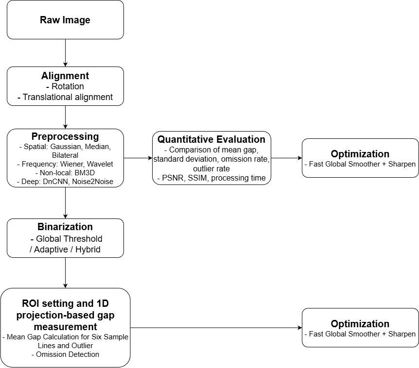

# 문서 줄바꿈과 읽기 배치 정정 전체 비교

기준 커밋: `768faa0b6a66530509fc63a0b5bd5ac515f4d9d5`

현재 원격 기준선에 대한 모든 Markdown 변경 줄과 새 문서 전문을 비교합니다. 사소한 줄바꿈·공백도 비교에 포함합니다. 이번 변경 기록과 이 비교 문서 자체만 비교 대상에서 제외합니다. 과거 전용 비교 문서는 비교 데이터와 의미를 보존한 배치 정정 대상으로 포함될 수 있습니다. 기존 변경 기록·라이선스와 문서 외 파일은 유지합니다.

`````````````diff
--- a/README.md
+++ b/README.md
@@ -6,7 +6,17 @@
 
 # Camera Module Gap Project
 
-영상 정렬과 영역별 필터로 카메라 모듈의 틈 위치와 길이를 측정하는 연구입니다.
+**영상 정렬과 영역별 필터로 카메라 모듈의 틈 위치와 길이를 측정하는 연구입니다.**
+
+<!-- reading-levels17:start -->
+| 읽기 수준 | 안내 내용 |
+| --- | --- |
+| [LEVEL 1 - Beginner](docs/%EC%9D%BD%EA%B8%B0%EC%95%88%EB%82%B4/%EB%A0%88%EB%B2%A81.md) | 낯선 용어를 풀고 입력부터 결과까지 구체적인 예로 읽기 |
+| [LEVEL 2 - Explorer](docs/%EC%9D%BD%EA%B8%B0%EC%95%88%EB%82%B4/%EB%A0%88%EB%B2%A82.md) | 핵심 개념과 처리 흐름의 관계 이해 |
+| [LEVEL 3 - Practitioner](docs/%EC%9D%BD%EA%B8%B0%EC%95%88%EB%82%B4/%EB%A0%88%EB%B2%A83.md) | 실험·사용 절차와 결과 해석 따라가기 |
+| [LEVEL 4 - Advanced](docs/%EC%9D%BD%EA%B8%B0%EC%95%88%EB%82%B4/%EB%A0%88%EB%B2%A84.md) | 코드 구조·설정·설계 선택과 제약 검토 |
+| [LEVEL 5 - Expert](docs/%EC%9D%BD%EA%B8%B0%EC%95%88%EB%82%B4/%EB%A0%88%EB%B2%A85.md) | 논문·프로토콜·분모·누수·미검증 범위 대조 |
+<!-- reading-levels17:end -->
 
 분야: 컴퓨터 비전 › 기하 정렬·영상 처리 › ROI·이진화·1차원 갭 측정
 
@@ -82,8 +92,25 @@
 | --- | --- | --- | --- |
 | [초기 원고 · 번호 없는 원본](docs/revisions/initial.md) | 필터·이진화 품질을 동적 ROI 정렬과 갭 길이 측정으로 연결한 초기 원고 단계입니다. | [폴더](%EB%85%BC%EB%AC%B8) | [전체 비교](docs/revision-diffs/initial.diff) |
 | [최종 원고 · HWP/PDF 단계](docs/revisions/final.md) | 초기 설계를 유지하면서 최종 HWP의 사사·지원 문구 등을 정리한 원고 단계입니다. | [폴더](%EB%85%BC%EB%AC%B8) | [전체 비교](docs/revision-diffs/final.diff) |
-| [사진 포함 최종 · HWPX 단계](docs/revisions/illustrated.md) | 사진·본문·소속·사사를 포함한 최종 HWPX와 같은 판의 12쪽 PDF로 갭 검출 연구를 읽는 단계입니다. | [폴더](%EB%85%BC%EB%AC%B8) | [전체 비교](docs/revision-diffs/illustrated.diff) |
-| [이진화 연구노트·외부 참고논문](docs/revisions/references.md) | 84쪽 Binarization 연구노트는 임계값·필터·ROI·프로젝션 관련 개념과 Python 예시를 모은 자료입니다.21쪽 Electronics 논문은 외부 저자의 연구 참고문헌입니다. | [폴더](%EC%B0%B8%EA%B3%A0%EC%9E%90%EB%A3%8C) | [전체 비교](docs/revision-diffs/references.diff) |
+| [사진 포함 최종 · HWPX 단계](docs/revisions/illustrated.md) | [상세 설명](#layout18-table-4-row-3-field-1) | [폴더](%EB%85%BC%EB%AC%B8) | [전체 비교](docs/revision-diffs/illustrated.diff) |
+| [이진화 연구노트·외부 참고논문](docs/revisions/references.md) | [상세 설명](#layout18-table-4-row-4-field-1) | [폴더](%EC%B0%B8%EA%B3%A0%EC%9E%90%EB%A3%8C) | [전체 비교](docs/revision-diffs/references.diff) |
+
+<a id="layout18-table-4-row-3-field-1"></a>
+
+**[사진 포함 최종 · HWPX 단계](docs/revisions/illustrated.md)**
+
+**주요 내용**
+
+사진·본문·소속·사사를 포함한 최종 HWPX와 같은 판의 12쪽 PDF로 갭 검출 연구를 읽는 단계입니다.
+
+<a id="layout18-table-4-row-4-field-1"></a>
+
+**[이진화 연구노트·외부 참고논문](docs/revisions/references.md)**
+
+**주요 내용**
+
+84쪽 Binarization 연구노트는 임계값·필터·ROI·프로젝션 관련 개념과 Python 예시를 모은 자료입니다.21쪽 Electronics 논문은 외부 저자의 연구 참고문헌입니다.
+
 
 <a id="-프로젝트-소개"></a>
 
@@ -247,14 +274,78 @@
 
 초기 설계를 유지하면서 최종 HWP의 사사·지원 문구 등을 정리한 원고 단계입니다.
 
-| 구성 | 처리 내용 |
-| --- | --- |
-| 지원 문구 개정 | HWP의 사사 자리표시자를 IITP-2024-00436954와 경기대학교 컴퓨터과학연구소 지원 문구로 바꾼 차이가 있습니다. |
-| 편집본과 PDF 구분 | 당시 함께 저장된 초기·최종 PDF의 추출 본문은 같았고 초기 사사 자리표시자가 남았습니다. 파일명만으로 HWP와 같은 판이라고 결론내리지 않습니다. |
-| 동적 정렬 | YOLO 키포인트의 left_top·right_top을 기준으로 회전·위치를 맞춥니다. |
-| 전처리 비교 | 공간·주파수·비국소 필터와 순차 조합이 이진화에 미치는 영향을 설명합니다. |
-| 갭 측정 | ROI의 6개 샘플라인과 1D 투영을 이용해 길이를 산출합니다. |
-| 평가 지표 | 평균·표준편차·누락률·이상치율과 PSNR·SSIM·처리시간을 구분합니다. |
+<a id="layout18-table-11-row-1"></a>
+
+**지원 문구 개정**
+
+**구성**
+
+지원 문구 개정
+
+**처리 내용**
+
+HWP의 사사 자리표시자를 IITP-2024-00436954와 경기대학교 컴퓨터과학연구소 지원 문구로 바꾼 차이가 있습니다.
+
+<a id="layout18-table-11-row-2"></a>
+
+**편집본과 PDF 구분**
+
+**구성**
+
+편집본과 PDF 구분
+
+**처리 내용**
+
+당시 함께 저장된 초기·최종 PDF의 추출 본문은 같았고 초기 사사 자리표시자가 남았습니다. 파일명만으로 HWP와 같은 판이라고 결론내리지 않습니다.
+
+<a id="layout18-table-11-row-3"></a>
+
+**동적 정렬**
+
+**구성**
+
+동적 정렬
+
+**처리 내용**
+
+YOLO 키포인트의 left_top·right_top을 기준으로 회전·위치를 맞춥니다.
+
+<a id="layout18-table-11-row-4"></a>
+
+**전처리 비교**
+
+**구성**
+
+전처리 비교
+
+**처리 내용**
+
+공간·주파수·비국소 필터와 순차 조합이 이진화에 미치는 영향을 설명합니다.
+
+<a id="layout18-table-11-row-5"></a>
+
+**갭 측정**
+
+**구성**
+
+갭 측정
+
+**처리 내용**
+
+ROI의 6개 샘플라인과 1D 투영을 이용해 길이를 산출합니다.
+
+<a id="layout18-table-11-row-6"></a>
+
+**평가 지표**
+
+**구성**
+
+평가 지표
+
+**처리 내용**
+
+평균·표준편차·누락률·이상치율과 PSNR·SSIM·처리시간을 구분합니다.
+
 
 | 입력·실행 조건 | 내용 |
 | --- | --- |
@@ -286,14 +377,78 @@
 
 사진·본문·소속·사사를 포함한 최종 HWPX와 같은 판의 12쪽 PDF로 갭 검출 연구를 읽는 단계입니다.
 
-| 구성 | 처리 내용 |
-| --- | --- |
-| 삽입 연구 그림 | 정렬·ROI·필터·이진화의 차이를 사진과 도표로 확인합니다. |
-| 최종 원문 | 편집 원본과 PDF의 본문·그림을 같은 연구 단계로 연결하고 저자·소속·사사를 원문 그대로 제공합니다. |
-| 동적 정렬 | YOLO 키포인트의 left_top·right_top을 기준으로 회전·위치를 맞춥니다. |
-| 전처리 비교 | 공간·주파수·비국소 필터와 순차 조합이 이진화에 미치는 영향을 설명합니다. |
-| 갭 측정 | ROI의 6개 샘플라인과 1D 투영을 이용해 길이를 산출합니다. |
-| 평가 지표 | 평균·표준편차·누락률·이상치율과 PSNR·SSIM·처리시간을 구분합니다. |
+<a id="layout18-table-14-row-1"></a>
+
+**삽입 연구 그림**
+
+**구성**
+
+삽입 연구 그림
+
+**처리 내용**
+
+정렬·ROI·필터·이진화의 차이를 사진과 도표로 확인합니다.
+
+<a id="layout18-table-14-row-2"></a>
+
+**최종 원문**
+
+**구성**
+
+최종 원문
+
+**처리 내용**
+
+편집 원본과 PDF의 본문·그림을 같은 연구 단계로 연결하고 저자·소속·사사를 원문 그대로 제공합니다.
+
+<a id="layout18-table-14-row-3"></a>
+
+**동적 정렬**
+
+**구성**
+
+동적 정렬
+
+**처리 내용**
+
+YOLO 키포인트의 left_top·right_top을 기준으로 회전·위치를 맞춥니다.
+
+<a id="layout18-table-14-row-4"></a>
+
+**전처리 비교**
+
+**구성**
+
+전처리 비교
+
+**처리 내용**
+
+공간·주파수·비국소 필터와 순차 조합이 이진화에 미치는 영향을 설명합니다.
+
+<a id="layout18-table-14-row-5"></a>
+
+**갭 측정**
+
+**구성**
+
+갭 측정
+
+**처리 내용**
+
+ROI의 6개 샘플라인과 1D 투영을 이용해 길이를 산출합니다.
+
+<a id="layout18-table-14-row-6"></a>
+
+**평가 지표**
+
+**구성**
+
+평가 지표
+
+**처리 내용**
+
+평균·표준편차·누락률·이상치율과 PSNR·SSIM·처리시간을 구분합니다.
+
 
 | 입력·실행 조건 | 내용 |
 | --- | --- |
@@ -327,12 +482,54 @@
 
 21쪽 Electronics 논문은 외부 저자의 연구 참고문헌입니다.
 
-| 구성 | 처리 내용 |
-| --- | --- |
-| 이진화 종류 | 전역 임계값·Otsu·적응형·반전·삼진화 등 방법을 비교합니다. |
-| 필터와 ROI | 공간·주파수·BM3D 등 필터와 ROI 내 흰 픽셀의 1D 투영 예시를 읽습니다. |
-| 외부 연구 | 스마트폰 소형 모듈의 구조 결함을 실시간·노이즈 강건 방식으로 분류한 비지도 연구를 참고합니다. |
-| 출처 보존 | 외부 논문의 DOI10.3390/electronics14173455와 CC BY4.0·원저자 표기를 유지합니다. |
+<a id="layout18-table-17-row-1"></a>
+
+**이진화 종류**
+
+**구성**
+
+이진화 종류
+
+**처리 내용**
+
+전역 임계값·Otsu·적응형·반전·삼진화 등 방법을 비교합니다.
+
+<a id="layout18-table-17-row-2"></a>
+
+**필터와 ROI**
+
+**구성**
+
+필터와 ROI
+
+**처리 내용**
+
+공간·주파수·BM3D 등 필터와 ROI 내 흰 픽셀의 1D 투영 예시를 읽습니다.
+
+<a id="layout18-table-17-row-3"></a>
+
+**외부 연구**
+
+**구성**
+
+외부 연구
+
+**처리 내용**
+
+스마트폰 소형 모듈의 구조 결함을 실시간·노이즈 강건 방식으로 분류한 비지도 연구를 참고합니다.
+
+<a id="layout18-table-17-row-4"></a>
+
+**출처 보존**
+
+**구성**
+
+출처 보존
+
+**처리 내용**
+
+외부 논문의 DOI10.3390/electronics14173455와 CC BY4.0·원저자 표기를 유지합니다.
+
 
 | 입력·실행 조건 | 내용 |
 | --- | --- |

--- a/docs/PAPERS.md
+++ b/docs/PAPERS.md
@@ -2,7 +2,11 @@
 
 # 논문과 최신 자료
 
-논문은 각 연구의 최종 전체본을 수록했습니다. 발표·대본·연구노트는 문서 목적을 구분해 연결합니다. 원문의 저자·소속·이메일·사진과 본문을 그대로 보존했습니다.
+<!-- reading-levels17:start -->
+**읽기 수준 선택** · [LEVEL 1 - Beginner](%EC%9D%BD%EA%B8%B0%EC%95%88%EB%82%B4/%EB%A0%88%EB%B2%A81.md) · [LEVEL 2 - Explorer](%EC%9D%BD%EA%B8%B0%EC%95%88%EB%82%B4/%EB%A0%88%EB%B2%A82.md) · [LEVEL 3 - Practitioner](%EC%9D%BD%EA%B8%B0%EC%95%88%EB%82%B4/%EB%A0%88%EB%B2%A83.md) · [LEVEL 4 - Advanced](%EC%9D%BD%EA%B8%B0%EC%95%88%EB%82%B4/%EB%A0%88%EB%B2%A84.md) · [LEVEL 5 - Expert](%EC%9D%BD%EA%B8%B0%EC%95%88%EB%82%B4/%EB%A0%88%EB%B2%A85.md)
+<!-- reading-levels17:end -->
+
+**논문은 각 연구의 최종 전체본을 수록했습니다.** 발표·대본·연구노트는 문서 목적을 구분해 연결합니다. 원문의 저자·소속·이메일·사진과 본문을 그대로 보존했습니다.
 
 | 자료 | 원문 파일 |
 |---|---|

--- a/docs/REVISION_INDEX.md
+++ b/docs/REVISION_INDEX.md
@@ -2,7 +2,11 @@
 
 # 전체 차수
 
-연구 원고·실험 코드·발표 자료의 목적과 사용 순서를 단계별로 살펴봅니다.
+<!-- reading-levels17:start -->
+**읽기 수준 선택** · [LEVEL 1 - Beginner](%EC%9D%BD%EA%B8%B0%EC%95%88%EB%82%B4/%EB%A0%88%EB%B2%A81.md) · [LEVEL 2 - Explorer](%EC%9D%BD%EA%B8%B0%EC%95%88%EB%82%B4/%EB%A0%88%EB%B2%A82.md) · [LEVEL 3 - Practitioner](%EC%9D%BD%EA%B8%B0%EC%95%88%EB%82%B4/%EB%A0%88%EB%B2%A83.md) · [LEVEL 4 - Advanced](%EC%9D%BD%EA%B8%B0%EC%95%88%EB%82%B4/%EB%A0%88%EB%B2%A84.md) · [LEVEL 5 - Expert](%EC%9D%BD%EA%B8%B0%EC%95%88%EB%82%B4/%EB%A0%88%EB%B2%A85.md)
+<!-- reading-levels17:end -->
+
+**연구 원고·실험 코드·발표 자료의 목적과 사용 순서를 단계별로 살펴봅니다.**
 
 [프로젝트 전체 소개](../README.md)
 
@@ -10,8 +14,25 @@
 | --- | --- | --- | --- |
 | [초기 원고 · 번호 없는 원본](revisions/initial.md) | 필터·이진화 품질을 동적 ROI 정렬과 갭 길이 측정으로 연결한 초기 원고 단계입니다. | [폴더](../%EB%85%BC%EB%AC%B8) | [전체 비교](revision-diffs/initial.diff) |
 | [최종 원고 · HWP/PDF 단계](revisions/final.md) | 초기 설계를 유지하면서 최종 HWP의 사사·지원 문구 등을 정리한 원고 단계입니다. | [폴더](../%EB%85%BC%EB%AC%B8) | [전체 비교](revision-diffs/final.diff) |
-| [사진 포함 최종 · HWPX 단계](revisions/illustrated.md) | 사진·본문·소속·사사를 포함한 최종 HWPX와 같은 판의 12쪽 PDF로 갭 검출 연구를 읽는 단계입니다. | [폴더](../%EB%85%BC%EB%AC%B8) | [전체 비교](revision-diffs/illustrated.diff) |
-| [이진화 연구노트·외부 참고논문](revisions/references.md) | 84쪽 Binarization 연구노트는 임계값·필터·ROI·프로젝션 관련 개념과 Python 예시를 모은 자료입니다.21쪽 Electronics 논문은 외부 저자의 연구 참고문헌입니다. | [폴더](../%EC%B0%B8%EA%B3%A0%EC%9E%90%EB%A3%8C) | [전체 비교](revision-diffs/references.diff) |
+| [사진 포함 최종 · HWPX 단계](revisions/illustrated.md) | [상세 설명](#layout18-table-1-row-3-field-1) | [폴더](../%EB%85%BC%EB%AC%B8) | [전체 비교](revision-diffs/illustrated.diff) |
+| [이진화 연구노트·외부 참고논문](revisions/references.md) | [상세 설명](#layout18-table-1-row-4-field-1) | [폴더](../%EC%B0%B8%EA%B3%A0%EC%9E%90%EB%A3%8C) | [전체 비교](revision-diffs/references.diff) |
+
+<a id="layout18-table-1-row-3-field-1"></a>
+
+**[사진 포함 최종 · HWPX 단계](revisions/illustrated.md)**
+
+**주요 내용**
+
+사진·본문·소속·사사를 포함한 최종 HWPX와 같은 판의 12쪽 PDF로 갭 검출 연구를 읽는 단계입니다.
+
+<a id="layout18-table-1-row-4-field-1"></a>
+
+**[이진화 연구노트·외부 참고논문](revisions/references.md)**
+
+**주요 내용**
+
+84쪽 Binarization 연구노트는 임계값·필터·ROI·프로젝션 관련 개념과 Python 예시를 모은 자료입니다.21쪽 Electronics 논문은 외부 저자의 연구 참고문헌입니다.
+
 
 <a id="-자료-이용"></a>
 

--- a/docs/VERSIONS.md
+++ b/docs/VERSIONS.md
@@ -2,6 +2,10 @@
 
 # 차수별 연구 자료
 
+<!-- reading-levels17:start -->
+**읽기 수준 선택** · [LEVEL 1 - Beginner](%EC%9D%BD%EA%B8%B0%EC%95%88%EB%82%B4/%EB%A0%88%EB%B2%A81.md) · [LEVEL 2 - Explorer](%EC%9D%BD%EA%B8%B0%EC%95%88%EB%82%B4/%EB%A0%88%EB%B2%A82.md) · [LEVEL 3 - Practitioner](%EC%9D%BD%EA%B8%B0%EC%95%88%EB%82%B4/%EB%A0%88%EB%B2%A83.md) · [LEVEL 4 - Advanced](%EC%9D%BD%EA%B8%B0%EC%95%88%EB%82%B4/%EB%A0%88%EB%B2%A84.md) · [LEVEL 5 - Expert](%EC%9D%BD%EA%B8%B0%EC%95%88%EB%82%B4/%EB%A0%88%EB%B2%A85.md)
+<!-- reading-levels17:end -->
+
 [모든 실제 차수·원고·발표·최종본과 직전 차수 전체 비교](REVISION_INDEX.md)를 확인하실 수 있습니다.
 
 기존 `versions/`의 주제별 설명은 남겨 두고, 현재의 전체 파일·차수 목록은 새 색인으로 관리합니다.

--- a/docs/latest/binarization-research-notes.md
+++ b/docs/latest/binarization-research-notes.md
@@ -2,7 +2,11 @@
 
 # 이진화·필터·ROI 연구노트
 
-84쪽 Binarization 연구노트는 임계값·필터·ROI·프로젝션 관련 개념과 Python 예시를 모은 자료입니다.
+<!-- reading-levels17:start -->
+**읽기 수준 선택** · [LEVEL 1 - Beginner](../%EC%9D%BD%EA%B8%B0%EC%95%88%EB%82%B4/%EB%A0%88%EB%B2%A81.md) · [LEVEL 2 - Explorer](../%EC%9D%BD%EA%B8%B0%EC%95%88%EB%82%B4/%EB%A0%88%EB%B2%A82.md) · [LEVEL 3 - Practitioner](../%EC%9D%BD%EA%B8%B0%EC%95%88%EB%82%B4/%EB%A0%88%EB%B2%A83.md) · [LEVEL 4 - Advanced](../%EC%9D%BD%EA%B8%B0%EC%95%88%EB%82%B4/%EB%A0%88%EB%B2%A84.md) · [LEVEL 5 - Expert](../%EC%9D%BD%EA%B8%B0%EC%95%88%EB%82%B4/%EB%A0%88%EB%B2%A85.md)
+<!-- reading-levels17:end -->
+
+**84쪽 Binarization 연구노트는 임계값·필터·ROI·프로젝션 관련 개념과 Python 예시를 모은 자료입니다.**
 
 21쪽 Electronics 논문은 외부 저자의 연구 참고문헌입니다.
 
@@ -21,12 +25,54 @@
 
 ## 연결된 내용
 
-| 구성 | 읽을 내용 |
-| --- | --- |
-| 이진화 종류 | 전역 임계값·Otsu·적응형·반전·삼진화 등 방법을 비교합니다. |
-| 필터와 ROI | 공간·주파수·BM3D 등 필터와 ROI 내 흰 픽셀의 1D 투영 예시를 읽습니다. |
-| 외부 연구 | 스마트폰 소형 모듈의 구조 결함을 실시간·노이즈 강건 방식으로 분류한 비지도 연구를 참고합니다. |
-| 출처 보존 | 외부 논문의 DOI10.3390/electronics14173455와 CC BY4.0·원저자 표기를 유지합니다. |
+<a id="layout18-table-1-row-1"></a>
+
+**이진화 종류**
+
+**구성**
+
+이진화 종류
+
+**읽을 내용**
+
+전역 임계값·Otsu·적응형·반전·삼진화 등 방법을 비교합니다.
+
+<a id="layout18-table-1-row-2"></a>
+
+**필터와 ROI**
+
+**구성**
+
+필터와 ROI
+
+**읽을 내용**
+
+공간·주파수·BM3D 등 필터와 ROI 내 흰 픽셀의 1D 투영 예시를 읽습니다.
+
+<a id="layout18-table-1-row-3"></a>
+
+**외부 연구**
+
+**구성**
+
+외부 연구
+
+**읽을 내용**
+
+스마트폰 소형 모듈의 구조 결함을 실시간·노이즈 강건 방식으로 분류한 비지도 연구를 참고합니다.
+
+<a id="layout18-table-1-row-4"></a>
+
+**출처 보존**
+
+**구성**
+
+출처 보존
+
+**읽을 내용**
+
+외부 논문의 DOI10.3390/electronics14173455와 CC BY4.0·원저자 표기를 유지합니다.
+
 
 <a id="-해석-범위"></a>
 
@@ -37,9 +83,22 @@
 <details>
 <summary>파일·크기·SHA-256과 자료 연결</summary>
 
-| 원문 파일 | 바이트 | SHA-256 |
-|---|---:|---|
-| [Binarization_연구노트.pdf](../../%EC%B0%B8%EA%B3%A0%EC%9E%90%EB%A3%8C/Binarization_%EC%97%B0%EA%B5%AC%EB%85%B8%ED%8A%B8.pdf) | 15825642 | `085e7f5224e555aa6e4a2006ed865c695be778f7726442a31882932d7d08fe83` |
+<a id="layout18-table-2-row-1"></a>
+
+**[Binarization_연구노트.pdf](../../%EC%B0%B8%EA%B3%A0%EC%9E%90%EB%A3%8C/Binarization_%EC%97%B0%EA%B5%AC%EB%85%B8%ED%8A%B8.pdf)**
+
+**원문 파일**
+
+[Binarization_연구노트.pdf](../../%EC%B0%B8%EA%B3%A0%EC%9E%90%EB%A3%8C/Binarization_%EC%97%B0%EA%B5%AC%EB%85%B8%ED%8A%B8.pdf)
+
+**바이트**
+
+15825642
+
+**SHA-256**
+
+`085e7f5224e555aa6e4a2006ed865c695be778f7726442a31882932d7d08fe83`
+
 
 </details>
 

--- a/docs/latest/camera-gap-binarization.md
+++ b/docs/latest/camera-gap-binarization.md
@@ -2,7 +2,11 @@
 
 # 제조용 갭 검출의 신뢰성 향상을 위한 이미지 이진화 및 필터 최적화 연구
 
-사진·본문·소속·사사를 포함한 최종 HWPX와 같은 판의 12쪽 PDF로 갭 검출 연구를 읽는 단계입니다.
+<!-- reading-levels17:start -->
+**읽기 수준 선택** · [LEVEL 1 - Beginner](../%EC%9D%BD%EA%B8%B0%EC%95%88%EB%82%B4/%EB%A0%88%EB%B2%A81.md) · [LEVEL 2 - Explorer](../%EC%9D%BD%EA%B8%B0%EC%95%88%EB%82%B4/%EB%A0%88%EB%B2%A82.md) · [LEVEL 3 - Practitioner](../%EC%9D%BD%EA%B8%B0%EC%95%88%EB%82%B4/%EB%A0%88%EB%B2%A83.md) · [LEVEL 4 - Advanced](../%EC%9D%BD%EA%B8%B0%EC%95%88%EB%82%B4/%EB%A0%88%EB%B2%A84.md) · [LEVEL 5 - Expert](../%EC%9D%BD%EA%B8%B0%EC%95%88%EB%82%B4/%EB%A0%88%EB%B2%A85.md)
+<!-- reading-levels17:end -->
+
+**사진·본문·소속·사사를 포함한 최종 HWPX와 같은 판의 12쪽 PDF로 갭 검출 연구를 읽는 단계입니다.**
 
 [목적·구성·사용법·결과의 상세 안내](../revisions/illustrated.md) · [프로젝트](../../README.md) · [전체 차수](../REVISION_INDEX.md)
 
@@ -19,14 +23,78 @@
 
 ## 연결된 내용
 
-| 구성 | 읽을 내용 |
-| --- | --- |
-| 삽입 연구 그림 | 정렬·ROI·필터·이진화의 차이를 사진과 도표로 확인합니다. |
-| 최종 원문 | 편집 원본과 PDF의 본문·그림을 같은 연구 단계로 연결하고 저자·소속·사사를 원문 그대로 제공합니다. |
-| 동적 정렬 | YOLO 키포인트의 left_top·right_top을 기준으로 회전·위치를 맞춥니다. |
-| 전처리 비교 | 공간·주파수·비국소 필터와 순차 조합이 이진화에 미치는 영향을 설명합니다. |
-| 갭 측정 | ROI의 6개 샘플라인과 1D 투영을 이용해 길이를 산출합니다. |
-| 평가 지표 | 평균·표준편차·누락률·이상치율과 PSNR·SSIM·처리시간을 구분합니다. |
+<a id="layout18-table-1-row-1"></a>
+
+**삽입 연구 그림**
+
+**구성**
+
+삽입 연구 그림
+
+**읽을 내용**
+
+정렬·ROI·필터·이진화의 차이를 사진과 도표로 확인합니다.
+
+<a id="layout18-table-1-row-2"></a>
+
+**최종 원문**
+
+**구성**
+
+최종 원문
+
+**읽을 내용**
+
+편집 원본과 PDF의 본문·그림을 같은 연구 단계로 연결하고 저자·소속·사사를 원문 그대로 제공합니다.
+
+<a id="layout18-table-1-row-3"></a>
+
+**동적 정렬**
+
+**구성**
+
+동적 정렬
+
+**읽을 내용**
+
+YOLO 키포인트의 left_top·right_top을 기준으로 회전·위치를 맞춥니다.
+
+<a id="layout18-table-1-row-4"></a>
+
+**전처리 비교**
+
+**구성**
+
+전처리 비교
+
+**읽을 내용**
+
+공간·주파수·비국소 필터와 순차 조합이 이진화에 미치는 영향을 설명합니다.
+
+<a id="layout18-table-1-row-5"></a>
+
+**갭 측정**
+
+**구성**
+
+갭 측정
+
+**읽을 내용**
+
+ROI의 6개 샘플라인과 1D 투영을 이용해 길이를 산출합니다.
+
+<a id="layout18-table-1-row-6"></a>
+
+**평가 지표**
+
+**구성**
+
+평가 지표
+
+**읽을 내용**
+
+평균·표준편차·누락률·이상치율과 PSNR·SSIM·처리시간을 구분합니다.
+
 
 <a id="-해석-범위"></a>
 
@@ -37,10 +105,38 @@
 <details>
 <summary>파일·크기·SHA-256과 자료 연결</summary>
 
-| 원문 파일 | 바이트 | SHA-256 |
-|---|---:|---|
-| [최종_논문.pdf](../../%EB%85%BC%EB%AC%B8/%EC%B5%9C%EC%A2%85_%EB%85%BC%EB%AC%B8.pdf) | 800724 | `04b85094c289c84aac59a90345127cf738f5903eb975b07b2959efb9c2eb175f` |
-| [최종_논문.hwpx](../../%EB%85%BC%EB%AC%B8/%EC%B5%9C%EC%A2%85_%EB%85%BC%EB%AC%B8.hwpx) | 9341032 | `15a861e0c2e32f065966cf7524dd5933b86aab2fd62ec0781017aeb2df44e3c5` |
+<a id="layout18-table-2-row-1"></a>
+
+**[최종_논문.pdf](../../%EB%85%BC%EB%AC%B8/%EC%B5%9C%EC%A2%85_%EB%85%BC%EB%AC%B8.pdf)**
+
+**원문 파일**
+
+[최종_논문.pdf](../../%EB%85%BC%EB%AC%B8/%EC%B5%9C%EC%A2%85_%EB%85%BC%EB%AC%B8.pdf)
+
+**바이트**
+
+800724
+
+**SHA-256**
+
+`04b85094c289c84aac59a90345127cf738f5903eb975b07b2959efb9c2eb175f`
+
+<a id="layout18-table-2-row-2"></a>
+
+**[최종_논문.hwpx](../../%EB%85%BC%EB%AC%B8/%EC%B5%9C%EC%A2%85_%EB%85%BC%EB%AC%B8.hwpx)**
+
+**원문 파일**
+
+[최종_논문.hwpx](../../%EB%85%BC%EB%AC%B8/%EC%B5%9C%EC%A2%85_%EB%85%BC%EB%AC%B8.hwpx)
+
+**바이트**
+
+9341032
+
+**SHA-256**
+
+`15a861e0c2e32f065966cf7524dd5933b86aab2fd62ec0781017aeb2df44e3c5`
+
 
 </details>
 

--- a/docs/latest/external-electronics-reference.md
+++ b/docs/latest/external-electronics-reference.md
@@ -2,7 +2,11 @@
 
 # electronics-14-03455 외부 참고논문
 
-84쪽 Binarization 연구노트는 임계값·필터·ROI·프로젝션 관련 개념과 Python 예시를 모은 자료입니다.
+<!-- reading-levels17:start -->
+**읽기 수준 선택** · [LEVEL 1 - Beginner](../%EC%9D%BD%EA%B8%B0%EC%95%88%EB%82%B4/%EB%A0%88%EB%B2%A81.md) · [LEVEL 2 - Explorer](../%EC%9D%BD%EA%B8%B0%EC%95%88%EB%82%B4/%EB%A0%88%EB%B2%A82.md) · [LEVEL 3 - Practitioner](../%EC%9D%BD%EA%B8%B0%EC%95%88%EB%82%B4/%EB%A0%88%EB%B2%A83.md) · [LEVEL 4 - Advanced](../%EC%9D%BD%EA%B8%B0%EC%95%88%EB%82%B4/%EB%A0%88%EB%B2%A84.md) · [LEVEL 5 - Expert](../%EC%9D%BD%EA%B8%B0%EC%95%88%EB%82%B4/%EB%A0%88%EB%B2%A85.md)
+<!-- reading-levels17:end -->
+
+**84쪽 Binarization 연구노트는 임계값·필터·ROI·프로젝션 관련 개념과 Python 예시를 모은 자료입니다.**
 
 21쪽 Electronics 논문은 외부 저자의 연구 참고문헌입니다.
 
@@ -21,12 +25,54 @@
 
 ## 연결된 내용
 
-| 구성 | 읽을 내용 |
-| --- | --- |
-| 이진화 종류 | 전역 임계값·Otsu·적응형·반전·삼진화 등 방법을 비교합니다. |
-| 필터와 ROI | 공간·주파수·BM3D 등 필터와 ROI 내 흰 픽셀의 1D 투영 예시를 읽습니다. |
-| 외부 연구 | 스마트폰 소형 모듈의 구조 결함을 실시간·노이즈 강건 방식으로 분류한 비지도 연구를 참고합니다. |
-| 출처 보존 | 외부 논문의 DOI10.3390/electronics14173455와 CC BY4.0·원저자 표기를 유지합니다. |
+<a id="layout18-table-1-row-1"></a>
+
+**이진화 종류**
+
+**구성**
+
+이진화 종류
+
+**읽을 내용**
+
+전역 임계값·Otsu·적응형·반전·삼진화 등 방법을 비교합니다.
+
+<a id="layout18-table-1-row-2"></a>
+
+**필터와 ROI**
+
+**구성**
+
+필터와 ROI
+
+**읽을 내용**
+
+공간·주파수·BM3D 등 필터와 ROI 내 흰 픽셀의 1D 투영 예시를 읽습니다.
+
+<a id="layout18-table-1-row-3"></a>
+
+**외부 연구**
+
+**구성**
+
+외부 연구
+
+**읽을 내용**
+
+스마트폰 소형 모듈의 구조 결함을 실시간·노이즈 강건 방식으로 분류한 비지도 연구를 참고합니다.
+
+<a id="layout18-table-1-row-4"></a>
+
+**출처 보존**
+
+**구성**
+
+출처 보존
+
+**읽을 내용**
+
+외부 논문의 DOI10.3390/electronics14173455와 CC BY4.0·원저자 표기를 유지합니다.
+
 
 <a id="-해석-범위"></a>
 
@@ -37,9 +83,22 @@
 <details>
 <summary>파일·크기·SHA-256과 자료 연결</summary>
 
-| 원문 파일 | 바이트 | SHA-256 |
-|---|---:|---|
-| [electronics-14-03455.pdf](../../%EC%B0%B8%EA%B3%A0%EC%9E%90%EB%A3%8C/electronics-14-03455.pdf) | 3269089 | `1b5d7c09cec6b7afab978f01b569f75bd763bc3b458d9e87cd50727317458659` |
+<a id="layout18-table-2-row-1"></a>
+
+**[electronics-14-03455.pdf](../../%EC%B0%B8%EA%B3%A0%EC%9E%90%EB%A3%8C/electronics-14-03455.pdf)**
+
+**원문 파일**
+
+[electronics-14-03455.pdf](../../%EC%B0%B8%EA%B3%A0%EC%9E%90%EB%A3%8C/electronics-14-03455.pdf)
+
+**바이트**
+
+3269089
+
+**SHA-256**
+
+`1b5d7c09cec6b7afab978f01b569f75bd763bc3b458d9e87cd50727317458659`
+
 
 </details>
 

--- a/docs/revisions/final.md
+++ b/docs/revisions/final.md
@@ -2,65 +2,170 @@
 
 # 최종 HWP 단계 · 사사와 원고 표현 정리
 
+<!-- reading-levels17:start -->
+**읽기 수준 선택** · [LEVEL 1 - Beginner](#reading-level-1) · [LEVEL 2 - Explorer](#reading-level-2) · [LEVEL 3 - Practitioner](#reading-level-3) · [LEVEL 4 - Advanced](#reading-level-4) · [LEVEL 5 - Expert](#reading-level-5)
+
+<a id="reading-level-1"></a>
+
+## LEVEL 1 - Beginner
+
+<!-- semantic-revision17:level-1:start -->
+
+<a id="semantic-alignment-level-1"></a>
+
+### LEVEL 1 · 부품 정렬에서 갭 길이까지
+
+사진이 기울어 있으면 같은 위치의 틈도 다른 곳에서 재게 됩니다. **기준점 정렬→측정 영역 선택→흑백 변환→길이 읽기** 순서로 보세요. 좋은 화질과 정확한 길이는 같은 뜻이 아니므로 마지막에는 실제 측정의 흔들림을 확인합니다.
+
+<a id="layout18-table-1-row-1"></a>
+
+**left_top/right_top 키포인트**
+
+**조건·자료**
+
+left_top/right_top 키포인트
+
+**의미와 확인 방법**
+
+부품 위의 왼쪽·오른쪽 기준점 두 개를 찾아 회전과 이동을 보정합니다. 사진마다 부품이 기울거나 밀려도 같은 자리를 측정하려는 단계입니다.
+
+<a id="layout18-table-1-row-2"></a>
+
+**6개 ROI·샘플 X좌표**
+
+**조건·자료**
+
+6개 ROI·샘플 X좌표
+
+**의미와 확인 방법**
+
+ROI는 사진 전체 중 실제로 길이를 잴 작은 영역입니다. 원고는 6개 ROI와 ROI별 6개 샘플 X좌표를 설명합니다. 단순히 전체 사진에 줄 여섯 개를 긋는 것과 구분합니다.
+
+<a id="layout18-table-1-row-3"></a>
+
+**이진화·1D 투영·검정 연속 구간**
+
+**조건·자료**
+
+이진화·1D 투영·검정 연속 구간
+
+**의미와 확인 방법**
+
+밝기를 흰색/검정으로 나눈 뒤 지정 좌표에서 픽셀의 연속 구간을 읽어 갭 길이를 구합니다. 1D 투영은 영역 정보를 한 축으로 모아 경계를 살피는 방법입니다.
+
+<a id="layout18-table-1-row-4"></a>
+
+**공간·주파수·비국소 필터**
+
+**조건·자료**
+
+공간·주파수·비국소 필터
+
+**의미와 확인 방법**
+
+주변 픽셀, 주파수 성분, 닮은 무늬를 이용하는 필터군을 비교합니다. 반사·잡음·국부 밝기가 이진화 경계를 흐리는 문제를 다룹니다.
+
+
+<!-- semantic-revision17:level-1:end -->
+
+[이 수준의 프로젝트 전체 안내](../%EC%9D%BD%EA%B8%B0%EC%95%88%EB%82%B4/%EB%A0%88%EB%B2%A81.md) · [같은 수준 프로필](https://github.com/PUVKID/PUVKID/blob/main/docs/읽기안내/레벨1.md)
+
+### LEVEL 1 · 목적과 대상
+
+**이 차수의 목적과 실제 구성**
+
 초기 설계를 유지하면서 최종 HWP의 사사·지원 문구 등을 정리한 원고 단계입니다.
 
-분야: 컴퓨터 비전 › 제조 영상 전처리 › 이진화·동적 ROI·갭 길이 측정
-
-[목적](#purpose) · [기능](#features) · [입출력](#flow) · [구성](#files) · [준비](#setup) · [사용법](#usage) · [결과](#results) · [제약](#limits) · [변경](#changes)
-
-<a name="purpose"></a>
-
-<a id="-이-단계에서-하는-일"></a>
-
-## 연구 목적
-
-이 연구는 이진화 영상 자체의 모양뿐 아니라 ROI에서 얻는 갭 길이의 안정성을 비교합니다.
-
-현재 원문을 읽으면서 초기·최종 HWP·사진 포함 최종의 편집 차이를 아래 비교와 함께 확인할 수 있습니다.
-
-<a name="features"></a>
-
-<a id="-주요-기능과-처리-방식"></a>
-
-## 방법과 구현
-
-| 구성 | 실제 역할 |
-| --- | --- |
-| 지원 문구 개정 | HWP의 사사 자리표시자를 IITP-2024-00436954와 경기대학교 컴퓨터과학연구소 지원 문구로 바꾼 차이가 있습니다. |
-| 편집본과 PDF 구분 | 당시 함께 저장된 초기·최종 PDF의 추출 본문은 같았고 초기 사사 자리표시자가 남았습니다. 파일명만으로 HWP와 같은 판이라고 결론내리지 않습니다. |
-| 동적 정렬 | YOLO 키포인트의 left_top·right_top을 기준으로 회전·위치를 맞춥니다. |
-| 전처리 비교 | 공간·주파수·비국소 필터와 순차 조합이 이진화에 미치는 영향을 설명합니다. |
-| 갭 측정 | ROI의 6개 샘플라인과 1D 투영을 이용해 길이를 산출합니다. |
-| 평가 지표 | 평균·표준편차·누락률·이상치율과 PSNR·SSIM·처리시간을 구분합니다. |
-
-<a name="flow"></a>
-
-<a id="-입력--처리--출력"></a>
-
-## 입력·처리·출력
+<a id="layout18-table-2-row-1"></a>
+
+**지원 문구 개정**
+
+**구성**
+
+지원 문구 개정
+
+**실제 역할**
+
+HWP의 사사 자리표시자를 IITP-2024-00436954와 경기대학교 컴퓨터과학연구소 지원 문구로 바꾼 차이가 있습니다.
+
+<a id="layout18-table-2-row-2"></a>
+
+**편집본과 PDF 구분**
+
+**구성**
+
+편집본과 PDF 구분
+
+**실제 역할**
+
+당시 함께 저장된 초기·최종 PDF의 추출 본문은 같았고 초기 사사 자리표시자가 남았습니다. 파일명만으로 HWP와 같은 판이라고 결론내리지 않습니다.
+
+<a id="layout18-table-2-row-3"></a>
+
+**동적 정렬**
+
+**구성**
+
+동적 정렬
+
+**실제 역할**
+
+YOLO 키포인트의 left_top·right_top을 기준으로 회전·위치를 맞춥니다.
+
+<a id="layout18-table-2-row-4"></a>
+
+**전처리 비교**
+
+**구성**
+
+전처리 비교
+
+**실제 역할**
+
+공간·주파수·비국소 필터와 순차 조합이 이진화에 미치는 영향을 설명합니다.
+
+<a id="layout18-table-2-row-5"></a>
+
+**갭 측정**
+
+**구성**
+
+갭 측정
+
+**실제 역할**
+
+ROI의 6개 샘플라인과 1D 투영을 이용해 길이를 산출합니다.
+
+<a id="layout18-table-2-row-6"></a>
+
+**평가 지표**
+
+**구성**
+
+평가 지표
+
+**실제 역할**
+
+평균·표준편차·누락률·이상치율과 PSNR·SSIM·처리시간을 구분합니다.
+
+
+카메라 모듈 사진에서 부품 사이의 틈 길이를 재는 연구입니다. 사진을 보기 좋게 만드는 일과 틈을 일정하게 재는 일은 다릅니다. **사진 정렬·잡음 제거·흑백 구분·길이 측정**을 연결해 비교합니다.
+
+### LEVEL 1 · 달라진 내용과 차수 관계
+
+초기→최종 HWP의 사사와 표현 차이를 구분합니다. 사진 포함 최종 HWPX와 현재 PDF의 대응은 다음 단계에서 읽을 수 있습니다.
+
+[직전 단계 전체 비교·구성](../revision-diffs/final.diff) · [전체 파일 크기·해시](../revision-manifests/final.json)
+
+같은 틈도 사진이 기울거나 빛이 반사되면 다르게 보일 수 있습니다. 먼저 부품 위치를 맞추고 재야 할 부분만 골라 비교합니다. 평균 길이뿐 아니라 측정이 빠지거나 크게 벗어난 경우도 봅니다.
+
+### LEVEL 1 · 입력과 실행 조건
 
 | 입력 | 처리 | 출력 |
 | --- | --- | --- |
 | 카메라 모듈 검사 영상 | 키포인트 기반 회전·위치 정렬 | 비교할 ROI |
 | 정렬 영상 | 필터와 이진화·1D 투영 | 샘플라인의 갭 길이 |
 | 측정값과 기준 영상 | 편차·누락·이상치·영상 품질 비교 | 조건별 신뢰성과 처리 비용 |
-
-<a name="files"></a>
-
-<a id="-파일과-핵심-처리"></a>
-
-## 파일별 역할
-
-| 파일 | 이용 방법 |
-| --- | --- |
-| [논문/최종_논문.pdf](../../%EB%85%BC%EB%AC%B8/%EC%B5%9C%EC%A2%85_%EB%85%BC%EB%AC%B8.pdf) | 전체 원문·도표 읽기 |
-| [논문/최종_논문.hwpx](../../%EB%85%BC%EB%AC%B8/%EC%B5%9C%EC%A2%85_%EB%85%BC%EB%AC%B8.hwpx) | 같은 판의 편집 원본 |
-
-<a name="setup"></a>
-
-<a id="️-환경과-설정"></a>
-
-## 실행 환경과 설정
 
 | 항목 | 조건·기본값 |
 | --- | --- |
@@ -69,32 +174,26 @@
 | 비교 대상 | 전처리 필터·이진화·순차 조합 |
 | 입력 준비 | 제조 영상과 정렬·임계값 조건은 별도 실험 환경에서 준비 |
 
-<a name="usage"></a>
-
-<a id="-읽고-활용하는-순서"></a>
-
-## 원고 읽기
+사진의 두 기준점을 찾아 기울기를 맞춘 뒤 측정할 영역을 고릅니다. 그 안에서 여섯 줄을 따라 밝고 어두운 구간을 읽어 틈 길이를 구합니다. 이 순서가 달라지면 서로 다른 위치를 비교할 수 있습니다.
+
+### LEVEL 1 · 처리 절차
 
 1. 연구 질문에서 갭 길이 측정의 안정성과 이진화 품질이 어떻게 연결되는지 읽습니다.
 2. 키포인트 정렬→ROI→필터→이진화→샘플라인 측정 순서로 처리 방법을 따라갑니다.
 3. 필터별 표·예시 그림에서 길이 편차와 누락·이상치 비율을 함께 확인합니다.
 4. 영상 품질 지표와 실제 측정 신뢰성·처리시간이 같은 지표가 아님을 구분해 결과를 읽습니다.
 
-<a name="results"></a>
-
-<a id="-결과를-읽는-방법"></a>
-
-## 결과와 해석
+PDF의 정렬 전후 그림을 먼저 보고, 같은 영역이 어떻게 흑백으로 바뀌는지 따라갑니다. 다음에 길이 편차와 누락 표를 확인합니다. 참고노트의 예시는 별도 영상·패키지가 필요하므로 책의 모든 코드를 한꺼번에 실행하는 자료는 아닙니다.
+
+### LEVEL 1 · 결과를 확인하는 방법
 
 갭 평균만으로 조건을 고르지 않고 표준편차·누락률·이상치율을 함께 읽습니다. PSNR·SSIM이 높아도 갭 경계를 더 안정적으로 찾는지는 측정 결과로 따로 확인합니다.
 
 원고의 장수·시간·필터 서술에는 내부 차이가 있습니다. 이 차이는 원고를 읽는 제약으로 설명하고 숫자를 새 측정값으로 정정하지 않았습니다.
 
-<a name="limits"></a>
-
-<a id="️-알려진-제약과-확인-지점"></a>
-
-## 제약과 확인 사항
+틈의 평균이 비슷해도 어떤 사진에서 측정이 빠졌다면 좋은 방법이라고 단정할 수 없습니다. 흔들림과 누락·이상치를 함께 봅니다. 원고에는 서로 다른 장수와 시간 설명이 있으므로 한 숫자로 합치지 않습니다.
+
+### LEVEL 1 · 주의할 범위
 
 | 상황 | 확인할 내용 |
 | --- | --- |
@@ -102,6 +201,842 @@
 | 시간 비교 | 일부 그래프 축과 본문의 초 단위가 달라 해당 그림·문단을 함께 읽습니다. |
 | 재현 준비 | 공개 자료는 연구 원고와 그림입니다. 제조 원영상 전체·실행 가중치·장비 설정은 별도로 필요합니다. |
 
+빛과 위치가 다른 모든 공장 사진에서도 같은 기준이 잘 맞는지는 따로 확인해야 합니다. 임계값이나 5픽셀 기준을 어디서나 정답인 값으로 쓰지 않습니다. 원영상 전체와 장비는 공개 자료에 없습니다.
+
+[표·코드·실행 설정·파일 전체 비교를 포함한 공통 상세](#reading-level-5)
+
+<a id="reading-level-2"></a>
+
+## LEVEL 2 - Explorer
+
+<!-- semantic-revision17:level-2:start -->
+
+<a id="semantic-alignment-level-2"></a>
+
+### LEVEL 2 · 부품 정렬에서 갭 길이까지
+
+정렬은 좌표를 맞추고 필터는 밝기·잡음을 다듬으며 이진화는 갭 경계를 구분합니다. ROI와 샘플 X좌표가 그 결과를 길이로 연결합니다. **단계마다 해결하는 문제가 달라** 필터 하나의 시각적 효과만으로 전체 측정을 판단하지 않습니다.
+
+<a id="layout18-table-6-row-1"></a>
+
+**left_top/right_top 키포인트**
+
+**조건·자료**
+
+left_top/right_top 키포인트
+
+**의미와 확인 방법**
+
+부품 위의 왼쪽·오른쪽 기준점 두 개를 찾아 회전과 이동을 보정합니다. 사진마다 부품이 기울거나 밀려도 같은 자리를 측정하려는 단계입니다.
+
+<a id="layout18-table-6-row-2"></a>
+
+**6개 ROI·샘플 X좌표**
+
+**조건·자료**
+
+6개 ROI·샘플 X좌표
+
+**의미와 확인 방법**
+
+ROI는 사진 전체 중 실제로 길이를 잴 작은 영역입니다. 원고는 6개 ROI와 ROI별 6개 샘플 X좌표를 설명합니다. 단순히 전체 사진에 줄 여섯 개를 긋는 것과 구분합니다.
+
+<a id="layout18-table-6-row-3"></a>
+
+**이진화·1D 투영·검정 연속 구간**
+
+**조건·자료**
+
+이진화·1D 투영·검정 연속 구간
+
+**의미와 확인 방법**
+
+밝기를 흰색/검정으로 나눈 뒤 지정 좌표에서 픽셀의 연속 구간을 읽어 갭 길이를 구합니다. 1D 투영은 영역 정보를 한 축으로 모아 경계를 살피는 방법입니다.
+
+<a id="layout18-table-6-row-4"></a>
+
+**공간·주파수·비국소 필터**
+
+**조건·자료**
+
+공간·주파수·비국소 필터
+
+**의미와 확인 방법**
+
+주변 픽셀, 주파수 성분, 닮은 무늬를 이용하는 필터군을 비교합니다. 반사·잡음·국부 밝기가 이진화 경계를 흐리는 문제를 다룹니다.
+
+
+<!-- semantic-revision17:level-2:end -->
+
+[이 수준의 프로젝트 전체 안내](../%EC%9D%BD%EA%B8%B0%EC%95%88%EB%82%B4/%EB%A0%88%EB%B2%A82.md) · [같은 수준 프로필](https://github.com/PUVKID/PUVKID/blob/main/docs/읽기안내/레벨2.md)
+
+### LEVEL 2 · 목적과 대상
+
+**이 차수의 목적과 실제 구성**
+
+초기 설계를 유지하면서 최종 HWP의 사사·지원 문구 등을 정리한 원고 단계입니다.
+
+<a id="layout18-table-7-row-1"></a>
+
+**지원 문구 개정**
+
+**구성**
+
+지원 문구 개정
+
+**실제 역할**
+
+HWP의 사사 자리표시자를 IITP-2024-00436954와 경기대학교 컴퓨터과학연구소 지원 문구로 바꾼 차이가 있습니다.
+
+<a id="layout18-table-7-row-2"></a>
+
+**편집본과 PDF 구분**
+
+**구성**
+
+편집본과 PDF 구분
+
+**실제 역할**
+
+당시 함께 저장된 초기·최종 PDF의 추출 본문은 같았고 초기 사사 자리표시자가 남았습니다. 파일명만으로 HWP와 같은 판이라고 결론내리지 않습니다.
+
+<a id="layout18-table-7-row-3"></a>
+
+**동적 정렬**
+
+**구성**
+
+동적 정렬
+
+**실제 역할**
+
+YOLO 키포인트의 left_top·right_top을 기준으로 회전·위치를 맞춥니다.
+
+<a id="layout18-table-7-row-4"></a>
+
+**전처리 비교**
+
+**구성**
+
+전처리 비교
+
+**실제 역할**
+
+공간·주파수·비국소 필터와 순차 조합이 이진화에 미치는 영향을 설명합니다.
+
+<a id="layout18-table-7-row-5"></a>
+
+**갭 측정**
+
+**구성**
+
+갭 측정
+
+**실제 역할**
+
+ROI의 6개 샘플라인과 1D 투영을 이용해 길이를 산출합니다.
+
+<a id="layout18-table-7-row-6"></a>
+
+**평가 지표**
+
+**구성**
+
+평가 지표
+
+**실제 역할**
+
+평균·표준편차·누락률·이상치율과 PSNR·SSIM·처리시간을 구분합니다.
+
+
+이진화는 밝기를 기준으로 픽셀을 구분하는 처리이고, ROI는 측정할 관심 영역입니다. 이 연구는 키포인트로 영상을 정렬한 뒤 ROI의 틈을 측정합니다. 필터가 영상 품질과 측정 안정성에 주는 영향을 함께 읽습니다.
+
+### LEVEL 2 · 달라진 내용과 차수 관계
+
+초기→최종 HWP의 사사와 표현 차이를 구분합니다. 사진 포함 최종 HWPX와 현재 PDF의 대응은 다음 단계에서 읽을 수 있습니다.
+
+[직전 단계 전체 비교·구성](../revision-diffs/final.diff) · [전체 파일 크기·해시](../revision-manifests/final.json)
+
+ROI는 사진 전체 중 갭을 재는 부분입니다. 키포인트 정렬로 위치를 맞추고, 필터로 잡음을 줄인 뒤 이진화 경계를 찾습니다. 색이 깨끗한 영상과 측정이 안정적인 영상을 구분합니다.
+
+### LEVEL 2 · 입력과 실행 조건
+
+| 입력 | 처리 | 출력 |
+| --- | --- | --- |
+| 카메라 모듈 검사 영상 | 키포인트 기반 회전·위치 정렬 | 비교할 ROI |
+| 정렬 영상 | 필터와 이진화·1D 투영 | 샘플라인의 갭 길이 |
+| 측정값과 기준 영상 | 편차·누락·이상치·영상 품질 비교 | 조건별 신뢰성과 처리 비용 |
+
+| 항목 | 조건·기본값 |
+| --- | --- |
+| 자료 | 원고 PDF와 같은 판의 HWPX |
+| 측정 | 동적 ROI와 6개 샘플라인 |
+| 비교 대상 | 전처리 필터·이진화·순차 조합 |
+| 입력 준비 | 제조 영상과 정렬·임계값 조건은 별도 실험 환경에서 준비 |
+
+YOLO의 left_top·right_top 키포인트로 회전·위치를 정렬합니다. ROI에 필터와 이진화를 적용하고 6개 샘플라인의 1D 투영을 읽습니다. 투영은 한 방향의 픽셀 정보를 줄 형태로 모아 경계를 찾는 과정입니다.
+
+### LEVEL 2 · 처리 절차
+
+1. 연구 질문에서 갭 길이 측정의 안정성과 이진화 품질이 어떻게 연결되는지 읽습니다.
+2. 키포인트 정렬→ROI→필터→이진화→샘플라인 측정 순서로 처리 방법을 따라갑니다.
+3. 필터별 표·예시 그림에서 길이 편차와 누락·이상치 비율을 함께 확인합니다.
+4. 영상 품질 지표와 실제 측정 신뢰성·처리시간이 같은 지표가 아님을 구분해 결과를 읽습니다.
+
+원고의 질문→방법→결과를 따라 읽고 필터 그림과 계측표를 나란히 비교합니다. 초기 원고와 최종 HWP, 사진 포함 HWPX는 편집 단계입니다. 같은 연구의 문서 변화와 새 실험 실행을 나눕니다.
+
+### LEVEL 2 · 결과를 확인하는 방법
+
+갭 평균만으로 조건을 고르지 않고 표준편차·누락률·이상치율을 함께 읽습니다. PSNR·SSIM이 높아도 갭 경계를 더 안정적으로 찾는지는 측정 결과로 따로 확인합니다.
+
+원고의 장수·시간·필터 서술에는 내부 차이가 있습니다. 이 차이는 원고를 읽는 제약으로 설명하고 숫자를 새 측정값으로 정정하지 않았습니다.
+
+평균·표준편차는 길이의 중심과 변동을, 누락률·이상치율은 측정 실패를 설명합니다. PSNR·SSIM은 화질 유사도입니다. 원고의 0.1266 s/image는 필터 처리시간이며 공장 전체 검사시간은 아닙니다.
+
+### LEVEL 2 · 주의할 범위
+
+| 상황 | 확인할 내용 |
+| --- | --- |
+| 자료 수 표기 | 초록의 약 1000장과 본문의 546장 등 내부 표기를 위치별로 확인합니다. |
+| 시간 비교 | 일부 그래프 축과 본문의 초 단위가 달라 해당 그림·문단을 함께 읽습니다. |
+| 재현 준비 | 공개 자료는 연구 원고와 그림입니다. 제조 원영상 전체·실행 가중치·장비 설정은 별도로 필요합니다. |
+
+사진이 깨끗해 보이는 것과 틈 측정의 신뢰성은 다릅니다. 원고 내부 수치 차이와 외부 환경 평가 부재를 함께 읽습니다. 참고노트의 예시를 곧바로 생산라인에 연결하는 안내는 아닙니다.
+
+[표·코드·실행 설정·파일 전체 비교를 포함한 공통 상세](#reading-level-5)
+
+<a id="reading-level-3"></a>
+
+## LEVEL 3 - Practitioner
+
+<!-- semantic-revision17:level-3:start -->
+
+<a id="semantic-alignment-level-3"></a>
+
+### LEVEL 3 · 부품 정렬에서 갭 길이까지
+
+원고 그림에서 두 키포인트와 ROI를 먼저 찾고 각 샘플 좌표가 어느 경계를 통과하는지 확인하세요. 전처리·이진화 조건을 유지한 상태에서 갭 길이·누락·이상치를 함께 비교합니다. 제조 원영상·실행 가중치·장비 설정은 별도로 필요합니다.
+
+<a id="layout18-table-11-row-1"></a>
+
+**left_top/right_top 키포인트**
+
+**조건·자료**
+
+left_top/right_top 키포인트
+
+**의미와 확인 방법**
+
+부품 위의 왼쪽·오른쪽 기준점 두 개를 찾아 회전과 이동을 보정합니다. 사진마다 부품이 기울거나 밀려도 같은 자리를 측정하려는 단계입니다.
+
+<a id="layout18-table-11-row-2"></a>
+
+**6개 ROI·샘플 X좌표**
+
+**조건·자료**
+
+6개 ROI·샘플 X좌표
+
+**의미와 확인 방법**
+
+ROI는 사진 전체 중 실제로 길이를 잴 작은 영역입니다. 원고는 6개 ROI와 ROI별 6개 샘플 X좌표를 설명합니다. 단순히 전체 사진에 줄 여섯 개를 긋는 것과 구분합니다.
+
+<a id="layout18-table-11-row-3"></a>
+
+**이진화·1D 투영·검정 연속 구간**
+
+**조건·자료**
+
+이진화·1D 투영·검정 연속 구간
+
+**의미와 확인 방법**
+
+밝기를 흰색/검정으로 나눈 뒤 지정 좌표에서 픽셀의 연속 구간을 읽어 갭 길이를 구합니다. 1D 투영은 영역 정보를 한 축으로 모아 경계를 살피는 방법입니다.
+
+<a id="layout18-table-11-row-4"></a>
+
+**공간·주파수·비국소 필터**
+
+**조건·자료**
+
+공간·주파수·비국소 필터
+
+**의미와 확인 방법**
+
+주변 픽셀, 주파수 성분, 닮은 무늬를 이용하는 필터군을 비교합니다. 반사·잡음·국부 밝기가 이진화 경계를 흐리는 문제를 다룹니다.
+
+
+<!-- semantic-revision17:level-3:end -->
+
+[이 수준의 프로젝트 전체 안내](../%EC%9D%BD%EA%B8%B0%EC%95%88%EB%82%B4/%EB%A0%88%EB%B2%A83.md) · [같은 수준 프로필](https://github.com/PUVKID/PUVKID/blob/main/docs/읽기안내/레벨3.md)
+
+### LEVEL 3 · 목적과 대상
+
+**이 차수의 목적과 실제 구성**
+
+초기 설계를 유지하면서 최종 HWP의 사사·지원 문구 등을 정리한 원고 단계입니다.
+
+<a id="layout18-table-12-row-1"></a>
+
+**지원 문구 개정**
+
+**구성**
+
+지원 문구 개정
+
+**실제 역할**
+
+HWP의 사사 자리표시자를 IITP-2024-00436954와 경기대학교 컴퓨터과학연구소 지원 문구로 바꾼 차이가 있습니다.
+
+<a id="layout18-table-12-row-2"></a>
+
+**편집본과 PDF 구분**
+
+**구성**
+
+편집본과 PDF 구분
+
+**실제 역할**
+
+당시 함께 저장된 초기·최종 PDF의 추출 본문은 같았고 초기 사사 자리표시자가 남았습니다. 파일명만으로 HWP와 같은 판이라고 결론내리지 않습니다.
+
+<a id="layout18-table-12-row-3"></a>
+
+**동적 정렬**
+
+**구성**
+
+동적 정렬
+
+**실제 역할**
+
+YOLO 키포인트의 left_top·right_top을 기준으로 회전·위치를 맞춥니다.
+
+<a id="layout18-table-12-row-4"></a>
+
+**전처리 비교**
+
+**구성**
+
+전처리 비교
+
+**실제 역할**
+
+공간·주파수·비국소 필터와 순차 조합이 이진화에 미치는 영향을 설명합니다.
+
+<a id="layout18-table-12-row-5"></a>
+
+**갭 측정**
+
+**구성**
+
+갭 측정
+
+**실제 역할**
+
+ROI의 6개 샘플라인과 1D 투영을 이용해 길이를 산출합니다.
+
+<a id="layout18-table-12-row-6"></a>
+
+**평가 지표**
+
+**구성**
+
+평가 지표
+
+**실제 역할**
+
+평균·표준편차·누락률·이상치율과 PSNR·SSIM·처리시간을 구분합니다.
+
+
+재현 검토의 단위는 제조 영상→정렬→ROI→필터→이진화→갭 길이입니다. 공개물은 원고·그림·참고자료 중심이며 제조 원영상과 장비 설정은 별도로 필요합니다. 먼저 단계별 조건과 결과 지표를 대응해 읽습니다.
+
+### LEVEL 3 · 달라진 내용과 차수 관계
+
+초기→최종 HWP의 사사와 표현 차이를 구분합니다. 사진 포함 최종 HWPX와 현재 PDF의 대응은 다음 단계에서 읽을 수 있습니다.
+
+[직전 단계 전체 비교·구성](../revision-diffs/final.diff) · [전체 파일 크기·해시](../revision-manifests/final.json)
+
+설정표에서 ROI와 샘플라인, 필터와 임계값을 확인합니다. 평균만 기록하지 않고 표준편차·누락률·이상치율을 함께 읽습니다. PSNR·SSIM을 갭 길이의 정답률로 바꾸어 적지 않습니다.
+
+### LEVEL 3 · 입력과 실행 조건
+
+| 입력 | 처리 | 출력 |
+| --- | --- | --- |
+| 카메라 모듈 검사 영상 | 키포인트 기반 회전·위치 정렬 | 비교할 ROI |
+| 정렬 영상 | 필터와 이진화·1D 투영 | 샘플라인의 갭 길이 |
+| 측정값과 기준 영상 | 편차·누락·이상치·영상 품질 비교 | 조건별 신뢰성과 처리 비용 |
+
+| 항목 | 조건·기본값 |
+| --- | --- |
+| 자료 | 원고 PDF와 같은 판의 HWPX |
+| 측정 | 동적 ROI와 6개 샘플라인 |
+| 비교 대상 | 전처리 필터·이진화·순차 조합 |
+| 입력 준비 | 제조 영상과 정렬·임계값 조건은 별도 실험 환경에서 준비 |
+
+상단 Anisotropic 필터·임계값 100, 하단 Wiener 필터·임계값 130 같은 원고 예를 확인하세요. 5픽셀 병합 기준은 초기 배치 실험의 경험적 설정입니다. 환경별 최적 기준이 입증됐다고 가정하지 않습니다.
+
+### LEVEL 3 · 처리 절차
+
+1. 연구 질문에서 갭 길이 측정의 안정성과 이진화 품질이 어떻게 연결되는지 읽습니다.
+2. 키포인트 정렬→ROI→필터→이진화→샘플라인 측정 순서로 처리 방법을 따라갑니다.
+3. 필터별 표·예시 그림에서 길이 편차와 누락·이상치 비율을 함께 확인합니다.
+4. 영상 품질 지표와 실제 측정 신뢰성·처리시간이 같은 지표가 아님을 구분해 결과를 읽습니다.
+
+전체 차수 표에서 해당 판과 직전 비교를 열고 설정·그림·수치를 대조합니다. 제조 원영상 전체·가중치·장비 설정이 없어 그대로 재실행할 수 있다는 보장은 없습니다. 연구노트는 필요한 예시의 경로를 별도로 검토합니다.
+
+### LEVEL 3 · 결과를 확인하는 방법
+
+갭 평균만으로 조건을 고르지 않고 표준편차·누락률·이상치율을 함께 읽습니다. PSNR·SSIM이 높아도 갭 경계를 더 안정적으로 찾는지는 측정 결과로 따로 확인합니다.
+
+원고의 장수·시간·필터 서술에는 내부 차이가 있습니다. 이 차이는 원고를 읽는 제약으로 설명하고 숫자를 새 측정값으로 정정하지 않았습니다.
+
+초록 약 1000장과 본문 546장, 시간 그래프와 초 단위 문장을 위치별로 확인합니다. Fast Global Smoother에 대한 우수 비용·느린 조합 설명도 병존합니다. 보고값의 불일치를 새 측정으로 해결한 것처럼 적지 않습니다.
+
+### LEVEL 3 · 주의할 범위
+
+| 상황 | 확인할 내용 |
+| --- | --- |
+| 자료 수 표기 | 초록의 약 1000장과 본문의 546장 등 내부 표기를 위치별로 확인합니다. |
+| 시간 비교 | 일부 그래프 축과 본문의 초 단위가 달라 해당 그림·문단을 함께 읽습니다. |
+| 재현 준비 | 공개 자료는 연구 원고와 그림입니다. 제조 원영상 전체·실행 가중치·장비 설정은 별도로 필요합니다. |
+
+재실행 전 데이터·키포인트 정렬·ROI·임계값·필터·시간 구간을 확인해야 합니다. 자료가 없거나 원문에 상충 설명이 있는 부분은 미확정으로 둡니다. 생산라인 전체 평가가 끝났다는 새 성과를 만들지 않습니다.
+
+[표·코드·실행 설정·파일 전체 비교를 포함한 공통 상세](#reading-level-5)
+
+<a id="reading-level-4"></a>
+
+## LEVEL 4 - Advanced
+
+<!-- semantic-revision17:level-4:start -->
+
+<a id="semantic-alignment-level-4"></a>
+
+### LEVEL 4 · 부품 정렬에서 갭 길이까지
+
+정렬 오차는 ROI 좌표와 샘플 위치로 전파되고 필터 변경은 이진화 경계에 영향을 줍니다. 따라서 정렬, 필터, 임계값, 1D 측정을 분리해 분석합니다. 각 ROI의 구조를 전체 사진의 단일 평균으로 대체하면 국부 실패를 놓칠 수 있습니다.
+
+<a id="layout18-table-16-row-1"></a>
+
+**left_top/right_top 키포인트**
+
+**조건·자료**
+
+left_top/right_top 키포인트
+
+**의미와 확인 방법**
+
+부품 위의 왼쪽·오른쪽 기준점 두 개를 찾아 회전과 이동을 보정합니다. 사진마다 부품이 기울거나 밀려도 같은 자리를 측정하려는 단계입니다.
+
+<a id="layout18-table-16-row-2"></a>
+
+**6개 ROI·샘플 X좌표**
+
+**조건·자료**
+
+6개 ROI·샘플 X좌표
+
+**의미와 확인 방법**
+
+ROI는 사진 전체 중 실제로 길이를 잴 작은 영역입니다. 원고는 6개 ROI와 ROI별 6개 샘플 X좌표를 설명합니다. 단순히 전체 사진에 줄 여섯 개를 긋는 것과 구분합니다.
+
+<a id="layout18-table-16-row-3"></a>
+
+**이진화·1D 투영·검정 연속 구간**
+
+**조건·자료**
+
+이진화·1D 투영·검정 연속 구간
+
+**의미와 확인 방법**
+
+밝기를 흰색/검정으로 나눈 뒤 지정 좌표에서 픽셀의 연속 구간을 읽어 갭 길이를 구합니다. 1D 투영은 영역 정보를 한 축으로 모아 경계를 살피는 방법입니다.
+
+<a id="layout18-table-16-row-4"></a>
+
+**공간·주파수·비국소 필터**
+
+**조건·자료**
+
+공간·주파수·비국소 필터
+
+**의미와 확인 방법**
+
+주변 픽셀, 주파수 성분, 닮은 무늬를 이용하는 필터군을 비교합니다. 반사·잡음·국부 밝기가 이진화 경계를 흐리는 문제를 다룹니다.
+
+
+<!-- semantic-revision17:level-4:end -->
+
+[이 수준의 프로젝트 전체 안내](../%EC%9D%BD%EA%B8%B0%EC%95%88%EB%82%B4/%EB%A0%88%EB%B2%A84.md) · [같은 수준 프로필](https://github.com/PUVKID/PUVKID/blob/main/docs/읽기안내/레벨4.md)
+
+### LEVEL 4 · 목적과 대상
+
+**이 차수의 목적과 실제 구성**
+
+초기 설계를 유지하면서 최종 HWP의 사사·지원 문구 등을 정리한 원고 단계입니다.
+
+<a id="layout18-table-17-row-1"></a>
+
+**지원 문구 개정**
+
+**구성**
+
+지원 문구 개정
+
+**실제 역할**
+
+HWP의 사사 자리표시자를 IITP-2024-00436954와 경기대학교 컴퓨터과학연구소 지원 문구로 바꾼 차이가 있습니다.
+
+<a id="layout18-table-17-row-2"></a>
+
+**편집본과 PDF 구분**
+
+**구성**
+
+편집본과 PDF 구분
+
+**실제 역할**
+
+당시 함께 저장된 초기·최종 PDF의 추출 본문은 같았고 초기 사사 자리표시자가 남았습니다. 파일명만으로 HWP와 같은 판이라고 결론내리지 않습니다.
+
+<a id="layout18-table-17-row-3"></a>
+
+**동적 정렬**
+
+**구성**
+
+동적 정렬
+
+**실제 역할**
+
+YOLO 키포인트의 left_top·right_top을 기준으로 회전·위치를 맞춥니다.
+
+<a id="layout18-table-17-row-4"></a>
+
+**전처리 비교**
+
+**구성**
+
+전처리 비교
+
+**실제 역할**
+
+공간·주파수·비국소 필터와 순차 조합이 이진화에 미치는 영향을 설명합니다.
+
+<a id="layout18-table-17-row-5"></a>
+
+**갭 측정**
+
+**구성**
+
+갭 측정
+
+**실제 역할**
+
+ROI의 6개 샘플라인과 1D 투영을 이용해 길이를 산출합니다.
+
+<a id="layout18-table-17-row-6"></a>
+
+**평가 지표**
+
+**구성**
+
+평가 지표
+
+**실제 역할**
+
+평균·표준편차·누락률·이상치율과 PSNR·SSIM·처리시간을 구분합니다.
+
+
+동적 ROI 정렬을 전처리 평가 앞에 두어 부품 위치 차이를 보정하는 설계입니다. 필터의 화질 보존과 측정 경계 안정성이 반드시 같은 방향으로 움직이지 않습니다. 처리시간과 누락·이상치까지 비교해야 합니다.
+
+### LEVEL 4 · 달라진 내용과 차수 관계
+
+초기→최종 HWP의 사사와 표현 차이를 구분합니다. 사진 포함 최종 HWPX와 현재 PDF의 대응은 다음 단계에서 읽을 수 있습니다.
+
+[직전 단계 전체 비교·구성](../revision-diffs/final.diff) · [전체 파일 크기·해시](../revision-manifests/final.json)
+
+후보 필터 정렬에 ROI 그룹의 평균 차이와 표준편차 합을 쓰고 상위 10% 필터군을 고르는 절차를 설명합니다. 영상 복원 품질과 실제 계측 안정성의 목적함수가 다르다는 점이 설계상의 선택입니다.
+
+### LEVEL 4 · 입력과 실행 조건
+
+| 입력 | 처리 | 출력 |
+| --- | --- | --- |
+| 카메라 모듈 검사 영상 | 키포인트 기반 회전·위치 정렬 | 비교할 ROI |
+| 정렬 영상 | 필터와 이진화·1D 투영 | 샘플라인의 갭 길이 |
+| 측정값과 기준 영상 | 편차·누락·이상치·영상 품질 비교 | 조건별 신뢰성과 처리 비용 |
+
+| 항목 | 조건·기본값 |
+| --- | --- |
+| 자료 | 원고 PDF와 같은 판의 HWPX |
+| 측정 | 동적 ROI와 6개 샘플라인 |
+| 비교 대상 | 전처리 필터·이진화·순차 조합 |
+| 입력 준비 | 제조 영상과 정렬·임계값 조건은 별도 실험 환경에서 준비 |
+
+공간·주파수·비국소 필터와 순차 조합을 비교합니다. 정렬·ROI·임계값이 계측 결과에 함께 작용하므로 필터 단독 차이와 시스템 전체 효과를 구분합니다. 1D 투영과 그룹 병합 규칙의 경계 조건도 원문에서 확인합니다.
+
+### LEVEL 4 · 처리 절차
+
+1. 연구 질문에서 갭 길이 측정의 안정성과 이진화 품질이 어떻게 연결되는지 읽습니다.
+2. 키포인트 정렬→ROI→필터→이진화→샘플라인 측정 순서로 처리 방법을 따라갑니다.
+3. 필터별 표·예시 그림에서 길이 편차와 누락·이상치 비율을 함께 확인합니다.
+4. 영상 품질 지표와 실제 측정 신뢰성·처리시간이 같은 지표가 아님을 구분해 결과를 읽습니다.
+
+재현 설계에서는 정렬 기준과 측정 정의를 먼저 고정해야 합니다. 전처리 후보의 순서와 시간 측정 구간을 기록하고 원문과 다른 부분은 새 실험 조건으로 남깁니다. 초기와 최종 PDF의 추출 본문이 같았던 이력도 파일명 판단과 분리합니다.
+
+### LEVEL 4 · 결과를 확인하는 방법
+
+갭 평균만으로 조건을 고르지 않고 표준편차·누락률·이상치율을 함께 읽습니다. PSNR·SSIM이 높아도 갭 경계를 더 안정적으로 찾는지는 측정 결과로 따로 확인합니다.
+
+원고의 장수·시간·필터 서술에는 내부 차이가 있습니다. 이 차이는 원고를 읽는 제약으로 설명하고 숫자를 새 측정값으로 정정하지 않았습니다.
+
+화질과 계측 안정성·연산 비용을 다목적으로 비교합니다. 처리시간의 측정 구간이 필터 단계라면 장비 입출력·정렬·통신을 포함한 end-to-end 지연과 다릅니다. 평균 갭 하나로 필터를 선택하면 누락 특성을 감출 수 있습니다.
+
+### LEVEL 4 · 주의할 범위
+
+| 상황 | 확인할 내용 |
+| --- | --- |
+| 자료 수 표기 | 초록의 약 1000장과 본문의 546장 등 내부 표기를 위치별로 확인합니다. |
+| 시간 비교 | 일부 그래프 축과 본문의 초 단위가 달라 해당 그림·문단을 함께 읽습니다. |
+| 재현 준비 | 공개 자료는 연구 원고와 그림입니다. 제조 원영상 전체·실행 가중치·장비 설정은 별도로 필요합니다. |
+
+경험 기준과 비교 대상의 범위 때문에 방법의 최적성을 일반화할 수 없습니다. 정렬·필터·이진화의 상호작용과 시간 측정의 범위를 포함해 트레이드오프를 판단합니다. 구현되지 않은 장비 연동은 별도 과제입니다.
+
+[표·코드·실행 설정·파일 전체 비교를 포함한 공통 상세](#reading-level-5)
+
+<a id="reading-level-5"></a>
+
+## LEVEL 5 - Expert
+
+<!-- semantic-revision17:level-5:start -->
+
+<a id="semantic-alignment-level-5"></a>
+
+### LEVEL 5 · 부품 정렬에서 갭 길이까지
+
+키포인트 기반 기하 보정 이후 ROI별 표본 좌표·투영·연속 픽셀 규칙을 평가 단위로 유지합니다. 반사와 국부 밝기 변화에 따른 경계 이동을 화질 지표만으로 검증할 수 없으며, 원고 설계와 공개 실행 패키지의 존재는 구분해야 합니다.
+
+<a id="layout18-table-21-row-1"></a>
+
+**left_top/right_top 키포인트**
+
+**조건·자료**
+
+left_top/right_top 키포인트
+
+**의미와 확인 방법**
+
+부품 위의 왼쪽·오른쪽 기준점 두 개를 찾아 회전과 이동을 보정합니다. 사진마다 부품이 기울거나 밀려도 같은 자리를 측정하려는 단계입니다.
+
+<a id="layout18-table-21-row-2"></a>
+
+**6개 ROI·샘플 X좌표**
+
+**조건·자료**
+
+6개 ROI·샘플 X좌표
+
+**의미와 확인 방법**
+
+ROI는 사진 전체 중 실제로 길이를 잴 작은 영역입니다. 원고는 6개 ROI와 ROI별 6개 샘플 X좌표를 설명합니다. 단순히 전체 사진에 줄 여섯 개를 긋는 것과 구분합니다.
+
+<a id="layout18-table-21-row-3"></a>
+
+**이진화·1D 투영·검정 연속 구간**
+
+**조건·자료**
+
+이진화·1D 투영·검정 연속 구간
+
+**의미와 확인 방법**
+
+밝기를 흰색/검정으로 나눈 뒤 지정 좌표에서 픽셀의 연속 구간을 읽어 갭 길이를 구합니다. 1D 투영은 영역 정보를 한 축으로 모아 경계를 살피는 방법입니다.
+
+<a id="layout18-table-21-row-4"></a>
+
+**공간·주파수·비국소 필터**
+
+**조건·자료**
+
+공간·주파수·비국소 필터
+
+**의미와 확인 방법**
+
+주변 픽셀, 주파수 성분, 닮은 무늬를 이용하는 필터군을 비교합니다. 반사·잡음·국부 밝기가 이진화 경계를 흐리는 문제를 다룹니다.
+
+
+<!-- semantic-revision17:level-5:end -->
+
+[전문가 수준 프로젝트 안내](../%EC%9D%BD%EA%B8%B0%EC%95%88%EB%82%B4/%EB%A0%88%EB%B2%A85.md) · [같은 수준 프로필](https://github.com/PUVKID/PUVKID/blob/main/docs/읽기안내/레벨5.md)
+
+**기존 전체 상세** — 다음 본문은 이 차수의 원래 방법·조건·결과·실패·한계와 전체 비교입니다. 위 수준의 설명에 필요한 공통 근거도 모두 여기서 확인할 수 있습니다.
+<!-- reading-levels17:end -->
+
+**초기 설계를 유지하면서 최종 HWP의 사사·지원 문구 등을 정리한 원고 단계입니다.**
+
+분야: 컴퓨터 비전 › 제조 영상 전처리 › 이진화·동적 ROI·갭 길이 측정
+
+[목적](#purpose) · [기능](#features) · [입출력](#flow) · [구성](#files) · [준비](#setup) · [사용법](#usage) · [결과](#results) · [제약](#limits) · [변경](#changes)
+
+<a name="purpose"></a>
+
+<a id="-이-단계에서-하는-일"></a>
+
+## 연구 목적
+
+이 연구는 이진화 영상 자체의 모양뿐 아니라 ROI에서 얻는 갭 길이의 안정성을 비교합니다.
+
+현재 원문을 읽으면서 초기·최종 HWP·사진 포함 최종의 편집 차이를 아래 비교와 함께 확인할 수 있습니다.
+
+<a name="features"></a>
+
+<a id="-주요-기능과-처리-방식"></a>
+
+## 방법과 구현
+
+<a id="layout18-table-22-row-1"></a>
+
+**지원 문구 개정**
+
+**구성**
+
+지원 문구 개정
+
+**실제 역할**
+
+HWP의 사사 자리표시자를 IITP-2024-00436954와 경기대학교 컴퓨터과학연구소 지원 문구로 바꾼 차이가 있습니다.
+
+<a id="layout18-table-22-row-2"></a>
+
+**편집본과 PDF 구분**
+
+**구성**
+
+편집본과 PDF 구분
+
+**실제 역할**
+
+당시 함께 저장된 초기·최종 PDF의 추출 본문은 같았고 초기 사사 자리표시자가 남았습니다. 파일명만으로 HWP와 같은 판이라고 결론내리지 않습니다.
+
+<a id="layout18-table-22-row-3"></a>
+
+**동적 정렬**
+
+**구성**
+
+동적 정렬
+
+**실제 역할**
+
+YOLO 키포인트의 left_top·right_top을 기준으로 회전·위치를 맞춥니다.
+
+<a id="layout18-table-22-row-4"></a>
+
+**전처리 비교**
+
+**구성**
+
+전처리 비교
+
+**실제 역할**
+
+공간·주파수·비국소 필터와 순차 조합이 이진화에 미치는 영향을 설명합니다.
+
+<a id="layout18-table-22-row-5"></a>
+
+**갭 측정**
+
+**구성**
+
+갭 측정
+
+**실제 역할**
+
+ROI의 6개 샘플라인과 1D 투영을 이용해 길이를 산출합니다.
+
+<a id="layout18-table-22-row-6"></a>
+
+**평가 지표**
+
+**구성**
+
+평가 지표
+
+**실제 역할**
+
+평균·표준편차·누락률·이상치율과 PSNR·SSIM·처리시간을 구분합니다.
+
+
+<a name="flow"></a>
+
+<a id="-입력--처리--출력"></a>
+
+## 입력·처리·출력
+
+| 입력 | 처리 | 출력 |
+| --- | --- | --- |
+| 카메라 모듈 검사 영상 | 키포인트 기반 회전·위치 정렬 | 비교할 ROI |
+| 정렬 영상 | 필터와 이진화·1D 투영 | 샘플라인의 갭 길이 |
+| 측정값과 기준 영상 | 편차·누락·이상치·영상 품질 비교 | 조건별 신뢰성과 처리 비용 |
+
+<a name="files"></a>
+
+<a id="-파일과-핵심-처리"></a>
+
+## 파일별 역할
+
+| 파일 | 이용 방법 |
+| --- | --- |
+| [논문/최종_논문.pdf](../../%EB%85%BC%EB%AC%B8/%EC%B5%9C%EC%A2%85_%EB%85%BC%EB%AC%B8.pdf) | 전체 원문·도표 읽기 |
+| [논문/최종_논문.hwpx](../../%EB%85%BC%EB%AC%B8/%EC%B5%9C%EC%A2%85_%EB%85%BC%EB%AC%B8.hwpx) | 같은 판의 편집 원본 |
+
+<a name="setup"></a>
+
+<a id="️-환경과-설정"></a>
+
+## 실행 환경과 설정
+
+| 항목 | 조건·기본값 |
+| --- | --- |
+| 자료 | 원고 PDF와 같은 판의 HWPX |
+| 측정 | 동적 ROI와 6개 샘플라인 |
+| 비교 대상 | 전처리 필터·이진화·순차 조합 |
+| 입력 준비 | 제조 영상과 정렬·임계값 조건은 별도 실험 환경에서 준비 |
+
+<a name="usage"></a>
+
+<a id="-읽고-활용하는-순서"></a>
+
+## 원고 읽기
+
+1. 연구 질문에서 갭 길이 측정의 안정성과 이진화 품질이 어떻게 연결되는지 읽습니다.
+2. 키포인트 정렬→ROI→필터→이진화→샘플라인 측정 순서로 처리 방법을 따라갑니다.
+3. 필터별 표·예시 그림에서 길이 편차와 누락·이상치 비율을 함께 확인합니다.
+4. 영상 품질 지표와 실제 측정 신뢰성·처리시간이 같은 지표가 아님을 구분해 결과를 읽습니다.
+
+<a name="results"></a>
+
+<a id="-결과를-읽는-방법"></a>
+
+## 결과와 해석
+
+갭 평균만으로 조건을 고르지 않고 표준편차·누락률·이상치율을 함께 읽습니다. PSNR·SSIM이 높아도 갭 경계를 더 안정적으로 찾는지는 측정 결과로 따로 확인합니다.
+
+원고의 장수·시간·필터 서술에는 내부 차이가 있습니다. 이 차이는 원고를 읽는 제약으로 설명하고 숫자를 새 측정값으로 정정하지 않았습니다.
+
+<a name="limits"></a>
+
+<a id="️-알려진-제약과-확인-지점"></a>
+
+## 제약과 확인 사항
+
+| 상황 | 확인할 내용 |
+| --- | --- |
+| 자료 수 표기 | 초록의 약 1000장과 본문의 546장 등 내부 표기를 위치별로 확인합니다. |
+| 시간 비교 | 일부 그래프 축과 본문의 초 단위가 달라 해당 그림·문단을 함께 읽습니다. |
+| 재현 준비 | 공개 자료는 연구 원고와 그림입니다. 제조 원영상 전체·실행 가중치·장비 설정은 별도로 필요합니다. |
+
 <a name="changes"></a>
 
 <a id="-이전-단계와의-변화"></a>
@@ -115,12 +1050,48 @@
 <details>
 <summary>이 단계의 파일 기록과 전체 해시</summary>
 
-아래 표는 해당 단계가 기록될 당시의 파일 정보입니다. 현재 첨부는 [프로젝트 자료 안내](../PAPERS.md)에서 확인할 수 있습니다.
-
-| 파일 | 종류 | 바이트 | SHA-256 |
-|---|---|---:|---|
-| `원고단계/최종/원고.pdf` | .pdf | 725432 | `6b12ab3e7ecabc44996270461ee21585ecceab7d990bd2a7eb5e00f41c787ff2` |
-| [최신 PDF](../../%EB%85%BC%EB%AC%B8/%EC%B5%9C%EC%A2%85_%EB%85%BC%EB%AC%B8.pdf) | .hwp | 2797568 | `4d8b4e9628885b988449a088a2e6283d339ca2f0ecae3b983b4a2389ec70fe54` |
+아래 내용는 해당 단계가 기록될 당시의 파일 정보입니다. 현재 첨부는 [프로젝트 자료 안내](../PAPERS.md)에서 확인할 수 있습니다.
+
+<a id="layout18-table-27-row-1"></a>
+
+**`원고단계/최종/원고.pdf`**
+
+**파일**
+
+`원고단계/최종/원고.pdf`
+
+**종류**
+
+.pdf
+
+**바이트**
+
+725432
+
+**SHA-256**
+
+`6b12ab3e7ecabc44996270461ee21585ecceab7d990bd2a7eb5e00f41c787ff2`
+
+<a id="layout18-table-27-row-2"></a>
+
+**[최신 PDF](../../%EB%85%BC%EB%AC%B8/%EC%B5%9C%EC%A2%85_%EB%85%BC%EB%AC%B8.pdf)**
+
+**파일**
+
+[최신 PDF](../../%EB%85%BC%EB%AC%B8/%EC%B5%9C%EC%A2%85_%EB%85%BC%EB%AC%B8.pdf)
+
+**종류**
+
+.hwp
+
+**바이트**
+
+2797568
+
+**SHA-256**
+
+`4d8b4e9628885b988449a088a2e6283d339ca2f0ecae3b983b4a2389ec70fe54`
+
 
 </details>
 

--- a/docs/revisions/illustrated.md
+++ b/docs/revisions/illustrated.md
@@ -2,65 +2,304 @@
 
 # 사진 포함 최종 · 정렬부터 측정까지 읽는 원고
 
+<!-- reading-levels17:start -->
+**읽기 수준 선택** · [LEVEL 1 - Beginner](#reading-level-1) · [LEVEL 2 - Explorer](#reading-level-2) · [LEVEL 3 - Practitioner](#reading-level-3) · [LEVEL 4 - Advanced](#reading-level-4) · [LEVEL 5 - Expert](#reading-level-5)
+
+<a id="reading-level-1"></a>
+
+## LEVEL 1 - Beginner
+
+<!-- semantic-revision17:level-1:start -->
+
+<a id="semantic-alignment-level-1"></a>
+
+### LEVEL 1 · 부품 정렬에서 갭 길이까지
+
+사진이 기울어 있으면 같은 위치의 틈도 다른 곳에서 재게 됩니다. **기준점 정렬→측정 영역 선택→흑백 변환→길이 읽기** 순서로 보세요. 좋은 화질과 정확한 길이는 같은 뜻이 아니므로 마지막에는 실제 측정의 흔들림을 확인합니다.
+
+<a id="layout18-table-1-row-1"></a>
+
+**left_top/right_top 키포인트**
+
+**조건·자료**
+
+left_top/right_top 키포인트
+
+**의미와 확인 방법**
+
+부품 위의 왼쪽·오른쪽 기준점 두 개를 찾아 회전과 이동을 보정합니다. 사진마다 부품이 기울거나 밀려도 같은 자리를 측정하려는 단계입니다.
+
+<a id="layout18-table-1-row-2"></a>
+
+**6개 ROI·샘플 X좌표**
+
+**조건·자료**
+
+6개 ROI·샘플 X좌표
+
+**의미와 확인 방법**
+
+ROI는 사진 전체 중 실제로 길이를 잴 작은 영역입니다. 원고는 6개 ROI와 ROI별 6개 샘플 X좌표를 설명합니다. 단순히 전체 사진에 줄 여섯 개를 긋는 것과 구분합니다.
+
+<a id="layout18-table-1-row-3"></a>
+
+**이진화·1D 투영·검정 연속 구간**
+
+**조건·자료**
+
+이진화·1D 투영·검정 연속 구간
+
+**의미와 확인 방법**
+
+밝기를 흰색/검정으로 나눈 뒤 지정 좌표에서 픽셀의 연속 구간을 읽어 갭 길이를 구합니다. 1D 투영은 영역 정보를 한 축으로 모아 경계를 살피는 방법입니다.
+
+<a id="layout18-table-1-row-4"></a>
+
+**공간·주파수·비국소 필터**
+
+**조건·자료**
+
+공간·주파수·비국소 필터
+
+**의미와 확인 방법**
+
+주변 픽셀, 주파수 성분, 닮은 무늬를 이용하는 필터군을 비교합니다. 반사·잡음·국부 밝기가 이진화 경계를 흐리는 문제를 다룹니다.
+
+
+<a id="semantic-pixel-rules-level-1"></a>
+
+### LEVEL 1 · 5픽셀 규칙과 필터 후보 선택
+
+작은 검정 점은 잡음일 수 있고 하나의 틈이 중간에 끊겨 보일 수도 있습니다. **짧은 조각을 제외하는 규칙과 가까운 조각을 합치는 규칙**을 따로 읽으세요. 상단과 하단의 밝기가 달라 필터·기준값도 다르게 설정한 예가 있습니다.
+
+<a id="layout18-table-2-row-1"></a>
+
+**최소 5픽셀 그룹**
+
+**조건·자료**
+
+최소 5픽셀 그룹
+
+**의미와 확인 방법**
+
+검정 픽셀의 연속 길이가 최소 5픽셀인 그룹을 유효 후보로 보는 규칙입니다.
+
+<a id="layout18-table-2-row-2"></a>
+
+**5픽셀 이하 간격 병합**
+
+**조건·자료**
+
+5픽셀 이하 간격 병합
+
+**의미와 확인 방법**
+
+서로 떨어진 검정 그룹 사이 간격이 5픽셀 이하이면 합치는 별도 규칙입니다. 그룹 최소 길이와 그룹 사이 간격은 다른 값입니다.
+
+<a id="layout18-table-2-row-3"></a>
+
+**상단·하단의 다른 조건**
+
+**조건·자료**
+
+상단·하단의 다른 조건
+
+**의미와 확인 방법**
+
+상단은 Anisotropic 필터·임계값100, 하단은 Wiener 필터·임계값130 예시입니다. 임계값은 흑백을 나누는 밝기 기준이며 영역별로 다릅니다.
+
+<a id="layout18-table-2-row-4"></a>
+
+**순차 조합과 후보 정렬**
+
+**조건·자료**
+
+순차 조합과 후보 정렬
+
+**의미와 확인 방법**
+
+Fast Global Smoother+Sharpen, Bilateral+Sharpen, Median+Sharpen 등의 결과를 ROI 그룹의 평균 차이와 표준편차 합으로 정렬하고 상위 10% 필터군을 고릅니다.
+
+<a id="layout18-table-2-row-5"></a>
+
+**경험적 설정**
+
+**조건·자료**
+
+경험적 설정
+
+**의미와 확인 방법**
+
+5픽셀은 초기 배치 실험에서 정한 값입니다. 통계적으로 모든 환경에서 최적인 값이 아니며 환경별 적응·최적화는 후속 과제입니다.
+
+
+<a id="semantic-measurements-level-1"></a>
+
+### LEVEL 1 · 보고 지표와 처리시간의 범위
+
+흐림이 줄어 사진이 보기 좋아지는 것과 틈 길이가 안정적으로 나오는 것은 다릅니다. **화질·측정 실패·시간을 따로 확인**하세요. 아래 수치는 원고가 보고한 값이며 이번 안내에서 새로 측정한 성능이 아닙니다.
+
+<a id="layout18-table-3-row-1"></a>
+
+**초록의 갭 편차 28.6% 감소**
+
+**조건·자료**
+
+초록의 갭 편차 28.6% 감소
+
+**의미와 확인 방법**
+
+길이 측정의 편차가 줄었다는 원고 보고입니다. 검사 정확도 28.6%나 모든 샘플의 개선율이 아닙니다.
+
+<a id="layout18-table-3-row-2"></a>
+
+**누락률 3.9→1.2%·이상치율 6.8→2.5%**
+
+**조건·자료**
+
+누락률 3.9→1.2%·이상치율 6.8→2.5%
+
+**의미와 확인 방법**
+
+누락은 측정을 얻지 못한 비율, 이상치는 비정상 측정 비율입니다. 두 실패를 서로 바꾸어 부르지 않습니다.
+
+<a id="layout18-table-3-row-3"></a>
+
+**PSNR 35.2dB·SSIM 0.94**
+
+**조건·자료**
+
+PSNR 35.2dB·SSIM 0.94
+
+**의미와 확인 방법**
+
+영상의 유사도/화질을 보는 원고 보고값입니다. 갭 편차·누락률·이상치율처럼 측정 안정성을 직접 평가하는 지표와 구분합니다.
+
+<a id="layout18-table-3-row-4"></a>
+
+**0.1266 s/image**
+
+**조건·자료**
+
+0.1266 s/image
+
+**의미와 확인 방법**
+
+한 영상의 필터 처리시간입니다. 카메라 입출력·장비 이동 등을 합친 생산라인 전체 지연이 아닙니다.
+
+<a id="layout18-table-3-row-5"></a>
+
+**원문 내 일관성 한계**
+
+**조건·자료**
+
+원문 내 일관성 한계
+
+**의미와 확인 방법**
+
+546장과 약1,000장 서술, Fast Global Smoother가 비용상 가장 우수/가장 느린 조합이라는 상충, 누락률 그림/설명과 시간축/초 단위 차이가 있습니다.
+
+
+<!-- semantic-revision17:level-1:end -->
+
+[이 수준의 프로젝트 전체 안내](../%EC%9D%BD%EA%B8%B0%EC%95%88%EB%82%B4/%EB%A0%88%EB%B2%A81.md) · [같은 수준 프로필](https://github.com/PUVKID/PUVKID/blob/main/docs/읽기안내/레벨1.md)
+
+### LEVEL 1 · 목적과 대상
+
+**이 차수의 목적과 실제 구성**
+
 사진·본문·소속·사사를 포함한 최종 HWPX와 같은 판의 12쪽 PDF로 갭 검출 연구를 읽는 단계입니다.
 
-분야: 컴퓨터 비전 › 제조 영상 전처리 › 이진화·동적 ROI·갭 길이 측정
-
-[목적](#purpose) · [기능](#features) · [입출력](#flow) · [구성](#files) · [준비](#setup) · [사용법](#usage) · [결과](#results) · [제약](#limits) · [변경](#changes)
-
-<a name="purpose"></a>
-
-<a id="-이-단계에서-하는-일"></a>
-
-## 연구 목적
-
-이 연구는 이진화 영상 자체의 모양뿐 아니라 ROI에서 얻는 갭 길이의 안정성을 비교합니다.
-
-현재 원문을 읽으면서 초기·최종 HWP·사진 포함 최종의 편집 차이를 아래 비교와 함께 확인할 수 있습니다.
-
-<a name="features"></a>
-
-<a id="-주요-기능과-처리-방식"></a>
-
-## 방법과 구현
-
-| 구성 | 실제 역할 |
-| --- | --- |
-| 삽입 연구 그림 | 정렬·ROI·필터·이진화의 차이를 사진과 도표로 확인합니다. |
-| 최종 원문 | 편집 원본과 PDF의 본문·그림을 같은 연구 단계로 연결하고 저자·소속·사사를 원문 그대로 제공합니다. |
-| 동적 정렬 | YOLO 키포인트의 left_top·right_top을 기준으로 회전·위치를 맞춥니다. |
-| 전처리 비교 | 공간·주파수·비국소 필터와 순차 조합이 이진화에 미치는 영향을 설명합니다. |
-| 갭 측정 | ROI의 6개 샘플라인과 1D 투영을 이용해 길이를 산출합니다. |
-| 평가 지표 | 평균·표준편차·누락률·이상치율과 PSNR·SSIM·처리시간을 구분합니다. |
-
-<a name="flow"></a>
-
-<a id="-입력--처리--출력"></a>
-
-## 입력·처리·출력
+<a id="layout18-table-4-row-1"></a>
+
+**삽입 연구 그림**
+
+**구성**
+
+삽입 연구 그림
+
+**실제 역할**
+
+정렬·ROI·필터·이진화의 차이를 사진과 도표로 확인합니다.
+
+<a id="layout18-table-4-row-2"></a>
+
+**최종 원문**
+
+**구성**
+
+최종 원문
+
+**실제 역할**
+
+편집 원본과 PDF의 본문·그림을 같은 연구 단계로 연결하고 저자·소속·사사를 원문 그대로 제공합니다.
+
+<a id="layout18-table-4-row-3"></a>
+
+**동적 정렬**
+
+**구성**
+
+동적 정렬
+
+**실제 역할**
+
+YOLO 키포인트의 left_top·right_top을 기준으로 회전·위치를 맞춥니다.
+
+<a id="layout18-table-4-row-4"></a>
+
+**전처리 비교**
+
+**구성**
+
+전처리 비교
+
+**실제 역할**
+
+공간·주파수·비국소 필터와 순차 조합이 이진화에 미치는 영향을 설명합니다.
+
+<a id="layout18-table-4-row-5"></a>
+
+**갭 측정**
+
+**구성**
+
+갭 측정
+
+**실제 역할**
+
+ROI의 6개 샘플라인과 1D 투영을 이용해 길이를 산출합니다.
+
+<a id="layout18-table-4-row-6"></a>
+
+**평가 지표**
+
+**구성**
+
+평가 지표
+
+**실제 역할**
+
+평균·표준편차·누락률·이상치율과 PSNR·SSIM·처리시간을 구분합니다.
+
+
+카메라 모듈 사진에서 부품 사이의 틈 길이를 재는 연구입니다. 사진을 보기 좋게 만드는 일과 틈을 일정하게 재는 일은 다릅니다. **사진 정렬·잡음 제거·흑백 구분·길이 측정**을 연결해 비교합니다.
+
+### LEVEL 1 · 달라진 내용과 차수 관계
+
+HWP 단계를 바탕으로 사진 포함 최종 HWPX와 같은 판의 PDF를 연결했습니다. 기존 원고 단계의 설명과 직전 비교는 보존합니다.
+
+[직전 단계 전체 비교·구성](../revision-diffs/illustrated.diff) · [전체 파일 크기·해시](../revision-manifests/illustrated.json)
+
+같은 틈도 사진이 기울거나 빛이 반사되면 다르게 보일 수 있습니다. 먼저 부품 위치를 맞추고 재야 할 부분만 골라 비교합니다. 평균 길이뿐 아니라 측정이 빠지거나 크게 벗어난 경우도 봅니다.
+
+### LEVEL 1 · 입력과 실행 조건
 
 | 입력 | 처리 | 출력 |
 | --- | --- | --- |
 | 카메라 모듈 검사 영상 | 키포인트 기반 회전·위치 정렬 | 비교할 ROI |
 | 정렬 영상 | 필터와 이진화·1D 투영 | 샘플라인의 갭 길이 |
 | 측정값과 기준 영상 | 편차·누락·이상치·영상 품질 비교 | 조건별 신뢰성과 처리 비용 |
-
-<a name="files"></a>
-
-<a id="-파일과-핵심-처리"></a>
-
-## 파일별 역할
-
-| 파일 | 이용 방법 |
-| --- | --- |
-| [논문/최종_논문.pdf](../../%EB%85%BC%EB%AC%B8/%EC%B5%9C%EC%A2%85_%EB%85%BC%EB%AC%B8.pdf) | 전체 원문·도표 읽기 |
-| [논문/최종_논문.hwpx](../../%EB%85%BC%EB%AC%B8/%EC%B5%9C%EC%A2%85_%EB%85%BC%EB%AC%B8.hwpx) | 같은 판의 편집 원본 |
-
-<a name="setup"></a>
-
-<a id="️-환경과-설정"></a>
-
-## 실행 환경과 설정
 
 | 항목 | 조건·기본값 |
 | --- | --- |
@@ -69,32 +308,26 @@
 | 비교 대상 | 전처리 필터·이진화·순차 조합 |
 | 입력 준비 | 제조 영상과 정렬·임계값 조건은 별도 실험 환경에서 준비 |
 
-<a name="usage"></a>
-
-<a id="-읽고-활용하는-순서"></a>
-
-## 원고 읽기
+사진의 두 기준점을 찾아 기울기를 맞춘 뒤 측정할 영역을 고릅니다. 그 안에서 여섯 줄을 따라 밝고 어두운 구간을 읽어 틈 길이를 구합니다. 이 순서가 달라지면 서로 다른 위치를 비교할 수 있습니다.
+
+### LEVEL 1 · 처리 절차
 
 1. 연구 질문에서 갭 길이 측정의 안정성과 이진화 품질이 어떻게 연결되는지 읽습니다.
 2. 키포인트 정렬→ROI→필터→이진화→샘플라인 측정 순서로 처리 방법을 따라갑니다.
 3. 필터별 표·예시 그림에서 길이 편차와 누락·이상치 비율을 함께 확인합니다.
 4. 영상 품질 지표와 실제 측정 신뢰성·처리시간이 같은 지표가 아님을 구분해 결과를 읽습니다.
 
-<a name="results"></a>
-
-<a id="-결과를-읽는-방법"></a>
-
-## 결과와 해석
+PDF의 정렬 전후 그림을 먼저 보고, 같은 영역이 어떻게 흑백으로 바뀌는지 따라갑니다. 다음에 길이 편차와 누락 표를 확인합니다. 참고노트의 예시는 별도 영상·패키지가 필요하므로 책의 모든 코드를 한꺼번에 실행하는 자료는 아닙니다.
+
+### LEVEL 1 · 결과를 확인하는 방법
 
 갭 평균만으로 조건을 고르지 않고 표준편차·누락률·이상치율을 함께 읽습니다. PSNR·SSIM이 높아도 갭 경계를 더 안정적으로 찾는지는 측정 결과로 따로 확인합니다.
 
 원고의 장수·시간·필터 서술에는 내부 차이가 있습니다. 이 차이는 원고를 읽는 제약으로 설명하고 숫자를 새 측정값으로 정정하지 않았습니다.
 
-<a name="limits"></a>
-
-<a id="️-알려진-제약과-확인-지점"></a>
-
-## 제약과 확인 사항
+틈의 평균이 비슷해도 어떤 사진에서 측정이 빠졌다면 좋은 방법이라고 단정할 수 없습니다. 흔들림과 누락·이상치를 함께 봅니다. 원고에는 서로 다른 장수와 시간 설명이 있으므로 한 숫자로 합치지 않습니다.
+
+### LEVEL 1 · 주의할 범위
 
 | 상황 | 확인할 내용 |
 | --- | --- |
@@ -102,6 +335,1378 @@
 | 시간 비교 | 일부 그래프 축과 본문의 초 단위가 달라 해당 그림·문단을 함께 읽습니다. |
 | 재현 준비 | 공개 자료는 연구 원고와 그림입니다. 제조 원영상 전체·실행 가중치·장비 설정은 별도로 필요합니다. |
 
+빛과 위치가 다른 모든 공장 사진에서도 같은 기준이 잘 맞는지는 따로 확인해야 합니다. 임계값이나 5픽셀 기준을 어디서나 정답인 값으로 쓰지 않습니다. 원영상 전체와 장비는 공개 자료에 없습니다.
+
+[표·코드·실행 설정·파일 전체 비교를 포함한 공통 상세](#reading-level-5)
+
+<a id="reading-level-2"></a>
+
+## LEVEL 2 - Explorer
+
+<!-- semantic-revision17:level-2:start -->
+
+<a id="semantic-alignment-level-2"></a>
+
+### LEVEL 2 · 부품 정렬에서 갭 길이까지
+
+정렬은 좌표를 맞추고 필터는 밝기·잡음을 다듬으며 이진화는 갭 경계를 구분합니다. ROI와 샘플 X좌표가 그 결과를 길이로 연결합니다. **단계마다 해결하는 문제가 달라** 필터 하나의 시각적 효과만으로 전체 측정을 판단하지 않습니다.
+
+<a id="layout18-table-8-row-1"></a>
+
+**left_top/right_top 키포인트**
+
+**조건·자료**
+
+left_top/right_top 키포인트
+
+**의미와 확인 방법**
+
+부품 위의 왼쪽·오른쪽 기준점 두 개를 찾아 회전과 이동을 보정합니다. 사진마다 부품이 기울거나 밀려도 같은 자리를 측정하려는 단계입니다.
+
+<a id="layout18-table-8-row-2"></a>
+
+**6개 ROI·샘플 X좌표**
+
+**조건·자료**
+
+6개 ROI·샘플 X좌표
+
+**의미와 확인 방법**
+
+ROI는 사진 전체 중 실제로 길이를 잴 작은 영역입니다. 원고는 6개 ROI와 ROI별 6개 샘플 X좌표를 설명합니다. 단순히 전체 사진에 줄 여섯 개를 긋는 것과 구분합니다.
+
+<a id="layout18-table-8-row-3"></a>
+
+**이진화·1D 투영·검정 연속 구간**
+
+**조건·자료**
+
+이진화·1D 투영·검정 연속 구간
+
+**의미와 확인 방법**
+
+밝기를 흰색/검정으로 나눈 뒤 지정 좌표에서 픽셀의 연속 구간을 읽어 갭 길이를 구합니다. 1D 투영은 영역 정보를 한 축으로 모아 경계를 살피는 방법입니다.
+
+<a id="layout18-table-8-row-4"></a>
+
+**공간·주파수·비국소 필터**
+
+**조건·자료**
+
+공간·주파수·비국소 필터
+
+**의미와 확인 방법**
+
+주변 픽셀, 주파수 성분, 닮은 무늬를 이용하는 필터군을 비교합니다. 반사·잡음·국부 밝기가 이진화 경계를 흐리는 문제를 다룹니다.
+
+
+<a id="semantic-pixel-rules-level-2"></a>
+
+### LEVEL 2 · 5픽셀 규칙과 필터 후보 선택
+
+필터로 잡음을 줄인 다음 Sharpen으로 경계를 보완하는 조합을 비교합니다. 평균 차이는 측정 중심의 변화, 표준편차는 흔들림을 보는 데 쓰입니다. 상위 10% 선택은 원고의 후보 선별 절차이며 보편적인 품질 보증은 아닙니다.
+
+<a id="layout18-table-9-row-1"></a>
+
+**최소 5픽셀 그룹**
+
+**조건·자료**
+
+최소 5픽셀 그룹
+
+**의미와 확인 방법**
+
+검정 픽셀의 연속 길이가 최소 5픽셀인 그룹을 유효 후보로 보는 규칙입니다.
+
+<a id="layout18-table-9-row-2"></a>
+
+**5픽셀 이하 간격 병합**
+
+**조건·자료**
+
+5픽셀 이하 간격 병합
+
+**의미와 확인 방법**
+
+서로 떨어진 검정 그룹 사이 간격이 5픽셀 이하이면 합치는 별도 규칙입니다. 그룹 최소 길이와 그룹 사이 간격은 다른 값입니다.
+
+<a id="layout18-table-9-row-3"></a>
+
+**상단·하단의 다른 조건**
+
+**조건·자료**
+
+상단·하단의 다른 조건
+
+**의미와 확인 방법**
+
+상단은 Anisotropic 필터·임계값100, 하단은 Wiener 필터·임계값130 예시입니다. 임계값은 흑백을 나누는 밝기 기준이며 영역별로 다릅니다.
+
+<a id="layout18-table-9-row-4"></a>
+
+**순차 조합과 후보 정렬**
+
+**조건·자료**
+
+순차 조합과 후보 정렬
+
+**의미와 확인 방법**
+
+Fast Global Smoother+Sharpen, Bilateral+Sharpen, Median+Sharpen 등의 결과를 ROI 그룹의 평균 차이와 표준편차 합으로 정렬하고 상위 10% 필터군을 고릅니다.
+
+<a id="layout18-table-9-row-5"></a>
+
+**경험적 설정**
+
+**조건·자료**
+
+경험적 설정
+
+**의미와 확인 방법**
+
+5픽셀은 초기 배치 실험에서 정한 값입니다. 통계적으로 모든 환경에서 최적인 값이 아니며 환경별 적응·최적화는 후속 과제입니다.
+
+
+<a id="semantic-measurements-level-2"></a>
+
+### LEVEL 2 · 보고 지표와 처리시간의 범위
+
+화질 지표는 전처리가 영상에 주는 영향, 갭 관련 지표는 그 변화가 측정에 주는 영향을 보여 줍니다. 비용은 또 다른 축입니다. 그림과 문단의 조건이 다르면 동일한 실험 결과처럼 이어 붙일 수 없습니다.
+
+<a id="layout18-table-10-row-1"></a>
+
+**초록의 갭 편차 28.6% 감소**
+
+**조건·자료**
+
+초록의 갭 편차 28.6% 감소
+
+**의미와 확인 방법**
+
+길이 측정의 편차가 줄었다는 원고 보고입니다. 검사 정확도 28.6%나 모든 샘플의 개선율이 아닙니다.
+
+<a id="layout18-table-10-row-2"></a>
+
+**누락률 3.9→1.2%·이상치율 6.8→2.5%**
+
+**조건·자료**
+
+누락률 3.9→1.2%·이상치율 6.8→2.5%
+
+**의미와 확인 방법**
+
+누락은 측정을 얻지 못한 비율, 이상치는 비정상 측정 비율입니다. 두 실패를 서로 바꾸어 부르지 않습니다.
+
+<a id="layout18-table-10-row-3"></a>
+
+**PSNR 35.2dB·SSIM 0.94**
+
+**조건·자료**
+
+PSNR 35.2dB·SSIM 0.94
+
+**의미와 확인 방법**
+
+영상의 유사도/화질을 보는 원고 보고값입니다. 갭 편차·누락률·이상치율처럼 측정 안정성을 직접 평가하는 지표와 구분합니다.
+
+<a id="layout18-table-10-row-4"></a>
+
+**0.1266 s/image**
+
+**조건·자료**
+
+0.1266 s/image
+
+**의미와 확인 방법**
+
+한 영상의 필터 처리시간입니다. 카메라 입출력·장비 이동 등을 합친 생산라인 전체 지연이 아닙니다.
+
+<a id="layout18-table-10-row-5"></a>
+
+**원문 내 일관성 한계**
+
+**조건·자료**
+
+원문 내 일관성 한계
+
+**의미와 확인 방법**
+
+546장과 약1,000장 서술, Fast Global Smoother가 비용상 가장 우수/가장 느린 조합이라는 상충, 누락률 그림/설명과 시간축/초 단위 차이가 있습니다.
+
+
+<!-- semantic-revision17:level-2:end -->
+
+[이 수준의 프로젝트 전체 안내](../%EC%9D%BD%EA%B8%B0%EC%95%88%EB%82%B4/%EB%A0%88%EB%B2%A82.md) · [같은 수준 프로필](https://github.com/PUVKID/PUVKID/blob/main/docs/읽기안내/레벨2.md)
+
+### LEVEL 2 · 목적과 대상
+
+**이 차수의 목적과 실제 구성**
+
+사진·본문·소속·사사를 포함한 최종 HWPX와 같은 판의 12쪽 PDF로 갭 검출 연구를 읽는 단계입니다.
+
+<a id="layout18-table-11-row-1"></a>
+
+**삽입 연구 그림**
+
+**구성**
+
+삽입 연구 그림
+
+**실제 역할**
+
+정렬·ROI·필터·이진화의 차이를 사진과 도표로 확인합니다.
+
+<a id="layout18-table-11-row-2"></a>
+
+**최종 원문**
+
+**구성**
+
+최종 원문
+
+**실제 역할**
+
+편집 원본과 PDF의 본문·그림을 같은 연구 단계로 연결하고 저자·소속·사사를 원문 그대로 제공합니다.
+
+<a id="layout18-table-11-row-3"></a>
+
+**동적 정렬**
+
+**구성**
+
+동적 정렬
+
+**실제 역할**
+
+YOLO 키포인트의 left_top·right_top을 기준으로 회전·위치를 맞춥니다.
+
+<a id="layout18-table-11-row-4"></a>
+
+**전처리 비교**
+
+**구성**
+
+전처리 비교
+
+**실제 역할**
+
+공간·주파수·비국소 필터와 순차 조합이 이진화에 미치는 영향을 설명합니다.
+
+<a id="layout18-table-11-row-5"></a>
+
+**갭 측정**
+
+**구성**
+
+갭 측정
+
+**실제 역할**
+
+ROI의 6개 샘플라인과 1D 투영을 이용해 길이를 산출합니다.
+
+<a id="layout18-table-11-row-6"></a>
+
+**평가 지표**
+
+**구성**
+
+평가 지표
+
+**실제 역할**
+
+평균·표준편차·누락률·이상치율과 PSNR·SSIM·처리시간을 구분합니다.
+
+
+이진화는 밝기를 기준으로 픽셀을 구분하는 처리이고, ROI는 측정할 관심 영역입니다. 이 연구는 키포인트로 영상을 정렬한 뒤 ROI의 틈을 측정합니다. 필터가 영상 품질과 측정 안정성에 주는 영향을 함께 읽습니다.
+
+### LEVEL 2 · 달라진 내용과 차수 관계
+
+HWP 단계를 바탕으로 사진 포함 최종 HWPX와 같은 판의 PDF를 연결했습니다. 기존 원고 단계의 설명과 직전 비교는 보존합니다.
+
+[직전 단계 전체 비교·구성](../revision-diffs/illustrated.diff) · [전체 파일 크기·해시](../revision-manifests/illustrated.json)
+
+ROI는 사진 전체 중 갭을 재는 부분입니다. 키포인트 정렬로 위치를 맞추고, 필터로 잡음을 줄인 뒤 이진화 경계를 찾습니다. 색이 깨끗한 영상과 측정이 안정적인 영상을 구분합니다.
+
+### LEVEL 2 · 입력과 실행 조건
+
+| 입력 | 처리 | 출력 |
+| --- | --- | --- |
+| 카메라 모듈 검사 영상 | 키포인트 기반 회전·위치 정렬 | 비교할 ROI |
+| 정렬 영상 | 필터와 이진화·1D 투영 | 샘플라인의 갭 길이 |
+| 측정값과 기준 영상 | 편차·누락·이상치·영상 품질 비교 | 조건별 신뢰성과 처리 비용 |
+
+| 항목 | 조건·기본값 |
+| --- | --- |
+| 자료 | 원고 PDF와 같은 판의 HWPX |
+| 측정 | 동적 ROI와 6개 샘플라인 |
+| 비교 대상 | 전처리 필터·이진화·순차 조합 |
+| 입력 준비 | 제조 영상과 정렬·임계값 조건은 별도 실험 환경에서 준비 |
+
+YOLO의 left_top·right_top 키포인트로 회전·위치를 정렬합니다. ROI에 필터와 이진화를 적용하고 6개 샘플라인의 1D 투영을 읽습니다. 투영은 한 방향의 픽셀 정보를 줄 형태로 모아 경계를 찾는 과정입니다.
+
+### LEVEL 2 · 처리 절차
+
+1. 연구 질문에서 갭 길이 측정의 안정성과 이진화 품질이 어떻게 연결되는지 읽습니다.
+2. 키포인트 정렬→ROI→필터→이진화→샘플라인 측정 순서로 처리 방법을 따라갑니다.
+3. 필터별 표·예시 그림에서 길이 편차와 누락·이상치 비율을 함께 확인합니다.
+4. 영상 품질 지표와 실제 측정 신뢰성·처리시간이 같은 지표가 아님을 구분해 결과를 읽습니다.
+
+원고의 질문→방법→결과를 따라 읽고 필터 그림과 계측표를 나란히 비교합니다. 초기 원고와 최종 HWP, 사진 포함 HWPX는 편집 단계입니다. 같은 연구의 문서 변화와 새 실험 실행을 나눕니다.
+
+### LEVEL 2 · 결과를 확인하는 방법
+
+갭 평균만으로 조건을 고르지 않고 표준편차·누락률·이상치율을 함께 읽습니다. PSNR·SSIM이 높아도 갭 경계를 더 안정적으로 찾는지는 측정 결과로 따로 확인합니다.
+
+원고의 장수·시간·필터 서술에는 내부 차이가 있습니다. 이 차이는 원고를 읽는 제약으로 설명하고 숫자를 새 측정값으로 정정하지 않았습니다.
+
+평균·표준편차는 길이의 중심과 변동을, 누락률·이상치율은 측정 실패를 설명합니다. PSNR·SSIM은 화질 유사도입니다. 원고의 0.1266 s/image는 필터 처리시간이며 공장 전체 검사시간은 아닙니다.
+
+### LEVEL 2 · 주의할 범위
+
+| 상황 | 확인할 내용 |
+| --- | --- |
+| 자료 수 표기 | 초록의 약 1000장과 본문의 546장 등 내부 표기를 위치별로 확인합니다. |
+| 시간 비교 | 일부 그래프 축과 본문의 초 단위가 달라 해당 그림·문단을 함께 읽습니다. |
+| 재현 준비 | 공개 자료는 연구 원고와 그림입니다. 제조 원영상 전체·실행 가중치·장비 설정은 별도로 필요합니다. |
+
+사진이 깨끗해 보이는 것과 틈 측정의 신뢰성은 다릅니다. 원고 내부 수치 차이와 외부 환경 평가 부재를 함께 읽습니다. 참고노트의 예시를 곧바로 생산라인에 연결하는 안내는 아닙니다.
+
+[표·코드·실행 설정·파일 전체 비교를 포함한 공통 상세](#reading-level-5)
+
+<a id="reading-level-3"></a>
+
+## LEVEL 3 - Practitioner
+
+<!-- semantic-revision17:level-3:start -->
+
+<a id="semantic-alignment-level-3"></a>
+
+### LEVEL 3 · 부품 정렬에서 갭 길이까지
+
+원고 그림에서 두 키포인트와 ROI를 먼저 찾고 각 샘플 좌표가 어느 경계를 통과하는지 확인하세요. 전처리·이진화 조건을 유지한 상태에서 갭 길이·누락·이상치를 함께 비교합니다. 제조 원영상·실행 가중치·장비 설정은 별도로 필요합니다.
+
+<a id="layout18-table-15-row-1"></a>
+
+**left_top/right_top 키포인트**
+
+**조건·자료**
+
+left_top/right_top 키포인트
+
+**의미와 확인 방법**
+
+부품 위의 왼쪽·오른쪽 기준점 두 개를 찾아 회전과 이동을 보정합니다. 사진마다 부품이 기울거나 밀려도 같은 자리를 측정하려는 단계입니다.
+
+<a id="layout18-table-15-row-2"></a>
+
+**6개 ROI·샘플 X좌표**
+
+**조건·자료**
+
+6개 ROI·샘플 X좌표
+
+**의미와 확인 방법**
+
+ROI는 사진 전체 중 실제로 길이를 잴 작은 영역입니다. 원고는 6개 ROI와 ROI별 6개 샘플 X좌표를 설명합니다. 단순히 전체 사진에 줄 여섯 개를 긋는 것과 구분합니다.
+
+<a id="layout18-table-15-row-3"></a>
+
+**이진화·1D 투영·검정 연속 구간**
+
+**조건·자료**
+
+이진화·1D 투영·검정 연속 구간
+
+**의미와 확인 방법**
+
+밝기를 흰색/검정으로 나눈 뒤 지정 좌표에서 픽셀의 연속 구간을 읽어 갭 길이를 구합니다. 1D 투영은 영역 정보를 한 축으로 모아 경계를 살피는 방법입니다.
+
+<a id="layout18-table-15-row-4"></a>
+
+**공간·주파수·비국소 필터**
+
+**조건·자료**
+
+공간·주파수·비국소 필터
+
+**의미와 확인 방법**
+
+주변 픽셀, 주파수 성분, 닮은 무늬를 이용하는 필터군을 비교합니다. 반사·잡음·국부 밝기가 이진화 경계를 흐리는 문제를 다룹니다.
+
+
+<a id="semantic-pixel-rules-level-3"></a>
+
+### LEVEL 3 · 5픽셀 규칙과 필터 후보 선택
+
+재현 조건표에는 그룹 최소 길이5와 병합 간격≤5, 상단100/Anisotropic과 하단130/Wiener를 각각 기록하세요. 후보를 고를 때 ROI 그룹 평균 차이와 표준편차 합의 정렬 방향·결과를 원고와 대조합니다. 임계값을 임의 최적값으로 바꾸지 않습니다.
+
+<a id="layout18-table-16-row-1"></a>
+
+**최소 5픽셀 그룹**
+
+**조건·자료**
+
+최소 5픽셀 그룹
+
+**의미와 확인 방법**
+
+검정 픽셀의 연속 길이가 최소 5픽셀인 그룹을 유효 후보로 보는 규칙입니다.
+
+<a id="layout18-table-16-row-2"></a>
+
+**5픽셀 이하 간격 병합**
+
+**조건·자료**
+
+5픽셀 이하 간격 병합
+
+**의미와 확인 방법**
+
+서로 떨어진 검정 그룹 사이 간격이 5픽셀 이하이면 합치는 별도 규칙입니다. 그룹 최소 길이와 그룹 사이 간격은 다른 값입니다.
+
+<a id="layout18-table-16-row-3"></a>
+
+**상단·하단의 다른 조건**
+
+**조건·자료**
+
+상단·하단의 다른 조건
+
+**의미와 확인 방법**
+
+상단은 Anisotropic 필터·임계값100, 하단은 Wiener 필터·임계값130 예시입니다. 임계값은 흑백을 나누는 밝기 기준이며 영역별로 다릅니다.
+
+<a id="layout18-table-16-row-4"></a>
+
+**순차 조합과 후보 정렬**
+
+**조건·자료**
+
+순차 조합과 후보 정렬
+
+**의미와 확인 방법**
+
+Fast Global Smoother+Sharpen, Bilateral+Sharpen, Median+Sharpen 등의 결과를 ROI 그룹의 평균 차이와 표준편차 합으로 정렬하고 상위 10% 필터군을 고릅니다.
+
+<a id="layout18-table-16-row-5"></a>
+
+**경험적 설정**
+
+**조건·자료**
+
+경험적 설정
+
+**의미와 확인 방법**
+
+5픽셀은 초기 배치 실험에서 정한 값입니다. 통계적으로 모든 환경에서 최적인 값이 아니며 환경별 적응·최적화는 후속 과제입니다.
+
+
+<a id="semantic-measurements-level-3"></a>
+
+### LEVEL 3 · 보고 지표와 처리시간의 범위
+
+초록의 지표를 해당 본문·그림과 대조하고 시간의 축 단위를 먼저 확인하세요. 장수는546/약1000을 하나로 통합하지 말고 위치를 기록합니다. PDF에서 읽은 보고값과 새로 실행해 얻은 값은 구분해서 남겨야 합니다.
+
+<a id="layout18-table-17-row-1"></a>
+
+**초록의 갭 편차 28.6% 감소**
+
+**조건·자료**
+
+초록의 갭 편차 28.6% 감소
+
+**의미와 확인 방법**
+
+길이 측정의 편차가 줄었다는 원고 보고입니다. 검사 정확도 28.6%나 모든 샘플의 개선율이 아닙니다.
+
+<a id="layout18-table-17-row-2"></a>
+
+**누락률 3.9→1.2%·이상치율 6.8→2.5%**
+
+**조건·자료**
+
+누락률 3.9→1.2%·이상치율 6.8→2.5%
+
+**의미와 확인 방법**
+
+누락은 측정을 얻지 못한 비율, 이상치는 비정상 측정 비율입니다. 두 실패를 서로 바꾸어 부르지 않습니다.
+
+<a id="layout18-table-17-row-3"></a>
+
+**PSNR 35.2dB·SSIM 0.94**
+
+**조건·자료**
+
+PSNR 35.2dB·SSIM 0.94
+
+**의미와 확인 방법**
+
+영상의 유사도/화질을 보는 원고 보고값입니다. 갭 편차·누락률·이상치율처럼 측정 안정성을 직접 평가하는 지표와 구분합니다.
+
+<a id="layout18-table-17-row-4"></a>
+
+**0.1266 s/image**
+
+**조건·자료**
+
+0.1266 s/image
+
+**의미와 확인 방법**
+
+한 영상의 필터 처리시간입니다. 카메라 입출력·장비 이동 등을 합친 생산라인 전체 지연이 아닙니다.
+
+<a id="layout18-table-17-row-5"></a>
+
+**원문 내 일관성 한계**
+
+**조건·자료**
+
+원문 내 일관성 한계
+
+**의미와 확인 방법**
+
+546장과 약1,000장 서술, Fast Global Smoother가 비용상 가장 우수/가장 느린 조합이라는 상충, 누락률 그림/설명과 시간축/초 단위 차이가 있습니다.
+
+
+<!-- semantic-revision17:level-3:end -->
+
+[이 수준의 프로젝트 전체 안내](../%EC%9D%BD%EA%B8%B0%EC%95%88%EB%82%B4/%EB%A0%88%EB%B2%A83.md) · [같은 수준 프로필](https://github.com/PUVKID/PUVKID/blob/main/docs/읽기안내/레벨3.md)
+
+### LEVEL 3 · 목적과 대상
+
+**이 차수의 목적과 실제 구성**
+
+사진·본문·소속·사사를 포함한 최종 HWPX와 같은 판의 12쪽 PDF로 갭 검출 연구를 읽는 단계입니다.
+
+<a id="layout18-table-18-row-1"></a>
+
+**삽입 연구 그림**
+
+**구성**
+
+삽입 연구 그림
+
+**실제 역할**
+
+정렬·ROI·필터·이진화의 차이를 사진과 도표로 확인합니다.
+
+<a id="layout18-table-18-row-2"></a>
+
+**최종 원문**
+
+**구성**
+
+최종 원문
+
+**실제 역할**
+
+편집 원본과 PDF의 본문·그림을 같은 연구 단계로 연결하고 저자·소속·사사를 원문 그대로 제공합니다.
+
+<a id="layout18-table-18-row-3"></a>
+
+**동적 정렬**
+
+**구성**
+
+동적 정렬
+
+**실제 역할**
+
+YOLO 키포인트의 left_top·right_top을 기준으로 회전·위치를 맞춥니다.
+
+<a id="layout18-table-18-row-4"></a>
+
+**전처리 비교**
+
+**구성**
+
+전처리 비교
+
+**실제 역할**
+
+공간·주파수·비국소 필터와 순차 조합이 이진화에 미치는 영향을 설명합니다.
+
+<a id="layout18-table-18-row-5"></a>
+
+**갭 측정**
+
+**구성**
+
+갭 측정
+
+**실제 역할**
+
+ROI의 6개 샘플라인과 1D 투영을 이용해 길이를 산출합니다.
+
+<a id="layout18-table-18-row-6"></a>
+
+**평가 지표**
+
+**구성**
+
+평가 지표
+
+**실제 역할**
+
+평균·표준편차·누락률·이상치율과 PSNR·SSIM·처리시간을 구분합니다.
+
+
+재현 검토의 단위는 제조 영상→정렬→ROI→필터→이진화→갭 길이입니다. 공개물은 원고·그림·참고자료 중심이며 제조 원영상과 장비 설정은 별도로 필요합니다. 먼저 단계별 조건과 결과 지표를 대응해 읽습니다.
+
+### LEVEL 3 · 달라진 내용과 차수 관계
+
+HWP 단계를 바탕으로 사진 포함 최종 HWPX와 같은 판의 PDF를 연결했습니다. 기존 원고 단계의 설명과 직전 비교는 보존합니다.
+
+[직전 단계 전체 비교·구성](../revision-diffs/illustrated.diff) · [전체 파일 크기·해시](../revision-manifests/illustrated.json)
+
+설정표에서 ROI와 샘플라인, 필터와 임계값을 확인합니다. 평균만 기록하지 않고 표준편차·누락률·이상치율을 함께 읽습니다. PSNR·SSIM을 갭 길이의 정답률로 바꾸어 적지 않습니다.
+
+### LEVEL 3 · 입력과 실행 조건
+
+| 입력 | 처리 | 출력 |
+| --- | --- | --- |
+| 카메라 모듈 검사 영상 | 키포인트 기반 회전·위치 정렬 | 비교할 ROI |
+| 정렬 영상 | 필터와 이진화·1D 투영 | 샘플라인의 갭 길이 |
+| 측정값과 기준 영상 | 편차·누락·이상치·영상 품질 비교 | 조건별 신뢰성과 처리 비용 |
+
+| 항목 | 조건·기본값 |
+| --- | --- |
+| 자료 | 원고 PDF와 같은 판의 HWPX |
+| 측정 | 동적 ROI와 6개 샘플라인 |
+| 비교 대상 | 전처리 필터·이진화·순차 조합 |
+| 입력 준비 | 제조 영상과 정렬·임계값 조건은 별도 실험 환경에서 준비 |
+
+상단 Anisotropic 필터·임계값 100, 하단 Wiener 필터·임계값 130 같은 원고 예를 확인하세요. 5픽셀 병합 기준은 초기 배치 실험의 경험적 설정입니다. 환경별 최적 기준이 입증됐다고 가정하지 않습니다.
+
+### LEVEL 3 · 처리 절차
+
+1. 연구 질문에서 갭 길이 측정의 안정성과 이진화 품질이 어떻게 연결되는지 읽습니다.
+2. 키포인트 정렬→ROI→필터→이진화→샘플라인 측정 순서로 처리 방법을 따라갑니다.
+3. 필터별 표·예시 그림에서 길이 편차와 누락·이상치 비율을 함께 확인합니다.
+4. 영상 품질 지표와 실제 측정 신뢰성·처리시간이 같은 지표가 아님을 구분해 결과를 읽습니다.
+
+전체 차수 표에서 해당 판과 직전 비교를 열고 설정·그림·수치를 대조합니다. 제조 원영상 전체·가중치·장비 설정이 없어 그대로 재실행할 수 있다는 보장은 없습니다. 연구노트는 필요한 예시의 경로를 별도로 검토합니다.
+
+### LEVEL 3 · 결과를 확인하는 방법
+
+갭 평균만으로 조건을 고르지 않고 표준편차·누락률·이상치율을 함께 읽습니다. PSNR·SSIM이 높아도 갭 경계를 더 안정적으로 찾는지는 측정 결과로 따로 확인합니다.
+
+원고의 장수·시간·필터 서술에는 내부 차이가 있습니다. 이 차이는 원고를 읽는 제약으로 설명하고 숫자를 새 측정값으로 정정하지 않았습니다.
+
+초록 약 1000장과 본문 546장, 시간 그래프와 초 단위 문장을 위치별로 확인합니다. Fast Global Smoother에 대한 우수 비용·느린 조합 설명도 병존합니다. 보고값의 불일치를 새 측정으로 해결한 것처럼 적지 않습니다.
+
+### LEVEL 3 · 주의할 범위
+
+| 상황 | 확인할 내용 |
+| --- | --- |
+| 자료 수 표기 | 초록의 약 1000장과 본문의 546장 등 내부 표기를 위치별로 확인합니다. |
+| 시간 비교 | 일부 그래프 축과 본문의 초 단위가 달라 해당 그림·문단을 함께 읽습니다. |
+| 재현 준비 | 공개 자료는 연구 원고와 그림입니다. 제조 원영상 전체·실행 가중치·장비 설정은 별도로 필요합니다. |
+
+재실행 전 데이터·키포인트 정렬·ROI·임계값·필터·시간 구간을 확인해야 합니다. 자료가 없거나 원문에 상충 설명이 있는 부분은 미확정으로 둡니다. 생산라인 전체 평가가 끝났다는 새 성과를 만들지 않습니다.
+
+[표·코드·실행 설정·파일 전체 비교를 포함한 공통 상세](#reading-level-5)
+
+<a id="reading-level-4"></a>
+
+## LEVEL 4 - Advanced
+
+<!-- semantic-revision17:level-4:start -->
+
+<a id="semantic-alignment-level-4"></a>
+
+### LEVEL 4 · 부품 정렬에서 갭 길이까지
+
+정렬 오차는 ROI 좌표와 샘플 위치로 전파되고 필터 변경은 이진화 경계에 영향을 줍니다. 따라서 정렬, 필터, 임계값, 1D 측정을 분리해 분석합니다. 각 ROI의 구조를 전체 사진의 단일 평균으로 대체하면 국부 실패를 놓칠 수 있습니다.
+
+<a id="layout18-table-22-row-1"></a>
+
+**left_top/right_top 키포인트**
+
+**조건·자료**
+
+left_top/right_top 키포인트
+
+**의미와 확인 방법**
+
+부품 위의 왼쪽·오른쪽 기준점 두 개를 찾아 회전과 이동을 보정합니다. 사진마다 부품이 기울거나 밀려도 같은 자리를 측정하려는 단계입니다.
+
+<a id="layout18-table-22-row-2"></a>
+
+**6개 ROI·샘플 X좌표**
+
+**조건·자료**
+
+6개 ROI·샘플 X좌표
+
+**의미와 확인 방법**
+
+ROI는 사진 전체 중 실제로 길이를 잴 작은 영역입니다. 원고는 6개 ROI와 ROI별 6개 샘플 X좌표를 설명합니다. 단순히 전체 사진에 줄 여섯 개를 긋는 것과 구분합니다.
+
+<a id="layout18-table-22-row-3"></a>
+
+**이진화·1D 투영·검정 연속 구간**
+
+**조건·자료**
+
+이진화·1D 투영·검정 연속 구간
+
+**의미와 확인 방법**
+
+밝기를 흰색/검정으로 나눈 뒤 지정 좌표에서 픽셀의 연속 구간을 읽어 갭 길이를 구합니다. 1D 투영은 영역 정보를 한 축으로 모아 경계를 살피는 방법입니다.
+
+<a id="layout18-table-22-row-4"></a>
+
+**공간·주파수·비국소 필터**
+
+**조건·자료**
+
+공간·주파수·비국소 필터
+
+**의미와 확인 방법**
+
+주변 픽셀, 주파수 성분, 닮은 무늬를 이용하는 필터군을 비교합니다. 반사·잡음·국부 밝기가 이진화 경계를 흐리는 문제를 다룹니다.
+
+
+<a id="semantic-pixel-rules-level-4"></a>
+
+### LEVEL 4 · 5픽셀 규칙과 필터 후보 선택
+
+연속 구간 검출과 병합은 서로 다른 연산이므로 한쪽을 변경하면 갭 길이와 누락률이 다르게 변할 수 있습니다. 필터의 경계 강화와 영역별 threshold를 함께 검토해야 하며, 상위10% 선별의 경험적 성격도 유지합니다.
+
+<a id="layout18-table-23-row-1"></a>
+
+**최소 5픽셀 그룹**
+
+**조건·자료**
+
+최소 5픽셀 그룹
+
+**의미와 확인 방법**
+
+검정 픽셀의 연속 길이가 최소 5픽셀인 그룹을 유효 후보로 보는 규칙입니다.
+
+<a id="layout18-table-23-row-2"></a>
+
+**5픽셀 이하 간격 병합**
+
+**조건·자료**
+
+5픽셀 이하 간격 병합
+
+**의미와 확인 방법**
+
+서로 떨어진 검정 그룹 사이 간격이 5픽셀 이하이면 합치는 별도 규칙입니다. 그룹 최소 길이와 그룹 사이 간격은 다른 값입니다.
+
+<a id="layout18-table-23-row-3"></a>
+
+**상단·하단의 다른 조건**
+
+**조건·자료**
+
+상단·하단의 다른 조건
+
+**의미와 확인 방법**
+
+상단은 Anisotropic 필터·임계값100, 하단은 Wiener 필터·임계값130 예시입니다. 임계값은 흑백을 나누는 밝기 기준이며 영역별로 다릅니다.
+
+<a id="layout18-table-23-row-4"></a>
+
+**순차 조합과 후보 정렬**
+
+**조건·자료**
+
+순차 조합과 후보 정렬
+
+**의미와 확인 방법**
+
+Fast Global Smoother+Sharpen, Bilateral+Sharpen, Median+Sharpen 등의 결과를 ROI 그룹의 평균 차이와 표준편차 합으로 정렬하고 상위 10% 필터군을 고릅니다.
+
+<a id="layout18-table-23-row-5"></a>
+
+**경험적 설정**
+
+**조건·자료**
+
+경험적 설정
+
+**의미와 확인 방법**
+
+5픽셀은 초기 배치 실험에서 정한 값입니다. 통계적으로 모든 환경에서 최적인 값이 아니며 환경별 적응·최적화는 후속 과제입니다.
+
+
+<a id="semantic-measurements-level-4"></a>
+
+### LEVEL 4 · 보고 지표와 처리시간의 범위
+
+필터 후보 선택의 목적함수와 실제 생산 지연은 다른 경계입니다. 화질 개선이 갭 경계 안정성 개선으로 이어지는지 측정 지표로 확인해야 합니다. 원고 내부 속도 우열 상충은 설계 선택의 확정 근거로 사용하지 않습니다.
+
+<a id="layout18-table-24-row-1"></a>
+
+**초록의 갭 편차 28.6% 감소**
+
+**조건·자료**
+
+초록의 갭 편차 28.6% 감소
+
+**의미와 확인 방법**
+
+길이 측정의 편차가 줄었다는 원고 보고입니다. 검사 정확도 28.6%나 모든 샘플의 개선율이 아닙니다.
+
+<a id="layout18-table-24-row-2"></a>
+
+**누락률 3.9→1.2%·이상치율 6.8→2.5%**
+
+**조건·자료**
+
+누락률 3.9→1.2%·이상치율 6.8→2.5%
+
+**의미와 확인 방법**
+
+누락은 측정을 얻지 못한 비율, 이상치는 비정상 측정 비율입니다. 두 실패를 서로 바꾸어 부르지 않습니다.
+
+<a id="layout18-table-24-row-3"></a>
+
+**PSNR 35.2dB·SSIM 0.94**
+
+**조건·자료**
+
+PSNR 35.2dB·SSIM 0.94
+
+**의미와 확인 방법**
+
+영상의 유사도/화질을 보는 원고 보고값입니다. 갭 편차·누락률·이상치율처럼 측정 안정성을 직접 평가하는 지표와 구분합니다.
+
+<a id="layout18-table-24-row-4"></a>
+
+**0.1266 s/image**
+
+**조건·자료**
+
+0.1266 s/image
+
+**의미와 확인 방법**
+
+한 영상의 필터 처리시간입니다. 카메라 입출력·장비 이동 등을 합친 생산라인 전체 지연이 아닙니다.
+
+<a id="layout18-table-24-row-5"></a>
+
+**원문 내 일관성 한계**
+
+**조건·자료**
+
+원문 내 일관성 한계
+
+**의미와 확인 방법**
+
+546장과 약1,000장 서술, Fast Global Smoother가 비용상 가장 우수/가장 느린 조합이라는 상충, 누락률 그림/설명과 시간축/초 단위 차이가 있습니다.
+
+
+<!-- semantic-revision17:level-4:end -->
+
+[이 수준의 프로젝트 전체 안내](../%EC%9D%BD%EA%B8%B0%EC%95%88%EB%82%B4/%EB%A0%88%EB%B2%A84.md) · [같은 수준 프로필](https://github.com/PUVKID/PUVKID/blob/main/docs/읽기안내/레벨4.md)
+
+### LEVEL 4 · 목적과 대상
+
+**이 차수의 목적과 실제 구성**
+
+사진·본문·소속·사사를 포함한 최종 HWPX와 같은 판의 12쪽 PDF로 갭 검출 연구를 읽는 단계입니다.
+
+<a id="layout18-table-25-row-1"></a>
+
+**삽입 연구 그림**
+
+**구성**
+
+삽입 연구 그림
+
+**실제 역할**
+
+정렬·ROI·필터·이진화의 차이를 사진과 도표로 확인합니다.
+
+<a id="layout18-table-25-row-2"></a>
+
+**최종 원문**
+
+**구성**
+
+최종 원문
+
+**실제 역할**
+
+편집 원본과 PDF의 본문·그림을 같은 연구 단계로 연결하고 저자·소속·사사를 원문 그대로 제공합니다.
+
+<a id="layout18-table-25-row-3"></a>
+
+**동적 정렬**
+
+**구성**
+
+동적 정렬
+
+**실제 역할**
+
+YOLO 키포인트의 left_top·right_top을 기준으로 회전·위치를 맞춥니다.
+
+<a id="layout18-table-25-row-4"></a>
+
+**전처리 비교**
+
+**구성**
+
+전처리 비교
+
+**실제 역할**
+
+공간·주파수·비국소 필터와 순차 조합이 이진화에 미치는 영향을 설명합니다.
+
+<a id="layout18-table-25-row-5"></a>
+
+**갭 측정**
+
+**구성**
+
+갭 측정
+
+**실제 역할**
+
+ROI의 6개 샘플라인과 1D 투영을 이용해 길이를 산출합니다.
+
+<a id="layout18-table-25-row-6"></a>
+
+**평가 지표**
+
+**구성**
+
+평가 지표
+
+**실제 역할**
+
+평균·표준편차·누락률·이상치율과 PSNR·SSIM·처리시간을 구분합니다.
+
+
+동적 ROI 정렬을 전처리 평가 앞에 두어 부품 위치 차이를 보정하는 설계입니다. 필터의 화질 보존과 측정 경계 안정성이 반드시 같은 방향으로 움직이지 않습니다. 처리시간과 누락·이상치까지 비교해야 합니다.
+
+### LEVEL 4 · 달라진 내용과 차수 관계
+
+HWP 단계를 바탕으로 사진 포함 최종 HWPX와 같은 판의 PDF를 연결했습니다. 기존 원고 단계의 설명과 직전 비교는 보존합니다.
+
+[직전 단계 전체 비교·구성](../revision-diffs/illustrated.diff) · [전체 파일 크기·해시](../revision-manifests/illustrated.json)
+
+후보 필터 정렬에 ROI 그룹의 평균 차이와 표준편차 합을 쓰고 상위 10% 필터군을 고르는 절차를 설명합니다. 영상 복원 품질과 실제 계측 안정성의 목적함수가 다르다는 점이 설계상의 선택입니다.
+
+### LEVEL 4 · 입력과 실행 조건
+
+| 입력 | 처리 | 출력 |
+| --- | --- | --- |
+| 카메라 모듈 검사 영상 | 키포인트 기반 회전·위치 정렬 | 비교할 ROI |
+| 정렬 영상 | 필터와 이진화·1D 투영 | 샘플라인의 갭 길이 |
+| 측정값과 기준 영상 | 편차·누락·이상치·영상 품질 비교 | 조건별 신뢰성과 처리 비용 |
+
+| 항목 | 조건·기본값 |
+| --- | --- |
+| 자료 | 원고 PDF와 같은 판의 HWPX |
+| 측정 | 동적 ROI와 6개 샘플라인 |
+| 비교 대상 | 전처리 필터·이진화·순차 조합 |
+| 입력 준비 | 제조 영상과 정렬·임계값 조건은 별도 실험 환경에서 준비 |
+
+공간·주파수·비국소 필터와 순차 조합을 비교합니다. 정렬·ROI·임계값이 계측 결과에 함께 작용하므로 필터 단독 차이와 시스템 전체 효과를 구분합니다. 1D 투영과 그룹 병합 규칙의 경계 조건도 원문에서 확인합니다.
+
+### LEVEL 4 · 처리 절차
+
+1. 연구 질문에서 갭 길이 측정의 안정성과 이진화 품질이 어떻게 연결되는지 읽습니다.
+2. 키포인트 정렬→ROI→필터→이진화→샘플라인 측정 순서로 처리 방법을 따라갑니다.
+3. 필터별 표·예시 그림에서 길이 편차와 누락·이상치 비율을 함께 확인합니다.
+4. 영상 품질 지표와 실제 측정 신뢰성·처리시간이 같은 지표가 아님을 구분해 결과를 읽습니다.
+
+재현 설계에서는 정렬 기준과 측정 정의를 먼저 고정해야 합니다. 전처리 후보의 순서와 시간 측정 구간을 기록하고 원문과 다른 부분은 새 실험 조건으로 남깁니다. 초기와 최종 PDF의 추출 본문이 같았던 이력도 파일명 판단과 분리합니다.
+
+### LEVEL 4 · 결과를 확인하는 방법
+
+갭 평균만으로 조건을 고르지 않고 표준편차·누락률·이상치율을 함께 읽습니다. PSNR·SSIM이 높아도 갭 경계를 더 안정적으로 찾는지는 측정 결과로 따로 확인합니다.
+
+원고의 장수·시간·필터 서술에는 내부 차이가 있습니다. 이 차이는 원고를 읽는 제약으로 설명하고 숫자를 새 측정값으로 정정하지 않았습니다.
+
+화질과 계측 안정성·연산 비용을 다목적으로 비교합니다. 처리시간의 측정 구간이 필터 단계라면 장비 입출력·정렬·통신을 포함한 end-to-end 지연과 다릅니다. 평균 갭 하나로 필터를 선택하면 누락 특성을 감출 수 있습니다.
+
+### LEVEL 4 · 주의할 범위
+
+| 상황 | 확인할 내용 |
+| --- | --- |
+| 자료 수 표기 | 초록의 약 1000장과 본문의 546장 등 내부 표기를 위치별로 확인합니다. |
+| 시간 비교 | 일부 그래프 축과 본문의 초 단위가 달라 해당 그림·문단을 함께 읽습니다. |
+| 재현 준비 | 공개 자료는 연구 원고와 그림입니다. 제조 원영상 전체·실행 가중치·장비 설정은 별도로 필요합니다. |
+
+경험 기준과 비교 대상의 범위 때문에 방법의 최적성을 일반화할 수 없습니다. 정렬·필터·이진화의 상호작용과 시간 측정의 범위를 포함해 트레이드오프를 판단합니다. 구현되지 않은 장비 연동은 별도 과제입니다.
+
+[표·코드·실행 설정·파일 전체 비교를 포함한 공통 상세](#reading-level-5)
+
+<a id="reading-level-5"></a>
+
+## LEVEL 5 - Expert
+
+<!-- semantic-revision17:level-5:start -->
+
+<a id="semantic-alignment-level-5"></a>
+
+### LEVEL 5 · 부품 정렬에서 갭 길이까지
+
+키포인트 기반 기하 보정 이후 ROI별 표본 좌표·투영·연속 픽셀 규칙을 평가 단위로 유지합니다. 반사와 국부 밝기 변화에 따른 경계 이동을 화질 지표만으로 검증할 수 없으며, 원고 설계와 공개 실행 패키지의 존재는 구분해야 합니다.
+
+<a id="layout18-table-29-row-1"></a>
+
+**left_top/right_top 키포인트**
+
+**조건·자료**
+
+left_top/right_top 키포인트
+
+**의미와 확인 방법**
+
+부품 위의 왼쪽·오른쪽 기준점 두 개를 찾아 회전과 이동을 보정합니다. 사진마다 부품이 기울거나 밀려도 같은 자리를 측정하려는 단계입니다.
+
+<a id="layout18-table-29-row-2"></a>
+
+**6개 ROI·샘플 X좌표**
+
+**조건·자료**
+
+6개 ROI·샘플 X좌표
+
+**의미와 확인 방법**
+
+ROI는 사진 전체 중 실제로 길이를 잴 작은 영역입니다. 원고는 6개 ROI와 ROI별 6개 샘플 X좌표를 설명합니다. 단순히 전체 사진에 줄 여섯 개를 긋는 것과 구분합니다.
+
+<a id="layout18-table-29-row-3"></a>
+
+**이진화·1D 투영·검정 연속 구간**
+
+**조건·자료**
+
+이진화·1D 투영·검정 연속 구간
+
+**의미와 확인 방법**
+
+밝기를 흰색/검정으로 나눈 뒤 지정 좌표에서 픽셀의 연속 구간을 읽어 갭 길이를 구합니다. 1D 투영은 영역 정보를 한 축으로 모아 경계를 살피는 방법입니다.
+
+<a id="layout18-table-29-row-4"></a>
+
+**공간·주파수·비국소 필터**
+
+**조건·자료**
+
+공간·주파수·비국소 필터
+
+**의미와 확인 방법**
+
+주변 픽셀, 주파수 성분, 닮은 무늬를 이용하는 필터군을 비교합니다. 반사·잡음·국부 밝기가 이진화 경계를 흐리는 문제를 다룹니다.
+
+
+<a id="semantic-pixel-rules-level-5"></a>
+
+### LEVEL 5 · 5픽셀 규칙과 필터 후보 선택
+
+원고의 초기 배치 경험값과 통계 최적화를 구분합니다. 최소 그룹 길이·병합 간격·ROI별 필터/임계값·후보 정렬 기준을 분리한 재현 명세가 필요합니다. 학습 기반 denoiser는 수행 비교로 서술된 부분과 향후 연구로 남은 부분을 원문 위치로 구분해야 합니다.
+
+<a id="layout18-table-30-row-1"></a>
+
+**최소 5픽셀 그룹**
+
+**조건·자료**
+
+최소 5픽셀 그룹
+
+**의미와 확인 방법**
+
+검정 픽셀의 연속 길이가 최소 5픽셀인 그룹을 유효 후보로 보는 규칙입니다.
+
+<a id="layout18-table-30-row-2"></a>
+
+**5픽셀 이하 간격 병합**
+
+**조건·자료**
+
+5픽셀 이하 간격 병합
+
+**의미와 확인 방법**
+
+서로 떨어진 검정 그룹 사이 간격이 5픽셀 이하이면 합치는 별도 규칙입니다. 그룹 최소 길이와 그룹 사이 간격은 다른 값입니다.
+
+<a id="layout18-table-30-row-3"></a>
+
+**상단·하단의 다른 조건**
+
+**조건·자료**
+
+상단·하단의 다른 조건
+
+**의미와 확인 방법**
+
+상단은 Anisotropic 필터·임계값100, 하단은 Wiener 필터·임계값130 예시입니다. 임계값은 흑백을 나누는 밝기 기준이며 영역별로 다릅니다.
+
+<a id="layout18-table-30-row-4"></a>
+
+**순차 조합과 후보 정렬**
+
+**조건·자료**
+
+순차 조합과 후보 정렬
+
+**의미와 확인 방법**
+
+Fast Global Smoother+Sharpen, Bilateral+Sharpen, Median+Sharpen 등의 결과를 ROI 그룹의 평균 차이와 표준편차 합으로 정렬하고 상위 10% 필터군을 고릅니다.
+
+<a id="layout18-table-30-row-5"></a>
+
+**경험적 설정**
+
+**조건·자료**
+
+경험적 설정
+
+**의미와 확인 방법**
+
+5픽셀은 초기 배치 실험에서 정한 값입니다. 통계적으로 모든 환경에서 최적인 값이 아니며 환경별 적응·최적화는 후속 과제입니다.
+
+
+<a id="semantic-measurements-level-5"></a>
+
+### LEVEL 5 · 보고 지표와 처리시간의 범위
+
+PSNR/SSIM을 측정 정확도의 대리 지표로 치환하지 않고 28.6% 편차 감소·누락/이상치 변화·필터시간을 각각 인용합니다. 표본수·비용 서술·도표 단위의 내부 불일치를 보존하며 외부 공정 재현과 전체 장비 지연은 미평가로 둡니다.
+
+<a id="layout18-table-31-row-1"></a>
+
+**초록의 갭 편차 28.6% 감소**
+
+**조건·자료**
+
+초록의 갭 편차 28.6% 감소
+
+**의미와 확인 방법**
+
+길이 측정의 편차가 줄었다는 원고 보고입니다. 검사 정확도 28.6%나 모든 샘플의 개선율이 아닙니다.
+
+<a id="layout18-table-31-row-2"></a>
+
+**누락률 3.9→1.2%·이상치율 6.8→2.5%**
+
+**조건·자료**
+
+누락률 3.9→1.2%·이상치율 6.8→2.5%
+
+**의미와 확인 방법**
+
+누락은 측정을 얻지 못한 비율, 이상치는 비정상 측정 비율입니다. 두 실패를 서로 바꾸어 부르지 않습니다.
+
+<a id="layout18-table-31-row-3"></a>
+
+**PSNR 35.2dB·SSIM 0.94**
+
+**조건·자료**
+
+PSNR 35.2dB·SSIM 0.94
+
+**의미와 확인 방법**
+
+영상의 유사도/화질을 보는 원고 보고값입니다. 갭 편차·누락률·이상치율처럼 측정 안정성을 직접 평가하는 지표와 구분합니다.
+
+<a id="layout18-table-31-row-4"></a>
+
+**0.1266 s/image**
+
+**조건·자료**
+
+0.1266 s/image
+
+**의미와 확인 방법**
+
+한 영상의 필터 처리시간입니다. 카메라 입출력·장비 이동 등을 합친 생산라인 전체 지연이 아닙니다.
+
+<a id="layout18-table-31-row-5"></a>
+
+**원문 내 일관성 한계**
+
+**조건·자료**
+
+원문 내 일관성 한계
+
+**의미와 확인 방법**
+
+546장과 약1,000장 서술, Fast Global Smoother가 비용상 가장 우수/가장 느린 조합이라는 상충, 누락률 그림/설명과 시간축/초 단위 차이가 있습니다.
+
+
+<!-- semantic-revision17:level-5:end -->
+
+[전문가 수준 프로젝트 안내](../%EC%9D%BD%EA%B8%B0%EC%95%88%EB%82%B4/%EB%A0%88%EB%B2%A85.md) · [같은 수준 프로필](https://github.com/PUVKID/PUVKID/blob/main/docs/읽기안내/레벨5.md)
+
+**기존 전체 상세** — 다음 본문은 이 차수의 원래 방법·조건·결과·실패·한계와 전체 비교입니다. 위 수준의 설명에 필요한 공통 근거도 모두 여기서 확인할 수 있습니다.
+<!-- reading-levels17:end -->
+
+**사진·본문·소속·사사를 포함한 최종 HWPX와 같은 판의 12쪽 PDF로 갭 검출 연구를 읽는 단계입니다.**
+
+분야: 컴퓨터 비전 › 제조 영상 전처리 › 이진화·동적 ROI·갭 길이 측정
+
+[목적](#purpose) · [기능](#features) · [입출력](#flow) · [구성](#files) · [준비](#setup) · [사용법](#usage) · [결과](#results) · [제약](#limits) · [변경](#changes)
+
+<a name="purpose"></a>
+
+<a id="-이-단계에서-하는-일"></a>
+
+## 연구 목적
+
+이 연구는 이진화 영상 자체의 모양뿐 아니라 ROI에서 얻는 갭 길이의 안정성을 비교합니다.
+
+현재 원문을 읽으면서 초기·최종 HWP·사진 포함 최종의 편집 차이를 아래 비교와 함께 확인할 수 있습니다.
+
+<a name="features"></a>
+
+<a id="-주요-기능과-처리-방식"></a>
+
+## 방법과 구현
+
+<a id="layout18-table-32-row-1"></a>
+
+**삽입 연구 그림**
+
+**구성**
+
+삽입 연구 그림
+
+**실제 역할**
+
+정렬·ROI·필터·이진화의 차이를 사진과 도표로 확인합니다.
+
+<a id="layout18-table-32-row-2"></a>
+
+**최종 원문**
+
+**구성**
+
+최종 원문
+
+**실제 역할**
+
+편집 원본과 PDF의 본문·그림을 같은 연구 단계로 연결하고 저자·소속·사사를 원문 그대로 제공합니다.
+
+<a id="layout18-table-32-row-3"></a>
+
+**동적 정렬**
+
+**구성**
+
+동적 정렬
+
+**실제 역할**
+
+YOLO 키포인트의 left_top·right_top을 기준으로 회전·위치를 맞춥니다.
+
+<a id="layout18-table-32-row-4"></a>
+
+**전처리 비교**
+
+**구성**
+
+전처리 비교
+
+**실제 역할**
+
+공간·주파수·비국소 필터와 순차 조합이 이진화에 미치는 영향을 설명합니다.
+
+<a id="layout18-table-32-row-5"></a>
+
+**갭 측정**
+
+**구성**
+
+갭 측정
+
+**실제 역할**
+
+ROI의 6개 샘플라인과 1D 투영을 이용해 길이를 산출합니다.
+
+<a id="layout18-table-32-row-6"></a>
+
+**평가 지표**
+
+**구성**
+
+평가 지표
+
+**실제 역할**
+
+평균·표준편차·누락률·이상치율과 PSNR·SSIM·처리시간을 구분합니다.
+
+
+<a name="flow"></a>
+
+<a id="-입력--처리--출력"></a>
+
+## 입력·처리·출력
+
+| 입력 | 처리 | 출력 |
+| --- | --- | --- |
+| 카메라 모듈 검사 영상 | 키포인트 기반 회전·위치 정렬 | 비교할 ROI |
+| 정렬 영상 | 필터와 이진화·1D 투영 | 샘플라인의 갭 길이 |
+| 측정값과 기준 영상 | 편차·누락·이상치·영상 품질 비교 | 조건별 신뢰성과 처리 비용 |
+
+<a name="files"></a>
+
+<a id="-파일과-핵심-처리"></a>
+
+## 파일별 역할
+
+| 파일 | 이용 방법 |
+| --- | --- |
+| [논문/최종_논문.pdf](../../%EB%85%BC%EB%AC%B8/%EC%B5%9C%EC%A2%85_%EB%85%BC%EB%AC%B8.pdf) | 전체 원문·도표 읽기 |
+| [논문/최종_논문.hwpx](../../%EB%85%BC%EB%AC%B8/%EC%B5%9C%EC%A2%85_%EB%85%BC%EB%AC%B8.hwpx) | 같은 판의 편집 원본 |
+
+<a name="setup"></a>
+
+<a id="️-환경과-설정"></a>
+
+## 실행 환경과 설정
+
+| 항목 | 조건·기본값 |
+| --- | --- |
+| 자료 | 원고 PDF와 같은 판의 HWPX |
+| 측정 | 동적 ROI와 6개 샘플라인 |
+| 비교 대상 | 전처리 필터·이진화·순차 조합 |
+| 입력 준비 | 제조 영상과 정렬·임계값 조건은 별도 실험 환경에서 준비 |
+
+<a name="usage"></a>
+
+<a id="-읽고-활용하는-순서"></a>
+
+## 원고 읽기
+
+1. 연구 질문에서 갭 길이 측정의 안정성과 이진화 품질이 어떻게 연결되는지 읽습니다.
+2. 키포인트 정렬→ROI→필터→이진화→샘플라인 측정 순서로 처리 방법을 따라갑니다.
+3. 필터별 표·예시 그림에서 길이 편차와 누락·이상치 비율을 함께 확인합니다.
+4. 영상 품질 지표와 실제 측정 신뢰성·처리시간이 같은 지표가 아님을 구분해 결과를 읽습니다.
+
+<a name="results"></a>
+
+<a id="-결과를-읽는-방법"></a>
+
+## 결과와 해석
+
+갭 평균만으로 조건을 고르지 않고 표준편차·누락률·이상치율을 함께 읽습니다. PSNR·SSIM이 높아도 갭 경계를 더 안정적으로 찾는지는 측정 결과로 따로 확인합니다.
+
+원고의 장수·시간·필터 서술에는 내부 차이가 있습니다. 이 차이는 원고를 읽는 제약으로 설명하고 숫자를 새 측정값으로 정정하지 않았습니다.
+
+<a name="limits"></a>
+
+<a id="️-알려진-제약과-확인-지점"></a>
+
+## 제약과 확인 사항
+
+| 상황 | 확인할 내용 |
+| --- | --- |
+| 자료 수 표기 | 초록의 약 1000장과 본문의 546장 등 내부 표기를 위치별로 확인합니다. |
+| 시간 비교 | 일부 그래프 축과 본문의 초 단위가 달라 해당 그림·문단을 함께 읽습니다. |
+| 재현 준비 | 공개 자료는 연구 원고와 그림입니다. 제조 원영상 전체·실행 가중치·장비 설정은 별도로 필요합니다. |
+
 <a name="changes"></a>
 
 <a id="-이전-단계와의-변화"></a>
@@ -115,24 +1720,288 @@
 <details>
 <summary>이 단계의 파일 기록과 전체 해시</summary>
 
-아래 표는 해당 단계가 기록될 당시의 파일 정보입니다. 현재 첨부는 [프로젝트 자료 안내](../PAPERS.md)에서 확인할 수 있습니다.
-
-| 파일 | 종류 | 바이트 | SHA-256 |
-|---|---|---:|---|
-| [최신 편집 원문](../../%EB%85%BC%EB%AC%B8/%EC%B5%9C%EC%A2%85_%EB%85%BC%EB%AC%B8.hwpx) | .hwpx | 9341032 | `15a861e0c2e32f065966cf7524dd5933b86aab2fd62ec0781017aeb2df44e3c5` |
-| `논문/최종_논문.pdf` | .pdf | 800724 | `1dbb7d4d6d39fad3d271d0eb3d1c1384b17280ca00374fc2528bf6a76f5a698a` |
-| [원고단계/사진 포함 최종/그림/image1.jpeg](../../%EC%9B%90%EA%B3%A0%EB%8B%A8%EA%B3%84/%EC%82%AC%EC%A7%84%20%ED%8F%AC%ED%95%A8%20%EC%B5%9C%EC%A2%85/%EA%B7%B8%EB%A6%BC/image1.jpeg) | .jpeg | 189454 | `9430d62ae17c3f880fa7565037f0afeda2afcff6fdc29560a687091dbba5d1b0` |
-| [원고단계/사진 포함 최종/그림/image10.png](../../%EC%9B%90%EA%B3%A0%EB%8B%A8%EA%B3%84/%EC%82%AC%EC%A7%84%20%ED%8F%AC%ED%95%A8%20%EC%B5%9C%EC%A2%85/%EA%B7%B8%EB%A6%BC/image10.png) | .png | 135008 | `c5c93d6fa301b8702f14511b5cb824faeed84b8da36854d71da92b208ee4b62f` |
-| [원고단계/사진 포함 최종/그림/image11.png](../../%EC%9B%90%EA%B3%A0%EB%8B%A8%EA%B3%84/%EC%82%AC%EC%A7%84%20%ED%8F%AC%ED%95%A8%20%EC%B5%9C%EC%A2%85/%EA%B7%B8%EB%A6%BC/image11.png) | .png | 218137 | `ef768e7708269f9c6e1384a9f085cddefdb421ecac248cd8bc1fcb4480acd5eb` |
-| [원고단계/사진 포함 최종/그림/image2.png](../../%EC%9B%90%EA%B3%A0%EB%8B%A8%EA%B3%84/%EC%82%AC%EC%A7%84%20%ED%8F%AC%ED%95%A8%20%EC%B5%9C%EC%A2%85/%EA%B7%B8%EB%A6%BC/image2.png) | .png | 90183 | `2eb0e7d384c82ca00f872b57dd244786871dbb895299676f04a953993a1f5641` |
-| [원고단계/사진 포함 최종/그림/image3.png](../../%EC%9B%90%EA%B3%A0%EB%8B%A8%EA%B3%84/%EC%82%AC%EC%A7%84%20%ED%8F%AC%ED%95%A8%20%EC%B5%9C%EC%A2%85/%EA%B7%B8%EB%A6%BC/image3.png) | .png | 1173238 | `6d54a2d528a514382b1bf94d757c68085be154b41bd354b9b0fdb88587796ac3` |
-| [원고단계/사진 포함 최종/그림/image4.png](../../%EC%9B%90%EA%B3%A0%EB%8B%A8%EA%B3%84/%EC%82%AC%EC%A7%84%20%ED%8F%AC%ED%95%A8%20%EC%B5%9C%EC%A2%85/%EA%B7%B8%EB%A6%BC/image4.png) | .png | 48046 | `21a0b70cb0cb91dcfdff7a4213bf7044407fea2a12484ad5af701869242ba334` |
-| [원고단계/사진 포함 최종/그림/image5.png](../../%EC%9B%90%EA%B3%A0%EB%8B%A8%EA%B3%84/%EC%82%AC%EC%A7%84%20%ED%8F%AC%ED%95%A8%20%EC%B5%9C%EC%A2%85/%EA%B7%B8%EB%A6%BC/image5.png) | .png | 335971 | `0788420f9f1c58bbfa57f5740566be0e36311a3fd1dbd97993dfb89fc4fe0a40` |
-| [원고단계/사진 포함 최종/그림/image6.png](../../%EC%9B%90%EA%B3%A0%EB%8B%A8%EA%B3%84/%EC%82%AC%EC%A7%84%20%ED%8F%AC%ED%95%A8%20%EC%B5%9C%EC%A2%85/%EA%B7%B8%EB%A6%BC/image6.png) | .png | 152195 | `2baa50867211717a6073754140fb1cd8e4c12e8c4b7f7bd7d5433e90d16670b9` |
-| [원고단계/사진 포함 최종/그림/image7.png](../../%EC%9B%90%EA%B3%A0%EB%8B%A8%EA%B3%84/%EC%82%AC%EC%A7%84%20%ED%8F%AC%ED%95%A8%20%EC%B5%9C%EC%A2%85/%EA%B7%B8%EB%A6%BC/image7.png) | .png | 48593 | `86d62918b54da1b7a9227e6aac994ee3ea1eecbdc00cc9cca26fd9c399f80000` |
-| [원고단계/사진 포함 최종/그림/image8.png](../../%EC%9B%90%EA%B3%A0%EB%8B%A8%EA%B3%84/%EC%82%AC%EC%A7%84%20%ED%8F%AC%ED%95%A8%20%EC%B5%9C%EC%A2%85/%EA%B7%B8%EB%A6%BC/image8.png) | .png | 36662 | `24d9cd997504fcbfa4671ea3fd5158553a9fddc9578d2c2f7cc9d1ef81556696` |
-| [원고단계/사진 포함 최종/그림/image9.png](../../%EC%9B%90%EA%B3%A0%EB%8B%A8%EA%B3%84/%EC%82%AC%EC%A7%84%20%ED%8F%AC%ED%95%A8%20%EC%B5%9C%EC%A2%85/%EA%B7%B8%EB%A6%BC/image9.png) | .png | 207660 | `9c0ed08abd5c9678aa3f38d928ab37bf630a7c283c07d732b8178d1135a0c266` |
-| [원고단계/사진 포함 최종/그림/result.png](../../%EC%9B%90%EA%B3%A0%EB%8B%A8%EA%B3%84/%EC%82%AC%EC%A7%84%20%ED%8F%AC%ED%95%A8%20%EC%B5%9C%EC%A2%85/%EA%B7%B8%EB%A6%BC/result.png) | .png | 3528774 | `29099f15e669ae0405104fb8a953545c910780a1a2b343324709601a13860b29` |
+아래 내용는 해당 단계가 기록될 당시의 파일 정보입니다. 현재 첨부는 [프로젝트 자료 안내](../PAPERS.md)에서 확인할 수 있습니다.
+
+<a id="layout18-table-37-row-1"></a>
+
+**[최신 편집 원문](../../%EB%85%BC%EB%AC%B8/%EC%B5%9C%EC%A2%85_%EB%85%BC%EB%AC%B8.hwpx)**
+
+**파일**
+
+[최신 편집 원문](../../%EB%85%BC%EB%AC%B8/%EC%B5%9C%EC%A2%85_%EB%85%BC%EB%AC%B8.hwpx)
+
+**종류**
+
+.hwpx
+
+**바이트**
+
+9341032
+
+**SHA-256**
+
+`15a861e0c2e32f065966cf7524dd5933b86aab2fd62ec0781017aeb2df44e3c5`
+
+<a id="layout18-table-37-row-2"></a>
+
+**`논문/최종_논문.pdf`**
+
+**파일**
+
+`논문/최종_논문.pdf`
+
+**종류**
+
+.pdf
+
+**바이트**
+
+800724
+
+**SHA-256**
+
+`1dbb7d4d6d39fad3d271d0eb3d1c1384b17280ca00374fc2528bf6a76f5a698a`
+
+<a id="layout18-table-37-row-3"></a>
+
+**[원고단계/사진 포함 최종/그림/image1.jpeg](../../%EC%9B%90%EA%B3%A0%EB%8B%A8%EA%B3%84/%EC%82%AC%EC%A7%84%20%ED%8F%AC%ED%95%A8%20%EC%B5%9C%EC%A2%85/%EA%B7%B8%EB%A6%BC/image1.jpeg)**
+
+**파일**
+
+[원고단계/사진 포함 최종/그림/image1.jpeg](../../%EC%9B%90%EA%B3%A0%EB%8B%A8%EA%B3%84/%EC%82%AC%EC%A7%84%20%ED%8F%AC%ED%95%A8%20%EC%B5%9C%EC%A2%85/%EA%B7%B8%EB%A6%BC/image1.jpeg)
+
+**종류**
+
+.jpeg
+
+**바이트**
+
+189454
+
+**SHA-256**
+
+`9430d62ae17c3f880fa7565037f0afeda2afcff6fdc29560a687091dbba5d1b0`
+
+<a id="layout18-table-37-row-4"></a>
+
+**[원고단계/사진 포함 최종/그림/image10.png](../../%EC%9B%90%EA%B3%A0%EB%8B%A8%EA%B3%84/%EC%82%AC%EC%A7%84%20%ED%8F%AC%ED%95%A8%20%EC%B5%9C%EC%A2%85/%EA%B7%B8%EB%A6%BC/image10.png)**
+
+**파일**
+
+[원고단계/사진 포함 최종/그림/image10.png](../../%EC%9B%90%EA%B3%A0%EB%8B%A8%EA%B3%84/%EC%82%AC%EC%A7%84%20%ED%8F%AC%ED%95%A8%20%EC%B5%9C%EC%A2%85/%EA%B7%B8%EB%A6%BC/image10.png)
+
+**종류**
+
+.png
+
+**바이트**
+
+135008
+
+**SHA-256**
+
+`c5c93d6fa301b8702f14511b5cb824faeed84b8da36854d71da92b208ee4b62f`
+
+<a id="layout18-table-37-row-5"></a>
+
+**[원고단계/사진 포함 최종/그림/image11.png](../../%EC%9B%90%EA%B3%A0%EB%8B%A8%EA%B3%84/%EC%82%AC%EC%A7%84%20%ED%8F%AC%ED%95%A8%20%EC%B5%9C%EC%A2%85/%EA%B7%B8%EB%A6%BC/image11.png)**
+
+**파일**
+
+[원고단계/사진 포함 최종/그림/image11.png](../../%EC%9B%90%EA%B3%A0%EB%8B%A8%EA%B3%84/%EC%82%AC%EC%A7%84%20%ED%8F%AC%ED%95%A8%20%EC%B5%9C%EC%A2%85/%EA%B7%B8%EB%A6%BC/image11.png)
+
+**종류**
+
+.png
+
+**바이트**
+
+218137
+
+**SHA-256**
+
+`ef768e7708269f9c6e1384a9f085cddefdb421ecac248cd8bc1fcb4480acd5eb`
+
+<a id="layout18-table-37-row-6"></a>
+
+**[원고단계/사진 포함 최종/그림/image2.png](../../%EC%9B%90%EA%B3%A0%EB%8B%A8%EA%B3%84/%EC%82%AC%EC%A7%84%20%ED%8F%AC%ED%95%A8%20%EC%B5%9C%EC%A2%85/%EA%B7%B8%EB%A6%BC/image2.png)**
+
+**파일**
+
+[원고단계/사진 포함 최종/그림/image2.png](../../%EC%9B%90%EA%B3%A0%EB%8B%A8%EA%B3%84/%EC%82%AC%EC%A7%84%20%ED%8F%AC%ED%95%A8%20%EC%B5%9C%EC%A2%85/%EA%B7%B8%EB%A6%BC/image2.png)
+
+**종류**
+
+.png
+
+**바이트**
+
+90183
+
+**SHA-256**
+
+`2eb0e7d384c82ca00f872b57dd244786871dbb895299676f04a953993a1f5641`
+
+<a id="layout18-table-37-row-7"></a>
+
+**[원고단계/사진 포함 최종/그림/image3.png](../../%EC%9B%90%EA%B3%A0%EB%8B%A8%EA%B3%84/%EC%82%AC%EC%A7%84%20%ED%8F%AC%ED%95%A8%20%EC%B5%9C%EC%A2%85/%EA%B7%B8%EB%A6%BC/image3.png)**
+
+**파일**
+
+[원고단계/사진 포함 최종/그림/image3.png](../../%EC%9B%90%EA%B3%A0%EB%8B%A8%EA%B3%84/%EC%82%AC%EC%A7%84%20%ED%8F%AC%ED%95%A8%20%EC%B5%9C%EC%A2%85/%EA%B7%B8%EB%A6%BC/image3.png)
+
+**종류**
+
+.png
+
+**바이트**
+
+1173238
+
+**SHA-256**
+
+`6d54a2d528a514382b1bf94d757c68085be154b41bd354b9b0fdb88587796ac3`
+
+<a id="layout18-table-37-row-8"></a>
+
+**[원고단계/사진 포함 최종/그림/image4.png](../../%EC%9B%90%EA%B3%A0%EB%8B%A8%EA%B3%84/%EC%82%AC%EC%A7%84%20%ED%8F%AC%ED%95%A8%20%EC%B5%9C%EC%A2%85/%EA%B7%B8%EB%A6%BC/image4.png)**
+
+**파일**
+
+[원고단계/사진 포함 최종/그림/image4.png](../../%EC%9B%90%EA%B3%A0%EB%8B%A8%EA%B3%84/%EC%82%AC%EC%A7%84%20%ED%8F%AC%ED%95%A8%20%EC%B5%9C%EC%A2%85/%EA%B7%B8%EB%A6%BC/image4.png)
+
+**종류**
+
+.png
+
+**바이트**
+
+48046
+
+**SHA-256**
+
+`21a0b70cb0cb91dcfdff7a4213bf7044407fea2a12484ad5af701869242ba334`
+
+<a id="layout18-table-37-row-9"></a>
+
+**[원고단계/사진 포함 최종/그림/image5.png](../../%EC%9B%90%EA%B3%A0%EB%8B%A8%EA%B3%84/%EC%82%AC%EC%A7%84%20%ED%8F%AC%ED%95%A8%20%EC%B5%9C%EC%A2%85/%EA%B7%B8%EB%A6%BC/image5.png)**
+
+**파일**
+
+[원고단계/사진 포함 최종/그림/image5.png](../../%EC%9B%90%EA%B3%A0%EB%8B%A8%EA%B3%84/%EC%82%AC%EC%A7%84%20%ED%8F%AC%ED%95%A8%20%EC%B5%9C%EC%A2%85/%EA%B7%B8%EB%A6%BC/image5.png)
+
+**종류**
+
+.png
+
+**바이트**
+
+335971
+
+**SHA-256**
+
+`0788420f9f1c58bbfa57f5740566be0e36311a3fd1dbd97993dfb89fc4fe0a40`
+
+<a id="layout18-table-37-row-10"></a>
+
+**[원고단계/사진 포함 최종/그림/image6.png](../../%EC%9B%90%EA%B3%A0%EB%8B%A8%EA%B3%84/%EC%82%AC%EC%A7%84%20%ED%8F%AC%ED%95%A8%20%EC%B5%9C%EC%A2%85/%EA%B7%B8%EB%A6%BC/image6.png)**
+
+**파일**
+
+[원고단계/사진 포함 최종/그림/image6.png](../../%EC%9B%90%EA%B3%A0%EB%8B%A8%EA%B3%84/%EC%82%AC%EC%A7%84%20%ED%8F%AC%ED%95%A8%20%EC%B5%9C%EC%A2%85/%EA%B7%B8%EB%A6%BC/image6.png)
+
+**종류**
+
+.png
+
+**바이트**
+
+152195
+
+**SHA-256**
+
+`2baa50867211717a6073754140fb1cd8e4c12e8c4b7f7bd7d5433e90d16670b9`
+
+<a id="layout18-table-37-row-11"></a>
+
+**[원고단계/사진 포함 최종/그림/image7.png](../../%EC%9B%90%EA%B3%A0%EB%8B%A8%EA%B3%84/%EC%82%AC%EC%A7%84%20%ED%8F%AC%ED%95%A8%20%EC%B5%9C%EC%A2%85/%EA%B7%B8%EB%A6%BC/image7.png)**
+
+**파일**
+
+[원고단계/사진 포함 최종/그림/image7.png](../../%EC%9B%90%EA%B3%A0%EB%8B%A8%EA%B3%84/%EC%82%AC%EC%A7%84%20%ED%8F%AC%ED%95%A8%20%EC%B5%9C%EC%A2%85/%EA%B7%B8%EB%A6%BC/image7.png)
+
+**종류**
+
+.png
+
+**바이트**
+
+48593
+
+**SHA-256**
+
+`86d62918b54da1b7a9227e6aac994ee3ea1eecbdc00cc9cca26fd9c399f80000`
+
+<a id="layout18-table-37-row-12"></a>
+
+**[원고단계/사진 포함 최종/그림/image8.png](../../%EC%9B%90%EA%B3%A0%EB%8B%A8%EA%B3%84/%EC%82%AC%EC%A7%84%20%ED%8F%AC%ED%95%A8%20%EC%B5%9C%EC%A2%85/%EA%B7%B8%EB%A6%BC/image8.png)**
+
+**파일**
+
+[원고단계/사진 포함 최종/그림/image8.png](../../%EC%9B%90%EA%B3%A0%EB%8B%A8%EA%B3%84/%EC%82%AC%EC%A7%84%20%ED%8F%AC%ED%95%A8%20%EC%B5%9C%EC%A2%85/%EA%B7%B8%EB%A6%BC/image8.png)
+
+**종류**
+
+.png
+
+**바이트**
+
+36662
+
+**SHA-256**
+
+`24d9cd997504fcbfa4671ea3fd5158553a9fddc9578d2c2f7cc9d1ef81556696`
+
+<a id="layout18-table-37-row-13"></a>
+
+**[원고단계/사진 포함 최종/그림/image9.png](../../%EC%9B%90%EA%B3%A0%EB%8B%A8%EA%B3%84/%EC%82%AC%EC%A7%84%20%ED%8F%AC%ED%95%A8%20%EC%B5%9C%EC%A2%85/%EA%B7%B8%EB%A6%BC/image9.png)**
+
+**파일**
+
+[원고단계/사진 포함 최종/그림/image9.png](../../%EC%9B%90%EA%B3%A0%EB%8B%A8%EA%B3%84/%EC%82%AC%EC%A7%84%20%ED%8F%AC%ED%95%A8%20%EC%B5%9C%EC%A2%85/%EA%B7%B8%EB%A6%BC/image9.png)
+
+**종류**
+
+.png
+
+**바이트**
+
+207660
+
+**SHA-256**
+
+`9c0ed08abd5c9678aa3f38d928ab37bf630a7c283c07d732b8178d1135a0c266`
+
+<a id="layout18-table-37-row-14"></a>
+
+**[원고단계/사진 포함 최종/그림/result.png](../../%EC%9B%90%EA%B3%A0%EB%8B%A8%EA%B3%84/%EC%82%AC%EC%A7%84%20%ED%8F%AC%ED%95%A8%20%EC%B5%9C%EC%A2%85/%EA%B7%B8%EB%A6%BC/result.png)**
+
+**파일**
+
+[원고단계/사진 포함 최종/그림/result.png](../../%EC%9B%90%EA%B3%A0%EB%8B%A8%EA%B3%84/%EC%82%AC%EC%A7%84%20%ED%8F%AC%ED%95%A8%20%EC%B5%9C%EC%A2%85/%EA%B7%B8%EB%A6%BC/result.png)
+
+**종류**
+
+.png
+
+**바이트**
+
+3528774
+
+**SHA-256**
+
+`29099f15e669ae0405104fb8a953545c910780a1a2b343324709601a13860b29`
+
 
 </details>
 

--- a/docs/revisions/initial.md
+++ b/docs/revisions/initial.md
@@ -2,27 +2,79 @@
 
 # 초기 원고 · 이진화와 갭 측정의 연결
 
+<!-- reading-levels17:start -->
+**읽기 수준 선택** · [LEVEL 1 - Beginner](#reading-level-1) · [LEVEL 2 - Explorer](#reading-level-2) · [LEVEL 3 - Practitioner](#reading-level-3) · [LEVEL 4 - Advanced](#reading-level-4) · [LEVEL 5 - Expert](#reading-level-5)
+
+<a id="reading-level-1"></a>
+
+## LEVEL 1 - Beginner
+
+<!-- semantic-revision17:level-1:start -->
+
+<a id="semantic-alignment-level-1"></a>
+
+### LEVEL 1 · 부품 정렬에서 갭 길이까지
+
+사진이 기울어 있으면 같은 위치의 틈도 다른 곳에서 재게 됩니다. **기준점 정렬→측정 영역 선택→흑백 변환→길이 읽기** 순서로 보세요. 좋은 화질과 정확한 길이는 같은 뜻이 아니므로 마지막에는 실제 측정의 흔들림을 확인합니다.
+
+<a id="layout18-table-1-row-1"></a>
+
+**left_top/right_top 키포인트**
+
+**조건·자료**
+
+left_top/right_top 키포인트
+
+**의미와 확인 방법**
+
+부품 위의 왼쪽·오른쪽 기준점 두 개를 찾아 회전과 이동을 보정합니다. 사진마다 부품이 기울거나 밀려도 같은 자리를 측정하려는 단계입니다.
+
+<a id="layout18-table-1-row-2"></a>
+
+**6개 ROI·샘플 X좌표**
+
+**조건·자료**
+
+6개 ROI·샘플 X좌표
+
+**의미와 확인 방법**
+
+ROI는 사진 전체 중 실제로 길이를 잴 작은 영역입니다. 원고는 6개 ROI와 ROI별 6개 샘플 X좌표를 설명합니다. 단순히 전체 사진에 줄 여섯 개를 긋는 것과 구분합니다.
+
+<a id="layout18-table-1-row-3"></a>
+
+**이진화·1D 투영·검정 연속 구간**
+
+**조건·자료**
+
+이진화·1D 투영·검정 연속 구간
+
+**의미와 확인 방법**
+
+밝기를 흰색/검정으로 나눈 뒤 지정 좌표에서 픽셀의 연속 구간을 읽어 갭 길이를 구합니다. 1D 투영은 영역 정보를 한 축으로 모아 경계를 살피는 방법입니다.
+
+<a id="layout18-table-1-row-4"></a>
+
+**공간·주파수·비국소 필터**
+
+**조건·자료**
+
+공간·주파수·비국소 필터
+
+**의미와 확인 방법**
+
+주변 픽셀, 주파수 성분, 닮은 무늬를 이용하는 필터군을 비교합니다. 반사·잡음·국부 밝기가 이진화 경계를 흐리는 문제를 다룹니다.
+
+
+<!-- semantic-revision17:level-1:end -->
+
+[이 수준의 프로젝트 전체 안내](../%EC%9D%BD%EA%B8%B0%EC%95%88%EB%82%B4/%EB%A0%88%EB%B2%A81.md) · [같은 수준 프로필](https://github.com/PUVKID/PUVKID/blob/main/docs/읽기안내/레벨1.md)
+
+### LEVEL 1 · 목적과 대상
+
+**이 차수의 목적과 실제 구성**
+
 필터·이진화 품질을 동적 ROI 정렬과 갭 길이 측정으로 연결한 초기 원고 단계입니다.
-
-분야: 컴퓨터 비전 › 제조 영상 전처리 › 이진화·동적 ROI·갭 길이 측정
-
-[목적](#purpose) · [기능](#features) · [입출력](#flow) · [구성](#files) · [준비](#setup) · [사용법](#usage) · [결과](#results) · [제약](#limits) · [변경](#changes)
-
-<a name="purpose"></a>
-
-<a id="-이-단계에서-하는-일"></a>
-
-## 연구 목적
-
-이 연구는 이진화 영상 자체의 모양뿐 아니라 ROI에서 얻는 갭 길이의 안정성을 비교합니다.
-
-현재 원문을 읽으면서 초기·최종 HWP·사진 포함 최종의 편집 차이를 아래 비교와 함께 확인할 수 있습니다.
-
-<a name="features"></a>
-
-<a id="-주요-기능과-처리-방식"></a>
-
-## 방법과 구현
 
 | 구성 | 실제 역할 |
 | --- | --- |
@@ -33,11 +85,17 @@
 | 갭 측정 | ROI의 6개 샘플라인과 1D 투영을 이용해 길이를 산출합니다. |
 | 평가 지표 | 평균·표준편차·누락률·이상치율과 PSNR·SSIM·처리시간을 구분합니다. |
 
-<a name="flow"></a>
-
-<a id="-입력--처리--출력"></a>
-
-## 입력·처리·출력
+카메라 모듈 사진에서 부품 사이의 틈 길이를 재는 연구입니다. 사진을 보기 좋게 만드는 일과 틈을 일정하게 재는 일은 다릅니다. **사진 정렬·잡음 제거·흑백 구분·길이 측정**을 연결해 비교합니다.
+
+### LEVEL 1 · 달라진 내용과 차수 관계
+
+초기 원고의 방법과 평가 구성을 읽는 단계입니다. 현재 첨부는 사진 포함 최종판으로 연결하고 당시 표현의 전체 차이는 기존 비교에 남겼습니다.
+
+[직전 단계 전체 비교·구성](../revision-diffs/initial.diff) · [전체 파일 크기·해시](../revision-manifests/initial.json)
+
+같은 틈도 사진이 기울거나 빛이 반사되면 다르게 보일 수 있습니다. 먼저 부품 위치를 맞추고 재야 할 부분만 골라 비교합니다. 평균 길이뿐 아니라 측정이 빠지거나 크게 벗어난 경우도 봅니다.
+
+### LEVEL 1 · 입력과 실행 조건
 
 | 입력 | 처리 | 출력 |
 | --- | --- | --- |
@@ -45,23 +103,6 @@
 | 정렬 영상 | 필터와 이진화·1D 투영 | 샘플라인의 갭 길이 |
 | 측정값과 기준 영상 | 편차·누락·이상치·영상 품질 비교 | 조건별 신뢰성과 처리 비용 |
 
-<a name="files"></a>
-
-<a id="-파일과-핵심-처리"></a>
-
-## 파일별 역할
-
-| 파일 | 이용 방법 |
-| --- | --- |
-| [논문/최종_논문.pdf](../../%EB%85%BC%EB%AC%B8/%EC%B5%9C%EC%A2%85_%EB%85%BC%EB%AC%B8.pdf) | 전체 원문·도표 읽기 |
-| [논문/최종_논문.hwpx](../../%EB%85%BC%EB%AC%B8/%EC%B5%9C%EC%A2%85_%EB%85%BC%EB%AC%B8.hwpx) | 같은 판의 편집 원본 |
-
-<a name="setup"></a>
-
-<a id="️-환경과-설정"></a>
-
-## 실행 환경과 설정
-
 | 항목 | 조건·기본값 |
 | --- | --- |
 | 자료 | 원고 PDF와 같은 판의 HWPX |
@@ -69,32 +110,26 @@
 | 비교 대상 | 전처리 필터·이진화·순차 조합 |
 | 입력 준비 | 제조 영상과 정렬·임계값 조건은 별도 실험 환경에서 준비 |
 
-<a name="usage"></a>
-
-<a id="-읽고-활용하는-순서"></a>
-
-## 원고 읽기
+사진의 두 기준점을 찾아 기울기를 맞춘 뒤 측정할 영역을 고릅니다. 그 안에서 여섯 줄을 따라 밝고 어두운 구간을 읽어 틈 길이를 구합니다. 이 순서가 달라지면 서로 다른 위치를 비교할 수 있습니다.
+
+### LEVEL 1 · 처리 절차
 
 1. 연구 질문에서 갭 길이 측정의 안정성과 이진화 품질이 어떻게 연결되는지 읽습니다.
 2. 키포인트 정렬→ROI→필터→이진화→샘플라인 측정 순서로 처리 방법을 따라갑니다.
 3. 필터별 표·예시 그림에서 길이 편차와 누락·이상치 비율을 함께 확인합니다.
 4. 영상 품질 지표와 실제 측정 신뢰성·처리시간이 같은 지표가 아님을 구분해 결과를 읽습니다.
 
-<a name="results"></a>
-
-<a id="-결과를-읽는-방법"></a>
-
-## 결과와 해석
+PDF의 정렬 전후 그림을 먼저 보고, 같은 영역이 어떻게 흑백으로 바뀌는지 따라갑니다. 다음에 길이 편차와 누락 표를 확인합니다. 참고노트의 예시는 별도 영상·패키지가 필요하므로 책의 모든 코드를 한꺼번에 실행하는 자료는 아닙니다.
+
+### LEVEL 1 · 결과를 확인하는 방법
 
 갭 평균만으로 조건을 고르지 않고 표준편차·누락률·이상치율을 함께 읽습니다. PSNR·SSIM이 높아도 갭 경계를 더 안정적으로 찾는지는 측정 결과로 따로 확인합니다.
 
 원고의 장수·시간·필터 서술에는 내부 차이가 있습니다. 이 차이는 원고를 읽는 제약으로 설명하고 숫자를 새 측정값으로 정정하지 않았습니다.
 
-<a name="limits"></a>
-
-<a id="️-알려진-제약과-확인-지점"></a>
-
-## 제약과 확인 사항
+틈의 평균이 비슷해도 어떤 사진에서 측정이 빠졌다면 좋은 방법이라고 단정할 수 없습니다. 흔들림과 누락·이상치를 함께 봅니다. 원고에는 서로 다른 장수와 시간 설명이 있으므로 한 숫자로 합치지 않습니다.
+
+### LEVEL 1 · 주의할 범위
 
 | 상황 | 확인할 내용 |
 | --- | --- |
@@ -102,6 +137,586 @@
 | 시간 비교 | 일부 그래프 축과 본문의 초 단위가 달라 해당 그림·문단을 함께 읽습니다. |
 | 재현 준비 | 공개 자료는 연구 원고와 그림입니다. 제조 원영상 전체·실행 가중치·장비 설정은 별도로 필요합니다. |
 
+빛과 위치가 다른 모든 공장 사진에서도 같은 기준이 잘 맞는지는 따로 확인해야 합니다. 임계값이나 5픽셀 기준을 어디서나 정답인 값으로 쓰지 않습니다. 원영상 전체와 장비는 공개 자료에 없습니다.
+
+[표·코드·실행 설정·파일 전체 비교를 포함한 공통 상세](#reading-level-5)
+
+<a id="reading-level-2"></a>
+
+## LEVEL 2 - Explorer
+
+<!-- semantic-revision17:level-2:start -->
+
+<a id="semantic-alignment-level-2"></a>
+
+### LEVEL 2 · 부품 정렬에서 갭 길이까지
+
+정렬은 좌표를 맞추고 필터는 밝기·잡음을 다듬으며 이진화는 갭 경계를 구분합니다. ROI와 샘플 X좌표가 그 결과를 길이로 연결합니다. **단계마다 해결하는 문제가 달라** 필터 하나의 시각적 효과만으로 전체 측정을 판단하지 않습니다.
+
+<a id="layout18-table-6-row-1"></a>
+
+**left_top/right_top 키포인트**
+
+**조건·자료**
+
+left_top/right_top 키포인트
+
+**의미와 확인 방법**
+
+부품 위의 왼쪽·오른쪽 기준점 두 개를 찾아 회전과 이동을 보정합니다. 사진마다 부품이 기울거나 밀려도 같은 자리를 측정하려는 단계입니다.
+
+<a id="layout18-table-6-row-2"></a>
+
+**6개 ROI·샘플 X좌표**
+
+**조건·자료**
+
+6개 ROI·샘플 X좌표
+
+**의미와 확인 방법**
+
+ROI는 사진 전체 중 실제로 길이를 잴 작은 영역입니다. 원고는 6개 ROI와 ROI별 6개 샘플 X좌표를 설명합니다. 단순히 전체 사진에 줄 여섯 개를 긋는 것과 구분합니다.
+
+<a id="layout18-table-6-row-3"></a>
+
+**이진화·1D 투영·검정 연속 구간**
+
+**조건·자료**
+
+이진화·1D 투영·검정 연속 구간
+
+**의미와 확인 방법**
+
+밝기를 흰색/검정으로 나눈 뒤 지정 좌표에서 픽셀의 연속 구간을 읽어 갭 길이를 구합니다. 1D 투영은 영역 정보를 한 축으로 모아 경계를 살피는 방법입니다.
+
+<a id="layout18-table-6-row-4"></a>
+
+**공간·주파수·비국소 필터**
+
+**조건·자료**
+
+공간·주파수·비국소 필터
+
+**의미와 확인 방법**
+
+주변 픽셀, 주파수 성분, 닮은 무늬를 이용하는 필터군을 비교합니다. 반사·잡음·국부 밝기가 이진화 경계를 흐리는 문제를 다룹니다.
+
+
+<!-- semantic-revision17:level-2:end -->
+
+[이 수준의 프로젝트 전체 안내](../%EC%9D%BD%EA%B8%B0%EC%95%88%EB%82%B4/%EB%A0%88%EB%B2%A82.md) · [같은 수준 프로필](https://github.com/PUVKID/PUVKID/blob/main/docs/읽기안내/레벨2.md)
+
+### LEVEL 2 · 목적과 대상
+
+**이 차수의 목적과 실제 구성**
+
+필터·이진화 품질을 동적 ROI 정렬과 갭 길이 측정으로 연결한 초기 원고 단계입니다.
+
+| 구성 | 실제 역할 |
+| --- | --- |
+| 초기 설계 | 반사 노이즈와 국부 밝기 변화가 측정에 미치는 영향을 함께 다룹니다. |
+| 초기 서술의 범위 | 데이터 장수·처리시간·필터 표현의 원고 내부 차이는 이후 단계 값으로 소급해서 바꾸지 않습니다. |
+| 동적 정렬 | YOLO 키포인트의 left_top·right_top을 기준으로 회전·위치를 맞춥니다. |
+| 전처리 비교 | 공간·주파수·비국소 필터와 순차 조합이 이진화에 미치는 영향을 설명합니다. |
+| 갭 측정 | ROI의 6개 샘플라인과 1D 투영을 이용해 길이를 산출합니다. |
+| 평가 지표 | 평균·표준편차·누락률·이상치율과 PSNR·SSIM·처리시간을 구분합니다. |
+
+이진화는 밝기를 기준으로 픽셀을 구분하는 처리이고, ROI는 측정할 관심 영역입니다. 이 연구는 키포인트로 영상을 정렬한 뒤 ROI의 틈을 측정합니다. 필터가 영상 품질과 측정 안정성에 주는 영향을 함께 읽습니다.
+
+### LEVEL 2 · 달라진 내용과 차수 관계
+
+초기 원고의 방법과 평가 구성을 읽는 단계입니다. 현재 첨부는 사진 포함 최종판으로 연결하고 당시 표현의 전체 차이는 기존 비교에 남겼습니다.
+
+[직전 단계 전체 비교·구성](../revision-diffs/initial.diff) · [전체 파일 크기·해시](../revision-manifests/initial.json)
+
+ROI는 사진 전체 중 갭을 재는 부분입니다. 키포인트 정렬로 위치를 맞추고, 필터로 잡음을 줄인 뒤 이진화 경계를 찾습니다. 색이 깨끗한 영상과 측정이 안정적인 영상을 구분합니다.
+
+### LEVEL 2 · 입력과 실행 조건
+
+| 입력 | 처리 | 출력 |
+| --- | --- | --- |
+| 카메라 모듈 검사 영상 | 키포인트 기반 회전·위치 정렬 | 비교할 ROI |
+| 정렬 영상 | 필터와 이진화·1D 투영 | 샘플라인의 갭 길이 |
+| 측정값과 기준 영상 | 편차·누락·이상치·영상 품질 비교 | 조건별 신뢰성과 처리 비용 |
+
+| 항목 | 조건·기본값 |
+| --- | --- |
+| 자료 | 원고 PDF와 같은 판의 HWPX |
+| 측정 | 동적 ROI와 6개 샘플라인 |
+| 비교 대상 | 전처리 필터·이진화·순차 조합 |
+| 입력 준비 | 제조 영상과 정렬·임계값 조건은 별도 실험 환경에서 준비 |
+
+YOLO의 left_top·right_top 키포인트로 회전·위치를 정렬합니다. ROI에 필터와 이진화를 적용하고 6개 샘플라인의 1D 투영을 읽습니다. 투영은 한 방향의 픽셀 정보를 줄 형태로 모아 경계를 찾는 과정입니다.
+
+### LEVEL 2 · 처리 절차
+
+1. 연구 질문에서 갭 길이 측정의 안정성과 이진화 품질이 어떻게 연결되는지 읽습니다.
+2. 키포인트 정렬→ROI→필터→이진화→샘플라인 측정 순서로 처리 방법을 따라갑니다.
+3. 필터별 표·예시 그림에서 길이 편차와 누락·이상치 비율을 함께 확인합니다.
+4. 영상 품질 지표와 실제 측정 신뢰성·처리시간이 같은 지표가 아님을 구분해 결과를 읽습니다.
+
+원고의 질문→방법→결과를 따라 읽고 필터 그림과 계측표를 나란히 비교합니다. 초기 원고와 최종 HWP, 사진 포함 HWPX는 편집 단계입니다. 같은 연구의 문서 변화와 새 실험 실행을 나눕니다.
+
+### LEVEL 2 · 결과를 확인하는 방법
+
+갭 평균만으로 조건을 고르지 않고 표준편차·누락률·이상치율을 함께 읽습니다. PSNR·SSIM이 높아도 갭 경계를 더 안정적으로 찾는지는 측정 결과로 따로 확인합니다.
+
+원고의 장수·시간·필터 서술에는 내부 차이가 있습니다. 이 차이는 원고를 읽는 제약으로 설명하고 숫자를 새 측정값으로 정정하지 않았습니다.
+
+평균·표준편차는 길이의 중심과 변동을, 누락률·이상치율은 측정 실패를 설명합니다. PSNR·SSIM은 화질 유사도입니다. 원고의 0.1266 s/image는 필터 처리시간이며 공장 전체 검사시간은 아닙니다.
+
+### LEVEL 2 · 주의할 범위
+
+| 상황 | 확인할 내용 |
+| --- | --- |
+| 자료 수 표기 | 초록의 약 1000장과 본문의 546장 등 내부 표기를 위치별로 확인합니다. |
+| 시간 비교 | 일부 그래프 축과 본문의 초 단위가 달라 해당 그림·문단을 함께 읽습니다. |
+| 재현 준비 | 공개 자료는 연구 원고와 그림입니다. 제조 원영상 전체·실행 가중치·장비 설정은 별도로 필요합니다. |
+
+사진이 깨끗해 보이는 것과 틈 측정의 신뢰성은 다릅니다. 원고 내부 수치 차이와 외부 환경 평가 부재를 함께 읽습니다. 참고노트의 예시를 곧바로 생산라인에 연결하는 안내는 아닙니다.
+
+[표·코드·실행 설정·파일 전체 비교를 포함한 공통 상세](#reading-level-5)
+
+<a id="reading-level-3"></a>
+
+## LEVEL 3 - Practitioner
+
+<!-- semantic-revision17:level-3:start -->
+
+<a id="semantic-alignment-level-3"></a>
+
+### LEVEL 3 · 부품 정렬에서 갭 길이까지
+
+원고 그림에서 두 키포인트와 ROI를 먼저 찾고 각 샘플 좌표가 어느 경계를 통과하는지 확인하세요. 전처리·이진화 조건을 유지한 상태에서 갭 길이·누락·이상치를 함께 비교합니다. 제조 원영상·실행 가중치·장비 설정은 별도로 필요합니다.
+
+<a id="layout18-table-11-row-1"></a>
+
+**left_top/right_top 키포인트**
+
+**조건·자료**
+
+left_top/right_top 키포인트
+
+**의미와 확인 방법**
+
+부품 위의 왼쪽·오른쪽 기준점 두 개를 찾아 회전과 이동을 보정합니다. 사진마다 부품이 기울거나 밀려도 같은 자리를 측정하려는 단계입니다.
+
+<a id="layout18-table-11-row-2"></a>
+
+**6개 ROI·샘플 X좌표**
+
+**조건·자료**
+
+6개 ROI·샘플 X좌표
+
+**의미와 확인 방법**
+
+ROI는 사진 전체 중 실제로 길이를 잴 작은 영역입니다. 원고는 6개 ROI와 ROI별 6개 샘플 X좌표를 설명합니다. 단순히 전체 사진에 줄 여섯 개를 긋는 것과 구분합니다.
+
+<a id="layout18-table-11-row-3"></a>
+
+**이진화·1D 투영·검정 연속 구간**
+
+**조건·자료**
+
+이진화·1D 투영·검정 연속 구간
+
+**의미와 확인 방법**
+
+밝기를 흰색/검정으로 나눈 뒤 지정 좌표에서 픽셀의 연속 구간을 읽어 갭 길이를 구합니다. 1D 투영은 영역 정보를 한 축으로 모아 경계를 살피는 방법입니다.
+
+<a id="layout18-table-11-row-4"></a>
+
+**공간·주파수·비국소 필터**
+
+**조건·자료**
+
+공간·주파수·비국소 필터
+
+**의미와 확인 방법**
+
+주변 픽셀, 주파수 성분, 닮은 무늬를 이용하는 필터군을 비교합니다. 반사·잡음·국부 밝기가 이진화 경계를 흐리는 문제를 다룹니다.
+
+
+<!-- semantic-revision17:level-3:end -->
+
+[이 수준의 프로젝트 전체 안내](../%EC%9D%BD%EA%B8%B0%EC%95%88%EB%82%B4/%EB%A0%88%EB%B2%A83.md) · [같은 수준 프로필](https://github.com/PUVKID/PUVKID/blob/main/docs/읽기안내/레벨3.md)
+
+### LEVEL 3 · 목적과 대상
+
+**이 차수의 목적과 실제 구성**
+
+필터·이진화 품질을 동적 ROI 정렬과 갭 길이 측정으로 연결한 초기 원고 단계입니다.
+
+| 구성 | 실제 역할 |
+| --- | --- |
+| 초기 설계 | 반사 노이즈와 국부 밝기 변화가 측정에 미치는 영향을 함께 다룹니다. |
+| 초기 서술의 범위 | 데이터 장수·처리시간·필터 표현의 원고 내부 차이는 이후 단계 값으로 소급해서 바꾸지 않습니다. |
+| 동적 정렬 | YOLO 키포인트의 left_top·right_top을 기준으로 회전·위치를 맞춥니다. |
+| 전처리 비교 | 공간·주파수·비국소 필터와 순차 조합이 이진화에 미치는 영향을 설명합니다. |
+| 갭 측정 | ROI의 6개 샘플라인과 1D 투영을 이용해 길이를 산출합니다. |
+| 평가 지표 | 평균·표준편차·누락률·이상치율과 PSNR·SSIM·처리시간을 구분합니다. |
+
+재현 검토의 단위는 제조 영상→정렬→ROI→필터→이진화→갭 길이입니다. 공개물은 원고·그림·참고자료 중심이며 제조 원영상과 장비 설정은 별도로 필요합니다. 먼저 단계별 조건과 결과 지표를 대응해 읽습니다.
+
+### LEVEL 3 · 달라진 내용과 차수 관계
+
+초기 원고의 방법과 평가 구성을 읽는 단계입니다. 현재 첨부는 사진 포함 최종판으로 연결하고 당시 표현의 전체 차이는 기존 비교에 남겼습니다.
+
+[직전 단계 전체 비교·구성](../revision-diffs/initial.diff) · [전체 파일 크기·해시](../revision-manifests/initial.json)
+
+설정표에서 ROI와 샘플라인, 필터와 임계값을 확인합니다. 평균만 기록하지 않고 표준편차·누락률·이상치율을 함께 읽습니다. PSNR·SSIM을 갭 길이의 정답률로 바꾸어 적지 않습니다.
+
+### LEVEL 3 · 입력과 실행 조건
+
+| 입력 | 처리 | 출력 |
+| --- | --- | --- |
+| 카메라 모듈 검사 영상 | 키포인트 기반 회전·위치 정렬 | 비교할 ROI |
+| 정렬 영상 | 필터와 이진화·1D 투영 | 샘플라인의 갭 길이 |
+| 측정값과 기준 영상 | 편차·누락·이상치·영상 품질 비교 | 조건별 신뢰성과 처리 비용 |
+
+| 항목 | 조건·기본값 |
+| --- | --- |
+| 자료 | 원고 PDF와 같은 판의 HWPX |
+| 측정 | 동적 ROI와 6개 샘플라인 |
+| 비교 대상 | 전처리 필터·이진화·순차 조합 |
+| 입력 준비 | 제조 영상과 정렬·임계값 조건은 별도 실험 환경에서 준비 |
+
+상단 Anisotropic 필터·임계값 100, 하단 Wiener 필터·임계값 130 같은 원고 예를 확인하세요. 5픽셀 병합 기준은 초기 배치 실험의 경험적 설정입니다. 환경별 최적 기준이 입증됐다고 가정하지 않습니다.
+
+### LEVEL 3 · 처리 절차
+
+1. 연구 질문에서 갭 길이 측정의 안정성과 이진화 품질이 어떻게 연결되는지 읽습니다.
+2. 키포인트 정렬→ROI→필터→이진화→샘플라인 측정 순서로 처리 방법을 따라갑니다.
+3. 필터별 표·예시 그림에서 길이 편차와 누락·이상치 비율을 함께 확인합니다.
+4. 영상 품질 지표와 실제 측정 신뢰성·처리시간이 같은 지표가 아님을 구분해 결과를 읽습니다.
+
+전체 차수 표에서 해당 판과 직전 비교를 열고 설정·그림·수치를 대조합니다. 제조 원영상 전체·가중치·장비 설정이 없어 그대로 재실행할 수 있다는 보장은 없습니다. 연구노트는 필요한 예시의 경로를 별도로 검토합니다.
+
+### LEVEL 3 · 결과를 확인하는 방법
+
+갭 평균만으로 조건을 고르지 않고 표준편차·누락률·이상치율을 함께 읽습니다. PSNR·SSIM이 높아도 갭 경계를 더 안정적으로 찾는지는 측정 결과로 따로 확인합니다.
+
+원고의 장수·시간·필터 서술에는 내부 차이가 있습니다. 이 차이는 원고를 읽는 제약으로 설명하고 숫자를 새 측정값으로 정정하지 않았습니다.
+
+초록 약 1000장과 본문 546장, 시간 그래프와 초 단위 문장을 위치별로 확인합니다. Fast Global Smoother에 대한 우수 비용·느린 조합 설명도 병존합니다. 보고값의 불일치를 새 측정으로 해결한 것처럼 적지 않습니다.
+
+### LEVEL 3 · 주의할 범위
+
+| 상황 | 확인할 내용 |
+| --- | --- |
+| 자료 수 표기 | 초록의 약 1000장과 본문의 546장 등 내부 표기를 위치별로 확인합니다. |
+| 시간 비교 | 일부 그래프 축과 본문의 초 단위가 달라 해당 그림·문단을 함께 읽습니다. |
+| 재현 준비 | 공개 자료는 연구 원고와 그림입니다. 제조 원영상 전체·실행 가중치·장비 설정은 별도로 필요합니다. |
+
+재실행 전 데이터·키포인트 정렬·ROI·임계값·필터·시간 구간을 확인해야 합니다. 자료가 없거나 원문에 상충 설명이 있는 부분은 미확정으로 둡니다. 생산라인 전체 평가가 끝났다는 새 성과를 만들지 않습니다.
+
+[표·코드·실행 설정·파일 전체 비교를 포함한 공통 상세](#reading-level-5)
+
+<a id="reading-level-4"></a>
+
+## LEVEL 4 - Advanced
+
+<!-- semantic-revision17:level-4:start -->
+
+<a id="semantic-alignment-level-4"></a>
+
+### LEVEL 4 · 부품 정렬에서 갭 길이까지
+
+정렬 오차는 ROI 좌표와 샘플 위치로 전파되고 필터 변경은 이진화 경계에 영향을 줍니다. 따라서 정렬, 필터, 임계값, 1D 측정을 분리해 분석합니다. 각 ROI의 구조를 전체 사진의 단일 평균으로 대체하면 국부 실패를 놓칠 수 있습니다.
+
+<a id="layout18-table-16-row-1"></a>
+
+**left_top/right_top 키포인트**
+
+**조건·자료**
+
+left_top/right_top 키포인트
+
+**의미와 확인 방법**
+
+부품 위의 왼쪽·오른쪽 기준점 두 개를 찾아 회전과 이동을 보정합니다. 사진마다 부품이 기울거나 밀려도 같은 자리를 측정하려는 단계입니다.
+
+<a id="layout18-table-16-row-2"></a>
+
+**6개 ROI·샘플 X좌표**
+
+**조건·자료**
+
+6개 ROI·샘플 X좌표
+
+**의미와 확인 방법**
+
+ROI는 사진 전체 중 실제로 길이를 잴 작은 영역입니다. 원고는 6개 ROI와 ROI별 6개 샘플 X좌표를 설명합니다. 단순히 전체 사진에 줄 여섯 개를 긋는 것과 구분합니다.
+
+<a id="layout18-table-16-row-3"></a>
+
+**이진화·1D 투영·검정 연속 구간**
+
+**조건·자료**
+
+이진화·1D 투영·검정 연속 구간
+
+**의미와 확인 방법**
+
+밝기를 흰색/검정으로 나눈 뒤 지정 좌표에서 픽셀의 연속 구간을 읽어 갭 길이를 구합니다. 1D 투영은 영역 정보를 한 축으로 모아 경계를 살피는 방법입니다.
+
+<a id="layout18-table-16-row-4"></a>
+
+**공간·주파수·비국소 필터**
+
+**조건·자료**
+
+공간·주파수·비국소 필터
+
+**의미와 확인 방법**
+
+주변 픽셀, 주파수 성분, 닮은 무늬를 이용하는 필터군을 비교합니다. 반사·잡음·국부 밝기가 이진화 경계를 흐리는 문제를 다룹니다.
+
+
+<!-- semantic-revision17:level-4:end -->
+
+[이 수준의 프로젝트 전체 안내](../%EC%9D%BD%EA%B8%B0%EC%95%88%EB%82%B4/%EB%A0%88%EB%B2%A84.md) · [같은 수준 프로필](https://github.com/PUVKID/PUVKID/blob/main/docs/읽기안내/레벨4.md)
+
+### LEVEL 4 · 목적과 대상
+
+**이 차수의 목적과 실제 구성**
+
+필터·이진화 품질을 동적 ROI 정렬과 갭 길이 측정으로 연결한 초기 원고 단계입니다.
+
+| 구성 | 실제 역할 |
+| --- | --- |
+| 초기 설계 | 반사 노이즈와 국부 밝기 변화가 측정에 미치는 영향을 함께 다룹니다. |
+| 초기 서술의 범위 | 데이터 장수·처리시간·필터 표현의 원고 내부 차이는 이후 단계 값으로 소급해서 바꾸지 않습니다. |
+| 동적 정렬 | YOLO 키포인트의 left_top·right_top을 기준으로 회전·위치를 맞춥니다. |
+| 전처리 비교 | 공간·주파수·비국소 필터와 순차 조합이 이진화에 미치는 영향을 설명합니다. |
+| 갭 측정 | ROI의 6개 샘플라인과 1D 투영을 이용해 길이를 산출합니다. |
+| 평가 지표 | 평균·표준편차·누락률·이상치율과 PSNR·SSIM·처리시간을 구분합니다. |
+
+동적 ROI 정렬을 전처리 평가 앞에 두어 부품 위치 차이를 보정하는 설계입니다. 필터의 화질 보존과 측정 경계 안정성이 반드시 같은 방향으로 움직이지 않습니다. 처리시간과 누락·이상치까지 비교해야 합니다.
+
+### LEVEL 4 · 달라진 내용과 차수 관계
+
+초기 원고의 방법과 평가 구성을 읽는 단계입니다. 현재 첨부는 사진 포함 최종판으로 연결하고 당시 표현의 전체 차이는 기존 비교에 남겼습니다.
+
+[직전 단계 전체 비교·구성](../revision-diffs/initial.diff) · [전체 파일 크기·해시](../revision-manifests/initial.json)
+
+후보 필터 정렬에 ROI 그룹의 평균 차이와 표준편차 합을 쓰고 상위 10% 필터군을 고르는 절차를 설명합니다. 영상 복원 품질과 실제 계측 안정성의 목적함수가 다르다는 점이 설계상의 선택입니다.
+
+### LEVEL 4 · 입력과 실행 조건
+
+| 입력 | 처리 | 출력 |
+| --- | --- | --- |
+| 카메라 모듈 검사 영상 | 키포인트 기반 회전·위치 정렬 | 비교할 ROI |
+| 정렬 영상 | 필터와 이진화·1D 투영 | 샘플라인의 갭 길이 |
+| 측정값과 기준 영상 | 편차·누락·이상치·영상 품질 비교 | 조건별 신뢰성과 처리 비용 |
+
+| 항목 | 조건·기본값 |
+| --- | --- |
+| 자료 | 원고 PDF와 같은 판의 HWPX |
+| 측정 | 동적 ROI와 6개 샘플라인 |
+| 비교 대상 | 전처리 필터·이진화·순차 조합 |
+| 입력 준비 | 제조 영상과 정렬·임계값 조건은 별도 실험 환경에서 준비 |
+
+공간·주파수·비국소 필터와 순차 조합을 비교합니다. 정렬·ROI·임계값이 계측 결과에 함께 작용하므로 필터 단독 차이와 시스템 전체 효과를 구분합니다. 1D 투영과 그룹 병합 규칙의 경계 조건도 원문에서 확인합니다.
+
+### LEVEL 4 · 처리 절차
+
+1. 연구 질문에서 갭 길이 측정의 안정성과 이진화 품질이 어떻게 연결되는지 읽습니다.
+2. 키포인트 정렬→ROI→필터→이진화→샘플라인 측정 순서로 처리 방법을 따라갑니다.
+3. 필터별 표·예시 그림에서 길이 편차와 누락·이상치 비율을 함께 확인합니다.
+4. 영상 품질 지표와 실제 측정 신뢰성·처리시간이 같은 지표가 아님을 구분해 결과를 읽습니다.
+
+재현 설계에서는 정렬 기준과 측정 정의를 먼저 고정해야 합니다. 전처리 후보의 순서와 시간 측정 구간을 기록하고 원문과 다른 부분은 새 실험 조건으로 남깁니다. 초기와 최종 PDF의 추출 본문이 같았던 이력도 파일명 판단과 분리합니다.
+
+### LEVEL 4 · 결과를 확인하는 방법
+
+갭 평균만으로 조건을 고르지 않고 표준편차·누락률·이상치율을 함께 읽습니다. PSNR·SSIM이 높아도 갭 경계를 더 안정적으로 찾는지는 측정 결과로 따로 확인합니다.
+
+원고의 장수·시간·필터 서술에는 내부 차이가 있습니다. 이 차이는 원고를 읽는 제약으로 설명하고 숫자를 새 측정값으로 정정하지 않았습니다.
+
+화질과 계측 안정성·연산 비용을 다목적으로 비교합니다. 처리시간의 측정 구간이 필터 단계라면 장비 입출력·정렬·통신을 포함한 end-to-end 지연과 다릅니다. 평균 갭 하나로 필터를 선택하면 누락 특성을 감출 수 있습니다.
+
+### LEVEL 4 · 주의할 범위
+
+| 상황 | 확인할 내용 |
+| --- | --- |
+| 자료 수 표기 | 초록의 약 1000장과 본문의 546장 등 내부 표기를 위치별로 확인합니다. |
+| 시간 비교 | 일부 그래프 축과 본문의 초 단위가 달라 해당 그림·문단을 함께 읽습니다. |
+| 재현 준비 | 공개 자료는 연구 원고와 그림입니다. 제조 원영상 전체·실행 가중치·장비 설정은 별도로 필요합니다. |
+
+경험 기준과 비교 대상의 범위 때문에 방법의 최적성을 일반화할 수 없습니다. 정렬·필터·이진화의 상호작용과 시간 측정의 범위를 포함해 트레이드오프를 판단합니다. 구현되지 않은 장비 연동은 별도 과제입니다.
+
+[표·코드·실행 설정·파일 전체 비교를 포함한 공통 상세](#reading-level-5)
+
+<a id="reading-level-5"></a>
+
+## LEVEL 5 - Expert
+
+<!-- semantic-revision17:level-5:start -->
+
+<a id="semantic-alignment-level-5"></a>
+
+### LEVEL 5 · 부품 정렬에서 갭 길이까지
+
+키포인트 기반 기하 보정 이후 ROI별 표본 좌표·투영·연속 픽셀 규칙을 평가 단위로 유지합니다. 반사와 국부 밝기 변화에 따른 경계 이동을 화질 지표만으로 검증할 수 없으며, 원고 설계와 공개 실행 패키지의 존재는 구분해야 합니다.
+
+<a id="layout18-table-21-row-1"></a>
+
+**left_top/right_top 키포인트**
+
+**조건·자료**
+
+left_top/right_top 키포인트
+
+**의미와 확인 방법**
+
+부품 위의 왼쪽·오른쪽 기준점 두 개를 찾아 회전과 이동을 보정합니다. 사진마다 부품이 기울거나 밀려도 같은 자리를 측정하려는 단계입니다.
+
+<a id="layout18-table-21-row-2"></a>
+
+**6개 ROI·샘플 X좌표**
+
+**조건·자료**
+
+6개 ROI·샘플 X좌표
+
+**의미와 확인 방법**
+
+ROI는 사진 전체 중 실제로 길이를 잴 작은 영역입니다. 원고는 6개 ROI와 ROI별 6개 샘플 X좌표를 설명합니다. 단순히 전체 사진에 줄 여섯 개를 긋는 것과 구분합니다.
+
+<a id="layout18-table-21-row-3"></a>
+
+**이진화·1D 투영·검정 연속 구간**
+
+**조건·자료**
+
+이진화·1D 투영·검정 연속 구간
+
+**의미와 확인 방법**
+
+밝기를 흰색/검정으로 나눈 뒤 지정 좌표에서 픽셀의 연속 구간을 읽어 갭 길이를 구합니다. 1D 투영은 영역 정보를 한 축으로 모아 경계를 살피는 방법입니다.
+
+<a id="layout18-table-21-row-4"></a>
+
+**공간·주파수·비국소 필터**
+
+**조건·자료**
+
+공간·주파수·비국소 필터
+
+**의미와 확인 방법**
+
+주변 픽셀, 주파수 성분, 닮은 무늬를 이용하는 필터군을 비교합니다. 반사·잡음·국부 밝기가 이진화 경계를 흐리는 문제를 다룹니다.
+
+
+<!-- semantic-revision17:level-5:end -->
+
+[전문가 수준 프로젝트 안내](../%EC%9D%BD%EA%B8%B0%EC%95%88%EB%82%B4/%EB%A0%88%EB%B2%A85.md) · [같은 수준 프로필](https://github.com/PUVKID/PUVKID/blob/main/docs/읽기안내/레벨5.md)
+
+**기존 전체 상세** — 다음 본문은 이 차수의 원래 방법·조건·결과·실패·한계와 전체 비교입니다. 위 수준의 설명에 필요한 공통 근거도 모두 여기서 확인할 수 있습니다.
+<!-- reading-levels17:end -->
+
+**필터·이진화 품질을 동적 ROI 정렬과 갭 길이 측정으로 연결한 초기 원고 단계입니다.**
+
+분야: 컴퓨터 비전 › 제조 영상 전처리 › 이진화·동적 ROI·갭 길이 측정
+
+[목적](#purpose) · [기능](#features) · [입출력](#flow) · [구성](#files) · [준비](#setup) · [사용법](#usage) · [결과](#results) · [제약](#limits) · [변경](#changes)
+
+<a name="purpose"></a>
+
+<a id="-이-단계에서-하는-일"></a>
+
+## 연구 목적
+
+이 연구는 이진화 영상 자체의 모양뿐 아니라 ROI에서 얻는 갭 길이의 안정성을 비교합니다.
+
+현재 원문을 읽으면서 초기·최종 HWP·사진 포함 최종의 편집 차이를 아래 비교와 함께 확인할 수 있습니다.
+
+<a name="features"></a>
+
+<a id="-주요-기능과-처리-방식"></a>
+
+## 방법과 구현
+
+| 구성 | 실제 역할 |
+| --- | --- |
+| 초기 설계 | 반사 노이즈와 국부 밝기 변화가 측정에 미치는 영향을 함께 다룹니다. |
+| 초기 서술의 범위 | 데이터 장수·처리시간·필터 표현의 원고 내부 차이는 이후 단계 값으로 소급해서 바꾸지 않습니다. |
+| 동적 정렬 | YOLO 키포인트의 left_top·right_top을 기준으로 회전·위치를 맞춥니다. |
+| 전처리 비교 | 공간·주파수·비국소 필터와 순차 조합이 이진화에 미치는 영향을 설명합니다. |
+| 갭 측정 | ROI의 6개 샘플라인과 1D 투영을 이용해 길이를 산출합니다. |
+| 평가 지표 | 평균·표준편차·누락률·이상치율과 PSNR·SSIM·처리시간을 구분합니다. |
+
+<a name="flow"></a>
+
+<a id="-입력--처리--출력"></a>
+
+## 입력·처리·출력
+
+| 입력 | 처리 | 출력 |
+| --- | --- | --- |
+| 카메라 모듈 검사 영상 | 키포인트 기반 회전·위치 정렬 | 비교할 ROI |
+| 정렬 영상 | 필터와 이진화·1D 투영 | 샘플라인의 갭 길이 |
+| 측정값과 기준 영상 | 편차·누락·이상치·영상 품질 비교 | 조건별 신뢰성과 처리 비용 |
+
+<a name="files"></a>
+
+<a id="-파일과-핵심-처리"></a>
+
+## 파일별 역할
+
+| 파일 | 이용 방법 |
+| --- | --- |
+| [논문/최종_논문.pdf](../../%EB%85%BC%EB%AC%B8/%EC%B5%9C%EC%A2%85_%EB%85%BC%EB%AC%B8.pdf) | 전체 원문·도표 읽기 |
+| [논문/최종_논문.hwpx](../../%EB%85%BC%EB%AC%B8/%EC%B5%9C%EC%A2%85_%EB%85%BC%EB%AC%B8.hwpx) | 같은 판의 편집 원본 |
+
+<a name="setup"></a>
+
+<a id="️-환경과-설정"></a>
+
+## 실행 환경과 설정
+
+| 항목 | 조건·기본값 |
+| --- | --- |
+| 자료 | 원고 PDF와 같은 판의 HWPX |
+| 측정 | 동적 ROI와 6개 샘플라인 |
+| 비교 대상 | 전처리 필터·이진화·순차 조합 |
+| 입력 준비 | 제조 영상과 정렬·임계값 조건은 별도 실험 환경에서 준비 |
+
+<a name="usage"></a>
+
+<a id="-읽고-활용하는-순서"></a>
+
+## 원고 읽기
+
+1. 연구 질문에서 갭 길이 측정의 안정성과 이진화 품질이 어떻게 연결되는지 읽습니다.
+2. 키포인트 정렬→ROI→필터→이진화→샘플라인 측정 순서로 처리 방법을 따라갑니다.
+3. 필터별 표·예시 그림에서 길이 편차와 누락·이상치 비율을 함께 확인합니다.
+4. 영상 품질 지표와 실제 측정 신뢰성·처리시간이 같은 지표가 아님을 구분해 결과를 읽습니다.
+
+<a name="results"></a>
+
+<a id="-결과를-읽는-방법"></a>
+
+## 결과와 해석
+
+갭 평균만으로 조건을 고르지 않고 표준편차·누락률·이상치율을 함께 읽습니다. PSNR·SSIM이 높아도 갭 경계를 더 안정적으로 찾는지는 측정 결과로 따로 확인합니다.
+
+원고의 장수·시간·필터 서술에는 내부 차이가 있습니다. 이 차이는 원고를 읽는 제약으로 설명하고 숫자를 새 측정값으로 정정하지 않았습니다.
+
+<a name="limits"></a>
+
+<a id="️-알려진-제약과-확인-지점"></a>
+
+## 제약과 확인 사항
+
+| 상황 | 확인할 내용 |
+| --- | --- |
+| 자료 수 표기 | 초록의 약 1000장과 본문의 546장 등 내부 표기를 위치별로 확인합니다. |
+| 시간 비교 | 일부 그래프 축과 본문의 초 단위가 달라 해당 그림·문단을 함께 읽습니다. |
+| 재현 준비 | 공개 자료는 연구 원고와 그림입니다. 제조 원영상 전체·실행 가중치·장비 설정은 별도로 필요합니다. |
+
 <a name="changes"></a>
 
 <a id="-이전-단계와의-변화"></a>
@@ -115,12 +730,48 @@
 <details>
 <summary>이 단계의 파일 기록과 전체 해시</summary>
 
-아래 표는 해당 단계가 기록될 당시의 파일 정보입니다. 현재 첨부는 [프로젝트 자료 안내](../PAPERS.md)에서 확인할 수 있습니다.
-
-| 파일 | 종류 | 바이트 | SHA-256 |
-|---|---|---:|---|
-| `원고단계/초기/원고.pdf` | .pdf | 695829 | `e856530a916e91762043b6cc640890aedc34cd5dde129453b8362312bff2d90a` |
-| [최신 PDF](../../%EB%85%BC%EB%AC%B8/%EC%B5%9C%EC%A2%85_%EB%85%BC%EB%AC%B8.pdf) | .hwp | 2617344 | `e8cd7aa91675f015add1358881b62d0626483fbf9fa0c12903a7c0ac3649e4d4` |
+아래 내용는 해당 단계가 기록될 당시의 파일 정보입니다. 현재 첨부는 [프로젝트 자료 안내](../PAPERS.md)에서 확인할 수 있습니다.
+
+<a id="layout18-table-27-row-1"></a>
+
+**`원고단계/초기/원고.pdf`**
+
+**파일**
+
+`원고단계/초기/원고.pdf`
+
+**종류**
+
+.pdf
+
+**바이트**
+
+695829
+
+**SHA-256**
+
+`e856530a916e91762043b6cc640890aedc34cd5dde129453b8362312bff2d90a`
+
+<a id="layout18-table-27-row-2"></a>
+
+**[최신 PDF](../../%EB%85%BC%EB%AC%B8/%EC%B5%9C%EC%A2%85_%EB%85%BC%EB%AC%B8.pdf)**
+
+**파일**
+
+[최신 PDF](../../%EB%85%BC%EB%AC%B8/%EC%B5%9C%EC%A2%85_%EB%85%BC%EB%AC%B8.pdf)
+
+**종류**
+
+.hwp
+
+**바이트**
+
+2617344
+
+**SHA-256**
+
+`e8cd7aa91675f015add1358881b62d0626483fbf9fa0c12903a7c0ac3649e4d4`
+
 
 </details>
 

--- a/docs/revisions/references.md
+++ b/docs/revisions/references.md
@@ -2,40 +2,128 @@
 
 # 참고자료 · 이진화 연구노트와 외부 논문
 
+<!-- reading-levels17:start -->
+**읽기 수준 선택** · [LEVEL 1 - Beginner](#reading-level-1) · [LEVEL 2 - Explorer](#reading-level-2) · [LEVEL 3 - Practitioner](#reading-level-3) · [LEVEL 4 - Advanced](#reading-level-4) · [LEVEL 5 - Expert](#reading-level-5)
+
+<a id="reading-level-1"></a>
+
+## LEVEL 1 - Beginner
+
+<!-- semantic-revision17:level-1:start -->
+
+<a id="semantic-references-level-1"></a>
+
+### LEVEL 1 · 연구노트와 외부 논문의 역할
+
+노트는 여러 흑백 변환 방법을 배우는 자료이고 외부 논문은 다른 저자의 연구입니다. **참고 자료가 있다고 검사 앱이 완성된 것은 아닙니다.** 원고에서 어려운 임계값·필터·투영 용어를 찾아 노트와 비교해 보세요.
+
+<a id="layout18-table-1-row-1"></a>
+
+**84쪽 Binarization 연구노트**
+
+**조건·자료**
+
+84쪽 Binarization 연구노트
+
+**의미와 확인 방법**
+
+전역 임계값·Otsu·적응형·반전·삼진화, 공간/주파수/BM3D 필터와 흰 픽셀의 1D 투영을 모은 개념·Python 예시 자료입니다. 하나의 완성된 장비 실행 프로젝트가 아닙니다.
+
+<a id="layout18-table-1-row-2"></a>
+
+**21쪽 외부 참고논문**
+
+**조건·자료**
+
+21쪽 외부 참고논문
+
+**의미와 확인 방법**
+
+외부 저자의 Electronics 논문 DOI 10.3390/electronics14173455입니다. 원저자 표시와 CC BY4.0 라이선스를 유지하며 이 저장소 저자의 새 연구 실적으로 합치지 않습니다.
+
+<a id="layout18-table-1-row-3"></a>
+
+**원고와 노트의 연결**
+
+**조건·자료**
+
+원고와 노트의 연결
+
+**의미와 확인 방법**
+
+연구노트는 임계값 선택·필터·투영 개념을 이해하는 보조 자료입니다. 노트의 흰 픽셀 투영 설명과 갭 원고의 검정 연속구간 측정을 같은 구현이라고 단정하지 않습니다.
+
+
+<!-- semantic-revision17:level-1:end -->
+
+[이 수준의 프로젝트 전체 안내](../%EC%9D%BD%EA%B8%B0%EC%95%88%EB%82%B4/%EB%A0%88%EB%B2%A81.md) · [같은 수준 프로필](https://github.com/PUVKID/PUVKID/blob/main/docs/읽기안내/레벨1.md)
+
+### LEVEL 1 · 목적과 대상
+
+**이 차수의 목적과 실제 구성**
+
 84쪽 Binarization 연구노트는 임계값·필터·ROI·프로젝션 관련 개념과 Python 예시를 모은 자료입니다.
 
-21쪽 Electronics 논문은 외부 저자의 연구 참고문헌입니다.
-
-분야: 연구 참고자료 › 이진화·필터 학습 노트 / 외부 구조 결함 연구
-
-[목적](#purpose) · [기능](#features) · [입출력](#flow) · [구성](#files) · [준비](#setup) · [사용법](#usage) · [결과](#results) · [제약](#limits) · [변경](#changes)
-
-<a name="purpose"></a>
-
-<a id="-이-단계에서-하는-일"></a>
-
-## 연구 목적
-
-두 자료는 목적이 다릅니다. 노트의 코드와 개념을 최종 갭 검출 원고의 방법에 연결해 읽되, 외부 논문의 저자·출처와 연구 성과는 해당 논문에 귀속합니다.
-
-<a name="features"></a>
-
-<a id="-주요-기능과-처리-방식"></a>
-
-## 방법과 구현
-
-| 구성 | 실제 역할 |
-| --- | --- |
-| 이진화 종류 | 전역 임계값·Otsu·적응형·반전·삼진화 등 방법을 비교합니다. |
-| 필터와 ROI | 공간·주파수·BM3D 등 필터와 ROI 내 흰 픽셀의 1D 투영 예시를 읽습니다. |
-| 외부 연구 | 스마트폰 소형 모듈의 구조 결함을 실시간·노이즈 강건 방식으로 분류한 비지도 연구를 참고합니다. |
-| 출처 보존 | 외부 논문의 DOI10.3390/electronics14173455와 CC BY4.0·원저자 표기를 유지합니다. |
-
-<a name="flow"></a>
-
-<a id="-입력--처리--출력"></a>
-
-## 입력·처리·출력
+<a id="layout18-table-2-row-1"></a>
+
+**이진화 종류**
+
+**구성**
+
+이진화 종류
+
+**실제 역할**
+
+전역 임계값·Otsu·적응형·반전·삼진화 등 방법을 비교합니다.
+
+<a id="layout18-table-2-row-2"></a>
+
+**필터와 ROI**
+
+**구성**
+
+필터와 ROI
+
+**실제 역할**
+
+공간·주파수·BM3D 등 필터와 ROI 내 흰 픽셀의 1D 투영 예시를 읽습니다.
+
+<a id="layout18-table-2-row-3"></a>
+
+**외부 연구**
+
+**구성**
+
+외부 연구
+
+**실제 역할**
+
+스마트폰 소형 모듈의 구조 결함을 실시간·노이즈 강건 방식으로 분류한 비지도 연구를 참고합니다.
+
+<a id="layout18-table-2-row-4"></a>
+
+**출처 보존**
+
+**구성**
+
+출처 보존
+
+**실제 역할**
+
+외부 논문의 DOI10.3390/electronics14173455와 CC BY4.0·원저자 표기를 유지합니다.
+
+
+카메라 모듈 사진에서 부품 사이의 틈 길이를 재는 연구입니다. 사진을 보기 좋게 만드는 일과 틈을 일정하게 재는 일은 다릅니다. **사진 정렬·잡음 제거·흑백 구분·길이 측정**을 연결해 비교합니다.
+
+### LEVEL 1 · 달라진 내용과 차수 관계
+
+갭 검출 연구의 방법을 이해하는 독립 참고자료 묶음입니다. 이전 원고·최종 원고와 별도 목적의 자료로 연결합니다.
+
+[직전 단계 전체 비교·구성](../revision-diffs/references.diff) · [전체 파일 크기·해시](../revision-manifests/references.json)
+
+같은 틈도 사진이 기울거나 빛이 반사되면 다르게 보일 수 있습니다. 먼저 부품 위치를 맞추고 재야 할 부분만 골라 비교합니다. 평균 길이뿐 아니라 측정이 빠지거나 크게 벗어난 경우도 봅니다.
+
+### LEVEL 1 · 입력과 실행 조건
 
 | 입력 | 처리 | 출력 |
 | --- | --- | --- |
@@ -43,56 +131,32 @@
 | ROI와 투영 예시 | 측정에 어떤 픽셀·방향을 사용하는지 읽기 | 갭 측정 방법을 이해할 기반 |
 | 외부 논문 | 방법·ROI·복원오차 기반 분류와 한계 확인 | 관련 연구와 본 연구의 차이 |
 
-<a name="files"></a>
-
-<a id="-파일과-핵심-처리"></a>
-
-## 파일별 역할
-
-| 파일 | 이용 방법 |
-| --- | --- |
-| [참고자료/Binarization_연구노트.pdf](../../%EC%B0%B8%EA%B3%A0%EC%9E%90%EB%A3%8C/Binarization_%EC%97%B0%EA%B5%AC%EB%85%B8%ED%8A%B8.pdf) | 전체 원문·도표 읽기 |
-| [참고자료/electronics-14-03455.pdf](../../%EC%B0%B8%EA%B3%A0%EC%9E%90%EB%A3%8C/electronics-14-03455.pdf) | 전체 원문·도표 읽기 |
-| [논문/최종_논문.pdf](../../%EB%85%BC%EB%AC%B8/%EC%B5%9C%EC%A2%85_%EB%85%BC%EB%AC%B8.pdf) | 전체 원문·도표 읽기 |
-
-<a name="setup"></a>
-
-<a id="️-환경과-설정"></a>
-
-## 실행 환경과 설정
-
 | 항목 | 조건·기본값 |
 | --- | --- |
 | 연구노트 | 84쪽 PDF·첫 기록 2025-02-18 |
 | 외부 논문 | Electronics2025,14,3455·21쪽 |
 | 이용 조건 | 외부 논문 원문의 CC BY4.0와 출처 확인 |
 
-<a name="usage"></a>
-
-<a id="-읽고-활용하는-순서"></a>
-
-## 원고 읽기
+사진의 두 기준점을 찾아 기울기를 맞춘 뒤 측정할 영역을 고릅니다. 그 안에서 여섯 줄을 따라 밝고 어두운 구간을 읽어 틈 길이를 구합니다. 이 순서가 달라지면 서로 다른 위치를 비교할 수 있습니다.
+
+### LEVEL 1 · 처리 절차
 
 1. 노트 앞부분에서 이진화 종류와 필터 분류를 읽습니다.
 2. ROI·투영·갭 길이 예시에서 입력과 출력의 의미를 확인합니다.
 3. 필요한 코드 예시의 경로·패키지·영상 조건을 따로 준비합니다.
 4. 외부 논문의 서론·방법·결과·한계를 읽으며 최종 갭 검출 원고와 문제·평가 기준을 비교합니다.
 
-<a name="results"></a>
-
-<a id="-결과를-읽는-방법"></a>
-
-## 결과와 해석
+PDF의 정렬 전후 그림을 먼저 보고, 같은 영역이 어떻게 흑백으로 바뀌는지 따라갑니다. 다음에 길이 편차와 누락 표를 확인합니다. 참고노트의 예시는 별도 영상·패키지가 필요하므로 책의 모든 코드를 한꺼번에 실행하는 자료는 아닙니다.
+
+### LEVEL 1 · 결과를 확인하는 방법
 
 노트는 개념·코드 예시의 모음이며 하나의 실행 가능한 실험 프로젝트나 새 논문 성과로 세지 않습니다.
 
 외부 논문은 Sehun Lee·Taehoon Kim·Sookyun Kim·Junho Ahn·Namgi Kim의 연구입니다. 예시·인용에는 원저자와 출처를 함께 표시합니다.
 
-<a name="limits"></a>
-
-<a id="️-알려진-제약과-확인-지점"></a>
-
-## 제약과 확인 사항
+틈의 평균이 비슷해도 어떤 사진에서 측정이 빠졌다면 좋은 방법이라고 단정할 수 없습니다. 흔들림과 누락·이상치를 함께 봅니다. 원고에는 서로 다른 장수와 시간 설명이 있으므로 한 숫자로 합치지 않습니다.
+
+### LEVEL 1 · 주의할 범위
 
 | 상황 | 확인할 내용 |
 | --- | --- |
@@ -100,6 +164,695 @@
 | 실적 구분 | 외부 논문을 이 프로젝트 저자의 연구 실적으로 합치지 않습니다. |
 | 입력 영상 | 제조 원영상 전체를 제공하는 자료가 아닙니다. |
 
+빛과 위치가 다른 모든 공장 사진에서도 같은 기준이 잘 맞는지는 따로 확인해야 합니다. 임계값이나 5픽셀 기준을 어디서나 정답인 값으로 쓰지 않습니다. 원영상 전체와 장비는 공개 자료에 없습니다.
+
+[표·코드·실행 설정·파일 전체 비교를 포함한 공통 상세](#reading-level-5)
+
+<a id="reading-level-2"></a>
+
+## LEVEL 2 - Explorer
+
+<!-- semantic-revision17:level-2:start -->
+
+<a id="semantic-references-level-2"></a>
+
+### LEVEL 2 · 연구노트와 외부 논문의 역할
+
+전역/Otsu/적응형은 기준값을 고르는 방식, 반전/삼진화는 밝기 표현을 바꾸는 방식입니다. 필터는 그 앞의 영상 상태를 바꾸고 투영은 결과를 한 축으로 읽습니다. 외부 논문은 이 개념을 비교하는 별도 출처입니다.
+
+<a id="layout18-table-6-row-1"></a>
+
+**84쪽 Binarization 연구노트**
+
+**조건·자료**
+
+84쪽 Binarization 연구노트
+
+**의미와 확인 방법**
+
+전역 임계값·Otsu·적응형·반전·삼진화, 공간/주파수/BM3D 필터와 흰 픽셀의 1D 투영을 모은 개념·Python 예시 자료입니다. 하나의 완성된 장비 실행 프로젝트가 아닙니다.
+
+<a id="layout18-table-6-row-2"></a>
+
+**21쪽 외부 참고논문**
+
+**조건·자료**
+
+21쪽 외부 참고논문
+
+**의미와 확인 방법**
+
+외부 저자의 Electronics 논문 DOI 10.3390/electronics14173455입니다. 원저자 표시와 CC BY4.0 라이선스를 유지하며 이 저장소 저자의 새 연구 실적으로 합치지 않습니다.
+
+<a id="layout18-table-6-row-3"></a>
+
+**원고와 노트의 연결**
+
+**조건·자료**
+
+원고와 노트의 연결
+
+**의미와 확인 방법**
+
+연구노트는 임계값 선택·필터·투영 개념을 이해하는 보조 자료입니다. 노트의 흰 픽셀 투영 설명과 갭 원고의 검정 연속구간 측정을 같은 구현이라고 단정하지 않습니다.
+
+
+<!-- semantic-revision17:level-2:end -->
+
+[이 수준의 프로젝트 전체 안내](../%EC%9D%BD%EA%B8%B0%EC%95%88%EB%82%B4/%EB%A0%88%EB%B2%A82.md) · [같은 수준 프로필](https://github.com/PUVKID/PUVKID/blob/main/docs/읽기안내/레벨2.md)
+
+### LEVEL 2 · 목적과 대상
+
+**이 차수의 목적과 실제 구성**
+
+84쪽 Binarization 연구노트는 임계값·필터·ROI·프로젝션 관련 개념과 Python 예시를 모은 자료입니다.
+
+<a id="layout18-table-7-row-1"></a>
+
+**이진화 종류**
+
+**구성**
+
+이진화 종류
+
+**실제 역할**
+
+전역 임계값·Otsu·적응형·반전·삼진화 등 방법을 비교합니다.
+
+<a id="layout18-table-7-row-2"></a>
+
+**필터와 ROI**
+
+**구성**
+
+필터와 ROI
+
+**실제 역할**
+
+공간·주파수·BM3D 등 필터와 ROI 내 흰 픽셀의 1D 투영 예시를 읽습니다.
+
+<a id="layout18-table-7-row-3"></a>
+
+**외부 연구**
+
+**구성**
+
+외부 연구
+
+**실제 역할**
+
+스마트폰 소형 모듈의 구조 결함을 실시간·노이즈 강건 방식으로 분류한 비지도 연구를 참고합니다.
+
+<a id="layout18-table-7-row-4"></a>
+
+**출처 보존**
+
+**구성**
+
+출처 보존
+
+**실제 역할**
+
+외부 논문의 DOI10.3390/electronics14173455와 CC BY4.0·원저자 표기를 유지합니다.
+
+
+이진화는 밝기를 기준으로 픽셀을 구분하는 처리이고, ROI는 측정할 관심 영역입니다. 이 연구는 키포인트로 영상을 정렬한 뒤 ROI의 틈을 측정합니다. 필터가 영상 품질과 측정 안정성에 주는 영향을 함께 읽습니다.
+
+### LEVEL 2 · 달라진 내용과 차수 관계
+
+갭 검출 연구의 방법을 이해하는 독립 참고자료 묶음입니다. 이전 원고·최종 원고와 별도 목적의 자료로 연결합니다.
+
+[직전 단계 전체 비교·구성](../revision-diffs/references.diff) · [전체 파일 크기·해시](../revision-manifests/references.json)
+
+ROI는 사진 전체 중 갭을 재는 부분입니다. 키포인트 정렬로 위치를 맞추고, 필터로 잡음을 줄인 뒤 이진화 경계를 찾습니다. 색이 깨끗한 영상과 측정이 안정적인 영상을 구분합니다.
+
+### LEVEL 2 · 입력과 실행 조건
+
+| 입력 | 처리 | 출력 |
+| --- | --- | --- |
+| 이진화·필터 개념 | 노트의 설명과 코드 예시를 비교 | 전처리 방식의 차이 |
+| ROI와 투영 예시 | 측정에 어떤 픽셀·방향을 사용하는지 읽기 | 갭 측정 방법을 이해할 기반 |
+| 외부 논문 | 방법·ROI·복원오차 기반 분류와 한계 확인 | 관련 연구와 본 연구의 차이 |
+
+| 항목 | 조건·기본값 |
+| --- | --- |
+| 연구노트 | 84쪽 PDF·첫 기록 2025-02-18 |
+| 외부 논문 | Electronics2025,14,3455·21쪽 |
+| 이용 조건 | 외부 논문 원문의 CC BY4.0와 출처 확인 |
+
+YOLO의 left_top·right_top 키포인트로 회전·위치를 정렬합니다. ROI에 필터와 이진화를 적용하고 6개 샘플라인의 1D 투영을 읽습니다. 투영은 한 방향의 픽셀 정보를 줄 형태로 모아 경계를 찾는 과정입니다.
+
+### LEVEL 2 · 처리 절차
+
+1. 노트 앞부분에서 이진화 종류와 필터 분류를 읽습니다.
+2. ROI·투영·갭 길이 예시에서 입력과 출력의 의미를 확인합니다.
+3. 필요한 코드 예시의 경로·패키지·영상 조건을 따로 준비합니다.
+4. 외부 논문의 서론·방법·결과·한계를 읽으며 최종 갭 검출 원고와 문제·평가 기준을 비교합니다.
+
+원고의 질문→방법→결과를 따라 읽고 필터 그림과 계측표를 나란히 비교합니다. 초기 원고와 최종 HWP, 사진 포함 HWPX는 편집 단계입니다. 같은 연구의 문서 변화와 새 실험 실행을 나눕니다.
+
+### LEVEL 2 · 결과를 확인하는 방법
+
+노트는 개념·코드 예시의 모음이며 하나의 실행 가능한 실험 프로젝트나 새 논문 성과로 세지 않습니다.
+
+외부 논문은 Sehun Lee·Taehoon Kim·Sookyun Kim·Junho Ahn·Namgi Kim의 연구입니다. 예시·인용에는 원저자와 출처를 함께 표시합니다.
+
+평균·표준편차는 길이의 중심과 변동을, 누락률·이상치율은 측정 실패를 설명합니다. PSNR·SSIM은 화질 유사도입니다. 원고의 0.1266 s/image는 필터 처리시간이며 공장 전체 검사시간은 아닙니다.
+
+### LEVEL 2 · 주의할 범위
+
+| 상황 | 확인할 내용 |
+| --- | --- |
+| 코드 예시 | 한 PDF의 여러 예시를 설정 확인 없이 연속 실행하는 구성으로 보지 않습니다. |
+| 실적 구분 | 외부 논문을 이 프로젝트 저자의 연구 실적으로 합치지 않습니다. |
+| 입력 영상 | 제조 원영상 전체를 제공하는 자료가 아닙니다. |
+
+사진이 깨끗해 보이는 것과 틈 측정의 신뢰성은 다릅니다. 원고 내부 수치 차이와 외부 환경 평가 부재를 함께 읽습니다. 참고노트의 예시를 곧바로 생산라인에 연결하는 안내는 아닙니다.
+
+[표·코드·실행 설정·파일 전체 비교를 포함한 공통 상세](#reading-level-5)
+
+<a id="reading-level-3"></a>
+
+## LEVEL 3 - Practitioner
+
+<!-- semantic-revision17:level-3:start -->
+
+<a id="semantic-references-level-3"></a>
+
+### LEVEL 3 · 연구노트와 외부 논문의 역할
+
+참고자료 단계에서는84쪽 노트의 필요한 예시를 먼저 고르고 원고 ROI와 다른 입력·픽셀색 조건을 확인하세요. 외부 논문을 인용할 때 DOI·원저자·라이선스를 함께 유지합니다. 여러 예시를 일괄 실행하는 설치 패키지로 사용하지 않습니다.
+
+<a id="layout18-table-11-row-1"></a>
+
+**84쪽 Binarization 연구노트**
+
+**조건·자료**
+
+84쪽 Binarization 연구노트
+
+**의미와 확인 방법**
+
+전역 임계값·Otsu·적응형·반전·삼진화, 공간/주파수/BM3D 필터와 흰 픽셀의 1D 투영을 모은 개념·Python 예시 자료입니다. 하나의 완성된 장비 실행 프로젝트가 아닙니다.
+
+<a id="layout18-table-11-row-2"></a>
+
+**21쪽 외부 참고논문**
+
+**조건·자료**
+
+21쪽 외부 참고논문
+
+**의미와 확인 방법**
+
+외부 저자의 Electronics 논문 DOI 10.3390/electronics14173455입니다. 원저자 표시와 CC BY4.0 라이선스를 유지하며 이 저장소 저자의 새 연구 실적으로 합치지 않습니다.
+
+<a id="layout18-table-11-row-3"></a>
+
+**원고와 노트의 연결**
+
+**조건·자료**
+
+원고와 노트의 연결
+
+**의미와 확인 방법**
+
+연구노트는 임계값 선택·필터·투영 개념을 이해하는 보조 자료입니다. 노트의 흰 픽셀 투영 설명과 갭 원고의 검정 연속구간 측정을 같은 구현이라고 단정하지 않습니다.
+
+
+<!-- semantic-revision17:level-3:end -->
+
+[이 수준의 프로젝트 전체 안내](../%EC%9D%BD%EA%B8%B0%EC%95%88%EB%82%B4/%EB%A0%88%EB%B2%A83.md) · [같은 수준 프로필](https://github.com/PUVKID/PUVKID/blob/main/docs/읽기안내/레벨3.md)
+
+### LEVEL 3 · 목적과 대상
+
+**이 차수의 목적과 실제 구성**
+
+84쪽 Binarization 연구노트는 임계값·필터·ROI·프로젝션 관련 개념과 Python 예시를 모은 자료입니다.
+
+<a id="layout18-table-12-row-1"></a>
+
+**이진화 종류**
+
+**구성**
+
+이진화 종류
+
+**실제 역할**
+
+전역 임계값·Otsu·적응형·반전·삼진화 등 방법을 비교합니다.
+
+<a id="layout18-table-12-row-2"></a>
+
+**필터와 ROI**
+
+**구성**
+
+필터와 ROI
+
+**실제 역할**
+
+공간·주파수·BM3D 등 필터와 ROI 내 흰 픽셀의 1D 투영 예시를 읽습니다.
+
+<a id="layout18-table-12-row-3"></a>
+
+**외부 연구**
+
+**구성**
+
+외부 연구
+
+**실제 역할**
+
+스마트폰 소형 모듈의 구조 결함을 실시간·노이즈 강건 방식으로 분류한 비지도 연구를 참고합니다.
+
+<a id="layout18-table-12-row-4"></a>
+
+**출처 보존**
+
+**구성**
+
+출처 보존
+
+**실제 역할**
+
+외부 논문의 DOI10.3390/electronics14173455와 CC BY4.0·원저자 표기를 유지합니다.
+
+
+재현 검토의 단위는 제조 영상→정렬→ROI→필터→이진화→갭 길이입니다. 공개물은 원고·그림·참고자료 중심이며 제조 원영상과 장비 설정은 별도로 필요합니다. 먼저 단계별 조건과 결과 지표를 대응해 읽습니다.
+
+### LEVEL 3 · 달라진 내용과 차수 관계
+
+갭 검출 연구의 방법을 이해하는 독립 참고자료 묶음입니다. 이전 원고·최종 원고와 별도 목적의 자료로 연결합니다.
+
+[직전 단계 전체 비교·구성](../revision-diffs/references.diff) · [전체 파일 크기·해시](../revision-manifests/references.json)
+
+설정표에서 ROI와 샘플라인, 필터와 임계값을 확인합니다. 평균만 기록하지 않고 표준편차·누락률·이상치율을 함께 읽습니다. PSNR·SSIM을 갭 길이의 정답률로 바꾸어 적지 않습니다.
+
+### LEVEL 3 · 입력과 실행 조건
+
+| 입력 | 처리 | 출력 |
+| --- | --- | --- |
+| 이진화·필터 개념 | 노트의 설명과 코드 예시를 비교 | 전처리 방식의 차이 |
+| ROI와 투영 예시 | 측정에 어떤 픽셀·방향을 사용하는지 읽기 | 갭 측정 방법을 이해할 기반 |
+| 외부 논문 | 방법·ROI·복원오차 기반 분류와 한계 확인 | 관련 연구와 본 연구의 차이 |
+
+| 항목 | 조건·기본값 |
+| --- | --- |
+| 연구노트 | 84쪽 PDF·첫 기록 2025-02-18 |
+| 외부 논문 | Electronics2025,14,3455·21쪽 |
+| 이용 조건 | 외부 논문 원문의 CC BY4.0와 출처 확인 |
+
+상단 Anisotropic 필터·임계값 100, 하단 Wiener 필터·임계값 130 같은 원고 예를 확인하세요. 5픽셀 병합 기준은 초기 배치 실험의 경험적 설정입니다. 환경별 최적 기준이 입증됐다고 가정하지 않습니다.
+
+### LEVEL 3 · 처리 절차
+
+1. 노트 앞부분에서 이진화 종류와 필터 분류를 읽습니다.
+2. ROI·투영·갭 길이 예시에서 입력과 출력의 의미를 확인합니다.
+3. 필요한 코드 예시의 경로·패키지·영상 조건을 따로 준비합니다.
+4. 외부 논문의 서론·방법·결과·한계를 읽으며 최종 갭 검출 원고와 문제·평가 기준을 비교합니다.
+
+전체 차수 표에서 해당 판과 직전 비교를 열고 설정·그림·수치를 대조합니다. 제조 원영상 전체·가중치·장비 설정이 없어 그대로 재실행할 수 있다는 보장은 없습니다. 연구노트는 필요한 예시의 경로를 별도로 검토합니다.
+
+### LEVEL 3 · 결과를 확인하는 방법
+
+노트는 개념·코드 예시의 모음이며 하나의 실행 가능한 실험 프로젝트나 새 논문 성과로 세지 않습니다.
+
+외부 논문은 Sehun Lee·Taehoon Kim·Sookyun Kim·Junho Ahn·Namgi Kim의 연구입니다. 예시·인용에는 원저자와 출처를 함께 표시합니다.
+
+초록 약 1000장과 본문 546장, 시간 그래프와 초 단위 문장을 위치별로 확인합니다. Fast Global Smoother에 대한 우수 비용·느린 조합 설명도 병존합니다. 보고값의 불일치를 새 측정으로 해결한 것처럼 적지 않습니다.
+
+### LEVEL 3 · 주의할 범위
+
+| 상황 | 확인할 내용 |
+| --- | --- |
+| 코드 예시 | 한 PDF의 여러 예시를 설정 확인 없이 연속 실행하는 구성으로 보지 않습니다. |
+| 실적 구분 | 외부 논문을 이 프로젝트 저자의 연구 실적으로 합치지 않습니다. |
+| 입력 영상 | 제조 원영상 전체를 제공하는 자료가 아닙니다. |
+
+재실행 전 데이터·키포인트 정렬·ROI·임계값·필터·시간 구간을 확인해야 합니다. 자료가 없거나 원문에 상충 설명이 있는 부분은 미확정으로 둡니다. 생산라인 전체 평가가 끝났다는 새 성과를 만들지 않습니다.
+
+[표·코드·실행 설정·파일 전체 비교를 포함한 공통 상세](#reading-level-5)
+
+<a id="reading-level-4"></a>
+
+## LEVEL 4 - Advanced
+
+<!-- semantic-revision17:level-4:start -->
+
+<a id="semantic-references-level-4"></a>
+
+### LEVEL 4 · 연구노트와 외부 논문의 역할
+
+개념 노트의 연산과 측정 파이프라인 구현을 구분해야 합니다. 예를 들어 흰 픽셀 투영과 검정 그룹 길이는 대상과 연산 목적이 다릅니다. 외부 논문의 설계 선택을 가져와도 이 저장소에서 검증된 변경으로 간주할 수 없습니다.
+
+<a id="layout18-table-16-row-1"></a>
+
+**84쪽 Binarization 연구노트**
+
+**조건·자료**
+
+84쪽 Binarization 연구노트
+
+**의미와 확인 방법**
+
+전역 임계값·Otsu·적응형·반전·삼진화, 공간/주파수/BM3D 필터와 흰 픽셀의 1D 투영을 모은 개념·Python 예시 자료입니다. 하나의 완성된 장비 실행 프로젝트가 아닙니다.
+
+<a id="layout18-table-16-row-2"></a>
+
+**21쪽 외부 참고논문**
+
+**조건·자료**
+
+21쪽 외부 참고논문
+
+**의미와 확인 방법**
+
+외부 저자의 Electronics 논문 DOI 10.3390/electronics14173455입니다. 원저자 표시와 CC BY4.0 라이선스를 유지하며 이 저장소 저자의 새 연구 실적으로 합치지 않습니다.
+
+<a id="layout18-table-16-row-3"></a>
+
+**원고와 노트의 연결**
+
+**조건·자료**
+
+원고와 노트의 연결
+
+**의미와 확인 방법**
+
+연구노트는 임계값 선택·필터·투영 개념을 이해하는 보조 자료입니다. 노트의 흰 픽셀 투영 설명과 갭 원고의 검정 연속구간 측정을 같은 구현이라고 단정하지 않습니다.
+
+
+<!-- semantic-revision17:level-4:end -->
+
+[이 수준의 프로젝트 전체 안내](../%EC%9D%BD%EA%B8%B0%EC%95%88%EB%82%B4/%EB%A0%88%EB%B2%A84.md) · [같은 수준 프로필](https://github.com/PUVKID/PUVKID/blob/main/docs/읽기안내/레벨4.md)
+
+### LEVEL 4 · 목적과 대상
+
+**이 차수의 목적과 실제 구성**
+
+84쪽 Binarization 연구노트는 임계값·필터·ROI·프로젝션 관련 개념과 Python 예시를 모은 자료입니다.
+
+<a id="layout18-table-17-row-1"></a>
+
+**이진화 종류**
+
+**구성**
+
+이진화 종류
+
+**실제 역할**
+
+전역 임계값·Otsu·적응형·반전·삼진화 등 방법을 비교합니다.
+
+<a id="layout18-table-17-row-2"></a>
+
+**필터와 ROI**
+
+**구성**
+
+필터와 ROI
+
+**실제 역할**
+
+공간·주파수·BM3D 등 필터와 ROI 내 흰 픽셀의 1D 투영 예시를 읽습니다.
+
+<a id="layout18-table-17-row-3"></a>
+
+**외부 연구**
+
+**구성**
+
+외부 연구
+
+**실제 역할**
+
+스마트폰 소형 모듈의 구조 결함을 실시간·노이즈 강건 방식으로 분류한 비지도 연구를 참고합니다.
+
+<a id="layout18-table-17-row-4"></a>
+
+**출처 보존**
+
+**구성**
+
+출처 보존
+
+**실제 역할**
+
+외부 논문의 DOI10.3390/electronics14173455와 CC BY4.0·원저자 표기를 유지합니다.
+
+
+동적 ROI 정렬을 전처리 평가 앞에 두어 부품 위치 차이를 보정하는 설계입니다. 필터의 화질 보존과 측정 경계 안정성이 반드시 같은 방향으로 움직이지 않습니다. 처리시간과 누락·이상치까지 비교해야 합니다.
+
+### LEVEL 4 · 달라진 내용과 차수 관계
+
+갭 검출 연구의 방법을 이해하는 독립 참고자료 묶음입니다. 이전 원고·최종 원고와 별도 목적의 자료로 연결합니다.
+
+[직전 단계 전체 비교·구성](../revision-diffs/references.diff) · [전체 파일 크기·해시](../revision-manifests/references.json)
+
+후보 필터 정렬에 ROI 그룹의 평균 차이와 표준편차 합을 쓰고 상위 10% 필터군을 고르는 절차를 설명합니다. 영상 복원 품질과 실제 계측 안정성의 목적함수가 다르다는 점이 설계상의 선택입니다.
+
+### LEVEL 4 · 입력과 실행 조건
+
+| 입력 | 처리 | 출력 |
+| --- | --- | --- |
+| 이진화·필터 개념 | 노트의 설명과 코드 예시를 비교 | 전처리 방식의 차이 |
+| ROI와 투영 예시 | 측정에 어떤 픽셀·방향을 사용하는지 읽기 | 갭 측정 방법을 이해할 기반 |
+| 외부 논문 | 방법·ROI·복원오차 기반 분류와 한계 확인 | 관련 연구와 본 연구의 차이 |
+
+| 항목 | 조건·기본값 |
+| --- | --- |
+| 연구노트 | 84쪽 PDF·첫 기록 2025-02-18 |
+| 외부 논문 | Electronics2025,14,3455·21쪽 |
+| 이용 조건 | 외부 논문 원문의 CC BY4.0와 출처 확인 |
+
+공간·주파수·비국소 필터와 순차 조합을 비교합니다. 정렬·ROI·임계값이 계측 결과에 함께 작용하므로 필터 단독 차이와 시스템 전체 효과를 구분합니다. 1D 투영과 그룹 병합 규칙의 경계 조건도 원문에서 확인합니다.
+
+### LEVEL 4 · 처리 절차
+
+1. 노트 앞부분에서 이진화 종류와 필터 분류를 읽습니다.
+2. ROI·투영·갭 길이 예시에서 입력과 출력의 의미를 확인합니다.
+3. 필요한 코드 예시의 경로·패키지·영상 조건을 따로 준비합니다.
+4. 외부 논문의 서론·방법·결과·한계를 읽으며 최종 갭 검출 원고와 문제·평가 기준을 비교합니다.
+
+재현 설계에서는 정렬 기준과 측정 정의를 먼저 고정해야 합니다. 전처리 후보의 순서와 시간 측정 구간을 기록하고 원문과 다른 부분은 새 실험 조건으로 남깁니다. 초기와 최종 PDF의 추출 본문이 같았던 이력도 파일명 판단과 분리합니다.
+
+### LEVEL 4 · 결과를 확인하는 방법
+
+노트는 개념·코드 예시의 모음이며 하나의 실행 가능한 실험 프로젝트나 새 논문 성과로 세지 않습니다.
+
+외부 논문은 Sehun Lee·Taehoon Kim·Sookyun Kim·Junho Ahn·Namgi Kim의 연구입니다. 예시·인용에는 원저자와 출처를 함께 표시합니다.
+
+화질과 계측 안정성·연산 비용을 다목적으로 비교합니다. 처리시간의 측정 구간이 필터 단계라면 장비 입출력·정렬·통신을 포함한 end-to-end 지연과 다릅니다. 평균 갭 하나로 필터를 선택하면 누락 특성을 감출 수 있습니다.
+
+### LEVEL 4 · 주의할 범위
+
+| 상황 | 확인할 내용 |
+| --- | --- |
+| 코드 예시 | 한 PDF의 여러 예시를 설정 확인 없이 연속 실행하는 구성으로 보지 않습니다. |
+| 실적 구분 | 외부 논문을 이 프로젝트 저자의 연구 실적으로 합치지 않습니다. |
+| 입력 영상 | 제조 원영상 전체를 제공하는 자료가 아닙니다. |
+
+경험 기준과 비교 대상의 범위 때문에 방법의 최적성을 일반화할 수 없습니다. 정렬·필터·이진화의 상호작용과 시간 측정의 범위를 포함해 트레이드오프를 판단합니다. 구현되지 않은 장비 연동은 별도 과제입니다.
+
+[표·코드·실행 설정·파일 전체 비교를 포함한 공통 상세](#reading-level-5)
+
+<a id="reading-level-5"></a>
+
+## LEVEL 5 - Expert
+
+<!-- semantic-revision17:level-5:start -->
+
+<a id="semantic-references-level-5"></a>
+
+### LEVEL 5 · 연구노트와 외부 논문의 역할
+
+연구노트·자체 원고·외부저자 논문의 출처 경계를 유지합니다. 노트 예시는 재현 명세나 성능 증거를 대체하지 않으며, 외부논문의 DOI/CC BY4.0/저자 표시와 이 프로젝트의 관측 범위를 분리해 검토합니다.
+
+<a id="layout18-table-21-row-1"></a>
+
+**84쪽 Binarization 연구노트**
+
+**조건·자료**
+
+84쪽 Binarization 연구노트
+
+**의미와 확인 방법**
+
+전역 임계값·Otsu·적응형·반전·삼진화, 공간/주파수/BM3D 필터와 흰 픽셀의 1D 투영을 모은 개념·Python 예시 자료입니다. 하나의 완성된 장비 실행 프로젝트가 아닙니다.
+
+<a id="layout18-table-21-row-2"></a>
+
+**21쪽 외부 참고논문**
+
+**조건·자료**
+
+21쪽 외부 참고논문
+
+**의미와 확인 방법**
+
+외부 저자의 Electronics 논문 DOI 10.3390/electronics14173455입니다. 원저자 표시와 CC BY4.0 라이선스를 유지하며 이 저장소 저자의 새 연구 실적으로 합치지 않습니다.
+
+<a id="layout18-table-21-row-3"></a>
+
+**원고와 노트의 연결**
+
+**조건·자료**
+
+원고와 노트의 연결
+
+**의미와 확인 방법**
+
+연구노트는 임계값 선택·필터·투영 개념을 이해하는 보조 자료입니다. 노트의 흰 픽셀 투영 설명과 갭 원고의 검정 연속구간 측정을 같은 구현이라고 단정하지 않습니다.
+
+
+<!-- semantic-revision17:level-5:end -->
+
+[전문가 수준 프로젝트 안내](../%EC%9D%BD%EA%B8%B0%EC%95%88%EB%82%B4/%EB%A0%88%EB%B2%A85.md) · [같은 수준 프로필](https://github.com/PUVKID/PUVKID/blob/main/docs/읽기안내/레벨5.md)
+
+**기존 전체 상세** — 다음 본문은 이 차수의 원래 방법·조건·결과·실패·한계와 전체 비교입니다. 위 수준의 설명에 필요한 공통 근거도 모두 여기서 확인할 수 있습니다.
+<!-- reading-levels17:end -->
+
+**84쪽 Binarization 연구노트는 임계값·필터·ROI·프로젝션 관련 개념과 Python 예시를 모은 자료입니다.**
+
+21쪽 Electronics 논문은 외부 저자의 연구 참고문헌입니다.
+
+분야: 연구 참고자료 › 이진화·필터 학습 노트 / 외부 구조 결함 연구
+
+[목적](#purpose) · [기능](#features) · [입출력](#flow) · [구성](#files) · [준비](#setup) · [사용법](#usage) · [결과](#results) · [제약](#limits) · [변경](#changes)
+
+<a name="purpose"></a>
+
+<a id="-이-단계에서-하는-일"></a>
+
+## 연구 목적
+
+두 자료는 목적이 다릅니다. 노트의 코드와 개념을 최종 갭 검출 원고의 방법에 연결해 읽되, 외부 논문의 저자·출처와 연구 성과는 해당 논문에 귀속합니다.
+
+<a name="features"></a>
+
+<a id="-주요-기능과-처리-방식"></a>
+
+## 방법과 구현
+
+<a id="layout18-table-22-row-1"></a>
+
+**이진화 종류**
+
+**구성**
+
+이진화 종류
+
+**실제 역할**
+
+전역 임계값·Otsu·적응형·반전·삼진화 등 방법을 비교합니다.
+
+<a id="layout18-table-22-row-2"></a>
+
+**필터와 ROI**
+
+**구성**
+
+필터와 ROI
+
+**실제 역할**
+
+공간·주파수·BM3D 등 필터와 ROI 내 흰 픽셀의 1D 투영 예시를 읽습니다.
+
+<a id="layout18-table-22-row-3"></a>
+
+**외부 연구**
+
+**구성**
+
+외부 연구
+
+**실제 역할**
+
+스마트폰 소형 모듈의 구조 결함을 실시간·노이즈 강건 방식으로 분류한 비지도 연구를 참고합니다.
+
+<a id="layout18-table-22-row-4"></a>
+
+**출처 보존**
+
+**구성**
+
+출처 보존
+
+**실제 역할**
+
+외부 논문의 DOI10.3390/electronics14173455와 CC BY4.0·원저자 표기를 유지합니다.
+
+
+<a name="flow"></a>
+
+<a id="-입력--처리--출력"></a>
+
+## 입력·처리·출력
+
+| 입력 | 처리 | 출력 |
+| --- | --- | --- |
+| 이진화·필터 개념 | 노트의 설명과 코드 예시를 비교 | 전처리 방식의 차이 |
+| ROI와 투영 예시 | 측정에 어떤 픽셀·방향을 사용하는지 읽기 | 갭 측정 방법을 이해할 기반 |
+| 외부 논문 | 방법·ROI·복원오차 기반 분류와 한계 확인 | 관련 연구와 본 연구의 차이 |
+
+<a name="files"></a>
+
+<a id="-파일과-핵심-처리"></a>
+
+## 파일별 역할
+
+| 파일 | 이용 방법 |
+| --- | --- |
+| [참고자료/Binarization_연구노트.pdf](../../%EC%B0%B8%EA%B3%A0%EC%9E%90%EB%A3%8C/Binarization_%EC%97%B0%EA%B5%AC%EB%85%B8%ED%8A%B8.pdf) | 전체 원문·도표 읽기 |
+| [참고자료/electronics-14-03455.pdf](../../%EC%B0%B8%EA%B3%A0%EC%9E%90%EB%A3%8C/electronics-14-03455.pdf) | 전체 원문·도표 읽기 |
+| [논문/최종_논문.pdf](../../%EB%85%BC%EB%AC%B8/%EC%B5%9C%EC%A2%85_%EB%85%BC%EB%AC%B8.pdf) | 전체 원문·도표 읽기 |
+
+<a name="setup"></a>
+
+<a id="️-환경과-설정"></a>
+
+## 실행 환경과 설정
+
+| 항목 | 조건·기본값 |
+| --- | --- |
+| 연구노트 | 84쪽 PDF·첫 기록 2025-02-18 |
+| 외부 논문 | Electronics2025,14,3455·21쪽 |
+| 이용 조건 | 외부 논문 원문의 CC BY4.0와 출처 확인 |
+
+<a name="usage"></a>
+
+<a id="-읽고-활용하는-순서"></a>
+
+## 원고 읽기
+
+1. 노트 앞부분에서 이진화 종류와 필터 분류를 읽습니다.
+2. ROI·투영·갭 길이 예시에서 입력과 출력의 의미를 확인합니다.
+3. 필요한 코드 예시의 경로·패키지·영상 조건을 따로 준비합니다.
+4. 외부 논문의 서론·방법·결과·한계를 읽으며 최종 갭 검출 원고와 문제·평가 기준을 비교합니다.
+
+<a name="results"></a>
+
+<a id="-결과를-읽는-방법"></a>
+
+## 결과와 해석
+
+노트는 개념·코드 예시의 모음이며 하나의 실행 가능한 실험 프로젝트나 새 논문 성과로 세지 않습니다.
+
+외부 논문은 Sehun Lee·Taehoon Kim·Sookyun Kim·Junho Ahn·Namgi Kim의 연구입니다. 예시·인용에는 원저자와 출처를 함께 표시합니다.
+
+<a name="limits"></a>
+
+<a id="️-알려진-제약과-확인-지점"></a>
+
+## 제약과 확인 사항
+
+| 상황 | 확인할 내용 |
+| --- | --- |
+| 코드 예시 | 한 PDF의 여러 예시를 설정 확인 없이 연속 실행하는 구성으로 보지 않습니다. |
+| 실적 구분 | 외부 논문을 이 프로젝트 저자의 연구 실적으로 합치지 않습니다. |
+| 입력 영상 | 제조 원영상 전체를 제공하는 자료가 아닙니다. |
+
 <a name="changes"></a>
 
 <a id="-이전-단계와의-변화"></a>
@@ -113,13 +866,68 @@
 <details>
 <summary>이 단계의 파일 기록과 전체 해시</summary>
 
-아래 표는 해당 단계가 기록될 당시의 파일 정보입니다. 현재 첨부는 [프로젝트 자료 안내](../PAPERS.md)에서 확인할 수 있습니다.
-
-| 파일 | 종류 | 바이트 | SHA-256 |
-|---|---|---:|---|
-| `참고자료/Binarization_연구노트.pdf` | .pdf | 15825642 | `085e7f5224e555aa6e4a2006ed865c695be778f7726442a31882932d7d08fe83` |
-| `참고자료/electronics-14-03455.pdf` | .pdf | 3269089 | `1b5d7c09cec6b7afab978f01b569f75bd763bc3b458d9e87cd50727317458659` |
-| [참고자료/ATTRIBUTION.md](../../%EC%B0%B8%EA%B3%A0%EC%9E%90%EB%A3%8C/ATTRIBUTION.md) | .md | 822 | `bf9bc7c4357a90fc6f98998dbbfe3d942bed0bb3bc11889b798fa1303d6a2e8b` |
+아래 내용는 해당 단계가 기록될 당시의 파일 정보입니다. 현재 첨부는 [프로젝트 자료 안내](../PAPERS.md)에서 확인할 수 있습니다.
+
+<a id="layout18-table-27-row-1"></a>
+
+**`참고자료/Binarization_연구노트.pdf`**
+
+**파일**
+
+`참고자료/Binarization_연구노트.pdf`
+
+**종류**
+
+.pdf
+
+**바이트**
+
+15825642
+
+**SHA-256**
+
+`085e7f5224e555aa6e4a2006ed865c695be778f7726442a31882932d7d08fe83`
+
+<a id="layout18-table-27-row-2"></a>
+
+**`참고자료/electronics-14-03455.pdf`**
+
+**파일**
+
+`참고자료/electronics-14-03455.pdf`
+
+**종류**
+
+.pdf
+
+**바이트**
+
+3269089
+
+**SHA-256**
+
+`1b5d7c09cec6b7afab978f01b569f75bd763bc3b458d9e87cd50727317458659`
+
+<a id="layout18-table-27-row-3"></a>
+
+**[참고자료/ATTRIBUTION.md](../../%EC%B0%B8%EA%B3%A0%EC%9E%90%EB%A3%8C/ATTRIBUTION.md)**
+
+**파일**
+
+[참고자료/ATTRIBUTION.md](../../%EC%B0%B8%EA%B3%A0%EC%9E%90%EB%A3%8C/ATTRIBUTION.md)
+
+**종류**
+
+.md
+
+**바이트**
+
+822
+
+**SHA-256**
+
+`bf9bc7c4357a90fc6f98998dbbfe3d942bed0bb3bc11889b798fa1303d6a2e8b`
+
 
 </details>
 

--- a/docs/versions/final-paper.md
+++ b/docs/versions/final-paper.md
@@ -2,7 +2,11 @@
 
 # 최종 원고
 
-사진·본문·소속·사사를 포함한 최종 HWPX와 같은 판의 12쪽 PDF로 갭 검출 연구를 읽는 단계입니다.
+<!-- reading-levels17:start -->
+**읽기 수준 선택** · [LEVEL 1 - Beginner](../%EC%9D%BD%EA%B8%B0%EC%95%88%EB%82%B4/%EB%A0%88%EB%B2%A81.md) · [LEVEL 2 - Explorer](../%EC%9D%BD%EA%B8%B0%EC%95%88%EB%82%B4/%EB%A0%88%EB%B2%A82.md) · [LEVEL 3 - Practitioner](../%EC%9D%BD%EA%B8%B0%EC%95%88%EB%82%B4/%EB%A0%88%EB%B2%A83.md) · [LEVEL 4 - Advanced](../%EC%9D%BD%EA%B8%B0%EC%95%88%EB%82%B4/%EB%A0%88%EB%B2%A84.md) · [LEVEL 5 - Expert](../%EC%9D%BD%EA%B8%B0%EC%95%88%EB%82%B4/%EB%A0%88%EB%B2%A85.md)
+<!-- reading-levels17:end -->
+
+**사진·본문·소속·사사를 포함한 최종 HWPX와 같은 판의 12쪽 PDF로 갭 검출 연구를 읽는 단계입니다.**
 
 [목적·구성·사용법·결과의 상세 안내](../revisions/illustrated.md) · [프로젝트](../../README.md) · [전체 차수](../REVISION_INDEX.md)
 
@@ -19,14 +23,78 @@
 
 ## 연결된 내용
 
-| 구성 | 읽을 내용 |
-| --- | --- |
-| 삽입 연구 그림 | 정렬·ROI·필터·이진화의 차이를 사진과 도표로 확인합니다. |
-| 최종 원문 | 편집 원본과 PDF의 본문·그림을 같은 연구 단계로 연결하고 저자·소속·사사를 원문 그대로 제공합니다. |
-| 동적 정렬 | YOLO 키포인트의 left_top·right_top을 기준으로 회전·위치를 맞춥니다. |
-| 전처리 비교 | 공간·주파수·비국소 필터와 순차 조합이 이진화에 미치는 영향을 설명합니다. |
-| 갭 측정 | ROI의 6개 샘플라인과 1D 투영을 이용해 길이를 산출합니다. |
-| 평가 지표 | 평균·표준편차·누락률·이상치율과 PSNR·SSIM·처리시간을 구분합니다. |
+<a id="layout18-table-1-row-1"></a>
+
+**삽입 연구 그림**
+
+**구성**
+
+삽입 연구 그림
+
+**읽을 내용**
+
+정렬·ROI·필터·이진화의 차이를 사진과 도표로 확인합니다.
+
+<a id="layout18-table-1-row-2"></a>
+
+**최종 원문**
+
+**구성**
+
+최종 원문
+
+**읽을 내용**
+
+편집 원본과 PDF의 본문·그림을 같은 연구 단계로 연결하고 저자·소속·사사를 원문 그대로 제공합니다.
+
+<a id="layout18-table-1-row-3"></a>
+
+**동적 정렬**
+
+**구성**
+
+동적 정렬
+
+**읽을 내용**
+
+YOLO 키포인트의 left_top·right_top을 기준으로 회전·위치를 맞춥니다.
+
+<a id="layout18-table-1-row-4"></a>
+
+**전처리 비교**
+
+**구성**
+
+전처리 비교
+
+**읽을 내용**
+
+공간·주파수·비국소 필터와 순차 조합이 이진화에 미치는 영향을 설명합니다.
+
+<a id="layout18-table-1-row-5"></a>
+
+**갭 측정**
+
+**구성**
+
+갭 측정
+
+**읽을 내용**
+
+ROI의 6개 샘플라인과 1D 투영을 이용해 길이를 산출합니다.
+
+<a id="layout18-table-1-row-6"></a>
+
+**평가 지표**
+
+**구성**
+
+평가 지표
+
+**읽을 내용**
+
+평균·표준편차·누락률·이상치율과 PSNR·SSIM·처리시간을 구분합니다.
+
 
 <a id="-해석-범위"></a>
 

--- a/논문/README.md
+++ b/논문/README.md
@@ -2,12 +2,25 @@
 
 # 논문
 
-이 폴더에 연결된 연구·개발 단계의 목적과 차이는 아래 개별 설명에서 확인할 수 있습니다.
+<!-- reading-levels17:start -->
+**읽기 수준 선택** · [LEVEL 1 - Beginner](../docs/%EC%9D%BD%EA%B8%B0%EC%95%88%EB%82%B4/%EB%A0%88%EB%B2%A81.md) · [LEVEL 2 - Explorer](../docs/%EC%9D%BD%EA%B8%B0%EC%95%88%EB%82%B4/%EB%A0%88%EB%B2%A82.md) · [LEVEL 3 - Practitioner](../docs/%EC%9D%BD%EA%B8%B0%EC%95%88%EB%82%B4/%EB%A0%88%EB%B2%A83.md) · [LEVEL 4 - Advanced](../docs/%EC%9D%BD%EA%B8%B0%EC%95%88%EB%82%B4/%EB%A0%88%EB%B2%A84.md) · [LEVEL 5 - Expert](../docs/%EC%9D%BD%EA%B8%B0%EC%95%88%EB%82%B4/%EB%A0%88%EB%B2%A85.md)
+<!-- reading-levels17:end -->
+
+**이 폴더에 연결된 연구·개발 단계의 목적과 차이는 아래 개별 설명에서 확인할 수 있습니다.**
 
 | 차수·단계 | 주요 내용 | 자료 | 직전 비교 |
 | --- | --- | --- | --- |
 | [초기 원고 · 번호 없는 원본](../docs/revisions/initial.md) | 필터·이진화 품질을 동적 ROI 정렬과 갭 길이 측정으로 연결한 초기 원고 단계입니다. | [폴더](.) | [전체 비교](../docs/revision-diffs/initial.diff) |
 | [최종 원고 · HWP/PDF 단계](../docs/revisions/final.md) | 초기 설계를 유지하면서 최종 HWP의 사사·지원 문구 등을 정리한 원고 단계입니다. | [폴더](.) | [전체 비교](../docs/revision-diffs/final.diff) |
-| [사진 포함 최종 · HWPX 단계](../docs/revisions/illustrated.md) | 사진·본문·소속·사사를 포함한 최종 HWPX와 같은 판의 12쪽 PDF로 갭 검출 연구를 읽는 단계입니다. | [폴더](.) | [전체 비교](../docs/revision-diffs/illustrated.diff) |
+| [사진 포함 최종 · HWPX 단계](../docs/revisions/illustrated.md) | [상세 설명](#layout18-table-1-row-3-field-1) | [폴더](.) | [전체 비교](../docs/revision-diffs/illustrated.diff) |
+
+<a id="layout18-table-1-row-3-field-1"></a>
+
+**[사진 포함 최종 · HWPX 단계](../docs/revisions/illustrated.md)**
+
+**주요 내용**
+
+사진·본문·소속·사사를 포함한 최종 HWPX와 같은 판의 12쪽 PDF로 갭 검출 연구를 읽는 단계입니다.
+
 
 [프로젝트](../README.md) · [전체 차수](../docs/REVISION_INDEX.md)

--- a/논문/최종_논문.hwpx.md
+++ b/논문/최종_논문.hwpx.md
@@ -2,6 +2,10 @@
 
 # 최신 편집 원문
 
+<!-- reading-levels17:start -->
+**읽기 수준 선택** · [LEVEL 1 - Beginner](../docs/%EC%9D%BD%EA%B8%B0%EC%95%88%EB%82%B4/%EB%A0%88%EB%B2%A81.md) · [LEVEL 2 - Explorer](../docs/%EC%9D%BD%EA%B8%B0%EC%95%88%EB%82%B4/%EB%A0%88%EB%B2%A82.md) · [LEVEL 3 - Practitioner](../docs/%EC%9D%BD%EA%B8%B0%EC%95%88%EB%82%B4/%EB%A0%88%EB%B2%A83.md) · [LEVEL 4 - Advanced](../docs/%EC%9D%BD%EA%B8%B0%EC%95%88%EB%82%B4/%EB%A0%88%EB%B2%A84.md) · [LEVEL 5 - Expert](../docs/%EC%9D%BD%EA%B8%B0%EC%95%88%EB%82%B4/%EB%A0%88%EB%B2%A85.md)
+<!-- reading-levels17:end -->
+
 [편집 원문 다운로드](%EC%B5%9C%EC%A2%85_%EB%85%BC%EB%AC%B8.hwpx) · [같은 판의 PDF](%EC%B5%9C%EC%A2%85_%EB%85%BC%EB%AC%B8.pdf)
 
-논문의 저자·소속과 본문을 원문 그대로 제공합니다.
+**논문의 저자·소속과 본문을 원문 그대로 제공합니다.**

--- a/참고자료/README.md
+++ b/참고자료/README.md
@@ -2,16 +2,62 @@
 
 # 참고자료
 
-84쪽 Binarization 연구노트는 임계값·필터·ROI·프로젝션 관련 개념과 Python 예시를 모은 자료입니다.
+<!-- reading-levels17:start -->
+**읽기 수준 선택** · [LEVEL 1 - Beginner](../docs/%EC%9D%BD%EA%B8%B0%EC%95%88%EB%82%B4/%EB%A0%88%EB%B2%A81.md) · [LEVEL 2 - Explorer](../docs/%EC%9D%BD%EA%B8%B0%EC%95%88%EB%82%B4/%EB%A0%88%EB%B2%A82.md) · [LEVEL 3 - Practitioner](../docs/%EC%9D%BD%EA%B8%B0%EC%95%88%EB%82%B4/%EB%A0%88%EB%B2%A83.md) · [LEVEL 4 - Advanced](../docs/%EC%9D%BD%EA%B8%B0%EC%95%88%EB%82%B4/%EB%A0%88%EB%B2%A84.md) · [LEVEL 5 - Expert](../docs/%EC%9D%BD%EA%B8%B0%EC%95%88%EB%82%B4/%EB%A0%88%EB%B2%A85.md)
+<!-- reading-levels17:end -->
+
+**84쪽 Binarization 연구노트는 임계값·필터·ROI·프로젝션 관련 개념과 Python 예시를 모은 자료입니다.**
 
 21쪽 Electronics 논문은 외부 저자의 연구 참고문헌입니다.
 
-| 주요 구성 | 내용 |
-| --- | --- |
-| 이진화 종류 | 전역 임계값·Otsu·적응형·반전·삼진화 등 방법을 비교합니다. |
-| 필터와 ROI | 공간·주파수·BM3D 등 필터와 ROI 내 흰 픽셀의 1D 투영 예시를 읽습니다. |
-| 외부 연구 | 스마트폰 소형 모듈의 구조 결함을 실시간·노이즈 강건 방식으로 분류한 비지도 연구를 참고합니다. |
-| 출처 보존 | 외부 논문의 DOI10.3390/electronics14173455와 CC BY4.0·원저자 표기를 유지합니다. |
+<a id="layout18-table-1-row-1"></a>
+
+**이진화 종류**
+
+**주요 구성**
+
+이진화 종류
+
+**내용**
+
+전역 임계값·Otsu·적응형·반전·삼진화 등 방법을 비교합니다.
+
+<a id="layout18-table-1-row-2"></a>
+
+**필터와 ROI**
+
+**주요 구성**
+
+필터와 ROI
+
+**내용**
+
+공간·주파수·BM3D 등 필터와 ROI 내 흰 픽셀의 1D 투영 예시를 읽습니다.
+
+<a id="layout18-table-1-row-3"></a>
+
+**외부 연구**
+
+**주요 구성**
+
+외부 연구
+
+**내용**
+
+스마트폰 소형 모듈의 구조 결함을 실시간·노이즈 강건 방식으로 분류한 비지도 연구를 참고합니다.
+
+<a id="layout18-table-1-row-4"></a>
+
+**출처 보존**
+
+**주요 구성**
+
+출처 보존
+
+**내용**
+
+외부 논문의 DOI10.3390/electronics14173455와 CC BY4.0·원저자 표기를 유지합니다.
+
 
 <a id="-이용-순서"></a>
 
@@ -24,6 +70,15 @@
 
 | 차수·단계 | 주요 내용 | 자료 | 직전 비교 |
 | --- | --- | --- | --- |
-| [이진화 연구노트·외부 참고논문](../docs/revisions/references.md) | 84쪽 Binarization 연구노트는 임계값·필터·ROI·프로젝션 관련 개념과 Python 예시를 모은 자료입니다.21쪽 Electronics 논문은 외부 저자의 연구 참고문헌입니다. | [폴더](.) | [전체 비교](../docs/revision-diffs/references.diff) |
+| [이진화 연구노트·외부 참고논문](../docs/revisions/references.md) | [상세 설명](#layout18-table-2-row-1-field-1) | [폴더](.) | [전체 비교](../docs/revision-diffs/references.diff) |
+
+<a id="layout18-table-2-row-1-field-1"></a>
+
+**[이진화 연구노트·외부 참고논문](../docs/revisions/references.md)**
+
+**주요 내용**
+
+84쪽 Binarization 연구노트는 임계값·필터·ROI·프로젝션 관련 개념과 Python 예시를 모은 자료입니다.21쪽 Electronics 논문은 외부 저자의 연구 참고문헌입니다.
+
 
 [프로젝트](../README.md) · [전체 차수](../docs/REVISION_INDEX.md)

--- /dev/null
+++ b/docs/changes/2026-11-13-읽기레벨-전체비교.md
@@ -0,0 +1,5215 @@
+# 문서 읽기 레벨 구성 전체 비교
+
+기준 커밋: `768faa0b6a66530509fc63a0b5bd5ac515f4d9d5`
+
+기존 Markdown의 모든 수정 줄과 새 수준별 안내 전문을 비교합니다. 줄바꿈·공백 차이는 원문 Git 비교로도 확인할 수 있습니다. 새 변경 기록과 이 비교 문서 자체는 비교 대상에서 제외했습니다. 코드·데이터·논문·이미지와 나머지 파일은 기준 커밋과 같습니다.
+
+````````````diff
+--- a/README.md
++++ b/README.md
+@@ -6,7 +6,17 @@
+ 
+ # Camera Module Gap Project
+ 
+-영상 정렬과 영역별 필터로 카메라 모듈의 틈 위치와 길이를 측정하는 연구입니다.
++**영상 정렬과 영역별 필터로 카메라 모듈의 틈 위치와 길이를 측정하는 연구입니다.**
++
++<!-- reading-levels17:start -->
++| 읽기 수준 | 안내 내용 |
++| --- | --- |
++| [LEVEL 1 - Beginner](docs/%EC%9D%BD%EA%B8%B0%EC%95%88%EB%82%B4/%EB%A0%88%EB%B2%A81.md) | 낯선 용어를 풀고 입력부터 결과까지 구체적인 예로 읽기 |
++| [LEVEL 2 - Explorer](docs/%EC%9D%BD%EA%B8%B0%EC%95%88%EB%82%B4/%EB%A0%88%EB%B2%A82.md) | 핵심 개념과 처리 흐름의 관계 이해 |
++| [LEVEL 3 - Practitioner](docs/%EC%9D%BD%EA%B8%B0%EC%95%88%EB%82%B4/%EB%A0%88%EB%B2%A83.md) | 실험·사용 절차와 결과 해석 따라가기 |
++| [LEVEL 4 - Advanced](docs/%EC%9D%BD%EA%B8%B0%EC%95%88%EB%82%B4/%EB%A0%88%EB%B2%A84.md) | 코드 구조·설정·설계 선택과 제약 검토 |
++| [LEVEL 5 - Expert](docs/%EC%9D%BD%EA%B8%B0%EC%95%88%EB%82%B4/%EB%A0%88%EB%B2%A85.md) | 논문·프로토콜·분모·누수·미검증 범위 대조 |
++<!-- reading-levels17:end -->
+ 
+ 분야: 컴퓨터 비전 › 기하 정렬·영상 처리 › ROI·이진화·1차원 갭 측정
+ 
+
+--- a/docs/PAPERS.md
++++ b/docs/PAPERS.md
+@@ -2,7 +2,11 @@
+ 
+ # 논문과 최신 자료
+ 
+-논문은 각 연구의 최종 전체본을 수록했습니다. 발표·대본·연구노트는 문서 목적을 구분해 연결합니다. 원문의 저자·소속·이메일·사진과 본문을 그대로 보존했습니다.
++<!-- reading-levels17:start -->
++**읽기 수준 선택** · [LEVEL 1 - Beginner](%EC%9D%BD%EA%B8%B0%EC%95%88%EB%82%B4/%EB%A0%88%EB%B2%A81.md) · [LEVEL 2 - Explorer](%EC%9D%BD%EA%B8%B0%EC%95%88%EB%82%B4/%EB%A0%88%EB%B2%A82.md) · [LEVEL 3 - Practitioner](%EC%9D%BD%EA%B8%B0%EC%95%88%EB%82%B4/%EB%A0%88%EB%B2%A83.md) · [LEVEL 4 - Advanced](%EC%9D%BD%EA%B8%B0%EC%95%88%EB%82%B4/%EB%A0%88%EB%B2%A84.md) · [LEVEL 5 - Expert](%EC%9D%BD%EA%B8%B0%EC%95%88%EB%82%B4/%EB%A0%88%EB%B2%A85.md)
++<!-- reading-levels17:end -->
++
++**논문은 각 연구의 최종 전체본을 수록했습니다.** 발표·대본·연구노트는 문서 목적을 구분해 연결합니다. 원문의 저자·소속·이메일·사진과 본문을 그대로 보존했습니다.
+ 
+ | 자료 | 원문 파일 |
+ |---|---|
+
+--- a/docs/REVISION_INDEX.md
++++ b/docs/REVISION_INDEX.md
+@@ -2,7 +2,11 @@
+ 
+ # 전체 차수
+ 
+-연구 원고·실험 코드·발표 자료의 목적과 사용 순서를 단계별로 살펴봅니다.
++<!-- reading-levels17:start -->
++**읽기 수준 선택** · [LEVEL 1 - Beginner](%EC%9D%BD%EA%B8%B0%EC%95%88%EB%82%B4/%EB%A0%88%EB%B2%A81.md) · [LEVEL 2 - Explorer](%EC%9D%BD%EA%B8%B0%EC%95%88%EB%82%B4/%EB%A0%88%EB%B2%A82.md) · [LEVEL 3 - Practitioner](%EC%9D%BD%EA%B8%B0%EC%95%88%EB%82%B4/%EB%A0%88%EB%B2%A83.md) · [LEVEL 4 - Advanced](%EC%9D%BD%EA%B8%B0%EC%95%88%EB%82%B4/%EB%A0%88%EB%B2%A84.md) · [LEVEL 5 - Expert](%EC%9D%BD%EA%B8%B0%EC%95%88%EB%82%B4/%EB%A0%88%EB%B2%A85.md)
++<!-- reading-levels17:end -->
++
++**연구 원고·실험 코드·발표 자료의 목적과 사용 순서를 단계별로 살펴봅니다.**
+ 
+ [프로젝트 전체 소개](../README.md)
+ 
+
+--- a/docs/VERSIONS.md
++++ b/docs/VERSIONS.md
+@@ -2,6 +2,10 @@
+ 
+ # 차수별 연구 자료
+ 
++<!-- reading-levels17:start -->
++**읽기 수준 선택** · [LEVEL 1 - Beginner](%EC%9D%BD%EA%B8%B0%EC%95%88%EB%82%B4/%EB%A0%88%EB%B2%A81.md) · [LEVEL 2 - Explorer](%EC%9D%BD%EA%B8%B0%EC%95%88%EB%82%B4/%EB%A0%88%EB%B2%A82.md) · [LEVEL 3 - Practitioner](%EC%9D%BD%EA%B8%B0%EC%95%88%EB%82%B4/%EB%A0%88%EB%B2%A83.md) · [LEVEL 4 - Advanced](%EC%9D%BD%EA%B8%B0%EC%95%88%EB%82%B4/%EB%A0%88%EB%B2%A84.md) · [LEVEL 5 - Expert](%EC%9D%BD%EA%B8%B0%EC%95%88%EB%82%B4/%EB%A0%88%EB%B2%A85.md)
++<!-- reading-levels17:end -->
++
+ [모든 실제 차수·원고·발표·최종본과 직전 차수 전체 비교](REVISION_INDEX.md)를 확인하실 수 있습니다.
+ 
+ 기존 `versions/`의 주제별 설명은 남겨 두고, 현재의 전체 파일·차수 목록은 새 색인으로 관리합니다.
+
+--- a/docs/latest/binarization-research-notes.md
++++ b/docs/latest/binarization-research-notes.md
+@@ -2,7 +2,11 @@
+ 
+ # 이진화·필터·ROI 연구노트
+ 
+-84쪽 Binarization 연구노트는 임계값·필터·ROI·프로젝션 관련 개념과 Python 예시를 모은 자료입니다.
++<!-- reading-levels17:start -->
++**읽기 수준 선택** · [LEVEL 1 - Beginner](../%EC%9D%BD%EA%B8%B0%EC%95%88%EB%82%B4/%EB%A0%88%EB%B2%A81.md) · [LEVEL 2 - Explorer](../%EC%9D%BD%EA%B8%B0%EC%95%88%EB%82%B4/%EB%A0%88%EB%B2%A82.md) · [LEVEL 3 - Practitioner](../%EC%9D%BD%EA%B8%B0%EC%95%88%EB%82%B4/%EB%A0%88%EB%B2%A83.md) · [LEVEL 4 - Advanced](../%EC%9D%BD%EA%B8%B0%EC%95%88%EB%82%B4/%EB%A0%88%EB%B2%A84.md) · [LEVEL 5 - Expert](../%EC%9D%BD%EA%B8%B0%EC%95%88%EB%82%B4/%EB%A0%88%EB%B2%A85.md)
++<!-- reading-levels17:end -->
++
++**84쪽 Binarization 연구노트는 임계값·필터·ROI·프로젝션 관련 개념과 Python 예시를 모은 자료입니다.**
+ 
+ 21쪽 Electronics 논문은 외부 저자의 연구 참고문헌입니다.
+ 
+
+--- a/docs/latest/camera-gap-binarization.md
++++ b/docs/latest/camera-gap-binarization.md
+@@ -2,7 +2,11 @@
+ 
+ # 제조용 갭 검출의 신뢰성 향상을 위한 이미지 이진화 및 필터 최적화 연구
+ 
+-사진·본문·소속·사사를 포함한 최종 HWPX와 같은 판의 12쪽 PDF로 갭 검출 연구를 읽는 단계입니다.
++<!-- reading-levels17:start -->
++**읽기 수준 선택** · [LEVEL 1 - Beginner](../%EC%9D%BD%EA%B8%B0%EC%95%88%EB%82%B4/%EB%A0%88%EB%B2%A81.md) · [LEVEL 2 - Explorer](../%EC%9D%BD%EA%B8%B0%EC%95%88%EB%82%B4/%EB%A0%88%EB%B2%A82.md) · [LEVEL 3 - Practitioner](../%EC%9D%BD%EA%B8%B0%EC%95%88%EB%82%B4/%EB%A0%88%EB%B2%A83.md) · [LEVEL 4 - Advanced](../%EC%9D%BD%EA%B8%B0%EC%95%88%EB%82%B4/%EB%A0%88%EB%B2%A84.md) · [LEVEL 5 - Expert](../%EC%9D%BD%EA%B8%B0%EC%95%88%EB%82%B4/%EB%A0%88%EB%B2%A85.md)
++<!-- reading-levels17:end -->
++
++**사진·본문·소속·사사를 포함한 최종 HWPX와 같은 판의 12쪽 PDF로 갭 검출 연구를 읽는 단계입니다.**
+ 
+ [목적·구성·사용법·결과의 상세 안내](../revisions/illustrated.md) · [프로젝트](../../README.md) · [전체 차수](../REVISION_INDEX.md)
+ 
+
+--- a/docs/latest/external-electronics-reference.md
++++ b/docs/latest/external-electronics-reference.md
+@@ -2,7 +2,11 @@
+ 
+ # electronics-14-03455 외부 참고논문
+ 
+-84쪽 Binarization 연구노트는 임계값·필터·ROI·프로젝션 관련 개념과 Python 예시를 모은 자료입니다.
++<!-- reading-levels17:start -->
++**읽기 수준 선택** · [LEVEL 1 - Beginner](../%EC%9D%BD%EA%B8%B0%EC%95%88%EB%82%B4/%EB%A0%88%EB%B2%A81.md) · [LEVEL 2 - Explorer](../%EC%9D%BD%EA%B8%B0%EC%95%88%EB%82%B4/%EB%A0%88%EB%B2%A82.md) · [LEVEL 3 - Practitioner](../%EC%9D%BD%EA%B8%B0%EC%95%88%EB%82%B4/%EB%A0%88%EB%B2%A83.md) · [LEVEL 4 - Advanced](../%EC%9D%BD%EA%B8%B0%EC%95%88%EB%82%B4/%EB%A0%88%EB%B2%A84.md) · [LEVEL 5 - Expert](../%EC%9D%BD%EA%B8%B0%EC%95%88%EB%82%B4/%EB%A0%88%EB%B2%A85.md)
++<!-- reading-levels17:end -->
++
++**84쪽 Binarization 연구노트는 임계값·필터·ROI·프로젝션 관련 개념과 Python 예시를 모은 자료입니다.**
+ 
+ 21쪽 Electronics 논문은 외부 저자의 연구 참고문헌입니다.
+ 
+
+--- a/docs/revisions/final.md
++++ b/docs/revisions/final.md
+@@ -2,27 +2,37 @@
+ 
+ # 최종 HWP 단계 · 사사와 원고 표현 정리
+ 
++<!-- reading-levels17:start -->
++**읽기 수준 선택** · [LEVEL 1 - Beginner](#reading-level-1) · [LEVEL 2 - Explorer](#reading-level-2) · [LEVEL 3 - Practitioner](#reading-level-3) · [LEVEL 4 - Advanced](#reading-level-4) · [LEVEL 5 - Expert](#reading-level-5)
++
++<a id="reading-level-1"></a>
++
++## LEVEL 1 - Beginner
++
++<!-- semantic-revision17:level-1:start -->
++
++<a id="semantic-alignment-level-1"></a>
++
++### LEVEL 1 · 부품 정렬에서 갭 길이까지
++
++사진이 기울어 있으면 같은 위치의 틈도 다른 곳에서 재게 됩니다. **기준점 정렬→측정 영역 선택→흑백 변환→길이 읽기** 순서로 보세요. 좋은 화질과 정확한 길이는 같은 뜻이 아니므로 마지막에는 실제 측정의 흔들림을 확인합니다.
++
++| 조건·자료 | 의미와 확인 방법 |
++| --- | --- |
++| left_top/right_top 키포인트 | 부품 위의 왼쪽·오른쪽 기준점 두 개를 찾아 회전과 이동을 보정합니다. 사진마다 부품이 기울거나 밀려도 같은 자리를 측정하려는 단계입니다. |
++| 6개 ROI·샘플 X좌표 | ROI는 사진 전체 중 실제로 길이를 잴 작은 영역입니다. 원고는 6개 ROI와 ROI별 6개 샘플 X좌표를 설명합니다. 단순히 전체 사진에 줄 여섯 개를 긋는 것과 구분합니다. |
++| 이진화·1D 투영·검정 연속 구간 | 밝기를 흰색/검정으로 나눈 뒤 지정 좌표에서 픽셀의 연속 구간을 읽어 갭 길이를 구합니다. 1D 투영은 영역 정보를 한 축으로 모아 경계를 살피는 방법입니다. |
++| 공간·주파수·비국소 필터 | 주변 픽셀, 주파수 성분, 닮은 무늬를 이용하는 필터군을 비교합니다. 반사·잡음·국부 밝기가 이진화 경계를 흐리는 문제를 다룹니다. |
++
++<!-- semantic-revision17:level-1:end -->
++
++[이 수준의 프로젝트 전체 안내](../%EC%9D%BD%EA%B8%B0%EC%95%88%EB%82%B4/%EB%A0%88%EB%B2%A81.md) · [같은 수준 프로필](https://github.com/PUVKID/PUVKID/blob/main/docs/읽기안내/레벨1.md)
++
++### LEVEL 1 · 목적과 대상
++
++**이 차수의 목적과 실제 구성**
++
+ 초기 설계를 유지하면서 최종 HWP의 사사·지원 문구 등을 정리한 원고 단계입니다.
+-
+-분야: 컴퓨터 비전 › 제조 영상 전처리 › 이진화·동적 ROI·갭 길이 측정
+-
+-[목적](#purpose) · [기능](#features) · [입출력](#flow) · [구성](#files) · [준비](#setup) · [사용법](#usage) · [결과](#results) · [제약](#limits) · [변경](#changes)
+-
+-<a name="purpose"></a>
+-
+-<a id="-이-단계에서-하는-일"></a>
+-
+-## 연구 목적
+-
+-이 연구는 이진화 영상 자체의 모양뿐 아니라 ROI에서 얻는 갭 길이의 안정성을 비교합니다.
+-
+-현재 원문을 읽으면서 초기·최종 HWP·사진 포함 최종의 편집 차이를 아래 비교와 함께 확인할 수 있습니다.
+-
+-<a name="features"></a>
+-
+-<a id="-주요-기능과-처리-방식"></a>
+-
+-## 방법과 구현
+ 
+ | 구성 | 실제 역할 |
+ | --- | --- |
+@@ -33,11 +43,17 @@
+ | 갭 측정 | ROI의 6개 샘플라인과 1D 투영을 이용해 길이를 산출합니다. |
+ | 평가 지표 | 평균·표준편차·누락률·이상치율과 PSNR·SSIM·처리시간을 구분합니다. |
+ 
+-<a name="flow"></a>
+-
+-<a id="-입력--처리--출력"></a>
+-
+-## 입력·처리·출력
++카메라 모듈 사진에서 부품 사이의 틈 길이를 재는 연구입니다. 사진을 보기 좋게 만드는 일과 틈을 일정하게 재는 일은 다릅니다. **사진 정렬·잡음 제거·흑백 구분·길이 측정**을 연결해 비교합니다.
++
++### LEVEL 1 · 달라진 내용과 차수 관계
++
++초기→최종 HWP의 사사와 표현 차이를 구분합니다. 사진 포함 최종 HWPX와 현재 PDF의 대응은 다음 단계에서 읽을 수 있습니다.
++
++[직전 단계 전체 비교·구성](../revision-diffs/final.diff) · [전체 파일 크기·해시](../revision-manifests/final.json)
++
++같은 틈도 사진이 기울거나 빛이 반사되면 다르게 보일 수 있습니다. 먼저 부품 위치를 맞추고 재야 할 부분만 골라 비교합니다. 평균 길이뿐 아니라 측정이 빠지거나 크게 벗어난 경우도 봅니다.
++
++### LEVEL 1 · 입력과 실행 조건
+ 
+ | 입력 | 처리 | 출력 |
+ | --- | --- | --- |
+@@ -45,23 +61,6 @@
+ | 정렬 영상 | 필터와 이진화·1D 투영 | 샘플라인의 갭 길이 |
+ | 측정값과 기준 영상 | 편차·누락·이상치·영상 품질 비교 | 조건별 신뢰성과 처리 비용 |
+ 
+-<a name="files"></a>
+-
+-<a id="-파일과-핵심-처리"></a>
+-
+-## 파일별 역할
+-
+-| 파일 | 이용 방법 |
+-| --- | --- |
+-| [논문/최종_논문.pdf](../../%EB%85%BC%EB%AC%B8/%EC%B5%9C%EC%A2%85_%EB%85%BC%EB%AC%B8.pdf) | 전체 원문·도표 읽기 |
+-| [논문/최종_논문.hwpx](../../%EB%85%BC%EB%AC%B8/%EC%B5%9C%EC%A2%85_%EB%85%BC%EB%AC%B8.hwpx) | 같은 판의 편집 원본 |
+-
+-<a name="setup"></a>
+-
+-<a id="️-환경과-설정"></a>
+-
+-## 실행 환경과 설정
+-
+ | 항목 | 조건·기본값 |
+ | --- | --- |
+ | 자료 | 원고 PDF와 같은 판의 HWPX |
+@@ -69,17 +68,423 @@
+ | 비교 대상 | 전처리 필터·이진화·순차 조합 |
+ | 입력 준비 | 제조 영상과 정렬·임계값 조건은 별도 실험 환경에서 준비 |
+ 
+-<a name="usage"></a>
+-
+-<a id="-읽고-활용하는-순서"></a>
+-
+-## 원고 읽기
++사진의 두 기준점을 찾아 기울기를 맞춘 뒤 측정할 영역을 고릅니다. 그 안에서 여섯 줄을 따라 밝고 어두운 구간을 읽어 틈 길이를 구합니다. 이 순서가 달라지면 서로 다른 위치를 비교할 수 있습니다.
++
++### LEVEL 1 · 처리 절차
+ 
+ 1. 연구 질문에서 갭 길이 측정의 안정성과 이진화 품질이 어떻게 연결되는지 읽습니다.
+ 2. 키포인트 정렬→ROI→필터→이진화→샘플라인 측정 순서로 처리 방법을 따라갑니다.
+ 3. 필터별 표·예시 그림에서 길이 편차와 누락·이상치 비율을 함께 확인합니다.
+ 4. 영상 품질 지표와 실제 측정 신뢰성·처리시간이 같은 지표가 아님을 구분해 결과를 읽습니다.
+ 
++PDF의 정렬 전후 그림을 먼저 보고, 같은 영역이 어떻게 흑백으로 바뀌는지 따라갑니다. 다음에 길이 편차와 누락 표를 확인합니다. 참고노트의 예시는 별도 영상·패키지가 필요하므로 책의 모든 코드를 한꺼번에 실행하는 자료는 아닙니다.
++
++### LEVEL 1 · 결과를 확인하는 방법
++
++갭 평균만으로 조건을 고르지 않고 표준편차·누락률·이상치율을 함께 읽습니다. PSNR·SSIM이 높아도 갭 경계를 더 안정적으로 찾는지는 측정 결과로 따로 확인합니다.
++
++원고의 장수·시간·필터 서술에는 내부 차이가 있습니다. 이 차이는 원고를 읽는 제약으로 설명하고 숫자를 새 측정값으로 정정하지 않았습니다.
++
++틈의 평균이 비슷해도 어떤 사진에서 측정이 빠졌다면 좋은 방법이라고 단정할 수 없습니다. 흔들림과 누락·이상치를 함께 봅니다. 원고에는 서로 다른 장수와 시간 설명이 있으므로 한 숫자로 합치지 않습니다.
++
++### LEVEL 1 · 주의할 범위
++
++| 상황 | 확인할 내용 |
++| --- | --- |
++| 자료 수 표기 | 초록의 약 1000장과 본문의 546장 등 내부 표기를 위치별로 확인합니다. |
++| 시간 비교 | 일부 그래프 축과 본문의 초 단위가 달라 해당 그림·문단을 함께 읽습니다. |
++| 재현 준비 | 공개 자료는 연구 원고와 그림입니다. 제조 원영상 전체·실행 가중치·장비 설정은 별도로 필요합니다. |
++
++빛과 위치가 다른 모든 공장 사진에서도 같은 기준이 잘 맞는지는 따로 확인해야 합니다. 임계값이나 5픽셀 기준을 어디서나 정답인 값으로 쓰지 않습니다. 원영상 전체와 장비는 공개 자료에 없습니다.
++
++[표·코드·실행 설정·파일 전체 비교를 포함한 공통 상세](#reading-level-5)
++
++<a id="reading-level-2"></a>
++
++## LEVEL 2 - Explorer
++
++<!-- semantic-revision17:level-2:start -->
++
++<a id="semantic-alignment-level-2"></a>
++
++### LEVEL 2 · 부품 정렬에서 갭 길이까지
++
++정렬은 좌표를 맞추고 필터는 밝기·잡음을 다듬으며 이진화는 갭 경계를 구분합니다. ROI와 샘플 X좌표가 그 결과를 길이로 연결합니다. **단계마다 해결하는 문제가 달라** 필터 하나의 시각적 효과만으로 전체 측정을 판단하지 않습니다.
++
++| 조건·자료 | 의미와 확인 방법 |
++| --- | --- |
++| left_top/right_top 키포인트 | 부품 위의 왼쪽·오른쪽 기준점 두 개를 찾아 회전과 이동을 보정합니다. 사진마다 부품이 기울거나 밀려도 같은 자리를 측정하려는 단계입니다. |
++| 6개 ROI·샘플 X좌표 | ROI는 사진 전체 중 실제로 길이를 잴 작은 영역입니다. 원고는 6개 ROI와 ROI별 6개 샘플 X좌표를 설명합니다. 단순히 전체 사진에 줄 여섯 개를 긋는 것과 구분합니다. |
++| 이진화·1D 투영·검정 연속 구간 | 밝기를 흰색/검정으로 나눈 뒤 지정 좌표에서 픽셀의 연속 구간을 읽어 갭 길이를 구합니다. 1D 투영은 영역 정보를 한 축으로 모아 경계를 살피는 방법입니다. |
++| 공간·주파수·비국소 필터 | 주변 픽셀, 주파수 성분, 닮은 무늬를 이용하는 필터군을 비교합니다. 반사·잡음·국부 밝기가 이진화 경계를 흐리는 문제를 다룹니다. |
++
++<!-- semantic-revision17:level-2:end -->
++
++[이 수준의 프로젝트 전체 안내](../%EC%9D%BD%EA%B8%B0%EC%95%88%EB%82%B4/%EB%A0%88%EB%B2%A82.md) · [같은 수준 프로필](https://github.com/PUVKID/PUVKID/blob/main/docs/읽기안내/레벨2.md)
++
++### LEVEL 2 · 목적과 대상
++
++**이 차수의 목적과 실제 구성**
++
++초기 설계를 유지하면서 최종 HWP의 사사·지원 문구 등을 정리한 원고 단계입니다.
++
++| 구성 | 실제 역할 |
++| --- | --- |
++| 지원 문구 개정 | HWP의 사사 자리표시자를 IITP-2024-00436954와 경기대학교 컴퓨터과학연구소 지원 문구로 바꾼 차이가 있습니다. |
++| 편집본과 PDF 구분 | 당시 함께 저장된 초기·최종 PDF의 추출 본문은 같았고 초기 사사 자리표시자가 남았습니다. 파일명만으로 HWP와 같은 판이라고 결론내리지 않습니다. |
++| 동적 정렬 | YOLO 키포인트의 left_top·right_top을 기준으로 회전·위치를 맞춥니다. |
++| 전처리 비교 | 공간·주파수·비국소 필터와 순차 조합이 이진화에 미치는 영향을 설명합니다. |
++| 갭 측정 | ROI의 6개 샘플라인과 1D 투영을 이용해 길이를 산출합니다. |
++| 평가 지표 | 평균·표준편차·누락률·이상치율과 PSNR·SSIM·처리시간을 구분합니다. |
++
++이진화는 밝기를 기준으로 픽셀을 구분하는 처리이고, ROI는 측정할 관심 영역입니다. 이 연구는 키포인트로 영상을 정렬한 뒤 ROI의 틈을 측정합니다. 필터가 영상 품질과 측정 안정성에 주는 영향을 함께 읽습니다.
++
++### LEVEL 2 · 달라진 내용과 차수 관계
++
++초기→최종 HWP의 사사와 표현 차이를 구분합니다. 사진 포함 최종 HWPX와 현재 PDF의 대응은 다음 단계에서 읽을 수 있습니다.
++
++[직전 단계 전체 비교·구성](../revision-diffs/final.diff) · [전체 파일 크기·해시](../revision-manifests/final.json)
++
++ROI는 사진 전체 중 갭을 재는 부분입니다. 키포인트 정렬로 위치를 맞추고, 필터로 잡음을 줄인 뒤 이진화 경계를 찾습니다. 색이 깨끗한 영상과 측정이 안정적인 영상을 구분합니다.
++
++### LEVEL 2 · 입력과 실행 조건
++
++| 입력 | 처리 | 출력 |
++| --- | --- | --- |
++| 카메라 모듈 검사 영상 | 키포인트 기반 회전·위치 정렬 | 비교할 ROI |
++| 정렬 영상 | 필터와 이진화·1D 투영 | 샘플라인의 갭 길이 |
++| 측정값과 기준 영상 | 편차·누락·이상치·영상 품질 비교 | 조건별 신뢰성과 처리 비용 |
++
++| 항목 | 조건·기본값 |
++| --- | --- |
++| 자료 | 원고 PDF와 같은 판의 HWPX |
++| 측정 | 동적 ROI와 6개 샘플라인 |
++| 비교 대상 | 전처리 필터·이진화·순차 조합 |
++| 입력 준비 | 제조 영상과 정렬·임계값 조건은 별도 실험 환경에서 준비 |
++
++YOLO의 left_top·right_top 키포인트로 회전·위치를 정렬합니다. ROI에 필터와 이진화를 적용하고 6개 샘플라인의 1D 투영을 읽습니다. 투영은 한 방향의 픽셀 정보를 줄 형태로 모아 경계를 찾는 과정입니다.
++
++### LEVEL 2 · 처리 절차
++
++1. 연구 질문에서 갭 길이 측정의 안정성과 이진화 품질이 어떻게 연결되는지 읽습니다.
++2. 키포인트 정렬→ROI→필터→이진화→샘플라인 측정 순서로 처리 방법을 따라갑니다.
++3. 필터별 표·예시 그림에서 길이 편차와 누락·이상치 비율을 함께 확인합니다.
++4. 영상 품질 지표와 실제 측정 신뢰성·처리시간이 같은 지표가 아님을 구분해 결과를 읽습니다.
++
++원고의 질문→방법→결과를 따라 읽고 필터 그림과 계측표를 나란히 비교합니다. 초기 원고와 최종 HWP, 사진 포함 HWPX는 편집 단계입니다. 같은 연구의 문서 변화와 새 실험 실행을 나눕니다.
++
++### LEVEL 2 · 결과를 확인하는 방법
++
++갭 평균만으로 조건을 고르지 않고 표준편차·누락률·이상치율을 함께 읽습니다. PSNR·SSIM이 높아도 갭 경계를 더 안정적으로 찾는지는 측정 결과로 따로 확인합니다.
++
++원고의 장수·시간·필터 서술에는 내부 차이가 있습니다. 이 차이는 원고를 읽는 제약으로 설명하고 숫자를 새 측정값으로 정정하지 않았습니다.
++
++평균·표준편차는 길이의 중심과 변동을, 누락률·이상치율은 측정 실패를 설명합니다. PSNR·SSIM은 화질 유사도입니다. 원고의 0.1266 s/image는 필터 처리시간이며 공장 전체 검사시간은 아닙니다.
++
++### LEVEL 2 · 주의할 범위
++
++| 상황 | 확인할 내용 |
++| --- | --- |
++| 자료 수 표기 | 초록의 약 1000장과 본문의 546장 등 내부 표기를 위치별로 확인합니다. |
++| 시간 비교 | 일부 그래프 축과 본문의 초 단위가 달라 해당 그림·문단을 함께 읽습니다. |
++| 재현 준비 | 공개 자료는 연구 원고와 그림입니다. 제조 원영상 전체·실행 가중치·장비 설정은 별도로 필요합니다. |
++
++사진이 깨끗해 보이는 것과 틈 측정의 신뢰성은 다릅니다. 원고 내부 수치 차이와 외부 환경 평가 부재를 함께 읽습니다. 참고노트의 예시를 곧바로 생산라인에 연결하는 안내는 아닙니다.
++
++[표·코드·실행 설정·파일 전체 비교를 포함한 공통 상세](#reading-level-5)
++
++<a id="reading-level-3"></a>
++
++## LEVEL 3 - Practitioner
++
++<!-- semantic-revision17:level-3:start -->
++
++<a id="semantic-alignment-level-3"></a>
++
++### LEVEL 3 · 부품 정렬에서 갭 길이까지
++
++원고 그림에서 두 키포인트와 ROI를 먼저 찾고 각 샘플 좌표가 어느 경계를 통과하는지 확인하세요. 전처리·이진화 조건을 유지한 상태에서 갭 길이·누락·이상치를 함께 비교합니다. 제조 원영상·실행 가중치·장비 설정은 별도로 필요합니다.
++
++| 조건·자료 | 의미와 확인 방법 |
++| --- | --- |
++| left_top/right_top 키포인트 | 부품 위의 왼쪽·오른쪽 기준점 두 개를 찾아 회전과 이동을 보정합니다. 사진마다 부품이 기울거나 밀려도 같은 자리를 측정하려는 단계입니다. |
++| 6개 ROI·샘플 X좌표 | ROI는 사진 전체 중 실제로 길이를 잴 작은 영역입니다. 원고는 6개 ROI와 ROI별 6개 샘플 X좌표를 설명합니다. 단순히 전체 사진에 줄 여섯 개를 긋는 것과 구분합니다. |
++| 이진화·1D 투영·검정 연속 구간 | 밝기를 흰색/검정으로 나눈 뒤 지정 좌표에서 픽셀의 연속 구간을 읽어 갭 길이를 구합니다. 1D 투영은 영역 정보를 한 축으로 모아 경계를 살피는 방법입니다. |
++| 공간·주파수·비국소 필터 | 주변 픽셀, 주파수 성분, 닮은 무늬를 이용하는 필터군을 비교합니다. 반사·잡음·국부 밝기가 이진화 경계를 흐리는 문제를 다룹니다. |
++
++<!-- semantic-revision17:level-3:end -->
++
++[이 수준의 프로젝트 전체 안내](../%EC%9D%BD%EA%B8%B0%EC%95%88%EB%82%B4/%EB%A0%88%EB%B2%A83.md) · [같은 수준 프로필](https://github.com/PUVKID/PUVKID/blob/main/docs/읽기안내/레벨3.md)
++
++### LEVEL 3 · 목적과 대상
++
++**이 차수의 목적과 실제 구성**
++
++초기 설계를 유지하면서 최종 HWP의 사사·지원 문구 등을 정리한 원고 단계입니다.
++
++| 구성 | 실제 역할 |
++| --- | --- |
++| 지원 문구 개정 | HWP의 사사 자리표시자를 IITP-2024-00436954와 경기대학교 컴퓨터과학연구소 지원 문구로 바꾼 차이가 있습니다. |
++| 편집본과 PDF 구분 | 당시 함께 저장된 초기·최종 PDF의 추출 본문은 같았고 초기 사사 자리표시자가 남았습니다. 파일명만으로 HWP와 같은 판이라고 결론내리지 않습니다. |
++| 동적 정렬 | YOLO 키포인트의 left_top·right_top을 기준으로 회전·위치를 맞춥니다. |
++| 전처리 비교 | 공간·주파수·비국소 필터와 순차 조합이 이진화에 미치는 영향을 설명합니다. |
++| 갭 측정 | ROI의 6개 샘플라인과 1D 투영을 이용해 길이를 산출합니다. |
++| 평가 지표 | 평균·표준편차·누락률·이상치율과 PSNR·SSIM·처리시간을 구분합니다. |
++
++재현 검토의 단위는 제조 영상→정렬→ROI→필터→이진화→갭 길이입니다. 공개물은 원고·그림·참고자료 중심이며 제조 원영상과 장비 설정은 별도로 필요합니다. 먼저 단계별 조건과 결과 지표를 대응해 읽습니다.
++
++### LEVEL 3 · 달라진 내용과 차수 관계
++
++초기→최종 HWP의 사사와 표현 차이를 구분합니다. 사진 포함 최종 HWPX와 현재 PDF의 대응은 다음 단계에서 읽을 수 있습니다.
++
++[직전 단계 전체 비교·구성](../revision-diffs/final.diff) · [전체 파일 크기·해시](../revision-manifests/final.json)
++
++설정표에서 ROI와 샘플라인, 필터와 임계값을 확인합니다. 평균만 기록하지 않고 표준편차·누락률·이상치율을 함께 읽습니다. PSNR·SSIM을 갭 길이의 정답률로 바꾸어 적지 않습니다.
++
++### LEVEL 3 · 입력과 실행 조건
++
++| 입력 | 처리 | 출력 |
++| --- | --- | --- |
++| 카메라 모듈 검사 영상 | 키포인트 기반 회전·위치 정렬 | 비교할 ROI |
++| 정렬 영상 | 필터와 이진화·1D 투영 | 샘플라인의 갭 길이 |
++| 측정값과 기준 영상 | 편차·누락·이상치·영상 품질 비교 | 조건별 신뢰성과 처리 비용 |
++
++| 항목 | 조건·기본값 |
++| --- | --- |
++| 자료 | 원고 PDF와 같은 판의 HWPX |
++| 측정 | 동적 ROI와 6개 샘플라인 |
++| 비교 대상 | 전처리 필터·이진화·순차 조합 |
++| 입력 준비 | 제조 영상과 정렬·임계값 조건은 별도 실험 환경에서 준비 |
++
++상단 Anisotropic 필터·임계값 100, 하단 Wiener 필터·임계값 130 같은 원고 예를 확인하세요. 5픽셀 병합 기준은 초기 배치 실험의 경험적 설정입니다. 환경별 최적 기준이 입증됐다고 가정하지 않습니다.
++
++### LEVEL 3 · 처리 절차
++
++1. 연구 질문에서 갭 길이 측정의 안정성과 이진화 품질이 어떻게 연결되는지 읽습니다.
++2. 키포인트 정렬→ROI→필터→이진화→샘플라인 측정 순서로 처리 방법을 따라갑니다.
++3. 필터별 표·예시 그림에서 길이 편차와 누락·이상치 비율을 함께 확인합니다.
++4. 영상 품질 지표와 실제 측정 신뢰성·처리시간이 같은 지표가 아님을 구분해 결과를 읽습니다.
++
++전체 차수 표에서 해당 판과 직전 비교를 열고 설정·그림·수치를 대조합니다. 제조 원영상 전체·가중치·장비 설정이 없어 그대로 재실행할 수 있다는 보장은 없습니다. 연구노트는 필요한 예시의 경로를 별도로 검토합니다.
++
++### LEVEL 3 · 결과를 확인하는 방법
++
++갭 평균만으로 조건을 고르지 않고 표준편차·누락률·이상치율을 함께 읽습니다. PSNR·SSIM이 높아도 갭 경계를 더 안정적으로 찾는지는 측정 결과로 따로 확인합니다.
++
++원고의 장수·시간·필터 서술에는 내부 차이가 있습니다. 이 차이는 원고를 읽는 제약으로 설명하고 숫자를 새 측정값으로 정정하지 않았습니다.
++
++초록 약 1000장과 본문 546장, 시간 그래프와 초 단위 문장을 위치별로 확인합니다. Fast Global Smoother에 대한 우수 비용·느린 조합 설명도 병존합니다. 보고값의 불일치를 새 측정으로 해결한 것처럼 적지 않습니다.
++
++### LEVEL 3 · 주의할 범위
++
++| 상황 | 확인할 내용 |
++| --- | --- |
++| 자료 수 표기 | 초록의 약 1000장과 본문의 546장 등 내부 표기를 위치별로 확인합니다. |
++| 시간 비교 | 일부 그래프 축과 본문의 초 단위가 달라 해당 그림·문단을 함께 읽습니다. |
++| 재현 준비 | 공개 자료는 연구 원고와 그림입니다. 제조 원영상 전체·실행 가중치·장비 설정은 별도로 필요합니다. |
++
++재실행 전 데이터·키포인트 정렬·ROI·임계값·필터·시간 구간을 확인해야 합니다. 자료가 없거나 원문에 상충 설명이 있는 부분은 미확정으로 둡니다. 생산라인 전체 평가가 끝났다는 새 성과를 만들지 않습니다.
++
++[표·코드·실행 설정·파일 전체 비교를 포함한 공통 상세](#reading-level-5)
++
++<a id="reading-level-4"></a>
++
++## LEVEL 4 - Advanced
++
++<!-- semantic-revision17:level-4:start -->
++
++<a id="semantic-alignment-level-4"></a>
++
++### LEVEL 4 · 부품 정렬에서 갭 길이까지
++
++정렬 오차는 ROI 좌표와 샘플 위치로 전파되고 필터 변경은 이진화 경계에 영향을 줍니다. 따라서 정렬, 필터, 임계값, 1D 측정을 분리해 분석합니다. 각 ROI의 구조를 전체 사진의 단일 평균으로 대체하면 국부 실패를 놓칠 수 있습니다.
++
++| 조건·자료 | 의미와 확인 방법 |
++| --- | --- |
++| left_top/right_top 키포인트 | 부품 위의 왼쪽·오른쪽 기준점 두 개를 찾아 회전과 이동을 보정합니다. 사진마다 부품이 기울거나 밀려도 같은 자리를 측정하려는 단계입니다. |
++| 6개 ROI·샘플 X좌표 | ROI는 사진 전체 중 실제로 길이를 잴 작은 영역입니다. 원고는 6개 ROI와 ROI별 6개 샘플 X좌표를 설명합니다. 단순히 전체 사진에 줄 여섯 개를 긋는 것과 구분합니다. |
++| 이진화·1D 투영·검정 연속 구간 | 밝기를 흰색/검정으로 나눈 뒤 지정 좌표에서 픽셀의 연속 구간을 읽어 갭 길이를 구합니다. 1D 투영은 영역 정보를 한 축으로 모아 경계를 살피는 방법입니다. |
++| 공간·주파수·비국소 필터 | 주변 픽셀, 주파수 성분, 닮은 무늬를 이용하는 필터군을 비교합니다. 반사·잡음·국부 밝기가 이진화 경계를 흐리는 문제를 다룹니다. |
++
++<!-- semantic-revision17:level-4:end -->
++
++[이 수준의 프로젝트 전체 안내](../%EC%9D%BD%EA%B8%B0%EC%95%88%EB%82%B4/%EB%A0%88%EB%B2%A84.md) · [같은 수준 프로필](https://github.com/PUVKID/PUVKID/blob/main/docs/읽기안내/레벨4.md)
++
++### LEVEL 4 · 목적과 대상
++
++**이 차수의 목적과 실제 구성**
++
++초기 설계를 유지하면서 최종 HWP의 사사·지원 문구 등을 정리한 원고 단계입니다.
++
++| 구성 | 실제 역할 |
++| --- | --- |
++| 지원 문구 개정 | HWP의 사사 자리표시자를 IITP-2024-00436954와 경기대학교 컴퓨터과학연구소 지원 문구로 바꾼 차이가 있습니다. |
++| 편집본과 PDF 구분 | 당시 함께 저장된 초기·최종 PDF의 추출 본문은 같았고 초기 사사 자리표시자가 남았습니다. 파일명만으로 HWP와 같은 판이라고 결론내리지 않습니다. |
++| 동적 정렬 | YOLO 키포인트의 left_top·right_top을 기준으로 회전·위치를 맞춥니다. |
++| 전처리 비교 | 공간·주파수·비국소 필터와 순차 조합이 이진화에 미치는 영향을 설명합니다. |
++| 갭 측정 | ROI의 6개 샘플라인과 1D 투영을 이용해 길이를 산출합니다. |
++| 평가 지표 | 평균·표준편차·누락률·이상치율과 PSNR·SSIM·처리시간을 구분합니다. |
++
++동적 ROI 정렬을 전처리 평가 앞에 두어 부품 위치 차이를 보정하는 설계입니다. 필터의 화질 보존과 측정 경계 안정성이 반드시 같은 방향으로 움직이지 않습니다. 처리시간과 누락·이상치까지 비교해야 합니다.
++
++### LEVEL 4 · 달라진 내용과 차수 관계
++
++초기→최종 HWP의 사사와 표현 차이를 구분합니다. 사진 포함 최종 HWPX와 현재 PDF의 대응은 다음 단계에서 읽을 수 있습니다.
++
++[직전 단계 전체 비교·구성](../revision-diffs/final.diff) · [전체 파일 크기·해시](../revision-manifests/final.json)
++
++후보 필터 정렬에 ROI 그룹의 평균 차이와 표준편차 합을 쓰고 상위 10% 필터군을 고르는 절차를 설명합니다. 영상 복원 품질과 실제 계측 안정성의 목적함수가 다르다는 점이 설계상의 선택입니다.
++
++### LEVEL 4 · 입력과 실행 조건
++
++| 입력 | 처리 | 출력 |
++| --- | --- | --- |
++| 카메라 모듈 검사 영상 | 키포인트 기반 회전·위치 정렬 | 비교할 ROI |
++| 정렬 영상 | 필터와 이진화·1D 투영 | 샘플라인의 갭 길이 |
++| 측정값과 기준 영상 | 편차·누락·이상치·영상 품질 비교 | 조건별 신뢰성과 처리 비용 |
++
++| 항목 | 조건·기본값 |
++| --- | --- |
++| 자료 | 원고 PDF와 같은 판의 HWPX |
++| 측정 | 동적 ROI와 6개 샘플라인 |
++| 비교 대상 | 전처리 필터·이진화·순차 조합 |
++| 입력 준비 | 제조 영상과 정렬·임계값 조건은 별도 실험 환경에서 준비 |
++
++공간·주파수·비국소 필터와 순차 조합을 비교합니다. 정렬·ROI·임계값이 계측 결과에 함께 작용하므로 필터 단독 차이와 시스템 전체 효과를 구분합니다. 1D 투영과 그룹 병합 규칙의 경계 조건도 원문에서 확인합니다.
++
++### LEVEL 4 · 처리 절차
++
++1. 연구 질문에서 갭 길이 측정의 안정성과 이진화 품질이 어떻게 연결되는지 읽습니다.
++2. 키포인트 정렬→ROI→필터→이진화→샘플라인 측정 순서로 처리 방법을 따라갑니다.
++3. 필터별 표·예시 그림에서 길이 편차와 누락·이상치 비율을 함께 확인합니다.
++4. 영상 품질 지표와 실제 측정 신뢰성·처리시간이 같은 지표가 아님을 구분해 결과를 읽습니다.
++
++재현 설계에서는 정렬 기준과 측정 정의를 먼저 고정해야 합니다. 전처리 후보의 순서와 시간 측정 구간을 기록하고 원문과 다른 부분은 새 실험 조건으로 남깁니다. 초기와 최종 PDF의 추출 본문이 같았던 이력도 파일명 판단과 분리합니다.
++
++### LEVEL 4 · 결과를 확인하는 방법
++
++갭 평균만으로 조건을 고르지 않고 표준편차·누락률·이상치율을 함께 읽습니다. PSNR·SSIM이 높아도 갭 경계를 더 안정적으로 찾는지는 측정 결과로 따로 확인합니다.
++
++원고의 장수·시간·필터 서술에는 내부 차이가 있습니다. 이 차이는 원고를 읽는 제약으로 설명하고 숫자를 새 측정값으로 정정하지 않았습니다.
++
++화질과 계측 안정성·연산 비용을 다목적으로 비교합니다. 처리시간의 측정 구간이 필터 단계라면 장비 입출력·정렬·통신을 포함한 end-to-end 지연과 다릅니다. 평균 갭 하나로 필터를 선택하면 누락 특성을 감출 수 있습니다.
++
++### LEVEL 4 · 주의할 범위
++
++| 상황 | 확인할 내용 |
++| --- | --- |
++| 자료 수 표기 | 초록의 약 1000장과 본문의 546장 등 내부 표기를 위치별로 확인합니다. |
++| 시간 비교 | 일부 그래프 축과 본문의 초 단위가 달라 해당 그림·문단을 함께 읽습니다. |
++| 재현 준비 | 공개 자료는 연구 원고와 그림입니다. 제조 원영상 전체·실행 가중치·장비 설정은 별도로 필요합니다. |
++
++경험 기준과 비교 대상의 범위 때문에 방법의 최적성을 일반화할 수 없습니다. 정렬·필터·이진화의 상호작용과 시간 측정의 범위를 포함해 트레이드오프를 판단합니다. 구현되지 않은 장비 연동은 별도 과제입니다.
++
++[표·코드·실행 설정·파일 전체 비교를 포함한 공통 상세](#reading-level-5)
++
++<a id="reading-level-5"></a>
++
++## LEVEL 5 - Expert
++
++<!-- semantic-revision17:level-5:start -->
++
++<a id="semantic-alignment-level-5"></a>
++
++### LEVEL 5 · 부품 정렬에서 갭 길이까지
++
++키포인트 기반 기하 보정 이후 ROI별 표본 좌표·투영·연속 픽셀 규칙을 평가 단위로 유지합니다. 반사와 국부 밝기 변화에 따른 경계 이동을 화질 지표만으로 검증할 수 없으며, 원고 설계와 공개 실행 패키지의 존재는 구분해야 합니다.
++
++| 조건·자료 | 의미와 확인 방법 |
++| --- | --- |
++| left_top/right_top 키포인트 | 부품 위의 왼쪽·오른쪽 기준점 두 개를 찾아 회전과 이동을 보정합니다. 사진마다 부품이 기울거나 밀려도 같은 자리를 측정하려는 단계입니다. |
++| 6개 ROI·샘플 X좌표 | ROI는 사진 전체 중 실제로 길이를 잴 작은 영역입니다. 원고는 6개 ROI와 ROI별 6개 샘플 X좌표를 설명합니다. 단순히 전체 사진에 줄 여섯 개를 긋는 것과 구분합니다. |
++| 이진화·1D 투영·검정 연속 구간 | 밝기를 흰색/검정으로 나눈 뒤 지정 좌표에서 픽셀의 연속 구간을 읽어 갭 길이를 구합니다. 1D 투영은 영역 정보를 한 축으로 모아 경계를 살피는 방법입니다. |
++| 공간·주파수·비국소 필터 | 주변 픽셀, 주파수 성분, 닮은 무늬를 이용하는 필터군을 비교합니다. 반사·잡음·국부 밝기가 이진화 경계를 흐리는 문제를 다룹니다. |
++
++<!-- semantic-revision17:level-5:end -->
++
++[전문가 수준 프로젝트 안내](../%EC%9D%BD%EA%B8%B0%EC%95%88%EB%82%B4/%EB%A0%88%EB%B2%A85.md) · [같은 수준 프로필](https://github.com/PUVKID/PUVKID/blob/main/docs/읽기안내/레벨5.md)
++
++**기존 전체 상세** — 다음 본문은 이 차수의 원래 방법·조건·결과·실패·한계와 전체 비교입니다. 위 수준의 설명에 필요한 공통 근거도 모두 여기서 확인할 수 있습니다.
++<!-- reading-levels17:end -->
++
++**초기 설계를 유지하면서 최종 HWP의 사사·지원 문구 등을 정리한 원고 단계입니다.**
++
++분야: 컴퓨터 비전 › 제조 영상 전처리 › 이진화·동적 ROI·갭 길이 측정
++
++[목적](#purpose) · [기능](#features) · [입출력](#flow) · [구성](#files) · [준비](#setup) · [사용법](#usage) · [결과](#results) · [제약](#limits) · [변경](#changes)
++
++<a name="purpose"></a>
++
++<a id="-이-단계에서-하는-일"></a>
++
++## 연구 목적
++
++이 연구는 이진화 영상 자체의 모양뿐 아니라 ROI에서 얻는 갭 길이의 안정성을 비교합니다.
++
++현재 원문을 읽으면서 초기·최종 HWP·사진 포함 최종의 편집 차이를 아래 비교와 함께 확인할 수 있습니다.
++
++<a name="features"></a>
++
++<a id="-주요-기능과-처리-방식"></a>
++
++## 방법과 구현
++
++| 구성 | 실제 역할 |
++| --- | --- |
++| 지원 문구 개정 | HWP의 사사 자리표시자를 IITP-2024-00436954와 경기대학교 컴퓨터과학연구소 지원 문구로 바꾼 차이가 있습니다. |
++| 편집본과 PDF 구분 | 당시 함께 저장된 초기·최종 PDF의 추출 본문은 같았고 초기 사사 자리표시자가 남았습니다. 파일명만으로 HWP와 같은 판이라고 결론내리지 않습니다. |
++| 동적 정렬 | YOLO 키포인트의 left_top·right_top을 기준으로 회전·위치를 맞춥니다. |
++| 전처리 비교 | 공간·주파수·비국소 필터와 순차 조합이 이진화에 미치는 영향을 설명합니다. |
++| 갭 측정 | ROI의 6개 샘플라인과 1D 투영을 이용해 길이를 산출합니다. |
++| 평가 지표 | 평균·표준편차·누락률·이상치율과 PSNR·SSIM·처리시간을 구분합니다. |
++
++<a name="flow"></a>
++
++<a id="-입력--처리--출력"></a>
++
++## 입력·처리·출력
++
++| 입력 | 처리 | 출력 |
++| --- | --- | --- |
++| 카메라 모듈 검사 영상 | 키포인트 기반 회전·위치 정렬 | 비교할 ROI |
++| 정렬 영상 | 필터와 이진화·1D 투영 | 샘플라인의 갭 길이 |
++| 측정값과 기준 영상 | 편차·누락·이상치·영상 품질 비교 | 조건별 신뢰성과 처리 비용 |
++
++<a name="files"></a>
++
++<a id="-파일과-핵심-처리"></a>
++
++## 파일별 역할
++
++| 파일 | 이용 방법 |
++| --- | --- |
++| [논문/최종_논문.pdf](../../%EB%85%BC%EB%AC%B8/%EC%B5%9C%EC%A2%85_%EB%85%BC%EB%AC%B8.pdf) | 전체 원문·도표 읽기 |
++| [논문/최종_논문.hwpx](../../%EB%85%BC%EB%AC%B8/%EC%B5%9C%EC%A2%85_%EB%85%BC%EB%AC%B8.hwpx) | 같은 판의 편집 원본 |
++
++<a name="setup"></a>
++
++<a id="️-환경과-설정"></a>
++
++## 실행 환경과 설정
++
++| 항목 | 조건·기본값 |
++| --- | --- |
++| 자료 | 원고 PDF와 같은 판의 HWPX |
++| 측정 | 동적 ROI와 6개 샘플라인 |
++| 비교 대상 | 전처리 필터·이진화·순차 조합 |
++| 입력 준비 | 제조 영상과 정렬·임계값 조건은 별도 실험 환경에서 준비 |
++
++<a name="usage"></a>
++
++<a id="-읽고-활용하는-순서"></a>
++
++## 원고 읽기
++
++1. 연구 질문에서 갭 길이 측정의 안정성과 이진화 품질이 어떻게 연결되는지 읽습니다.
++2. 키포인트 정렬→ROI→필터→이진화→샘플라인 측정 순서로 처리 방법을 따라갑니다.
++3. 필터별 표·예시 그림에서 길이 편차와 누락·이상치 비율을 함께 확인합니다.
++4. 영상 품질 지표와 실제 측정 신뢰성·처리시간이 같은 지표가 아님을 구분해 결과를 읽습니다.
++
+ <a name="results"></a>
+ 
+ <a id="-결과를-읽는-방법"></a>
+
+--- a/docs/revisions/illustrated.md
++++ b/docs/revisions/illustrated.md
+@@ -2,7 +2,552 @@
+ 
+ # 사진 포함 최종 · 정렬부터 측정까지 읽는 원고
+ 
++<!-- reading-levels17:start -->
++**읽기 수준 선택** · [LEVEL 1 - Beginner](#reading-level-1) · [LEVEL 2 - Explorer](#reading-level-2) · [LEVEL 3 - Practitioner](#reading-level-3) · [LEVEL 4 - Advanced](#reading-level-4) · [LEVEL 5 - Expert](#reading-level-5)
++
++<a id="reading-level-1"></a>
++
++## LEVEL 1 - Beginner
++
++<!-- semantic-revision17:level-1:start -->
++
++<a id="semantic-alignment-level-1"></a>
++
++### LEVEL 1 · 부품 정렬에서 갭 길이까지
++
++사진이 기울어 있으면 같은 위치의 틈도 다른 곳에서 재게 됩니다. **기준점 정렬→측정 영역 선택→흑백 변환→길이 읽기** 순서로 보세요. 좋은 화질과 정확한 길이는 같은 뜻이 아니므로 마지막에는 실제 측정의 흔들림을 확인합니다.
++
++| 조건·자료 | 의미와 확인 방법 |
++| --- | --- |
++| left_top/right_top 키포인트 | 부품 위의 왼쪽·오른쪽 기준점 두 개를 찾아 회전과 이동을 보정합니다. 사진마다 부품이 기울거나 밀려도 같은 자리를 측정하려는 단계입니다. |
++| 6개 ROI·샘플 X좌표 | ROI는 사진 전체 중 실제로 길이를 잴 작은 영역입니다. 원고는 6개 ROI와 ROI별 6개 샘플 X좌표를 설명합니다. 단순히 전체 사진에 줄 여섯 개를 긋는 것과 구분합니다. |
++| 이진화·1D 투영·검정 연속 구간 | 밝기를 흰색/검정으로 나눈 뒤 지정 좌표에서 픽셀의 연속 구간을 읽어 갭 길이를 구합니다. 1D 투영은 영역 정보를 한 축으로 모아 경계를 살피는 방법입니다. |
++| 공간·주파수·비국소 필터 | 주변 픽셀, 주파수 성분, 닮은 무늬를 이용하는 필터군을 비교합니다. 반사·잡음·국부 밝기가 이진화 경계를 흐리는 문제를 다룹니다. |
++
++<a id="semantic-pixel-rules-level-1"></a>
++
++### LEVEL 1 · 5픽셀 규칙과 필터 후보 선택
++
++작은 검정 점은 잡음일 수 있고 하나의 틈이 중간에 끊겨 보일 수도 있습니다. **짧은 조각을 제외하는 규칙과 가까운 조각을 합치는 규칙**을 따로 읽으세요. 상단과 하단의 밝기가 달라 필터·기준값도 다르게 설정한 예가 있습니다.
++
++| 조건·자료 | 의미와 확인 방법 |
++| --- | --- |
++| 최소 5픽셀 그룹 | 검정 픽셀의 연속 길이가 최소 5픽셀인 그룹을 유효 후보로 보는 규칙입니다. |
++| 5픽셀 이하 간격 병합 | 서로 떨어진 검정 그룹 사이 간격이 5픽셀 이하이면 합치는 별도 규칙입니다. 그룹 최소 길이와 그룹 사이 간격은 다른 값입니다. |
++| 상단·하단의 다른 조건 | 상단은 Anisotropic 필터·임계값100, 하단은 Wiener 필터·임계값130 예시입니다. 임계값은 흑백을 나누는 밝기 기준이며 영역별로 다릅니다. |
++| 순차 조합과 후보 정렬 | Fast Global Smoother+Sharpen, Bilateral+Sharpen, Median+Sharpen 등의 결과를 ROI 그룹의 평균 차이와 표준편차 합으로 정렬하고 상위 10% 필터군을 고릅니다. |
++| 경험적 설정 | 5픽셀은 초기 배치 실험에서 정한 값입니다. 통계적으로 모든 환경에서 최적인 값이 아니며 환경별 적응·최적화는 후속 과제입니다. |
++
++<a id="semantic-measurements-level-1"></a>
++
++### LEVEL 1 · 보고 지표와 처리시간의 범위
++
++흐림이 줄어 사진이 보기 좋아지는 것과 틈 길이가 안정적으로 나오는 것은 다릅니다. **화질·측정 실패·시간을 따로 확인**하세요. 아래 수치는 원고가 보고한 값이며 이번 안내에서 새로 측정한 성능이 아닙니다.
++
++| 조건·자료 | 의미와 확인 방법 |
++| --- | --- |
++| 초록의 갭 편차 28.6% 감소 | 길이 측정의 편차가 줄었다는 원고 보고입니다. 검사 정확도 28.6%나 모든 샘플의 개선율이 아닙니다. |
++| 누락률 3.9→1.2%·이상치율 6.8→2.5% | 누락은 측정을 얻지 못한 비율, 이상치는 비정상 측정 비율입니다. 두 실패를 서로 바꾸어 부르지 않습니다. |
++| PSNR 35.2dB·SSIM 0.94 | 영상의 유사도/화질을 보는 원고 보고값입니다. 갭 편차·누락률·이상치율처럼 측정 안정성을 직접 평가하는 지표와 구분합니다. |
++| 0.1266 s/image | 한 영상의 필터 처리시간입니다. 카메라 입출력·장비 이동 등을 합친 생산라인 전체 지연이 아닙니다. |
++| 원문 내 일관성 한계 | 546장과 약1,000장 서술, Fast Global Smoother가 비용상 가장 우수/가장 느린 조합이라는 상충, 누락률 그림/설명과 시간축/초 단위 차이가 있습니다. |
++
++<!-- semantic-revision17:level-1:end -->
++
++[이 수준의 프로젝트 전체 안내](../%EC%9D%BD%EA%B8%B0%EC%95%88%EB%82%B4/%EB%A0%88%EB%B2%A81.md) · [같은 수준 프로필](https://github.com/PUVKID/PUVKID/blob/main/docs/읽기안내/레벨1.md)
++
++### LEVEL 1 · 목적과 대상
++
++**이 차수의 목적과 실제 구성**
++
+ 사진·본문·소속·사사를 포함한 최종 HWPX와 같은 판의 12쪽 PDF로 갭 검출 연구를 읽는 단계입니다.
++
++| 구성 | 실제 역할 |
++| --- | --- |
++| 삽입 연구 그림 | 정렬·ROI·필터·이진화의 차이를 사진과 도표로 확인합니다. |
++| 최종 원문 | 편집 원본과 PDF의 본문·그림을 같은 연구 단계로 연결하고 저자·소속·사사를 원문 그대로 제공합니다. |
++| 동적 정렬 | YOLO 키포인트의 left_top·right_top을 기준으로 회전·위치를 맞춥니다. |
++| 전처리 비교 | 공간·주파수·비국소 필터와 순차 조합이 이진화에 미치는 영향을 설명합니다. |
++| 갭 측정 | ROI의 6개 샘플라인과 1D 투영을 이용해 길이를 산출합니다. |
++| 평가 지표 | 평균·표준편차·누락률·이상치율과 PSNR·SSIM·처리시간을 구분합니다. |
++
++카메라 모듈 사진에서 부품 사이의 틈 길이를 재는 연구입니다. 사진을 보기 좋게 만드는 일과 틈을 일정하게 재는 일은 다릅니다. **사진 정렬·잡음 제거·흑백 구분·길이 측정**을 연결해 비교합니다.
++
++### LEVEL 1 · 달라진 내용과 차수 관계
++
++HWP 단계를 바탕으로 사진 포함 최종 HWPX와 같은 판의 PDF를 연결했습니다. 기존 원고 단계의 설명과 직전 비교는 보존합니다.
++
++[직전 단계 전체 비교·구성](../revision-diffs/illustrated.diff) · [전체 파일 크기·해시](../revision-manifests/illustrated.json)
++
++같은 틈도 사진이 기울거나 빛이 반사되면 다르게 보일 수 있습니다. 먼저 부품 위치를 맞추고 재야 할 부분만 골라 비교합니다. 평균 길이뿐 아니라 측정이 빠지거나 크게 벗어난 경우도 봅니다.
++
++### LEVEL 1 · 입력과 실행 조건
++
++| 입력 | 처리 | 출력 |
++| --- | --- | --- |
++| 카메라 모듈 검사 영상 | 키포인트 기반 회전·위치 정렬 | 비교할 ROI |
++| 정렬 영상 | 필터와 이진화·1D 투영 | 샘플라인의 갭 길이 |
++| 측정값과 기준 영상 | 편차·누락·이상치·영상 품질 비교 | 조건별 신뢰성과 처리 비용 |
++
++| 항목 | 조건·기본값 |
++| --- | --- |
++| 자료 | 원고 PDF와 같은 판의 HWPX |
++| 측정 | 동적 ROI와 6개 샘플라인 |
++| 비교 대상 | 전처리 필터·이진화·순차 조합 |
++| 입력 준비 | 제조 영상과 정렬·임계값 조건은 별도 실험 환경에서 준비 |
++
++사진의 두 기준점을 찾아 기울기를 맞춘 뒤 측정할 영역을 고릅니다. 그 안에서 여섯 줄을 따라 밝고 어두운 구간을 읽어 틈 길이를 구합니다. 이 순서가 달라지면 서로 다른 위치를 비교할 수 있습니다.
++
++### LEVEL 1 · 처리 절차
++
++1. 연구 질문에서 갭 길이 측정의 안정성과 이진화 품질이 어떻게 연결되는지 읽습니다.
++2. 키포인트 정렬→ROI→필터→이진화→샘플라인 측정 순서로 처리 방법을 따라갑니다.
++3. 필터별 표·예시 그림에서 길이 편차와 누락·이상치 비율을 함께 확인합니다.
++4. 영상 품질 지표와 실제 측정 신뢰성·처리시간이 같은 지표가 아님을 구분해 결과를 읽습니다.
++
++PDF의 정렬 전후 그림을 먼저 보고, 같은 영역이 어떻게 흑백으로 바뀌는지 따라갑니다. 다음에 길이 편차와 누락 표를 확인합니다. 참고노트의 예시는 별도 영상·패키지가 필요하므로 책의 모든 코드를 한꺼번에 실행하는 자료는 아닙니다.
++
++### LEVEL 1 · 결과를 확인하는 방법
++
++갭 평균만으로 조건을 고르지 않고 표준편차·누락률·이상치율을 함께 읽습니다. PSNR·SSIM이 높아도 갭 경계를 더 안정적으로 찾는지는 측정 결과로 따로 확인합니다.
++
++원고의 장수·시간·필터 서술에는 내부 차이가 있습니다. 이 차이는 원고를 읽는 제약으로 설명하고 숫자를 새 측정값으로 정정하지 않았습니다.
++
++틈의 평균이 비슷해도 어떤 사진에서 측정이 빠졌다면 좋은 방법이라고 단정할 수 없습니다. 흔들림과 누락·이상치를 함께 봅니다. 원고에는 서로 다른 장수와 시간 설명이 있으므로 한 숫자로 합치지 않습니다.
++
++### LEVEL 1 · 주의할 범위
++
++| 상황 | 확인할 내용 |
++| --- | --- |
++| 자료 수 표기 | 초록의 약 1000장과 본문의 546장 등 내부 표기를 위치별로 확인합니다. |
++| 시간 비교 | 일부 그래프 축과 본문의 초 단위가 달라 해당 그림·문단을 함께 읽습니다. |
++| 재현 준비 | 공개 자료는 연구 원고와 그림입니다. 제조 원영상 전체·실행 가중치·장비 설정은 별도로 필요합니다. |
++
++빛과 위치가 다른 모든 공장 사진에서도 같은 기준이 잘 맞는지는 따로 확인해야 합니다. 임계값이나 5픽셀 기준을 어디서나 정답인 값으로 쓰지 않습니다. 원영상 전체와 장비는 공개 자료에 없습니다.
++
++[표·코드·실행 설정·파일 전체 비교를 포함한 공통 상세](#reading-level-5)
++
++<a id="reading-level-2"></a>
++
++## LEVEL 2 - Explorer
++
++<!-- semantic-revision17:level-2:start -->
++
++<a id="semantic-alignment-level-2"></a>
++
++### LEVEL 2 · 부품 정렬에서 갭 길이까지
++
++정렬은 좌표를 맞추고 필터는 밝기·잡음을 다듬으며 이진화는 갭 경계를 구분합니다. ROI와 샘플 X좌표가 그 결과를 길이로 연결합니다. **단계마다 해결하는 문제가 달라** 필터 하나의 시각적 효과만으로 전체 측정을 판단하지 않습니다.
++
++| 조건·자료 | 의미와 확인 방법 |
++| --- | --- |
++| left_top/right_top 키포인트 | 부품 위의 왼쪽·오른쪽 기준점 두 개를 찾아 회전과 이동을 보정합니다. 사진마다 부품이 기울거나 밀려도 같은 자리를 측정하려는 단계입니다. |
++| 6개 ROI·샘플 X좌표 | ROI는 사진 전체 중 실제로 길이를 잴 작은 영역입니다. 원고는 6개 ROI와 ROI별 6개 샘플 X좌표를 설명합니다. 단순히 전체 사진에 줄 여섯 개를 긋는 것과 구분합니다. |
++| 이진화·1D 투영·검정 연속 구간 | 밝기를 흰색/검정으로 나눈 뒤 지정 좌표에서 픽셀의 연속 구간을 읽어 갭 길이를 구합니다. 1D 투영은 영역 정보를 한 축으로 모아 경계를 살피는 방법입니다. |
++| 공간·주파수·비국소 필터 | 주변 픽셀, 주파수 성분, 닮은 무늬를 이용하는 필터군을 비교합니다. 반사·잡음·국부 밝기가 이진화 경계를 흐리는 문제를 다룹니다. |
++
++<a id="semantic-pixel-rules-level-2"></a>
++
++### LEVEL 2 · 5픽셀 규칙과 필터 후보 선택
++
++필터로 잡음을 줄인 다음 Sharpen으로 경계를 보완하는 조합을 비교합니다. 평균 차이는 측정 중심의 변화, 표준편차는 흔들림을 보는 데 쓰입니다. 상위 10% 선택은 원고의 후보 선별 절차이며 보편적인 품질 보증은 아닙니다.
++
++| 조건·자료 | 의미와 확인 방법 |
++| --- | --- |
++| 최소 5픽셀 그룹 | 검정 픽셀의 연속 길이가 최소 5픽셀인 그룹을 유효 후보로 보는 규칙입니다. |
++| 5픽셀 이하 간격 병합 | 서로 떨어진 검정 그룹 사이 간격이 5픽셀 이하이면 합치는 별도 규칙입니다. 그룹 최소 길이와 그룹 사이 간격은 다른 값입니다. |
++| 상단·하단의 다른 조건 | 상단은 Anisotropic 필터·임계값100, 하단은 Wiener 필터·임계값130 예시입니다. 임계값은 흑백을 나누는 밝기 기준이며 영역별로 다릅니다. |
++| 순차 조합과 후보 정렬 | Fast Global Smoother+Sharpen, Bilateral+Sharpen, Median+Sharpen 등의 결과를 ROI 그룹의 평균 차이와 표준편차 합으로 정렬하고 상위 10% 필터군을 고릅니다. |
++| 경험적 설정 | 5픽셀은 초기 배치 실험에서 정한 값입니다. 통계적으로 모든 환경에서 최적인 값이 아니며 환경별 적응·최적화는 후속 과제입니다. |
++
++<a id="semantic-measurements-level-2"></a>
++
++### LEVEL 2 · 보고 지표와 처리시간의 범위
++
++화질 지표는 전처리가 영상에 주는 영향, 갭 관련 지표는 그 변화가 측정에 주는 영향을 보여 줍니다. 비용은 또 다른 축입니다. 그림과 문단의 조건이 다르면 동일한 실험 결과처럼 이어 붙일 수 없습니다.
++
++| 조건·자료 | 의미와 확인 방법 |
++| --- | --- |
++| 초록의 갭 편차 28.6% 감소 | 길이 측정의 편차가 줄었다는 원고 보고입니다. 검사 정확도 28.6%나 모든 샘플의 개선율이 아닙니다. |
++| 누락률 3.9→1.2%·이상치율 6.8→2.5% | 누락은 측정을 얻지 못한 비율, 이상치는 비정상 측정 비율입니다. 두 실패를 서로 바꾸어 부르지 않습니다. |
++| PSNR 35.2dB·SSIM 0.94 | 영상의 유사도/화질을 보는 원고 보고값입니다. 갭 편차·누락률·이상치율처럼 측정 안정성을 직접 평가하는 지표와 구분합니다. |
++| 0.1266 s/image | 한 영상의 필터 처리시간입니다. 카메라 입출력·장비 이동 등을 합친 생산라인 전체 지연이 아닙니다. |
++| 원문 내 일관성 한계 | 546장과 약1,000장 서술, Fast Global Smoother가 비용상 가장 우수/가장 느린 조합이라는 상충, 누락률 그림/설명과 시간축/초 단위 차이가 있습니다. |
++
++<!-- semantic-revision17:level-2:end -->
++
++[이 수준의 프로젝트 전체 안내](../%EC%9D%BD%EA%B8%B0%EC%95%88%EB%82%B4/%EB%A0%88%EB%B2%A82.md) · [같은 수준 프로필](https://github.com/PUVKID/PUVKID/blob/main/docs/읽기안내/레벨2.md)
++
++### LEVEL 2 · 목적과 대상
++
++**이 차수의 목적과 실제 구성**
++
++사진·본문·소속·사사를 포함한 최종 HWPX와 같은 판의 12쪽 PDF로 갭 검출 연구를 읽는 단계입니다.
++
++| 구성 | 실제 역할 |
++| --- | --- |
++| 삽입 연구 그림 | 정렬·ROI·필터·이진화의 차이를 사진과 도표로 확인합니다. |
++| 최종 원문 | 편집 원본과 PDF의 본문·그림을 같은 연구 단계로 연결하고 저자·소속·사사를 원문 그대로 제공합니다. |
++| 동적 정렬 | YOLO 키포인트의 left_top·right_top을 기준으로 회전·위치를 맞춥니다. |
++| 전처리 비교 | 공간·주파수·비국소 필터와 순차 조합이 이진화에 미치는 영향을 설명합니다. |
++| 갭 측정 | ROI의 6개 샘플라인과 1D 투영을 이용해 길이를 산출합니다. |
++| 평가 지표 | 평균·표준편차·누락률·이상치율과 PSNR·SSIM·처리시간을 구분합니다. |
++
++이진화는 밝기를 기준으로 픽셀을 구분하는 처리이고, ROI는 측정할 관심 영역입니다. 이 연구는 키포인트로 영상을 정렬한 뒤 ROI의 틈을 측정합니다. 필터가 영상 품질과 측정 안정성에 주는 영향을 함께 읽습니다.
++
++### LEVEL 2 · 달라진 내용과 차수 관계
++
++HWP 단계를 바탕으로 사진 포함 최종 HWPX와 같은 판의 PDF를 연결했습니다. 기존 원고 단계의 설명과 직전 비교는 보존합니다.
++
++[직전 단계 전체 비교·구성](../revision-diffs/illustrated.diff) · [전체 파일 크기·해시](../revision-manifests/illustrated.json)
++
++ROI는 사진 전체 중 갭을 재는 부분입니다. 키포인트 정렬로 위치를 맞추고, 필터로 잡음을 줄인 뒤 이진화 경계를 찾습니다. 색이 깨끗한 영상과 측정이 안정적인 영상을 구분합니다.
++
++### LEVEL 2 · 입력과 실행 조건
++
++| 입력 | 처리 | 출력 |
++| --- | --- | --- |
++| 카메라 모듈 검사 영상 | 키포인트 기반 회전·위치 정렬 | 비교할 ROI |
++| 정렬 영상 | 필터와 이진화·1D 투영 | 샘플라인의 갭 길이 |
++| 측정값과 기준 영상 | 편차·누락·이상치·영상 품질 비교 | 조건별 신뢰성과 처리 비용 |
++
++| 항목 | 조건·기본값 |
++| --- | --- |
++| 자료 | 원고 PDF와 같은 판의 HWPX |
++| 측정 | 동적 ROI와 6개 샘플라인 |
++| 비교 대상 | 전처리 필터·이진화·순차 조합 |
++| 입력 준비 | 제조 영상과 정렬·임계값 조건은 별도 실험 환경에서 준비 |
++
++YOLO의 left_top·right_top 키포인트로 회전·위치를 정렬합니다. ROI에 필터와 이진화를 적용하고 6개 샘플라인의 1D 투영을 읽습니다. 투영은 한 방향의 픽셀 정보를 줄 형태로 모아 경계를 찾는 과정입니다.
++
++### LEVEL 2 · 처리 절차
++
++1. 연구 질문에서 갭 길이 측정의 안정성과 이진화 품질이 어떻게 연결되는지 읽습니다.
++2. 키포인트 정렬→ROI→필터→이진화→샘플라인 측정 순서로 처리 방법을 따라갑니다.
++3. 필터별 표·예시 그림에서 길이 편차와 누락·이상치 비율을 함께 확인합니다.
++4. 영상 품질 지표와 실제 측정 신뢰성·처리시간이 같은 지표가 아님을 구분해 결과를 읽습니다.
++
++원고의 질문→방법→결과를 따라 읽고 필터 그림과 계측표를 나란히 비교합니다. 초기 원고와 최종 HWP, 사진 포함 HWPX는 편집 단계입니다. 같은 연구의 문서 변화와 새 실험 실행을 나눕니다.
++
++### LEVEL 2 · 결과를 확인하는 방법
++
++갭 평균만으로 조건을 고르지 않고 표준편차·누락률·이상치율을 함께 읽습니다. PSNR·SSIM이 높아도 갭 경계를 더 안정적으로 찾는지는 측정 결과로 따로 확인합니다.
++
++원고의 장수·시간·필터 서술에는 내부 차이가 있습니다. 이 차이는 원고를 읽는 제약으로 설명하고 숫자를 새 측정값으로 정정하지 않았습니다.
++
++평균·표준편차는 길이의 중심과 변동을, 누락률·이상치율은 측정 실패를 설명합니다. PSNR·SSIM은 화질 유사도입니다. 원고의 0.1266 s/image는 필터 처리시간이며 공장 전체 검사시간은 아닙니다.
++
++### LEVEL 2 · 주의할 범위
++
++| 상황 | 확인할 내용 |
++| --- | --- |
++| 자료 수 표기 | 초록의 약 1000장과 본문의 546장 등 내부 표기를 위치별로 확인합니다. |
++| 시간 비교 | 일부 그래프 축과 본문의 초 단위가 달라 해당 그림·문단을 함께 읽습니다. |
++| 재현 준비 | 공개 자료는 연구 원고와 그림입니다. 제조 원영상 전체·실행 가중치·장비 설정은 별도로 필요합니다. |
++
++사진이 깨끗해 보이는 것과 틈 측정의 신뢰성은 다릅니다. 원고 내부 수치 차이와 외부 환경 평가 부재를 함께 읽습니다. 참고노트의 예시를 곧바로 생산라인에 연결하는 안내는 아닙니다.
++
++[표·코드·실행 설정·파일 전체 비교를 포함한 공통 상세](#reading-level-5)
++
++<a id="reading-level-3"></a>
++
++## LEVEL 3 - Practitioner
++
++<!-- semantic-revision17:level-3:start -->
++
++<a id="semantic-alignment-level-3"></a>
++
++### LEVEL 3 · 부품 정렬에서 갭 길이까지
++
++원고 그림에서 두 키포인트와 ROI를 먼저 찾고 각 샘플 좌표가 어느 경계를 통과하는지 확인하세요. 전처리·이진화 조건을 유지한 상태에서 갭 길이·누락·이상치를 함께 비교합니다. 제조 원영상·실행 가중치·장비 설정은 별도로 필요합니다.
++
++| 조건·자료 | 의미와 확인 방법 |
++| --- | --- |
++| left_top/right_top 키포인트 | 부품 위의 왼쪽·오른쪽 기준점 두 개를 찾아 회전과 이동을 보정합니다. 사진마다 부품이 기울거나 밀려도 같은 자리를 측정하려는 단계입니다. |
++| 6개 ROI·샘플 X좌표 | ROI는 사진 전체 중 실제로 길이를 잴 작은 영역입니다. 원고는 6개 ROI와 ROI별 6개 샘플 X좌표를 설명합니다. 단순히 전체 사진에 줄 여섯 개를 긋는 것과 구분합니다. |
++| 이진화·1D 투영·검정 연속 구간 | 밝기를 흰색/검정으로 나눈 뒤 지정 좌표에서 픽셀의 연속 구간을 읽어 갭 길이를 구합니다. 1D 투영은 영역 정보를 한 축으로 모아 경계를 살피는 방법입니다. |
++| 공간·주파수·비국소 필터 | 주변 픽셀, 주파수 성분, 닮은 무늬를 이용하는 필터군을 비교합니다. 반사·잡음·국부 밝기가 이진화 경계를 흐리는 문제를 다룹니다. |
++
++<a id="semantic-pixel-rules-level-3"></a>
++
++### LEVEL 3 · 5픽셀 규칙과 필터 후보 선택
++
++재현 조건표에는 그룹 최소 길이5와 병합 간격≤5, 상단100/Anisotropic과 하단130/Wiener를 각각 기록하세요. 후보를 고를 때 ROI 그룹 평균 차이와 표준편차 합의 정렬 방향·결과를 원고와 대조합니다. 임계값을 임의 최적값으로 바꾸지 않습니다.
++
++| 조건·자료 | 의미와 확인 방법 |
++| --- | --- |
++| 최소 5픽셀 그룹 | 검정 픽셀의 연속 길이가 최소 5픽셀인 그룹을 유효 후보로 보는 규칙입니다. |
++| 5픽셀 이하 간격 병합 | 서로 떨어진 검정 그룹 사이 간격이 5픽셀 이하이면 합치는 별도 규칙입니다. 그룹 최소 길이와 그룹 사이 간격은 다른 값입니다. |
++| 상단·하단의 다른 조건 | 상단은 Anisotropic 필터·임계값100, 하단은 Wiener 필터·임계값130 예시입니다. 임계값은 흑백을 나누는 밝기 기준이며 영역별로 다릅니다. |
++| 순차 조합과 후보 정렬 | Fast Global Smoother+Sharpen, Bilateral+Sharpen, Median+Sharpen 등의 결과를 ROI 그룹의 평균 차이와 표준편차 합으로 정렬하고 상위 10% 필터군을 고릅니다. |
++| 경험적 설정 | 5픽셀은 초기 배치 실험에서 정한 값입니다. 통계적으로 모든 환경에서 최적인 값이 아니며 환경별 적응·최적화는 후속 과제입니다. |
++
++<a id="semantic-measurements-level-3"></a>
++
++### LEVEL 3 · 보고 지표와 처리시간의 범위
++
++초록의 지표를 해당 본문·그림과 대조하고 시간의 축 단위를 먼저 확인하세요. 장수는546/약1000을 하나로 통합하지 말고 위치를 기록합니다. PDF에서 읽은 보고값과 새로 실행해 얻은 값은 구분해서 남겨야 합니다.
++
++| 조건·자료 | 의미와 확인 방법 |
++| --- | --- |
++| 초록의 갭 편차 28.6% 감소 | 길이 측정의 편차가 줄었다는 원고 보고입니다. 검사 정확도 28.6%나 모든 샘플의 개선율이 아닙니다. |
++| 누락률 3.9→1.2%·이상치율 6.8→2.5% | 누락은 측정을 얻지 못한 비율, 이상치는 비정상 측정 비율입니다. 두 실패를 서로 바꾸어 부르지 않습니다. |
++| PSNR 35.2dB·SSIM 0.94 | 영상의 유사도/화질을 보는 원고 보고값입니다. 갭 편차·누락률·이상치율처럼 측정 안정성을 직접 평가하는 지표와 구분합니다. |
++| 0.1266 s/image | 한 영상의 필터 처리시간입니다. 카메라 입출력·장비 이동 등을 합친 생산라인 전체 지연이 아닙니다. |
++| 원문 내 일관성 한계 | 546장과 약1,000장 서술, Fast Global Smoother가 비용상 가장 우수/가장 느린 조합이라는 상충, 누락률 그림/설명과 시간축/초 단위 차이가 있습니다. |
++
++<!-- semantic-revision17:level-3:end -->
++
++[이 수준의 프로젝트 전체 안내](../%EC%9D%BD%EA%B8%B0%EC%95%88%EB%82%B4/%EB%A0%88%EB%B2%A83.md) · [같은 수준 프로필](https://github.com/PUVKID/PUVKID/blob/main/docs/읽기안내/레벨3.md)
++
++### LEVEL 3 · 목적과 대상
++
++**이 차수의 목적과 실제 구성**
++
++사진·본문·소속·사사를 포함한 최종 HWPX와 같은 판의 12쪽 PDF로 갭 검출 연구를 읽는 단계입니다.
++
++| 구성 | 실제 역할 |
++| --- | --- |
++| 삽입 연구 그림 | 정렬·ROI·필터·이진화의 차이를 사진과 도표로 확인합니다. |
++| 최종 원문 | 편집 원본과 PDF의 본문·그림을 같은 연구 단계로 연결하고 저자·소속·사사를 원문 그대로 제공합니다. |
++| 동적 정렬 | YOLO 키포인트의 left_top·right_top을 기준으로 회전·위치를 맞춥니다. |
++| 전처리 비교 | 공간·주파수·비국소 필터와 순차 조합이 이진화에 미치는 영향을 설명합니다. |
++| 갭 측정 | ROI의 6개 샘플라인과 1D 투영을 이용해 길이를 산출합니다. |
++| 평가 지표 | 평균·표준편차·누락률·이상치율과 PSNR·SSIM·처리시간을 구분합니다. |
++
++재현 검토의 단위는 제조 영상→정렬→ROI→필터→이진화→갭 길이입니다. 공개물은 원고·그림·참고자료 중심이며 제조 원영상과 장비 설정은 별도로 필요합니다. 먼저 단계별 조건과 결과 지표를 대응해 읽습니다.
++
++### LEVEL 3 · 달라진 내용과 차수 관계
++
++HWP 단계를 바탕으로 사진 포함 최종 HWPX와 같은 판의 PDF를 연결했습니다. 기존 원고 단계의 설명과 직전 비교는 보존합니다.
++
++[직전 단계 전체 비교·구성](../revision-diffs/illustrated.diff) · [전체 파일 크기·해시](../revision-manifests/illustrated.json)
++
++설정표에서 ROI와 샘플라인, 필터와 임계값을 확인합니다. 평균만 기록하지 않고 표준편차·누락률·이상치율을 함께 읽습니다. PSNR·SSIM을 갭 길이의 정답률로 바꾸어 적지 않습니다.
++
++### LEVEL 3 · 입력과 실행 조건
++
++| 입력 | 처리 | 출력 |
++| --- | --- | --- |
++| 카메라 모듈 검사 영상 | 키포인트 기반 회전·위치 정렬 | 비교할 ROI |
++| 정렬 영상 | 필터와 이진화·1D 투영 | 샘플라인의 갭 길이 |
++| 측정값과 기준 영상 | 편차·누락·이상치·영상 품질 비교 | 조건별 신뢰성과 처리 비용 |
++
++| 항목 | 조건·기본값 |
++| --- | --- |
++| 자료 | 원고 PDF와 같은 판의 HWPX |
++| 측정 | 동적 ROI와 6개 샘플라인 |
++| 비교 대상 | 전처리 필터·이진화·순차 조합 |
++| 입력 준비 | 제조 영상과 정렬·임계값 조건은 별도 실험 환경에서 준비 |
++
++상단 Anisotropic 필터·임계값 100, 하단 Wiener 필터·임계값 130 같은 원고 예를 확인하세요. 5픽셀 병합 기준은 초기 배치 실험의 경험적 설정입니다. 환경별 최적 기준이 입증됐다고 가정하지 않습니다.
++
++### LEVEL 3 · 처리 절차
++
++1. 연구 질문에서 갭 길이 측정의 안정성과 이진화 품질이 어떻게 연결되는지 읽습니다.
++2. 키포인트 정렬→ROI→필터→이진화→샘플라인 측정 순서로 처리 방법을 따라갑니다.
++3. 필터별 표·예시 그림에서 길이 편차와 누락·이상치 비율을 함께 확인합니다.
++4. 영상 품질 지표와 실제 측정 신뢰성·처리시간이 같은 지표가 아님을 구분해 결과를 읽습니다.
++
++전체 차수 표에서 해당 판과 직전 비교를 열고 설정·그림·수치를 대조합니다. 제조 원영상 전체·가중치·장비 설정이 없어 그대로 재실행할 수 있다는 보장은 없습니다. 연구노트는 필요한 예시의 경로를 별도로 검토합니다.
++
++### LEVEL 3 · 결과를 확인하는 방법
++
++갭 평균만으로 조건을 고르지 않고 표준편차·누락률·이상치율을 함께 읽습니다. PSNR·SSIM이 높아도 갭 경계를 더 안정적으로 찾는지는 측정 결과로 따로 확인합니다.
++
++원고의 장수·시간·필터 서술에는 내부 차이가 있습니다. 이 차이는 원고를 읽는 제약으로 설명하고 숫자를 새 측정값으로 정정하지 않았습니다.
++
++초록 약 1000장과 본문 546장, 시간 그래프와 초 단위 문장을 위치별로 확인합니다. Fast Global Smoother에 대한 우수 비용·느린 조합 설명도 병존합니다. 보고값의 불일치를 새 측정으로 해결한 것처럼 적지 않습니다.
++
++### LEVEL 3 · 주의할 범위
++
++| 상황 | 확인할 내용 |
++| --- | --- |
++| 자료 수 표기 | 초록의 약 1000장과 본문의 546장 등 내부 표기를 위치별로 확인합니다. |
++| 시간 비교 | 일부 그래프 축과 본문의 초 단위가 달라 해당 그림·문단을 함께 읽습니다. |
++| 재현 준비 | 공개 자료는 연구 원고와 그림입니다. 제조 원영상 전체·실행 가중치·장비 설정은 별도로 필요합니다. |
++
++재실행 전 데이터·키포인트 정렬·ROI·임계값·필터·시간 구간을 확인해야 합니다. 자료가 없거나 원문에 상충 설명이 있는 부분은 미확정으로 둡니다. 생산라인 전체 평가가 끝났다는 새 성과를 만들지 않습니다.
++
++[표·코드·실행 설정·파일 전체 비교를 포함한 공통 상세](#reading-level-5)
++
++<a id="reading-level-4"></a>
++
++## LEVEL 4 - Advanced
++
++<!-- semantic-revision17:level-4:start -->
++
++<a id="semantic-alignment-level-4"></a>
++
++### LEVEL 4 · 부품 정렬에서 갭 길이까지
++
++정렬 오차는 ROI 좌표와 샘플 위치로 전파되고 필터 변경은 이진화 경계에 영향을 줍니다. 따라서 정렬, 필터, 임계값, 1D 측정을 분리해 분석합니다. 각 ROI의 구조를 전체 사진의 단일 평균으로 대체하면 국부 실패를 놓칠 수 있습니다.
++
++| 조건·자료 | 의미와 확인 방법 |
++| --- | --- |
++| left_top/right_top 키포인트 | 부품 위의 왼쪽·오른쪽 기준점 두 개를 찾아 회전과 이동을 보정합니다. 사진마다 부품이 기울거나 밀려도 같은 자리를 측정하려는 단계입니다. |
++| 6개 ROI·샘플 X좌표 | ROI는 사진 전체 중 실제로 길이를 잴 작은 영역입니다. 원고는 6개 ROI와 ROI별 6개 샘플 X좌표를 설명합니다. 단순히 전체 사진에 줄 여섯 개를 긋는 것과 구분합니다. |
++| 이진화·1D 투영·검정 연속 구간 | 밝기를 흰색/검정으로 나눈 뒤 지정 좌표에서 픽셀의 연속 구간을 읽어 갭 길이를 구합니다. 1D 투영은 영역 정보를 한 축으로 모아 경계를 살피는 방법입니다. |
++| 공간·주파수·비국소 필터 | 주변 픽셀, 주파수 성분, 닮은 무늬를 이용하는 필터군을 비교합니다. 반사·잡음·국부 밝기가 이진화 경계를 흐리는 문제를 다룹니다. |
++
++<a id="semantic-pixel-rules-level-4"></a>
++
++### LEVEL 4 · 5픽셀 규칙과 필터 후보 선택
++
++연속 구간 검출과 병합은 서로 다른 연산이므로 한쪽을 변경하면 갭 길이와 누락률이 다르게 변할 수 있습니다. 필터의 경계 강화와 영역별 threshold를 함께 검토해야 하며, 상위10% 선별의 경험적 성격도 유지합니다.
++
++| 조건·자료 | 의미와 확인 방법 |
++| --- | --- |
++| 최소 5픽셀 그룹 | 검정 픽셀의 연속 길이가 최소 5픽셀인 그룹을 유효 후보로 보는 규칙입니다. |
++| 5픽셀 이하 간격 병합 | 서로 떨어진 검정 그룹 사이 간격이 5픽셀 이하이면 합치는 별도 규칙입니다. 그룹 최소 길이와 그룹 사이 간격은 다른 값입니다. |
++| 상단·하단의 다른 조건 | 상단은 Anisotropic 필터·임계값100, 하단은 Wiener 필터·임계값130 예시입니다. 임계값은 흑백을 나누는 밝기 기준이며 영역별로 다릅니다. |
++| 순차 조합과 후보 정렬 | Fast Global Smoother+Sharpen, Bilateral+Sharpen, Median+Sharpen 등의 결과를 ROI 그룹의 평균 차이와 표준편차 합으로 정렬하고 상위 10% 필터군을 고릅니다. |
++| 경험적 설정 | 5픽셀은 초기 배치 실험에서 정한 값입니다. 통계적으로 모든 환경에서 최적인 값이 아니며 환경별 적응·최적화는 후속 과제입니다. |
++
++<a id="semantic-measurements-level-4"></a>
++
++### LEVEL 4 · 보고 지표와 처리시간의 범위
++
++필터 후보 선택의 목적함수와 실제 생산 지연은 다른 경계입니다. 화질 개선이 갭 경계 안정성 개선으로 이어지는지 측정 지표로 확인해야 합니다. 원고 내부 속도 우열 상충은 설계 선택의 확정 근거로 사용하지 않습니다.
++
++| 조건·자료 | 의미와 확인 방법 |
++| --- | --- |
++| 초록의 갭 편차 28.6% 감소 | 길이 측정의 편차가 줄었다는 원고 보고입니다. 검사 정확도 28.6%나 모든 샘플의 개선율이 아닙니다. |
++| 누락률 3.9→1.2%·이상치율 6.8→2.5% | 누락은 측정을 얻지 못한 비율, 이상치는 비정상 측정 비율입니다. 두 실패를 서로 바꾸어 부르지 않습니다. |
++| PSNR 35.2dB·SSIM 0.94 | 영상의 유사도/화질을 보는 원고 보고값입니다. 갭 편차·누락률·이상치율처럼 측정 안정성을 직접 평가하는 지표와 구분합니다. |
++| 0.1266 s/image | 한 영상의 필터 처리시간입니다. 카메라 입출력·장비 이동 등을 합친 생산라인 전체 지연이 아닙니다. |
++| 원문 내 일관성 한계 | 546장과 약1,000장 서술, Fast Global Smoother가 비용상 가장 우수/가장 느린 조합이라는 상충, 누락률 그림/설명과 시간축/초 단위 차이가 있습니다. |
++
++<!-- semantic-revision17:level-4:end -->
++
++[이 수준의 프로젝트 전체 안내](../%EC%9D%BD%EA%B8%B0%EC%95%88%EB%82%B4/%EB%A0%88%EB%B2%A84.md) · [같은 수준 프로필](https://github.com/PUVKID/PUVKID/blob/main/docs/읽기안내/레벨4.md)
++
++### LEVEL 4 · 목적과 대상
++
++**이 차수의 목적과 실제 구성**
++
++사진·본문·소속·사사를 포함한 최종 HWPX와 같은 판의 12쪽 PDF로 갭 검출 연구를 읽는 단계입니다.
++
++| 구성 | 실제 역할 |
++| --- | --- |
++| 삽입 연구 그림 | 정렬·ROI·필터·이진화의 차이를 사진과 도표로 확인합니다. |
++| 최종 원문 | 편집 원본과 PDF의 본문·그림을 같은 연구 단계로 연결하고 저자·소속·사사를 원문 그대로 제공합니다. |
++| 동적 정렬 | YOLO 키포인트의 left_top·right_top을 기준으로 회전·위치를 맞춥니다. |
++| 전처리 비교 | 공간·주파수·비국소 필터와 순차 조합이 이진화에 미치는 영향을 설명합니다. |
++| 갭 측정 | ROI의 6개 샘플라인과 1D 투영을 이용해 길이를 산출합니다. |
++| 평가 지표 | 평균·표준편차·누락률·이상치율과 PSNR·SSIM·처리시간을 구분합니다. |
++
++동적 ROI 정렬을 전처리 평가 앞에 두어 부품 위치 차이를 보정하는 설계입니다. 필터의 화질 보존과 측정 경계 안정성이 반드시 같은 방향으로 움직이지 않습니다. 처리시간과 누락·이상치까지 비교해야 합니다.
++
++### LEVEL 4 · 달라진 내용과 차수 관계
++
++HWP 단계를 바탕으로 사진 포함 최종 HWPX와 같은 판의 PDF를 연결했습니다. 기존 원고 단계의 설명과 직전 비교는 보존합니다.
++
++[직전 단계 전체 비교·구성](../revision-diffs/illustrated.diff) · [전체 파일 크기·해시](../revision-manifests/illustrated.json)
++
++후보 필터 정렬에 ROI 그룹의 평균 차이와 표준편차 합을 쓰고 상위 10% 필터군을 고르는 절차를 설명합니다. 영상 복원 품질과 실제 계측 안정성의 목적함수가 다르다는 점이 설계상의 선택입니다.
++
++### LEVEL 4 · 입력과 실행 조건
++
++| 입력 | 처리 | 출력 |
++| --- | --- | --- |
++| 카메라 모듈 검사 영상 | 키포인트 기반 회전·위치 정렬 | 비교할 ROI |
++| 정렬 영상 | 필터와 이진화·1D 투영 | 샘플라인의 갭 길이 |
++| 측정값과 기준 영상 | 편차·누락·이상치·영상 품질 비교 | 조건별 신뢰성과 처리 비용 |
++
++| 항목 | 조건·기본값 |
++| --- | --- |
++| 자료 | 원고 PDF와 같은 판의 HWPX |
++| 측정 | 동적 ROI와 6개 샘플라인 |
++| 비교 대상 | 전처리 필터·이진화·순차 조합 |
++| 입력 준비 | 제조 영상과 정렬·임계값 조건은 별도 실험 환경에서 준비 |
++
++공간·주파수·비국소 필터와 순차 조합을 비교합니다. 정렬·ROI·임계값이 계측 결과에 함께 작용하므로 필터 단독 차이와 시스템 전체 효과를 구분합니다. 1D 투영과 그룹 병합 규칙의 경계 조건도 원문에서 확인합니다.
++
++### LEVEL 4 · 처리 절차
++
++1. 연구 질문에서 갭 길이 측정의 안정성과 이진화 품질이 어떻게 연결되는지 읽습니다.
++2. 키포인트 정렬→ROI→필터→이진화→샘플라인 측정 순서로 처리 방법을 따라갑니다.
++3. 필터별 표·예시 그림에서 길이 편차와 누락·이상치 비율을 함께 확인합니다.
++4. 영상 품질 지표와 실제 측정 신뢰성·처리시간이 같은 지표가 아님을 구분해 결과를 읽습니다.
++
++재현 설계에서는 정렬 기준과 측정 정의를 먼저 고정해야 합니다. 전처리 후보의 순서와 시간 측정 구간을 기록하고 원문과 다른 부분은 새 실험 조건으로 남깁니다. 초기와 최종 PDF의 추출 본문이 같았던 이력도 파일명 판단과 분리합니다.
++
++### LEVEL 4 · 결과를 확인하는 방법
++
++갭 평균만으로 조건을 고르지 않고 표준편차·누락률·이상치율을 함께 읽습니다. PSNR·SSIM이 높아도 갭 경계를 더 안정적으로 찾는지는 측정 결과로 따로 확인합니다.
++
++원고의 장수·시간·필터 서술에는 내부 차이가 있습니다. 이 차이는 원고를 읽는 제약으로 설명하고 숫자를 새 측정값으로 정정하지 않았습니다.
++
++화질과 계측 안정성·연산 비용을 다목적으로 비교합니다. 처리시간의 측정 구간이 필터 단계라면 장비 입출력·정렬·통신을 포함한 end-to-end 지연과 다릅니다. 평균 갭 하나로 필터를 선택하면 누락 특성을 감출 수 있습니다.
++
++### LEVEL 4 · 주의할 범위
++
++| 상황 | 확인할 내용 |
++| --- | --- |
++| 자료 수 표기 | 초록의 약 1000장과 본문의 546장 등 내부 표기를 위치별로 확인합니다. |
++| 시간 비교 | 일부 그래프 축과 본문의 초 단위가 달라 해당 그림·문단을 함께 읽습니다. |
++| 재현 준비 | 공개 자료는 연구 원고와 그림입니다. 제조 원영상 전체·실행 가중치·장비 설정은 별도로 필요합니다. |
++
++경험 기준과 비교 대상의 범위 때문에 방법의 최적성을 일반화할 수 없습니다. 정렬·필터·이진화의 상호작용과 시간 측정의 범위를 포함해 트레이드오프를 판단합니다. 구현되지 않은 장비 연동은 별도 과제입니다.
++
++[표·코드·실행 설정·파일 전체 비교를 포함한 공통 상세](#reading-level-5)
++
++<a id="reading-level-5"></a>
++
++## LEVEL 5 - Expert
++
++<!-- semantic-revision17:level-5:start -->
++
++<a id="semantic-alignment-level-5"></a>
++
++### LEVEL 5 · 부품 정렬에서 갭 길이까지
++
++키포인트 기반 기하 보정 이후 ROI별 표본 좌표·투영·연속 픽셀 규칙을 평가 단위로 유지합니다. 반사와 국부 밝기 변화에 따른 경계 이동을 화질 지표만으로 검증할 수 없으며, 원고 설계와 공개 실행 패키지의 존재는 구분해야 합니다.
++
++| 조건·자료 | 의미와 확인 방법 |
++| --- | --- |
++| left_top/right_top 키포인트 | 부품 위의 왼쪽·오른쪽 기준점 두 개를 찾아 회전과 이동을 보정합니다. 사진마다 부품이 기울거나 밀려도 같은 자리를 측정하려는 단계입니다. |
++| 6개 ROI·샘플 X좌표 | ROI는 사진 전체 중 실제로 길이를 잴 작은 영역입니다. 원고는 6개 ROI와 ROI별 6개 샘플 X좌표를 설명합니다. 단순히 전체 사진에 줄 여섯 개를 긋는 것과 구분합니다. |
++| 이진화·1D 투영·검정 연속 구간 | 밝기를 흰색/검정으로 나눈 뒤 지정 좌표에서 픽셀의 연속 구간을 읽어 갭 길이를 구합니다. 1D 투영은 영역 정보를 한 축으로 모아 경계를 살피는 방법입니다. |
++| 공간·주파수·비국소 필터 | 주변 픽셀, 주파수 성분, 닮은 무늬를 이용하는 필터군을 비교합니다. 반사·잡음·국부 밝기가 이진화 경계를 흐리는 문제를 다룹니다. |
++
++<a id="semantic-pixel-rules-level-5"></a>
++
++### LEVEL 5 · 5픽셀 규칙과 필터 후보 선택
++
++원고의 초기 배치 경험값과 통계 최적화를 구분합니다. 최소 그룹 길이·병합 간격·ROI별 필터/임계값·후보 정렬 기준을 분리한 재현 명세가 필요합니다. 학습 기반 denoiser는 수행 비교로 서술된 부분과 향후 연구로 남은 부분을 원문 위치로 구분해야 합니다.
++
++| 조건·자료 | 의미와 확인 방법 |
++| --- | --- |
++| 최소 5픽셀 그룹 | 검정 픽셀의 연속 길이가 최소 5픽셀인 그룹을 유효 후보로 보는 규칙입니다. |
++| 5픽셀 이하 간격 병합 | 서로 떨어진 검정 그룹 사이 간격이 5픽셀 이하이면 합치는 별도 규칙입니다. 그룹 최소 길이와 그룹 사이 간격은 다른 값입니다. |
++| 상단·하단의 다른 조건 | 상단은 Anisotropic 필터·임계값100, 하단은 Wiener 필터·임계값130 예시입니다. 임계값은 흑백을 나누는 밝기 기준이며 영역별로 다릅니다. |
++| 순차 조합과 후보 정렬 | Fast Global Smoother+Sharpen, Bilateral+Sharpen, Median+Sharpen 등의 결과를 ROI 그룹의 평균 차이와 표준편차 합으로 정렬하고 상위 10% 필터군을 고릅니다. |
++| 경험적 설정 | 5픽셀은 초기 배치 실험에서 정한 값입니다. 통계적으로 모든 환경에서 최적인 값이 아니며 환경별 적응·최적화는 후속 과제입니다. |
++
++<a id="semantic-measurements-level-5"></a>
++
++### LEVEL 5 · 보고 지표와 처리시간의 범위
++
++PSNR/SSIM을 측정 정확도의 대리 지표로 치환하지 않고 28.6% 편차 감소·누락/이상치 변화·필터시간을 각각 인용합니다. 표본수·비용 서술·도표 단위의 내부 불일치를 보존하며 외부 공정 재현과 전체 장비 지연은 미평가로 둡니다.
++
++| 조건·자료 | 의미와 확인 방법 |
++| --- | --- |
++| 초록의 갭 편차 28.6% 감소 | 길이 측정의 편차가 줄었다는 원고 보고입니다. 검사 정확도 28.6%나 모든 샘플의 개선율이 아닙니다. |
++| 누락률 3.9→1.2%·이상치율 6.8→2.5% | 누락은 측정을 얻지 못한 비율, 이상치는 비정상 측정 비율입니다. 두 실패를 서로 바꾸어 부르지 않습니다. |
++| PSNR 35.2dB·SSIM 0.94 | 영상의 유사도/화질을 보는 원고 보고값입니다. 갭 편차·누락률·이상치율처럼 측정 안정성을 직접 평가하는 지표와 구분합니다. |
++| 0.1266 s/image | 한 영상의 필터 처리시간입니다. 카메라 입출력·장비 이동 등을 합친 생산라인 전체 지연이 아닙니다. |
++| 원문 내 일관성 한계 | 546장과 약1,000장 서술, Fast Global Smoother가 비용상 가장 우수/가장 느린 조합이라는 상충, 누락률 그림/설명과 시간축/초 단위 차이가 있습니다. |
++
++<!-- semantic-revision17:level-5:end -->
++
++[전문가 수준 프로젝트 안내](../%EC%9D%BD%EA%B8%B0%EC%95%88%EB%82%B4/%EB%A0%88%EB%B2%A85.md) · [같은 수준 프로필](https://github.com/PUVKID/PUVKID/blob/main/docs/읽기안내/레벨5.md)
++
++**기존 전체 상세** — 다음 본문은 이 차수의 원래 방법·조건·결과·실패·한계와 전체 비교입니다. 위 수준의 설명에 필요한 공통 근거도 모두 여기서 확인할 수 있습니다.
++<!-- reading-levels17:end -->
++
++**사진·본문·소속·사사를 포함한 최종 HWPX와 같은 판의 12쪽 PDF로 갭 검출 연구를 읽는 단계입니다.**
+ 
+ 분야: 컴퓨터 비전 › 제조 영상 전처리 › 이진화·동적 ROI·갭 길이 측정
+ 
+
+--- a/docs/revisions/initial.md
++++ b/docs/revisions/initial.md
+@@ -2,27 +2,37 @@
+ 
+ # 초기 원고 · 이진화와 갭 측정의 연결
+ 
++<!-- reading-levels17:start -->
++**읽기 수준 선택** · [LEVEL 1 - Beginner](#reading-level-1) · [LEVEL 2 - Explorer](#reading-level-2) · [LEVEL 3 - Practitioner](#reading-level-3) · [LEVEL 4 - Advanced](#reading-level-4) · [LEVEL 5 - Expert](#reading-level-5)
++
++<a id="reading-level-1"></a>
++
++## LEVEL 1 - Beginner
++
++<!-- semantic-revision17:level-1:start -->
++
++<a id="semantic-alignment-level-1"></a>
++
++### LEVEL 1 · 부품 정렬에서 갭 길이까지
++
++사진이 기울어 있으면 같은 위치의 틈도 다른 곳에서 재게 됩니다. **기준점 정렬→측정 영역 선택→흑백 변환→길이 읽기** 순서로 보세요. 좋은 화질과 정확한 길이는 같은 뜻이 아니므로 마지막에는 실제 측정의 흔들림을 확인합니다.
++
++| 조건·자료 | 의미와 확인 방법 |
++| --- | --- |
++| left_top/right_top 키포인트 | 부품 위의 왼쪽·오른쪽 기준점 두 개를 찾아 회전과 이동을 보정합니다. 사진마다 부품이 기울거나 밀려도 같은 자리를 측정하려는 단계입니다. |
++| 6개 ROI·샘플 X좌표 | ROI는 사진 전체 중 실제로 길이를 잴 작은 영역입니다. 원고는 6개 ROI와 ROI별 6개 샘플 X좌표를 설명합니다. 단순히 전체 사진에 줄 여섯 개를 긋는 것과 구분합니다. |
++| 이진화·1D 투영·검정 연속 구간 | 밝기를 흰색/검정으로 나눈 뒤 지정 좌표에서 픽셀의 연속 구간을 읽어 갭 길이를 구합니다. 1D 투영은 영역 정보를 한 축으로 모아 경계를 살피는 방법입니다. |
++| 공간·주파수·비국소 필터 | 주변 픽셀, 주파수 성분, 닮은 무늬를 이용하는 필터군을 비교합니다. 반사·잡음·국부 밝기가 이진화 경계를 흐리는 문제를 다룹니다. |
++
++<!-- semantic-revision17:level-1:end -->
++
++[이 수준의 프로젝트 전체 안내](../%EC%9D%BD%EA%B8%B0%EC%95%88%EB%82%B4/%EB%A0%88%EB%B2%A81.md) · [같은 수준 프로필](https://github.com/PUVKID/PUVKID/blob/main/docs/읽기안내/레벨1.md)
++
++### LEVEL 1 · 목적과 대상
++
++**이 차수의 목적과 실제 구성**
++
+ 필터·이진화 품질을 동적 ROI 정렬과 갭 길이 측정으로 연결한 초기 원고 단계입니다.
+-
+-분야: 컴퓨터 비전 › 제조 영상 전처리 › 이진화·동적 ROI·갭 길이 측정
+-
+-[목적](#purpose) · [기능](#features) · [입출력](#flow) · [구성](#files) · [준비](#setup) · [사용법](#usage) · [결과](#results) · [제약](#limits) · [변경](#changes)
+-
+-<a name="purpose"></a>
+-
+-<a id="-이-단계에서-하는-일"></a>
+-
+-## 연구 목적
+-
+-이 연구는 이진화 영상 자체의 모양뿐 아니라 ROI에서 얻는 갭 길이의 안정성을 비교합니다.
+-
+-현재 원문을 읽으면서 초기·최종 HWP·사진 포함 최종의 편집 차이를 아래 비교와 함께 확인할 수 있습니다.
+-
+-<a name="features"></a>
+-
+-<a id="-주요-기능과-처리-방식"></a>
+-
+-## 방법과 구현
+ 
+ | 구성 | 실제 역할 |
+ | --- | --- |
+@@ -33,11 +43,17 @@
+ | 갭 측정 | ROI의 6개 샘플라인과 1D 투영을 이용해 길이를 산출합니다. |
+ | 평가 지표 | 평균·표준편차·누락률·이상치율과 PSNR·SSIM·처리시간을 구분합니다. |
+ 
+-<a name="flow"></a>
+-
+-<a id="-입력--처리--출력"></a>
+-
+-## 입력·처리·출력
++카메라 모듈 사진에서 부품 사이의 틈 길이를 재는 연구입니다. 사진을 보기 좋게 만드는 일과 틈을 일정하게 재는 일은 다릅니다. **사진 정렬·잡음 제거·흑백 구분·길이 측정**을 연결해 비교합니다.
++
++### LEVEL 1 · 달라진 내용과 차수 관계
++
++초기 원고의 방법과 평가 구성을 읽는 단계입니다. 현재 첨부는 사진 포함 최종판으로 연결하고 당시 표현의 전체 차이는 기존 비교에 남겼습니다.
++
++[직전 단계 전체 비교·구성](../revision-diffs/initial.diff) · [전체 파일 크기·해시](../revision-manifests/initial.json)
++
++같은 틈도 사진이 기울거나 빛이 반사되면 다르게 보일 수 있습니다. 먼저 부품 위치를 맞추고 재야 할 부분만 골라 비교합니다. 평균 길이뿐 아니라 측정이 빠지거나 크게 벗어난 경우도 봅니다.
++
++### LEVEL 1 · 입력과 실행 조건
+ 
+ | 입력 | 처리 | 출력 |
+ | --- | --- | --- |
+@@ -45,23 +61,6 @@
+ | 정렬 영상 | 필터와 이진화·1D 투영 | 샘플라인의 갭 길이 |
+ | 측정값과 기준 영상 | 편차·누락·이상치·영상 품질 비교 | 조건별 신뢰성과 처리 비용 |
+ 
+-<a name="files"></a>
+-
+-<a id="-파일과-핵심-처리"></a>
+-
+-## 파일별 역할
+-
+-| 파일 | 이용 방법 |
+-| --- | --- |
+-| [논문/최종_논문.pdf](../../%EB%85%BC%EB%AC%B8/%EC%B5%9C%EC%A2%85_%EB%85%BC%EB%AC%B8.pdf) | 전체 원문·도표 읽기 |
+-| [논문/최종_논문.hwpx](../../%EB%85%BC%EB%AC%B8/%EC%B5%9C%EC%A2%85_%EB%85%BC%EB%AC%B8.hwpx) | 같은 판의 편집 원본 |
+-
+-<a name="setup"></a>
+-
+-<a id="️-환경과-설정"></a>
+-
+-## 실행 환경과 설정
+-
+ | 항목 | 조건·기본값 |
+ | --- | --- |
+ | 자료 | 원고 PDF와 같은 판의 HWPX |
+@@ -69,17 +68,423 @@
+ | 비교 대상 | 전처리 필터·이진화·순차 조합 |
+ | 입력 준비 | 제조 영상과 정렬·임계값 조건은 별도 실험 환경에서 준비 |
+ 
+-<a name="usage"></a>
+-
+-<a id="-읽고-활용하는-순서"></a>
+-
+-## 원고 읽기
++사진의 두 기준점을 찾아 기울기를 맞춘 뒤 측정할 영역을 고릅니다. 그 안에서 여섯 줄을 따라 밝고 어두운 구간을 읽어 틈 길이를 구합니다. 이 순서가 달라지면 서로 다른 위치를 비교할 수 있습니다.
++
++### LEVEL 1 · 처리 절차
+ 
+ 1. 연구 질문에서 갭 길이 측정의 안정성과 이진화 품질이 어떻게 연결되는지 읽습니다.
+ 2. 키포인트 정렬→ROI→필터→이진화→샘플라인 측정 순서로 처리 방법을 따라갑니다.
+ 3. 필터별 표·예시 그림에서 길이 편차와 누락·이상치 비율을 함께 확인합니다.
+ 4. 영상 품질 지표와 실제 측정 신뢰성·처리시간이 같은 지표가 아님을 구분해 결과를 읽습니다.
+ 
++PDF의 정렬 전후 그림을 먼저 보고, 같은 영역이 어떻게 흑백으로 바뀌는지 따라갑니다. 다음에 길이 편차와 누락 표를 확인합니다. 참고노트의 예시는 별도 영상·패키지가 필요하므로 책의 모든 코드를 한꺼번에 실행하는 자료는 아닙니다.
++
++### LEVEL 1 · 결과를 확인하는 방법
++
++갭 평균만으로 조건을 고르지 않고 표준편차·누락률·이상치율을 함께 읽습니다. PSNR·SSIM이 높아도 갭 경계를 더 안정적으로 찾는지는 측정 결과로 따로 확인합니다.
++
++원고의 장수·시간·필터 서술에는 내부 차이가 있습니다. 이 차이는 원고를 읽는 제약으로 설명하고 숫자를 새 측정값으로 정정하지 않았습니다.
++
++틈의 평균이 비슷해도 어떤 사진에서 측정이 빠졌다면 좋은 방법이라고 단정할 수 없습니다. 흔들림과 누락·이상치를 함께 봅니다. 원고에는 서로 다른 장수와 시간 설명이 있으므로 한 숫자로 합치지 않습니다.
++
++### LEVEL 1 · 주의할 범위
++
++| 상황 | 확인할 내용 |
++| --- | --- |
++| 자료 수 표기 | 초록의 약 1000장과 본문의 546장 등 내부 표기를 위치별로 확인합니다. |
++| 시간 비교 | 일부 그래프 축과 본문의 초 단위가 달라 해당 그림·문단을 함께 읽습니다. |
++| 재현 준비 | 공개 자료는 연구 원고와 그림입니다. 제조 원영상 전체·실행 가중치·장비 설정은 별도로 필요합니다. |
++
++빛과 위치가 다른 모든 공장 사진에서도 같은 기준이 잘 맞는지는 따로 확인해야 합니다. 임계값이나 5픽셀 기준을 어디서나 정답인 값으로 쓰지 않습니다. 원영상 전체와 장비는 공개 자료에 없습니다.
++
++[표·코드·실행 설정·파일 전체 비교를 포함한 공통 상세](#reading-level-5)
++
++<a id="reading-level-2"></a>
++
++## LEVEL 2 - Explorer
++
++<!-- semantic-revision17:level-2:start -->
++
++<a id="semantic-alignment-level-2"></a>
++
++### LEVEL 2 · 부품 정렬에서 갭 길이까지
++
++정렬은 좌표를 맞추고 필터는 밝기·잡음을 다듬으며 이진화는 갭 경계를 구분합니다. ROI와 샘플 X좌표가 그 결과를 길이로 연결합니다. **단계마다 해결하는 문제가 달라** 필터 하나의 시각적 효과만으로 전체 측정을 판단하지 않습니다.
++
++| 조건·자료 | 의미와 확인 방법 |
++| --- | --- |
++| left_top/right_top 키포인트 | 부품 위의 왼쪽·오른쪽 기준점 두 개를 찾아 회전과 이동을 보정합니다. 사진마다 부품이 기울거나 밀려도 같은 자리를 측정하려는 단계입니다. |
++| 6개 ROI·샘플 X좌표 | ROI는 사진 전체 중 실제로 길이를 잴 작은 영역입니다. 원고는 6개 ROI와 ROI별 6개 샘플 X좌표를 설명합니다. 단순히 전체 사진에 줄 여섯 개를 긋는 것과 구분합니다. |
++| 이진화·1D 투영·검정 연속 구간 | 밝기를 흰색/검정으로 나눈 뒤 지정 좌표에서 픽셀의 연속 구간을 읽어 갭 길이를 구합니다. 1D 투영은 영역 정보를 한 축으로 모아 경계를 살피는 방법입니다. |
++| 공간·주파수·비국소 필터 | 주변 픽셀, 주파수 성분, 닮은 무늬를 이용하는 필터군을 비교합니다. 반사·잡음·국부 밝기가 이진화 경계를 흐리는 문제를 다룹니다. |
++
++<!-- semantic-revision17:level-2:end -->
++
++[이 수준의 프로젝트 전체 안내](../%EC%9D%BD%EA%B8%B0%EC%95%88%EB%82%B4/%EB%A0%88%EB%B2%A82.md) · [같은 수준 프로필](https://github.com/PUVKID/PUVKID/blob/main/docs/읽기안내/레벨2.md)
++
++### LEVEL 2 · 목적과 대상
++
++**이 차수의 목적과 실제 구성**
++
++필터·이진화 품질을 동적 ROI 정렬과 갭 길이 측정으로 연결한 초기 원고 단계입니다.
++
++| 구성 | 실제 역할 |
++| --- | --- |
++| 초기 설계 | 반사 노이즈와 국부 밝기 변화가 측정에 미치는 영향을 함께 다룹니다. |
++| 초기 서술의 범위 | 데이터 장수·처리시간·필터 표현의 원고 내부 차이는 이후 단계 값으로 소급해서 바꾸지 않습니다. |
++| 동적 정렬 | YOLO 키포인트의 left_top·right_top을 기준으로 회전·위치를 맞춥니다. |
++| 전처리 비교 | 공간·주파수·비국소 필터와 순차 조합이 이진화에 미치는 영향을 설명합니다. |
++| 갭 측정 | ROI의 6개 샘플라인과 1D 투영을 이용해 길이를 산출합니다. |
++| 평가 지표 | 평균·표준편차·누락률·이상치율과 PSNR·SSIM·처리시간을 구분합니다. |
++
++이진화는 밝기를 기준으로 픽셀을 구분하는 처리이고, ROI는 측정할 관심 영역입니다. 이 연구는 키포인트로 영상을 정렬한 뒤 ROI의 틈을 측정합니다. 필터가 영상 품질과 측정 안정성에 주는 영향을 함께 읽습니다.
++
++### LEVEL 2 · 달라진 내용과 차수 관계
++
++초기 원고의 방법과 평가 구성을 읽는 단계입니다. 현재 첨부는 사진 포함 최종판으로 연결하고 당시 표현의 전체 차이는 기존 비교에 남겼습니다.
++
++[직전 단계 전체 비교·구성](../revision-diffs/initial.diff) · [전체 파일 크기·해시](../revision-manifests/initial.json)
++
++ROI는 사진 전체 중 갭을 재는 부분입니다. 키포인트 정렬로 위치를 맞추고, 필터로 잡음을 줄인 뒤 이진화 경계를 찾습니다. 색이 깨끗한 영상과 측정이 안정적인 영상을 구분합니다.
++
++### LEVEL 2 · 입력과 실행 조건
++
++| 입력 | 처리 | 출력 |
++| --- | --- | --- |
++| 카메라 모듈 검사 영상 | 키포인트 기반 회전·위치 정렬 | 비교할 ROI |
++| 정렬 영상 | 필터와 이진화·1D 투영 | 샘플라인의 갭 길이 |
++| 측정값과 기준 영상 | 편차·누락·이상치·영상 품질 비교 | 조건별 신뢰성과 처리 비용 |
++
++| 항목 | 조건·기본값 |
++| --- | --- |
++| 자료 | 원고 PDF와 같은 판의 HWPX |
++| 측정 | 동적 ROI와 6개 샘플라인 |
++| 비교 대상 | 전처리 필터·이진화·순차 조합 |
++| 입력 준비 | 제조 영상과 정렬·임계값 조건은 별도 실험 환경에서 준비 |
++
++YOLO의 left_top·right_top 키포인트로 회전·위치를 정렬합니다. ROI에 필터와 이진화를 적용하고 6개 샘플라인의 1D 투영을 읽습니다. 투영은 한 방향의 픽셀 정보를 줄 형태로 모아 경계를 찾는 과정입니다.
++
++### LEVEL 2 · 처리 절차
++
++1. 연구 질문에서 갭 길이 측정의 안정성과 이진화 품질이 어떻게 연결되는지 읽습니다.
++2. 키포인트 정렬→ROI→필터→이진화→샘플라인 측정 순서로 처리 방법을 따라갑니다.
++3. 필터별 표·예시 그림에서 길이 편차와 누락·이상치 비율을 함께 확인합니다.
++4. 영상 품질 지표와 실제 측정 신뢰성·처리시간이 같은 지표가 아님을 구분해 결과를 읽습니다.
++
++원고의 질문→방법→결과를 따라 읽고 필터 그림과 계측표를 나란히 비교합니다. 초기 원고와 최종 HWP, 사진 포함 HWPX는 편집 단계입니다. 같은 연구의 문서 변화와 새 실험 실행을 나눕니다.
++
++### LEVEL 2 · 결과를 확인하는 방법
++
++갭 평균만으로 조건을 고르지 않고 표준편차·누락률·이상치율을 함께 읽습니다. PSNR·SSIM이 높아도 갭 경계를 더 안정적으로 찾는지는 측정 결과로 따로 확인합니다.
++
++원고의 장수·시간·필터 서술에는 내부 차이가 있습니다. 이 차이는 원고를 읽는 제약으로 설명하고 숫자를 새 측정값으로 정정하지 않았습니다.
++
++평균·표준편차는 길이의 중심과 변동을, 누락률·이상치율은 측정 실패를 설명합니다. PSNR·SSIM은 화질 유사도입니다. 원고의 0.1266 s/image는 필터 처리시간이며 공장 전체 검사시간은 아닙니다.
++
++### LEVEL 2 · 주의할 범위
++
++| 상황 | 확인할 내용 |
++| --- | --- |
++| 자료 수 표기 | 초록의 약 1000장과 본문의 546장 등 내부 표기를 위치별로 확인합니다. |
++| 시간 비교 | 일부 그래프 축과 본문의 초 단위가 달라 해당 그림·문단을 함께 읽습니다. |
++| 재현 준비 | 공개 자료는 연구 원고와 그림입니다. 제조 원영상 전체·실행 가중치·장비 설정은 별도로 필요합니다. |
++
++사진이 깨끗해 보이는 것과 틈 측정의 신뢰성은 다릅니다. 원고 내부 수치 차이와 외부 환경 평가 부재를 함께 읽습니다. 참고노트의 예시를 곧바로 생산라인에 연결하는 안내는 아닙니다.
++
++[표·코드·실행 설정·파일 전체 비교를 포함한 공통 상세](#reading-level-5)
++
++<a id="reading-level-3"></a>
++
++## LEVEL 3 - Practitioner
++
++<!-- semantic-revision17:level-3:start -->
++
++<a id="semantic-alignment-level-3"></a>
++
++### LEVEL 3 · 부품 정렬에서 갭 길이까지
++
++원고 그림에서 두 키포인트와 ROI를 먼저 찾고 각 샘플 좌표가 어느 경계를 통과하는지 확인하세요. 전처리·이진화 조건을 유지한 상태에서 갭 길이·누락·이상치를 함께 비교합니다. 제조 원영상·실행 가중치·장비 설정은 별도로 필요합니다.
++
++| 조건·자료 | 의미와 확인 방법 |
++| --- | --- |
++| left_top/right_top 키포인트 | 부품 위의 왼쪽·오른쪽 기준점 두 개를 찾아 회전과 이동을 보정합니다. 사진마다 부품이 기울거나 밀려도 같은 자리를 측정하려는 단계입니다. |
++| 6개 ROI·샘플 X좌표 | ROI는 사진 전체 중 실제로 길이를 잴 작은 영역입니다. 원고는 6개 ROI와 ROI별 6개 샘플 X좌표를 설명합니다. 단순히 전체 사진에 줄 여섯 개를 긋는 것과 구분합니다. |
++| 이진화·1D 투영·검정 연속 구간 | 밝기를 흰색/검정으로 나눈 뒤 지정 좌표에서 픽셀의 연속 구간을 읽어 갭 길이를 구합니다. 1D 투영은 영역 정보를 한 축으로 모아 경계를 살피는 방법입니다. |
++| 공간·주파수·비국소 필터 | 주변 픽셀, 주파수 성분, 닮은 무늬를 이용하는 필터군을 비교합니다. 반사·잡음·국부 밝기가 이진화 경계를 흐리는 문제를 다룹니다. |
++
++<!-- semantic-revision17:level-3:end -->
++
++[이 수준의 프로젝트 전체 안내](../%EC%9D%BD%EA%B8%B0%EC%95%88%EB%82%B4/%EB%A0%88%EB%B2%A83.md) · [같은 수준 프로필](https://github.com/PUVKID/PUVKID/blob/main/docs/읽기안내/레벨3.md)
++
++### LEVEL 3 · 목적과 대상
++
++**이 차수의 목적과 실제 구성**
++
++필터·이진화 품질을 동적 ROI 정렬과 갭 길이 측정으로 연결한 초기 원고 단계입니다.
++
++| 구성 | 실제 역할 |
++| --- | --- |
++| 초기 설계 | 반사 노이즈와 국부 밝기 변화가 측정에 미치는 영향을 함께 다룹니다. |
++| 초기 서술의 범위 | 데이터 장수·처리시간·필터 표현의 원고 내부 차이는 이후 단계 값으로 소급해서 바꾸지 않습니다. |
++| 동적 정렬 | YOLO 키포인트의 left_top·right_top을 기준으로 회전·위치를 맞춥니다. |
++| 전처리 비교 | 공간·주파수·비국소 필터와 순차 조합이 이진화에 미치는 영향을 설명합니다. |
++| 갭 측정 | ROI의 6개 샘플라인과 1D 투영을 이용해 길이를 산출합니다. |
++| 평가 지표 | 평균·표준편차·누락률·이상치율과 PSNR·SSIM·처리시간을 구분합니다. |
++
++재현 검토의 단위는 제조 영상→정렬→ROI→필터→이진화→갭 길이입니다. 공개물은 원고·그림·참고자료 중심이며 제조 원영상과 장비 설정은 별도로 필요합니다. 먼저 단계별 조건과 결과 지표를 대응해 읽습니다.
++
++### LEVEL 3 · 달라진 내용과 차수 관계
++
++초기 원고의 방법과 평가 구성을 읽는 단계입니다. 현재 첨부는 사진 포함 최종판으로 연결하고 당시 표현의 전체 차이는 기존 비교에 남겼습니다.
++
++[직전 단계 전체 비교·구성](../revision-diffs/initial.diff) · [전체 파일 크기·해시](../revision-manifests/initial.json)
++
++설정표에서 ROI와 샘플라인, 필터와 임계값을 확인합니다. 평균만 기록하지 않고 표준편차·누락률·이상치율을 함께 읽습니다. PSNR·SSIM을 갭 길이의 정답률로 바꾸어 적지 않습니다.
++
++### LEVEL 3 · 입력과 실행 조건
++
++| 입력 | 처리 | 출력 |
++| --- | --- | --- |
++| 카메라 모듈 검사 영상 | 키포인트 기반 회전·위치 정렬 | 비교할 ROI |
++| 정렬 영상 | 필터와 이진화·1D 투영 | 샘플라인의 갭 길이 |
++| 측정값과 기준 영상 | 편차·누락·이상치·영상 품질 비교 | 조건별 신뢰성과 처리 비용 |
++
++| 항목 | 조건·기본값 |
++| --- | --- |
++| 자료 | 원고 PDF와 같은 판의 HWPX |
++| 측정 | 동적 ROI와 6개 샘플라인 |
++| 비교 대상 | 전처리 필터·이진화·순차 조합 |
++| 입력 준비 | 제조 영상과 정렬·임계값 조건은 별도 실험 환경에서 준비 |
++
++상단 Anisotropic 필터·임계값 100, 하단 Wiener 필터·임계값 130 같은 원고 예를 확인하세요. 5픽셀 병합 기준은 초기 배치 실험의 경험적 설정입니다. 환경별 최적 기준이 입증됐다고 가정하지 않습니다.
++
++### LEVEL 3 · 처리 절차
++
++1. 연구 질문에서 갭 길이 측정의 안정성과 이진화 품질이 어떻게 연결되는지 읽습니다.
++2. 키포인트 정렬→ROI→필터→이진화→샘플라인 측정 순서로 처리 방법을 따라갑니다.
++3. 필터별 표·예시 그림에서 길이 편차와 누락·이상치 비율을 함께 확인합니다.
++4. 영상 품질 지표와 실제 측정 신뢰성·처리시간이 같은 지표가 아님을 구분해 결과를 읽습니다.
++
++전체 차수 표에서 해당 판과 직전 비교를 열고 설정·그림·수치를 대조합니다. 제조 원영상 전체·가중치·장비 설정이 없어 그대로 재실행할 수 있다는 보장은 없습니다. 연구노트는 필요한 예시의 경로를 별도로 검토합니다.
++
++### LEVEL 3 · 결과를 확인하는 방법
++
++갭 평균만으로 조건을 고르지 않고 표준편차·누락률·이상치율을 함께 읽습니다. PSNR·SSIM이 높아도 갭 경계를 더 안정적으로 찾는지는 측정 결과로 따로 확인합니다.
++
++원고의 장수·시간·필터 서술에는 내부 차이가 있습니다. 이 차이는 원고를 읽는 제약으로 설명하고 숫자를 새 측정값으로 정정하지 않았습니다.
++
++초록 약 1000장과 본문 546장, 시간 그래프와 초 단위 문장을 위치별로 확인합니다. Fast Global Smoother에 대한 우수 비용·느린 조합 설명도 병존합니다. 보고값의 불일치를 새 측정으로 해결한 것처럼 적지 않습니다.
++
++### LEVEL 3 · 주의할 범위
++
++| 상황 | 확인할 내용 |
++| --- | --- |
++| 자료 수 표기 | 초록의 약 1000장과 본문의 546장 등 내부 표기를 위치별로 확인합니다. |
++| 시간 비교 | 일부 그래프 축과 본문의 초 단위가 달라 해당 그림·문단을 함께 읽습니다. |
++| 재현 준비 | 공개 자료는 연구 원고와 그림입니다. 제조 원영상 전체·실행 가중치·장비 설정은 별도로 필요합니다. |
++
++재실행 전 데이터·키포인트 정렬·ROI·임계값·필터·시간 구간을 확인해야 합니다. 자료가 없거나 원문에 상충 설명이 있는 부분은 미확정으로 둡니다. 생산라인 전체 평가가 끝났다는 새 성과를 만들지 않습니다.
++
++[표·코드·실행 설정·파일 전체 비교를 포함한 공통 상세](#reading-level-5)
++
++<a id="reading-level-4"></a>
++
++## LEVEL 4 - Advanced
++
++<!-- semantic-revision17:level-4:start -->
++
++<a id="semantic-alignment-level-4"></a>
++
++### LEVEL 4 · 부품 정렬에서 갭 길이까지
++
++정렬 오차는 ROI 좌표와 샘플 위치로 전파되고 필터 변경은 이진화 경계에 영향을 줍니다. 따라서 정렬, 필터, 임계값, 1D 측정을 분리해 분석합니다. 각 ROI의 구조를 전체 사진의 단일 평균으로 대체하면 국부 실패를 놓칠 수 있습니다.
++
++| 조건·자료 | 의미와 확인 방법 |
++| --- | --- |
++| left_top/right_top 키포인트 | 부품 위의 왼쪽·오른쪽 기준점 두 개를 찾아 회전과 이동을 보정합니다. 사진마다 부품이 기울거나 밀려도 같은 자리를 측정하려는 단계입니다. |
++| 6개 ROI·샘플 X좌표 | ROI는 사진 전체 중 실제로 길이를 잴 작은 영역입니다. 원고는 6개 ROI와 ROI별 6개 샘플 X좌표를 설명합니다. 단순히 전체 사진에 줄 여섯 개를 긋는 것과 구분합니다. |
++| 이진화·1D 투영·검정 연속 구간 | 밝기를 흰색/검정으로 나눈 뒤 지정 좌표에서 픽셀의 연속 구간을 읽어 갭 길이를 구합니다. 1D 투영은 영역 정보를 한 축으로 모아 경계를 살피는 방법입니다. |
++| 공간·주파수·비국소 필터 | 주변 픽셀, 주파수 성분, 닮은 무늬를 이용하는 필터군을 비교합니다. 반사·잡음·국부 밝기가 이진화 경계를 흐리는 문제를 다룹니다. |
++
++<!-- semantic-revision17:level-4:end -->
++
++[이 수준의 프로젝트 전체 안내](../%EC%9D%BD%EA%B8%B0%EC%95%88%EB%82%B4/%EB%A0%88%EB%B2%A84.md) · [같은 수준 프로필](https://github.com/PUVKID/PUVKID/blob/main/docs/읽기안내/레벨4.md)
++
++### LEVEL 4 · 목적과 대상
++
++**이 차수의 목적과 실제 구성**
++
++필터·이진화 품질을 동적 ROI 정렬과 갭 길이 측정으로 연결한 초기 원고 단계입니다.
++
++| 구성 | 실제 역할 |
++| --- | --- |
++| 초기 설계 | 반사 노이즈와 국부 밝기 변화가 측정에 미치는 영향을 함께 다룹니다. |
++| 초기 서술의 범위 | 데이터 장수·처리시간·필터 표현의 원고 내부 차이는 이후 단계 값으로 소급해서 바꾸지 않습니다. |
++| 동적 정렬 | YOLO 키포인트의 left_top·right_top을 기준으로 회전·위치를 맞춥니다. |
++| 전처리 비교 | 공간·주파수·비국소 필터와 순차 조합이 이진화에 미치는 영향을 설명합니다. |
++| 갭 측정 | ROI의 6개 샘플라인과 1D 투영을 이용해 길이를 산출합니다. |
++| 평가 지표 | 평균·표준편차·누락률·이상치율과 PSNR·SSIM·처리시간을 구분합니다. |
++
++동적 ROI 정렬을 전처리 평가 앞에 두어 부품 위치 차이를 보정하는 설계입니다. 필터의 화질 보존과 측정 경계 안정성이 반드시 같은 방향으로 움직이지 않습니다. 처리시간과 누락·이상치까지 비교해야 합니다.
++
++### LEVEL 4 · 달라진 내용과 차수 관계
++
++초기 원고의 방법과 평가 구성을 읽는 단계입니다. 현재 첨부는 사진 포함 최종판으로 연결하고 당시 표현의 전체 차이는 기존 비교에 남겼습니다.
++
++[직전 단계 전체 비교·구성](../revision-diffs/initial.diff) · [전체 파일 크기·해시](../revision-manifests/initial.json)
++
++후보 필터 정렬에 ROI 그룹의 평균 차이와 표준편차 합을 쓰고 상위 10% 필터군을 고르는 절차를 설명합니다. 영상 복원 품질과 실제 계측 안정성의 목적함수가 다르다는 점이 설계상의 선택입니다.
++
++### LEVEL 4 · 입력과 실행 조건
++
++| 입력 | 처리 | 출력 |
++| --- | --- | --- |
++| 카메라 모듈 검사 영상 | 키포인트 기반 회전·위치 정렬 | 비교할 ROI |
++| 정렬 영상 | 필터와 이진화·1D 투영 | 샘플라인의 갭 길이 |
++| 측정값과 기준 영상 | 편차·누락·이상치·영상 품질 비교 | 조건별 신뢰성과 처리 비용 |
++
++| 항목 | 조건·기본값 |
++| --- | --- |
++| 자료 | 원고 PDF와 같은 판의 HWPX |
++| 측정 | 동적 ROI와 6개 샘플라인 |
++| 비교 대상 | 전처리 필터·이진화·순차 조합 |
++| 입력 준비 | 제조 영상과 정렬·임계값 조건은 별도 실험 환경에서 준비 |
++
++공간·주파수·비국소 필터와 순차 조합을 비교합니다. 정렬·ROI·임계값이 계측 결과에 함께 작용하므로 필터 단독 차이와 시스템 전체 효과를 구분합니다. 1D 투영과 그룹 병합 규칙의 경계 조건도 원문에서 확인합니다.
++
++### LEVEL 4 · 처리 절차
++
++1. 연구 질문에서 갭 길이 측정의 안정성과 이진화 품질이 어떻게 연결되는지 읽습니다.
++2. 키포인트 정렬→ROI→필터→이진화→샘플라인 측정 순서로 처리 방법을 따라갑니다.
++3. 필터별 표·예시 그림에서 길이 편차와 누락·이상치 비율을 함께 확인합니다.
++4. 영상 품질 지표와 실제 측정 신뢰성·처리시간이 같은 지표가 아님을 구분해 결과를 읽습니다.
++
++재현 설계에서는 정렬 기준과 측정 정의를 먼저 고정해야 합니다. 전처리 후보의 순서와 시간 측정 구간을 기록하고 원문과 다른 부분은 새 실험 조건으로 남깁니다. 초기와 최종 PDF의 추출 본문이 같았던 이력도 파일명 판단과 분리합니다.
++
++### LEVEL 4 · 결과를 확인하는 방법
++
++갭 평균만으로 조건을 고르지 않고 표준편차·누락률·이상치율을 함께 읽습니다. PSNR·SSIM이 높아도 갭 경계를 더 안정적으로 찾는지는 측정 결과로 따로 확인합니다.
++
++원고의 장수·시간·필터 서술에는 내부 차이가 있습니다. 이 차이는 원고를 읽는 제약으로 설명하고 숫자를 새 측정값으로 정정하지 않았습니다.
++
++화질과 계측 안정성·연산 비용을 다목적으로 비교합니다. 처리시간의 측정 구간이 필터 단계라면 장비 입출력·정렬·통신을 포함한 end-to-end 지연과 다릅니다. 평균 갭 하나로 필터를 선택하면 누락 특성을 감출 수 있습니다.
++
++### LEVEL 4 · 주의할 범위
++
++| 상황 | 확인할 내용 |
++| --- | --- |
++| 자료 수 표기 | 초록의 약 1000장과 본문의 546장 등 내부 표기를 위치별로 확인합니다. |
++| 시간 비교 | 일부 그래프 축과 본문의 초 단위가 달라 해당 그림·문단을 함께 읽습니다. |
++| 재현 준비 | 공개 자료는 연구 원고와 그림입니다. 제조 원영상 전체·실행 가중치·장비 설정은 별도로 필요합니다. |
++
++경험 기준과 비교 대상의 범위 때문에 방법의 최적성을 일반화할 수 없습니다. 정렬·필터·이진화의 상호작용과 시간 측정의 범위를 포함해 트레이드오프를 판단합니다. 구현되지 않은 장비 연동은 별도 과제입니다.
++
++[표·코드·실행 설정·파일 전체 비교를 포함한 공통 상세](#reading-level-5)
++
++<a id="reading-level-5"></a>
++
++## LEVEL 5 - Expert
++
++<!-- semantic-revision17:level-5:start -->
++
++<a id="semantic-alignment-level-5"></a>
++
++### LEVEL 5 · 부품 정렬에서 갭 길이까지
++
++키포인트 기반 기하 보정 이후 ROI별 표본 좌표·투영·연속 픽셀 규칙을 평가 단위로 유지합니다. 반사와 국부 밝기 변화에 따른 경계 이동을 화질 지표만으로 검증할 수 없으며, 원고 설계와 공개 실행 패키지의 존재는 구분해야 합니다.
++
++| 조건·자료 | 의미와 확인 방법 |
++| --- | --- |
++| left_top/right_top 키포인트 | 부품 위의 왼쪽·오른쪽 기준점 두 개를 찾아 회전과 이동을 보정합니다. 사진마다 부품이 기울거나 밀려도 같은 자리를 측정하려는 단계입니다. |
++| 6개 ROI·샘플 X좌표 | ROI는 사진 전체 중 실제로 길이를 잴 작은 영역입니다. 원고는 6개 ROI와 ROI별 6개 샘플 X좌표를 설명합니다. 단순히 전체 사진에 줄 여섯 개를 긋는 것과 구분합니다. |
++| 이진화·1D 투영·검정 연속 구간 | 밝기를 흰색/검정으로 나눈 뒤 지정 좌표에서 픽셀의 연속 구간을 읽어 갭 길이를 구합니다. 1D 투영은 영역 정보를 한 축으로 모아 경계를 살피는 방법입니다. |
++| 공간·주파수·비국소 필터 | 주변 픽셀, 주파수 성분, 닮은 무늬를 이용하는 필터군을 비교합니다. 반사·잡음·국부 밝기가 이진화 경계를 흐리는 문제를 다룹니다. |
++
++<!-- semantic-revision17:level-5:end -->
++
++[전문가 수준 프로젝트 안내](../%EC%9D%BD%EA%B8%B0%EC%95%88%EB%82%B4/%EB%A0%88%EB%B2%A85.md) · [같은 수준 프로필](https://github.com/PUVKID/PUVKID/blob/main/docs/읽기안내/레벨5.md)
++
++**기존 전체 상세** — 다음 본문은 이 차수의 원래 방법·조건·결과·실패·한계와 전체 비교입니다. 위 수준의 설명에 필요한 공통 근거도 모두 여기서 확인할 수 있습니다.
++<!-- reading-levels17:end -->
++
++**필터·이진화 품질을 동적 ROI 정렬과 갭 길이 측정으로 연결한 초기 원고 단계입니다.**
++
++분야: 컴퓨터 비전 › 제조 영상 전처리 › 이진화·동적 ROI·갭 길이 측정
++
++[목적](#purpose) · [기능](#features) · [입출력](#flow) · [구성](#files) · [준비](#setup) · [사용법](#usage) · [결과](#results) · [제약](#limits) · [변경](#changes)
++
++<a name="purpose"></a>
++
++<a id="-이-단계에서-하는-일"></a>
++
++## 연구 목적
++
++이 연구는 이진화 영상 자체의 모양뿐 아니라 ROI에서 얻는 갭 길이의 안정성을 비교합니다.
++
++현재 원문을 읽으면서 초기·최종 HWP·사진 포함 최종의 편집 차이를 아래 비교와 함께 확인할 수 있습니다.
++
++<a name="features"></a>
++
++<a id="-주요-기능과-처리-방식"></a>
++
++## 방법과 구현
++
++| 구성 | 실제 역할 |
++| --- | --- |
++| 초기 설계 | 반사 노이즈와 국부 밝기 변화가 측정에 미치는 영향을 함께 다룹니다. |
++| 초기 서술의 범위 | 데이터 장수·처리시간·필터 표현의 원고 내부 차이는 이후 단계 값으로 소급해서 바꾸지 않습니다. |
++| 동적 정렬 | YOLO 키포인트의 left_top·right_top을 기준으로 회전·위치를 맞춥니다. |
++| 전처리 비교 | 공간·주파수·비국소 필터와 순차 조합이 이진화에 미치는 영향을 설명합니다. |
++| 갭 측정 | ROI의 6개 샘플라인과 1D 투영을 이용해 길이를 산출합니다. |
++| 평가 지표 | 평균·표준편차·누락률·이상치율과 PSNR·SSIM·처리시간을 구분합니다. |
++
++<a name="flow"></a>
++
++<a id="-입력--처리--출력"></a>
++
++## 입력·처리·출력
++
++| 입력 | 처리 | 출력 |
++| --- | --- | --- |
++| 카메라 모듈 검사 영상 | 키포인트 기반 회전·위치 정렬 | 비교할 ROI |
++| 정렬 영상 | 필터와 이진화·1D 투영 | 샘플라인의 갭 길이 |
++| 측정값과 기준 영상 | 편차·누락·이상치·영상 품질 비교 | 조건별 신뢰성과 처리 비용 |
++
++<a name="files"></a>
++
++<a id="-파일과-핵심-처리"></a>
++
++## 파일별 역할
++
++| 파일 | 이용 방법 |
++| --- | --- |
++| [논문/최종_논문.pdf](../../%EB%85%BC%EB%AC%B8/%EC%B5%9C%EC%A2%85_%EB%85%BC%EB%AC%B8.pdf) | 전체 원문·도표 읽기 |
++| [논문/최종_논문.hwpx](../../%EB%85%BC%EB%AC%B8/%EC%B5%9C%EC%A2%85_%EB%85%BC%EB%AC%B8.hwpx) | 같은 판의 편집 원본 |
++
++<a name="setup"></a>
++
++<a id="️-환경과-설정"></a>
++
++## 실행 환경과 설정
++
++| 항목 | 조건·기본값 |
++| --- | --- |
++| 자료 | 원고 PDF와 같은 판의 HWPX |
++| 측정 | 동적 ROI와 6개 샘플라인 |
++| 비교 대상 | 전처리 필터·이진화·순차 조합 |
++| 입력 준비 | 제조 영상과 정렬·임계값 조건은 별도 실험 환경에서 준비 |
++
++<a name="usage"></a>
++
++<a id="-읽고-활용하는-순서"></a>
++
++## 원고 읽기
++
++1. 연구 질문에서 갭 길이 측정의 안정성과 이진화 품질이 어떻게 연결되는지 읽습니다.
++2. 키포인트 정렬→ROI→필터→이진화→샘플라인 측정 순서로 처리 방법을 따라갑니다.
++3. 필터별 표·예시 그림에서 길이 편차와 누락·이상치 비율을 함께 확인합니다.
++4. 영상 품질 지표와 실제 측정 신뢰성·처리시간이 같은 지표가 아님을 구분해 결과를 읽습니다.
++
+ <a name="results"></a>
+ 
+ <a id="-결과를-읽는-방법"></a>
+
+--- a/docs/revisions/references.md
++++ b/docs/revisions/references.md
+@@ -2,27 +2,36 @@
+ 
+ # 참고자료 · 이진화 연구노트와 외부 논문
+ 
++<!-- reading-levels17:start -->
++**읽기 수준 선택** · [LEVEL 1 - Beginner](#reading-level-1) · [LEVEL 2 - Explorer](#reading-level-2) · [LEVEL 3 - Practitioner](#reading-level-3) · [LEVEL 4 - Advanced](#reading-level-4) · [LEVEL 5 - Expert](#reading-level-5)
++
++<a id="reading-level-1"></a>
++
++## LEVEL 1 - Beginner
++
++<!-- semantic-revision17:level-1:start -->
++
++<a id="semantic-references-level-1"></a>
++
++### LEVEL 1 · 연구노트와 외부 논문의 역할
++
++노트는 여러 흑백 변환 방법을 배우는 자료이고 외부 논문은 다른 저자의 연구입니다. **참고 자료가 있다고 검사 앱이 완성된 것은 아닙니다.** 원고에서 어려운 임계값·필터·투영 용어를 찾아 노트와 비교해 보세요.
++
++| 조건·자료 | 의미와 확인 방법 |
++| --- | --- |
++| 84쪽 Binarization 연구노트 | 전역 임계값·Otsu·적응형·반전·삼진화, 공간/주파수/BM3D 필터와 흰 픽셀의 1D 투영을 모은 개념·Python 예시 자료입니다. 하나의 완성된 장비 실행 프로젝트가 아닙니다. |
++| 21쪽 외부 참고논문 | 외부 저자의 Electronics 논문 DOI 10.3390/electronics14173455입니다. 원저자 표시와 CC BY4.0 라이선스를 유지하며 이 저장소 저자의 새 연구 실적으로 합치지 않습니다. |
++| 원고와 노트의 연결 | 연구노트는 임계값 선택·필터·투영 개념을 이해하는 보조 자료입니다. 노트의 흰 픽셀 투영 설명과 갭 원고의 검정 연속구간 측정을 같은 구현이라고 단정하지 않습니다. |
++
++<!-- semantic-revision17:level-1:end -->
++
++[이 수준의 프로젝트 전체 안내](../%EC%9D%BD%EA%B8%B0%EC%95%88%EB%82%B4/%EB%A0%88%EB%B2%A81.md) · [같은 수준 프로필](https://github.com/PUVKID/PUVKID/blob/main/docs/읽기안내/레벨1.md)
++
++### LEVEL 1 · 목적과 대상
++
++**이 차수의 목적과 실제 구성**
++
+ 84쪽 Binarization 연구노트는 임계값·필터·ROI·프로젝션 관련 개념과 Python 예시를 모은 자료입니다.
+-
+-21쪽 Electronics 논문은 외부 저자의 연구 참고문헌입니다.
+-
+-분야: 연구 참고자료 › 이진화·필터 학습 노트 / 외부 구조 결함 연구
+-
+-[목적](#purpose) · [기능](#features) · [입출력](#flow) · [구성](#files) · [준비](#setup) · [사용법](#usage) · [결과](#results) · [제약](#limits) · [변경](#changes)
+-
+-<a name="purpose"></a>
+-
+-<a id="-이-단계에서-하는-일"></a>
+-
+-## 연구 목적
+-
+-두 자료는 목적이 다릅니다. 노트의 코드와 개념을 최종 갭 검출 원고의 방법에 연결해 읽되, 외부 논문의 저자·출처와 연구 성과는 해당 논문에 귀속합니다.
+-
+-<a name="features"></a>
+-
+-<a id="-주요-기능과-처리-방식"></a>
+-
+-## 방법과 구현
+ 
+ | 구성 | 실제 역할 |
+ | --- | --- |
+@@ -31,11 +40,17 @@
+ | 외부 연구 | 스마트폰 소형 모듈의 구조 결함을 실시간·노이즈 강건 방식으로 분류한 비지도 연구를 참고합니다. |
+ | 출처 보존 | 외부 논문의 DOI10.3390/electronics14173455와 CC BY4.0·원저자 표기를 유지합니다. |
+ 
+-<a name="flow"></a>
+-
+-<a id="-입력--처리--출력"></a>
+-
+-## 입력·처리·출력
++카메라 모듈 사진에서 부품 사이의 틈 길이를 재는 연구입니다. 사진을 보기 좋게 만드는 일과 틈을 일정하게 재는 일은 다릅니다. **사진 정렬·잡음 제거·흑백 구분·길이 측정**을 연결해 비교합니다.
++
++### LEVEL 1 · 달라진 내용과 차수 관계
++
++갭 검출 연구의 방법을 이해하는 독립 참고자료 묶음입니다. 이전 원고·최종 원고와 별도 목적의 자료로 연결합니다.
++
++[직전 단계 전체 비교·구성](../revision-diffs/references.diff) · [전체 파일 크기·해시](../revision-manifests/references.json)
++
++같은 틈도 사진이 기울거나 빛이 반사되면 다르게 보일 수 있습니다. 먼저 부품 위치를 맞추고 재야 할 부분만 골라 비교합니다. 평균 길이뿐 아니라 측정이 빠지거나 크게 벗어난 경우도 봅니다.
++
++### LEVEL 1 · 입력과 실행 조건
+ 
+ | 입력 | 처리 | 출력 |
+ | --- | --- | --- |
+@@ -43,6 +58,379 @@
+ | ROI와 투영 예시 | 측정에 어떤 픽셀·방향을 사용하는지 읽기 | 갭 측정 방법을 이해할 기반 |
+ | 외부 논문 | 방법·ROI·복원오차 기반 분류와 한계 확인 | 관련 연구와 본 연구의 차이 |
+ 
++| 항목 | 조건·기본값 |
++| --- | --- |
++| 연구노트 | 84쪽 PDF·첫 기록 2025-02-18 |
++| 외부 논문 | Electronics2025,14,3455·21쪽 |
++| 이용 조건 | 외부 논문 원문의 CC BY4.0와 출처 확인 |
++
++사진의 두 기준점을 찾아 기울기를 맞춘 뒤 측정할 영역을 고릅니다. 그 안에서 여섯 줄을 따라 밝고 어두운 구간을 읽어 틈 길이를 구합니다. 이 순서가 달라지면 서로 다른 위치를 비교할 수 있습니다.
++
++### LEVEL 1 · 처리 절차
++
++1. 노트 앞부분에서 이진화 종류와 필터 분류를 읽습니다.
++2. ROI·투영·갭 길이 예시에서 입력과 출력의 의미를 확인합니다.
++3. 필요한 코드 예시의 경로·패키지·영상 조건을 따로 준비합니다.
++4. 외부 논문의 서론·방법·결과·한계를 읽으며 최종 갭 검출 원고와 문제·평가 기준을 비교합니다.
++
++PDF의 정렬 전후 그림을 먼저 보고, 같은 영역이 어떻게 흑백으로 바뀌는지 따라갑니다. 다음에 길이 편차와 누락 표를 확인합니다. 참고노트의 예시는 별도 영상·패키지가 필요하므로 책의 모든 코드를 한꺼번에 실행하는 자료는 아닙니다.
++
++### LEVEL 1 · 결과를 확인하는 방법
++
++노트는 개념·코드 예시의 모음이며 하나의 실행 가능한 실험 프로젝트나 새 논문 성과로 세지 않습니다.
++
++외부 논문은 Sehun Lee·Taehoon Kim·Sookyun Kim·Junho Ahn·Namgi Kim의 연구입니다. 예시·인용에는 원저자와 출처를 함께 표시합니다.
++
++틈의 평균이 비슷해도 어떤 사진에서 측정이 빠졌다면 좋은 방법이라고 단정할 수 없습니다. 흔들림과 누락·이상치를 함께 봅니다. 원고에는 서로 다른 장수와 시간 설명이 있으므로 한 숫자로 합치지 않습니다.
++
++### LEVEL 1 · 주의할 범위
++
++| 상황 | 확인할 내용 |
++| --- | --- |
++| 코드 예시 | 한 PDF의 여러 예시를 설정 확인 없이 연속 실행하는 구성으로 보지 않습니다. |
++| 실적 구분 | 외부 논문을 이 프로젝트 저자의 연구 실적으로 합치지 않습니다. |
++| 입력 영상 | 제조 원영상 전체를 제공하는 자료가 아닙니다. |
++
++빛과 위치가 다른 모든 공장 사진에서도 같은 기준이 잘 맞는지는 따로 확인해야 합니다. 임계값이나 5픽셀 기준을 어디서나 정답인 값으로 쓰지 않습니다. 원영상 전체와 장비는 공개 자료에 없습니다.
++
++[표·코드·실행 설정·파일 전체 비교를 포함한 공통 상세](#reading-level-5)
++
++<a id="reading-level-2"></a>
++
++## LEVEL 2 - Explorer
++
++<!-- semantic-revision17:level-2:start -->
++
++<a id="semantic-references-level-2"></a>
++
++### LEVEL 2 · 연구노트와 외부 논문의 역할
++
++전역/Otsu/적응형은 기준값을 고르는 방식, 반전/삼진화는 밝기 표현을 바꾸는 방식입니다. 필터는 그 앞의 영상 상태를 바꾸고 투영은 결과를 한 축으로 읽습니다. 외부 논문은 이 개념을 비교하는 별도 출처입니다.
++
++| 조건·자료 | 의미와 확인 방법 |
++| --- | --- |
++| 84쪽 Binarization 연구노트 | 전역 임계값·Otsu·적응형·반전·삼진화, 공간/주파수/BM3D 필터와 흰 픽셀의 1D 투영을 모은 개념·Python 예시 자료입니다. 하나의 완성된 장비 실행 프로젝트가 아닙니다. |
++| 21쪽 외부 참고논문 | 외부 저자의 Electronics 논문 DOI 10.3390/electronics14173455입니다. 원저자 표시와 CC BY4.0 라이선스를 유지하며 이 저장소 저자의 새 연구 실적으로 합치지 않습니다. |
++| 원고와 노트의 연결 | 연구노트는 임계값 선택·필터·투영 개념을 이해하는 보조 자료입니다. 노트의 흰 픽셀 투영 설명과 갭 원고의 검정 연속구간 측정을 같은 구현이라고 단정하지 않습니다. |
++
++<!-- semantic-revision17:level-2:end -->
++
++[이 수준의 프로젝트 전체 안내](../%EC%9D%BD%EA%B8%B0%EC%95%88%EB%82%B4/%EB%A0%88%EB%B2%A82.md) · [같은 수준 프로필](https://github.com/PUVKID/PUVKID/blob/main/docs/읽기안내/레벨2.md)
++
++### LEVEL 2 · 목적과 대상
++
++**이 차수의 목적과 실제 구성**
++
++84쪽 Binarization 연구노트는 임계값·필터·ROI·프로젝션 관련 개념과 Python 예시를 모은 자료입니다.
++
++| 구성 | 실제 역할 |
++| --- | --- |
++| 이진화 종류 | 전역 임계값·Otsu·적응형·반전·삼진화 등 방법을 비교합니다. |
++| 필터와 ROI | 공간·주파수·BM3D 등 필터와 ROI 내 흰 픽셀의 1D 투영 예시를 읽습니다. |
++| 외부 연구 | 스마트폰 소형 모듈의 구조 결함을 실시간·노이즈 강건 방식으로 분류한 비지도 연구를 참고합니다. |
++| 출처 보존 | 외부 논문의 DOI10.3390/electronics14173455와 CC BY4.0·원저자 표기를 유지합니다. |
++
++이진화는 밝기를 기준으로 픽셀을 구분하는 처리이고, ROI는 측정할 관심 영역입니다. 이 연구는 키포인트로 영상을 정렬한 뒤 ROI의 틈을 측정합니다. 필터가 영상 품질과 측정 안정성에 주는 영향을 함께 읽습니다.
++
++### LEVEL 2 · 달라진 내용과 차수 관계
++
++갭 검출 연구의 방법을 이해하는 독립 참고자료 묶음입니다. 이전 원고·최종 원고와 별도 목적의 자료로 연결합니다.
++
++[직전 단계 전체 비교·구성](../revision-diffs/references.diff) · [전체 파일 크기·해시](../revision-manifests/references.json)
++
++ROI는 사진 전체 중 갭을 재는 부분입니다. 키포인트 정렬로 위치를 맞추고, 필터로 잡음을 줄인 뒤 이진화 경계를 찾습니다. 색이 깨끗한 영상과 측정이 안정적인 영상을 구분합니다.
++
++### LEVEL 2 · 입력과 실행 조건
++
++| 입력 | 처리 | 출력 |
++| --- | --- | --- |
++| 이진화·필터 개념 | 노트의 설명과 코드 예시를 비교 | 전처리 방식의 차이 |
++| ROI와 투영 예시 | 측정에 어떤 픽셀·방향을 사용하는지 읽기 | 갭 측정 방법을 이해할 기반 |
++| 외부 논문 | 방법·ROI·복원오차 기반 분류와 한계 확인 | 관련 연구와 본 연구의 차이 |
++
++| 항목 | 조건·기본값 |
++| --- | --- |
++| 연구노트 | 84쪽 PDF·첫 기록 2025-02-18 |
++| 외부 논문 | Electronics2025,14,3455·21쪽 |
++| 이용 조건 | 외부 논문 원문의 CC BY4.0와 출처 확인 |
++
++YOLO의 left_top·right_top 키포인트로 회전·위치를 정렬합니다. ROI에 필터와 이진화를 적용하고 6개 샘플라인의 1D 투영을 읽습니다. 투영은 한 방향의 픽셀 정보를 줄 형태로 모아 경계를 찾는 과정입니다.
++
++### LEVEL 2 · 처리 절차
++
++1. 노트 앞부분에서 이진화 종류와 필터 분류를 읽습니다.
++2. ROI·투영·갭 길이 예시에서 입력과 출력의 의미를 확인합니다.
++3. 필요한 코드 예시의 경로·패키지·영상 조건을 따로 준비합니다.
++4. 외부 논문의 서론·방법·결과·한계를 읽으며 최종 갭 검출 원고와 문제·평가 기준을 비교합니다.
++
++원고의 질문→방법→결과를 따라 읽고 필터 그림과 계측표를 나란히 비교합니다. 초기 원고와 최종 HWP, 사진 포함 HWPX는 편집 단계입니다. 같은 연구의 문서 변화와 새 실험 실행을 나눕니다.
++
++### LEVEL 2 · 결과를 확인하는 방법
++
++노트는 개념·코드 예시의 모음이며 하나의 실행 가능한 실험 프로젝트나 새 논문 성과로 세지 않습니다.
++
++외부 논문은 Sehun Lee·Taehoon Kim·Sookyun Kim·Junho Ahn·Namgi Kim의 연구입니다. 예시·인용에는 원저자와 출처를 함께 표시합니다.
++
++평균·표준편차는 길이의 중심과 변동을, 누락률·이상치율은 측정 실패를 설명합니다. PSNR·SSIM은 화질 유사도입니다. 원고의 0.1266 s/image는 필터 처리시간이며 공장 전체 검사시간은 아닙니다.
++
++### LEVEL 2 · 주의할 범위
++
++| 상황 | 확인할 내용 |
++| --- | --- |
++| 코드 예시 | 한 PDF의 여러 예시를 설정 확인 없이 연속 실행하는 구성으로 보지 않습니다. |
++| 실적 구분 | 외부 논문을 이 프로젝트 저자의 연구 실적으로 합치지 않습니다. |
++| 입력 영상 | 제조 원영상 전체를 제공하는 자료가 아닙니다. |
++
++사진이 깨끗해 보이는 것과 틈 측정의 신뢰성은 다릅니다. 원고 내부 수치 차이와 외부 환경 평가 부재를 함께 읽습니다. 참고노트의 예시를 곧바로 생산라인에 연결하는 안내는 아닙니다.
++
++[표·코드·실행 설정·파일 전체 비교를 포함한 공통 상세](#reading-level-5)
++
++<a id="reading-level-3"></a>
++
++## LEVEL 3 - Practitioner
++
++<!-- semantic-revision17:level-3:start -->
++
++<a id="semantic-references-level-3"></a>
++
++### LEVEL 3 · 연구노트와 외부 논문의 역할
++
++참고자료 단계에서는84쪽 노트의 필요한 예시를 먼저 고르고 원고 ROI와 다른 입력·픽셀색 조건을 확인하세요. 외부 논문을 인용할 때 DOI·원저자·라이선스를 함께 유지합니다. 여러 예시를 일괄 실행하는 설치 패키지로 사용하지 않습니다.
++
++| 조건·자료 | 의미와 확인 방법 |
++| --- | --- |
++| 84쪽 Binarization 연구노트 | 전역 임계값·Otsu·적응형·반전·삼진화, 공간/주파수/BM3D 필터와 흰 픽셀의 1D 투영을 모은 개념·Python 예시 자료입니다. 하나의 완성된 장비 실행 프로젝트가 아닙니다. |
++| 21쪽 외부 참고논문 | 외부 저자의 Electronics 논문 DOI 10.3390/electronics14173455입니다. 원저자 표시와 CC BY4.0 라이선스를 유지하며 이 저장소 저자의 새 연구 실적으로 합치지 않습니다. |
++| 원고와 노트의 연결 | 연구노트는 임계값 선택·필터·투영 개념을 이해하는 보조 자료입니다. 노트의 흰 픽셀 투영 설명과 갭 원고의 검정 연속구간 측정을 같은 구현이라고 단정하지 않습니다. |
++
++<!-- semantic-revision17:level-3:end -->
++
++[이 수준의 프로젝트 전체 안내](../%EC%9D%BD%EA%B8%B0%EC%95%88%EB%82%B4/%EB%A0%88%EB%B2%A83.md) · [같은 수준 프로필](https://github.com/PUVKID/PUVKID/blob/main/docs/읽기안내/레벨3.md)
++
++### LEVEL 3 · 목적과 대상
++
++**이 차수의 목적과 실제 구성**
++
++84쪽 Binarization 연구노트는 임계값·필터·ROI·프로젝션 관련 개념과 Python 예시를 모은 자료입니다.
++
++| 구성 | 실제 역할 |
++| --- | --- |
++| 이진화 종류 | 전역 임계값·Otsu·적응형·반전·삼진화 등 방법을 비교합니다. |
++| 필터와 ROI | 공간·주파수·BM3D 등 필터와 ROI 내 흰 픽셀의 1D 투영 예시를 읽습니다. |
++| 외부 연구 | 스마트폰 소형 모듈의 구조 결함을 실시간·노이즈 강건 방식으로 분류한 비지도 연구를 참고합니다. |
++| 출처 보존 | 외부 논문의 DOI10.3390/electronics14173455와 CC BY4.0·원저자 표기를 유지합니다. |
++
++재현 검토의 단위는 제조 영상→정렬→ROI→필터→이진화→갭 길이입니다. 공개물은 원고·그림·참고자료 중심이며 제조 원영상과 장비 설정은 별도로 필요합니다. 먼저 단계별 조건과 결과 지표를 대응해 읽습니다.
++
++### LEVEL 3 · 달라진 내용과 차수 관계
++
++갭 검출 연구의 방법을 이해하는 독립 참고자료 묶음입니다. 이전 원고·최종 원고와 별도 목적의 자료로 연결합니다.
++
++[직전 단계 전체 비교·구성](../revision-diffs/references.diff) · [전체 파일 크기·해시](../revision-manifests/references.json)
++
++설정표에서 ROI와 샘플라인, 필터와 임계값을 확인합니다. 평균만 기록하지 않고 표준편차·누락률·이상치율을 함께 읽습니다. PSNR·SSIM을 갭 길이의 정답률로 바꾸어 적지 않습니다.
++
++### LEVEL 3 · 입력과 실행 조건
++
++| 입력 | 처리 | 출력 |
++| --- | --- | --- |
++| 이진화·필터 개념 | 노트의 설명과 코드 예시를 비교 | 전처리 방식의 차이 |
++| ROI와 투영 예시 | 측정에 어떤 픽셀·방향을 사용하는지 읽기 | 갭 측정 방법을 이해할 기반 |
++| 외부 논문 | 방법·ROI·복원오차 기반 분류와 한계 확인 | 관련 연구와 본 연구의 차이 |
++
++| 항목 | 조건·기본값 |
++| --- | --- |
++| 연구노트 | 84쪽 PDF·첫 기록 2025-02-18 |
++| 외부 논문 | Electronics2025,14,3455·21쪽 |
++| 이용 조건 | 외부 논문 원문의 CC BY4.0와 출처 확인 |
++
++상단 Anisotropic 필터·임계값 100, 하단 Wiener 필터·임계값 130 같은 원고 예를 확인하세요. 5픽셀 병합 기준은 초기 배치 실험의 경험적 설정입니다. 환경별 최적 기준이 입증됐다고 가정하지 않습니다.
++
++### LEVEL 3 · 처리 절차
++
++1. 노트 앞부분에서 이진화 종류와 필터 분류를 읽습니다.
++2. ROI·투영·갭 길이 예시에서 입력과 출력의 의미를 확인합니다.
++3. 필요한 코드 예시의 경로·패키지·영상 조건을 따로 준비합니다.
++4. 외부 논문의 서론·방법·결과·한계를 읽으며 최종 갭 검출 원고와 문제·평가 기준을 비교합니다.
++
++전체 차수 표에서 해당 판과 직전 비교를 열고 설정·그림·수치를 대조합니다. 제조 원영상 전체·가중치·장비 설정이 없어 그대로 재실행할 수 있다는 보장은 없습니다. 연구노트는 필요한 예시의 경로를 별도로 검토합니다.
++
++### LEVEL 3 · 결과를 확인하는 방법
++
++노트는 개념·코드 예시의 모음이며 하나의 실행 가능한 실험 프로젝트나 새 논문 성과로 세지 않습니다.
++
++외부 논문은 Sehun Lee·Taehoon Kim·Sookyun Kim·Junho Ahn·Namgi Kim의 연구입니다. 예시·인용에는 원저자와 출처를 함께 표시합니다.
++
++초록 약 1000장과 본문 546장, 시간 그래프와 초 단위 문장을 위치별로 확인합니다. Fast Global Smoother에 대한 우수 비용·느린 조합 설명도 병존합니다. 보고값의 불일치를 새 측정으로 해결한 것처럼 적지 않습니다.
++
++### LEVEL 3 · 주의할 범위
++
++| 상황 | 확인할 내용 |
++| --- | --- |
++| 코드 예시 | 한 PDF의 여러 예시를 설정 확인 없이 연속 실행하는 구성으로 보지 않습니다. |
++| 실적 구분 | 외부 논문을 이 프로젝트 저자의 연구 실적으로 합치지 않습니다. |
++| 입력 영상 | 제조 원영상 전체를 제공하는 자료가 아닙니다. |
++
++재실행 전 데이터·키포인트 정렬·ROI·임계값·필터·시간 구간을 확인해야 합니다. 자료가 없거나 원문에 상충 설명이 있는 부분은 미확정으로 둡니다. 생산라인 전체 평가가 끝났다는 새 성과를 만들지 않습니다.
++
++[표·코드·실행 설정·파일 전체 비교를 포함한 공통 상세](#reading-level-5)
++
++<a id="reading-level-4"></a>
++
++## LEVEL 4 - Advanced
++
++<!-- semantic-revision17:level-4:start -->
++
++<a id="semantic-references-level-4"></a>
++
++### LEVEL 4 · 연구노트와 외부 논문의 역할
++
++개념 노트의 연산과 측정 파이프라인 구현을 구분해야 합니다. 예를 들어 흰 픽셀 투영과 검정 그룹 길이는 대상과 연산 목적이 다릅니다. 외부 논문의 설계 선택을 가져와도 이 저장소에서 검증된 변경으로 간주할 수 없습니다.
++
++| 조건·자료 | 의미와 확인 방법 |
++| --- | --- |
++| 84쪽 Binarization 연구노트 | 전역 임계값·Otsu·적응형·반전·삼진화, 공간/주파수/BM3D 필터와 흰 픽셀의 1D 투영을 모은 개념·Python 예시 자료입니다. 하나의 완성된 장비 실행 프로젝트가 아닙니다. |
++| 21쪽 외부 참고논문 | 외부 저자의 Electronics 논문 DOI 10.3390/electronics14173455입니다. 원저자 표시와 CC BY4.0 라이선스를 유지하며 이 저장소 저자의 새 연구 실적으로 합치지 않습니다. |
++| 원고와 노트의 연결 | 연구노트는 임계값 선택·필터·투영 개념을 이해하는 보조 자료입니다. 노트의 흰 픽셀 투영 설명과 갭 원고의 검정 연속구간 측정을 같은 구현이라고 단정하지 않습니다. |
++
++<!-- semantic-revision17:level-4:end -->
++
++[이 수준의 프로젝트 전체 안내](../%EC%9D%BD%EA%B8%B0%EC%95%88%EB%82%B4/%EB%A0%88%EB%B2%A84.md) · [같은 수준 프로필](https://github.com/PUVKID/PUVKID/blob/main/docs/읽기안내/레벨4.md)
++
++### LEVEL 4 · 목적과 대상
++
++**이 차수의 목적과 실제 구성**
++
++84쪽 Binarization 연구노트는 임계값·필터·ROI·프로젝션 관련 개념과 Python 예시를 모은 자료입니다.
++
++| 구성 | 실제 역할 |
++| --- | --- |
++| 이진화 종류 | 전역 임계값·Otsu·적응형·반전·삼진화 등 방법을 비교합니다. |
++| 필터와 ROI | 공간·주파수·BM3D 등 필터와 ROI 내 흰 픽셀의 1D 투영 예시를 읽습니다. |
++| 외부 연구 | 스마트폰 소형 모듈의 구조 결함을 실시간·노이즈 강건 방식으로 분류한 비지도 연구를 참고합니다. |
++| 출처 보존 | 외부 논문의 DOI10.3390/electronics14173455와 CC BY4.0·원저자 표기를 유지합니다. |
++
++동적 ROI 정렬을 전처리 평가 앞에 두어 부품 위치 차이를 보정하는 설계입니다. 필터의 화질 보존과 측정 경계 안정성이 반드시 같은 방향으로 움직이지 않습니다. 처리시간과 누락·이상치까지 비교해야 합니다.
++
++### LEVEL 4 · 달라진 내용과 차수 관계
++
++갭 검출 연구의 방법을 이해하는 독립 참고자료 묶음입니다. 이전 원고·최종 원고와 별도 목적의 자료로 연결합니다.
++
++[직전 단계 전체 비교·구성](../revision-diffs/references.diff) · [전체 파일 크기·해시](../revision-manifests/references.json)
++
++후보 필터 정렬에 ROI 그룹의 평균 차이와 표준편차 합을 쓰고 상위 10% 필터군을 고르는 절차를 설명합니다. 영상 복원 품질과 실제 계측 안정성의 목적함수가 다르다는 점이 설계상의 선택입니다.
++
++### LEVEL 4 · 입력과 실행 조건
++
++| 입력 | 처리 | 출력 |
++| --- | --- | --- |
++| 이진화·필터 개념 | 노트의 설명과 코드 예시를 비교 | 전처리 방식의 차이 |
++| ROI와 투영 예시 | 측정에 어떤 픽셀·방향을 사용하는지 읽기 | 갭 측정 방법을 이해할 기반 |
++| 외부 논문 | 방법·ROI·복원오차 기반 분류와 한계 확인 | 관련 연구와 본 연구의 차이 |
++
++| 항목 | 조건·기본값 |
++| --- | --- |
++| 연구노트 | 84쪽 PDF·첫 기록 2025-02-18 |
++| 외부 논문 | Electronics2025,14,3455·21쪽 |
++| 이용 조건 | 외부 논문 원문의 CC BY4.0와 출처 확인 |
++
++공간·주파수·비국소 필터와 순차 조합을 비교합니다. 정렬·ROI·임계값이 계측 결과에 함께 작용하므로 필터 단독 차이와 시스템 전체 효과를 구분합니다. 1D 투영과 그룹 병합 규칙의 경계 조건도 원문에서 확인합니다.
++
++### LEVEL 4 · 처리 절차
++
++1. 노트 앞부분에서 이진화 종류와 필터 분류를 읽습니다.
++2. ROI·투영·갭 길이 예시에서 입력과 출력의 의미를 확인합니다.
++3. 필요한 코드 예시의 경로·패키지·영상 조건을 따로 준비합니다.
++4. 외부 논문의 서론·방법·결과·한계를 읽으며 최종 갭 검출 원고와 문제·평가 기준을 비교합니다.
++
++재현 설계에서는 정렬 기준과 측정 정의를 먼저 고정해야 합니다. 전처리 후보의 순서와 시간 측정 구간을 기록하고 원문과 다른 부분은 새 실험 조건으로 남깁니다. 초기와 최종 PDF의 추출 본문이 같았던 이력도 파일명 판단과 분리합니다.
++
++### LEVEL 4 · 결과를 확인하는 방법
++
++노트는 개념·코드 예시의 모음이며 하나의 실행 가능한 실험 프로젝트나 새 논문 성과로 세지 않습니다.
++
++외부 논문은 Sehun Lee·Taehoon Kim·Sookyun Kim·Junho Ahn·Namgi Kim의 연구입니다. 예시·인용에는 원저자와 출처를 함께 표시합니다.
++
++화질과 계측 안정성·연산 비용을 다목적으로 비교합니다. 처리시간의 측정 구간이 필터 단계라면 장비 입출력·정렬·통신을 포함한 end-to-end 지연과 다릅니다. 평균 갭 하나로 필터를 선택하면 누락 특성을 감출 수 있습니다.
++
++### LEVEL 4 · 주의할 범위
++
++| 상황 | 확인할 내용 |
++| --- | --- |
++| 코드 예시 | 한 PDF의 여러 예시를 설정 확인 없이 연속 실행하는 구성으로 보지 않습니다. |
++| 실적 구분 | 외부 논문을 이 프로젝트 저자의 연구 실적으로 합치지 않습니다. |
++| 입력 영상 | 제조 원영상 전체를 제공하는 자료가 아닙니다. |
++
++경험 기준과 비교 대상의 범위 때문에 방법의 최적성을 일반화할 수 없습니다. 정렬·필터·이진화의 상호작용과 시간 측정의 범위를 포함해 트레이드오프를 판단합니다. 구현되지 않은 장비 연동은 별도 과제입니다.
++
++[표·코드·실행 설정·파일 전체 비교를 포함한 공통 상세](#reading-level-5)
++
++<a id="reading-level-5"></a>
++
++## LEVEL 5 - Expert
++
++<!-- semantic-revision17:level-5:start -->
++
++<a id="semantic-references-level-5"></a>
++
++### LEVEL 5 · 연구노트와 외부 논문의 역할
++
++연구노트·자체 원고·외부저자 논문의 출처 경계를 유지합니다. 노트 예시는 재현 명세나 성능 증거를 대체하지 않으며, 외부논문의 DOI/CC BY4.0/저자 표시와 이 프로젝트의 관측 범위를 분리해 검토합니다.
++
++| 조건·자료 | 의미와 확인 방법 |
++| --- | --- |
++| 84쪽 Binarization 연구노트 | 전역 임계값·Otsu·적응형·반전·삼진화, 공간/주파수/BM3D 필터와 흰 픽셀의 1D 투영을 모은 개념·Python 예시 자료입니다. 하나의 완성된 장비 실행 프로젝트가 아닙니다. |
++| 21쪽 외부 참고논문 | 외부 저자의 Electronics 논문 DOI 10.3390/electronics14173455입니다. 원저자 표시와 CC BY4.0 라이선스를 유지하며 이 저장소 저자의 새 연구 실적으로 합치지 않습니다. |
++| 원고와 노트의 연결 | 연구노트는 임계값 선택·필터·투영 개념을 이해하는 보조 자료입니다. 노트의 흰 픽셀 투영 설명과 갭 원고의 검정 연속구간 측정을 같은 구현이라고 단정하지 않습니다. |
++
++<!-- semantic-revision17:level-5:end -->
++
++[전문가 수준 프로젝트 안내](../%EC%9D%BD%EA%B8%B0%EC%95%88%EB%82%B4/%EB%A0%88%EB%B2%A85.md) · [같은 수준 프로필](https://github.com/PUVKID/PUVKID/blob/main/docs/읽기안내/레벨5.md)
++
++**기존 전체 상세** — 다음 본문은 이 차수의 원래 방법·조건·결과·실패·한계와 전체 비교입니다. 위 수준의 설명에 필요한 공통 근거도 모두 여기서 확인할 수 있습니다.
++<!-- reading-levels17:end -->
++
++**84쪽 Binarization 연구노트는 임계값·필터·ROI·프로젝션 관련 개념과 Python 예시를 모은 자료입니다.**
++
++21쪽 Electronics 논문은 외부 저자의 연구 참고문헌입니다.
++
++분야: 연구 참고자료 › 이진화·필터 학습 노트 / 외부 구조 결함 연구
++
++[목적](#purpose) · [기능](#features) · [입출력](#flow) · [구성](#files) · [준비](#setup) · [사용법](#usage) · [결과](#results) · [제약](#limits) · [변경](#changes)
++
++<a name="purpose"></a>
++
++<a id="-이-단계에서-하는-일"></a>
++
++## 연구 목적
++
++두 자료는 목적이 다릅니다. 노트의 코드와 개념을 최종 갭 검출 원고의 방법에 연결해 읽되, 외부 논문의 저자·출처와 연구 성과는 해당 논문에 귀속합니다.
++
++<a name="features"></a>
++
++<a id="-주요-기능과-처리-방식"></a>
++
++## 방법과 구현
++
++| 구성 | 실제 역할 |
++| --- | --- |
++| 이진화 종류 | 전역 임계값·Otsu·적응형·반전·삼진화 등 방법을 비교합니다. |
++| 필터와 ROI | 공간·주파수·BM3D 등 필터와 ROI 내 흰 픽셀의 1D 투영 예시를 읽습니다. |
++| 외부 연구 | 스마트폰 소형 모듈의 구조 결함을 실시간·노이즈 강건 방식으로 분류한 비지도 연구를 참고합니다. |
++| 출처 보존 | 외부 논문의 DOI10.3390/electronics14173455와 CC BY4.0·원저자 표기를 유지합니다. |
++
++<a name="flow"></a>
++
++<a id="-입력--처리--출력"></a>
++
++## 입력·처리·출력
++
++| 입력 | 처리 | 출력 |
++| --- | --- | --- |
++| 이진화·필터 개념 | 노트의 설명과 코드 예시를 비교 | 전처리 방식의 차이 |
++| ROI와 투영 예시 | 측정에 어떤 픽셀·방향을 사용하는지 읽기 | 갭 측정 방법을 이해할 기반 |
++| 외부 논문 | 방법·ROI·복원오차 기반 분류와 한계 확인 | 관련 연구와 본 연구의 차이 |
++
+ <a name="files"></a>
+ 
+ <a id="-파일과-핵심-처리"></a>
+
+--- a/docs/versions/final-paper.md
++++ b/docs/versions/final-paper.md
+@@ -2,7 +2,11 @@
+ 
+ # 최종 원고
+ 
+-사진·본문·소속·사사를 포함한 최종 HWPX와 같은 판의 12쪽 PDF로 갭 검출 연구를 읽는 단계입니다.
++<!-- reading-levels17:start -->
++**읽기 수준 선택** · [LEVEL 1 - Beginner](../%EC%9D%BD%EA%B8%B0%EC%95%88%EB%82%B4/%EB%A0%88%EB%B2%A81.md) · [LEVEL 2 - Explorer](../%EC%9D%BD%EA%B8%B0%EC%95%88%EB%82%B4/%EB%A0%88%EB%B2%A82.md) · [LEVEL 3 - Practitioner](../%EC%9D%BD%EA%B8%B0%EC%95%88%EB%82%B4/%EB%A0%88%EB%B2%A83.md) · [LEVEL 4 - Advanced](../%EC%9D%BD%EA%B8%B0%EC%95%88%EB%82%B4/%EB%A0%88%EB%B2%A84.md) · [LEVEL 5 - Expert](../%EC%9D%BD%EA%B8%B0%EC%95%88%EB%82%B4/%EB%A0%88%EB%B2%A85.md)
++<!-- reading-levels17:end -->
++
++**사진·본문·소속·사사를 포함한 최종 HWPX와 같은 판의 12쪽 PDF로 갭 검출 연구를 읽는 단계입니다.**
+ 
+ [목적·구성·사용법·결과의 상세 안내](../revisions/illustrated.md) · [프로젝트](../../README.md) · [전체 차수](../REVISION_INDEX.md)
+ 
+
+--- a/논문/README.md
++++ b/논문/README.md
+@@ -2,7 +2,11 @@
+ 
+ # 논문
+ 
+-이 폴더에 연결된 연구·개발 단계의 목적과 차이는 아래 개별 설명에서 확인할 수 있습니다.
++<!-- reading-levels17:start -->
++**읽기 수준 선택** · [LEVEL 1 - Beginner](../docs/%EC%9D%BD%EA%B8%B0%EC%95%88%EB%82%B4/%EB%A0%88%EB%B2%A81.md) · [LEVEL 2 - Explorer](../docs/%EC%9D%BD%EA%B8%B0%EC%95%88%EB%82%B4/%EB%A0%88%EB%B2%A82.md) · [LEVEL 3 - Practitioner](../docs/%EC%9D%BD%EA%B8%B0%EC%95%88%EB%82%B4/%EB%A0%88%EB%B2%A83.md) · [LEVEL 4 - Advanced](../docs/%EC%9D%BD%EA%B8%B0%EC%95%88%EB%82%B4/%EB%A0%88%EB%B2%A84.md) · [LEVEL 5 - Expert](../docs/%EC%9D%BD%EA%B8%B0%EC%95%88%EB%82%B4/%EB%A0%88%EB%B2%A85.md)
++<!-- reading-levels17:end -->
++
++**이 폴더에 연결된 연구·개발 단계의 목적과 차이는 아래 개별 설명에서 확인할 수 있습니다.**
+ 
+ | 차수·단계 | 주요 내용 | 자료 | 직전 비교 |
+ | --- | --- | --- | --- |
+
+--- a/논문/최종_논문.hwpx.md
++++ b/논문/최종_논문.hwpx.md
+@@ -2,6 +2,10 @@
+ 
+ # 최신 편집 원문
+ 
++<!-- reading-levels17:start -->
++**읽기 수준 선택** · [LEVEL 1 - Beginner](../docs/%EC%9D%BD%EA%B8%B0%EC%95%88%EB%82%B4/%EB%A0%88%EB%B2%A81.md) · [LEVEL 2 - Explorer](../docs/%EC%9D%BD%EA%B8%B0%EC%95%88%EB%82%B4/%EB%A0%88%EB%B2%A82.md) · [LEVEL 3 - Practitioner](../docs/%EC%9D%BD%EA%B8%B0%EC%95%88%EB%82%B4/%EB%A0%88%EB%B2%A83.md) · [LEVEL 4 - Advanced](../docs/%EC%9D%BD%EA%B8%B0%EC%95%88%EB%82%B4/%EB%A0%88%EB%B2%A84.md) · [LEVEL 5 - Expert](../docs/%EC%9D%BD%EA%B8%B0%EC%95%88%EB%82%B4/%EB%A0%88%EB%B2%A85.md)
++<!-- reading-levels17:end -->
++
+ [편집 원문 다운로드](%EC%B5%9C%EC%A2%85_%EB%85%BC%EB%AC%B8.hwpx) · [같은 판의 PDF](%EC%B5%9C%EC%A2%85_%EB%85%BC%EB%AC%B8.pdf)
+ 
+-논문의 저자·소속과 본문을 원문 그대로 제공합니다.
++**논문의 저자·소속과 본문을 원문 그대로 제공합니다.**
+
+--- a/참고자료/README.md
++++ b/참고자료/README.md
+@@ -2,7 +2,11 @@
+ 
+ # 참고자료
+ 
+-84쪽 Binarization 연구노트는 임계값·필터·ROI·프로젝션 관련 개념과 Python 예시를 모은 자료입니다.
++<!-- reading-levels17:start -->
++**읽기 수준 선택** · [LEVEL 1 - Beginner](../docs/%EC%9D%BD%EA%B8%B0%EC%95%88%EB%82%B4/%EB%A0%88%EB%B2%A81.md) · [LEVEL 2 - Explorer](../docs/%EC%9D%BD%EA%B8%B0%EC%95%88%EB%82%B4/%EB%A0%88%EB%B2%A82.md) · [LEVEL 3 - Practitioner](../docs/%EC%9D%BD%EA%B8%B0%EC%95%88%EB%82%B4/%EB%A0%88%EB%B2%A83.md) · [LEVEL 4 - Advanced](../docs/%EC%9D%BD%EA%B8%B0%EC%95%88%EB%82%B4/%EB%A0%88%EB%B2%A84.md) · [LEVEL 5 - Expert](../docs/%EC%9D%BD%EA%B8%B0%EC%95%88%EB%82%B4/%EB%A0%88%EB%B2%A85.md)
++<!-- reading-levels17:end -->
++
++**84쪽 Binarization 연구노트는 임계값·필터·ROI·프로젝션 관련 개념과 Python 예시를 모은 자료입니다.**
+ 
+ 21쪽 Electronics 논문은 외부 저자의 연구 참고문헌입니다.
+ 
+
+--- /dev/null
++++ b/docs/읽기안내/레벨1.md
+@@ -0,0 +1,583 @@
++# Camera-Module-Gap-Detection-Project — LEVEL 1 - Beginner
++
++**읽기 수준 선택** · **LEVEL 1 - Beginner** · [LEVEL 2 - Explorer](%EB%A0%88%EB%B2%A82.md) · [LEVEL 3 - Practitioner](%EB%A0%88%EB%B2%A83.md) · [LEVEL 4 - Advanced](%EB%A0%88%EB%B2%A84.md) · [LEVEL 5 - Expert](%EB%A0%88%EB%B2%A85.md)
++
++[같은 수준 프로필](https://github.com/PUVKID/PUVKID/blob/main/docs/읽기안내/레벨1.md) · [저장소 첫 화면](../../README.md)
++
++<a id="guide-intro"></a>
++
++## 프로젝트 소개
++
++**카메라 모듈 사진에서 부품 사이의 틈 길이를 재는 연구입니다.** 사진을 보기 좋게 만드는 일과 틈을 일정하게 재는 일은 다릅니다. **사진 정렬·잡음 제거·흑백 구분·길이 측정**을 연결해 비교합니다.
++
++<a id="guide-problem"></a>
++
++## 문제와 주요 기능
++
++같은 틈도 사진이 기울거나 빛이 반사되면 다르게 보일 수 있습니다. 먼저 부품 위치를 맞추고 재야 할 부분만 골라 비교합니다. 평균 길이뿐 아니라 측정이 빠지거나 크게 벗어난 경우도 봅니다.
++
++<a id="guide-flow"></a>
++
++## 입력·처리·출력
++
++사진의 두 기준점을 찾아 기울기를 맞춘 뒤 측정할 영역을 고릅니다. 그 안에서 여섯 줄을 따라 밝고 어두운 구간을 읽어 틈 길이를 구합니다. 이 순서가 달라지면 서로 다른 위치를 비교할 수 있습니다.
++
++<a id="guide-practice"></a>
++
++## 실험과 사용 흐름
++
++PDF의 정렬 전후 그림을 먼저 보고, 같은 영역이 어떻게 흑백으로 바뀌는지 따라갑니다. 다음에 길이 편차와 누락 표를 확인합니다. 참고노트의 예시는 별도 영상·패키지가 필요하므로 책의 모든 코드를 한꺼번에 실행하는 자료는 아닙니다.
++
++<a id="guide-results"></a>
++
++## 관측 결과와 해석
++
++틈의 평균이 비슷해도 어떤 사진에서 측정이 빠졌다면 좋은 방법이라고 단정할 수 없습니다. 흔들림과 누락·이상치를 함께 봅니다. 원고에는 서로 다른 장수와 시간 설명이 있으므로 한 숫자로 합치지 않습니다.
++
++<a id="guide-architecture"></a>
++
++## 구현과 핵심 파일
++
++이 저장소에는 논문 PDF·편집 원본과 이진화 연구노트가 있습니다. 기준점, 측정 영역, 흑백 변환과 줄 단위 측정이 핵심 구성입니다. 그림이 있다고 해서 실제 검사 장비가 함께 제공되는 것은 아닙니다.
++
++<a id="guide-paper"></a>
++
++## 실제 논문과 원고
++
++현재 최종 전체 원고는 12쪽 PDF와 같은 판의 HWPX로 읽습니다. 84쪽 이진화 노트와 21쪽 외부 논문은 공부할 때 함께 보는 자료입니다. 외부 논문은 이 프로젝트 저자의 새 성과가 아닙니다.
++
++<a id="guide-limits"></a>
++
++## 조건·실패·미검증 한계
++
++빛과 위치가 다른 모든 공장 사진에서도 같은 기준이 잘 맞는지는 따로 확인해야 합니다. 임계값이나 5픽셀 기준을 어디서나 정답인 값으로 쓰지 않습니다. 원영상 전체와 장비는 공개 자료에 없습니다.
++
++## 전체 차수
++
++차수는 아래의 실제 자료 구분을 따릅니다. 설명은 현재 선택한 수준으로 열리며, 자료 폴더와 당시 전체 비교도 함께 확인할 수 있습니다.
++
++| 차수·단계 | 같은 수준 설명 | 자료 폴더 | 직전 비교·구성 |
++| --- | --- | --- | --- |
++| 초기 원고 · 번호 없는 원본 | [LEVEL 1 - Beginner](../revisions/initial.md#reading-level-1) | [자료](../../%EB%85%BC%EB%AC%B8) | [전체 비교](../revision-diffs/initial.diff) |
++| 최종 원고 · HWP/PDF 단계 | [LEVEL 1 - Beginner](../revisions/final.md#reading-level-1) | [자료](../../%EB%85%BC%EB%AC%B8) | [전체 비교](../revision-diffs/final.diff) |
++| 사진 포함 최종 · HWPX 단계 | [LEVEL 1 - Beginner](../revisions/illustrated.md#reading-level-1) | [자료](../../%EB%85%BC%EB%AC%B8) | [전체 비교](../revision-diffs/illustrated.diff) |
++| 이진화 연구노트·외부 참고논문 | [LEVEL 1 - Beginner](../revisions/references.md#reading-level-1) | [자료](../../%EC%B0%B8%EA%B3%A0%EC%9E%90%EB%A3%8C) | [전체 비교](../revision-diffs/references.diff) |
++
++## 첫 화면의 모든 설명과 공통 근거
++
++아래는 기존 첫 화면의 실질 구성 전체입니다. 각 항목의 개념은 이 페이지의 풀이와 연결하고, 실제 표·코드·그림·상세 조건은 원문 공통 근거에서 확인합니다. 기존 전체 비교는 문장·주석·파일 단위의 작은 변화까지 보존하는 자료입니다.
++
++| 첫 화면 구성 | 이 수준의 풀이 | 원문 공통 근거 |
++| --- | --- | --- |
++| 연구 요약 | [프로젝트 소개](#guide-intro) | [전체 설명·표·그림](../../README.md#-%EC%97%B0%EA%B5%AC-%ED%95%B5%EC%8B%AC) |
++| 입력·처리·출력 | [입력·처리·출력](#guide-flow) | [전체 설명·표·그림](../../README.md#-%EC%9E%85%EB%A0%A5%EC%B2%98%EB%A6%AC%EC%B6%9C%EB%A0%A5) |
++| 논문과 최신 자료 | [실제 논문과 원고](#guide-paper) | [전체 설명·표·그림](../../README.md#-%EB%85%BC%EB%AC%B8%EA%B3%BC-%EC%B5%9C%EC%8B%A0-%EC%9E%90%EB%A3%8C) |
++| 전체 차수 | [문제와 주요 기능](#guide-problem) | [전체 설명·표·그림](../../README.md#%EF%B8%8F-%EC%B0%A8%EC%88%98%EB%B3%84-%ED%94%84%EB%A1%9C%EC%A0%9D%ED%8A%B8-%EC%95%88%EB%82%B4) |
++| 연구 방법 | [부품 정렬에서 갭 길이까지](#semantic-alignment-level-1) | [전체 설명·표·그림](../../README.md#-%ED%94%84%EB%A1%9C%EC%A0%9D%ED%8A%B8-%EC%86%8C%EA%B0%9C) |
++| 저장소 구성 | [구현과 핵심 파일](#guide-architecture) | [전체 설명·표·그림](../../README.md#-%EC%A0%80%EC%9E%A5%EC%86%8C-%EA%B5%AC%EC%84%B1) |
++| 갭 측정과 필터 비교 | [5픽셀 규칙과 필터 후보 선택](#semantic-pixel-rules-level-1) | [전체 설명·표·그림](../../README.md#-%EA%B0%AD-%EC%B8%A1%EC%A0%95%EA%B3%BC-%ED%95%84%ED%84%B0-%EB%B9%84%EA%B5%90) |
++| 원고 읽기 | [실제 논문과 원고](#guide-paper) | [전체 설명·표·그림](../../README.md#-%EC%9B%90%EA%B3%A0-%EC%9D%BD%EA%B8%B0) |
++| 자료 구성과 결과 해석 | [관측 결과와 해석](#guide-results) | [전체 설명·표·그림](../../README.md#-%EC%9E%90%EB%A3%8C-%EA%B5%AC%EC%84%B1%EA%B3%BC-%EA%B2%B0%EA%B3%BC-%ED%95%B4%EC%84%9D) |
++| 문제 해결 | [보고 지표와 처리시간의 범위](#semantic-measurements-level-1) | [전체 설명·표·그림](../../README.md#-%EB%AC%B8%EC%A0%9C-%ED%95%B4%EA%B2%B0) |
++| 최신 문서와 변경 이력 | [실제 논문과 원고](#guide-paper) | [전체 설명·표·그림](../../README.md#-%ED%98%84%EC%9E%AC-%EC%B2%A8%EB%B6%80-%EB%AC%B8%EC%84%9C) |
++| 차수별 방법과 조건 | [초기·최종·사진 포함 원고의 차이](#semantic-editions-level-1) | [전체 설명·표·그림](../../README.md#-%EC%97%B0%EA%B5%AC%EA%B5%AC%ED%98%84%EC%9D%98-%EC%84%B8%EB%B6%80-%ED%9D%90%EB%A6%84) |
++
++## 이어 읽기
++
++같은 난이도로 다른 프로젝트를 찾으려면 [프로필의 LEVEL 1 - Beginner](https://github.com/PUVKID/PUVKID/blob/main/docs/읽기안내/레벨1.md)를 엽니다. 이 저장소 안에서는 위 전체 차수 표의 같은 수준 설명으로 이동하세요. 단계별 선택표에서 깊이를 바꿀 수 있으며, LEVEL 5 아래에는 기존 상세 전체가 보존되어 있습니다.
++
++<!-- semantic-explanation17:start -->
++
++## LEVEL 1 · 조건과 절차를 상세히 읽기
++
++<a id="semantic-alignment-level-1"></a>
++
++### LEVEL 1 · 부품 정렬에서 갭 길이까지
++
++사진이 기울어 있으면 같은 위치의 틈도 다른 곳에서 재게 됩니다. **기준점 정렬→측정 영역 선택→흑백 변환→길이 읽기** 순서로 보세요. 좋은 화질과 정확한 길이는 같은 뜻이 아니므로 마지막에는 실제 측정의 흔들림을 확인합니다.
++
++| 조건·자료 | 의미와 확인 방법 |
++| --- | --- |
++| left_top/right_top 키포인트 | 부품 위의 왼쪽·오른쪽 기준점 두 개를 찾아 회전과 이동을 보정합니다. 사진마다 부품이 기울거나 밀려도 같은 자리를 측정하려는 단계입니다. |
++| 6개 ROI·샘플 X좌표 | ROI는 사진 전체 중 실제로 길이를 잴 작은 영역입니다. 원고는 6개 ROI와 ROI별 6개 샘플 X좌표를 설명합니다. 단순히 전체 사진에 줄 여섯 개를 긋는 것과 구분합니다. |
++| 이진화·1D 투영·검정 연속 구간 | 밝기를 흰색/검정으로 나눈 뒤 지정 좌표에서 픽셀의 연속 구간을 읽어 갭 길이를 구합니다. 1D 투영은 영역 정보를 한 축으로 모아 경계를 살피는 방법입니다. |
++| 공간·주파수·비국소 필터 | 주변 픽셀, 주파수 성분, 닮은 무늬를 이용하는 필터군을 비교합니다. 반사·잡음·국부 밝기가 이진화 경계를 흐리는 문제를 다룹니다. |
++
++<a id="semantic-pixel-rules-level-1"></a>
++
++### LEVEL 1 · 5픽셀 규칙과 필터 후보 선택
++
++작은 검정 점은 잡음일 수 있고 하나의 틈이 중간에 끊겨 보일 수도 있습니다. **짧은 조각을 제외하는 규칙과 가까운 조각을 합치는 규칙**을 따로 읽으세요. 상단과 하단의 밝기가 달라 필터·기준값도 다르게 설정한 예가 있습니다.
++
++| 조건·자료 | 의미와 확인 방법 |
++| --- | --- |
++| 최소 5픽셀 그룹 | 검정 픽셀의 연속 길이가 최소 5픽셀인 그룹을 유효 후보로 보는 규칙입니다. |
++| 5픽셀 이하 간격 병합 | 서로 떨어진 검정 그룹 사이 간격이 5픽셀 이하이면 합치는 별도 규칙입니다. 그룹 최소 길이와 그룹 사이 간격은 다른 값입니다. |
++| 상단·하단의 다른 조건 | 상단은 Anisotropic 필터·임계값100, 하단은 Wiener 필터·임계값130 예시입니다. 임계값은 흑백을 나누는 밝기 기준이며 영역별로 다릅니다. |
++| 순차 조합과 후보 정렬 | Fast Global Smoother+Sharpen, Bilateral+Sharpen, Median+Sharpen 등의 결과를 ROI 그룹의 평균 차이와 표준편차 합으로 정렬하고 상위 10% 필터군을 고릅니다. |
++| 경험적 설정 | 5픽셀은 초기 배치 실험에서 정한 값입니다. 통계적으로 모든 환경에서 최적인 값이 아니며 환경별 적응·최적화는 후속 과제입니다. |
++
++<a id="semantic-measurements-level-1"></a>
++
++### LEVEL 1 · 보고 지표와 처리시간의 범위
++
++흐림이 줄어 사진이 보기 좋아지는 것과 틈 길이가 안정적으로 나오는 것은 다릅니다. **화질·측정 실패·시간을 따로 확인**하세요. 아래 수치는 원고가 보고한 값이며 이번 안내에서 새로 측정한 성능이 아닙니다.
++
++| 조건·자료 | 의미와 확인 방법 |
++| --- | --- |
++| 초록의 갭 편차 28.6% 감소 | 길이 측정의 편차가 줄었다는 원고 보고입니다. 검사 정확도 28.6%나 모든 샘플의 개선율이 아닙니다. |
++| 누락률 3.9→1.2%·이상치율 6.8→2.5% | 누락은 측정을 얻지 못한 비율, 이상치는 비정상 측정 비율입니다. 두 실패를 서로 바꾸어 부르지 않습니다. |
++| PSNR 35.2dB·SSIM 0.94 | 영상의 유사도/화질을 보는 원고 보고값입니다. 갭 편차·누락률·이상치율처럼 측정 안정성을 직접 평가하는 지표와 구분합니다. |
++| 0.1266 s/image | 한 영상의 필터 처리시간입니다. 카메라 입출력·장비 이동 등을 합친 생산라인 전체 지연이 아닙니다. |
++| 원문 내 일관성 한계 | 546장과 약1,000장 서술, Fast Global Smoother가 비용상 가장 우수/가장 느린 조합이라는 상충, 누락률 그림/설명과 시간축/초 단위 차이가 있습니다. |
++
++<a id="semantic-editions-level-1"></a>
++
++### LEVEL 1 · 초기·최종·사진 포함 원고의 차이
++
++같은 연구에도 편집본과 읽기용 PDF가 있습니다. **이름에 최종이라고 적혀 있어도 내용이 같은지는 따로 확인**해야 합니다. 현재12쪽 PDF가 맞춰졌다는 사실로 과거 파일의 사사 차이를 지우지 않습니다.
++
++| 조건·자료 | 의미와 확인 방법 |
++| --- | --- |
++| 초기 원고 | 정렬·필터·이진화·갭 측정 설계를 읽는 단계입니다. 뒤 판본의 편집 내용을 초기 판본의 성과로 소급하지 않습니다. |
++| 최종 HWP 단계 | 사사 자리표시자를 IITP-2024-00436954와 경기대학교 컴퓨터과학연구소 지원 문구로 바꾼 차이가 있습니다. 당시 함께 저장된 초기/최종 PDF 추출 본문은 같고 초기 사사가 남아 있었습니다. |
++| 현재 사진 포함 최종 | 사진·본문·소속·사사를 포함한 HWPX와 같은 판의 12쪽 PDF입니다. 현재의 판본 일치와 과거 HWP/PDF 차이는 서로 다른 시점의 사실입니다. |
++| 확인 순서 | 바로 읽을 때 PDF, 편집 원문이 필요할 때 HWPX를 봅니다. 파일명만으로 같은 판이라 단정하지 말고 본문·그림·사사와 해당 단계 전체 비교를 대조합니다. |
++
++<a id="semantic-references-level-1"></a>
++
++### LEVEL 1 · 연구노트와 외부 논문의 역할
++
++노트는 여러 흑백 변환 방법을 배우는 자료이고 외부 논문은 다른 저자의 연구입니다. **참고 자료가 있다고 검사 앱이 완성된 것은 아닙니다.** 원고에서 어려운 임계값·필터·투영 용어를 찾아 노트와 비교해 보세요.
++
++| 조건·자료 | 의미와 확인 방법 |
++| --- | --- |
++| 84쪽 Binarization 연구노트 | 전역 임계값·Otsu·적응형·반전·삼진화, 공간/주파수/BM3D 필터와 흰 픽셀의 1D 투영을 모은 개념·Python 예시 자료입니다. 하나의 완성된 장비 실행 프로젝트가 아닙니다. |
++| 21쪽 외부 참고논문 | 외부 저자의 Electronics 논문 DOI 10.3390/electronics14173455입니다. 원저자 표시와 CC BY4.0 라이선스를 유지하며 이 저장소 저자의 새 연구 실적으로 합치지 않습니다. |
++| 원고와 노트의 연결 | 연구노트는 임계값 선택·필터·투영 개념을 이해하는 보조 자료입니다. 노트의 흰 픽셀 투영 설명과 갭 원고의 검정 연속구간 측정을 같은 구현이라고 단정하지 않습니다. |
++
++<!-- semantic-explanation17:end -->
++
++<!-- complete-source-facts17:start -->
++
++## 첫 화면의 세부 사실을 빠짐없이 읽기
++
++위의 수준별 풀이에 대응하는 실제 세부 사실입니다. 입력·조건·수치·표·그림·문서 판본과 작은 변경까지 같은 페이지에서 확인하도록 기존 첫 화면의 내용을 함께 수록했습니다. 각 절은 해당 수준의 앞선 설명과 연결해 읽으며, 원래 실행 코드·전체 비교·원고는 원문 주소로 이어집니다.
++
++<a id="facts-section-0"></a>
++
++### LEVEL 1 · 첫 화면 기본 정보
++
++
++영상 정렬과 영역별 필터로 카메라 모듈의 틈 위치와 길이를 측정하는 연구입니다.
++
++분야: 컴퓨터 비전 › 기하 정렬·영상 처리 › ROI·이진화·1차원 갭 측정
++
++`논문·연구 자료` `Document`
++
++[원고 읽기](../../README.md#quick-start) · [저장소 구성](../../README.md#structure) · [자료·설정](../../README.md#data)
++
++[핵심 구성](../../README.md#input-processing-output)
++
++<details>
++<summary>원고 제목</summary>
++
++Gap Detection for Compact Camera Modules Based on Dynamic ROI Alignment and Optimized Image Binarization
++
++</details>
++
++[PDF로 읽기](../../%EB%85%BC%EB%AC%B8/%EC%B5%9C%EC%A2%85_%EB%85%BC%EB%AC%B8.pdf) · [최신 편집 원문](../../%EB%85%BC%EB%AC%B8/%EC%B5%9C%EC%A2%85_%EB%85%BC%EB%AC%B8.hwpx)
++
++
++
++
++
++<a id="facts-section-1"></a>
++
++### LEVEL 1 · 연구 요약
++
++
++정렬·전처리·이진화와 ROI 측정으로 카메라 모듈 갭을 비교하는 원고입니다.
++
++5픽셀 기준은 초기 배치 실험에서 정한 경험적 설정입니다. 환경별 적응 기준의 검증은 후속 과제입니다.
++
++- 관심영역과 측정선을 이용한 갭 측정에서 화질 지표와 실제 갭 오차의 역할을 구분합니다.
++- 초기 배치에서 5픽셀 기준을 적용했습니다. 필터 처리시간을 비교하며, 생산라인 전체 지연 평가와 학습 기반 방식은 후속 과제로 남습니다.
++
++**자료별 안내:** [최종 원고](../../docs/versions/final-paper.md) · [전체 기록](../../docs/VERSIONS.md)
++
++
++
++
++
++**논문 그림** — 공개 HWPX 원고의 처리 흐름도: 정렬·전처리·이진화·ROI 기반 갭 측정 과정입니다.
++
++[최신 편집 원문](../../%EB%85%BC%EB%AC%B8/%EC%B5%9C%EC%A2%85_%EB%85%BC%EB%AC%B8.hwpx)
++
++
++
++
++
++
++
++<a id="facts-section-2"></a>
++
++### LEVEL 1 · 입력·처리·출력
++
++
++| 구분 | 내용 |
++| :--- | :--- |
++| 문제 | 촬영 위치와 밝기가 달라져도 부품의 틈을 측정할 수 있도록 정렬·이진화 방법을 비교합니다. |
++| 입력 | 카메라 모듈 검사 영상 |
++| 처리 | 기준 위치 검출·ROI 정렬, 영역별 필터·임계값, 주사선 길이 측정 |
++| 출력 | 갭 위치·길이와 검사 지표 |
++
++---
++
++
++
++
++
++<a id="facts-section-3"></a>
++
++### LEVEL 1 · 논문과 최신 자료
++
++
++| 자료 | 원문 파일 |
++|---|---|
++| 사진 포함 최종 논문 · 갭 검출 | [PDF 다운로드](../../%EB%85%BC%EB%AC%B8/%EC%B5%9C%EC%A2%85_%EB%85%BC%EB%AC%B8.pdf) |
++| 사진 포함 최종 논문 · 갭 검출 | [HWPX 다운로드](../../%EB%85%BC%EB%AC%B8/%EC%B5%9C%EC%A2%85_%EB%85%BC%EB%AC%B8.hwpx) |
++| 이진화·필터·ROI 연구노트 | [PDF 다운로드](../../%EC%B0%B8%EA%B3%A0%EC%9E%90%EB%A3%8C/Binarization_%EC%97%B0%EA%B5%AC%EB%85%B8%ED%8A%B8.pdf) |
++| 외부 참고논문 · Electronics | [PDF 다운로드](../../%EC%B0%B8%EA%B3%A0%EC%9E%90%EB%A3%8C/electronics-14-03455.pdf) |
++
++[자료별 설명](../../docs/PAPERS.md) · [코드 차수와 변경 이력](../../docs/REVISION_INDEX.md)
++
++
++
++
++
++<a id="facts-section-4"></a>
++
++### LEVEL 1 · 전체 차수
++
++
++| 차수·단계 | 주요 내용 | 자료 | 직전 비교 |
++| --- | --- | --- | --- |
++| [초기 원고 · 번호 없는 원본](../../docs/revisions/initial.md#reading-level-1) | 필터·이진화 품질을 동적 ROI 정렬과 갭 길이 측정으로 연결한 초기 원고 단계입니다. | [폴더](../../%EB%85%BC%EB%AC%B8) | [전체 비교](../../docs/revision-diffs/initial.diff) |
++| [최종 원고 · HWP/PDF 단계](../../docs/revisions/final.md#reading-level-1) | 초기 설계를 유지하면서 최종 HWP의 사사·지원 문구 등을 정리한 원고 단계입니다. | [폴더](../../%EB%85%BC%EB%AC%B8) | [전체 비교](../../docs/revision-diffs/final.diff) |
++| [사진 포함 최종 · HWPX 단계](../../docs/revisions/illustrated.md#reading-level-1) | 사진·본문·소속·사사를 포함한 최종 HWPX와 같은 판의 12쪽 PDF로 갭 검출 연구를 읽는 단계입니다. | [폴더](../../%EB%85%BC%EB%AC%B8) | [전체 비교](../../docs/revision-diffs/illustrated.diff) |
++| [이진화 연구노트·외부 참고논문](../../docs/revisions/references.md#reading-level-1) | 84쪽 Binarization 연구노트는 임계값·필터·ROI·프로젝션 관련 개념과 Python 예시를 모은 자료입니다.21쪽 Electronics 논문은 외부 저자의 연구 참고문헌입니다. | [폴더](../../%EC%B0%B8%EA%B3%A0%EC%9E%90%EB%A3%8C) | [전체 비교](../../docs/revision-diffs/references.diff) |
++
++
++
++
++
++<a id="facts-section-5"></a>
++
++### LEVEL 1 · 연구 방법
++
++
++저자: **곽윤석 · 김남기**
++
++동적 ROI 정렬과 이진화 기반 갭 측정을 다룬 연구 원고입니다.
++
++| 항목 | 원고에서 다루는 내용 |
++|---|---|
++| 동적 정렬 | YOLO 키포인트의 left_top/right_top으로 회전·이동을 보정합니다. |
++| 갭 측정 | 6개 ROI 안의 샘플 라인에서 검정 픽셀 연속 구간을 분석합니다. |
++| 필터 비교 | 공간·주파수·비국소 필터와 순차 조합을 비교합니다. |
++| 품질·비용 분석 | 갭 편차·누락률·이상치율·PSNR·SSIM·처리시간을 설명합니다. |
++
++```mermaid
++flowchart LR
++A[제조 부품 영상] --> B[키포인트 기반 회전·이동 정렬]
++B --> C[전처리 필터]
++C --> D[전역·적응형·영역별 이진화]
++D --> E[ROI와 샘플 라인]
++E --> F[갭·누락·이상치·화질·시간 비교]
++```
++
++
++
++
++
++
++<a id="facts-section-6"></a>
++
++### LEVEL 1 · 저장소 구성
++
++
++```text
++.
++├── README.md
++├── CHANGELOG.md
++└── 논문/
++    ├── 최종_논문.pdf
++    └── 최종_논문.hwpx
++```
++
++- [최신 편집 원문](../../%EB%85%BC%EB%AC%B8/%EC%B5%9C%EC%A2%85_%EB%85%BC%EB%AC%B8.hwpx)
++
++
++
++
++
++<a id="facts-section-7"></a>
++
++### LEVEL 1 · 갭 측정과 필터 비교
++
++
++원고는 ROI별 6개 샘플 X좌표, 최소 5픽셀의 검정 그룹, 5픽셀 이하 간격의 그룹 병합 규칙을 설명합니다. 상단에는 Anisotropic 필터와 임계값 100, 하단에는 Wiener 필터와 임계값 130을 적용하는 예도 제시합니다.
++
++5픽셀 기준은 초기 배치 실험에서 정한 경험적 설정입니다. 통계적 최적화나 환경별 적응 기준의 검증은 후속 과제로 남아 있으므로, 모든 제조 환경에 통용되는 기준으로 사용하지 않습니다.
++
++Fast Global Smoother+Sharpen, Bilateral+Sharpen, Median+Sharpen 등 조합의 측정 안정성과 연산 비용을 비교합니다. ROI 그룹의 평균 차이와 표준편차 합으로 후보를 정렬하고 상위 10% 필터군을 고르는 절차도 설명합니다.
++
++PSNR·SSIM은 화질 유사도, 갭 편차·누락률·이상치율은 측정 안정성을 보는 지표이므로 서로 대신하지 않습니다. 학습 기반 denoiser는 비교 대상으로 서술한 부분과 향후 연구로 남긴 부분이 있어 실제 수행 범위를 구분해야 합니다.
++
++
++
++
++
++
++<a id="facts-section-8"></a>
++
++### LEVEL 1 · 원고 읽기
++
++
++1. 위의 최종 원고 링크를 엽니다.
++2. 서론의 연구 질문과 방법을 먼저 읽습니다.
++3. 결과표와 함께 한계·후속 연구를 확인합니다.
++
++동적 ROI 정렬과 이진화를 활용한 카메라 모듈 갭 측정 방법을 담은 연구 논문을 수록했습니다.
++
++
++
++
++
++
++<a id="facts-section-9"></a>
++
++### LEVEL 1 · 자료 구성과 결과 해석
++
++
++PDF와 HWPX 원고에 제조 부품 영상, 이진화 결과, 처리 흐름도와 연구 도표를 수록했습니다. 제조 원데이터는 별도로 관리합니다.
++
++
++
++
++
++#### LEVEL 1 · 원고가 보고한 결과와 한계
++
++원고 초록은 갭 편차 28.6% 감소, 누락률 3.9→1.2%, 이상치율 6.8→2.5%, PSNR 35.2dB·SSIM 0.94를 보고합니다.
++
++본문에는 546장과 약 1,000장 실험이 함께 서술되어 있습니다. Fast Global Smoother의 처리 비용을 가장 우수하다고 설명한 문장과 가장 느린 조합이라고 설명한 문장이 병존하며, 누락률 도표와 설명에도 차이가 있습니다. 실험 조건과 수치의 일관성은 추가 정리가 필요한 부분입니다.
++
++0.1266 s/image는 필터 처리시간이며, 장비 입출력을 포함한 생산라인 전체 지연은 별도 평가가 필요합니다.
++
++
++
++
++
++<a id="facts-section-10"></a>
++
++### LEVEL 1 · 문제 해결
++
++
++| 상황 | 확인할 내용 |
++|---|---|
++| 원고를 바로 읽고 싶습니다. | 상단의 PDF 링크로 본문과 도표를 볼 수 있습니다. |
++| 편집 가능한 원고가 필요합니다. | 같은 논문의 HWPX 원본을 함께 제공합니다. |
++| 처리시간 단위가 혼동됩니다. | 일부 그래프 축 숫자와 본문의 초 단위가 달라 원고의 위치를 함께 확인해야 합니다. |
++
++
++
++
++
++<a id="facts-section-11"></a>
++
++### LEVEL 1 · 최신 문서와 변경 이력
++
++
++현재 제공하는 원문과 직전 공개본의 비교입니다. 이전 원고·발표와 코드는 전체 차수 표에서 확인할 수 있습니다.
++
++| 문서 | 자료 폴더 | 상세 | 직전 공개본 전체 비교 |
++|---|---|---|---|
++| 사진 포함 최종 논문 · 갭 검출 | [폴더](../../%EB%85%BC%EB%AC%B8) | [설명](../../docs/latest/camera-gap-binarization.md) | [전체 비교](../../docs/changes/2026-11-02-%EC%B5%9C%EC%8B%A0%EB%AC%B8%EC%84%9C-%EC%A0%84%EC%B2%B4%EB%B9%84%EA%B5%90.md) |
++| 이진화·필터·ROI 연구노트 | [폴더](../../%EC%B0%B8%EA%B3%A0%EC%9E%90%EB%A3%8C) | [설명](../../docs/latest/binarization-research-notes.md) | [전체 비교](../../docs/changes/2026-11-02-%EC%B5%9C%EC%8B%A0%EB%AC%B8%EC%84%9C-%EC%A0%84%EC%B2%B4%EB%B9%84%EA%B5%90.md) |
++| 외부 참고논문 · Electronics | [폴더](../../%EC%B0%B8%EA%B3%A0%EC%9E%90%EB%A3%8C) | [설명](../../docs/latest/external-electronics-reference.md) | [전체 비교](../../docs/changes/2026-11-02-%EC%B5%9C%EC%8B%A0%EB%AC%B8%EC%84%9C-%EC%A0%84%EC%B2%B4%EB%B9%84%EA%B5%90.md) |
++
++[최신 문서 구성 변경](../../docs/changes/2026-11-02-%EC%B5%9C%EC%8B%A0%EB%AC%B8%EC%84%9C.md)
++
++
++
++
++
++
++
++<a id="facts-section-12"></a>
++
++### LEVEL 1 · 차수별 방법과 조건
++
++
++차수별 입력, 처리 방법, 실행 조건과 결과를 정리했습니다.
++
++
++
++<details>
++<summary>초기 원고 · 이진화와 갭 측정의 연결</summary>
++
++#### LEVEL 1 · 초기 원고 · 이진화와 갭 측정의 연결
++
++필터·이진화 품질을 동적 ROI 정렬과 갭 길이 측정으로 연결한 초기 원고 단계입니다.
++
++| 구성 | 처리 내용 |
++| --- | --- |
++| 초기 설계 | 반사 노이즈와 국부 밝기 변화가 측정에 미치는 영향을 함께 다룹니다. |
++| 초기 서술의 범위 | 데이터 장수·처리시간·필터 표현의 원고 내부 차이는 이후 단계 값으로 소급해서 바꾸지 않습니다. |
++| 동적 정렬 | YOLO 키포인트의 left_top·right_top을 기준으로 회전·위치를 맞춥니다. |
++| 전처리 비교 | 공간·주파수·비국소 필터와 순차 조합이 이진화에 미치는 영향을 설명합니다. |
++| 갭 측정 | ROI의 6개 샘플라인과 1D 투영을 이용해 길이를 산출합니다. |
++| 평가 지표 | 평균·표준편차·누락률·이상치율과 PSNR·SSIM·처리시간을 구분합니다. |
++
++| 입력·실행 조건 | 내용 |
++| --- | --- |
++| 자료 | 원고 PDF와 같은 판의 HWPX |
++| 측정 | 동적 ROI와 6개 샘플라인 |
++| 비교 대상 | 전처리 필터·이진화·순차 조합 |
++| 입력 준비 | 제조 영상과 정렬·임계값 조건은 별도 실험 환경에서 준비 |
++
++갭 평균만으로 조건을 고르지 않고 표준편차·누락률·이상치율을 함께 읽습니다. PSNR·SSIM이 높아도 갭 경계를 더 안정적으로 찾는지는 측정 결과로 따로 확인합니다.
++
++원고의 장수·시간·필터 서술에는 내부 차이가 있습니다. 이 차이는 원고를 읽는 제약으로 설명하고 숫자를 새 측정값으로 정정하지 않았습니다.
++
++| 제약 | 확인할 내용 |
++| --- | --- |
++| 자료 수 표기 | 초록의 약 1000장과 본문의 546장 등 내부 표기를 위치별로 확인합니다. |
++| 시간 비교 | 일부 그래프 축과 본문의 초 단위가 달라 해당 그림·문단을 함께 읽습니다. |
++| 재현 준비 | 공개 자료는 연구 원고와 그림입니다. 제조 원영상 전체·실행 가중치·장비 설정은 별도로 필요합니다. |
++
++[파일 구성·핵심 정의·사용 순서](../../docs/revisions/initial.md#reading-level-1) · [이 단계 전체 비교](../../docs/revision-diffs/initial.diff)
++
++
++
++</details>
++
++<details>
++<summary>최종 HWP 단계 · 사사와 원고 표현 정리</summary>
++
++#### LEVEL 1 · 최종 HWP 단계 · 사사와 원고 표현 정리
++
++초기 설계를 유지하면서 최종 HWP의 사사·지원 문구 등을 정리한 원고 단계입니다.
++
++| 구성 | 처리 내용 |
++| --- | --- |
++| 지원 문구 개정 | HWP의 사사 자리표시자를 IITP-2024-00436954와 경기대학교 컴퓨터과학연구소 지원 문구로 바꾼 차이가 있습니다. |
++| 편집본과 PDF 구분 | 당시 함께 저장된 초기·최종 PDF의 추출 본문은 같았고 초기 사사 자리표시자가 남았습니다. 파일명만으로 HWP와 같은 판이라고 결론내리지 않습니다. |
++| 동적 정렬 | YOLO 키포인트의 left_top·right_top을 기준으로 회전·위치를 맞춥니다. |
++| 전처리 비교 | 공간·주파수·비국소 필터와 순차 조합이 이진화에 미치는 영향을 설명합니다. |
++| 갭 측정 | ROI의 6개 샘플라인과 1D 투영을 이용해 길이를 산출합니다. |
++| 평가 지표 | 평균·표준편차·누락률·이상치율과 PSNR·SSIM·처리시간을 구분합니다. |
++
++| 입력·실행 조건 | 내용 |
++| --- | --- |
++| 자료 | 원고 PDF와 같은 판의 HWPX |
++| 측정 | 동적 ROI와 6개 샘플라인 |
++| 비교 대상 | 전처리 필터·이진화·순차 조합 |
++| 입력 준비 | 제조 영상과 정렬·임계값 조건은 별도 실험 환경에서 준비 |
++
++갭 평균만으로 조건을 고르지 않고 표준편차·누락률·이상치율을 함께 읽습니다. PSNR·SSIM이 높아도 갭 경계를 더 안정적으로 찾는지는 측정 결과로 따로 확인합니다.
++
++원고의 장수·시간·필터 서술에는 내부 차이가 있습니다. 이 차이는 원고를 읽는 제약으로 설명하고 숫자를 새 측정값으로 정정하지 않았습니다.
++
++| 제약 | 확인할 내용 |
++| --- | --- |
++| 자료 수 표기 | 초록의 약 1000장과 본문의 546장 등 내부 표기를 위치별로 확인합니다. |
++| 시간 비교 | 일부 그래프 축과 본문의 초 단위가 달라 해당 그림·문단을 함께 읽습니다. |
++| 재현 준비 | 공개 자료는 연구 원고와 그림입니다. 제조 원영상 전체·실행 가중치·장비 설정은 별도로 필요합니다. |
++
++[파일 구성·핵심 정의·사용 순서](../../docs/revisions/final.md#reading-level-1) · [이 단계 전체 비교](../../docs/revision-diffs/final.diff)
++
++
++
++</details>
++
++<details>
++<summary>사진 포함 최종 · 정렬부터 측정까지 읽는 원고</summary>
++
++#### LEVEL 1 · 사진 포함 최종 · 정렬부터 측정까지 읽는 원고
++
++사진·본문·소속·사사를 포함한 최종 HWPX와 같은 판의 12쪽 PDF로 갭 검출 연구를 읽는 단계입니다.
++
++| 구성 | 처리 내용 |
++| --- | --- |
++| 삽입 연구 그림 | 정렬·ROI·필터·이진화의 차이를 사진과 도표로 확인합니다. |
++| 최종 원문 | 편집 원본과 PDF의 본문·그림을 같은 연구 단계로 연결하고 저자·소속·사사를 원문 그대로 제공합니다. |
++| 동적 정렬 | YOLO 키포인트의 left_top·right_top을 기준으로 회전·위치를 맞춥니다. |
++| 전처리 비교 | 공간·주파수·비국소 필터와 순차 조합이 이진화에 미치는 영향을 설명합니다. |
++| 갭 측정 | ROI의 6개 샘플라인과 1D 투영을 이용해 길이를 산출합니다. |
++| 평가 지표 | 평균·표준편차·누락률·이상치율과 PSNR·SSIM·처리시간을 구분합니다. |
++
++| 입력·실행 조건 | 내용 |
++| --- | --- |
++| 자료 | 원고 PDF와 같은 판의 HWPX |
++| 측정 | 동적 ROI와 6개 샘플라인 |
++| 비교 대상 | 전처리 필터·이진화·순차 조합 |
++| 입력 준비 | 제조 영상과 정렬·임계값 조건은 별도 실험 환경에서 준비 |
++
++갭 평균만으로 조건을 고르지 않고 표준편차·누락률·이상치율을 함께 읽습니다. PSNR·SSIM이 높아도 갭 경계를 더 안정적으로 찾는지는 측정 결과로 따로 확인합니다.
++
++원고의 장수·시간·필터 서술에는 내부 차이가 있습니다. 이 차이는 원고를 읽는 제약으로 설명하고 숫자를 새 측정값으로 정정하지 않았습니다.
++
++| 제약 | 확인할 내용 |
++| --- | --- |
++| 자료 수 표기 | 초록의 약 1000장과 본문의 546장 등 내부 표기를 위치별로 확인합니다. |
++| 시간 비교 | 일부 그래프 축과 본문의 초 단위가 달라 해당 그림·문단을 함께 읽습니다. |
++| 재현 준비 | 공개 자료는 연구 원고와 그림입니다. 제조 원영상 전체·실행 가중치·장비 설정은 별도로 필요합니다. |
++
++[파일 구성·핵심 정의·사용 순서](../../docs/revisions/illustrated.md#reading-level-1) · [이 단계 전체 비교](../../docs/revision-diffs/illustrated.diff)
++
++
++
++</details>
++
++<details>
++<summary>참고자료 · 이진화 연구노트와 외부 논문</summary>
++
++#### LEVEL 1 · 참고자료 · 이진화 연구노트와 외부 논문
++
++84쪽 Binarization 연구노트는 임계값·필터·ROI·프로젝션 관련 개념과 Python 예시를 모은 자료입니다.
++
++21쪽 Electronics 논문은 외부 저자의 연구 참고문헌입니다.
++
++| 구성 | 처리 내용 |
++| --- | --- |
++| 이진화 종류 | 전역 임계값·Otsu·적응형·반전·삼진화 등 방법을 비교합니다. |
++| 필터와 ROI | 공간·주파수·BM3D 등 필터와 ROI 내 흰 픽셀의 1D 투영 예시를 읽습니다. |
++| 외부 연구 | 스마트폰 소형 모듈의 구조 결함을 실시간·노이즈 강건 방식으로 분류한 비지도 연구를 참고합니다. |
++| 출처 보존 | 외부 논문의 DOI10.3390/electronics14173455와 CC BY4.0·원저자 표기를 유지합니다. |
++
++| 입력·실행 조건 | 내용 |
++| --- | --- |
++| 연구노트 | 84쪽 PDF·첫 기록 2025-02-18 |
++| 외부 논문 | Electronics2025,14,3455·21쪽 |
++| 이용 조건 | 외부 논문 원문의 CC BY4.0와 출처 확인 |
++
++노트는 개념·코드 예시의 모음이며 하나의 실행 가능한 실험 프로젝트나 새 논문 성과로 세지 않습니다.
++
++외부 논문은 Sehun Lee·Taehoon Kim·Sookyun Kim·Junho Ahn·Namgi Kim의 연구입니다. 예시·인용에는 원저자와 출처를 함께 표시합니다.
++
++| 제약 | 확인할 내용 |
++| --- | --- |
++| 코드 예시 | 한 PDF의 여러 예시를 설정 확인 없이 연속 실행하는 구성으로 보지 않습니다. |
++| 실적 구분 | 외부 논문을 이 프로젝트 저자의 연구 실적으로 합치지 않습니다. |
++| 입력 영상 | 제조 원영상 전체를 제공하는 자료가 아닙니다. |
++
++[파일 구성·핵심 정의·사용 순서](../../docs/revisions/references.md#reading-level-1) · [이 단계 전체 비교](../../docs/revision-diffs/references.diff)
++
++[차수별 안내 변경](../../docs/changes/2026-11-03-%EC%B0%A8%EC%88%98%EB%B3%84%ED%94%84%EB%A1%9C%EC%A0%9D%ED%8A%B8%EC%95%88%EB%82%B4.md)
++
++</details>
++
++
++<!-- complete-source-facts17:end -->
+
+--- /dev/null
++++ b/docs/읽기안내/레벨2.md
+@@ -0,0 +1,583 @@
++# Camera-Module-Gap-Detection-Project — LEVEL 2 - Explorer
++
++**읽기 수준 선택** · [LEVEL 1 - Beginner](%EB%A0%88%EB%B2%A81.md) · **LEVEL 2 - Explorer** · [LEVEL 3 - Practitioner](%EB%A0%88%EB%B2%A83.md) · [LEVEL 4 - Advanced](%EB%A0%88%EB%B2%A84.md) · [LEVEL 5 - Expert](%EB%A0%88%EB%B2%A85.md)
++
++[같은 수준 프로필](https://github.com/PUVKID/PUVKID/blob/main/docs/읽기안내/레벨2.md) · [저장소 첫 화면](../../README.md)
++
++<a id="guide-intro"></a>
++
++## 프로젝트 소개
++
++**이진화는 밝기를 기준으로 픽셀을 구분하는 처리이고, ROI는 측정할 관심 영역입니다.** 이 연구는 키포인트로 영상을 정렬한 뒤 ROI의 틈을 측정합니다. 필터가 영상 품질과 측정 안정성에 주는 영향을 함께 읽습니다.
++
++<a id="guide-problem"></a>
++
++## 문제와 주요 기능
++
++ROI는 사진 전체 중 갭을 재는 부분입니다. 키포인트 정렬로 위치를 맞추고, 필터로 잡음을 줄인 뒤 이진화 경계를 찾습니다. 색이 깨끗한 영상과 측정이 안정적인 영상을 구분합니다.
++
++<a id="guide-flow"></a>
++
++## 입력·처리·출력
++
++YOLO의 left_top·right_top 키포인트로 회전·위치를 정렬합니다. ROI에 필터와 이진화를 적용하고 6개 샘플라인의 1D 투영을 읽습니다. 투영은 한 방향의 픽셀 정보를 줄 형태로 모아 경계를 찾는 과정입니다.
++
++<a id="guide-practice"></a>
++
++## 실험과 사용 흐름
++
++원고의 질문→방법→결과를 따라 읽고 필터 그림과 계측표를 나란히 비교합니다. 초기 원고와 최종 HWP, 사진 포함 HWPX는 편집 단계입니다. 같은 연구의 문서 변화와 새 실험 실행을 나눕니다.
++
++<a id="guide-results"></a>
++
++## 관측 결과와 해석
++
++평균·표준편차는 길이의 중심과 변동을, 누락률·이상치율은 측정 실패를 설명합니다. PSNR·SSIM은 화질 유사도입니다. 원고의 0.1266 s/image는 필터 처리시간이며 공장 전체 검사시간은 아닙니다.
++
++<a id="guide-architecture"></a>
++
++## 구현과 핵심 파일
++
++최종 원고는 방법과 그림, 연구노트는 전처리 개념·Python 예시를 담습니다. 외부 Electronics 논문은 관련 연구입니다. 자체 계측 방법과 외부 저자의 성과를 같은 것으로 합치지 않습니다.
++
++<a id="guide-paper"></a>
++
++## 실제 논문과 원고
++
++원고 차수는 초기, 최종 HWP/PDF, 사진 포함 최종으로 구분합니다. Binarization 연구노트와 Electronics 참고논문은 별도 목적의 자료입니다. 출처와 원저자 표기를 함께 확인합니다.
++
++<a id="guide-limits"></a>
++
++## 조건·실패·미검증 한계
++
++사진이 깨끗해 보이는 것과 틈 측정의 신뢰성은 다릅니다. 원고 내부 수치 차이와 외부 환경 평가 부재를 함께 읽습니다. 참고노트의 예시를 곧바로 생산라인에 연결하는 안내는 아닙니다.
++
++## 전체 차수
++
++차수는 아래의 실제 자료 구분을 따릅니다. 설명은 현재 선택한 수준으로 열리며, 자료 폴더와 당시 전체 비교도 함께 확인할 수 있습니다.
++
++| 차수·단계 | 같은 수준 설명 | 자료 폴더 | 직전 비교·구성 |
++| --- | --- | --- | --- |
++| 초기 원고 · 번호 없는 원본 | [LEVEL 2 - Explorer](../revisions/initial.md#reading-level-2) | [자료](../../%EB%85%BC%EB%AC%B8) | [전체 비교](../revision-diffs/initial.diff) |
++| 최종 원고 · HWP/PDF 단계 | [LEVEL 2 - Explorer](../revisions/final.md#reading-level-2) | [자료](../../%EB%85%BC%EB%AC%B8) | [전체 비교](../revision-diffs/final.diff) |
++| 사진 포함 최종 · HWPX 단계 | [LEVEL 2 - Explorer](../revisions/illustrated.md#reading-level-2) | [자료](../../%EB%85%BC%EB%AC%B8) | [전체 비교](../revision-diffs/illustrated.diff) |
++| 이진화 연구노트·외부 참고논문 | [LEVEL 2 - Explorer](../revisions/references.md#reading-level-2) | [자료](../../%EC%B0%B8%EA%B3%A0%EC%9E%90%EB%A3%8C) | [전체 비교](../revision-diffs/references.diff) |
++
++## 첫 화면의 모든 설명과 공통 근거
++
++아래는 기존 첫 화면의 실질 구성 전체입니다. 각 항목의 개념은 이 페이지의 풀이와 연결하고, 실제 표·코드·그림·상세 조건은 원문 공통 근거에서 확인합니다. 기존 전체 비교는 문장·주석·파일 단위의 작은 변화까지 보존하는 자료입니다.
++
++| 첫 화면 구성 | 이 수준의 풀이 | 원문 공통 근거 |
++| --- | --- | --- |
++| 연구 요약 | [프로젝트 소개](#guide-intro) | [전체 설명·표·그림](../../README.md#-%EC%97%B0%EA%B5%AC-%ED%95%B5%EC%8B%AC) |
++| 입력·처리·출력 | [입력·처리·출력](#guide-flow) | [전체 설명·표·그림](../../README.md#-%EC%9E%85%EB%A0%A5%EC%B2%98%EB%A6%AC%EC%B6%9C%EB%A0%A5) |
++| 논문과 최신 자료 | [실제 논문과 원고](#guide-paper) | [전체 설명·표·그림](../../README.md#-%EB%85%BC%EB%AC%B8%EA%B3%BC-%EC%B5%9C%EC%8B%A0-%EC%9E%90%EB%A3%8C) |
++| 전체 차수 | [문제와 주요 기능](#guide-problem) | [전체 설명·표·그림](../../README.md#%EF%B8%8F-%EC%B0%A8%EC%88%98%EB%B3%84-%ED%94%84%EB%A1%9C%EC%A0%9D%ED%8A%B8-%EC%95%88%EB%82%B4) |
++| 연구 방법 | [부품 정렬에서 갭 길이까지](#semantic-alignment-level-2) | [전체 설명·표·그림](../../README.md#-%ED%94%84%EB%A1%9C%EC%A0%9D%ED%8A%B8-%EC%86%8C%EA%B0%9C) |
++| 저장소 구성 | [구현과 핵심 파일](#guide-architecture) | [전체 설명·표·그림](../../README.md#-%EC%A0%80%EC%9E%A5%EC%86%8C-%EA%B5%AC%EC%84%B1) |
++| 갭 측정과 필터 비교 | [5픽셀 규칙과 필터 후보 선택](#semantic-pixel-rules-level-2) | [전체 설명·표·그림](../../README.md#-%EA%B0%AD-%EC%B8%A1%EC%A0%95%EA%B3%BC-%ED%95%84%ED%84%B0-%EB%B9%84%EA%B5%90) |
++| 원고 읽기 | [실제 논문과 원고](#guide-paper) | [전체 설명·표·그림](../../README.md#-%EC%9B%90%EA%B3%A0-%EC%9D%BD%EA%B8%B0) |
++| 자료 구성과 결과 해석 | [관측 결과와 해석](#guide-results) | [전체 설명·표·그림](../../README.md#-%EC%9E%90%EB%A3%8C-%EA%B5%AC%EC%84%B1%EA%B3%BC-%EA%B2%B0%EA%B3%BC-%ED%95%B4%EC%84%9D) |
++| 문제 해결 | [보고 지표와 처리시간의 범위](#semantic-measurements-level-2) | [전체 설명·표·그림](../../README.md#-%EB%AC%B8%EC%A0%9C-%ED%95%B4%EA%B2%B0) |
++| 최신 문서와 변경 이력 | [실제 논문과 원고](#guide-paper) | [전체 설명·표·그림](../../README.md#-%ED%98%84%EC%9E%AC-%EC%B2%A8%EB%B6%80-%EB%AC%B8%EC%84%9C) |
++| 차수별 방법과 조건 | [초기·최종·사진 포함 원고의 차이](#semantic-editions-level-2) | [전체 설명·표·그림](../../README.md#-%EC%97%B0%EA%B5%AC%EA%B5%AC%ED%98%84%EC%9D%98-%EC%84%B8%EB%B6%80-%ED%9D%90%EB%A6%84) |
++
++## 이어 읽기
++
++같은 난이도로 다른 프로젝트를 찾으려면 [프로필의 LEVEL 2 - Explorer](https://github.com/PUVKID/PUVKID/blob/main/docs/읽기안내/레벨2.md)를 엽니다. 이 저장소 안에서는 위 전체 차수 표의 같은 수준 설명으로 이동하세요. 단계별 선택표에서 깊이를 바꿀 수 있으며, LEVEL 5 아래에는 기존 상세 전체가 보존되어 있습니다.
++
++<!-- semantic-explanation17:start -->
++
++## LEVEL 2 · 조건과 절차를 상세히 읽기
++
++<a id="semantic-alignment-level-2"></a>
++
++### LEVEL 2 · 부품 정렬에서 갭 길이까지
++
++정렬은 좌표를 맞추고 필터는 밝기·잡음을 다듬으며 이진화는 갭 경계를 구분합니다. ROI와 샘플 X좌표가 그 결과를 길이로 연결합니다. **단계마다 해결하는 문제가 달라** 필터 하나의 시각적 효과만으로 전체 측정을 판단하지 않습니다.
++
++| 조건·자료 | 의미와 확인 방법 |
++| --- | --- |
++| left_top/right_top 키포인트 | 부품 위의 왼쪽·오른쪽 기준점 두 개를 찾아 회전과 이동을 보정합니다. 사진마다 부품이 기울거나 밀려도 같은 자리를 측정하려는 단계입니다. |
++| 6개 ROI·샘플 X좌표 | ROI는 사진 전체 중 실제로 길이를 잴 작은 영역입니다. 원고는 6개 ROI와 ROI별 6개 샘플 X좌표를 설명합니다. 단순히 전체 사진에 줄 여섯 개를 긋는 것과 구분합니다. |
++| 이진화·1D 투영·검정 연속 구간 | 밝기를 흰색/검정으로 나눈 뒤 지정 좌표에서 픽셀의 연속 구간을 읽어 갭 길이를 구합니다. 1D 투영은 영역 정보를 한 축으로 모아 경계를 살피는 방법입니다. |
++| 공간·주파수·비국소 필터 | 주변 픽셀, 주파수 성분, 닮은 무늬를 이용하는 필터군을 비교합니다. 반사·잡음·국부 밝기가 이진화 경계를 흐리는 문제를 다룹니다. |
++
++<a id="semantic-pixel-rules-level-2"></a>
++
++### LEVEL 2 · 5픽셀 규칙과 필터 후보 선택
++
++필터로 잡음을 줄인 다음 Sharpen으로 경계를 보완하는 조합을 비교합니다. 평균 차이는 측정 중심의 변화, 표준편차는 흔들림을 보는 데 쓰입니다. 상위 10% 선택은 원고의 후보 선별 절차이며 보편적인 품질 보증은 아닙니다.
++
++| 조건·자료 | 의미와 확인 방법 |
++| --- | --- |
++| 최소 5픽셀 그룹 | 검정 픽셀의 연속 길이가 최소 5픽셀인 그룹을 유효 후보로 보는 규칙입니다. |
++| 5픽셀 이하 간격 병합 | 서로 떨어진 검정 그룹 사이 간격이 5픽셀 이하이면 합치는 별도 규칙입니다. 그룹 최소 길이와 그룹 사이 간격은 다른 값입니다. |
++| 상단·하단의 다른 조건 | 상단은 Anisotropic 필터·임계값100, 하단은 Wiener 필터·임계값130 예시입니다. 임계값은 흑백을 나누는 밝기 기준이며 영역별로 다릅니다. |
++| 순차 조합과 후보 정렬 | Fast Global Smoother+Sharpen, Bilateral+Sharpen, Median+Sharpen 등의 결과를 ROI 그룹의 평균 차이와 표준편차 합으로 정렬하고 상위 10% 필터군을 고릅니다. |
++| 경험적 설정 | 5픽셀은 초기 배치 실험에서 정한 값입니다. 통계적으로 모든 환경에서 최적인 값이 아니며 환경별 적응·최적화는 후속 과제입니다. |
++
++<a id="semantic-measurements-level-2"></a>
++
++### LEVEL 2 · 보고 지표와 처리시간의 범위
++
++화질 지표는 전처리가 영상에 주는 영향, 갭 관련 지표는 그 변화가 측정에 주는 영향을 보여 줍니다. 비용은 또 다른 축입니다. 그림과 문단의 조건이 다르면 동일한 실험 결과처럼 이어 붙일 수 없습니다.
++
++| 조건·자료 | 의미와 확인 방법 |
++| --- | --- |
++| 초록의 갭 편차 28.6% 감소 | 길이 측정의 편차가 줄었다는 원고 보고입니다. 검사 정확도 28.6%나 모든 샘플의 개선율이 아닙니다. |
++| 누락률 3.9→1.2%·이상치율 6.8→2.5% | 누락은 측정을 얻지 못한 비율, 이상치는 비정상 측정 비율입니다. 두 실패를 서로 바꾸어 부르지 않습니다. |
++| PSNR 35.2dB·SSIM 0.94 | 영상의 유사도/화질을 보는 원고 보고값입니다. 갭 편차·누락률·이상치율처럼 측정 안정성을 직접 평가하는 지표와 구분합니다. |
++| 0.1266 s/image | 한 영상의 필터 처리시간입니다. 카메라 입출력·장비 이동 등을 합친 생산라인 전체 지연이 아닙니다. |
++| 원문 내 일관성 한계 | 546장과 약1,000장 서술, Fast Global Smoother가 비용상 가장 우수/가장 느린 조합이라는 상충, 누락률 그림/설명과 시간축/초 단위 차이가 있습니다. |
++
++<a id="semantic-editions-level-2"></a>
++
++### LEVEL 2 · 초기·최종·사진 포함 원고의 차이
++
++이 세 단계는 새로운 실험 세 개가 아니라 연구 설명과 편집 자료의 변화입니다. 초기 방법을 유지하며 사사와 연구 그림을 정리한 흐름을 따라가면 파일 형식과 연구 결과의 차이를 구분할 수 있습니다.
++
++| 조건·자료 | 의미와 확인 방법 |
++| --- | --- |
++| 초기 원고 | 정렬·필터·이진화·갭 측정 설계를 읽는 단계입니다. 뒤 판본의 편집 내용을 초기 판본의 성과로 소급하지 않습니다. |
++| 최종 HWP 단계 | 사사 자리표시자를 IITP-2024-00436954와 경기대학교 컴퓨터과학연구소 지원 문구로 바꾼 차이가 있습니다. 당시 함께 저장된 초기/최종 PDF 추출 본문은 같고 초기 사사가 남아 있었습니다. |
++| 현재 사진 포함 최종 | 사진·본문·소속·사사를 포함한 HWPX와 같은 판의 12쪽 PDF입니다. 현재의 판본 일치와 과거 HWP/PDF 차이는 서로 다른 시점의 사실입니다. |
++| 확인 순서 | 바로 읽을 때 PDF, 편집 원문이 필요할 때 HWPX를 봅니다. 파일명만으로 같은 판이라 단정하지 말고 본문·그림·사사와 해당 단계 전체 비교를 대조합니다. |
++
++<a id="semantic-references-level-2"></a>
++
++### LEVEL 2 · 연구노트와 외부 논문의 역할
++
++전역/Otsu/적응형은 기준값을 고르는 방식, 반전/삼진화는 밝기 표현을 바꾸는 방식입니다. 필터는 그 앞의 영상 상태를 바꾸고 투영은 결과를 한 축으로 읽습니다. 외부 논문은 이 개념을 비교하는 별도 출처입니다.
++
++| 조건·자료 | 의미와 확인 방법 |
++| --- | --- |
++| 84쪽 Binarization 연구노트 | 전역 임계값·Otsu·적응형·반전·삼진화, 공간/주파수/BM3D 필터와 흰 픽셀의 1D 투영을 모은 개념·Python 예시 자료입니다. 하나의 완성된 장비 실행 프로젝트가 아닙니다. |
++| 21쪽 외부 참고논문 | 외부 저자의 Electronics 논문 DOI 10.3390/electronics14173455입니다. 원저자 표시와 CC BY4.0 라이선스를 유지하며 이 저장소 저자의 새 연구 실적으로 합치지 않습니다. |
++| 원고와 노트의 연결 | 연구노트는 임계값 선택·필터·투영 개념을 이해하는 보조 자료입니다. 노트의 흰 픽셀 투영 설명과 갭 원고의 검정 연속구간 측정을 같은 구현이라고 단정하지 않습니다. |
++
++<!-- semantic-explanation17:end -->
++
++<!-- complete-source-facts17:start -->
++
++## 첫 화면의 세부 사실을 빠짐없이 읽기
++
++위의 수준별 풀이에 대응하는 실제 세부 사실입니다. 입력·조건·수치·표·그림·문서 판본과 작은 변경까지 같은 페이지에서 확인하도록 기존 첫 화면의 내용을 함께 수록했습니다. 각 절은 해당 수준의 앞선 설명과 연결해 읽으며, 원래 실행 코드·전체 비교·원고는 원문 주소로 이어집니다.
++
++<a id="facts-section-0"></a>
++
++### LEVEL 2 · 첫 화면 기본 정보
++
++
++영상 정렬과 영역별 필터로 카메라 모듈의 틈 위치와 길이를 측정하는 연구입니다.
++
++분야: 컴퓨터 비전 › 기하 정렬·영상 처리 › ROI·이진화·1차원 갭 측정
++
++`논문·연구 자료` `Document`
++
++[원고 읽기](../../README.md#quick-start) · [저장소 구성](../../README.md#structure) · [자료·설정](../../README.md#data)
++
++[핵심 구성](../../README.md#input-processing-output)
++
++<details>
++<summary>원고 제목</summary>
++
++Gap Detection for Compact Camera Modules Based on Dynamic ROI Alignment and Optimized Image Binarization
++
++</details>
++
++[PDF로 읽기](../../%EB%85%BC%EB%AC%B8/%EC%B5%9C%EC%A2%85_%EB%85%BC%EB%AC%B8.pdf) · [최신 편집 원문](../../%EB%85%BC%EB%AC%B8/%EC%B5%9C%EC%A2%85_%EB%85%BC%EB%AC%B8.hwpx)
++
++
++
++
++
++<a id="facts-section-1"></a>
++
++### LEVEL 2 · 연구 요약
++
++
++정렬·전처리·이진화와 ROI 측정으로 카메라 모듈 갭을 비교하는 원고입니다.
++
++5픽셀 기준은 초기 배치 실험에서 정한 경험적 설정입니다. 환경별 적응 기준의 검증은 후속 과제입니다.
++
++- 관심영역과 측정선을 이용한 갭 측정에서 화질 지표와 실제 갭 오차의 역할을 구분합니다.
++- 초기 배치에서 5픽셀 기준을 적용했습니다. 필터 처리시간을 비교하며, 생산라인 전체 지연 평가와 학습 기반 방식은 후속 과제로 남습니다.
++
++**자료별 안내:** [최종 원고](../../docs/versions/final-paper.md) · [전체 기록](../../docs/VERSIONS.md)
++
++
++
++
++
++**논문 그림** — 공개 HWPX 원고의 처리 흐름도: 정렬·전처리·이진화·ROI 기반 갭 측정 과정입니다.
++
++[최신 편집 원문](../../%EB%85%BC%EB%AC%B8/%EC%B5%9C%EC%A2%85_%EB%85%BC%EB%AC%B8.hwpx)
++
++
++
++
++
++
++
++<a id="facts-section-2"></a>
++
++### LEVEL 2 · 입력·처리·출력
++
++
++| 구분 | 내용 |
++| :--- | :--- |
++| 문제 | 촬영 위치와 밝기가 달라져도 부품의 틈을 측정할 수 있도록 정렬·이진화 방법을 비교합니다. |
++| 입력 | 카메라 모듈 검사 영상 |
++| 처리 | 기준 위치 검출·ROI 정렬, 영역별 필터·임계값, 주사선 길이 측정 |
++| 출력 | 갭 위치·길이와 검사 지표 |
++
++---
++
++
++
++
++
++<a id="facts-section-3"></a>
++
++### LEVEL 2 · 논문과 최신 자료
++
++
++| 자료 | 원문 파일 |
++|---|---|
++| 사진 포함 최종 논문 · 갭 검출 | [PDF 다운로드](../../%EB%85%BC%EB%AC%B8/%EC%B5%9C%EC%A2%85_%EB%85%BC%EB%AC%B8.pdf) |
++| 사진 포함 최종 논문 · 갭 검출 | [HWPX 다운로드](../../%EB%85%BC%EB%AC%B8/%EC%B5%9C%EC%A2%85_%EB%85%BC%EB%AC%B8.hwpx) |
++| 이진화·필터·ROI 연구노트 | [PDF 다운로드](../../%EC%B0%B8%EA%B3%A0%EC%9E%90%EB%A3%8C/Binarization_%EC%97%B0%EA%B5%AC%EB%85%B8%ED%8A%B8.pdf) |
++| 외부 참고논문 · Electronics | [PDF 다운로드](../../%EC%B0%B8%EA%B3%A0%EC%9E%90%EB%A3%8C/electronics-14-03455.pdf) |
++
++[자료별 설명](../../docs/PAPERS.md) · [코드 차수와 변경 이력](../../docs/REVISION_INDEX.md)
++
++
++
++
++
++<a id="facts-section-4"></a>
++
++### LEVEL 2 · 전체 차수
++
++
++| 차수·단계 | 주요 내용 | 자료 | 직전 비교 |
++| --- | --- | --- | --- |
++| [초기 원고 · 번호 없는 원본](../../docs/revisions/initial.md#reading-level-2) | 필터·이진화 품질을 동적 ROI 정렬과 갭 길이 측정으로 연결한 초기 원고 단계입니다. | [폴더](../../%EB%85%BC%EB%AC%B8) | [전체 비교](../../docs/revision-diffs/initial.diff) |
++| [최종 원고 · HWP/PDF 단계](../../docs/revisions/final.md#reading-level-2) | 초기 설계를 유지하면서 최종 HWP의 사사·지원 문구 등을 정리한 원고 단계입니다. | [폴더](../../%EB%85%BC%EB%AC%B8) | [전체 비교](../../docs/revision-diffs/final.diff) |
++| [사진 포함 최종 · HWPX 단계](../../docs/revisions/illustrated.md#reading-level-2) | 사진·본문·소속·사사를 포함한 최종 HWPX와 같은 판의 12쪽 PDF로 갭 검출 연구를 읽는 단계입니다. | [폴더](../../%EB%85%BC%EB%AC%B8) | [전체 비교](../../docs/revision-diffs/illustrated.diff) |
++| [이진화 연구노트·외부 참고논문](../../docs/revisions/references.md#reading-level-2) | 84쪽 Binarization 연구노트는 임계값·필터·ROI·프로젝션 관련 개념과 Python 예시를 모은 자료입니다.21쪽 Electronics 논문은 외부 저자의 연구 참고문헌입니다. | [폴더](../../%EC%B0%B8%EA%B3%A0%EC%9E%90%EB%A3%8C) | [전체 비교](../../docs/revision-diffs/references.diff) |
++
++
++
++
++
++<a id="facts-section-5"></a>
++
++### LEVEL 2 · 연구 방법
++
++
++저자: **곽윤석 · 김남기**
++
++동적 ROI 정렬과 이진화 기반 갭 측정을 다룬 연구 원고입니다.
++
++| 항목 | 원고에서 다루는 내용 |
++|---|---|
++| 동적 정렬 | YOLO 키포인트의 left_top/right_top으로 회전·이동을 보정합니다. |
++| 갭 측정 | 6개 ROI 안의 샘플 라인에서 검정 픽셀 연속 구간을 분석합니다. |
++| 필터 비교 | 공간·주파수·비국소 필터와 순차 조합을 비교합니다. |
++| 품질·비용 분석 | 갭 편차·누락률·이상치율·PSNR·SSIM·처리시간을 설명합니다. |
++
++```mermaid
++flowchart LR
++A[제조 부품 영상] --> B[키포인트 기반 회전·이동 정렬]
++B --> C[전처리 필터]
++C --> D[전역·적응형·영역별 이진화]
++D --> E[ROI와 샘플 라인]
++E --> F[갭·누락·이상치·화질·시간 비교]
++```
++
++
++
++
++
++
++<a id="facts-section-6"></a>
++
++### LEVEL 2 · 저장소 구성
++
++
++```text
++.
++├── README.md
++├── CHANGELOG.md
++└── 논문/
++    ├── 최종_논문.pdf
++    └── 최종_논문.hwpx
++```
++
++- [최신 편집 원문](../../%EB%85%BC%EB%AC%B8/%EC%B5%9C%EC%A2%85_%EB%85%BC%EB%AC%B8.hwpx)
++
++
++
++
++
++<a id="facts-section-7"></a>
++
++### LEVEL 2 · 갭 측정과 필터 비교
++
++
++원고는 ROI별 6개 샘플 X좌표, 최소 5픽셀의 검정 그룹, 5픽셀 이하 간격의 그룹 병합 규칙을 설명합니다. 상단에는 Anisotropic 필터와 임계값 100, 하단에는 Wiener 필터와 임계값 130을 적용하는 예도 제시합니다.
++
++5픽셀 기준은 초기 배치 실험에서 정한 경험적 설정입니다. 통계적 최적화나 환경별 적응 기준의 검증은 후속 과제로 남아 있으므로, 모든 제조 환경에 통용되는 기준으로 사용하지 않습니다.
++
++Fast Global Smoother+Sharpen, Bilateral+Sharpen, Median+Sharpen 등 조합의 측정 안정성과 연산 비용을 비교합니다. ROI 그룹의 평균 차이와 표준편차 합으로 후보를 정렬하고 상위 10% 필터군을 고르는 절차도 설명합니다.
++
++PSNR·SSIM은 화질 유사도, 갭 편차·누락률·이상치율은 측정 안정성을 보는 지표이므로 서로 대신하지 않습니다. 학습 기반 denoiser는 비교 대상으로 서술한 부분과 향후 연구로 남긴 부분이 있어 실제 수행 범위를 구분해야 합니다.
++
++
++
++
++
++
++<a id="facts-section-8"></a>
++
++### LEVEL 2 · 원고 읽기
++
++
++1. 위의 최종 원고 링크를 엽니다.
++2. 서론의 연구 질문과 방법을 먼저 읽습니다.
++3. 결과표와 함께 한계·후속 연구를 확인합니다.
++
++동적 ROI 정렬과 이진화를 활용한 카메라 모듈 갭 측정 방법을 담은 연구 논문을 수록했습니다.
++
++
++
++
++
++
++<a id="facts-section-9"></a>
++
++### LEVEL 2 · 자료 구성과 결과 해석
++
++
++PDF와 HWPX 원고에 제조 부품 영상, 이진화 결과, 처리 흐름도와 연구 도표를 수록했습니다. 제조 원데이터는 별도로 관리합니다.
++
++
++
++
++
++#### LEVEL 2 · 원고가 보고한 결과와 한계
++
++원고 초록은 갭 편차 28.6% 감소, 누락률 3.9→1.2%, 이상치율 6.8→2.5%, PSNR 35.2dB·SSIM 0.94를 보고합니다.
++
++본문에는 546장과 약 1,000장 실험이 함께 서술되어 있습니다. Fast Global Smoother의 처리 비용을 가장 우수하다고 설명한 문장과 가장 느린 조합이라고 설명한 문장이 병존하며, 누락률 도표와 설명에도 차이가 있습니다. 실험 조건과 수치의 일관성은 추가 정리가 필요한 부분입니다.
++
++0.1266 s/image는 필터 처리시간이며, 장비 입출력을 포함한 생산라인 전체 지연은 별도 평가가 필요합니다.
++
++
++
++
++
++<a id="facts-section-10"></a>
++
++### LEVEL 2 · 문제 해결
++
++
++| 상황 | 확인할 내용 |
++|---|---|
++| 원고를 바로 읽고 싶습니다. | 상단의 PDF 링크로 본문과 도표를 볼 수 있습니다. |
++| 편집 가능한 원고가 필요합니다. | 같은 논문의 HWPX 원본을 함께 제공합니다. |
++| 처리시간 단위가 혼동됩니다. | 일부 그래프 축 숫자와 본문의 초 단위가 달라 원고의 위치를 함께 확인해야 합니다. |
++
++
++
++
++
++<a id="facts-section-11"></a>
++
++### LEVEL 2 · 최신 문서와 변경 이력
++
++
++현재 제공하는 원문과 직전 공개본의 비교입니다. 이전 원고·발표와 코드는 전체 차수 표에서 확인할 수 있습니다.
++
++| 문서 | 자료 폴더 | 상세 | 직전 공개본 전체 비교 |
++|---|---|---|---|
++| 사진 포함 최종 논문 · 갭 검출 | [폴더](../../%EB%85%BC%EB%AC%B8) | [설명](../../docs/latest/camera-gap-binarization.md) | [전체 비교](../../docs/changes/2026-11-02-%EC%B5%9C%EC%8B%A0%EB%AC%B8%EC%84%9C-%EC%A0%84%EC%B2%B4%EB%B9%84%EA%B5%90.md) |
++| 이진화·필터·ROI 연구노트 | [폴더](../../%EC%B0%B8%EA%B3%A0%EC%9E%90%EB%A3%8C) | [설명](../../docs/latest/binarization-research-notes.md) | [전체 비교](../../docs/changes/2026-11-02-%EC%B5%9C%EC%8B%A0%EB%AC%B8%EC%84%9C-%EC%A0%84%EC%B2%B4%EB%B9%84%EA%B5%90.md) |
++| 외부 참고논문 · Electronics | [폴더](../../%EC%B0%B8%EA%B3%A0%EC%9E%90%EB%A3%8C) | [설명](../../docs/latest/external-electronics-reference.md) | [전체 비교](../../docs/changes/2026-11-02-%EC%B5%9C%EC%8B%A0%EB%AC%B8%EC%84%9C-%EC%A0%84%EC%B2%B4%EB%B9%84%EA%B5%90.md) |
++
++[최신 문서 구성 변경](../../docs/changes/2026-11-02-%EC%B5%9C%EC%8B%A0%EB%AC%B8%EC%84%9C.md)
++
++
++
++
++
++
++
++<a id="facts-section-12"></a>
++
++### LEVEL 2 · 차수별 방법과 조건
++
++
++차수별 입력, 처리 방법, 실행 조건과 결과를 정리했습니다.
++
++
++
++<details>
++<summary>초기 원고 · 이진화와 갭 측정의 연결</summary>
++
++#### LEVEL 2 · 초기 원고 · 이진화와 갭 측정의 연결
++
++필터·이진화 품질을 동적 ROI 정렬과 갭 길이 측정으로 연결한 초기 원고 단계입니다.
++
++| 구성 | 처리 내용 |
++| --- | --- |
++| 초기 설계 | 반사 노이즈와 국부 밝기 변화가 측정에 미치는 영향을 함께 다룹니다. |
++| 초기 서술의 범위 | 데이터 장수·처리시간·필터 표현의 원고 내부 차이는 이후 단계 값으로 소급해서 바꾸지 않습니다. |
++| 동적 정렬 | YOLO 키포인트의 left_top·right_top을 기준으로 회전·위치를 맞춥니다. |
++| 전처리 비교 | 공간·주파수·비국소 필터와 순차 조합이 이진화에 미치는 영향을 설명합니다. |
++| 갭 측정 | ROI의 6개 샘플라인과 1D 투영을 이용해 길이를 산출합니다. |
++| 평가 지표 | 평균·표준편차·누락률·이상치율과 PSNR·SSIM·처리시간을 구분합니다. |
++
++| 입력·실행 조건 | 내용 |
++| --- | --- |
++| 자료 | 원고 PDF와 같은 판의 HWPX |
++| 측정 | 동적 ROI와 6개 샘플라인 |
++| 비교 대상 | 전처리 필터·이진화·순차 조합 |
++| 입력 준비 | 제조 영상과 정렬·임계값 조건은 별도 실험 환경에서 준비 |
++
++갭 평균만으로 조건을 고르지 않고 표준편차·누락률·이상치율을 함께 읽습니다. PSNR·SSIM이 높아도 갭 경계를 더 안정적으로 찾는지는 측정 결과로 따로 확인합니다.
++
++원고의 장수·시간·필터 서술에는 내부 차이가 있습니다. 이 차이는 원고를 읽는 제약으로 설명하고 숫자를 새 측정값으로 정정하지 않았습니다.
++
++| 제약 | 확인할 내용 |
++| --- | --- |
++| 자료 수 표기 | 초록의 약 1000장과 본문의 546장 등 내부 표기를 위치별로 확인합니다. |
++| 시간 비교 | 일부 그래프 축과 본문의 초 단위가 달라 해당 그림·문단을 함께 읽습니다. |
++| 재현 준비 | 공개 자료는 연구 원고와 그림입니다. 제조 원영상 전체·실행 가중치·장비 설정은 별도로 필요합니다. |
++
++[파일 구성·핵심 정의·사용 순서](../../docs/revisions/initial.md#reading-level-2) · [이 단계 전체 비교](../../docs/revision-diffs/initial.diff)
++
++
++
++</details>
++
++<details>
++<summary>최종 HWP 단계 · 사사와 원고 표현 정리</summary>
++
++#### LEVEL 2 · 최종 HWP 단계 · 사사와 원고 표현 정리
++
++초기 설계를 유지하면서 최종 HWP의 사사·지원 문구 등을 정리한 원고 단계입니다.
++
++| 구성 | 처리 내용 |
++| --- | --- |
++| 지원 문구 개정 | HWP의 사사 자리표시자를 IITP-2024-00436954와 경기대학교 컴퓨터과학연구소 지원 문구로 바꾼 차이가 있습니다. |
++| 편집본과 PDF 구분 | 당시 함께 저장된 초기·최종 PDF의 추출 본문은 같았고 초기 사사 자리표시자가 남았습니다. 파일명만으로 HWP와 같은 판이라고 결론내리지 않습니다. |
++| 동적 정렬 | YOLO 키포인트의 left_top·right_top을 기준으로 회전·위치를 맞춥니다. |
++| 전처리 비교 | 공간·주파수·비국소 필터와 순차 조합이 이진화에 미치는 영향을 설명합니다. |
++| 갭 측정 | ROI의 6개 샘플라인과 1D 투영을 이용해 길이를 산출합니다. |
++| 평가 지표 | 평균·표준편차·누락률·이상치율과 PSNR·SSIM·처리시간을 구분합니다. |
++
++| 입력·실행 조건 | 내용 |
++| --- | --- |
++| 자료 | 원고 PDF와 같은 판의 HWPX |
++| 측정 | 동적 ROI와 6개 샘플라인 |
++| 비교 대상 | 전처리 필터·이진화·순차 조합 |
++| 입력 준비 | 제조 영상과 정렬·임계값 조건은 별도 실험 환경에서 준비 |
++
++갭 평균만으로 조건을 고르지 않고 표준편차·누락률·이상치율을 함께 읽습니다. PSNR·SSIM이 높아도 갭 경계를 더 안정적으로 찾는지는 측정 결과로 따로 확인합니다.
++
++원고의 장수·시간·필터 서술에는 내부 차이가 있습니다. 이 차이는 원고를 읽는 제약으로 설명하고 숫자를 새 측정값으로 정정하지 않았습니다.
++
++| 제약 | 확인할 내용 |
++| --- | --- |
++| 자료 수 표기 | 초록의 약 1000장과 본문의 546장 등 내부 표기를 위치별로 확인합니다. |
++| 시간 비교 | 일부 그래프 축과 본문의 초 단위가 달라 해당 그림·문단을 함께 읽습니다. |
++| 재현 준비 | 공개 자료는 연구 원고와 그림입니다. 제조 원영상 전체·실행 가중치·장비 설정은 별도로 필요합니다. |
++
++[파일 구성·핵심 정의·사용 순서](../../docs/revisions/final.md#reading-level-2) · [이 단계 전체 비교](../../docs/revision-diffs/final.diff)
++
++
++
++</details>
++
++<details>
++<summary>사진 포함 최종 · 정렬부터 측정까지 읽는 원고</summary>
++
++#### LEVEL 2 · 사진 포함 최종 · 정렬부터 측정까지 읽는 원고
++
++사진·본문·소속·사사를 포함한 최종 HWPX와 같은 판의 12쪽 PDF로 갭 검출 연구를 읽는 단계입니다.
++
++| 구성 | 처리 내용 |
++| --- | --- |
++| 삽입 연구 그림 | 정렬·ROI·필터·이진화의 차이를 사진과 도표로 확인합니다. |
++| 최종 원문 | 편집 원본과 PDF의 본문·그림을 같은 연구 단계로 연결하고 저자·소속·사사를 원문 그대로 제공합니다. |
++| 동적 정렬 | YOLO 키포인트의 left_top·right_top을 기준으로 회전·위치를 맞춥니다. |
++| 전처리 비교 | 공간·주파수·비국소 필터와 순차 조합이 이진화에 미치는 영향을 설명합니다. |
++| 갭 측정 | ROI의 6개 샘플라인과 1D 투영을 이용해 길이를 산출합니다. |
++| 평가 지표 | 평균·표준편차·누락률·이상치율과 PSNR·SSIM·처리시간을 구분합니다. |
++
++| 입력·실행 조건 | 내용 |
++| --- | --- |
++| 자료 | 원고 PDF와 같은 판의 HWPX |
++| 측정 | 동적 ROI와 6개 샘플라인 |
++| 비교 대상 | 전처리 필터·이진화·순차 조합 |
++| 입력 준비 | 제조 영상과 정렬·임계값 조건은 별도 실험 환경에서 준비 |
++
++갭 평균만으로 조건을 고르지 않고 표준편차·누락률·이상치율을 함께 읽습니다. PSNR·SSIM이 높아도 갭 경계를 더 안정적으로 찾는지는 측정 결과로 따로 확인합니다.
++
++원고의 장수·시간·필터 서술에는 내부 차이가 있습니다. 이 차이는 원고를 읽는 제약으로 설명하고 숫자를 새 측정값으로 정정하지 않았습니다.
++
++| 제약 | 확인할 내용 |
++| --- | --- |
++| 자료 수 표기 | 초록의 약 1000장과 본문의 546장 등 내부 표기를 위치별로 확인합니다. |
++| 시간 비교 | 일부 그래프 축과 본문의 초 단위가 달라 해당 그림·문단을 함께 읽습니다. |
++| 재현 준비 | 공개 자료는 연구 원고와 그림입니다. 제조 원영상 전체·실행 가중치·장비 설정은 별도로 필요합니다. |
++
++[파일 구성·핵심 정의·사용 순서](../../docs/revisions/illustrated.md#reading-level-2) · [이 단계 전체 비교](../../docs/revision-diffs/illustrated.diff)
++
++
++
++</details>
++
++<details>
++<summary>참고자료 · 이진화 연구노트와 외부 논문</summary>
++
++#### LEVEL 2 · 참고자료 · 이진화 연구노트와 외부 논문
++
++84쪽 Binarization 연구노트는 임계값·필터·ROI·프로젝션 관련 개념과 Python 예시를 모은 자료입니다.
++
++21쪽 Electronics 논문은 외부 저자의 연구 참고문헌입니다.
++
++| 구성 | 처리 내용 |
++| --- | --- |
++| 이진화 종류 | 전역 임계값·Otsu·적응형·반전·삼진화 등 방법을 비교합니다. |
++| 필터와 ROI | 공간·주파수·BM3D 등 필터와 ROI 내 흰 픽셀의 1D 투영 예시를 읽습니다. |
++| 외부 연구 | 스마트폰 소형 모듈의 구조 결함을 실시간·노이즈 강건 방식으로 분류한 비지도 연구를 참고합니다. |
++| 출처 보존 | 외부 논문의 DOI10.3390/electronics14173455와 CC BY4.0·원저자 표기를 유지합니다. |
++
++| 입력·실행 조건 | 내용 |
++| --- | --- |
++| 연구노트 | 84쪽 PDF·첫 기록 2025-02-18 |
++| 외부 논문 | Electronics2025,14,3455·21쪽 |
++| 이용 조건 | 외부 논문 원문의 CC BY4.0와 출처 확인 |
++
++노트는 개념·코드 예시의 모음이며 하나의 실행 가능한 실험 프로젝트나 새 논문 성과로 세지 않습니다.
++
++외부 논문은 Sehun Lee·Taehoon Kim·Sookyun Kim·Junho Ahn·Namgi Kim의 연구입니다. 예시·인용에는 원저자와 출처를 함께 표시합니다.
++
++| 제약 | 확인할 내용 |
++| --- | --- |
++| 코드 예시 | 한 PDF의 여러 예시를 설정 확인 없이 연속 실행하는 구성으로 보지 않습니다. |
++| 실적 구분 | 외부 논문을 이 프로젝트 저자의 연구 실적으로 합치지 않습니다. |
++| 입력 영상 | 제조 원영상 전체를 제공하는 자료가 아닙니다. |
++
++[파일 구성·핵심 정의·사용 순서](../../docs/revisions/references.md#reading-level-2) · [이 단계 전체 비교](../../docs/revision-diffs/references.diff)
++
++[차수별 안내 변경](../../docs/changes/2026-11-03-%EC%B0%A8%EC%88%98%EB%B3%84%ED%94%84%EB%A1%9C%EC%A0%9D%ED%8A%B8%EC%95%88%EB%82%B4.md)
++
++</details>
++
++
++<!-- complete-source-facts17:end -->
+
+--- /dev/null
++++ b/docs/읽기안내/레벨3.md
+@@ -0,0 +1,583 @@
++# Camera-Module-Gap-Detection-Project — LEVEL 3 - Practitioner
++
++**읽기 수준 선택** · [LEVEL 1 - Beginner](%EB%A0%88%EB%B2%A81.md) · [LEVEL 2 - Explorer](%EB%A0%88%EB%B2%A82.md) · **LEVEL 3 - Practitioner** · [LEVEL 4 - Advanced](%EB%A0%88%EB%B2%A84.md) · [LEVEL 5 - Expert](%EB%A0%88%EB%B2%A85.md)
++
++[같은 수준 프로필](https://github.com/PUVKID/PUVKID/blob/main/docs/읽기안내/레벨3.md) · [저장소 첫 화면](../../README.md)
++
++<a id="guide-intro"></a>
++
++## 프로젝트 소개
++
++**재현 검토의 단위는 제조 영상→정렬→ROI→필터→이진화→갭 길이입니다.** 공개물은 원고·그림·참고자료 중심이며 제조 원영상과 장비 설정은 별도로 필요합니다. 먼저 단계별 조건과 결과 지표를 대응해 읽습니다.
++
++<a id="guide-problem"></a>
++
++## 문제와 주요 기능
++
++설정표에서 ROI와 샘플라인, 필터와 임계값을 확인합니다. 평균만 기록하지 않고 표준편차·누락률·이상치율을 함께 읽습니다. PSNR·SSIM을 갭 길이의 정답률로 바꾸어 적지 않습니다.
++
++<a id="guide-flow"></a>
++
++## 입력·처리·출력
++
++상단 Anisotropic 필터·임계값 100, 하단 Wiener 필터·임계값 130 같은 원고 예를 확인하세요. 5픽셀 병합 기준은 초기 배치 실험의 경험적 설정입니다. 환경별 최적 기준이 입증됐다고 가정하지 않습니다.
++
++<a id="guide-practice"></a>
++
++## 실험과 사용 흐름
++
++전체 차수 표에서 해당 판과 직전 비교를 열고 설정·그림·수치를 대조합니다. 제조 원영상 전체·가중치·장비 설정이 없어 그대로 재실행할 수 있다는 보장은 없습니다. 연구노트는 필요한 예시의 경로를 별도로 검토합니다.
++
++<a id="guide-results"></a>
++
++## 관측 결과와 해석
++
++초록 약 1000장과 본문 546장, 시간 그래프와 초 단위 문장을 위치별로 확인합니다. Fast Global Smoother에 대한 우수 비용·느린 조합 설명도 병존합니다. 보고값의 불일치를 새 측정으로 해결한 것처럼 적지 않습니다.
++
++<a id="guide-architecture"></a>
++
++## 구현과 핵심 파일
++
++구현을 읽을 때 YOLO 키포인트, ROI, 샘플라인, 1D 투영의 역할을 대응합니다. PDF 예시와 실제 실행 파일을 구분하세요. 노트의 예시마다 입력 경로와 의존성을 확인해야 합니다.
++
++<a id="guide-paper"></a>
++
++## 실제 논문과 원고
++
++최종 원고와 노트의 해당 예시를 연결해 읽고 직전 비교에서 사사·문장·그림 변경을 확인합니다. 외부 논문 DOI10.3390/electronics14173455와 CC BY4.0는 그 자료의 출처와 이용 조건입니다. 원저자 정보를 보존합니다.
++
++<a id="guide-limits"></a>
++
++## 조건·실패·미검증 한계
++
++재실행 전 데이터·키포인트 정렬·ROI·임계값·필터·시간 구간을 확인해야 합니다. 자료가 없거나 원문에 상충 설명이 있는 부분은 미확정으로 둡니다. 생산라인 전체 평가가 끝났다는 새 성과를 만들지 않습니다.
++
++## 전체 차수
++
++차수는 아래의 실제 자료 구분을 따릅니다. 설명은 현재 선택한 수준으로 열리며, 자료 폴더와 당시 전체 비교도 함께 확인할 수 있습니다.
++
++| 차수·단계 | 같은 수준 설명 | 자료 폴더 | 직전 비교·구성 |
++| --- | --- | --- | --- |
++| 초기 원고 · 번호 없는 원본 | [LEVEL 3 - Practitioner](../revisions/initial.md#reading-level-3) | [자료](../../%EB%85%BC%EB%AC%B8) | [전체 비교](../revision-diffs/initial.diff) |
++| 최종 원고 · HWP/PDF 단계 | [LEVEL 3 - Practitioner](../revisions/final.md#reading-level-3) | [자료](../../%EB%85%BC%EB%AC%B8) | [전체 비교](../revision-diffs/final.diff) |
++| 사진 포함 최종 · HWPX 단계 | [LEVEL 3 - Practitioner](../revisions/illustrated.md#reading-level-3) | [자료](../../%EB%85%BC%EB%AC%B8) | [전체 비교](../revision-diffs/illustrated.diff) |
++| 이진화 연구노트·외부 참고논문 | [LEVEL 3 - Practitioner](../revisions/references.md#reading-level-3) | [자료](../../%EC%B0%B8%EA%B3%A0%EC%9E%90%EB%A3%8C) | [전체 비교](../revision-diffs/references.diff) |
++
++## 첫 화면의 모든 설명과 공통 근거
++
++아래는 기존 첫 화면의 실질 구성 전체입니다. 각 항목의 개념은 이 페이지의 풀이와 연결하고, 실제 표·코드·그림·상세 조건은 원문 공통 근거에서 확인합니다. 기존 전체 비교는 문장·주석·파일 단위의 작은 변화까지 보존하는 자료입니다.
++
++| 첫 화면 구성 | 이 수준의 풀이 | 원문 공통 근거 |
++| --- | --- | --- |
++| 연구 요약 | [프로젝트 소개](#guide-intro) | [전체 설명·표·그림](../../README.md#-%EC%97%B0%EA%B5%AC-%ED%95%B5%EC%8B%AC) |
++| 입력·처리·출력 | [입력·처리·출력](#guide-flow) | [전체 설명·표·그림](../../README.md#-%EC%9E%85%EB%A0%A5%EC%B2%98%EB%A6%AC%EC%B6%9C%EB%A0%A5) |
++| 논문과 최신 자료 | [실제 논문과 원고](#guide-paper) | [전체 설명·표·그림](../../README.md#-%EB%85%BC%EB%AC%B8%EA%B3%BC-%EC%B5%9C%EC%8B%A0-%EC%9E%90%EB%A3%8C) |
++| 전체 차수 | [문제와 주요 기능](#guide-problem) | [전체 설명·표·그림](../../README.md#%EF%B8%8F-%EC%B0%A8%EC%88%98%EB%B3%84-%ED%94%84%EB%A1%9C%EC%A0%9D%ED%8A%B8-%EC%95%88%EB%82%B4) |
++| 연구 방법 | [부품 정렬에서 갭 길이까지](#semantic-alignment-level-3) | [전체 설명·표·그림](../../README.md#-%ED%94%84%EB%A1%9C%EC%A0%9D%ED%8A%B8-%EC%86%8C%EA%B0%9C) |
++| 저장소 구성 | [구현과 핵심 파일](#guide-architecture) | [전체 설명·표·그림](../../README.md#-%EC%A0%80%EC%9E%A5%EC%86%8C-%EA%B5%AC%EC%84%B1) |
++| 갭 측정과 필터 비교 | [5픽셀 규칙과 필터 후보 선택](#semantic-pixel-rules-level-3) | [전체 설명·표·그림](../../README.md#-%EA%B0%AD-%EC%B8%A1%EC%A0%95%EA%B3%BC-%ED%95%84%ED%84%B0-%EB%B9%84%EA%B5%90) |
++| 원고 읽기 | [실제 논문과 원고](#guide-paper) | [전체 설명·표·그림](../../README.md#-%EC%9B%90%EA%B3%A0-%EC%9D%BD%EA%B8%B0) |
++| 자료 구성과 결과 해석 | [관측 결과와 해석](#guide-results) | [전체 설명·표·그림](../../README.md#-%EC%9E%90%EB%A3%8C-%EA%B5%AC%EC%84%B1%EA%B3%BC-%EA%B2%B0%EA%B3%BC-%ED%95%B4%EC%84%9D) |
++| 문제 해결 | [보고 지표와 처리시간의 범위](#semantic-measurements-level-3) | [전체 설명·표·그림](../../README.md#-%EB%AC%B8%EC%A0%9C-%ED%95%B4%EA%B2%B0) |
++| 최신 문서와 변경 이력 | [실제 논문과 원고](#guide-paper) | [전체 설명·표·그림](../../README.md#-%ED%98%84%EC%9E%AC-%EC%B2%A8%EB%B6%80-%EB%AC%B8%EC%84%9C) |
++| 차수별 방법과 조건 | [초기·최종·사진 포함 원고의 차이](#semantic-editions-level-3) | [전체 설명·표·그림](../../README.md#-%EC%97%B0%EA%B5%AC%EA%B5%AC%ED%98%84%EC%9D%98-%EC%84%B8%EB%B6%80-%ED%9D%90%EB%A6%84) |
++
++## 이어 읽기
++
++같은 난이도로 다른 프로젝트를 찾으려면 [프로필의 LEVEL 3 - Practitioner](https://github.com/PUVKID/PUVKID/blob/main/docs/읽기안내/레벨3.md)를 엽니다. 이 저장소 안에서는 위 전체 차수 표의 같은 수준 설명으로 이동하세요. 단계별 선택표에서 깊이를 바꿀 수 있으며, LEVEL 5 아래에는 기존 상세 전체가 보존되어 있습니다.
++
++<!-- semantic-explanation17:start -->
++
++## LEVEL 3 · 조건과 절차를 상세히 읽기
++
++<a id="semantic-alignment-level-3"></a>
++
++### LEVEL 3 · 부품 정렬에서 갭 길이까지
++
++원고 그림에서 두 키포인트와 ROI를 먼저 찾고 각 샘플 좌표가 어느 경계를 통과하는지 확인하세요. 전처리·이진화 조건을 유지한 상태에서 갭 길이·누락·이상치를 함께 비교합니다. 제조 원영상·실행 가중치·장비 설정은 별도로 필요합니다.
++
++| 조건·자료 | 의미와 확인 방법 |
++| --- | --- |
++| left_top/right_top 키포인트 | 부품 위의 왼쪽·오른쪽 기준점 두 개를 찾아 회전과 이동을 보정합니다. 사진마다 부품이 기울거나 밀려도 같은 자리를 측정하려는 단계입니다. |
++| 6개 ROI·샘플 X좌표 | ROI는 사진 전체 중 실제로 길이를 잴 작은 영역입니다. 원고는 6개 ROI와 ROI별 6개 샘플 X좌표를 설명합니다. 단순히 전체 사진에 줄 여섯 개를 긋는 것과 구분합니다. |
++| 이진화·1D 투영·검정 연속 구간 | 밝기를 흰색/검정으로 나눈 뒤 지정 좌표에서 픽셀의 연속 구간을 읽어 갭 길이를 구합니다. 1D 투영은 영역 정보를 한 축으로 모아 경계를 살피는 방법입니다. |
++| 공간·주파수·비국소 필터 | 주변 픽셀, 주파수 성분, 닮은 무늬를 이용하는 필터군을 비교합니다. 반사·잡음·국부 밝기가 이진화 경계를 흐리는 문제를 다룹니다. |
++
++<a id="semantic-pixel-rules-level-3"></a>
++
++### LEVEL 3 · 5픽셀 규칙과 필터 후보 선택
++
++재현 조건표에는 그룹 최소 길이5와 병합 간격≤5, 상단100/Anisotropic과 하단130/Wiener를 각각 기록하세요. 후보를 고를 때 ROI 그룹 평균 차이와 표준편차 합의 정렬 방향·결과를 원고와 대조합니다. 임계값을 임의 최적값으로 바꾸지 않습니다.
++
++| 조건·자료 | 의미와 확인 방법 |
++| --- | --- |
++| 최소 5픽셀 그룹 | 검정 픽셀의 연속 길이가 최소 5픽셀인 그룹을 유효 후보로 보는 규칙입니다. |
++| 5픽셀 이하 간격 병합 | 서로 떨어진 검정 그룹 사이 간격이 5픽셀 이하이면 합치는 별도 규칙입니다. 그룹 최소 길이와 그룹 사이 간격은 다른 값입니다. |
++| 상단·하단의 다른 조건 | 상단은 Anisotropic 필터·임계값100, 하단은 Wiener 필터·임계값130 예시입니다. 임계값은 흑백을 나누는 밝기 기준이며 영역별로 다릅니다. |
++| 순차 조합과 후보 정렬 | Fast Global Smoother+Sharpen, Bilateral+Sharpen, Median+Sharpen 등의 결과를 ROI 그룹의 평균 차이와 표준편차 합으로 정렬하고 상위 10% 필터군을 고릅니다. |
++| 경험적 설정 | 5픽셀은 초기 배치 실험에서 정한 값입니다. 통계적으로 모든 환경에서 최적인 값이 아니며 환경별 적응·최적화는 후속 과제입니다. |
++
++<a id="semantic-measurements-level-3"></a>
++
++### LEVEL 3 · 보고 지표와 처리시간의 범위
++
++초록의 지표를 해당 본문·그림과 대조하고 시간의 축 단위를 먼저 확인하세요. 장수는546/약1000을 하나로 통합하지 말고 위치를 기록합니다. PDF에서 읽은 보고값과 새로 실행해 얻은 값은 구분해서 남겨야 합니다.
++
++| 조건·자료 | 의미와 확인 방법 |
++| --- | --- |
++| 초록의 갭 편차 28.6% 감소 | 길이 측정의 편차가 줄었다는 원고 보고입니다. 검사 정확도 28.6%나 모든 샘플의 개선율이 아닙니다. |
++| 누락률 3.9→1.2%·이상치율 6.8→2.5% | 누락은 측정을 얻지 못한 비율, 이상치는 비정상 측정 비율입니다. 두 실패를 서로 바꾸어 부르지 않습니다. |
++| PSNR 35.2dB·SSIM 0.94 | 영상의 유사도/화질을 보는 원고 보고값입니다. 갭 편차·누락률·이상치율처럼 측정 안정성을 직접 평가하는 지표와 구분합니다. |
++| 0.1266 s/image | 한 영상의 필터 처리시간입니다. 카메라 입출력·장비 이동 등을 합친 생산라인 전체 지연이 아닙니다. |
++| 원문 내 일관성 한계 | 546장과 약1,000장 서술, Fast Global Smoother가 비용상 가장 우수/가장 느린 조합이라는 상충, 누락률 그림/설명과 시간축/초 단위 차이가 있습니다. |
++
++<a id="semantic-editions-level-3"></a>
++
++### LEVEL 3 · 초기·최종·사진 포함 원고의 차이
++
++단계 표에서 초기/최종HWP/사진포함HWPX를 고른 뒤 해당 PDF·편집본과 전체 비교를 같이 여세요. 최종HWP의 사사 변경을 확인할 때 당시 PDF의 초기 자리표시자도 함께 기록합니다. 현재 제공되는12쪽 판본의 일치는 별도로 확인합니다.
++
++| 조건·자료 | 의미와 확인 방법 |
++| --- | --- |
++| 초기 원고 | 정렬·필터·이진화·갭 측정 설계를 읽는 단계입니다. 뒤 판본의 편집 내용을 초기 판본의 성과로 소급하지 않습니다. |
++| 최종 HWP 단계 | 사사 자리표시자를 IITP-2024-00436954와 경기대학교 컴퓨터과학연구소 지원 문구로 바꾼 차이가 있습니다. 당시 함께 저장된 초기/최종 PDF 추출 본문은 같고 초기 사사가 남아 있었습니다. |
++| 현재 사진 포함 최종 | 사진·본문·소속·사사를 포함한 HWPX와 같은 판의 12쪽 PDF입니다. 현재의 판본 일치와 과거 HWP/PDF 차이는 서로 다른 시점의 사실입니다. |
++| 확인 순서 | 바로 읽을 때 PDF, 편집 원문이 필요할 때 HWPX를 봅니다. 파일명만으로 같은 판이라 단정하지 말고 본문·그림·사사와 해당 단계 전체 비교를 대조합니다. |
++
++<a id="semantic-references-level-3"></a>
++
++### LEVEL 3 · 연구노트와 외부 논문의 역할
++
++참고자료 단계에서는84쪽 노트의 필요한 예시를 먼저 고르고 원고 ROI와 다른 입력·픽셀색 조건을 확인하세요. 외부 논문을 인용할 때 DOI·원저자·라이선스를 함께 유지합니다. 여러 예시를 일괄 실행하는 설치 패키지로 사용하지 않습니다.
++
++| 조건·자료 | 의미와 확인 방법 |
++| --- | --- |
++| 84쪽 Binarization 연구노트 | 전역 임계값·Otsu·적응형·반전·삼진화, 공간/주파수/BM3D 필터와 흰 픽셀의 1D 투영을 모은 개념·Python 예시 자료입니다. 하나의 완성된 장비 실행 프로젝트가 아닙니다. |
++| 21쪽 외부 참고논문 | 외부 저자의 Electronics 논문 DOI 10.3390/electronics14173455입니다. 원저자 표시와 CC BY4.0 라이선스를 유지하며 이 저장소 저자의 새 연구 실적으로 합치지 않습니다. |
++| 원고와 노트의 연결 | 연구노트는 임계값 선택·필터·투영 개념을 이해하는 보조 자료입니다. 노트의 흰 픽셀 투영 설명과 갭 원고의 검정 연속구간 측정을 같은 구현이라고 단정하지 않습니다. |
++
++<!-- semantic-explanation17:end -->
++
++<!-- complete-source-facts17:start -->
++
++## 첫 화면의 세부 사실을 빠짐없이 읽기
++
++위의 수준별 풀이에 대응하는 실제 세부 사실입니다. 입력·조건·수치·표·그림·문서 판본과 작은 변경까지 같은 페이지에서 확인하도록 기존 첫 화면의 내용을 함께 수록했습니다. 각 절은 해당 수준의 앞선 설명과 연결해 읽으며, 원래 실행 코드·전체 비교·원고는 원문 주소로 이어집니다.
++
++<a id="facts-section-0"></a>
++
++### LEVEL 3 · 첫 화면 기본 정보
++
++
++영상 정렬과 영역별 필터로 카메라 모듈의 틈 위치와 길이를 측정하는 연구입니다.
++
++분야: 컴퓨터 비전 › 기하 정렬·영상 처리 › ROI·이진화·1차원 갭 측정
++
++`논문·연구 자료` `Document`
++
++[원고 읽기](../../README.md#quick-start) · [저장소 구성](../../README.md#structure) · [자료·설정](../../README.md#data)
++
++[핵심 구성](../../README.md#input-processing-output)
++
++<details>
++<summary>원고 제목</summary>
++
++Gap Detection for Compact Camera Modules Based on Dynamic ROI Alignment and Optimized Image Binarization
++
++</details>
++
++[PDF로 읽기](../../%EB%85%BC%EB%AC%B8/%EC%B5%9C%EC%A2%85_%EB%85%BC%EB%AC%B8.pdf) · [최신 편집 원문](../../%EB%85%BC%EB%AC%B8/%EC%B5%9C%EC%A2%85_%EB%85%BC%EB%AC%B8.hwpx)
++
++
++
++
++
++<a id="facts-section-1"></a>
++
++### LEVEL 3 · 연구 요약
++
++
++정렬·전처리·이진화와 ROI 측정으로 카메라 모듈 갭을 비교하는 원고입니다.
++
++5픽셀 기준은 초기 배치 실험에서 정한 경험적 설정입니다. 환경별 적응 기준의 검증은 후속 과제입니다.
++
++- 관심영역과 측정선을 이용한 갭 측정에서 화질 지표와 실제 갭 오차의 역할을 구분합니다.
++- 초기 배치에서 5픽셀 기준을 적용했습니다. 필터 처리시간을 비교하며, 생산라인 전체 지연 평가와 학습 기반 방식은 후속 과제로 남습니다.
++
++**자료별 안내:** [최종 원고](../../docs/versions/final-paper.md) · [전체 기록](../../docs/VERSIONS.md)
++
++
++
++
++
++**논문 그림** — 공개 HWPX 원고의 처리 흐름도: 정렬·전처리·이진화·ROI 기반 갭 측정 과정입니다.
++
++[최신 편집 원문](../../%EB%85%BC%EB%AC%B8/%EC%B5%9C%EC%A2%85_%EB%85%BC%EB%AC%B8.hwpx)
++
++
++
++
++
++
++
++<a id="facts-section-2"></a>
++
++### LEVEL 3 · 입력·처리·출력
++
++
++| 구분 | 내용 |
++| :--- | :--- |
++| 문제 | 촬영 위치와 밝기가 달라져도 부품의 틈을 측정할 수 있도록 정렬·이진화 방법을 비교합니다. |
++| 입력 | 카메라 모듈 검사 영상 |
++| 처리 | 기준 위치 검출·ROI 정렬, 영역별 필터·임계값, 주사선 길이 측정 |
++| 출력 | 갭 위치·길이와 검사 지표 |
++
++---
++
++
++
++
++
++<a id="facts-section-3"></a>
++
++### LEVEL 3 · 논문과 최신 자료
++
++
++| 자료 | 원문 파일 |
++|---|---|
++| 사진 포함 최종 논문 · 갭 검출 | [PDF 다운로드](../../%EB%85%BC%EB%AC%B8/%EC%B5%9C%EC%A2%85_%EB%85%BC%EB%AC%B8.pdf) |
++| 사진 포함 최종 논문 · 갭 검출 | [HWPX 다운로드](../../%EB%85%BC%EB%AC%B8/%EC%B5%9C%EC%A2%85_%EB%85%BC%EB%AC%B8.hwpx) |
++| 이진화·필터·ROI 연구노트 | [PDF 다운로드](../../%EC%B0%B8%EA%B3%A0%EC%9E%90%EB%A3%8C/Binarization_%EC%97%B0%EA%B5%AC%EB%85%B8%ED%8A%B8.pdf) |
++| 외부 참고논문 · Electronics | [PDF 다운로드](../../%EC%B0%B8%EA%B3%A0%EC%9E%90%EB%A3%8C/electronics-14-03455.pdf) |
++
++[자료별 설명](../../docs/PAPERS.md) · [코드 차수와 변경 이력](../../docs/REVISION_INDEX.md)
++
++
++
++
++
++<a id="facts-section-4"></a>
++
++### LEVEL 3 · 전체 차수
++
++
++| 차수·단계 | 주요 내용 | 자료 | 직전 비교 |
++| --- | --- | --- | --- |
++| [초기 원고 · 번호 없는 원본](../../docs/revisions/initial.md#reading-level-3) | 필터·이진화 품질을 동적 ROI 정렬과 갭 길이 측정으로 연결한 초기 원고 단계입니다. | [폴더](../../%EB%85%BC%EB%AC%B8) | [전체 비교](../../docs/revision-diffs/initial.diff) |
++| [최종 원고 · HWP/PDF 단계](../../docs/revisions/final.md#reading-level-3) | 초기 설계를 유지하면서 최종 HWP의 사사·지원 문구 등을 정리한 원고 단계입니다. | [폴더](../../%EB%85%BC%EB%AC%B8) | [전체 비교](../../docs/revision-diffs/final.diff) |
++| [사진 포함 최종 · HWPX 단계](../../docs/revisions/illustrated.md#reading-level-3) | 사진·본문·소속·사사를 포함한 최종 HWPX와 같은 판의 12쪽 PDF로 갭 검출 연구를 읽는 단계입니다. | [폴더](../../%EB%85%BC%EB%AC%B8) | [전체 비교](../../docs/revision-diffs/illustrated.diff) |
++| [이진화 연구노트·외부 참고논문](../../docs/revisions/references.md#reading-level-3) | 84쪽 Binarization 연구노트는 임계값·필터·ROI·프로젝션 관련 개념과 Python 예시를 모은 자료입니다.21쪽 Electronics 논문은 외부 저자의 연구 참고문헌입니다. | [폴더](../../%EC%B0%B8%EA%B3%A0%EC%9E%90%EB%A3%8C) | [전체 비교](../../docs/revision-diffs/references.diff) |
++
++
++
++
++
++<a id="facts-section-5"></a>
++
++### LEVEL 3 · 연구 방법
++
++
++저자: **곽윤석 · 김남기**
++
++동적 ROI 정렬과 이진화 기반 갭 측정을 다룬 연구 원고입니다.
++
++| 항목 | 원고에서 다루는 내용 |
++|---|---|
++| 동적 정렬 | YOLO 키포인트의 left_top/right_top으로 회전·이동을 보정합니다. |
++| 갭 측정 | 6개 ROI 안의 샘플 라인에서 검정 픽셀 연속 구간을 분석합니다. |
++| 필터 비교 | 공간·주파수·비국소 필터와 순차 조합을 비교합니다. |
++| 품질·비용 분석 | 갭 편차·누락률·이상치율·PSNR·SSIM·처리시간을 설명합니다. |
++
++```mermaid
++flowchart LR
++A[제조 부품 영상] --> B[키포인트 기반 회전·이동 정렬]
++B --> C[전처리 필터]
++C --> D[전역·적응형·영역별 이진화]
++D --> E[ROI와 샘플 라인]
++E --> F[갭·누락·이상치·화질·시간 비교]
++```
++
++
++
++
++
++
++<a id="facts-section-6"></a>
++
++### LEVEL 3 · 저장소 구성
++
++
++```text
++.
++├── README.md
++├── CHANGELOG.md
++└── 논문/
++    ├── 최종_논문.pdf
++    └── 최종_논문.hwpx
++```
++
++- [최신 편집 원문](../../%EB%85%BC%EB%AC%B8/%EC%B5%9C%EC%A2%85_%EB%85%BC%EB%AC%B8.hwpx)
++
++
++
++
++
++<a id="facts-section-7"></a>
++
++### LEVEL 3 · 갭 측정과 필터 비교
++
++
++원고는 ROI별 6개 샘플 X좌표, 최소 5픽셀의 검정 그룹, 5픽셀 이하 간격의 그룹 병합 규칙을 설명합니다. 상단에는 Anisotropic 필터와 임계값 100, 하단에는 Wiener 필터와 임계값 130을 적용하는 예도 제시합니다.
++
++5픽셀 기준은 초기 배치 실험에서 정한 경험적 설정입니다. 통계적 최적화나 환경별 적응 기준의 검증은 후속 과제로 남아 있으므로, 모든 제조 환경에 통용되는 기준으로 사용하지 않습니다.
++
++Fast Global Smoother+Sharpen, Bilateral+Sharpen, Median+Sharpen 등 조합의 측정 안정성과 연산 비용을 비교합니다. ROI 그룹의 평균 차이와 표준편차 합으로 후보를 정렬하고 상위 10% 필터군을 고르는 절차도 설명합니다.
++
++PSNR·SSIM은 화질 유사도, 갭 편차·누락률·이상치율은 측정 안정성을 보는 지표이므로 서로 대신하지 않습니다. 학습 기반 denoiser는 비교 대상으로 서술한 부분과 향후 연구로 남긴 부분이 있어 실제 수행 범위를 구분해야 합니다.
++
++
++
++
++
++
++<a id="facts-section-8"></a>
++
++### LEVEL 3 · 원고 읽기
++
++
++1. 위의 최종 원고 링크를 엽니다.
++2. 서론의 연구 질문과 방법을 먼저 읽습니다.
++3. 결과표와 함께 한계·후속 연구를 확인합니다.
++
++동적 ROI 정렬과 이진화를 활용한 카메라 모듈 갭 측정 방법을 담은 연구 논문을 수록했습니다.
++
++
++
++
++
++
++<a id="facts-section-9"></a>
++
++### LEVEL 3 · 자료 구성과 결과 해석
++
++
++PDF와 HWPX 원고에 제조 부품 영상, 이진화 결과, 처리 흐름도와 연구 도표를 수록했습니다. 제조 원데이터는 별도로 관리합니다.
++
++
++
++
++
++#### LEVEL 3 · 원고가 보고한 결과와 한계
++
++원고 초록은 갭 편차 28.6% 감소, 누락률 3.9→1.2%, 이상치율 6.8→2.5%, PSNR 35.2dB·SSIM 0.94를 보고합니다.
++
++본문에는 546장과 약 1,000장 실험이 함께 서술되어 있습니다. Fast Global Smoother의 처리 비용을 가장 우수하다고 설명한 문장과 가장 느린 조합이라고 설명한 문장이 병존하며, 누락률 도표와 설명에도 차이가 있습니다. 실험 조건과 수치의 일관성은 추가 정리가 필요한 부분입니다.
++
++0.1266 s/image는 필터 처리시간이며, 장비 입출력을 포함한 생산라인 전체 지연은 별도 평가가 필요합니다.
++
++
++
++
++
++<a id="facts-section-10"></a>
++
++### LEVEL 3 · 문제 해결
++
++
++| 상황 | 확인할 내용 |
++|---|---|
++| 원고를 바로 읽고 싶습니다. | 상단의 PDF 링크로 본문과 도표를 볼 수 있습니다. |
++| 편집 가능한 원고가 필요합니다. | 같은 논문의 HWPX 원본을 함께 제공합니다. |
++| 처리시간 단위가 혼동됩니다. | 일부 그래프 축 숫자와 본문의 초 단위가 달라 원고의 위치를 함께 확인해야 합니다. |
++
++
++
++
++
++<a id="facts-section-11"></a>
++
++### LEVEL 3 · 최신 문서와 변경 이력
++
++
++현재 제공하는 원문과 직전 공개본의 비교입니다. 이전 원고·발표와 코드는 전체 차수 표에서 확인할 수 있습니다.
++
++| 문서 | 자료 폴더 | 상세 | 직전 공개본 전체 비교 |
++|---|---|---|---|
++| 사진 포함 최종 논문 · 갭 검출 | [폴더](../../%EB%85%BC%EB%AC%B8) | [설명](../../docs/latest/camera-gap-binarization.md) | [전체 비교](../../docs/changes/2026-11-02-%EC%B5%9C%EC%8B%A0%EB%AC%B8%EC%84%9C-%EC%A0%84%EC%B2%B4%EB%B9%84%EA%B5%90.md) |
++| 이진화·필터·ROI 연구노트 | [폴더](../../%EC%B0%B8%EA%B3%A0%EC%9E%90%EB%A3%8C) | [설명](../../docs/latest/binarization-research-notes.md) | [전체 비교](../../docs/changes/2026-11-02-%EC%B5%9C%EC%8B%A0%EB%AC%B8%EC%84%9C-%EC%A0%84%EC%B2%B4%EB%B9%84%EA%B5%90.md) |
++| 외부 참고논문 · Electronics | [폴더](../../%EC%B0%B8%EA%B3%A0%EC%9E%90%EB%A3%8C) | [설명](../../docs/latest/external-electronics-reference.md) | [전체 비교](../../docs/changes/2026-11-02-%EC%B5%9C%EC%8B%A0%EB%AC%B8%EC%84%9C-%EC%A0%84%EC%B2%B4%EB%B9%84%EA%B5%90.md) |
++
++[최신 문서 구성 변경](../../docs/changes/2026-11-02-%EC%B5%9C%EC%8B%A0%EB%AC%B8%EC%84%9C.md)
++
++
++
++
++
++
++
++<a id="facts-section-12"></a>
++
++### LEVEL 3 · 차수별 방법과 조건
++
++
++차수별 입력, 처리 방법, 실행 조건과 결과를 정리했습니다.
++
++
++
++<details>
++<summary>초기 원고 · 이진화와 갭 측정의 연결</summary>
++
++#### LEVEL 3 · 초기 원고 · 이진화와 갭 측정의 연결
++
++필터·이진화 품질을 동적 ROI 정렬과 갭 길이 측정으로 연결한 초기 원고 단계입니다.
++
++| 구성 | 처리 내용 |
++| --- | --- |
++| 초기 설계 | 반사 노이즈와 국부 밝기 변화가 측정에 미치는 영향을 함께 다룹니다. |
++| 초기 서술의 범위 | 데이터 장수·처리시간·필터 표현의 원고 내부 차이는 이후 단계 값으로 소급해서 바꾸지 않습니다. |
++| 동적 정렬 | YOLO 키포인트의 left_top·right_top을 기준으로 회전·위치를 맞춥니다. |
++| 전처리 비교 | 공간·주파수·비국소 필터와 순차 조합이 이진화에 미치는 영향을 설명합니다. |
++| 갭 측정 | ROI의 6개 샘플라인과 1D 투영을 이용해 길이를 산출합니다. |
++| 평가 지표 | 평균·표준편차·누락률·이상치율과 PSNR·SSIM·처리시간을 구분합니다. |
++
++| 입력·실행 조건 | 내용 |
++| --- | --- |
++| 자료 | 원고 PDF와 같은 판의 HWPX |
++| 측정 | 동적 ROI와 6개 샘플라인 |
++| 비교 대상 | 전처리 필터·이진화·순차 조합 |
++| 입력 준비 | 제조 영상과 정렬·임계값 조건은 별도 실험 환경에서 준비 |
++
++갭 평균만으로 조건을 고르지 않고 표준편차·누락률·이상치율을 함께 읽습니다. PSNR·SSIM이 높아도 갭 경계를 더 안정적으로 찾는지는 측정 결과로 따로 확인합니다.
++
++원고의 장수·시간·필터 서술에는 내부 차이가 있습니다. 이 차이는 원고를 읽는 제약으로 설명하고 숫자를 새 측정값으로 정정하지 않았습니다.
++
++| 제약 | 확인할 내용 |
++| --- | --- |
++| 자료 수 표기 | 초록의 약 1000장과 본문의 546장 등 내부 표기를 위치별로 확인합니다. |
++| 시간 비교 | 일부 그래프 축과 본문의 초 단위가 달라 해당 그림·문단을 함께 읽습니다. |
++| 재현 준비 | 공개 자료는 연구 원고와 그림입니다. 제조 원영상 전체·실행 가중치·장비 설정은 별도로 필요합니다. |
++
++[파일 구성·핵심 정의·사용 순서](../../docs/revisions/initial.md#reading-level-3) · [이 단계 전체 비교](../../docs/revision-diffs/initial.diff)
++
++
++
++</details>
++
++<details>
++<summary>최종 HWP 단계 · 사사와 원고 표현 정리</summary>
++
++#### LEVEL 3 · 최종 HWP 단계 · 사사와 원고 표현 정리
++
++초기 설계를 유지하면서 최종 HWP의 사사·지원 문구 등을 정리한 원고 단계입니다.
++
++| 구성 | 처리 내용 |
++| --- | --- |
++| 지원 문구 개정 | HWP의 사사 자리표시자를 IITP-2024-00436954와 경기대학교 컴퓨터과학연구소 지원 문구로 바꾼 차이가 있습니다. |
++| 편집본과 PDF 구분 | 당시 함께 저장된 초기·최종 PDF의 추출 본문은 같았고 초기 사사 자리표시자가 남았습니다. 파일명만으로 HWP와 같은 판이라고 결론내리지 않습니다. |
++| 동적 정렬 | YOLO 키포인트의 left_top·right_top을 기준으로 회전·위치를 맞춥니다. |
++| 전처리 비교 | 공간·주파수·비국소 필터와 순차 조합이 이진화에 미치는 영향을 설명합니다. |
++| 갭 측정 | ROI의 6개 샘플라인과 1D 투영을 이용해 길이를 산출합니다. |
++| 평가 지표 | 평균·표준편차·누락률·이상치율과 PSNR·SSIM·처리시간을 구분합니다. |
++
++| 입력·실행 조건 | 내용 |
++| --- | --- |
++| 자료 | 원고 PDF와 같은 판의 HWPX |
++| 측정 | 동적 ROI와 6개 샘플라인 |
++| 비교 대상 | 전처리 필터·이진화·순차 조합 |
++| 입력 준비 | 제조 영상과 정렬·임계값 조건은 별도 실험 환경에서 준비 |
++
++갭 평균만으로 조건을 고르지 않고 표준편차·누락률·이상치율을 함께 읽습니다. PSNR·SSIM이 높아도 갭 경계를 더 안정적으로 찾는지는 측정 결과로 따로 확인합니다.
++
++원고의 장수·시간·필터 서술에는 내부 차이가 있습니다. 이 차이는 원고를 읽는 제약으로 설명하고 숫자를 새 측정값으로 정정하지 않았습니다.
++
++| 제약 | 확인할 내용 |
++| --- | --- |
++| 자료 수 표기 | 초록의 약 1000장과 본문의 546장 등 내부 표기를 위치별로 확인합니다. |
++| 시간 비교 | 일부 그래프 축과 본문의 초 단위가 달라 해당 그림·문단을 함께 읽습니다. |
++| 재현 준비 | 공개 자료는 연구 원고와 그림입니다. 제조 원영상 전체·실행 가중치·장비 설정은 별도로 필요합니다. |
++
++[파일 구성·핵심 정의·사용 순서](../../docs/revisions/final.md#reading-level-3) · [이 단계 전체 비교](../../docs/revision-diffs/final.diff)
++
++
++
++</details>
++
++<details>
++<summary>사진 포함 최종 · 정렬부터 측정까지 읽는 원고</summary>
++
++#### LEVEL 3 · 사진 포함 최종 · 정렬부터 측정까지 읽는 원고
++
++사진·본문·소속·사사를 포함한 최종 HWPX와 같은 판의 12쪽 PDF로 갭 검출 연구를 읽는 단계입니다.
++
++| 구성 | 처리 내용 |
++| --- | --- |
++| 삽입 연구 그림 | 정렬·ROI·필터·이진화의 차이를 사진과 도표로 확인합니다. |
++| 최종 원문 | 편집 원본과 PDF의 본문·그림을 같은 연구 단계로 연결하고 저자·소속·사사를 원문 그대로 제공합니다. |
++| 동적 정렬 | YOLO 키포인트의 left_top·right_top을 기준으로 회전·위치를 맞춥니다. |
++| 전처리 비교 | 공간·주파수·비국소 필터와 순차 조합이 이진화에 미치는 영향을 설명합니다. |
++| 갭 측정 | ROI의 6개 샘플라인과 1D 투영을 이용해 길이를 산출합니다. |
++| 평가 지표 | 평균·표준편차·누락률·이상치율과 PSNR·SSIM·처리시간을 구분합니다. |
++
++| 입력·실행 조건 | 내용 |
++| --- | --- |
++| 자료 | 원고 PDF와 같은 판의 HWPX |
++| 측정 | 동적 ROI와 6개 샘플라인 |
++| 비교 대상 | 전처리 필터·이진화·순차 조합 |
++| 입력 준비 | 제조 영상과 정렬·임계값 조건은 별도 실험 환경에서 준비 |
++
++갭 평균만으로 조건을 고르지 않고 표준편차·누락률·이상치율을 함께 읽습니다. PSNR·SSIM이 높아도 갭 경계를 더 안정적으로 찾는지는 측정 결과로 따로 확인합니다.
++
++원고의 장수·시간·필터 서술에는 내부 차이가 있습니다. 이 차이는 원고를 읽는 제약으로 설명하고 숫자를 새 측정값으로 정정하지 않았습니다.
++
++| 제약 | 확인할 내용 |
++| --- | --- |
++| 자료 수 표기 | 초록의 약 1000장과 본문의 546장 등 내부 표기를 위치별로 확인합니다. |
++| 시간 비교 | 일부 그래프 축과 본문의 초 단위가 달라 해당 그림·문단을 함께 읽습니다. |
++| 재현 준비 | 공개 자료는 연구 원고와 그림입니다. 제조 원영상 전체·실행 가중치·장비 설정은 별도로 필요합니다. |
++
++[파일 구성·핵심 정의·사용 순서](../../docs/revisions/illustrated.md#reading-level-3) · [이 단계 전체 비교](../../docs/revision-diffs/illustrated.diff)
++
++
++
++</details>
++
++<details>
++<summary>참고자료 · 이진화 연구노트와 외부 논문</summary>
++
++#### LEVEL 3 · 참고자료 · 이진화 연구노트와 외부 논문
++
++84쪽 Binarization 연구노트는 임계값·필터·ROI·프로젝션 관련 개념과 Python 예시를 모은 자료입니다.
++
++21쪽 Electronics 논문은 외부 저자의 연구 참고문헌입니다.
++
++| 구성 | 처리 내용 |
++| --- | --- |
++| 이진화 종류 | 전역 임계값·Otsu·적응형·반전·삼진화 등 방법을 비교합니다. |
++| 필터와 ROI | 공간·주파수·BM3D 등 필터와 ROI 내 흰 픽셀의 1D 투영 예시를 읽습니다. |
++| 외부 연구 | 스마트폰 소형 모듈의 구조 결함을 실시간·노이즈 강건 방식으로 분류한 비지도 연구를 참고합니다. |
++| 출처 보존 | 외부 논문의 DOI10.3390/electronics14173455와 CC BY4.0·원저자 표기를 유지합니다. |
++
++| 입력·실행 조건 | 내용 |
++| --- | --- |
++| 연구노트 | 84쪽 PDF·첫 기록 2025-02-18 |
++| 외부 논문 | Electronics2025,14,3455·21쪽 |
++| 이용 조건 | 외부 논문 원문의 CC BY4.0와 출처 확인 |
++
++노트는 개념·코드 예시의 모음이며 하나의 실행 가능한 실험 프로젝트나 새 논문 성과로 세지 않습니다.
++
++외부 논문은 Sehun Lee·Taehoon Kim·Sookyun Kim·Junho Ahn·Namgi Kim의 연구입니다. 예시·인용에는 원저자와 출처를 함께 표시합니다.
++
++| 제약 | 확인할 내용 |
++| --- | --- |
++| 코드 예시 | 한 PDF의 여러 예시를 설정 확인 없이 연속 실행하는 구성으로 보지 않습니다. |
++| 실적 구분 | 외부 논문을 이 프로젝트 저자의 연구 실적으로 합치지 않습니다. |
++| 입력 영상 | 제조 원영상 전체를 제공하는 자료가 아닙니다. |
++
++[파일 구성·핵심 정의·사용 순서](../../docs/revisions/references.md#reading-level-3) · [이 단계 전체 비교](../../docs/revision-diffs/references.diff)
++
++[차수별 안내 변경](../../docs/changes/2026-11-03-%EC%B0%A8%EC%88%98%EB%B3%84%ED%94%84%EB%A1%9C%EC%A0%9D%ED%8A%B8%EC%95%88%EB%82%B4.md)
++
++</details>
++
++
++<!-- complete-source-facts17:end -->
+
+--- /dev/null
++++ b/docs/읽기안내/레벨4.md
+@@ -0,0 +1,583 @@
++# Camera-Module-Gap-Detection-Project — LEVEL 4 - Advanced
++
++**읽기 수준 선택** · [LEVEL 1 - Beginner](%EB%A0%88%EB%B2%A81.md) · [LEVEL 2 - Explorer](%EB%A0%88%EB%B2%A82.md) · [LEVEL 3 - Practitioner](%EB%A0%88%EB%B2%A83.md) · **LEVEL 4 - Advanced** · [LEVEL 5 - Expert](%EB%A0%88%EB%B2%A85.md)
++
++[같은 수준 프로필](https://github.com/PUVKID/PUVKID/blob/main/docs/읽기안내/레벨4.md) · [저장소 첫 화면](../../README.md)
++
++<a id="guide-intro"></a>
++
++## 프로젝트 소개
++
++**동적 ROI 정렬을 전처리 평가 앞에 두어 부품 위치 차이를 보정하는 설계입니다.** 필터의 화질 보존과 측정 경계 안정성이 반드시 같은 방향으로 움직이지 않습니다. 처리시간과 누락·이상치까지 비교해야 합니다.
++
++<a id="guide-problem"></a>
++
++## 문제와 주요 기능
++
++후보 필터 정렬에 ROI 그룹의 평균 차이와 표준편차 합을 쓰고 상위 10% 필터군을 고르는 절차를 설명합니다. 영상 복원 품질과 실제 계측 안정성의 목적함수가 다르다는 점이 설계상의 선택입니다.
++
++<a id="guide-flow"></a>
++
++## 입력·처리·출력
++
++공간·주파수·비국소 필터와 순차 조합을 비교합니다. 정렬·ROI·임계값이 계측 결과에 함께 작용하므로 필터 단독 차이와 시스템 전체 효과를 구분합니다. 1D 투영과 그룹 병합 규칙의 경계 조건도 원문에서 확인합니다.
++
++<a id="guide-practice"></a>
++
++## 실험과 사용 흐름
++
++재현 설계에서는 정렬 기준과 측정 정의를 먼저 고정해야 합니다. 전처리 후보의 순서와 시간 측정 구간을 기록하고 원문과 다른 부분은 새 실험 조건으로 남깁니다. 초기와 최종 PDF의 추출 본문이 같았던 이력도 파일명 판단과 분리합니다.
++
++<a id="guide-results"></a>
++
++## 관측 결과와 해석
++
++화질과 계측 안정성·연산 비용을 다목적으로 비교합니다. 처리시간의 측정 구간이 필터 단계라면 장비 입출력·정렬·통신을 포함한 end-to-end 지연과 다릅니다. 평균 갭 하나로 필터를 선택하면 누락 특성을 감출 수 있습니다.
++
++<a id="guide-architecture"></a>
++
++## 구현과 핵심 파일
++
++계측 모듈은 정렬 오차와 필터 효과를 순서대로 전달받습니다. 파이프라인의 안정성을 검토할 때 각 단계의 실패를 최종 길이 오차와 구분합니다. 현재 공개물은 원고 중심이므로 장비 API의 동작까지 검증됐다고 보고하지 않습니다.
++
++<a id="guide-paper"></a>
++
++## 실제 논문과 원고
++
++초기→최종 HWP에는 IITP-2024-00436954와 경기대학교 컴퓨터과학연구소 지원 문구의 변화가 있습니다. 당시 PDF의 추출 본문은 같아 파일명만으로 동일 판을 확정할 수 없었습니다. 현재 최종 HWPX/PDF와 과거 이력을 구분합니다.
++
++<a id="guide-limits"></a>
++
++## 조건·실패·미검증 한계
++
++경험 기준과 비교 대상의 범위 때문에 방법의 최적성을 일반화할 수 없습니다. 정렬·필터·이진화의 상호작용과 시간 측정의 범위를 포함해 트레이드오프를 판단합니다. 구현되지 않은 장비 연동은 별도 과제입니다.
++
++## 전체 차수
++
++차수는 아래의 실제 자료 구분을 따릅니다. 설명은 현재 선택한 수준으로 열리며, 자료 폴더와 당시 전체 비교도 함께 확인할 수 있습니다.
++
++| 차수·단계 | 같은 수준 설명 | 자료 폴더 | 직전 비교·구성 |
++| --- | --- | --- | --- |
++| 초기 원고 · 번호 없는 원본 | [LEVEL 4 - Advanced](../revisions/initial.md#reading-level-4) | [자료](../../%EB%85%BC%EB%AC%B8) | [전체 비교](../revision-diffs/initial.diff) |
++| 최종 원고 · HWP/PDF 단계 | [LEVEL 4 - Advanced](../revisions/final.md#reading-level-4) | [자료](../../%EB%85%BC%EB%AC%B8) | [전체 비교](../revision-diffs/final.diff) |
++| 사진 포함 최종 · HWPX 단계 | [LEVEL 4 - Advanced](../revisions/illustrated.md#reading-level-4) | [자료](../../%EB%85%BC%EB%AC%B8) | [전체 비교](../revision-diffs/illustrated.diff) |
++| 이진화 연구노트·외부 참고논문 | [LEVEL 4 - Advanced](../revisions/references.md#reading-level-4) | [자료](../../%EC%B0%B8%EA%B3%A0%EC%9E%90%EB%A3%8C) | [전체 비교](../revision-diffs/references.diff) |
++
++## 첫 화면의 모든 설명과 공통 근거
++
++아래는 기존 첫 화면의 실질 구성 전체입니다. 각 항목의 개념은 이 페이지의 풀이와 연결하고, 실제 표·코드·그림·상세 조건은 원문 공통 근거에서 확인합니다. 기존 전체 비교는 문장·주석·파일 단위의 작은 변화까지 보존하는 자료입니다.
++
++| 첫 화면 구성 | 이 수준의 풀이 | 원문 공통 근거 |
++| --- | --- | --- |
++| 연구 요약 | [프로젝트 소개](#guide-intro) | [전체 설명·표·그림](../../README.md#-%EC%97%B0%EA%B5%AC-%ED%95%B5%EC%8B%AC) |
++| 입력·처리·출력 | [입력·처리·출력](#guide-flow) | [전체 설명·표·그림](../../README.md#-%EC%9E%85%EB%A0%A5%EC%B2%98%EB%A6%AC%EC%B6%9C%EB%A0%A5) |
++| 논문과 최신 자료 | [실제 논문과 원고](#guide-paper) | [전체 설명·표·그림](../../README.md#-%EB%85%BC%EB%AC%B8%EA%B3%BC-%EC%B5%9C%EC%8B%A0-%EC%9E%90%EB%A3%8C) |
++| 전체 차수 | [문제와 주요 기능](#guide-problem) | [전체 설명·표·그림](../../README.md#%EF%B8%8F-%EC%B0%A8%EC%88%98%EB%B3%84-%ED%94%84%EB%A1%9C%EC%A0%9D%ED%8A%B8-%EC%95%88%EB%82%B4) |
++| 연구 방법 | [부품 정렬에서 갭 길이까지](#semantic-alignment-level-4) | [전체 설명·표·그림](../../README.md#-%ED%94%84%EB%A1%9C%EC%A0%9D%ED%8A%B8-%EC%86%8C%EA%B0%9C) |
++| 저장소 구성 | [구현과 핵심 파일](#guide-architecture) | [전체 설명·표·그림](../../README.md#-%EC%A0%80%EC%9E%A5%EC%86%8C-%EA%B5%AC%EC%84%B1) |
++| 갭 측정과 필터 비교 | [5픽셀 규칙과 필터 후보 선택](#semantic-pixel-rules-level-4) | [전체 설명·표·그림](../../README.md#-%EA%B0%AD-%EC%B8%A1%EC%A0%95%EA%B3%BC-%ED%95%84%ED%84%B0-%EB%B9%84%EA%B5%90) |
++| 원고 읽기 | [실제 논문과 원고](#guide-paper) | [전체 설명·표·그림](../../README.md#-%EC%9B%90%EA%B3%A0-%EC%9D%BD%EA%B8%B0) |
++| 자료 구성과 결과 해석 | [관측 결과와 해석](#guide-results) | [전체 설명·표·그림](../../README.md#-%EC%9E%90%EB%A3%8C-%EA%B5%AC%EC%84%B1%EA%B3%BC-%EA%B2%B0%EA%B3%BC-%ED%95%B4%EC%84%9D) |
++| 문제 해결 | [보고 지표와 처리시간의 범위](#semantic-measurements-level-4) | [전체 설명·표·그림](../../README.md#-%EB%AC%B8%EC%A0%9C-%ED%95%B4%EA%B2%B0) |
++| 최신 문서와 변경 이력 | [실제 논문과 원고](#guide-paper) | [전체 설명·표·그림](../../README.md#-%ED%98%84%EC%9E%AC-%EC%B2%A8%EB%B6%80-%EB%AC%B8%EC%84%9C) |
++| 차수별 방법과 조건 | [초기·최종·사진 포함 원고의 차이](#semantic-editions-level-4) | [전체 설명·표·그림](../../README.md#-%EC%97%B0%EA%B5%AC%EA%B5%AC%ED%98%84%EC%9D%98-%EC%84%B8%EB%B6%80-%ED%9D%90%EB%A6%84) |
++
++## 이어 읽기
++
++같은 난이도로 다른 프로젝트를 찾으려면 [프로필의 LEVEL 4 - Advanced](https://github.com/PUVKID/PUVKID/blob/main/docs/읽기안내/레벨4.md)를 엽니다. 이 저장소 안에서는 위 전체 차수 표의 같은 수준 설명으로 이동하세요. 단계별 선택표에서 깊이를 바꿀 수 있으며, LEVEL 5 아래에는 기존 상세 전체가 보존되어 있습니다.
++
++<!-- semantic-explanation17:start -->
++
++## LEVEL 4 · 조건과 절차를 상세히 읽기
++
++<a id="semantic-alignment-level-4"></a>
++
++### LEVEL 4 · 부품 정렬에서 갭 길이까지
++
++정렬 오차는 ROI 좌표와 샘플 위치로 전파되고 필터 변경은 이진화 경계에 영향을 줍니다. 따라서 정렬, 필터, 임계값, 1D 측정을 분리해 분석합니다. 각 ROI의 구조를 전체 사진의 단일 평균으로 대체하면 국부 실패를 놓칠 수 있습니다.
++
++| 조건·자료 | 의미와 확인 방법 |
++| --- | --- |
++| left_top/right_top 키포인트 | 부품 위의 왼쪽·오른쪽 기준점 두 개를 찾아 회전과 이동을 보정합니다. 사진마다 부품이 기울거나 밀려도 같은 자리를 측정하려는 단계입니다. |
++| 6개 ROI·샘플 X좌표 | ROI는 사진 전체 중 실제로 길이를 잴 작은 영역입니다. 원고는 6개 ROI와 ROI별 6개 샘플 X좌표를 설명합니다. 단순히 전체 사진에 줄 여섯 개를 긋는 것과 구분합니다. |
++| 이진화·1D 투영·검정 연속 구간 | 밝기를 흰색/검정으로 나눈 뒤 지정 좌표에서 픽셀의 연속 구간을 읽어 갭 길이를 구합니다. 1D 투영은 영역 정보를 한 축으로 모아 경계를 살피는 방법입니다. |
++| 공간·주파수·비국소 필터 | 주변 픽셀, 주파수 성분, 닮은 무늬를 이용하는 필터군을 비교합니다. 반사·잡음·국부 밝기가 이진화 경계를 흐리는 문제를 다룹니다. |
++
++<a id="semantic-pixel-rules-level-4"></a>
++
++### LEVEL 4 · 5픽셀 규칙과 필터 후보 선택
++
++연속 구간 검출과 병합은 서로 다른 연산이므로 한쪽을 변경하면 갭 길이와 누락률이 다르게 변할 수 있습니다. 필터의 경계 강화와 영역별 threshold를 함께 검토해야 하며, 상위10% 선별의 경험적 성격도 유지합니다.
++
++| 조건·자료 | 의미와 확인 방법 |
++| --- | --- |
++| 최소 5픽셀 그룹 | 검정 픽셀의 연속 길이가 최소 5픽셀인 그룹을 유효 후보로 보는 규칙입니다. |
++| 5픽셀 이하 간격 병합 | 서로 떨어진 검정 그룹 사이 간격이 5픽셀 이하이면 합치는 별도 규칙입니다. 그룹 최소 길이와 그룹 사이 간격은 다른 값입니다. |
++| 상단·하단의 다른 조건 | 상단은 Anisotropic 필터·임계값100, 하단은 Wiener 필터·임계값130 예시입니다. 임계값은 흑백을 나누는 밝기 기준이며 영역별로 다릅니다. |
++| 순차 조합과 후보 정렬 | Fast Global Smoother+Sharpen, Bilateral+Sharpen, Median+Sharpen 등의 결과를 ROI 그룹의 평균 차이와 표준편차 합으로 정렬하고 상위 10% 필터군을 고릅니다. |
++| 경험적 설정 | 5픽셀은 초기 배치 실험에서 정한 값입니다. 통계적으로 모든 환경에서 최적인 값이 아니며 환경별 적응·최적화는 후속 과제입니다. |
++
++<a id="semantic-measurements-level-4"></a>
++
++### LEVEL 4 · 보고 지표와 처리시간의 범위
++
++필터 후보 선택의 목적함수와 실제 생산 지연은 다른 경계입니다. 화질 개선이 갭 경계 안정성 개선으로 이어지는지 측정 지표로 확인해야 합니다. 원고 내부 속도 우열 상충은 설계 선택의 확정 근거로 사용하지 않습니다.
++
++| 조건·자료 | 의미와 확인 방법 |
++| --- | --- |
++| 초록의 갭 편차 28.6% 감소 | 길이 측정의 편차가 줄었다는 원고 보고입니다. 검사 정확도 28.6%나 모든 샘플의 개선율이 아닙니다. |
++| 누락률 3.9→1.2%·이상치율 6.8→2.5% | 누락은 측정을 얻지 못한 비율, 이상치는 비정상 측정 비율입니다. 두 실패를 서로 바꾸어 부르지 않습니다. |
++| PSNR 35.2dB·SSIM 0.94 | 영상의 유사도/화질을 보는 원고 보고값입니다. 갭 편차·누락률·이상치율처럼 측정 안정성을 직접 평가하는 지표와 구분합니다. |
++| 0.1266 s/image | 한 영상의 필터 처리시간입니다. 카메라 입출력·장비 이동 등을 합친 생산라인 전체 지연이 아닙니다. |
++| 원문 내 일관성 한계 | 546장과 약1,000장 서술, Fast Global Smoother가 비용상 가장 우수/가장 느린 조합이라는 상충, 누락률 그림/설명과 시간축/초 단위 차이가 있습니다. |
++
++<a id="semantic-editions-level-4"></a>
++
++### LEVEL 4 · 초기·최종·사진 포함 원고의 차이
++
++원고의 내용 동등성은 확장자나 파일명으로 결정되지 않습니다. 편집 변경·그림 추가·PDF 변환 상태를 분리하고 사사 등 작은 차이도 전체 비교에 남깁니다. 방법의 동일성과 산출물 판본의 동일성은 다른 검토입니다.
++
++| 조건·자료 | 의미와 확인 방법 |
++| --- | --- |
++| 초기 원고 | 정렬·필터·이진화·갭 측정 설계를 읽는 단계입니다. 뒤 판본의 편집 내용을 초기 판본의 성과로 소급하지 않습니다. |
++| 최종 HWP 단계 | 사사 자리표시자를 IITP-2024-00436954와 경기대학교 컴퓨터과학연구소 지원 문구로 바꾼 차이가 있습니다. 당시 함께 저장된 초기/최종 PDF 추출 본문은 같고 초기 사사가 남아 있었습니다. |
++| 현재 사진 포함 최종 | 사진·본문·소속·사사를 포함한 HWPX와 같은 판의 12쪽 PDF입니다. 현재의 판본 일치와 과거 HWP/PDF 차이는 서로 다른 시점의 사실입니다. |
++| 확인 순서 | 바로 읽을 때 PDF, 편집 원문이 필요할 때 HWPX를 봅니다. 파일명만으로 같은 판이라 단정하지 말고 본문·그림·사사와 해당 단계 전체 비교를 대조합니다. |
++
++<a id="semantic-references-level-4"></a>
++
++### LEVEL 4 · 연구노트와 외부 논문의 역할
++
++개념 노트의 연산과 측정 파이프라인 구현을 구분해야 합니다. 예를 들어 흰 픽셀 투영과 검정 그룹 길이는 대상과 연산 목적이 다릅니다. 외부 논문의 설계 선택을 가져와도 이 저장소에서 검증된 변경으로 간주할 수 없습니다.
++
++| 조건·자료 | 의미와 확인 방법 |
++| --- | --- |
++| 84쪽 Binarization 연구노트 | 전역 임계값·Otsu·적응형·반전·삼진화, 공간/주파수/BM3D 필터와 흰 픽셀의 1D 투영을 모은 개념·Python 예시 자료입니다. 하나의 완성된 장비 실행 프로젝트가 아닙니다. |
++| 21쪽 외부 참고논문 | 외부 저자의 Electronics 논문 DOI 10.3390/electronics14173455입니다. 원저자 표시와 CC BY4.0 라이선스를 유지하며 이 저장소 저자의 새 연구 실적으로 합치지 않습니다. |
++| 원고와 노트의 연결 | 연구노트는 임계값 선택·필터·투영 개념을 이해하는 보조 자료입니다. 노트의 흰 픽셀 투영 설명과 갭 원고의 검정 연속구간 측정을 같은 구현이라고 단정하지 않습니다. |
++
++<!-- semantic-explanation17:end -->
++
++<!-- complete-source-facts17:start -->
++
++## 첫 화면의 세부 사실을 빠짐없이 읽기
++
++위의 수준별 풀이에 대응하는 실제 세부 사실입니다. 입력·조건·수치·표·그림·문서 판본과 작은 변경까지 같은 페이지에서 확인하도록 기존 첫 화면의 내용을 함께 수록했습니다. 각 절은 해당 수준의 앞선 설명과 연결해 읽으며, 원래 실행 코드·전체 비교·원고는 원문 주소로 이어집니다.
++
++<a id="facts-section-0"></a>
++
++### LEVEL 4 · 첫 화면 기본 정보
++
++
++영상 정렬과 영역별 필터로 카메라 모듈의 틈 위치와 길이를 측정하는 연구입니다.
++
++분야: 컴퓨터 비전 › 기하 정렬·영상 처리 › ROI·이진화·1차원 갭 측정
++
++`논문·연구 자료` `Document`
++
++[원고 읽기](../../README.md#quick-start) · [저장소 구성](../../README.md#structure) · [자료·설정](../../README.md#data)
++
++[핵심 구성](../../README.md#input-processing-output)
++
++<details>
++<summary>원고 제목</summary>
++
++Gap Detection for Compact Camera Modules Based on Dynamic ROI Alignment and Optimized Image Binarization
++
++</details>
++
++[PDF로 읽기](../../%EB%85%BC%EB%AC%B8/%EC%B5%9C%EC%A2%85_%EB%85%BC%EB%AC%B8.pdf) · [최신 편집 원문](../../%EB%85%BC%EB%AC%B8/%EC%B5%9C%EC%A2%85_%EB%85%BC%EB%AC%B8.hwpx)
++
++
++
++
++
++<a id="facts-section-1"></a>
++
++### LEVEL 4 · 연구 요약
++
++
++정렬·전처리·이진화와 ROI 측정으로 카메라 모듈 갭을 비교하는 원고입니다.
++
++5픽셀 기준은 초기 배치 실험에서 정한 경험적 설정입니다. 환경별 적응 기준의 검증은 후속 과제입니다.
++
++- 관심영역과 측정선을 이용한 갭 측정에서 화질 지표와 실제 갭 오차의 역할을 구분합니다.
++- 초기 배치에서 5픽셀 기준을 적용했습니다. 필터 처리시간을 비교하며, 생산라인 전체 지연 평가와 학습 기반 방식은 후속 과제로 남습니다.
++
++**자료별 안내:** [최종 원고](../../docs/versions/final-paper.md) · [전체 기록](../../docs/VERSIONS.md)
++
++
++
++
++
++**논문 그림** — 공개 HWPX 원고의 처리 흐름도: 정렬·전처리·이진화·ROI 기반 갭 측정 과정입니다.
++
++[최신 편집 원문](../../%EB%85%BC%EB%AC%B8/%EC%B5%9C%EC%A2%85_%EB%85%BC%EB%AC%B8.hwpx)
++
++
++
++
++
++
++
++<a id="facts-section-2"></a>
++
++### LEVEL 4 · 입력·처리·출력
++
++
++| 구분 | 내용 |
++| :--- | :--- |
++| 문제 | 촬영 위치와 밝기가 달라져도 부품의 틈을 측정할 수 있도록 정렬·이진화 방법을 비교합니다. |
++| 입력 | 카메라 모듈 검사 영상 |
++| 처리 | 기준 위치 검출·ROI 정렬, 영역별 필터·임계값, 주사선 길이 측정 |
++| 출력 | 갭 위치·길이와 검사 지표 |
++
++---
++
++
++
++
++
++<a id="facts-section-3"></a>
++
++### LEVEL 4 · 논문과 최신 자료
++
++
++| 자료 | 원문 파일 |
++|---|---|
++| 사진 포함 최종 논문 · 갭 검출 | [PDF 다운로드](../../%EB%85%BC%EB%AC%B8/%EC%B5%9C%EC%A2%85_%EB%85%BC%EB%AC%B8.pdf) |
++| 사진 포함 최종 논문 · 갭 검출 | [HWPX 다운로드](../../%EB%85%BC%EB%AC%B8/%EC%B5%9C%EC%A2%85_%EB%85%BC%EB%AC%B8.hwpx) |
++| 이진화·필터·ROI 연구노트 | [PDF 다운로드](../../%EC%B0%B8%EA%B3%A0%EC%9E%90%EB%A3%8C/Binarization_%EC%97%B0%EA%B5%AC%EB%85%B8%ED%8A%B8.pdf) |
++| 외부 참고논문 · Electronics | [PDF 다운로드](../../%EC%B0%B8%EA%B3%A0%EC%9E%90%EB%A3%8C/electronics-14-03455.pdf) |
++
++[자료별 설명](../../docs/PAPERS.md) · [코드 차수와 변경 이력](../../docs/REVISION_INDEX.md)
++
++
++
++
++
++<a id="facts-section-4"></a>
++
++### LEVEL 4 · 전체 차수
++
++
++| 차수·단계 | 주요 내용 | 자료 | 직전 비교 |
++| --- | --- | --- | --- |
++| [초기 원고 · 번호 없는 원본](../../docs/revisions/initial.md#reading-level-4) | 필터·이진화 품질을 동적 ROI 정렬과 갭 길이 측정으로 연결한 초기 원고 단계입니다. | [폴더](../../%EB%85%BC%EB%AC%B8) | [전체 비교](../../docs/revision-diffs/initial.diff) |
++| [최종 원고 · HWP/PDF 단계](../../docs/revisions/final.md#reading-level-4) | 초기 설계를 유지하면서 최종 HWP의 사사·지원 문구 등을 정리한 원고 단계입니다. | [폴더](../../%EB%85%BC%EB%AC%B8) | [전체 비교](../../docs/revision-diffs/final.diff) |
++| [사진 포함 최종 · HWPX 단계](../../docs/revisions/illustrated.md#reading-level-4) | 사진·본문·소속·사사를 포함한 최종 HWPX와 같은 판의 12쪽 PDF로 갭 검출 연구를 읽는 단계입니다. | [폴더](../../%EB%85%BC%EB%AC%B8) | [전체 비교](../../docs/revision-diffs/illustrated.diff) |
++| [이진화 연구노트·외부 참고논문](../../docs/revisions/references.md#reading-level-4) | 84쪽 Binarization 연구노트는 임계값·필터·ROI·프로젝션 관련 개념과 Python 예시를 모은 자료입니다.21쪽 Electronics 논문은 외부 저자의 연구 참고문헌입니다. | [폴더](../../%EC%B0%B8%EA%B3%A0%EC%9E%90%EB%A3%8C) | [전체 비교](../../docs/revision-diffs/references.diff) |
++
++
++
++
++
++<a id="facts-section-5"></a>
++
++### LEVEL 4 · 연구 방법
++
++
++저자: **곽윤석 · 김남기**
++
++동적 ROI 정렬과 이진화 기반 갭 측정을 다룬 연구 원고입니다.
++
++| 항목 | 원고에서 다루는 내용 |
++|---|---|
++| 동적 정렬 | YOLO 키포인트의 left_top/right_top으로 회전·이동을 보정합니다. |
++| 갭 측정 | 6개 ROI 안의 샘플 라인에서 검정 픽셀 연속 구간을 분석합니다. |
++| 필터 비교 | 공간·주파수·비국소 필터와 순차 조합을 비교합니다. |
++| 품질·비용 분석 | 갭 편차·누락률·이상치율·PSNR·SSIM·처리시간을 설명합니다. |
++
++```mermaid
++flowchart LR
++A[제조 부품 영상] --> B[키포인트 기반 회전·이동 정렬]
++B --> C[전처리 필터]
++C --> D[전역·적응형·영역별 이진화]
++D --> E[ROI와 샘플 라인]
++E --> F[갭·누락·이상치·화질·시간 비교]
++```
++
++
++
++
++
++
++<a id="facts-section-6"></a>
++
++### LEVEL 4 · 저장소 구성
++
++
++```text
++.
++├── README.md
++├── CHANGELOG.md
++└── 논문/
++    ├── 최종_논문.pdf
++    └── 최종_논문.hwpx
++```
++
++- [최신 편집 원문](../../%EB%85%BC%EB%AC%B8/%EC%B5%9C%EC%A2%85_%EB%85%BC%EB%AC%B8.hwpx)
++
++
++
++
++
++<a id="facts-section-7"></a>
++
++### LEVEL 4 · 갭 측정과 필터 비교
++
++
++원고는 ROI별 6개 샘플 X좌표, 최소 5픽셀의 검정 그룹, 5픽셀 이하 간격의 그룹 병합 규칙을 설명합니다. 상단에는 Anisotropic 필터와 임계값 100, 하단에는 Wiener 필터와 임계값 130을 적용하는 예도 제시합니다.
++
++5픽셀 기준은 초기 배치 실험에서 정한 경험적 설정입니다. 통계적 최적화나 환경별 적응 기준의 검증은 후속 과제로 남아 있으므로, 모든 제조 환경에 통용되는 기준으로 사용하지 않습니다.
++
++Fast Global Smoother+Sharpen, Bilateral+Sharpen, Median+Sharpen 등 조합의 측정 안정성과 연산 비용을 비교합니다. ROI 그룹의 평균 차이와 표준편차 합으로 후보를 정렬하고 상위 10% 필터군을 고르는 절차도 설명합니다.
++
++PSNR·SSIM은 화질 유사도, 갭 편차·누락률·이상치율은 측정 안정성을 보는 지표이므로 서로 대신하지 않습니다. 학습 기반 denoiser는 비교 대상으로 서술한 부분과 향후 연구로 남긴 부분이 있어 실제 수행 범위를 구분해야 합니다.
++
++
++
++
++
++
++<a id="facts-section-8"></a>
++
++### LEVEL 4 · 원고 읽기
++
++
++1. 위의 최종 원고 링크를 엽니다.
++2. 서론의 연구 질문과 방법을 먼저 읽습니다.
++3. 결과표와 함께 한계·후속 연구를 확인합니다.
++
++동적 ROI 정렬과 이진화를 활용한 카메라 모듈 갭 측정 방법을 담은 연구 논문을 수록했습니다.
++
++
++
++
++
++
++<a id="facts-section-9"></a>
++
++### LEVEL 4 · 자료 구성과 결과 해석
++
++
++PDF와 HWPX 원고에 제조 부품 영상, 이진화 결과, 처리 흐름도와 연구 도표를 수록했습니다. 제조 원데이터는 별도로 관리합니다.
++
++
++
++
++
++#### LEVEL 4 · 원고가 보고한 결과와 한계
++
++원고 초록은 갭 편차 28.6% 감소, 누락률 3.9→1.2%, 이상치율 6.8→2.5%, PSNR 35.2dB·SSIM 0.94를 보고합니다.
++
++본문에는 546장과 약 1,000장 실험이 함께 서술되어 있습니다. Fast Global Smoother의 처리 비용을 가장 우수하다고 설명한 문장과 가장 느린 조합이라고 설명한 문장이 병존하며, 누락률 도표와 설명에도 차이가 있습니다. 실험 조건과 수치의 일관성은 추가 정리가 필요한 부분입니다.
++
++0.1266 s/image는 필터 처리시간이며, 장비 입출력을 포함한 생산라인 전체 지연은 별도 평가가 필요합니다.
++
++
++
++
++
++<a id="facts-section-10"></a>
++
++### LEVEL 4 · 문제 해결
++
++
++| 상황 | 확인할 내용 |
++|---|---|
++| 원고를 바로 읽고 싶습니다. | 상단의 PDF 링크로 본문과 도표를 볼 수 있습니다. |
++| 편집 가능한 원고가 필요합니다. | 같은 논문의 HWPX 원본을 함께 제공합니다. |
++| 처리시간 단위가 혼동됩니다. | 일부 그래프 축 숫자와 본문의 초 단위가 달라 원고의 위치를 함께 확인해야 합니다. |
++
++
++
++
++
++<a id="facts-section-11"></a>
++
++### LEVEL 4 · 최신 문서와 변경 이력
++
++
++현재 제공하는 원문과 직전 공개본의 비교입니다. 이전 원고·발표와 코드는 전체 차수 표에서 확인할 수 있습니다.
++
++| 문서 | 자료 폴더 | 상세 | 직전 공개본 전체 비교 |
++|---|---|---|---|
++| 사진 포함 최종 논문 · 갭 검출 | [폴더](../../%EB%85%BC%EB%AC%B8) | [설명](../../docs/latest/camera-gap-binarization.md) | [전체 비교](../../docs/changes/2026-11-02-%EC%B5%9C%EC%8B%A0%EB%AC%B8%EC%84%9C-%EC%A0%84%EC%B2%B4%EB%B9%84%EA%B5%90.md) |
++| 이진화·필터·ROI 연구노트 | [폴더](../../%EC%B0%B8%EA%B3%A0%EC%9E%90%EB%A3%8C) | [설명](../../docs/latest/binarization-research-notes.md) | [전체 비교](../../docs/changes/2026-11-02-%EC%B5%9C%EC%8B%A0%EB%AC%B8%EC%84%9C-%EC%A0%84%EC%B2%B4%EB%B9%84%EA%B5%90.md) |
++| 외부 참고논문 · Electronics | [폴더](../../%EC%B0%B8%EA%B3%A0%EC%9E%90%EB%A3%8C) | [설명](../../docs/latest/external-electronics-reference.md) | [전체 비교](../../docs/changes/2026-11-02-%EC%B5%9C%EC%8B%A0%EB%AC%B8%EC%84%9C-%EC%A0%84%EC%B2%B4%EB%B9%84%EA%B5%90.md) |
++
++[최신 문서 구성 변경](../../docs/changes/2026-11-02-%EC%B5%9C%EC%8B%A0%EB%AC%B8%EC%84%9C.md)
++
++
++
++
++
++
++
++<a id="facts-section-12"></a>
++
++### LEVEL 4 · 차수별 방법과 조건
++
++
++차수별 입력, 처리 방법, 실행 조건과 결과를 정리했습니다.
++
++
++
++<details>
++<summary>초기 원고 · 이진화와 갭 측정의 연결</summary>
++
++#### LEVEL 4 · 초기 원고 · 이진화와 갭 측정의 연결
++
++필터·이진화 품질을 동적 ROI 정렬과 갭 길이 측정으로 연결한 초기 원고 단계입니다.
++
++| 구성 | 처리 내용 |
++| --- | --- |
++| 초기 설계 | 반사 노이즈와 국부 밝기 변화가 측정에 미치는 영향을 함께 다룹니다. |
++| 초기 서술의 범위 | 데이터 장수·처리시간·필터 표현의 원고 내부 차이는 이후 단계 값으로 소급해서 바꾸지 않습니다. |
++| 동적 정렬 | YOLO 키포인트의 left_top·right_top을 기준으로 회전·위치를 맞춥니다. |
++| 전처리 비교 | 공간·주파수·비국소 필터와 순차 조합이 이진화에 미치는 영향을 설명합니다. |
++| 갭 측정 | ROI의 6개 샘플라인과 1D 투영을 이용해 길이를 산출합니다. |
++| 평가 지표 | 평균·표준편차·누락률·이상치율과 PSNR·SSIM·처리시간을 구분합니다. |
++
++| 입력·실행 조건 | 내용 |
++| --- | --- |
++| 자료 | 원고 PDF와 같은 판의 HWPX |
++| 측정 | 동적 ROI와 6개 샘플라인 |
++| 비교 대상 | 전처리 필터·이진화·순차 조합 |
++| 입력 준비 | 제조 영상과 정렬·임계값 조건은 별도 실험 환경에서 준비 |
++
++갭 평균만으로 조건을 고르지 않고 표준편차·누락률·이상치율을 함께 읽습니다. PSNR·SSIM이 높아도 갭 경계를 더 안정적으로 찾는지는 측정 결과로 따로 확인합니다.
++
++원고의 장수·시간·필터 서술에는 내부 차이가 있습니다. 이 차이는 원고를 읽는 제약으로 설명하고 숫자를 새 측정값으로 정정하지 않았습니다.
++
++| 제약 | 확인할 내용 |
++| --- | --- |
++| 자료 수 표기 | 초록의 약 1000장과 본문의 546장 등 내부 표기를 위치별로 확인합니다. |
++| 시간 비교 | 일부 그래프 축과 본문의 초 단위가 달라 해당 그림·문단을 함께 읽습니다. |
++| 재현 준비 | 공개 자료는 연구 원고와 그림입니다. 제조 원영상 전체·실행 가중치·장비 설정은 별도로 필요합니다. |
++
++[파일 구성·핵심 정의·사용 순서](../../docs/revisions/initial.md#reading-level-4) · [이 단계 전체 비교](../../docs/revision-diffs/initial.diff)
++
++
++
++</details>
++
++<details>
++<summary>최종 HWP 단계 · 사사와 원고 표현 정리</summary>
++
++#### LEVEL 4 · 최종 HWP 단계 · 사사와 원고 표현 정리
++
++초기 설계를 유지하면서 최종 HWP의 사사·지원 문구 등을 정리한 원고 단계입니다.
++
++| 구성 | 처리 내용 |
++| --- | --- |
++| 지원 문구 개정 | HWP의 사사 자리표시자를 IITP-2024-00436954와 경기대학교 컴퓨터과학연구소 지원 문구로 바꾼 차이가 있습니다. |
++| 편집본과 PDF 구분 | 당시 함께 저장된 초기·최종 PDF의 추출 본문은 같았고 초기 사사 자리표시자가 남았습니다. 파일명만으로 HWP와 같은 판이라고 결론내리지 않습니다. |
++| 동적 정렬 | YOLO 키포인트의 left_top·right_top을 기준으로 회전·위치를 맞춥니다. |
++| 전처리 비교 | 공간·주파수·비국소 필터와 순차 조합이 이진화에 미치는 영향을 설명합니다. |
++| 갭 측정 | ROI의 6개 샘플라인과 1D 투영을 이용해 길이를 산출합니다. |
++| 평가 지표 | 평균·표준편차·누락률·이상치율과 PSNR·SSIM·처리시간을 구분합니다. |
++
++| 입력·실행 조건 | 내용 |
++| --- | --- |
++| 자료 | 원고 PDF와 같은 판의 HWPX |
++| 측정 | 동적 ROI와 6개 샘플라인 |
++| 비교 대상 | 전처리 필터·이진화·순차 조합 |
++| 입력 준비 | 제조 영상과 정렬·임계값 조건은 별도 실험 환경에서 준비 |
++
++갭 평균만으로 조건을 고르지 않고 표준편차·누락률·이상치율을 함께 읽습니다. PSNR·SSIM이 높아도 갭 경계를 더 안정적으로 찾는지는 측정 결과로 따로 확인합니다.
++
++원고의 장수·시간·필터 서술에는 내부 차이가 있습니다. 이 차이는 원고를 읽는 제약으로 설명하고 숫자를 새 측정값으로 정정하지 않았습니다.
++
++| 제약 | 확인할 내용 |
++| --- | --- |
++| 자료 수 표기 | 초록의 약 1000장과 본문의 546장 등 내부 표기를 위치별로 확인합니다. |
++| 시간 비교 | 일부 그래프 축과 본문의 초 단위가 달라 해당 그림·문단을 함께 읽습니다. |
++| 재현 준비 | 공개 자료는 연구 원고와 그림입니다. 제조 원영상 전체·실행 가중치·장비 설정은 별도로 필요합니다. |
++
++[파일 구성·핵심 정의·사용 순서](../../docs/revisions/final.md#reading-level-4) · [이 단계 전체 비교](../../docs/revision-diffs/final.diff)
++
++
++
++</details>
++
++<details>
++<summary>사진 포함 최종 · 정렬부터 측정까지 읽는 원고</summary>
++
++#### LEVEL 4 · 사진 포함 최종 · 정렬부터 측정까지 읽는 원고
++
++사진·본문·소속·사사를 포함한 최종 HWPX와 같은 판의 12쪽 PDF로 갭 검출 연구를 읽는 단계입니다.
++
++| 구성 | 처리 내용 |
++| --- | --- |
++| 삽입 연구 그림 | 정렬·ROI·필터·이진화의 차이를 사진과 도표로 확인합니다. |
++| 최종 원문 | 편집 원본과 PDF의 본문·그림을 같은 연구 단계로 연결하고 저자·소속·사사를 원문 그대로 제공합니다. |
++| 동적 정렬 | YOLO 키포인트의 left_top·right_top을 기준으로 회전·위치를 맞춥니다. |
++| 전처리 비교 | 공간·주파수·비국소 필터와 순차 조합이 이진화에 미치는 영향을 설명합니다. |
++| 갭 측정 | ROI의 6개 샘플라인과 1D 투영을 이용해 길이를 산출합니다. |
++| 평가 지표 | 평균·표준편차·누락률·이상치율과 PSNR·SSIM·처리시간을 구분합니다. |
++
++| 입력·실행 조건 | 내용 |
++| --- | --- |
++| 자료 | 원고 PDF와 같은 판의 HWPX |
++| 측정 | 동적 ROI와 6개 샘플라인 |
++| 비교 대상 | 전처리 필터·이진화·순차 조합 |
++| 입력 준비 | 제조 영상과 정렬·임계값 조건은 별도 실험 환경에서 준비 |
++
++갭 평균만으로 조건을 고르지 않고 표준편차·누락률·이상치율을 함께 읽습니다. PSNR·SSIM이 높아도 갭 경계를 더 안정적으로 찾는지는 측정 결과로 따로 확인합니다.
++
++원고의 장수·시간·필터 서술에는 내부 차이가 있습니다. 이 차이는 원고를 읽는 제약으로 설명하고 숫자를 새 측정값으로 정정하지 않았습니다.
++
++| 제약 | 확인할 내용 |
++| --- | --- |
++| 자료 수 표기 | 초록의 약 1000장과 본문의 546장 등 내부 표기를 위치별로 확인합니다. |
++| 시간 비교 | 일부 그래프 축과 본문의 초 단위가 달라 해당 그림·문단을 함께 읽습니다. |
++| 재현 준비 | 공개 자료는 연구 원고와 그림입니다. 제조 원영상 전체·실행 가중치·장비 설정은 별도로 필요합니다. |
++
++[파일 구성·핵심 정의·사용 순서](../../docs/revisions/illustrated.md#reading-level-4) · [이 단계 전체 비교](../../docs/revision-diffs/illustrated.diff)
++
++
++
++</details>
++
++<details>
++<summary>참고자료 · 이진화 연구노트와 외부 논문</summary>
++
++#### LEVEL 4 · 참고자료 · 이진화 연구노트와 외부 논문
++
++84쪽 Binarization 연구노트는 임계값·필터·ROI·프로젝션 관련 개념과 Python 예시를 모은 자료입니다.
++
++21쪽 Electronics 논문은 외부 저자의 연구 참고문헌입니다.
++
++| 구성 | 처리 내용 |
++| --- | --- |
++| 이진화 종류 | 전역 임계값·Otsu·적응형·반전·삼진화 등 방법을 비교합니다. |
++| 필터와 ROI | 공간·주파수·BM3D 등 필터와 ROI 내 흰 픽셀의 1D 투영 예시를 읽습니다. |
++| 외부 연구 | 스마트폰 소형 모듈의 구조 결함을 실시간·노이즈 강건 방식으로 분류한 비지도 연구를 참고합니다. |
++| 출처 보존 | 외부 논문의 DOI10.3390/electronics14173455와 CC BY4.0·원저자 표기를 유지합니다. |
++
++| 입력·실행 조건 | 내용 |
++| --- | --- |
++| 연구노트 | 84쪽 PDF·첫 기록 2025-02-18 |
++| 외부 논문 | Electronics2025,14,3455·21쪽 |
++| 이용 조건 | 외부 논문 원문의 CC BY4.0와 출처 확인 |
++
++노트는 개념·코드 예시의 모음이며 하나의 실행 가능한 실험 프로젝트나 새 논문 성과로 세지 않습니다.
++
++외부 논문은 Sehun Lee·Taehoon Kim·Sookyun Kim·Junho Ahn·Namgi Kim의 연구입니다. 예시·인용에는 원저자와 출처를 함께 표시합니다.
++
++| 제약 | 확인할 내용 |
++| --- | --- |
++| 코드 예시 | 한 PDF의 여러 예시를 설정 확인 없이 연속 실행하는 구성으로 보지 않습니다. |
++| 실적 구분 | 외부 논문을 이 프로젝트 저자의 연구 실적으로 합치지 않습니다. |
++| 입력 영상 | 제조 원영상 전체를 제공하는 자료가 아닙니다. |
++
++[파일 구성·핵심 정의·사용 순서](../../docs/revisions/references.md#reading-level-4) · [이 단계 전체 비교](../../docs/revision-diffs/references.diff)
++
++[차수별 안내 변경](../../docs/changes/2026-11-03-%EC%B0%A8%EC%88%98%EB%B3%84%ED%94%84%EB%A1%9C%EC%A0%9D%ED%8A%B8%EC%95%88%EB%82%B4.md)
++
++</details>
++
++
++<!-- complete-source-facts17:end -->
+
+--- /dev/null
++++ b/docs/읽기안내/레벨5.md
+@@ -0,0 +1,583 @@
++# Camera-Module-Gap-Detection-Project — LEVEL 5 - Expert
++
++**읽기 수준 선택** · [LEVEL 1 - Beginner](%EB%A0%88%EB%B2%A81.md) · [LEVEL 2 - Explorer](%EB%A0%88%EB%B2%A82.md) · [LEVEL 3 - Practitioner](%EB%A0%88%EB%B2%A83.md) · [LEVEL 4 - Advanced](%EB%A0%88%EB%B2%A84.md) · **LEVEL 5 - Expert**
++
++[같은 수준 프로필](https://github.com/PUVKID/PUVKID/blob/main/docs/읽기안내/레벨5.md) · [저장소 첫 화면](../../README.md)
++
++<a id="guide-intro"></a>
++
++## 프로젝트 소개
++
++**평가 대상은 이진화 기반 갭 계측의 안정성입니다.** 영상 유사도와 길이 편차·누락·이상치의 추정 대상을 분리하고, 원고 내부 장수·시간·필터 서술의 차이를 포함해 검토합니다. 완결된 장비 재현 패키지는 아닙니다.
++
++<a id="guide-problem"></a>
++
++## 문제와 주요 기능
++
++샘플라인 계측은 경계 검출 실패와 값의 변동을 모두 수반합니다. PSNR·SSIM과 길이 통계는 서로 다른 관측량입니다. 학습 기반 denoiser는 비교 대상에서 제외되므로 전체 방법군에 대한 최적성 주장으로 확대하지 않습니다.
++
++<a id="guide-flow"></a>
++
++## 입력·처리·출력
++
++키포인트 정렬 후 ROI의 6샘플라인에 적용하는 계측 경로를 기준으로 봅니다. 5픽셀 경험 기준과 상·하단 필터·임계값은 관측 조건입니다. 통계 최적화나 장비 간 적응성이 검증된 값으로 재해석하지 않습니다.
++
++<a id="guide-practice"></a>
++
++## 실험과 사용 흐름
++
++조건·단위·판본을 고정한 다음 본문·도표·원고 차이를 검토합니다. 초록·본문의 데이터 수와 시간 축 불일치는 임의 정정하지 않습니다. 공개 자료로 확인한 문헌 재구성과 실제 계측 재현의 증거 수준은 다릅니다.
++
++<a id="guide-results"></a>
++
++## 관측 결과와 해석
++
++원고 내부의 자료 수·비용 순위·누락 도표 차이는 결과 해석의 제약입니다. 0.1266 s/image의 필터 구간을 생산라인 전체 지연으로 확대하지 않습니다. 서로 다른 장수나 측정 구간의 결과를 단일 비교로 합치지 않습니다.
++
++<a id="guide-architecture"></a>
++
++## 구현과 핵심 파일
++
++파일 계보에서는 초기 HWP/PDF, 최종 HWP, 사진 포함 HWPX/PDF의 대응을 따릅니다. 사사 개정과 계측 프로토콜 변화는 다른 종류의 변경입니다. 참고자료의 코드 예시를 최종 실험의 실행 규격으로 대체하지 않습니다.
++
++<a id="guide-paper"></a>
++
++## 실제 논문과 원고
++
++외부 연구는 Sehun Lee·Taehoon Kim·Sookyun Kim·Junho Ahn·Namgi Kim의 논문이며 자체 성과로 귀속하지 않습니다. 노트는 2025-02-18 첫 기록의 개념·예시 모음입니다. 출처·권리·판본의 계보를 실험 결과와 별도로 검토합니다.
++
++<a id="guide-limits"></a>
++
++## 조건·실패·미검증 한계
++
++평가의 추정 대상, 자료 단위, 측정 구간과 실패 분모를 확인해야 합니다. 원고 내부 불일치와 외부 검증 부재는 보고할 제약입니다. 학습 기반 denoiser 전체나 모든 제조 환경에 대한 우위는 현재 근거로 결론낼 수 없습니다.
++
++## 전체 차수
++
++차수는 아래의 실제 자료 구분을 따릅니다. 설명은 현재 선택한 수준으로 열리며, 자료 폴더와 당시 전체 비교도 함께 확인할 수 있습니다.
++
++| 차수·단계 | 같은 수준 설명 | 자료 폴더 | 직전 비교·구성 |
++| --- | --- | --- | --- |
++| 초기 원고 · 번호 없는 원본 | [LEVEL 5 - Expert](../revisions/initial.md#reading-level-5) | [자료](../../%EB%85%BC%EB%AC%B8) | [전체 비교](../revision-diffs/initial.diff) |
++| 최종 원고 · HWP/PDF 단계 | [LEVEL 5 - Expert](../revisions/final.md#reading-level-5) | [자료](../../%EB%85%BC%EB%AC%B8) | [전체 비교](../revision-diffs/final.diff) |
++| 사진 포함 최종 · HWPX 단계 | [LEVEL 5 - Expert](../revisions/illustrated.md#reading-level-5) | [자료](../../%EB%85%BC%EB%AC%B8) | [전체 비교](../revision-diffs/illustrated.diff) |
++| 이진화 연구노트·외부 참고논문 | [LEVEL 5 - Expert](../revisions/references.md#reading-level-5) | [자료](../../%EC%B0%B8%EA%B3%A0%EC%9E%90%EB%A3%8C) | [전체 비교](../revision-diffs/references.diff) |
++
++## 첫 화면의 모든 설명과 공통 근거
++
++아래는 기존 첫 화면의 실질 구성 전체입니다. 각 항목의 개념은 이 페이지의 풀이와 연결하고, 실제 표·코드·그림·상세 조건은 원문 공통 근거에서 확인합니다. 기존 전체 비교는 문장·주석·파일 단위의 작은 변화까지 보존하는 자료입니다.
++
++| 첫 화면 구성 | 이 수준의 풀이 | 원문 공통 근거 |
++| --- | --- | --- |
++| 연구 요약 | [프로젝트 소개](#guide-intro) | [전체 설명·표·그림](../../README.md#-%EC%97%B0%EA%B5%AC-%ED%95%B5%EC%8B%AC) |
++| 입력·처리·출력 | [입력·처리·출력](#guide-flow) | [전체 설명·표·그림](../../README.md#-%EC%9E%85%EB%A0%A5%EC%B2%98%EB%A6%AC%EC%B6%9C%EB%A0%A5) |
++| 논문과 최신 자료 | [실제 논문과 원고](#guide-paper) | [전체 설명·표·그림](../../README.md#-%EB%85%BC%EB%AC%B8%EA%B3%BC-%EC%B5%9C%EC%8B%A0-%EC%9E%90%EB%A3%8C) |
++| 전체 차수 | [문제와 주요 기능](#guide-problem) | [전체 설명·표·그림](../../README.md#%EF%B8%8F-%EC%B0%A8%EC%88%98%EB%B3%84-%ED%94%84%EB%A1%9C%EC%A0%9D%ED%8A%B8-%EC%95%88%EB%82%B4) |
++| 연구 방법 | [부품 정렬에서 갭 길이까지](#semantic-alignment-level-5) | [전체 설명·표·그림](../../README.md#-%ED%94%84%EB%A1%9C%EC%A0%9D%ED%8A%B8-%EC%86%8C%EA%B0%9C) |
++| 저장소 구성 | [구현과 핵심 파일](#guide-architecture) | [전체 설명·표·그림](../../README.md#-%EC%A0%80%EC%9E%A5%EC%86%8C-%EA%B5%AC%EC%84%B1) |
++| 갭 측정과 필터 비교 | [5픽셀 규칙과 필터 후보 선택](#semantic-pixel-rules-level-5) | [전체 설명·표·그림](../../README.md#-%EA%B0%AD-%EC%B8%A1%EC%A0%95%EA%B3%BC-%ED%95%84%ED%84%B0-%EB%B9%84%EA%B5%90) |
++| 원고 읽기 | [실제 논문과 원고](#guide-paper) | [전체 설명·표·그림](../../README.md#-%EC%9B%90%EA%B3%A0-%EC%9D%BD%EA%B8%B0) |
++| 자료 구성과 결과 해석 | [관측 결과와 해석](#guide-results) | [전체 설명·표·그림](../../README.md#-%EC%9E%90%EB%A3%8C-%EA%B5%AC%EC%84%B1%EA%B3%BC-%EA%B2%B0%EA%B3%BC-%ED%95%B4%EC%84%9D) |
++| 문제 해결 | [보고 지표와 처리시간의 범위](#semantic-measurements-level-5) | [전체 설명·표·그림](../../README.md#-%EB%AC%B8%EC%A0%9C-%ED%95%B4%EA%B2%B0) |
++| 최신 문서와 변경 이력 | [실제 논문과 원고](#guide-paper) | [전체 설명·표·그림](../../README.md#-%ED%98%84%EC%9E%AC-%EC%B2%A8%EB%B6%80-%EB%AC%B8%EC%84%9C) |
++| 차수별 방법과 조건 | [초기·최종·사진 포함 원고의 차이](#semantic-editions-level-5) | [전체 설명·표·그림](../../README.md#-%EC%97%B0%EA%B5%AC%EA%B5%AC%ED%98%84%EC%9D%98-%EC%84%B8%EB%B6%80-%ED%9D%90%EB%A6%84) |
++
++## 이어 읽기
++
++같은 난이도로 다른 프로젝트를 찾으려면 [프로필의 LEVEL 5 - Expert](https://github.com/PUVKID/PUVKID/blob/main/docs/읽기안내/레벨5.md)를 엽니다. 이 저장소 안에서는 위 전체 차수 표의 같은 수준 설명으로 이동하세요. 단계별 선택표에서 깊이를 바꿀 수 있으며, LEVEL 5 아래에는 기존 상세 전체가 보존되어 있습니다.
++
++<!-- semantic-explanation17:start -->
++
++## LEVEL 5 · 조건과 절차를 상세히 읽기
++
++<a id="semantic-alignment-level-5"></a>
++
++### LEVEL 5 · 부품 정렬에서 갭 길이까지
++
++키포인트 기반 기하 보정 이후 ROI별 표본 좌표·투영·연속 픽셀 규칙을 평가 단위로 유지합니다. 반사와 국부 밝기 변화에 따른 경계 이동을 화질 지표만으로 검증할 수 없으며, 원고 설계와 공개 실행 패키지의 존재는 구분해야 합니다.
++
++| 조건·자료 | 의미와 확인 방법 |
++| --- | --- |
++| left_top/right_top 키포인트 | 부품 위의 왼쪽·오른쪽 기준점 두 개를 찾아 회전과 이동을 보정합니다. 사진마다 부품이 기울거나 밀려도 같은 자리를 측정하려는 단계입니다. |
++| 6개 ROI·샘플 X좌표 | ROI는 사진 전체 중 실제로 길이를 잴 작은 영역입니다. 원고는 6개 ROI와 ROI별 6개 샘플 X좌표를 설명합니다. 단순히 전체 사진에 줄 여섯 개를 긋는 것과 구분합니다. |
++| 이진화·1D 투영·검정 연속 구간 | 밝기를 흰색/검정으로 나눈 뒤 지정 좌표에서 픽셀의 연속 구간을 읽어 갭 길이를 구합니다. 1D 투영은 영역 정보를 한 축으로 모아 경계를 살피는 방법입니다. |
++| 공간·주파수·비국소 필터 | 주변 픽셀, 주파수 성분, 닮은 무늬를 이용하는 필터군을 비교합니다. 반사·잡음·국부 밝기가 이진화 경계를 흐리는 문제를 다룹니다. |
++
++<a id="semantic-pixel-rules-level-5"></a>
++
++### LEVEL 5 · 5픽셀 규칙과 필터 후보 선택
++
++원고의 초기 배치 경험값과 통계 최적화를 구분합니다. 최소 그룹 길이·병합 간격·ROI별 필터/임계값·후보 정렬 기준을 분리한 재현 명세가 필요합니다. 학습 기반 denoiser는 수행 비교로 서술된 부분과 향후 연구로 남은 부분을 원문 위치로 구분해야 합니다.
++
++| 조건·자료 | 의미와 확인 방법 |
++| --- | --- |
++| 최소 5픽셀 그룹 | 검정 픽셀의 연속 길이가 최소 5픽셀인 그룹을 유효 후보로 보는 규칙입니다. |
++| 5픽셀 이하 간격 병합 | 서로 떨어진 검정 그룹 사이 간격이 5픽셀 이하이면 합치는 별도 규칙입니다. 그룹 최소 길이와 그룹 사이 간격은 다른 값입니다. |
++| 상단·하단의 다른 조건 | 상단은 Anisotropic 필터·임계값100, 하단은 Wiener 필터·임계값130 예시입니다. 임계값은 흑백을 나누는 밝기 기준이며 영역별로 다릅니다. |
++| 순차 조합과 후보 정렬 | Fast Global Smoother+Sharpen, Bilateral+Sharpen, Median+Sharpen 등의 결과를 ROI 그룹의 평균 차이와 표준편차 합으로 정렬하고 상위 10% 필터군을 고릅니다. |
++| 경험적 설정 | 5픽셀은 초기 배치 실험에서 정한 값입니다. 통계적으로 모든 환경에서 최적인 값이 아니며 환경별 적응·최적화는 후속 과제입니다. |
++
++<a id="semantic-measurements-level-5"></a>
++
++### LEVEL 5 · 보고 지표와 처리시간의 범위
++
++PSNR/SSIM을 측정 정확도의 대리 지표로 치환하지 않고 28.6% 편차 감소·누락/이상치 변화·필터시간을 각각 인용합니다. 표본수·비용 서술·도표 단위의 내부 불일치를 보존하며 외부 공정 재현과 전체 장비 지연은 미평가로 둡니다.
++
++| 조건·자료 | 의미와 확인 방법 |
++| --- | --- |
++| 초록의 갭 편차 28.6% 감소 | 길이 측정의 편차가 줄었다는 원고 보고입니다. 검사 정확도 28.6%나 모든 샘플의 개선율이 아닙니다. |
++| 누락률 3.9→1.2%·이상치율 6.8→2.5% | 누락은 측정을 얻지 못한 비율, 이상치는 비정상 측정 비율입니다. 두 실패를 서로 바꾸어 부르지 않습니다. |
++| PSNR 35.2dB·SSIM 0.94 | 영상의 유사도/화질을 보는 원고 보고값입니다. 갭 편차·누락률·이상치율처럼 측정 안정성을 직접 평가하는 지표와 구분합니다. |
++| 0.1266 s/image | 한 영상의 필터 처리시간입니다. 카메라 입출력·장비 이동 등을 합친 생산라인 전체 지연이 아닙니다. |
++| 원문 내 일관성 한계 | 546장과 약1,000장 서술, Fast Global Smoother가 비용상 가장 우수/가장 느린 조합이라는 상충, 누락률 그림/설명과 시간축/초 단위 차이가 있습니다. |
++
++<a id="semantic-editions-level-5"></a>
++
++### LEVEL 5 · 초기·최종·사진 포함 원고의 차이
++
++역사적 HWP/PDF 불일치와 현재 HWPX/PDF12쪽 일치를 시간별로 보존합니다. 파일별 실제 본문·그림·저자/소속/사사의 대응이 검토 대상이며, 편집 변경을 새 성능 관측이나 별도 연구로 세지 않습니다.
++
++| 조건·자료 | 의미와 확인 방법 |
++| --- | --- |
++| 초기 원고 | 정렬·필터·이진화·갭 측정 설계를 읽는 단계입니다. 뒤 판본의 편집 내용을 초기 판본의 성과로 소급하지 않습니다. |
++| 최종 HWP 단계 | 사사 자리표시자를 IITP-2024-00436954와 경기대학교 컴퓨터과학연구소 지원 문구로 바꾼 차이가 있습니다. 당시 함께 저장된 초기/최종 PDF 추출 본문은 같고 초기 사사가 남아 있었습니다. |
++| 현재 사진 포함 최종 | 사진·본문·소속·사사를 포함한 HWPX와 같은 판의 12쪽 PDF입니다. 현재의 판본 일치와 과거 HWP/PDF 차이는 서로 다른 시점의 사실입니다. |
++| 확인 순서 | 바로 읽을 때 PDF, 편집 원문이 필요할 때 HWPX를 봅니다. 파일명만으로 같은 판이라 단정하지 말고 본문·그림·사사와 해당 단계 전체 비교를 대조합니다. |
++
++<a id="semantic-references-level-5"></a>
++
++### LEVEL 5 · 연구노트와 외부 논문의 역할
++
++연구노트·자체 원고·외부저자 논문의 출처 경계를 유지합니다. 노트 예시는 재현 명세나 성능 증거를 대체하지 않으며, 외부논문의 DOI/CC BY4.0/저자 표시와 이 프로젝트의 관측 범위를 분리해 검토합니다.
++
++| 조건·자료 | 의미와 확인 방법 |
++| --- | --- |
++| 84쪽 Binarization 연구노트 | 전역 임계값·Otsu·적응형·반전·삼진화, 공간/주파수/BM3D 필터와 흰 픽셀의 1D 투영을 모은 개념·Python 예시 자료입니다. 하나의 완성된 장비 실행 프로젝트가 아닙니다. |
++| 21쪽 외부 참고논문 | 외부 저자의 Electronics 논문 DOI 10.3390/electronics14173455입니다. 원저자 표시와 CC BY4.0 라이선스를 유지하며 이 저장소 저자의 새 연구 실적으로 합치지 않습니다. |
++| 원고와 노트의 연결 | 연구노트는 임계값 선택·필터·투영 개념을 이해하는 보조 자료입니다. 노트의 흰 픽셀 투영 설명과 갭 원고의 검정 연속구간 측정을 같은 구현이라고 단정하지 않습니다. |
++
++<!-- semantic-explanation17:end -->
++
++<!-- complete-source-facts17:start -->
++
++## 첫 화면의 세부 사실을 빠짐없이 읽기
++
++위의 수준별 풀이에 대응하는 실제 세부 사실입니다. 입력·조건·수치·표·그림·문서 판본과 작은 변경까지 같은 페이지에서 확인하도록 기존 첫 화면의 내용을 함께 수록했습니다. 각 절은 해당 수준의 앞선 설명과 연결해 읽으며, 원래 실행 코드·전체 비교·원고는 원문 주소로 이어집니다.
++
++<a id="facts-section-0"></a>
++
++### LEVEL 5 · 첫 화면 기본 정보
++
++
++영상 정렬과 영역별 필터로 카메라 모듈의 틈 위치와 길이를 측정하는 연구입니다.
++
++분야: 컴퓨터 비전 › 기하 정렬·영상 처리 › ROI·이진화·1차원 갭 측정
++
++`논문·연구 자료` `Document`
++
++[원고 읽기](../../README.md#quick-start) · [저장소 구성](../../README.md#structure) · [자료·설정](../../README.md#data)
++
++[핵심 구성](../../README.md#input-processing-output)
++
++<details>
++<summary>원고 제목</summary>
++
++Gap Detection for Compact Camera Modules Based on Dynamic ROI Alignment and Optimized Image Binarization
++
++</details>
++
++[PDF로 읽기](../../%EB%85%BC%EB%AC%B8/%EC%B5%9C%EC%A2%85_%EB%85%BC%EB%AC%B8.pdf) · [최신 편집 원문](../../%EB%85%BC%EB%AC%B8/%EC%B5%9C%EC%A2%85_%EB%85%BC%EB%AC%B8.hwpx)
++
++
++
++
++
++<a id="facts-section-1"></a>
++
++### LEVEL 5 · 연구 요약
++
++
++정렬·전처리·이진화와 ROI 측정으로 카메라 모듈 갭을 비교하는 원고입니다.
++
++5픽셀 기준은 초기 배치 실험에서 정한 경험적 설정입니다. 환경별 적응 기준의 검증은 후속 과제입니다.
++
++- 관심영역과 측정선을 이용한 갭 측정에서 화질 지표와 실제 갭 오차의 역할을 구분합니다.
++- 초기 배치에서 5픽셀 기준을 적용했습니다. 필터 처리시간을 비교하며, 생산라인 전체 지연 평가와 학습 기반 방식은 후속 과제로 남습니다.
++
++**자료별 안내:** [최종 원고](../../docs/versions/final-paper.md) · [전체 기록](../../docs/VERSIONS.md)
++
++
++
++
++
++**논문 그림** — 공개 HWPX 원고의 처리 흐름도: 정렬·전처리·이진화·ROI 기반 갭 측정 과정입니다.
++
++[최신 편집 원문](../../%EB%85%BC%EB%AC%B8/%EC%B5%9C%EC%A2%85_%EB%85%BC%EB%AC%B8.hwpx)
++
++
++
++
++
++
++
++<a id="facts-section-2"></a>
++
++### LEVEL 5 · 입력·처리·출력
++
++
++| 구분 | 내용 |
++| :--- | :--- |
++| 문제 | 촬영 위치와 밝기가 달라져도 부품의 틈을 측정할 수 있도록 정렬·이진화 방법을 비교합니다. |
++| 입력 | 카메라 모듈 검사 영상 |
++| 처리 | 기준 위치 검출·ROI 정렬, 영역별 필터·임계값, 주사선 길이 측정 |
++| 출력 | 갭 위치·길이와 검사 지표 |
++
++---
++
++
++
++
++
++<a id="facts-section-3"></a>
++
++### LEVEL 5 · 논문과 최신 자료
++
++
++| 자료 | 원문 파일 |
++|---|---|
++| 사진 포함 최종 논문 · 갭 검출 | [PDF 다운로드](../../%EB%85%BC%EB%AC%B8/%EC%B5%9C%EC%A2%85_%EB%85%BC%EB%AC%B8.pdf) |
++| 사진 포함 최종 논문 · 갭 검출 | [HWPX 다운로드](../../%EB%85%BC%EB%AC%B8/%EC%B5%9C%EC%A2%85_%EB%85%BC%EB%AC%B8.hwpx) |
++| 이진화·필터·ROI 연구노트 | [PDF 다운로드](../../%EC%B0%B8%EA%B3%A0%EC%9E%90%EB%A3%8C/Binarization_%EC%97%B0%EA%B5%AC%EB%85%B8%ED%8A%B8.pdf) |
++| 외부 참고논문 · Electronics | [PDF 다운로드](../../%EC%B0%B8%EA%B3%A0%EC%9E%90%EB%A3%8C/electronics-14-03455.pdf) |
++
++[자료별 설명](../../docs/PAPERS.md) · [코드 차수와 변경 이력](../../docs/REVISION_INDEX.md)
++
++
++
++
++
++<a id="facts-section-4"></a>
++
++### LEVEL 5 · 전체 차수
++
++
++| 차수·단계 | 주요 내용 | 자료 | 직전 비교 |
++| --- | --- | --- | --- |
++| [초기 원고 · 번호 없는 원본](../../docs/revisions/initial.md#reading-level-5) | 필터·이진화 품질을 동적 ROI 정렬과 갭 길이 측정으로 연결한 초기 원고 단계입니다. | [폴더](../../%EB%85%BC%EB%AC%B8) | [전체 비교](../../docs/revision-diffs/initial.diff) |
++| [최종 원고 · HWP/PDF 단계](../../docs/revisions/final.md#reading-level-5) | 초기 설계를 유지하면서 최종 HWP의 사사·지원 문구 등을 정리한 원고 단계입니다. | [폴더](../../%EB%85%BC%EB%AC%B8) | [전체 비교](../../docs/revision-diffs/final.diff) |
++| [사진 포함 최종 · HWPX 단계](../../docs/revisions/illustrated.md#reading-level-5) | 사진·본문·소속·사사를 포함한 최종 HWPX와 같은 판의 12쪽 PDF로 갭 검출 연구를 읽는 단계입니다. | [폴더](../../%EB%85%BC%EB%AC%B8) | [전체 비교](../../docs/revision-diffs/illustrated.diff) |
++| [이진화 연구노트·외부 참고논문](../../docs/revisions/references.md#reading-level-5) | 84쪽 Binarization 연구노트는 임계값·필터·ROI·프로젝션 관련 개념과 Python 예시를 모은 자료입니다.21쪽 Electronics 논문은 외부 저자의 연구 참고문헌입니다. | [폴더](../../%EC%B0%B8%EA%B3%A0%EC%9E%90%EB%A3%8C) | [전체 비교](../../docs/revision-diffs/references.diff) |
++
++
++
++
++
++<a id="facts-section-5"></a>
++
++### LEVEL 5 · 연구 방법
++
++
++저자: **곽윤석 · 김남기**
++
++동적 ROI 정렬과 이진화 기반 갭 측정을 다룬 연구 원고입니다.
++
++| 항목 | 원고에서 다루는 내용 |
++|---|---|
++| 동적 정렬 | YOLO 키포인트의 left_top/right_top으로 회전·이동을 보정합니다. |
++| 갭 측정 | 6개 ROI 안의 샘플 라인에서 검정 픽셀 연속 구간을 분석합니다. |
++| 필터 비교 | 공간·주파수·비국소 필터와 순차 조합을 비교합니다. |
++| 품질·비용 분석 | 갭 편차·누락률·이상치율·PSNR·SSIM·처리시간을 설명합니다. |
++
++```mermaid
++flowchart LR
++A[제조 부품 영상] --> B[키포인트 기반 회전·이동 정렬]
++B --> C[전처리 필터]
++C --> D[전역·적응형·영역별 이진화]
++D --> E[ROI와 샘플 라인]
++E --> F[갭·누락·이상치·화질·시간 비교]
++```
++
++
++
++
++
++
++<a id="facts-section-6"></a>
++
++### LEVEL 5 · 저장소 구성
++
++
++```text
++.
++├── README.md
++├── CHANGELOG.md
++└── 논문/
++    ├── 최종_논문.pdf
++    └── 최종_논문.hwpx
++```
++
++- [최신 편집 원문](../../%EB%85%BC%EB%AC%B8/%EC%B5%9C%EC%A2%85_%EB%85%BC%EB%AC%B8.hwpx)
++
++
++
++
++
++<a id="facts-section-7"></a>
++
++### LEVEL 5 · 갭 측정과 필터 비교
++
++
++원고는 ROI별 6개 샘플 X좌표, 최소 5픽셀의 검정 그룹, 5픽셀 이하 간격의 그룹 병합 규칙을 설명합니다. 상단에는 Anisotropic 필터와 임계값 100, 하단에는 Wiener 필터와 임계값 130을 적용하는 예도 제시합니다.
++
++5픽셀 기준은 초기 배치 실험에서 정한 경험적 설정입니다. 통계적 최적화나 환경별 적응 기준의 검증은 후속 과제로 남아 있으므로, 모든 제조 환경에 통용되는 기준으로 사용하지 않습니다.
++
++Fast Global Smoother+Sharpen, Bilateral+Sharpen, Median+Sharpen 등 조합의 측정 안정성과 연산 비용을 비교합니다. ROI 그룹의 평균 차이와 표준편차 합으로 후보를 정렬하고 상위 10% 필터군을 고르는 절차도 설명합니다.
++
++PSNR·SSIM은 화질 유사도, 갭 편차·누락률·이상치율은 측정 안정성을 보는 지표이므로 서로 대신하지 않습니다. 학습 기반 denoiser는 비교 대상으로 서술한 부분과 향후 연구로 남긴 부분이 있어 실제 수행 범위를 구분해야 합니다.
++
++
++
++
++
++
++<a id="facts-section-8"></a>
++
++### LEVEL 5 · 원고 읽기
++
++
++1. 위의 최종 원고 링크를 엽니다.
++2. 서론의 연구 질문과 방법을 먼저 읽습니다.
++3. 결과표와 함께 한계·후속 연구를 확인합니다.
++
++동적 ROI 정렬과 이진화를 활용한 카메라 모듈 갭 측정 방법을 담은 연구 논문을 수록했습니다.
++
++
++
++
++
++
++<a id="facts-section-9"></a>
++
++### LEVEL 5 · 자료 구성과 결과 해석
++
++
++PDF와 HWPX 원고에 제조 부품 영상, 이진화 결과, 처리 흐름도와 연구 도표를 수록했습니다. 제조 원데이터는 별도로 관리합니다.
++
++
++
++
++
++#### LEVEL 5 · 원고가 보고한 결과와 한계
++
++원고 초록은 갭 편차 28.6% 감소, 누락률 3.9→1.2%, 이상치율 6.8→2.5%, PSNR 35.2dB·SSIM 0.94를 보고합니다.
++
++본문에는 546장과 약 1,000장 실험이 함께 서술되어 있습니다. Fast Global Smoother의 처리 비용을 가장 우수하다고 설명한 문장과 가장 느린 조합이라고 설명한 문장이 병존하며, 누락률 도표와 설명에도 차이가 있습니다. 실험 조건과 수치의 일관성은 추가 정리가 필요한 부분입니다.
++
++0.1266 s/image는 필터 처리시간이며, 장비 입출력을 포함한 생산라인 전체 지연은 별도 평가가 필요합니다.
++
++
++
++
++
++<a id="facts-section-10"></a>
++
++### LEVEL 5 · 문제 해결
++
++
++| 상황 | 확인할 내용 |
++|---|---|
++| 원고를 바로 읽고 싶습니다. | 상단의 PDF 링크로 본문과 도표를 볼 수 있습니다. |
++| 편집 가능한 원고가 필요합니다. | 같은 논문의 HWPX 원본을 함께 제공합니다. |
++| 처리시간 단위가 혼동됩니다. | 일부 그래프 축 숫자와 본문의 초 단위가 달라 원고의 위치를 함께 확인해야 합니다. |
++
++
++
++
++
++<a id="facts-section-11"></a>
++
++### LEVEL 5 · 최신 문서와 변경 이력
++
++
++현재 제공하는 원문과 직전 공개본의 비교입니다. 이전 원고·발표와 코드는 전체 차수 표에서 확인할 수 있습니다.
++
++| 문서 | 자료 폴더 | 상세 | 직전 공개본 전체 비교 |
++|---|---|---|---|
++| 사진 포함 최종 논문 · 갭 검출 | [폴더](../../%EB%85%BC%EB%AC%B8) | [설명](../../docs/latest/camera-gap-binarization.md) | [전체 비교](../../docs/changes/2026-11-02-%EC%B5%9C%EC%8B%A0%EB%AC%B8%EC%84%9C-%EC%A0%84%EC%B2%B4%EB%B9%84%EA%B5%90.md) |
++| 이진화·필터·ROI 연구노트 | [폴더](../../%EC%B0%B8%EA%B3%A0%EC%9E%90%EB%A3%8C) | [설명](../../docs/latest/binarization-research-notes.md) | [전체 비교](../../docs/changes/2026-11-02-%EC%B5%9C%EC%8B%A0%EB%AC%B8%EC%84%9C-%EC%A0%84%EC%B2%B4%EB%B9%84%EA%B5%90.md) |
++| 외부 참고논문 · Electronics | [폴더](../../%EC%B0%B8%EA%B3%A0%EC%9E%90%EB%A3%8C) | [설명](../../docs/latest/external-electronics-reference.md) | [전체 비교](../../docs/changes/2026-11-02-%EC%B5%9C%EC%8B%A0%EB%AC%B8%EC%84%9C-%EC%A0%84%EC%B2%B4%EB%B9%84%EA%B5%90.md) |
++
++[최신 문서 구성 변경](../../docs/changes/2026-11-02-%EC%B5%9C%EC%8B%A0%EB%AC%B8%EC%84%9C.md)
++
++
++
++
++
++
++
++<a id="facts-section-12"></a>
++
++### LEVEL 5 · 차수별 방법과 조건
++
++
++차수별 입력, 처리 방법, 실행 조건과 결과를 정리했습니다.
++
++
++
++<details>
++<summary>초기 원고 · 이진화와 갭 측정의 연결</summary>
++
++#### LEVEL 5 · 초기 원고 · 이진화와 갭 측정의 연결
++
++필터·이진화 품질을 동적 ROI 정렬과 갭 길이 측정으로 연결한 초기 원고 단계입니다.
++
++| 구성 | 처리 내용 |
++| --- | --- |
++| 초기 설계 | 반사 노이즈와 국부 밝기 변화가 측정에 미치는 영향을 함께 다룹니다. |
++| 초기 서술의 범위 | 데이터 장수·처리시간·필터 표현의 원고 내부 차이는 이후 단계 값으로 소급해서 바꾸지 않습니다. |
++| 동적 정렬 | YOLO 키포인트의 left_top·right_top을 기준으로 회전·위치를 맞춥니다. |
++| 전처리 비교 | 공간·주파수·비국소 필터와 순차 조합이 이진화에 미치는 영향을 설명합니다. |
++| 갭 측정 | ROI의 6개 샘플라인과 1D 투영을 이용해 길이를 산출합니다. |
++| 평가 지표 | 평균·표준편차·누락률·이상치율과 PSNR·SSIM·처리시간을 구분합니다. |
++
++| 입력·실행 조건 | 내용 |
++| --- | --- |
++| 자료 | 원고 PDF와 같은 판의 HWPX |
++| 측정 | 동적 ROI와 6개 샘플라인 |
++| 비교 대상 | 전처리 필터·이진화·순차 조합 |
++| 입력 준비 | 제조 영상과 정렬·임계값 조건은 별도 실험 환경에서 준비 |
++
++갭 평균만으로 조건을 고르지 않고 표준편차·누락률·이상치율을 함께 읽습니다. PSNR·SSIM이 높아도 갭 경계를 더 안정적으로 찾는지는 측정 결과로 따로 확인합니다.
++
++원고의 장수·시간·필터 서술에는 내부 차이가 있습니다. 이 차이는 원고를 읽는 제약으로 설명하고 숫자를 새 측정값으로 정정하지 않았습니다.
++
++| 제약 | 확인할 내용 |
++| --- | --- |
++| 자료 수 표기 | 초록의 약 1000장과 본문의 546장 등 내부 표기를 위치별로 확인합니다. |
++| 시간 비교 | 일부 그래프 축과 본문의 초 단위가 달라 해당 그림·문단을 함께 읽습니다. |
++| 재현 준비 | 공개 자료는 연구 원고와 그림입니다. 제조 원영상 전체·실행 가중치·장비 설정은 별도로 필요합니다. |
++
++[파일 구성·핵심 정의·사용 순서](../../docs/revisions/initial.md#reading-level-5) · [이 단계 전체 비교](../../docs/revision-diffs/initial.diff)
++
++
++
++</details>
++
++<details>
++<summary>최종 HWP 단계 · 사사와 원고 표현 정리</summary>
++
++#### LEVEL 5 · 최종 HWP 단계 · 사사와 원고 표현 정리
++
++초기 설계를 유지하면서 최종 HWP의 사사·지원 문구 등을 정리한 원고 단계입니다.
++
++| 구성 | 처리 내용 |
++| --- | --- |
++| 지원 문구 개정 | HWP의 사사 자리표시자를 IITP-2024-00436954와 경기대학교 컴퓨터과학연구소 지원 문구로 바꾼 차이가 있습니다. |
++| 편집본과 PDF 구분 | 당시 함께 저장된 초기·최종 PDF의 추출 본문은 같았고 초기 사사 자리표시자가 남았습니다. 파일명만으로 HWP와 같은 판이라고 결론내리지 않습니다. |
++| 동적 정렬 | YOLO 키포인트의 left_top·right_top을 기준으로 회전·위치를 맞춥니다. |
++| 전처리 비교 | 공간·주파수·비국소 필터와 순차 조합이 이진화에 미치는 영향을 설명합니다. |
++| 갭 측정 | ROI의 6개 샘플라인과 1D 투영을 이용해 길이를 산출합니다. |
++| 평가 지표 | 평균·표준편차·누락률·이상치율과 PSNR·SSIM·처리시간을 구분합니다. |
++
++| 입력·실행 조건 | 내용 |
++| --- | --- |
++| 자료 | 원고 PDF와 같은 판의 HWPX |
++| 측정 | 동적 ROI와 6개 샘플라인 |
++| 비교 대상 | 전처리 필터·이진화·순차 조합 |
++| 입력 준비 | 제조 영상과 정렬·임계값 조건은 별도 실험 환경에서 준비 |
++
++갭 평균만으로 조건을 고르지 않고 표준편차·누락률·이상치율을 함께 읽습니다. PSNR·SSIM이 높아도 갭 경계를 더 안정적으로 찾는지는 측정 결과로 따로 확인합니다.
++
++원고의 장수·시간·필터 서술에는 내부 차이가 있습니다. 이 차이는 원고를 읽는 제약으로 설명하고 숫자를 새 측정값으로 정정하지 않았습니다.
++
++| 제약 | 확인할 내용 |
++| --- | --- |
++| 자료 수 표기 | 초록의 약 1000장과 본문의 546장 등 내부 표기를 위치별로 확인합니다. |
++| 시간 비교 | 일부 그래프 축과 본문의 초 단위가 달라 해당 그림·문단을 함께 읽습니다. |
++| 재현 준비 | 공개 자료는 연구 원고와 그림입니다. 제조 원영상 전체·실행 가중치·장비 설정은 별도로 필요합니다. |
++
++[파일 구성·핵심 정의·사용 순서](../../docs/revisions/final.md#reading-level-5) · [이 단계 전체 비교](../../docs/revision-diffs/final.diff)
++
++
++
++</details>
++
++<details>
++<summary>사진 포함 최종 · 정렬부터 측정까지 읽는 원고</summary>
++
++#### LEVEL 5 · 사진 포함 최종 · 정렬부터 측정까지 읽는 원고
++
++사진·본문·소속·사사를 포함한 최종 HWPX와 같은 판의 12쪽 PDF로 갭 검출 연구를 읽는 단계입니다.
++
++| 구성 | 처리 내용 |
++| --- | --- |
++| 삽입 연구 그림 | 정렬·ROI·필터·이진화의 차이를 사진과 도표로 확인합니다. |
++| 최종 원문 | 편집 원본과 PDF의 본문·그림을 같은 연구 단계로 연결하고 저자·소속·사사를 원문 그대로 제공합니다. |
++| 동적 정렬 | YOLO 키포인트의 left_top·right_top을 기준으로 회전·위치를 맞춥니다. |
++| 전처리 비교 | 공간·주파수·비국소 필터와 순차 조합이 이진화에 미치는 영향을 설명합니다. |
++| 갭 측정 | ROI의 6개 샘플라인과 1D 투영을 이용해 길이를 산출합니다. |
++| 평가 지표 | 평균·표준편차·누락률·이상치율과 PSNR·SSIM·처리시간을 구분합니다. |
++
++| 입력·실행 조건 | 내용 |
++| --- | --- |
++| 자료 | 원고 PDF와 같은 판의 HWPX |
++| 측정 | 동적 ROI와 6개 샘플라인 |
++| 비교 대상 | 전처리 필터·이진화·순차 조합 |
++| 입력 준비 | 제조 영상과 정렬·임계값 조건은 별도 실험 환경에서 준비 |
++
++갭 평균만으로 조건을 고르지 않고 표준편차·누락률·이상치율을 함께 읽습니다. PSNR·SSIM이 높아도 갭 경계를 더 안정적으로 찾는지는 측정 결과로 따로 확인합니다.
++
++원고의 장수·시간·필터 서술에는 내부 차이가 있습니다. 이 차이는 원고를 읽는 제약으로 설명하고 숫자를 새 측정값으로 정정하지 않았습니다.
++
++| 제약 | 확인할 내용 |
++| --- | --- |
++| 자료 수 표기 | 초록의 약 1000장과 본문의 546장 등 내부 표기를 위치별로 확인합니다. |
++| 시간 비교 | 일부 그래프 축과 본문의 초 단위가 달라 해당 그림·문단을 함께 읽습니다. |
++| 재현 준비 | 공개 자료는 연구 원고와 그림입니다. 제조 원영상 전체·실행 가중치·장비 설정은 별도로 필요합니다. |
++
++[파일 구성·핵심 정의·사용 순서](../../docs/revisions/illustrated.md#reading-level-5) · [이 단계 전체 비교](../../docs/revision-diffs/illustrated.diff)
++
++
++
++</details>
++
++<details>
++<summary>참고자료 · 이진화 연구노트와 외부 논문</summary>
++
++#### LEVEL 5 · 참고자료 · 이진화 연구노트와 외부 논문
++
++84쪽 Binarization 연구노트는 임계값·필터·ROI·프로젝션 관련 개념과 Python 예시를 모은 자료입니다.
++
++21쪽 Electronics 논문은 외부 저자의 연구 참고문헌입니다.
++
++| 구성 | 처리 내용 |
++| --- | --- |
++| 이진화 종류 | 전역 임계값·Otsu·적응형·반전·삼진화 등 방법을 비교합니다. |
++| 필터와 ROI | 공간·주파수·BM3D 등 필터와 ROI 내 흰 픽셀의 1D 투영 예시를 읽습니다. |
++| 외부 연구 | 스마트폰 소형 모듈의 구조 결함을 실시간·노이즈 강건 방식으로 분류한 비지도 연구를 참고합니다. |
++| 출처 보존 | 외부 논문의 DOI10.3390/electronics14173455와 CC BY4.0·원저자 표기를 유지합니다. |
++
++| 입력·실행 조건 | 내용 |
++| --- | --- |
++| 연구노트 | 84쪽 PDF·첫 기록 2025-02-18 |
++| 외부 논문 | Electronics2025,14,3455·21쪽 |
++| 이용 조건 | 외부 논문 원문의 CC BY4.0와 출처 확인 |
++
++노트는 개념·코드 예시의 모음이며 하나의 실행 가능한 실험 프로젝트나 새 논문 성과로 세지 않습니다.
++
++외부 논문은 Sehun Lee·Taehoon Kim·Sookyun Kim·Junho Ahn·Namgi Kim의 연구입니다. 예시·인용에는 원저자와 출처를 함께 표시합니다.
++
++| 제약 | 확인할 내용 |
++| --- | --- |
++| 코드 예시 | 한 PDF의 여러 예시를 설정 확인 없이 연속 실행하는 구성으로 보지 않습니다. |
++| 실적 구분 | 외부 논문을 이 프로젝트 저자의 연구 실적으로 합치지 않습니다. |
++| 입력 영상 | 제조 원영상 전체를 제공하는 자료가 아닙니다. |
++
++[파일 구성·핵심 정의·사용 순서](../../docs/revisions/references.md#reading-level-5) · [이 단계 전체 비교](../../docs/revision-diffs/references.diff)
++
++[차수별 안내 변경](../../docs/changes/2026-11-03-%EC%B0%A8%EC%88%98%EB%B3%84%ED%94%84%EB%A1%9C%EC%A0%9D%ED%8A%B8%EC%95%88%EB%82%B4.md)
++
++</details>
++
++
++<!-- complete-source-facts17:end -->
+
+````````````

--- /dev/null
+++ b/docs/changes/2026-11-13-읽기레벨.md
@@ -0,0 +1,98 @@
+# 문서 읽기 레벨 구성
+
+## 2026-11-13
+
+LEVEL 1 - Beginner부터 LEVEL 5 - Expert까지 같은 프로젝트와 차수를 수준별로 읽도록 설명과 연결을 구성하고 핵심 내용을 굵게 표시했습니다. 기존 관측 결과와 코드 예시, 논문 및 자료 파일은 유지했습니다.
+
+[전체 문서 비교](2026-11-13-읽기레벨-전체비교.md)
+
+| 수정 파일 | 크기(바이트) |
+| :--- | ---: |
+| `README.md` | 19764 → 20639 |
+| `docs/PAPERS.md` | 1064 → 1583 |
+| `docs/REVISION_INDEX.md` | 1943 → 2462 |
+| `docs/VERSIONS.md` | 334 → 849 |
+| `docs/latest/binarization-research-notes.md` | 2102 → 2636 |
+| `docs/latest/camera-gap-binarization.md` | 2670 → 3204 |
+| `docs/latest/external-electronics-reference.md` | 2081 → 2615 |
+| `docs/revisions/final.md` | 5897 → 36541 |
+| `docs/revisions/illustrated.md` | 9103 → 53581 |
+| `docs/revisions/initial.md` | 5748 → 36064 |
+| `docs/revisions/references.md` | 5531 → 32549 |
+| `docs/versions/final-paper.md` | 2018 → 2552 |
+| `논문/README.md` | 1105 → 1664 |
+| `논문/최종_논문.hwpx.md` | 272 → 831 |
+| `참고자료/README.md` | 1746 → 2305 |
+| `docs/읽기안내/레벨1.md` | 0 → 34417 |
+| `docs/읽기안내/레벨2.md` | 0 → 34241 |
+| `docs/읽기안내/레벨3.md` | 0 → 34507 |
+| `docs/읽기안내/레벨4.md` | 0 → 34594 |
+| `docs/읽기안내/레벨5.md` | 0 → 34550 |
+
+<details>
+<summary>파일별 SHA-256</summary>
+
+- `README.md`
+  - 변경 전: `242cd966a46f6d2126f02132d61e2bbee3a66a270e9cdcfc8d50a436e808c7f5`
+  - 변경 후: `d36ccafaf225d309c453fcae8250d0302f44cccc6341f1c79927a082c7b17d54`
+- `docs/PAPERS.md`
+  - 변경 전: `600d4a3574b3819191db84550b5e89ffae7801d57d6ef6d9fff7edee54116481`
+  - 변경 후: `9502e434e454e8209b812bdda878374dbcfa7f898fc89417b919ea1c13fcd134`
+- `docs/REVISION_INDEX.md`
+  - 변경 전: `8ff32c5f3aae7e0c303a6d36a44db84d95b1dbe3b60de66124c26bfb9ec7d0dc`
+  - 변경 후: `72daed68e10843412609f5cee16226dc9415b1d7ab80e02a96472e3bafd05b3f`
+- `docs/VERSIONS.md`
+  - 변경 전: `03c0b9f8affc3948ef9bcd056e7e042ffc3505b7bbdbb3691917be5e8f4a6bb4`
+  - 변경 후: `74e9e0c085bbca4040a9ee60069ab4fde6bd7d8d4723f510305c77b7b8a78bfb`
+- `docs/latest/binarization-research-notes.md`
+  - 변경 전: `979cc4e03dcc02d0c3738a2fd9c30d713e255f3a45606b58520d250fa083cfd0`
+  - 변경 후: `8c163079fe6918119666942e492a1cad94073405bca867df5ac1bf2083a9dd0e`
+- `docs/latest/camera-gap-binarization.md`
+  - 변경 전: `e1b58fdc546233709d8c6f76910bd5ef47a819890a7abed9a986c9db05ef2f55`
+  - 변경 후: `235349c41a0777e8bfb7535780b1983b47bde08fe56e417f5fb39d3aa0eba084`
+- `docs/latest/external-electronics-reference.md`
+  - 변경 전: `d27917aedc3f137df13ffcd12a6614acaa10a5705db20dfdb8cf97b3b6bc3c39`
+  - 변경 후: `1858d792ff21bab0d7327ef5deda14de978bcd75b80d14f244467fddf82fdb8f`
+- `docs/revisions/final.md`
+  - 변경 전: `a593484b7f60037b93656dfc31a0d642d8f82c06ed71c77222de02a7295d681a`
+  - 변경 후: `1c66afef8d8bf8fe056bb5a9b4932fd374c456a2b69abbcba27e98c98839a67b`
+- `docs/revisions/illustrated.md`
+  - 변경 전: `99d7e9be6219fdd178248245862e918146c0c8488c3eaa000b4bc03a98067d09`
+  - 변경 후: `036f2a9597603bd98b9f7b436c008ce35ba8080fd725486414d2376de5928fb4`
+- `docs/revisions/initial.md`
+  - 변경 전: `35773a4d320458a666dc7918c279429f3e23098b700524e89786c010b4c234a9`
+  - 변경 후: `6bc0b466367384cf95e469cc62978e8c37ec14a9c695b283d413cc3a85ef4ab1`
+- `docs/revisions/references.md`
+  - 변경 전: `7ad635e218281542ede2991e7e7640eeaf24ca67c8f74fc09ec2b1dc6a6c0c47`
+  - 변경 후: `c1c9c89b88f2d9ad7826d438d4f469ab3b6a7a6116dc6220205fc523cf5fbc6c`
+- `docs/versions/final-paper.md`
+  - 변경 전: `652e6b1c0338eb9e0cbb4f454cd3ed7e5a502bdd05bc735782ecb4d3f0474b71`
+  - 변경 후: `d116a0c2bb0d6402da5da653886430ae92e54675930d8ebb10df43ef0eb921f3`
+- `논문/README.md`
+  - 변경 전: `e95ec15670749651003ca7fca0e1175175ae1383dfe4422f06d9005d36ab5e1f`
+  - 변경 후: `2601f667be05365537c3153fdb636b5b8a569b8071612f65e103422c290f8b4a`
+- `논문/최종_논문.hwpx.md`
+  - 변경 전: `15f376015377a49465db5f52a6076fa9f4e807f833f1f348e0960a5a69346372`
+  - 변경 후: `aa84f2b4897452cc7e4944c77778502953366ee97ca21a174d9507cb3ef48e68`
+- `참고자료/README.md`
+  - 변경 전: `f48920b33d2364c44d0907c42279fc7c76e01fdc468cb416e57522763f62458e`
+  - 변경 후: `25f6ed9ba39e5cf513ae212c74a1a96395ae34d0cd82a728593ee55ea326bcbd`
+- `docs/읽기안내/레벨1.md`
+  - 변경 전: `None`
+  - 변경 후: `046c43e233dbe284f1f26e95dbc274ac5ba5d51be468aac0b21db90f74f8c6a7`
+- `docs/읽기안내/레벨2.md`
+  - 변경 전: `None`
+  - 변경 후: `c860de8b05d6c8274c2304070673067b8432c47a78d0b7549b7b6b6ad261675f`
+- `docs/읽기안내/레벨3.md`
+  - 변경 전: `None`
+  - 변경 후: `e27fca20cdacc6ff05b360052375a65540a3815848e2a6ad90bf86f793a421ff`
+- `docs/읽기안내/레벨4.md`
+  - 변경 전: `None`
+  - 변경 후: `a1aaaf6d1cf33f9f5d55ad114781e785c7c3363e3c1ee0c0bfb63cba533f4e7c`
+- `docs/읽기안내/레벨5.md`
+  - 변경 전: `None`
+  - 변경 후: `8aee01e1d06a3ad7f323a672b81d6b69fe9e298d65a7a99bc9e0f8ed66cca3cd`
+
+</details>
+
+크기 0에서 시작한 항목은 새 읽기 안내입니다. 연구·개발 차수와 읽기 수준은 서로 구분합니다.

--- /dev/null
+++ b/docs/읽기안내/레벨1.md
@@ -0,0 +1,991 @@
+# Camera-Module-Gap-Detection-Project — LEVEL 1 - Beginner
+
+**읽기 수준 선택** · **LEVEL 1 - Beginner** · [LEVEL 2 - Explorer](%EB%A0%88%EB%B2%A82.md) · [LEVEL 3 - Practitioner](%EB%A0%88%EB%B2%A83.md) · [LEVEL 4 - Advanced](%EB%A0%88%EB%B2%A84.md) · [LEVEL 5 - Expert](%EB%A0%88%EB%B2%A85.md)
+
+[같은 수준 프로필](https://github.com/PUVKID/PUVKID/blob/main/docs/읽기안내/레벨1.md) · [저장소 첫 화면](../../README.md)
+
+<a id="guide-intro"></a>
+
+## 프로젝트 소개
+
+**카메라 모듈 사진에서 부품 사이의 틈 길이를 재는 연구입니다.** 사진을 보기 좋게 만드는 일과 틈을 일정하게 재는 일은 다릅니다. **사진 정렬·잡음 제거·흑백 구분·길이 측정**을 연결해 비교합니다.
+
+<a id="guide-problem"></a>
+
+## 문제와 주요 기능
+
+같은 틈도 사진이 기울거나 빛이 반사되면 다르게 보일 수 있습니다. 먼저 부품 위치를 맞추고 재야 할 부분만 골라 비교합니다. 평균 길이뿐 아니라 측정이 빠지거나 크게 벗어난 경우도 봅니다.
+
+<a id="guide-flow"></a>
+
+## 입력·처리·출력
+
+사진의 두 기준점을 찾아 기울기를 맞춘 뒤 측정할 영역을 고릅니다. 그 안에서 여섯 줄을 따라 밝고 어두운 구간을 읽어 틈 길이를 구합니다. 이 순서가 달라지면 서로 다른 위치를 비교할 수 있습니다.
+
+<a id="guide-practice"></a>
+
+## 실험과 사용 흐름
+
+PDF의 정렬 전후 그림을 먼저 보고, 같은 영역이 어떻게 흑백으로 바뀌는지 따라갑니다. 다음에 길이 편차와 누락 표를 확인합니다. 참고노트의 예시는 별도 영상·패키지가 필요하므로 책의 모든 코드를 한꺼번에 실행하는 자료는 아닙니다.
+
+<a id="guide-results"></a>
+
+## 관측 결과와 해석
+
+틈의 평균이 비슷해도 어떤 사진에서 측정이 빠졌다면 좋은 방법이라고 단정할 수 없습니다. 흔들림과 누락·이상치를 함께 봅니다. 원고에는 서로 다른 장수와 시간 설명이 있으므로 한 숫자로 합치지 않습니다.
+
+<a id="guide-architecture"></a>
+
+## 구현과 핵심 파일
+
+이 저장소에는 논문 PDF·편집 원본과 이진화 연구노트가 있습니다. 기준점, 측정 영역, 흑백 변환과 줄 단위 측정이 핵심 구성입니다. 그림이 있다고 해서 실제 검사 장비가 함께 제공되는 것은 아닙니다.
+
+<a id="guide-paper"></a>
+
+## 실제 논문과 원고
+
+현재 최종 전체 원고는 12쪽 PDF와 같은 판의 HWPX로 읽습니다. 84쪽 이진화 노트와 21쪽 외부 논문은 공부할 때 함께 보는 자료입니다. 외부 논문은 이 프로젝트 저자의 새 성과가 아닙니다.
+
+<a id="guide-limits"></a>
+
+## 조건·실패·미검증 한계
+
+빛과 위치가 다른 모든 공장 사진에서도 같은 기준이 잘 맞는지는 따로 확인해야 합니다. 임계값이나 5픽셀 기준을 어디서나 정답인 값으로 쓰지 않습니다. 원영상 전체와 장비는 공개 자료에 없습니다.
+
+## 전체 차수
+
+차수는 아래의 실제 자료 구분을 따릅니다. 설명은 현재 선택한 수준으로 열리며, 자료 폴더와 당시 전체 비교도 함께 확인할 수 있습니다.
+
+| 차수·단계 | 같은 수준 설명 | 자료 폴더 | 직전 비교·구성 |
+| --- | --- | --- | --- |
+| 초기 원고 · 번호 없는 원본 | [LEVEL 1 - Beginner](../revisions/initial.md#reading-level-1) | [자료](../../%EB%85%BC%EB%AC%B8) | [전체 비교](../revision-diffs/initial.diff) |
+| 최종 원고 · HWP/PDF 단계 | [LEVEL 1 - Beginner](../revisions/final.md#reading-level-1) | [자료](../../%EB%85%BC%EB%AC%B8) | [전체 비교](../revision-diffs/final.diff) |
+| 사진 포함 최종 · HWPX 단계 | [LEVEL 1 - Beginner](../revisions/illustrated.md#reading-level-1) | [자료](../../%EB%85%BC%EB%AC%B8) | [전체 비교](../revision-diffs/illustrated.diff) |
+| 이진화 연구노트·외부 참고논문 | [LEVEL 1 - Beginner](../revisions/references.md#reading-level-1) | [자료](../../%EC%B0%B8%EA%B3%A0%EC%9E%90%EB%A3%8C) | [전체 비교](../revision-diffs/references.diff) |
+
+## 첫 화면의 모든 설명과 공통 근거
+
+아래는 기존 첫 화면의 실질 구성 전체입니다. 각 항목의 개념은 이 페이지의 풀이와 연결하고, 실제 표·코드·그림·상세 조건은 원문 공통 근거에서 확인합니다. 기존 전체 비교는 문장·주석·파일 단위의 작은 변화까지 보존하는 자료입니다.
+
+| 첫 화면 구성 | 이 수준의 풀이 | 원문 공통 근거 |
+| --- | --- | --- |
+| 연구 요약 | [프로젝트 소개](#guide-intro) | [전체 설명·표·그림](../../README.md#-%EC%97%B0%EA%B5%AC-%ED%95%B5%EC%8B%AC) |
+| 입력·처리·출력 | [입력·처리·출력](#guide-flow) | [전체 설명·표·그림](../../README.md#-%EC%9E%85%EB%A0%A5%EC%B2%98%EB%A6%AC%EC%B6%9C%EB%A0%A5) |
+| 논문과 최신 자료 | [실제 논문과 원고](#guide-paper) | [전체 설명·표·그림](../../README.md#-%EB%85%BC%EB%AC%B8%EA%B3%BC-%EC%B5%9C%EC%8B%A0-%EC%9E%90%EB%A3%8C) |
+| 전체 차수 | [문제와 주요 기능](#guide-problem) | [전체 설명·표·그림](../../README.md#%EF%B8%8F-%EC%B0%A8%EC%88%98%EB%B3%84-%ED%94%84%EB%A1%9C%EC%A0%9D%ED%8A%B8-%EC%95%88%EB%82%B4) |
+| 연구 방법 | [부품 정렬에서 갭 길이까지](#semantic-alignment-level-1) | [전체 설명·표·그림](../../README.md#-%ED%94%84%EB%A1%9C%EC%A0%9D%ED%8A%B8-%EC%86%8C%EA%B0%9C) |
+| 저장소 구성 | [구현과 핵심 파일](#guide-architecture) | [전체 설명·표·그림](../../README.md#-%EC%A0%80%EC%9E%A5%EC%86%8C-%EA%B5%AC%EC%84%B1) |
+| 갭 측정과 필터 비교 | [5픽셀 규칙과 필터 후보 선택](#semantic-pixel-rules-level-1) | [전체 설명·표·그림](../../README.md#-%EA%B0%AD-%EC%B8%A1%EC%A0%95%EA%B3%BC-%ED%95%84%ED%84%B0-%EB%B9%84%EA%B5%90) |
+| 원고 읽기 | [실제 논문과 원고](#guide-paper) | [전체 설명·표·그림](../../README.md#-%EC%9B%90%EA%B3%A0-%EC%9D%BD%EA%B8%B0) |
+| 자료 구성과 결과 해석 | [관측 결과와 해석](#guide-results) | [전체 설명·표·그림](../../README.md#-%EC%9E%90%EB%A3%8C-%EA%B5%AC%EC%84%B1%EA%B3%BC-%EA%B2%B0%EA%B3%BC-%ED%95%B4%EC%84%9D) |
+| 문제 해결 | [보고 지표와 처리시간의 범위](#semantic-measurements-level-1) | [전체 설명·표·그림](../../README.md#-%EB%AC%B8%EC%A0%9C-%ED%95%B4%EA%B2%B0) |
+| 최신 문서와 변경 이력 | [실제 논문과 원고](#guide-paper) | [전체 설명·표·그림](../../README.md#-%ED%98%84%EC%9E%AC-%EC%B2%A8%EB%B6%80-%EB%AC%B8%EC%84%9C) |
+| 차수별 방법과 조건 | [초기·최종·사진 포함 원고의 차이](#semantic-editions-level-1) | [전체 설명·표·그림](../../README.md#-%EC%97%B0%EA%B5%AC%EA%B5%AC%ED%98%84%EC%9D%98-%EC%84%B8%EB%B6%80-%ED%9D%90%EB%A6%84) |
+
+## 이어 읽기
+
+같은 난이도로 다른 프로젝트를 찾으려면 [프로필의 LEVEL 1 - Beginner](https://github.com/PUVKID/PUVKID/blob/main/docs/읽기안내/레벨1.md)를 엽니다. 이 저장소 안에서는 위 전체 차수 표의 같은 수준 설명으로 이동하세요. 단계별 선택표에서 깊이를 바꿀 수 있으며, LEVEL 5 아래에는 기존 상세 전체가 보존되어 있습니다.
+
+<!-- semantic-explanation17:start -->
+
+## LEVEL 1 · 조건과 절차를 상세히 읽기
+
+<a id="semantic-alignment-level-1"></a>
+
+### LEVEL 1 · 부품 정렬에서 갭 길이까지
+
+사진이 기울어 있으면 같은 위치의 틈도 다른 곳에서 재게 됩니다. **기준점 정렬→측정 영역 선택→흑백 변환→길이 읽기** 순서로 보세요. 좋은 화질과 정확한 길이는 같은 뜻이 아니므로 마지막에는 실제 측정의 흔들림을 확인합니다.
+
+<a id="layout18-table-3-row-1"></a>
+
+**left_top/right_top 키포인트**
+
+**조건·자료**
+
+left_top/right_top 키포인트
+
+**의미와 확인 방법**
+
+부품 위의 왼쪽·오른쪽 기준점 두 개를 찾아 회전과 이동을 보정합니다. 사진마다 부품이 기울거나 밀려도 같은 자리를 측정하려는 단계입니다.
+
+<a id="layout18-table-3-row-2"></a>
+
+**6개 ROI·샘플 X좌표**
+
+**조건·자료**
+
+6개 ROI·샘플 X좌표
+
+**의미와 확인 방법**
+
+ROI는 사진 전체 중 실제로 길이를 잴 작은 영역입니다. 원고는 6개 ROI와 ROI별 6개 샘플 X좌표를 설명합니다. 단순히 전체 사진에 줄 여섯 개를 긋는 것과 구분합니다.
+
+<a id="layout18-table-3-row-3"></a>
+
+**이진화·1D 투영·검정 연속 구간**
+
+**조건·자료**
+
+이진화·1D 투영·검정 연속 구간
+
+**의미와 확인 방법**
+
+밝기를 흰색/검정으로 나눈 뒤 지정 좌표에서 픽셀의 연속 구간을 읽어 갭 길이를 구합니다. 1D 투영은 영역 정보를 한 축으로 모아 경계를 살피는 방법입니다.
+
+<a id="layout18-table-3-row-4"></a>
+
+**공간·주파수·비국소 필터**
+
+**조건·자료**
+
+공간·주파수·비국소 필터
+
+**의미와 확인 방법**
+
+주변 픽셀, 주파수 성분, 닮은 무늬를 이용하는 필터군을 비교합니다. 반사·잡음·국부 밝기가 이진화 경계를 흐리는 문제를 다룹니다.
+
+
+<a id="semantic-pixel-rules-level-1"></a>
+
+### LEVEL 1 · 5픽셀 규칙과 필터 후보 선택
+
+작은 검정 점은 잡음일 수 있고 하나의 틈이 중간에 끊겨 보일 수도 있습니다. **짧은 조각을 제외하는 규칙과 가까운 조각을 합치는 규칙**을 따로 읽으세요. 상단과 하단의 밝기가 달라 필터·기준값도 다르게 설정한 예가 있습니다.
+
+<a id="layout18-table-4-row-1"></a>
+
+**최소 5픽셀 그룹**
+
+**조건·자료**
+
+최소 5픽셀 그룹
+
+**의미와 확인 방법**
+
+검정 픽셀의 연속 길이가 최소 5픽셀인 그룹을 유효 후보로 보는 규칙입니다.
+
+<a id="layout18-table-4-row-2"></a>
+
+**5픽셀 이하 간격 병합**
+
+**조건·자료**
+
+5픽셀 이하 간격 병합
+
+**의미와 확인 방법**
+
+서로 떨어진 검정 그룹 사이 간격이 5픽셀 이하이면 합치는 별도 규칙입니다. 그룹 최소 길이와 그룹 사이 간격은 다른 값입니다.
+
+<a id="layout18-table-4-row-3"></a>
+
+**상단·하단의 다른 조건**
+
+**조건·자료**
+
+상단·하단의 다른 조건
+
+**의미와 확인 방법**
+
+상단은 Anisotropic 필터·임계값100, 하단은 Wiener 필터·임계값130 예시입니다. 임계값은 흑백을 나누는 밝기 기준이며 영역별로 다릅니다.
+
+<a id="layout18-table-4-row-4"></a>
+
+**순차 조합과 후보 정렬**
+
+**조건·자료**
+
+순차 조합과 후보 정렬
+
+**의미와 확인 방법**
+
+Fast Global Smoother+Sharpen, Bilateral+Sharpen, Median+Sharpen 등의 결과를 ROI 그룹의 평균 차이와 표준편차 합으로 정렬하고 상위 10% 필터군을 고릅니다.
+
+<a id="layout18-table-4-row-5"></a>
+
+**경험적 설정**
+
+**조건·자료**
+
+경험적 설정
+
+**의미와 확인 방법**
+
+5픽셀은 초기 배치 실험에서 정한 값입니다. 통계적으로 모든 환경에서 최적인 값이 아니며 환경별 적응·최적화는 후속 과제입니다.
+
+
+<a id="semantic-measurements-level-1"></a>
+
+### LEVEL 1 · 보고 지표와 처리시간의 범위
+
+흐림이 줄어 사진이 보기 좋아지는 것과 틈 길이가 안정적으로 나오는 것은 다릅니다. **화질·측정 실패·시간을 따로 확인**하세요. 아래 수치는 원고가 보고한 값이며 이번 안내에서 새로 측정한 성능이 아닙니다.
+
+<a id="layout18-table-5-row-1"></a>
+
+**초록의 갭 편차 28.6% 감소**
+
+**조건·자료**
+
+초록의 갭 편차 28.6% 감소
+
+**의미와 확인 방법**
+
+길이 측정의 편차가 줄었다는 원고 보고입니다. 검사 정확도 28.6%나 모든 샘플의 개선율이 아닙니다.
+
+<a id="layout18-table-5-row-2"></a>
+
+**누락률 3.9→1.2%·이상치율 6.8→2.5%**
+
+**조건·자료**
+
+누락률 3.9→1.2%·이상치율 6.8→2.5%
+
+**의미와 확인 방법**
+
+누락은 측정을 얻지 못한 비율, 이상치는 비정상 측정 비율입니다. 두 실패를 서로 바꾸어 부르지 않습니다.
+
+<a id="layout18-table-5-row-3"></a>
+
+**PSNR 35.2dB·SSIM 0.94**
+
+**조건·자료**
+
+PSNR 35.2dB·SSIM 0.94
+
+**의미와 확인 방법**
+
+영상의 유사도/화질을 보는 원고 보고값입니다. 갭 편차·누락률·이상치율처럼 측정 안정성을 직접 평가하는 지표와 구분합니다.
+
+<a id="layout18-table-5-row-4"></a>
+
+**0.1266 s/image**
+
+**조건·자료**
+
+0.1266 s/image
+
+**의미와 확인 방법**
+
+한 영상의 필터 처리시간입니다. 카메라 입출력·장비 이동 등을 합친 생산라인 전체 지연이 아닙니다.
+
+<a id="layout18-table-5-row-5"></a>
+
+**원문 내 일관성 한계**
+
+**조건·자료**
+
+원문 내 일관성 한계
+
+**의미와 확인 방법**
+
+546장과 약1,000장 서술, Fast Global Smoother가 비용상 가장 우수/가장 느린 조합이라는 상충, 누락률 그림/설명과 시간축/초 단위 차이가 있습니다.
+
+
+<a id="semantic-editions-level-1"></a>
+
+### LEVEL 1 · 초기·최종·사진 포함 원고의 차이
+
+같은 연구에도 편집본과 읽기용 PDF가 있습니다. **이름에 최종이라고 적혀 있어도 내용이 같은지는 따로 확인**해야 합니다. 현재12쪽 PDF가 맞춰졌다는 사실로 과거 파일의 사사 차이를 지우지 않습니다.
+
+<a id="layout18-table-6-row-1"></a>
+
+**초기 원고**
+
+**조건·자료**
+
+초기 원고
+
+**의미와 확인 방법**
+
+정렬·필터·이진화·갭 측정 설계를 읽는 단계입니다. 뒤 판본의 편집 내용을 초기 판본의 성과로 소급하지 않습니다.
+
+<a id="layout18-table-6-row-2"></a>
+
+**최종 HWP 단계**
+
+**조건·자료**
+
+최종 HWP 단계
+
+**의미와 확인 방법**
+
+사사 자리표시자를 IITP-2024-00436954와 경기대학교 컴퓨터과학연구소 지원 문구로 바꾼 차이가 있습니다. 당시 함께 저장된 초기/최종 PDF 추출 본문은 같고 초기 사사가 남아 있었습니다.
+
+<a id="layout18-table-6-row-3"></a>
+
+**현재 사진 포함 최종**
+
+**조건·자료**
+
+현재 사진 포함 최종
+
+**의미와 확인 방법**
+
+사진·본문·소속·사사를 포함한 HWPX와 같은 판의 12쪽 PDF입니다. 현재의 판본 일치와 과거 HWP/PDF 차이는 서로 다른 시점의 사실입니다.
+
+<a id="layout18-table-6-row-4"></a>
+
+**확인 순서**
+
+**조건·자료**
+
+확인 순서
+
+**의미와 확인 방법**
+
+바로 읽을 때 PDF, 편집 원문이 필요할 때 HWPX를 봅니다. 파일명만으로 같은 판이라 단정하지 말고 본문·그림·사사와 해당 단계 전체 비교를 대조합니다.
+
+
+<a id="semantic-references-level-1"></a>
+
+### LEVEL 1 · 연구노트와 외부 논문의 역할
+
+노트는 여러 흑백 변환 방법을 배우는 자료이고 외부 논문은 다른 저자의 연구입니다. **참고 자료가 있다고 검사 앱이 완성된 것은 아닙니다.** 원고에서 어려운 임계값·필터·투영 용어를 찾아 노트와 비교해 보세요.
+
+<a id="layout18-table-7-row-1"></a>
+
+**84쪽 Binarization 연구노트**
+
+**조건·자료**
+
+84쪽 Binarization 연구노트
+
+**의미와 확인 방법**
+
+전역 임계값·Otsu·적응형·반전·삼진화, 공간/주파수/BM3D 필터와 흰 픽셀의 1D 투영을 모은 개념·Python 예시 자료입니다. 하나의 완성된 장비 실행 프로젝트가 아닙니다.
+
+<a id="layout18-table-7-row-2"></a>
+
+**21쪽 외부 참고논문**
+
+**조건·자료**
+
+21쪽 외부 참고논문
+
+**의미와 확인 방법**
+
+외부 저자의 Electronics 논문 DOI 10.3390/electronics14173455입니다. 원저자 표시와 CC BY4.0 라이선스를 유지하며 이 저장소 저자의 새 연구 실적으로 합치지 않습니다.
+
+<a id="layout18-table-7-row-3"></a>
+
+**원고와 노트의 연결**
+
+**조건·자료**
+
+원고와 노트의 연결
+
+**의미와 확인 방법**
+
+연구노트는 임계값 선택·필터·투영 개념을 이해하는 보조 자료입니다. 노트의 흰 픽셀 투영 설명과 갭 원고의 검정 연속구간 측정을 같은 구현이라고 단정하지 않습니다.
+
+
+<!-- semantic-explanation17:end -->
+
+<!-- complete-source-facts17:start -->
+
+## 첫 화면의 세부 사실을 빠짐없이 읽기
+
+위의 수준별 풀이에 대응하는 실제 세부 사실입니다. 입력·조건·수치·표·그림·문서 판본과 작은 변경까지 같은 페이지에서 확인하도록 기존 첫 화면의 내용을 함께 수록했습니다. 각 절은 해당 수준의 앞선 설명과 연결해 읽으며, 원래 실행 코드·전체 비교·원고는 원문 주소로 이어집니다.
+
+<a id="facts-section-0"></a>
+
+### LEVEL 1 · 첫 화면 기본 정보
+
+
+영상 정렬과 영역별 필터로 카메라 모듈의 틈 위치와 길이를 측정하는 연구입니다.
+
+분야: 컴퓨터 비전 › 기하 정렬·영상 처리 › ROI·이진화·1차원 갭 측정
+
+`논문·연구 자료` `Document`
+
+[원고 읽기](../../README.md#quick-start) · [저장소 구성](../../README.md#structure) · [자료·설정](../../README.md#data)
+
+[핵심 구성](../../README.md#input-processing-output)
+
+<details>
+<summary>원고 제목</summary>
+
+Gap Detection for Compact Camera Modules Based on Dynamic ROI Alignment and Optimized Image Binarization
+
+</details>
+
+[PDF로 읽기](../../%EB%85%BC%EB%AC%B8/%EC%B5%9C%EC%A2%85_%EB%85%BC%EB%AC%B8.pdf) · [최신 편집 원문](../../%EB%85%BC%EB%AC%B8/%EC%B5%9C%EC%A2%85_%EB%85%BC%EB%AC%B8.hwpx)
+
+
+
+
+
+<a id="facts-section-1"></a>
+
+### LEVEL 1 · 연구 요약
+
+
+정렬·전처리·이진화와 ROI 측정으로 카메라 모듈 갭을 비교하는 원고입니다.
+
+5픽셀 기준은 초기 배치 실험에서 정한 경험적 설정입니다. 환경별 적응 기준의 검증은 후속 과제입니다.
+
+- 관심영역과 측정선을 이용한 갭 측정에서 화질 지표와 실제 갭 오차의 역할을 구분합니다.
+- 초기 배치에서 5픽셀 기준을 적용했습니다. 필터 처리시간을 비교하며, 생산라인 전체 지연 평가와 학습 기반 방식은 후속 과제로 남습니다.
+
+**자료별 안내:** [최종 원고](../../docs/versions/final-paper.md) · [전체 기록](../../docs/VERSIONS.md)
+
+
+
+
+
+**논문 그림** — 공개 HWPX 원고의 처리 흐름도: 정렬·전처리·이진화·ROI 기반 갭 측정 과정입니다.
+
+[최신 편집 원문](../../%EB%85%BC%EB%AC%B8/%EC%B5%9C%EC%A2%85_%EB%85%BC%EB%AC%B8.hwpx)
+
+
+
+
+
+
+
+<a id="facts-section-2"></a>
+
+### LEVEL 1 · 입력·처리·출력
+
+
+| 구분 | 내용 |
+| :--- | :--- |
+| 문제 | 촬영 위치와 밝기가 달라져도 부품의 틈을 측정할 수 있도록 정렬·이진화 방법을 비교합니다. |
+| 입력 | 카메라 모듈 검사 영상 |
+| 처리 | 기준 위치 검출·ROI 정렬, 영역별 필터·임계값, 주사선 길이 측정 |
+| 출력 | 갭 위치·길이와 검사 지표 |
+
+---
+
+
+
+
+
+<a id="facts-section-3"></a>
+
+### LEVEL 1 · 논문과 최신 자료
+
+
+| 자료 | 원문 파일 |
+|---|---|
+| 사진 포함 최종 논문 · 갭 검출 | [PDF 다운로드](../../%EB%85%BC%EB%AC%B8/%EC%B5%9C%EC%A2%85_%EB%85%BC%EB%AC%B8.pdf) |
+| 사진 포함 최종 논문 · 갭 검출 | [HWPX 다운로드](../../%EB%85%BC%EB%AC%B8/%EC%B5%9C%EC%A2%85_%EB%85%BC%EB%AC%B8.hwpx) |
+| 이진화·필터·ROI 연구노트 | [PDF 다운로드](../../%EC%B0%B8%EA%B3%A0%EC%9E%90%EB%A3%8C/Binarization_%EC%97%B0%EA%B5%AC%EB%85%B8%ED%8A%B8.pdf) |
+| 외부 참고논문 · Electronics | [PDF 다운로드](../../%EC%B0%B8%EA%B3%A0%EC%9E%90%EB%A3%8C/electronics-14-03455.pdf) |
+
+[자료별 설명](../../docs/PAPERS.md) · [코드 차수와 변경 이력](../../docs/REVISION_INDEX.md)
+
+
+
+
+
+<a id="facts-section-4"></a>
+
+### LEVEL 1 · 전체 차수
+
+
+| 차수·단계 | 주요 내용 | 자료 | 직전 비교 |
+| --- | --- | --- | --- |
+| [초기 원고 · 번호 없는 원본](../../docs/revisions/initial.md#reading-level-1) | 필터·이진화 품질을 동적 ROI 정렬과 갭 길이 측정으로 연결한 초기 원고 단계입니다. | [폴더](../../%EB%85%BC%EB%AC%B8) | [전체 비교](../../docs/revision-diffs/initial.diff) |
+| [최종 원고 · HWP/PDF 단계](../../docs/revisions/final.md#reading-level-1) | 초기 설계를 유지하면서 최종 HWP의 사사·지원 문구 등을 정리한 원고 단계입니다. | [폴더](../../%EB%85%BC%EB%AC%B8) | [전체 비교](../../docs/revision-diffs/final.diff) |
+| [사진 포함 최종 · HWPX 단계](../../docs/revisions/illustrated.md#reading-level-1) | [상세 설명](#layout18-table-10-row-3-field-1) | [폴더](../../%EB%85%BC%EB%AC%B8) | [전체 비교](../../docs/revision-diffs/illustrated.diff) |
+| [이진화 연구노트·외부 참고논문](../../docs/revisions/references.md#reading-level-1) | [상세 설명](#layout18-table-10-row-4-field-1) | [폴더](../../%EC%B0%B8%EA%B3%A0%EC%9E%90%EB%A3%8C) | [전체 비교](../../docs/revision-diffs/references.diff) |
+
+<a id="layout18-table-10-row-3-field-1"></a>
+
+**[사진 포함 최종 · HWPX 단계](../../docs/revisions/illustrated.md#reading-level-1)**
+
+**주요 내용**
+
+사진·본문·소속·사사를 포함한 최종 HWPX와 같은 판의 12쪽 PDF로 갭 검출 연구를 읽는 단계입니다.
+
+<a id="layout18-table-10-row-4-field-1"></a>
+
+**[이진화 연구노트·외부 참고논문](../../docs/revisions/references.md#reading-level-1)**
+
+**주요 내용**
+
+84쪽 Binarization 연구노트는 임계값·필터·ROI·프로젝션 관련 개념과 Python 예시를 모은 자료입니다.21쪽 Electronics 논문은 외부 저자의 연구 참고문헌입니다.
+
+
+
+
+
+
+<a id="facts-section-5"></a>
+
+### LEVEL 1 · 연구 방법
+
+
+저자: **곽윤석 · 김남기**
+
+동적 ROI 정렬과 이진화 기반 갭 측정을 다룬 연구 원고입니다.
+
+| 항목 | 원고에서 다루는 내용 |
+|---|---|
+| 동적 정렬 | YOLO 키포인트의 left_top/right_top으로 회전·이동을 보정합니다. |
+| 갭 측정 | 6개 ROI 안의 샘플 라인에서 검정 픽셀 연속 구간을 분석합니다. |
+| 필터 비교 | 공간·주파수·비국소 필터와 순차 조합을 비교합니다. |
+| 품질·비용 분석 | 갭 편차·누락률·이상치율·PSNR·SSIM·처리시간을 설명합니다. |
+
+```mermaid
+flowchart LR
+A[제조 부품 영상] --> B[키포인트 기반 회전·이동 정렬]
+B --> C[전처리 필터]
+C --> D[전역·적응형·영역별 이진화]
+D --> E[ROI와 샘플 라인]
+E --> F[갭·누락·이상치·화질·시간 비교]
+```
+
+
+
+
+
+
+<a id="facts-section-6"></a>
+
+### LEVEL 1 · 저장소 구성
+
+
+```text
+.
+├── README.md
+├── CHANGELOG.md
+└── 논문/
+    ├── 최종_논문.pdf
+    └── 최종_논문.hwpx
+```
+
+- [최신 편집 원문](../../%EB%85%BC%EB%AC%B8/%EC%B5%9C%EC%A2%85_%EB%85%BC%EB%AC%B8.hwpx)
+
+
+
+
+
+<a id="facts-section-7"></a>
+
+### LEVEL 1 · 갭 측정과 필터 비교
+
+
+원고는 ROI별 6개 샘플 X좌표, 최소 5픽셀의 검정 그룹, 5픽셀 이하 간격의 그룹 병합 규칙을 설명합니다. 상단에는 Anisotropic 필터와 임계값 100, 하단에는 Wiener 필터와 임계값 130을 적용하는 예도 제시합니다.
+
+5픽셀 기준은 초기 배치 실험에서 정한 경험적 설정입니다. 통계적 최적화나 환경별 적응 기준의 검증은 후속 과제로 남아 있으므로, 모든 제조 환경에 통용되는 기준으로 사용하지 않습니다.
+
+Fast Global Smoother+Sharpen, Bilateral+Sharpen, Median+Sharpen 등 조합의 측정 안정성과 연산 비용을 비교합니다. ROI 그룹의 평균 차이와 표준편차 합으로 후보를 정렬하고 상위 10% 필터군을 고르는 절차도 설명합니다.
+
+PSNR·SSIM은 화질 유사도, 갭 편차·누락률·이상치율은 측정 안정성을 보는 지표이므로 서로 대신하지 않습니다. 학습 기반 denoiser는 비교 대상으로 서술한 부분과 향후 연구로 남긴 부분이 있어 실제 수행 범위를 구분해야 합니다.
+
+
+
+
+
+
+<a id="facts-section-8"></a>
+
+### LEVEL 1 · 원고 읽기
+
+
+1. 위의 최종 원고 링크를 엽니다.
+2. 서론의 연구 질문과 방법을 먼저 읽습니다.
+3. 결과표와 함께 한계·후속 연구를 확인합니다.
+
+동적 ROI 정렬과 이진화를 활용한 카메라 모듈 갭 측정 방법을 담은 연구 논문을 수록했습니다.
+
+
+
+
+
+
+<a id="facts-section-9"></a>
+
+### LEVEL 1 · 자료 구성과 결과 해석
+
+
+PDF와 HWPX 원고에 제조 부품 영상, 이진화 결과, 처리 흐름도와 연구 도표를 수록했습니다. 제조 원데이터는 별도로 관리합니다.
+
+
+
+
+
+#### LEVEL 1 · 원고가 보고한 결과와 한계
+
+원고 초록은 갭 편차 28.6% 감소, 누락률 3.9→1.2%, 이상치율 6.8→2.5%, PSNR 35.2dB·SSIM 0.94를 보고합니다.
+
+본문에는 546장과 약 1,000장 실험이 함께 서술되어 있습니다. Fast Global Smoother의 처리 비용을 가장 우수하다고 설명한 문장과 가장 느린 조합이라고 설명한 문장이 병존하며, 누락률 도표와 설명에도 차이가 있습니다. 실험 조건과 수치의 일관성은 추가 정리가 필요한 부분입니다.
+
+0.1266 s/image는 필터 처리시간이며, 장비 입출력을 포함한 생산라인 전체 지연은 별도 평가가 필요합니다.
+
+
+
+
+
+<a id="facts-section-10"></a>
+
+### LEVEL 1 · 문제 해결
+
+
+| 상황 | 확인할 내용 |
+|---|---|
+| 원고를 바로 읽고 싶습니다. | 상단의 PDF 링크로 본문과 도표를 볼 수 있습니다. |
+| 편집 가능한 원고가 필요합니다. | 같은 논문의 HWPX 원본을 함께 제공합니다. |
+| 처리시간 단위가 혼동됩니다. | 일부 그래프 축 숫자와 본문의 초 단위가 달라 원고의 위치를 함께 확인해야 합니다. |
+
+
+
+
+
+<a id="facts-section-11"></a>
+
+### LEVEL 1 · 최신 문서와 변경 이력
+
+
+현재 제공하는 원문과 직전 공개본의 비교입니다. 이전 원고·발표와 코드는 전체 차수 표에서 확인할 수 있습니다.
+
+| 문서 | 자료 폴더 | 상세 | 직전 공개본 전체 비교 |
+|---|---|---|---|
+| 사진 포함 최종 논문 · 갭 검출 | [폴더](../../%EB%85%BC%EB%AC%B8) | [설명](../../docs/latest/camera-gap-binarization.md) | [전체 비교](../../docs/changes/2026-11-02-%EC%B5%9C%EC%8B%A0%EB%AC%B8%EC%84%9C-%EC%A0%84%EC%B2%B4%EB%B9%84%EA%B5%90.md) |
+| 이진화·필터·ROI 연구노트 | [폴더](../../%EC%B0%B8%EA%B3%A0%EC%9E%90%EB%A3%8C) | [설명](../../docs/latest/binarization-research-notes.md) | [전체 비교](../../docs/changes/2026-11-02-%EC%B5%9C%EC%8B%A0%EB%AC%B8%EC%84%9C-%EC%A0%84%EC%B2%B4%EB%B9%84%EA%B5%90.md) |
+| 외부 참고논문 · Electronics | [폴더](../../%EC%B0%B8%EA%B3%A0%EC%9E%90%EB%A3%8C) | [설명](../../docs/latest/external-electronics-reference.md) | [전체 비교](../../docs/changes/2026-11-02-%EC%B5%9C%EC%8B%A0%EB%AC%B8%EC%84%9C-%EC%A0%84%EC%B2%B4%EB%B9%84%EA%B5%90.md) |
+
+[최신 문서 구성 변경](../../docs/changes/2026-11-02-%EC%B5%9C%EC%8B%A0%EB%AC%B8%EC%84%9C.md)
+
+
+
+
+
+
+
+<a id="facts-section-12"></a>
+
+### LEVEL 1 · 차수별 방법과 조건
+
+
+차수별 입력, 처리 방법, 실행 조건과 결과를 정리했습니다.
+
+
+
+<details>
+<summary>초기 원고 · 이진화와 갭 측정의 연결</summary>
+
+#### LEVEL 1 · 초기 원고 · 이진화와 갭 측정의 연결
+
+필터·이진화 품질을 동적 ROI 정렬과 갭 길이 측정으로 연결한 초기 원고 단계입니다.
+
+| 구성 | 처리 내용 |
+| --- | --- |
+| 초기 설계 | 반사 노이즈와 국부 밝기 변화가 측정에 미치는 영향을 함께 다룹니다. |
+| 초기 서술의 범위 | 데이터 장수·처리시간·필터 표현의 원고 내부 차이는 이후 단계 값으로 소급해서 바꾸지 않습니다. |
+| 동적 정렬 | YOLO 키포인트의 left_top·right_top을 기준으로 회전·위치를 맞춥니다. |
+| 전처리 비교 | 공간·주파수·비국소 필터와 순차 조합이 이진화에 미치는 영향을 설명합니다. |
+| 갭 측정 | ROI의 6개 샘플라인과 1D 투영을 이용해 길이를 산출합니다. |
+| 평가 지표 | 평균·표준편차·누락률·이상치율과 PSNR·SSIM·처리시간을 구분합니다. |
+
+| 입력·실행 조건 | 내용 |
+| --- | --- |
+| 자료 | 원고 PDF와 같은 판의 HWPX |
+| 측정 | 동적 ROI와 6개 샘플라인 |
+| 비교 대상 | 전처리 필터·이진화·순차 조합 |
+| 입력 준비 | 제조 영상과 정렬·임계값 조건은 별도 실험 환경에서 준비 |
+
+갭 평균만으로 조건을 고르지 않고 표준편차·누락률·이상치율을 함께 읽습니다. PSNR·SSIM이 높아도 갭 경계를 더 안정적으로 찾는지는 측정 결과로 따로 확인합니다.
+
+원고의 장수·시간·필터 서술에는 내부 차이가 있습니다. 이 차이는 원고를 읽는 제약으로 설명하고 숫자를 새 측정값으로 정정하지 않았습니다.
+
+| 제약 | 확인할 내용 |
+| --- | --- |
+| 자료 수 표기 | 초록의 약 1000장과 본문의 546장 등 내부 표기를 위치별로 확인합니다. |
+| 시간 비교 | 일부 그래프 축과 본문의 초 단위가 달라 해당 그림·문단을 함께 읽습니다. |
+| 재현 준비 | 공개 자료는 연구 원고와 그림입니다. 제조 원영상 전체·실행 가중치·장비 설정은 별도로 필요합니다. |
+
+[파일 구성·핵심 정의·사용 순서](../../docs/revisions/initial.md#reading-level-1) · [이 단계 전체 비교](../../docs/revision-diffs/initial.diff)
+
+
+
+</details>
+
+<details>
+<summary>최종 HWP 단계 · 사사와 원고 표현 정리</summary>
+
+#### LEVEL 1 · 최종 HWP 단계 · 사사와 원고 표현 정리
+
+초기 설계를 유지하면서 최종 HWP의 사사·지원 문구 등을 정리한 원고 단계입니다.
+
+<a id="layout18-table-17-row-1"></a>
+
+**지원 문구 개정**
+
+**구성**
+
+지원 문구 개정
+
+**처리 내용**
+
+HWP의 사사 자리표시자를 IITP-2024-00436954와 경기대학교 컴퓨터과학연구소 지원 문구로 바꾼 차이가 있습니다.
+
+<a id="layout18-table-17-row-2"></a>
+
+**편집본과 PDF 구분**
+
+**구성**
+
+편집본과 PDF 구분
+
+**처리 내용**
+
+당시 함께 저장된 초기·최종 PDF의 추출 본문은 같았고 초기 사사 자리표시자가 남았습니다. 파일명만으로 HWP와 같은 판이라고 결론내리지 않습니다.
+
+<a id="layout18-table-17-row-3"></a>
+
+**동적 정렬**
+
+**구성**
+
+동적 정렬
+
+**처리 내용**
+
+YOLO 키포인트의 left_top·right_top을 기준으로 회전·위치를 맞춥니다.
+
+<a id="layout18-table-17-row-4"></a>
+
+**전처리 비교**
+
+**구성**
+
+전처리 비교
+
+**처리 내용**
+
+공간·주파수·비국소 필터와 순차 조합이 이진화에 미치는 영향을 설명합니다.
+
+<a id="layout18-table-17-row-5"></a>
+
+**갭 측정**
+
+**구성**
+
+갭 측정
+
+**처리 내용**
+
+ROI의 6개 샘플라인과 1D 투영을 이용해 길이를 산출합니다.
+
+<a id="layout18-table-17-row-6"></a>
+
+**평가 지표**
+
+**구성**
+
+평가 지표
+
+**처리 내용**
+
+평균·표준편차·누락률·이상치율과 PSNR·SSIM·처리시간을 구분합니다.
+
+
+| 입력·실행 조건 | 내용 |
+| --- | --- |
+| 자료 | 원고 PDF와 같은 판의 HWPX |
+| 측정 | 동적 ROI와 6개 샘플라인 |
+| 비교 대상 | 전처리 필터·이진화·순차 조합 |
+| 입력 준비 | 제조 영상과 정렬·임계값 조건은 별도 실험 환경에서 준비 |
+
+갭 평균만으로 조건을 고르지 않고 표준편차·누락률·이상치율을 함께 읽습니다. PSNR·SSIM이 높아도 갭 경계를 더 안정적으로 찾는지는 측정 결과로 따로 확인합니다.
+
+원고의 장수·시간·필터 서술에는 내부 차이가 있습니다. 이 차이는 원고를 읽는 제약으로 설명하고 숫자를 새 측정값으로 정정하지 않았습니다.
+
+| 제약 | 확인할 내용 |
+| --- | --- |
+| 자료 수 표기 | 초록의 약 1000장과 본문의 546장 등 내부 표기를 위치별로 확인합니다. |
+| 시간 비교 | 일부 그래프 축과 본문의 초 단위가 달라 해당 그림·문단을 함께 읽습니다. |
+| 재현 준비 | 공개 자료는 연구 원고와 그림입니다. 제조 원영상 전체·실행 가중치·장비 설정은 별도로 필요합니다. |
+
+[파일 구성·핵심 정의·사용 순서](../../docs/revisions/final.md#reading-level-1) · [이 단계 전체 비교](../../docs/revision-diffs/final.diff)
+
+
+
+</details>
+
+<details>
+<summary>사진 포함 최종 · 정렬부터 측정까지 읽는 원고</summary>
+
+#### LEVEL 1 · 사진 포함 최종 · 정렬부터 측정까지 읽는 원고
+
+사진·본문·소속·사사를 포함한 최종 HWPX와 같은 판의 12쪽 PDF로 갭 검출 연구를 읽는 단계입니다.
+
+<a id="layout18-table-20-row-1"></a>
+
+**삽입 연구 그림**
+
+**구성**
+
+삽입 연구 그림
+
+**처리 내용**
+
+정렬·ROI·필터·이진화의 차이를 사진과 도표로 확인합니다.
+
+<a id="layout18-table-20-row-2"></a>
+
+**최종 원문**
+
+**구성**
+
+최종 원문
+
+**처리 내용**
+
+편집 원본과 PDF의 본문·그림을 같은 연구 단계로 연결하고 저자·소속·사사를 원문 그대로 제공합니다.
+
+<a id="layout18-table-20-row-3"></a>
+
+**동적 정렬**
+
+**구성**
+
+동적 정렬
+
+**처리 내용**
+
+YOLO 키포인트의 left_top·right_top을 기준으로 회전·위치를 맞춥니다.
+
+<a id="layout18-table-20-row-4"></a>
+
+**전처리 비교**
+
+**구성**
+
+전처리 비교
+
+**처리 내용**
+
+공간·주파수·비국소 필터와 순차 조합이 이진화에 미치는 영향을 설명합니다.
+
+<a id="layout18-table-20-row-5"></a>
+
+**갭 측정**
+
+**구성**
+
+갭 측정
+
+**처리 내용**
+
+ROI의 6개 샘플라인과 1D 투영을 이용해 길이를 산출합니다.
+
+<a id="layout18-table-20-row-6"></a>
+
+**평가 지표**
+
+**구성**
+
+평가 지표
+
+**처리 내용**
+
+평균·표준편차·누락률·이상치율과 PSNR·SSIM·처리시간을 구분합니다.
+
+
+| 입력·실행 조건 | 내용 |
+| --- | --- |
+| 자료 | 원고 PDF와 같은 판의 HWPX |
+| 측정 | 동적 ROI와 6개 샘플라인 |
+| 비교 대상 | 전처리 필터·이진화·순차 조합 |
+| 입력 준비 | 제조 영상과 정렬·임계값 조건은 별도 실험 환경에서 준비 |
+
+갭 평균만으로 조건을 고르지 않고 표준편차·누락률·이상치율을 함께 읽습니다. PSNR·SSIM이 높아도 갭 경계를 더 안정적으로 찾는지는 측정 결과로 따로 확인합니다.
+
+원고의 장수·시간·필터 서술에는 내부 차이가 있습니다. 이 차이는 원고를 읽는 제약으로 설명하고 숫자를 새 측정값으로 정정하지 않았습니다.
+
+| 제약 | 확인할 내용 |
+| --- | --- |
+| 자료 수 표기 | 초록의 약 1000장과 본문의 546장 등 내부 표기를 위치별로 확인합니다. |
+| 시간 비교 | 일부 그래프 축과 본문의 초 단위가 달라 해당 그림·문단을 함께 읽습니다. |
+| 재현 준비 | 공개 자료는 연구 원고와 그림입니다. 제조 원영상 전체·실행 가중치·장비 설정은 별도로 필요합니다. |
+
+[파일 구성·핵심 정의·사용 순서](../../docs/revisions/illustrated.md#reading-level-1) · [이 단계 전체 비교](../../docs/revision-diffs/illustrated.diff)
+
+
+
+</details>
+
+<details>
+<summary>참고자료 · 이진화 연구노트와 외부 논문</summary>
+
+#### LEVEL 1 · 참고자료 · 이진화 연구노트와 외부 논문
+
+84쪽 Binarization 연구노트는 임계값·필터·ROI·프로젝션 관련 개념과 Python 예시를 모은 자료입니다.
+
+21쪽 Electronics 논문은 외부 저자의 연구 참고문헌입니다.
+
+<a id="layout18-table-23-row-1"></a>
+
+**이진화 종류**
+
+**구성**
+
+이진화 종류
+
+**처리 내용**
+
+전역 임계값·Otsu·적응형·반전·삼진화 등 방법을 비교합니다.
+
+<a id="layout18-table-23-row-2"></a>
+
+**필터와 ROI**
+
+**구성**
+
+필터와 ROI
+
+**처리 내용**
+
+공간·주파수·BM3D 등 필터와 ROI 내 흰 픽셀의 1D 투영 예시를 읽습니다.
+
+<a id="layout18-table-23-row-3"></a>
+
+**외부 연구**
+
+**구성**
+
+외부 연구
+
+**처리 내용**
+
+스마트폰 소형 모듈의 구조 결함을 실시간·노이즈 강건 방식으로 분류한 비지도 연구를 참고합니다.
+
+<a id="layout18-table-23-row-4"></a>
+
+**출처 보존**
+
+**구성**
+
+출처 보존
+
+**처리 내용**
+
+외부 논문의 DOI10.3390/electronics14173455와 CC BY4.0·원저자 표기를 유지합니다.
+
+
+| 입력·실행 조건 | 내용 |
+| --- | --- |
+| 연구노트 | 84쪽 PDF·첫 기록 2025-02-18 |
+| 외부 논문 | Electronics2025,14,3455·21쪽 |
+| 이용 조건 | 외부 논문 원문의 CC BY4.0와 출처 확인 |
+
+노트는 개념·코드 예시의 모음이며 하나의 실행 가능한 실험 프로젝트나 새 논문 성과로 세지 않습니다.
+
+외부 논문은 Sehun Lee·Taehoon Kim·Sookyun Kim·Junho Ahn·Namgi Kim의 연구입니다. 예시·인용에는 원저자와 출처를 함께 표시합니다.
+
+| 제약 | 확인할 내용 |
+| --- | --- |
+| 코드 예시 | 한 PDF의 여러 예시를 설정 확인 없이 연속 실행하는 구성으로 보지 않습니다. |
+| 실적 구분 | 외부 논문을 이 프로젝트 저자의 연구 실적으로 합치지 않습니다. |
+| 입력 영상 | 제조 원영상 전체를 제공하는 자료가 아닙니다. |
+
+[파일 구성·핵심 정의·사용 순서](../../docs/revisions/references.md#reading-level-1) · [이 단계 전체 비교](../../docs/revision-diffs/references.diff)
+
+[차수별 안내 변경](../../docs/changes/2026-11-03-%EC%B0%A8%EC%88%98%EB%B3%84%ED%94%84%EB%A1%9C%EC%A0%9D%ED%8A%B8%EC%95%88%EB%82%B4.md)
+
+</details>
+
+
+<!-- complete-source-facts17:end -->

--- /dev/null
+++ b/docs/읽기안내/레벨2.md
@@ -0,0 +1,991 @@
+# Camera-Module-Gap-Detection-Project — LEVEL 2 - Explorer
+
+**읽기 수준 선택** · [LEVEL 1 - Beginner](%EB%A0%88%EB%B2%A81.md) · **LEVEL 2 - Explorer** · [LEVEL 3 - Practitioner](%EB%A0%88%EB%B2%A83.md) · [LEVEL 4 - Advanced](%EB%A0%88%EB%B2%A84.md) · [LEVEL 5 - Expert](%EB%A0%88%EB%B2%A85.md)
+
+[같은 수준 프로필](https://github.com/PUVKID/PUVKID/blob/main/docs/읽기안내/레벨2.md) · [저장소 첫 화면](../../README.md)
+
+<a id="guide-intro"></a>
+
+## 프로젝트 소개
+
+**이진화는 밝기를 기준으로 픽셀을 구분하는 처리이고, ROI는 측정할 관심 영역입니다.** 이 연구는 키포인트로 영상을 정렬한 뒤 ROI의 틈을 측정합니다. 필터가 영상 품질과 측정 안정성에 주는 영향을 함께 읽습니다.
+
+<a id="guide-problem"></a>
+
+## 문제와 주요 기능
+
+ROI는 사진 전체 중 갭을 재는 부분입니다. 키포인트 정렬로 위치를 맞추고, 필터로 잡음을 줄인 뒤 이진화 경계를 찾습니다. 색이 깨끗한 영상과 측정이 안정적인 영상을 구분합니다.
+
+<a id="guide-flow"></a>
+
+## 입력·처리·출력
+
+YOLO의 left_top·right_top 키포인트로 회전·위치를 정렬합니다. ROI에 필터와 이진화를 적용하고 6개 샘플라인의 1D 투영을 읽습니다. 투영은 한 방향의 픽셀 정보를 줄 형태로 모아 경계를 찾는 과정입니다.
+
+<a id="guide-practice"></a>
+
+## 실험과 사용 흐름
+
+원고의 질문→방법→결과를 따라 읽고 필터 그림과 계측표를 나란히 비교합니다. 초기 원고와 최종 HWP, 사진 포함 HWPX는 편집 단계입니다. 같은 연구의 문서 변화와 새 실험 실행을 나눕니다.
+
+<a id="guide-results"></a>
+
+## 관측 결과와 해석
+
+평균·표준편차는 길이의 중심과 변동을, 누락률·이상치율은 측정 실패를 설명합니다. PSNR·SSIM은 화질 유사도입니다. 원고의 0.1266 s/image는 필터 처리시간이며 공장 전체 검사시간은 아닙니다.
+
+<a id="guide-architecture"></a>
+
+## 구현과 핵심 파일
+
+최종 원고는 방법과 그림, 연구노트는 전처리 개념·Python 예시를 담습니다. 외부 Electronics 논문은 관련 연구입니다. 자체 계측 방법과 외부 저자의 성과를 같은 것으로 합치지 않습니다.
+
+<a id="guide-paper"></a>
+
+## 실제 논문과 원고
+
+원고 차수는 초기, 최종 HWP/PDF, 사진 포함 최종으로 구분합니다. Binarization 연구노트와 Electronics 참고논문은 별도 목적의 자료입니다. 출처와 원저자 표기를 함께 확인합니다.
+
+<a id="guide-limits"></a>
+
+## 조건·실패·미검증 한계
+
+사진이 깨끗해 보이는 것과 틈 측정의 신뢰성은 다릅니다. 원고 내부 수치 차이와 외부 환경 평가 부재를 함께 읽습니다. 참고노트의 예시를 곧바로 생산라인에 연결하는 안내는 아닙니다.
+
+## 전체 차수
+
+차수는 아래의 실제 자료 구분을 따릅니다. 설명은 현재 선택한 수준으로 열리며, 자료 폴더와 당시 전체 비교도 함께 확인할 수 있습니다.
+
+| 차수·단계 | 같은 수준 설명 | 자료 폴더 | 직전 비교·구성 |
+| --- | --- | --- | --- |
+| 초기 원고 · 번호 없는 원본 | [LEVEL 2 - Explorer](../revisions/initial.md#reading-level-2) | [자료](../../%EB%85%BC%EB%AC%B8) | [전체 비교](../revision-diffs/initial.diff) |
+| 최종 원고 · HWP/PDF 단계 | [LEVEL 2 - Explorer](../revisions/final.md#reading-level-2) | [자료](../../%EB%85%BC%EB%AC%B8) | [전체 비교](../revision-diffs/final.diff) |
+| 사진 포함 최종 · HWPX 단계 | [LEVEL 2 - Explorer](../revisions/illustrated.md#reading-level-2) | [자료](../../%EB%85%BC%EB%AC%B8) | [전체 비교](../revision-diffs/illustrated.diff) |
+| 이진화 연구노트·외부 참고논문 | [LEVEL 2 - Explorer](../revisions/references.md#reading-level-2) | [자료](../../%EC%B0%B8%EA%B3%A0%EC%9E%90%EB%A3%8C) | [전체 비교](../revision-diffs/references.diff) |
+
+## 첫 화면의 모든 설명과 공통 근거
+
+아래는 기존 첫 화면의 실질 구성 전체입니다. 각 항목의 개념은 이 페이지의 풀이와 연결하고, 실제 표·코드·그림·상세 조건은 원문 공통 근거에서 확인합니다. 기존 전체 비교는 문장·주석·파일 단위의 작은 변화까지 보존하는 자료입니다.
+
+| 첫 화면 구성 | 이 수준의 풀이 | 원문 공통 근거 |
+| --- | --- | --- |
+| 연구 요약 | [프로젝트 소개](#guide-intro) | [전체 설명·표·그림](../../README.md#-%EC%97%B0%EA%B5%AC-%ED%95%B5%EC%8B%AC) |
+| 입력·처리·출력 | [입력·처리·출력](#guide-flow) | [전체 설명·표·그림](../../README.md#-%EC%9E%85%EB%A0%A5%EC%B2%98%EB%A6%AC%EC%B6%9C%EB%A0%A5) |
+| 논문과 최신 자료 | [실제 논문과 원고](#guide-paper) | [전체 설명·표·그림](../../README.md#-%EB%85%BC%EB%AC%B8%EA%B3%BC-%EC%B5%9C%EC%8B%A0-%EC%9E%90%EB%A3%8C) |
+| 전체 차수 | [문제와 주요 기능](#guide-problem) | [전체 설명·표·그림](../../README.md#%EF%B8%8F-%EC%B0%A8%EC%88%98%EB%B3%84-%ED%94%84%EB%A1%9C%EC%A0%9D%ED%8A%B8-%EC%95%88%EB%82%B4) |
+| 연구 방법 | [부품 정렬에서 갭 길이까지](#semantic-alignment-level-2) | [전체 설명·표·그림](../../README.md#-%ED%94%84%EB%A1%9C%EC%A0%9D%ED%8A%B8-%EC%86%8C%EA%B0%9C) |
+| 저장소 구성 | [구현과 핵심 파일](#guide-architecture) | [전체 설명·표·그림](../../README.md#-%EC%A0%80%EC%9E%A5%EC%86%8C-%EA%B5%AC%EC%84%B1) |
+| 갭 측정과 필터 비교 | [5픽셀 규칙과 필터 후보 선택](#semantic-pixel-rules-level-2) | [전체 설명·표·그림](../../README.md#-%EA%B0%AD-%EC%B8%A1%EC%A0%95%EA%B3%BC-%ED%95%84%ED%84%B0-%EB%B9%84%EA%B5%90) |
+| 원고 읽기 | [실제 논문과 원고](#guide-paper) | [전체 설명·표·그림](../../README.md#-%EC%9B%90%EA%B3%A0-%EC%9D%BD%EA%B8%B0) |
+| 자료 구성과 결과 해석 | [관측 결과와 해석](#guide-results) | [전체 설명·표·그림](../../README.md#-%EC%9E%90%EB%A3%8C-%EA%B5%AC%EC%84%B1%EA%B3%BC-%EA%B2%B0%EA%B3%BC-%ED%95%B4%EC%84%9D) |
+| 문제 해결 | [보고 지표와 처리시간의 범위](#semantic-measurements-level-2) | [전체 설명·표·그림](../../README.md#-%EB%AC%B8%EC%A0%9C-%ED%95%B4%EA%B2%B0) |
+| 최신 문서와 변경 이력 | [실제 논문과 원고](#guide-paper) | [전체 설명·표·그림](../../README.md#-%ED%98%84%EC%9E%AC-%EC%B2%A8%EB%B6%80-%EB%AC%B8%EC%84%9C) |
+| 차수별 방법과 조건 | [초기·최종·사진 포함 원고의 차이](#semantic-editions-level-2) | [전체 설명·표·그림](../../README.md#-%EC%97%B0%EA%B5%AC%EA%B5%AC%ED%98%84%EC%9D%98-%EC%84%B8%EB%B6%80-%ED%9D%90%EB%A6%84) |
+
+## 이어 읽기
+
+같은 난이도로 다른 프로젝트를 찾으려면 [프로필의 LEVEL 2 - Explorer](https://github.com/PUVKID/PUVKID/blob/main/docs/읽기안내/레벨2.md)를 엽니다. 이 저장소 안에서는 위 전체 차수 표의 같은 수준 설명으로 이동하세요. 단계별 선택표에서 깊이를 바꿀 수 있으며, LEVEL 5 아래에는 기존 상세 전체가 보존되어 있습니다.
+
+<!-- semantic-explanation17:start -->
+
+## LEVEL 2 · 조건과 절차를 상세히 읽기
+
+<a id="semantic-alignment-level-2"></a>
+
+### LEVEL 2 · 부품 정렬에서 갭 길이까지
+
+정렬은 좌표를 맞추고 필터는 밝기·잡음을 다듬으며 이진화는 갭 경계를 구분합니다. ROI와 샘플 X좌표가 그 결과를 길이로 연결합니다. **단계마다 해결하는 문제가 달라** 필터 하나의 시각적 효과만으로 전체 측정을 판단하지 않습니다.
+
+<a id="layout18-table-3-row-1"></a>
+
+**left_top/right_top 키포인트**
+
+**조건·자료**
+
+left_top/right_top 키포인트
+
+**의미와 확인 방법**
+
+부품 위의 왼쪽·오른쪽 기준점 두 개를 찾아 회전과 이동을 보정합니다. 사진마다 부품이 기울거나 밀려도 같은 자리를 측정하려는 단계입니다.
+
+<a id="layout18-table-3-row-2"></a>
+
+**6개 ROI·샘플 X좌표**
+
+**조건·자료**
+
+6개 ROI·샘플 X좌표
+
+**의미와 확인 방법**
+
+ROI는 사진 전체 중 실제로 길이를 잴 작은 영역입니다. 원고는 6개 ROI와 ROI별 6개 샘플 X좌표를 설명합니다. 단순히 전체 사진에 줄 여섯 개를 긋는 것과 구분합니다.
+
+<a id="layout18-table-3-row-3"></a>
+
+**이진화·1D 투영·검정 연속 구간**
+
+**조건·자료**
+
+이진화·1D 투영·검정 연속 구간
+
+**의미와 확인 방법**
+
+밝기를 흰색/검정으로 나눈 뒤 지정 좌표에서 픽셀의 연속 구간을 읽어 갭 길이를 구합니다. 1D 투영은 영역 정보를 한 축으로 모아 경계를 살피는 방법입니다.
+
+<a id="layout18-table-3-row-4"></a>
+
+**공간·주파수·비국소 필터**
+
+**조건·자료**
+
+공간·주파수·비국소 필터
+
+**의미와 확인 방법**
+
+주변 픽셀, 주파수 성분, 닮은 무늬를 이용하는 필터군을 비교합니다. 반사·잡음·국부 밝기가 이진화 경계를 흐리는 문제를 다룹니다.
+
+
+<a id="semantic-pixel-rules-level-2"></a>
+
+### LEVEL 2 · 5픽셀 규칙과 필터 후보 선택
+
+필터로 잡음을 줄인 다음 Sharpen으로 경계를 보완하는 조합을 비교합니다. 평균 차이는 측정 중심의 변화, 표준편차는 흔들림을 보는 데 쓰입니다. 상위 10% 선택은 원고의 후보 선별 절차이며 보편적인 품질 보증은 아닙니다.
+
+<a id="layout18-table-4-row-1"></a>
+
+**최소 5픽셀 그룹**
+
+**조건·자료**
+
+최소 5픽셀 그룹
+
+**의미와 확인 방법**
+
+검정 픽셀의 연속 길이가 최소 5픽셀인 그룹을 유효 후보로 보는 규칙입니다.
+
+<a id="layout18-table-4-row-2"></a>
+
+**5픽셀 이하 간격 병합**
+
+**조건·자료**
+
+5픽셀 이하 간격 병합
+
+**의미와 확인 방법**
+
+서로 떨어진 검정 그룹 사이 간격이 5픽셀 이하이면 합치는 별도 규칙입니다. 그룹 최소 길이와 그룹 사이 간격은 다른 값입니다.
+
+<a id="layout18-table-4-row-3"></a>
+
+**상단·하단의 다른 조건**
+
+**조건·자료**
+
+상단·하단의 다른 조건
+
+**의미와 확인 방법**
+
+상단은 Anisotropic 필터·임계값100, 하단은 Wiener 필터·임계값130 예시입니다. 임계값은 흑백을 나누는 밝기 기준이며 영역별로 다릅니다.
+
+<a id="layout18-table-4-row-4"></a>
+
+**순차 조합과 후보 정렬**
+
+**조건·자료**
+
+순차 조합과 후보 정렬
+
+**의미와 확인 방법**
+
+Fast Global Smoother+Sharpen, Bilateral+Sharpen, Median+Sharpen 등의 결과를 ROI 그룹의 평균 차이와 표준편차 합으로 정렬하고 상위 10% 필터군을 고릅니다.
+
+<a id="layout18-table-4-row-5"></a>
+
+**경험적 설정**
+
+**조건·자료**
+
+경험적 설정
+
+**의미와 확인 방법**
+
+5픽셀은 초기 배치 실험에서 정한 값입니다. 통계적으로 모든 환경에서 최적인 값이 아니며 환경별 적응·최적화는 후속 과제입니다.
+
+
+<a id="semantic-measurements-level-2"></a>
+
+### LEVEL 2 · 보고 지표와 처리시간의 범위
+
+화질 지표는 전처리가 영상에 주는 영향, 갭 관련 지표는 그 변화가 측정에 주는 영향을 보여 줍니다. 비용은 또 다른 축입니다. 그림과 문단의 조건이 다르면 동일한 실험 결과처럼 이어 붙일 수 없습니다.
+
+<a id="layout18-table-5-row-1"></a>
+
+**초록의 갭 편차 28.6% 감소**
+
+**조건·자료**
+
+초록의 갭 편차 28.6% 감소
+
+**의미와 확인 방법**
+
+길이 측정의 편차가 줄었다는 원고 보고입니다. 검사 정확도 28.6%나 모든 샘플의 개선율이 아닙니다.
+
+<a id="layout18-table-5-row-2"></a>
+
+**누락률 3.9→1.2%·이상치율 6.8→2.5%**
+
+**조건·자료**
+
+누락률 3.9→1.2%·이상치율 6.8→2.5%
+
+**의미와 확인 방법**
+
+누락은 측정을 얻지 못한 비율, 이상치는 비정상 측정 비율입니다. 두 실패를 서로 바꾸어 부르지 않습니다.
+
+<a id="layout18-table-5-row-3"></a>
+
+**PSNR 35.2dB·SSIM 0.94**
+
+**조건·자료**
+
+PSNR 35.2dB·SSIM 0.94
+
+**의미와 확인 방법**
+
+영상의 유사도/화질을 보는 원고 보고값입니다. 갭 편차·누락률·이상치율처럼 측정 안정성을 직접 평가하는 지표와 구분합니다.
+
+<a id="layout18-table-5-row-4"></a>
+
+**0.1266 s/image**
+
+**조건·자료**
+
+0.1266 s/image
+
+**의미와 확인 방법**
+
+한 영상의 필터 처리시간입니다. 카메라 입출력·장비 이동 등을 합친 생산라인 전체 지연이 아닙니다.
+
+<a id="layout18-table-5-row-5"></a>
+
+**원문 내 일관성 한계**
+
+**조건·자료**
+
+원문 내 일관성 한계
+
+**의미와 확인 방법**
+
+546장과 약1,000장 서술, Fast Global Smoother가 비용상 가장 우수/가장 느린 조합이라는 상충, 누락률 그림/설명과 시간축/초 단위 차이가 있습니다.
+
+
+<a id="semantic-editions-level-2"></a>
+
+### LEVEL 2 · 초기·최종·사진 포함 원고의 차이
+
+이 세 단계는 새로운 실험 세 개가 아니라 연구 설명과 편집 자료의 변화입니다. 초기 방법을 유지하며 사사와 연구 그림을 정리한 흐름을 따라가면 파일 형식과 연구 결과의 차이를 구분할 수 있습니다.
+
+<a id="layout18-table-6-row-1"></a>
+
+**초기 원고**
+
+**조건·자료**
+
+초기 원고
+
+**의미와 확인 방법**
+
+정렬·필터·이진화·갭 측정 설계를 읽는 단계입니다. 뒤 판본의 편집 내용을 초기 판본의 성과로 소급하지 않습니다.
+
+<a id="layout18-table-6-row-2"></a>
+
+**최종 HWP 단계**
+
+**조건·자료**
+
+최종 HWP 단계
+
+**의미와 확인 방법**
+
+사사 자리표시자를 IITP-2024-00436954와 경기대학교 컴퓨터과학연구소 지원 문구로 바꾼 차이가 있습니다. 당시 함께 저장된 초기/최종 PDF 추출 본문은 같고 초기 사사가 남아 있었습니다.
+
+<a id="layout18-table-6-row-3"></a>
+
+**현재 사진 포함 최종**
+
+**조건·자료**
+
+현재 사진 포함 최종
+
+**의미와 확인 방법**
+
+사진·본문·소속·사사를 포함한 HWPX와 같은 판의 12쪽 PDF입니다. 현재의 판본 일치와 과거 HWP/PDF 차이는 서로 다른 시점의 사실입니다.
+
+<a id="layout18-table-6-row-4"></a>
+
+**확인 순서**
+
+**조건·자료**
+
+확인 순서
+
+**의미와 확인 방법**
+
+바로 읽을 때 PDF, 편집 원문이 필요할 때 HWPX를 봅니다. 파일명만으로 같은 판이라 단정하지 말고 본문·그림·사사와 해당 단계 전체 비교를 대조합니다.
+
+
+<a id="semantic-references-level-2"></a>
+
+### LEVEL 2 · 연구노트와 외부 논문의 역할
+
+전역/Otsu/적응형은 기준값을 고르는 방식, 반전/삼진화는 밝기 표현을 바꾸는 방식입니다. 필터는 그 앞의 영상 상태를 바꾸고 투영은 결과를 한 축으로 읽습니다. 외부 논문은 이 개념을 비교하는 별도 출처입니다.
+
+<a id="layout18-table-7-row-1"></a>
+
+**84쪽 Binarization 연구노트**
+
+**조건·자료**
+
+84쪽 Binarization 연구노트
+
+**의미와 확인 방법**
+
+전역 임계값·Otsu·적응형·반전·삼진화, 공간/주파수/BM3D 필터와 흰 픽셀의 1D 투영을 모은 개념·Python 예시 자료입니다. 하나의 완성된 장비 실행 프로젝트가 아닙니다.
+
+<a id="layout18-table-7-row-2"></a>
+
+**21쪽 외부 참고논문**
+
+**조건·자료**
+
+21쪽 외부 참고논문
+
+**의미와 확인 방법**
+
+외부 저자의 Electronics 논문 DOI 10.3390/electronics14173455입니다. 원저자 표시와 CC BY4.0 라이선스를 유지하며 이 저장소 저자의 새 연구 실적으로 합치지 않습니다.
+
+<a id="layout18-table-7-row-3"></a>
+
+**원고와 노트의 연결**
+
+**조건·자료**
+
+원고와 노트의 연결
+
+**의미와 확인 방법**
+
+연구노트는 임계값 선택·필터·투영 개념을 이해하는 보조 자료입니다. 노트의 흰 픽셀 투영 설명과 갭 원고의 검정 연속구간 측정을 같은 구현이라고 단정하지 않습니다.
+
+
+<!-- semantic-explanation17:end -->
+
+<!-- complete-source-facts17:start -->
+
+## 첫 화면의 세부 사실을 빠짐없이 읽기
+
+위의 수준별 풀이에 대응하는 실제 세부 사실입니다. 입력·조건·수치·표·그림·문서 판본과 작은 변경까지 같은 페이지에서 확인하도록 기존 첫 화면의 내용을 함께 수록했습니다. 각 절은 해당 수준의 앞선 설명과 연결해 읽으며, 원래 실행 코드·전체 비교·원고는 원문 주소로 이어집니다.
+
+<a id="facts-section-0"></a>
+
+### LEVEL 2 · 첫 화면 기본 정보
+
+
+영상 정렬과 영역별 필터로 카메라 모듈의 틈 위치와 길이를 측정하는 연구입니다.
+
+분야: 컴퓨터 비전 › 기하 정렬·영상 처리 › ROI·이진화·1차원 갭 측정
+
+`논문·연구 자료` `Document`
+
+[원고 읽기](../../README.md#quick-start) · [저장소 구성](../../README.md#structure) · [자료·설정](../../README.md#data)
+
+[핵심 구성](../../README.md#input-processing-output)
+
+<details>
+<summary>원고 제목</summary>
+
+Gap Detection for Compact Camera Modules Based on Dynamic ROI Alignment and Optimized Image Binarization
+
+</details>
+
+[PDF로 읽기](../../%EB%85%BC%EB%AC%B8/%EC%B5%9C%EC%A2%85_%EB%85%BC%EB%AC%B8.pdf) · [최신 편집 원문](../../%EB%85%BC%EB%AC%B8/%EC%B5%9C%EC%A2%85_%EB%85%BC%EB%AC%B8.hwpx)
+
+
+
+
+
+<a id="facts-section-1"></a>
+
+### LEVEL 2 · 연구 요약
+
+
+정렬·전처리·이진화와 ROI 측정으로 카메라 모듈 갭을 비교하는 원고입니다.
+
+5픽셀 기준은 초기 배치 실험에서 정한 경험적 설정입니다. 환경별 적응 기준의 검증은 후속 과제입니다.
+
+- 관심영역과 측정선을 이용한 갭 측정에서 화질 지표와 실제 갭 오차의 역할을 구분합니다.
+- 초기 배치에서 5픽셀 기준을 적용했습니다. 필터 처리시간을 비교하며, 생산라인 전체 지연 평가와 학습 기반 방식은 후속 과제로 남습니다.
+
+**자료별 안내:** [최종 원고](../../docs/versions/final-paper.md) · [전체 기록](../../docs/VERSIONS.md)
+
+
+
+
+
+**논문 그림** — 공개 HWPX 원고의 처리 흐름도: 정렬·전처리·이진화·ROI 기반 갭 측정 과정입니다.
+
+[최신 편집 원문](../../%EB%85%BC%EB%AC%B8/%EC%B5%9C%EC%A2%85_%EB%85%BC%EB%AC%B8.hwpx)
+
+
+
+
+
+
+
+<a id="facts-section-2"></a>
+
+### LEVEL 2 · 입력·처리·출력
+
+
+| 구분 | 내용 |
+| :--- | :--- |
+| 문제 | 촬영 위치와 밝기가 달라져도 부품의 틈을 측정할 수 있도록 정렬·이진화 방법을 비교합니다. |
+| 입력 | 카메라 모듈 검사 영상 |
+| 처리 | 기준 위치 검출·ROI 정렬, 영역별 필터·임계값, 주사선 길이 측정 |
+| 출력 | 갭 위치·길이와 검사 지표 |
+
+---
+
+
+
+
+
+<a id="facts-section-3"></a>
+
+### LEVEL 2 · 논문과 최신 자료
+
+
+| 자료 | 원문 파일 |
+|---|---|
+| 사진 포함 최종 논문 · 갭 검출 | [PDF 다운로드](../../%EB%85%BC%EB%AC%B8/%EC%B5%9C%EC%A2%85_%EB%85%BC%EB%AC%B8.pdf) |
+| 사진 포함 최종 논문 · 갭 검출 | [HWPX 다운로드](../../%EB%85%BC%EB%AC%B8/%EC%B5%9C%EC%A2%85_%EB%85%BC%EB%AC%B8.hwpx) |
+| 이진화·필터·ROI 연구노트 | [PDF 다운로드](../../%EC%B0%B8%EA%B3%A0%EC%9E%90%EB%A3%8C/Binarization_%EC%97%B0%EA%B5%AC%EB%85%B8%ED%8A%B8.pdf) |
+| 외부 참고논문 · Electronics | [PDF 다운로드](../../%EC%B0%B8%EA%B3%A0%EC%9E%90%EB%A3%8C/electronics-14-03455.pdf) |
+
+[자료별 설명](../../docs/PAPERS.md) · [코드 차수와 변경 이력](../../docs/REVISION_INDEX.md)
+
+
+
+
+
+<a id="facts-section-4"></a>
+
+### LEVEL 2 · 전체 차수
+
+
+| 차수·단계 | 주요 내용 | 자료 | 직전 비교 |
+| --- | --- | --- | --- |
+| [초기 원고 · 번호 없는 원본](../../docs/revisions/initial.md#reading-level-2) | 필터·이진화 품질을 동적 ROI 정렬과 갭 길이 측정으로 연결한 초기 원고 단계입니다. | [폴더](../../%EB%85%BC%EB%AC%B8) | [전체 비교](../../docs/revision-diffs/initial.diff) |
+| [최종 원고 · HWP/PDF 단계](../../docs/revisions/final.md#reading-level-2) | 초기 설계를 유지하면서 최종 HWP의 사사·지원 문구 등을 정리한 원고 단계입니다. | [폴더](../../%EB%85%BC%EB%AC%B8) | [전체 비교](../../docs/revision-diffs/final.diff) |
+| [사진 포함 최종 · HWPX 단계](../../docs/revisions/illustrated.md#reading-level-2) | [상세 설명](#layout18-table-10-row-3-field-1) | [폴더](../../%EB%85%BC%EB%AC%B8) | [전체 비교](../../docs/revision-diffs/illustrated.diff) |
+| [이진화 연구노트·외부 참고논문](../../docs/revisions/references.md#reading-level-2) | [상세 설명](#layout18-table-10-row-4-field-1) | [폴더](../../%EC%B0%B8%EA%B3%A0%EC%9E%90%EB%A3%8C) | [전체 비교](../../docs/revision-diffs/references.diff) |
+
+<a id="layout18-table-10-row-3-field-1"></a>
+
+**[사진 포함 최종 · HWPX 단계](../../docs/revisions/illustrated.md#reading-level-2)**
+
+**주요 내용**
+
+사진·본문·소속·사사를 포함한 최종 HWPX와 같은 판의 12쪽 PDF로 갭 검출 연구를 읽는 단계입니다.
+
+<a id="layout18-table-10-row-4-field-1"></a>
+
+**[이진화 연구노트·외부 참고논문](../../docs/revisions/references.md#reading-level-2)**
+
+**주요 내용**
+
+84쪽 Binarization 연구노트는 임계값·필터·ROI·프로젝션 관련 개념과 Python 예시를 모은 자료입니다.21쪽 Electronics 논문은 외부 저자의 연구 참고문헌입니다.
+
+
+
+
+
+
+<a id="facts-section-5"></a>
+
+### LEVEL 2 · 연구 방법
+
+
+저자: **곽윤석 · 김남기**
+
+동적 ROI 정렬과 이진화 기반 갭 측정을 다룬 연구 원고입니다.
+
+| 항목 | 원고에서 다루는 내용 |
+|---|---|
+| 동적 정렬 | YOLO 키포인트의 left_top/right_top으로 회전·이동을 보정합니다. |
+| 갭 측정 | 6개 ROI 안의 샘플 라인에서 검정 픽셀 연속 구간을 분석합니다. |
+| 필터 비교 | 공간·주파수·비국소 필터와 순차 조합을 비교합니다. |
+| 품질·비용 분석 | 갭 편차·누락률·이상치율·PSNR·SSIM·처리시간을 설명합니다. |
+
+```mermaid
+flowchart LR
+A[제조 부품 영상] --> B[키포인트 기반 회전·이동 정렬]
+B --> C[전처리 필터]
+C --> D[전역·적응형·영역별 이진화]
+D --> E[ROI와 샘플 라인]
+E --> F[갭·누락·이상치·화질·시간 비교]
+```
+
+
+
+
+
+
+<a id="facts-section-6"></a>
+
+### LEVEL 2 · 저장소 구성
+
+
+```text
+.
+├── README.md
+├── CHANGELOG.md
+└── 논문/
+    ├── 최종_논문.pdf
+    └── 최종_논문.hwpx
+```
+
+- [최신 편집 원문](../../%EB%85%BC%EB%AC%B8/%EC%B5%9C%EC%A2%85_%EB%85%BC%EB%AC%B8.hwpx)
+
+
+
+
+
+<a id="facts-section-7"></a>
+
+### LEVEL 2 · 갭 측정과 필터 비교
+
+
+원고는 ROI별 6개 샘플 X좌표, 최소 5픽셀의 검정 그룹, 5픽셀 이하 간격의 그룹 병합 규칙을 설명합니다. 상단에는 Anisotropic 필터와 임계값 100, 하단에는 Wiener 필터와 임계값 130을 적용하는 예도 제시합니다.
+
+5픽셀 기준은 초기 배치 실험에서 정한 경험적 설정입니다. 통계적 최적화나 환경별 적응 기준의 검증은 후속 과제로 남아 있으므로, 모든 제조 환경에 통용되는 기준으로 사용하지 않습니다.
+
+Fast Global Smoother+Sharpen, Bilateral+Sharpen, Median+Sharpen 등 조합의 측정 안정성과 연산 비용을 비교합니다. ROI 그룹의 평균 차이와 표준편차 합으로 후보를 정렬하고 상위 10% 필터군을 고르는 절차도 설명합니다.
+
+PSNR·SSIM은 화질 유사도, 갭 편차·누락률·이상치율은 측정 안정성을 보는 지표이므로 서로 대신하지 않습니다. 학습 기반 denoiser는 비교 대상으로 서술한 부분과 향후 연구로 남긴 부분이 있어 실제 수행 범위를 구분해야 합니다.
+
+
+
+
+
+
+<a id="facts-section-8"></a>
+
+### LEVEL 2 · 원고 읽기
+
+
+1. 위의 최종 원고 링크를 엽니다.
+2. 서론의 연구 질문과 방법을 먼저 읽습니다.
+3. 결과표와 함께 한계·후속 연구를 확인합니다.
+
+동적 ROI 정렬과 이진화를 활용한 카메라 모듈 갭 측정 방법을 담은 연구 논문을 수록했습니다.
+
+
+
+
+
+
+<a id="facts-section-9"></a>
+
+### LEVEL 2 · 자료 구성과 결과 해석
+
+
+PDF와 HWPX 원고에 제조 부품 영상, 이진화 결과, 처리 흐름도와 연구 도표를 수록했습니다. 제조 원데이터는 별도로 관리합니다.
+
+
+
+
+
+#### LEVEL 2 · 원고가 보고한 결과와 한계
+
+원고 초록은 갭 편차 28.6% 감소, 누락률 3.9→1.2%, 이상치율 6.8→2.5%, PSNR 35.2dB·SSIM 0.94를 보고합니다.
+
+본문에는 546장과 약 1,000장 실험이 함께 서술되어 있습니다. Fast Global Smoother의 처리 비용을 가장 우수하다고 설명한 문장과 가장 느린 조합이라고 설명한 문장이 병존하며, 누락률 도표와 설명에도 차이가 있습니다. 실험 조건과 수치의 일관성은 추가 정리가 필요한 부분입니다.
+
+0.1266 s/image는 필터 처리시간이며, 장비 입출력을 포함한 생산라인 전체 지연은 별도 평가가 필요합니다.
+
+
+
+
+
+<a id="facts-section-10"></a>
+
+### LEVEL 2 · 문제 해결
+
+
+| 상황 | 확인할 내용 |
+|---|---|
+| 원고를 바로 읽고 싶습니다. | 상단의 PDF 링크로 본문과 도표를 볼 수 있습니다. |
+| 편집 가능한 원고가 필요합니다. | 같은 논문의 HWPX 원본을 함께 제공합니다. |
+| 처리시간 단위가 혼동됩니다. | 일부 그래프 축 숫자와 본문의 초 단위가 달라 원고의 위치를 함께 확인해야 합니다. |
+
+
+
+
+
+<a id="facts-section-11"></a>
+
+### LEVEL 2 · 최신 문서와 변경 이력
+
+
+현재 제공하는 원문과 직전 공개본의 비교입니다. 이전 원고·발표와 코드는 전체 차수 표에서 확인할 수 있습니다.
+
+| 문서 | 자료 폴더 | 상세 | 직전 공개본 전체 비교 |
+|---|---|---|---|
+| 사진 포함 최종 논문 · 갭 검출 | [폴더](../../%EB%85%BC%EB%AC%B8) | [설명](../../docs/latest/camera-gap-binarization.md) | [전체 비교](../../docs/changes/2026-11-02-%EC%B5%9C%EC%8B%A0%EB%AC%B8%EC%84%9C-%EC%A0%84%EC%B2%B4%EB%B9%84%EA%B5%90.md) |
+| 이진화·필터·ROI 연구노트 | [폴더](../../%EC%B0%B8%EA%B3%A0%EC%9E%90%EB%A3%8C) | [설명](../../docs/latest/binarization-research-notes.md) | [전체 비교](../../docs/changes/2026-11-02-%EC%B5%9C%EC%8B%A0%EB%AC%B8%EC%84%9C-%EC%A0%84%EC%B2%B4%EB%B9%84%EA%B5%90.md) |
+| 외부 참고논문 · Electronics | [폴더](../../%EC%B0%B8%EA%B3%A0%EC%9E%90%EB%A3%8C) | [설명](../../docs/latest/external-electronics-reference.md) | [전체 비교](../../docs/changes/2026-11-02-%EC%B5%9C%EC%8B%A0%EB%AC%B8%EC%84%9C-%EC%A0%84%EC%B2%B4%EB%B9%84%EA%B5%90.md) |
+
+[최신 문서 구성 변경](../../docs/changes/2026-11-02-%EC%B5%9C%EC%8B%A0%EB%AC%B8%EC%84%9C.md)
+
+
+
+
+
+
+
+<a id="facts-section-12"></a>
+
+### LEVEL 2 · 차수별 방법과 조건
+
+
+차수별 입력, 처리 방법, 실행 조건과 결과를 정리했습니다.
+
+
+
+<details>
+<summary>초기 원고 · 이진화와 갭 측정의 연결</summary>
+
+#### LEVEL 2 · 초기 원고 · 이진화와 갭 측정의 연결
+
+필터·이진화 품질을 동적 ROI 정렬과 갭 길이 측정으로 연결한 초기 원고 단계입니다.
+
+| 구성 | 처리 내용 |
+| --- | --- |
+| 초기 설계 | 반사 노이즈와 국부 밝기 변화가 측정에 미치는 영향을 함께 다룹니다. |
+| 초기 서술의 범위 | 데이터 장수·처리시간·필터 표현의 원고 내부 차이는 이후 단계 값으로 소급해서 바꾸지 않습니다. |
+| 동적 정렬 | YOLO 키포인트의 left_top·right_top을 기준으로 회전·위치를 맞춥니다. |
+| 전처리 비교 | 공간·주파수·비국소 필터와 순차 조합이 이진화에 미치는 영향을 설명합니다. |
+| 갭 측정 | ROI의 6개 샘플라인과 1D 투영을 이용해 길이를 산출합니다. |
+| 평가 지표 | 평균·표준편차·누락률·이상치율과 PSNR·SSIM·처리시간을 구분합니다. |
+
+| 입력·실행 조건 | 내용 |
+| --- | --- |
+| 자료 | 원고 PDF와 같은 판의 HWPX |
+| 측정 | 동적 ROI와 6개 샘플라인 |
+| 비교 대상 | 전처리 필터·이진화·순차 조합 |
+| 입력 준비 | 제조 영상과 정렬·임계값 조건은 별도 실험 환경에서 준비 |
+
+갭 평균만으로 조건을 고르지 않고 표준편차·누락률·이상치율을 함께 읽습니다. PSNR·SSIM이 높아도 갭 경계를 더 안정적으로 찾는지는 측정 결과로 따로 확인합니다.
+
+원고의 장수·시간·필터 서술에는 내부 차이가 있습니다. 이 차이는 원고를 읽는 제약으로 설명하고 숫자를 새 측정값으로 정정하지 않았습니다.
+
+| 제약 | 확인할 내용 |
+| --- | --- |
+| 자료 수 표기 | 초록의 약 1000장과 본문의 546장 등 내부 표기를 위치별로 확인합니다. |
+| 시간 비교 | 일부 그래프 축과 본문의 초 단위가 달라 해당 그림·문단을 함께 읽습니다. |
+| 재현 준비 | 공개 자료는 연구 원고와 그림입니다. 제조 원영상 전체·실행 가중치·장비 설정은 별도로 필요합니다. |
+
+[파일 구성·핵심 정의·사용 순서](../../docs/revisions/initial.md#reading-level-2) · [이 단계 전체 비교](../../docs/revision-diffs/initial.diff)
+
+
+
+</details>
+
+<details>
+<summary>최종 HWP 단계 · 사사와 원고 표현 정리</summary>
+
+#### LEVEL 2 · 최종 HWP 단계 · 사사와 원고 표현 정리
+
+초기 설계를 유지하면서 최종 HWP의 사사·지원 문구 등을 정리한 원고 단계입니다.
+
+<a id="layout18-table-17-row-1"></a>
+
+**지원 문구 개정**
+
+**구성**
+
+지원 문구 개정
+
+**처리 내용**
+
+HWP의 사사 자리표시자를 IITP-2024-00436954와 경기대학교 컴퓨터과학연구소 지원 문구로 바꾼 차이가 있습니다.
+
+<a id="layout18-table-17-row-2"></a>
+
+**편집본과 PDF 구분**
+
+**구성**
+
+편집본과 PDF 구분
+
+**처리 내용**
+
+당시 함께 저장된 초기·최종 PDF의 추출 본문은 같았고 초기 사사 자리표시자가 남았습니다. 파일명만으로 HWP와 같은 판이라고 결론내리지 않습니다.
+
+<a id="layout18-table-17-row-3"></a>
+
+**동적 정렬**
+
+**구성**
+
+동적 정렬
+
+**처리 내용**
+
+YOLO 키포인트의 left_top·right_top을 기준으로 회전·위치를 맞춥니다.
+
+<a id="layout18-table-17-row-4"></a>
+
+**전처리 비교**
+
+**구성**
+
+전처리 비교
+
+**처리 내용**
+
+공간·주파수·비국소 필터와 순차 조합이 이진화에 미치는 영향을 설명합니다.
+
+<a id="layout18-table-17-row-5"></a>
+
+**갭 측정**
+
+**구성**
+
+갭 측정
+
+**처리 내용**
+
+ROI의 6개 샘플라인과 1D 투영을 이용해 길이를 산출합니다.
+
+<a id="layout18-table-17-row-6"></a>
+
+**평가 지표**
+
+**구성**
+
+평가 지표
+
+**처리 내용**
+
+평균·표준편차·누락률·이상치율과 PSNR·SSIM·처리시간을 구분합니다.
+
+
+| 입력·실행 조건 | 내용 |
+| --- | --- |
+| 자료 | 원고 PDF와 같은 판의 HWPX |
+| 측정 | 동적 ROI와 6개 샘플라인 |
+| 비교 대상 | 전처리 필터·이진화·순차 조합 |
+| 입력 준비 | 제조 영상과 정렬·임계값 조건은 별도 실험 환경에서 준비 |
+
+갭 평균만으로 조건을 고르지 않고 표준편차·누락률·이상치율을 함께 읽습니다. PSNR·SSIM이 높아도 갭 경계를 더 안정적으로 찾는지는 측정 결과로 따로 확인합니다.
+
+원고의 장수·시간·필터 서술에는 내부 차이가 있습니다. 이 차이는 원고를 읽는 제약으로 설명하고 숫자를 새 측정값으로 정정하지 않았습니다.
+
+| 제약 | 확인할 내용 |
+| --- | --- |
+| 자료 수 표기 | 초록의 약 1000장과 본문의 546장 등 내부 표기를 위치별로 확인합니다. |
+| 시간 비교 | 일부 그래프 축과 본문의 초 단위가 달라 해당 그림·문단을 함께 읽습니다. |
+| 재현 준비 | 공개 자료는 연구 원고와 그림입니다. 제조 원영상 전체·실행 가중치·장비 설정은 별도로 필요합니다. |
+
+[파일 구성·핵심 정의·사용 순서](../../docs/revisions/final.md#reading-level-2) · [이 단계 전체 비교](../../docs/revision-diffs/final.diff)
+
+
+
+</details>
+
+<details>
+<summary>사진 포함 최종 · 정렬부터 측정까지 읽는 원고</summary>
+
+#### LEVEL 2 · 사진 포함 최종 · 정렬부터 측정까지 읽는 원고
+
+사진·본문·소속·사사를 포함한 최종 HWPX와 같은 판의 12쪽 PDF로 갭 검출 연구를 읽는 단계입니다.
+
+<a id="layout18-table-20-row-1"></a>
+
+**삽입 연구 그림**
+
+**구성**
+
+삽입 연구 그림
+
+**처리 내용**
+
+정렬·ROI·필터·이진화의 차이를 사진과 도표로 확인합니다.
+
+<a id="layout18-table-20-row-2"></a>
+
+**최종 원문**
+
+**구성**
+
+최종 원문
+
+**처리 내용**
+
+편집 원본과 PDF의 본문·그림을 같은 연구 단계로 연결하고 저자·소속·사사를 원문 그대로 제공합니다.
+
+<a id="layout18-table-20-row-3"></a>
+
+**동적 정렬**
+
+**구성**
+
+동적 정렬
+
+**처리 내용**
+
+YOLO 키포인트의 left_top·right_top을 기준으로 회전·위치를 맞춥니다.
+
+<a id="layout18-table-20-row-4"></a>
+
+**전처리 비교**
+
+**구성**
+
+전처리 비교
+
+**처리 내용**
+
+공간·주파수·비국소 필터와 순차 조합이 이진화에 미치는 영향을 설명합니다.
+
+<a id="layout18-table-20-row-5"></a>
+
+**갭 측정**
+
+**구성**
+
+갭 측정
+
+**처리 내용**
+
+ROI의 6개 샘플라인과 1D 투영을 이용해 길이를 산출합니다.
+
+<a id="layout18-table-20-row-6"></a>
+
+**평가 지표**
+
+**구성**
+
+평가 지표
+
+**처리 내용**
+
+평균·표준편차·누락률·이상치율과 PSNR·SSIM·처리시간을 구분합니다.
+
+
+| 입력·실행 조건 | 내용 |
+| --- | --- |
+| 자료 | 원고 PDF와 같은 판의 HWPX |
+| 측정 | 동적 ROI와 6개 샘플라인 |
+| 비교 대상 | 전처리 필터·이진화·순차 조합 |
+| 입력 준비 | 제조 영상과 정렬·임계값 조건은 별도 실험 환경에서 준비 |
+
+갭 평균만으로 조건을 고르지 않고 표준편차·누락률·이상치율을 함께 읽습니다. PSNR·SSIM이 높아도 갭 경계를 더 안정적으로 찾는지는 측정 결과로 따로 확인합니다.
+
+원고의 장수·시간·필터 서술에는 내부 차이가 있습니다. 이 차이는 원고를 읽는 제약으로 설명하고 숫자를 새 측정값으로 정정하지 않았습니다.
+
+| 제약 | 확인할 내용 |
+| --- | --- |
+| 자료 수 표기 | 초록의 약 1000장과 본문의 546장 등 내부 표기를 위치별로 확인합니다. |
+| 시간 비교 | 일부 그래프 축과 본문의 초 단위가 달라 해당 그림·문단을 함께 읽습니다. |
+| 재현 준비 | 공개 자료는 연구 원고와 그림입니다. 제조 원영상 전체·실행 가중치·장비 설정은 별도로 필요합니다. |
+
+[파일 구성·핵심 정의·사용 순서](../../docs/revisions/illustrated.md#reading-level-2) · [이 단계 전체 비교](../../docs/revision-diffs/illustrated.diff)
+
+
+
+</details>
+
+<details>
+<summary>참고자료 · 이진화 연구노트와 외부 논문</summary>
+
+#### LEVEL 2 · 참고자료 · 이진화 연구노트와 외부 논문
+
+84쪽 Binarization 연구노트는 임계값·필터·ROI·프로젝션 관련 개념과 Python 예시를 모은 자료입니다.
+
+21쪽 Electronics 논문은 외부 저자의 연구 참고문헌입니다.
+
+<a id="layout18-table-23-row-1"></a>
+
+**이진화 종류**
+
+**구성**
+
+이진화 종류
+
+**처리 내용**
+
+전역 임계값·Otsu·적응형·반전·삼진화 등 방법을 비교합니다.
+
+<a id="layout18-table-23-row-2"></a>
+
+**필터와 ROI**
+
+**구성**
+
+필터와 ROI
+
+**처리 내용**
+
+공간·주파수·BM3D 등 필터와 ROI 내 흰 픽셀의 1D 투영 예시를 읽습니다.
+
+<a id="layout18-table-23-row-3"></a>
+
+**외부 연구**
+
+**구성**
+
+외부 연구
+
+**처리 내용**
+
+스마트폰 소형 모듈의 구조 결함을 실시간·노이즈 강건 방식으로 분류한 비지도 연구를 참고합니다.
+
+<a id="layout18-table-23-row-4"></a>
+
+**출처 보존**
+
+**구성**
+
+출처 보존
+
+**처리 내용**
+
+외부 논문의 DOI10.3390/electronics14173455와 CC BY4.0·원저자 표기를 유지합니다.
+
+
+| 입력·실행 조건 | 내용 |
+| --- | --- |
+| 연구노트 | 84쪽 PDF·첫 기록 2025-02-18 |
+| 외부 논문 | Electronics2025,14,3455·21쪽 |
+| 이용 조건 | 외부 논문 원문의 CC BY4.0와 출처 확인 |
+
+노트는 개념·코드 예시의 모음이며 하나의 실행 가능한 실험 프로젝트나 새 논문 성과로 세지 않습니다.
+
+외부 논문은 Sehun Lee·Taehoon Kim·Sookyun Kim·Junho Ahn·Namgi Kim의 연구입니다. 예시·인용에는 원저자와 출처를 함께 표시합니다.
+
+| 제약 | 확인할 내용 |
+| --- | --- |
+| 코드 예시 | 한 PDF의 여러 예시를 설정 확인 없이 연속 실행하는 구성으로 보지 않습니다. |
+| 실적 구분 | 외부 논문을 이 프로젝트 저자의 연구 실적으로 합치지 않습니다. |
+| 입력 영상 | 제조 원영상 전체를 제공하는 자료가 아닙니다. |
+
+[파일 구성·핵심 정의·사용 순서](../../docs/revisions/references.md#reading-level-2) · [이 단계 전체 비교](../../docs/revision-diffs/references.diff)
+
+[차수별 안내 변경](../../docs/changes/2026-11-03-%EC%B0%A8%EC%88%98%EB%B3%84%ED%94%84%EB%A1%9C%EC%A0%9D%ED%8A%B8%EC%95%88%EB%82%B4.md)
+
+</details>
+
+
+<!-- complete-source-facts17:end -->

--- /dev/null
+++ b/docs/읽기안내/레벨3.md
@@ -0,0 +1,991 @@
+# Camera-Module-Gap-Detection-Project — LEVEL 3 - Practitioner
+
+**읽기 수준 선택** · [LEVEL 1 - Beginner](%EB%A0%88%EB%B2%A81.md) · [LEVEL 2 - Explorer](%EB%A0%88%EB%B2%A82.md) · **LEVEL 3 - Practitioner** · [LEVEL 4 - Advanced](%EB%A0%88%EB%B2%A84.md) · [LEVEL 5 - Expert](%EB%A0%88%EB%B2%A85.md)
+
+[같은 수준 프로필](https://github.com/PUVKID/PUVKID/blob/main/docs/읽기안내/레벨3.md) · [저장소 첫 화면](../../README.md)
+
+<a id="guide-intro"></a>
+
+## 프로젝트 소개
+
+**재현 검토의 단위는 제조 영상→정렬→ROI→필터→이진화→갭 길이입니다.** 공개물은 원고·그림·참고자료 중심이며 제조 원영상과 장비 설정은 별도로 필요합니다. 먼저 단계별 조건과 결과 지표를 대응해 읽습니다.
+
+<a id="guide-problem"></a>
+
+## 문제와 주요 기능
+
+설정표에서 ROI와 샘플라인, 필터와 임계값을 확인합니다. 평균만 기록하지 않고 표준편차·누락률·이상치율을 함께 읽습니다. PSNR·SSIM을 갭 길이의 정답률로 바꾸어 적지 않습니다.
+
+<a id="guide-flow"></a>
+
+## 입력·처리·출력
+
+상단 Anisotropic 필터·임계값 100, 하단 Wiener 필터·임계값 130 같은 원고 예를 확인하세요. 5픽셀 병합 기준은 초기 배치 실험의 경험적 설정입니다. 환경별 최적 기준이 입증됐다고 가정하지 않습니다.
+
+<a id="guide-practice"></a>
+
+## 실험과 사용 흐름
+
+전체 차수 표에서 해당 판과 직전 비교를 열고 설정·그림·수치를 대조합니다. 제조 원영상 전체·가중치·장비 설정이 없어 그대로 재실행할 수 있다는 보장은 없습니다. 연구노트는 필요한 예시의 경로를 별도로 검토합니다.
+
+<a id="guide-results"></a>
+
+## 관측 결과와 해석
+
+초록 약 1000장과 본문 546장, 시간 그래프와 초 단위 문장을 위치별로 확인합니다. Fast Global Smoother에 대한 우수 비용·느린 조합 설명도 병존합니다. 보고값의 불일치를 새 측정으로 해결한 것처럼 적지 않습니다.
+
+<a id="guide-architecture"></a>
+
+## 구현과 핵심 파일
+
+구현을 읽을 때 YOLO 키포인트, ROI, 샘플라인, 1D 투영의 역할을 대응합니다. PDF 예시와 실제 실행 파일을 구분하세요. 노트의 예시마다 입력 경로와 의존성을 확인해야 합니다.
+
+<a id="guide-paper"></a>
+
+## 실제 논문과 원고
+
+최종 원고와 노트의 해당 예시를 연결해 읽고 직전 비교에서 사사·문장·그림 변경을 확인합니다. 외부 논문 DOI10.3390/electronics14173455와 CC BY4.0는 그 자료의 출처와 이용 조건입니다. 원저자 정보를 보존합니다.
+
+<a id="guide-limits"></a>
+
+## 조건·실패·미검증 한계
+
+재실행 전 데이터·키포인트 정렬·ROI·임계값·필터·시간 구간을 확인해야 합니다. 자료가 없거나 원문에 상충 설명이 있는 부분은 미확정으로 둡니다. 생산라인 전체 평가가 끝났다는 새 성과를 만들지 않습니다.
+
+## 전체 차수
+
+차수는 아래의 실제 자료 구분을 따릅니다. 설명은 현재 선택한 수준으로 열리며, 자료 폴더와 당시 전체 비교도 함께 확인할 수 있습니다.
+
+| 차수·단계 | 같은 수준 설명 | 자료 폴더 | 직전 비교·구성 |
+| --- | --- | --- | --- |
+| 초기 원고 · 번호 없는 원본 | [LEVEL 3 - Practitioner](../revisions/initial.md#reading-level-3) | [자료](../../%EB%85%BC%EB%AC%B8) | [전체 비교](../revision-diffs/initial.diff) |
+| 최종 원고 · HWP/PDF 단계 | [LEVEL 3 - Practitioner](../revisions/final.md#reading-level-3) | [자료](../../%EB%85%BC%EB%AC%B8) | [전체 비교](../revision-diffs/final.diff) |
+| 사진 포함 최종 · HWPX 단계 | [LEVEL 3 - Practitioner](../revisions/illustrated.md#reading-level-3) | [자료](../../%EB%85%BC%EB%AC%B8) | [전체 비교](../revision-diffs/illustrated.diff) |
+| 이진화 연구노트·외부 참고논문 | [LEVEL 3 - Practitioner](../revisions/references.md#reading-level-3) | [자료](../../%EC%B0%B8%EA%B3%A0%EC%9E%90%EB%A3%8C) | [전체 비교](../revision-diffs/references.diff) |
+
+## 첫 화면의 모든 설명과 공통 근거
+
+아래는 기존 첫 화면의 실질 구성 전체입니다. 각 항목의 개념은 이 페이지의 풀이와 연결하고, 실제 표·코드·그림·상세 조건은 원문 공통 근거에서 확인합니다. 기존 전체 비교는 문장·주석·파일 단위의 작은 변화까지 보존하는 자료입니다.
+
+| 첫 화면 구성 | 이 수준의 풀이 | 원문 공통 근거 |
+| --- | --- | --- |
+| 연구 요약 | [프로젝트 소개](#guide-intro) | [전체 설명·표·그림](../../README.md#-%EC%97%B0%EA%B5%AC-%ED%95%B5%EC%8B%AC) |
+| 입력·처리·출력 | [입력·처리·출력](#guide-flow) | [전체 설명·표·그림](../../README.md#-%EC%9E%85%EB%A0%A5%EC%B2%98%EB%A6%AC%EC%B6%9C%EB%A0%A5) |
+| 논문과 최신 자료 | [실제 논문과 원고](#guide-paper) | [전체 설명·표·그림](../../README.md#-%EB%85%BC%EB%AC%B8%EA%B3%BC-%EC%B5%9C%EC%8B%A0-%EC%9E%90%EB%A3%8C) |
+| 전체 차수 | [문제와 주요 기능](#guide-problem) | [전체 설명·표·그림](../../README.md#%EF%B8%8F-%EC%B0%A8%EC%88%98%EB%B3%84-%ED%94%84%EB%A1%9C%EC%A0%9D%ED%8A%B8-%EC%95%88%EB%82%B4) |
+| 연구 방법 | [부품 정렬에서 갭 길이까지](#semantic-alignment-level-3) | [전체 설명·표·그림](../../README.md#-%ED%94%84%EB%A1%9C%EC%A0%9D%ED%8A%B8-%EC%86%8C%EA%B0%9C) |
+| 저장소 구성 | [구현과 핵심 파일](#guide-architecture) | [전체 설명·표·그림](../../README.md#-%EC%A0%80%EC%9E%A5%EC%86%8C-%EA%B5%AC%EC%84%B1) |
+| 갭 측정과 필터 비교 | [5픽셀 규칙과 필터 후보 선택](#semantic-pixel-rules-level-3) | [전체 설명·표·그림](../../README.md#-%EA%B0%AD-%EC%B8%A1%EC%A0%95%EA%B3%BC-%ED%95%84%ED%84%B0-%EB%B9%84%EA%B5%90) |
+| 원고 읽기 | [실제 논문과 원고](#guide-paper) | [전체 설명·표·그림](../../README.md#-%EC%9B%90%EA%B3%A0-%EC%9D%BD%EA%B8%B0) |
+| 자료 구성과 결과 해석 | [관측 결과와 해석](#guide-results) | [전체 설명·표·그림](../../README.md#-%EC%9E%90%EB%A3%8C-%EA%B5%AC%EC%84%B1%EA%B3%BC-%EA%B2%B0%EA%B3%BC-%ED%95%B4%EC%84%9D) |
+| 문제 해결 | [보고 지표와 처리시간의 범위](#semantic-measurements-level-3) | [전체 설명·표·그림](../../README.md#-%EB%AC%B8%EC%A0%9C-%ED%95%B4%EA%B2%B0) |
+| 최신 문서와 변경 이력 | [실제 논문과 원고](#guide-paper) | [전체 설명·표·그림](../../README.md#-%ED%98%84%EC%9E%AC-%EC%B2%A8%EB%B6%80-%EB%AC%B8%EC%84%9C) |
+| 차수별 방법과 조건 | [초기·최종·사진 포함 원고의 차이](#semantic-editions-level-3) | [전체 설명·표·그림](../../README.md#-%EC%97%B0%EA%B5%AC%EA%B5%AC%ED%98%84%EC%9D%98-%EC%84%B8%EB%B6%80-%ED%9D%90%EB%A6%84) |
+
+## 이어 읽기
+
+같은 난이도로 다른 프로젝트를 찾으려면 [프로필의 LEVEL 3 - Practitioner](https://github.com/PUVKID/PUVKID/blob/main/docs/읽기안내/레벨3.md)를 엽니다. 이 저장소 안에서는 위 전체 차수 표의 같은 수준 설명으로 이동하세요. 단계별 선택표에서 깊이를 바꿀 수 있으며, LEVEL 5 아래에는 기존 상세 전체가 보존되어 있습니다.
+
+<!-- semantic-explanation17:start -->
+
+## LEVEL 3 · 조건과 절차를 상세히 읽기
+
+<a id="semantic-alignment-level-3"></a>
+
+### LEVEL 3 · 부품 정렬에서 갭 길이까지
+
+원고 그림에서 두 키포인트와 ROI를 먼저 찾고 각 샘플 좌표가 어느 경계를 통과하는지 확인하세요. 전처리·이진화 조건을 유지한 상태에서 갭 길이·누락·이상치를 함께 비교합니다. 제조 원영상·실행 가중치·장비 설정은 별도로 필요합니다.
+
+<a id="layout18-table-3-row-1"></a>
+
+**left_top/right_top 키포인트**
+
+**조건·자료**
+
+left_top/right_top 키포인트
+
+**의미와 확인 방법**
+
+부품 위의 왼쪽·오른쪽 기준점 두 개를 찾아 회전과 이동을 보정합니다. 사진마다 부품이 기울거나 밀려도 같은 자리를 측정하려는 단계입니다.
+
+<a id="layout18-table-3-row-2"></a>
+
+**6개 ROI·샘플 X좌표**
+
+**조건·자료**
+
+6개 ROI·샘플 X좌표
+
+**의미와 확인 방법**
+
+ROI는 사진 전체 중 실제로 길이를 잴 작은 영역입니다. 원고는 6개 ROI와 ROI별 6개 샘플 X좌표를 설명합니다. 단순히 전체 사진에 줄 여섯 개를 긋는 것과 구분합니다.
+
+<a id="layout18-table-3-row-3"></a>
+
+**이진화·1D 투영·검정 연속 구간**
+
+**조건·자료**
+
+이진화·1D 투영·검정 연속 구간
+
+**의미와 확인 방법**
+
+밝기를 흰색/검정으로 나눈 뒤 지정 좌표에서 픽셀의 연속 구간을 읽어 갭 길이를 구합니다. 1D 투영은 영역 정보를 한 축으로 모아 경계를 살피는 방법입니다.
+
+<a id="layout18-table-3-row-4"></a>
+
+**공간·주파수·비국소 필터**
+
+**조건·자료**
+
+공간·주파수·비국소 필터
+
+**의미와 확인 방법**
+
+주변 픽셀, 주파수 성분, 닮은 무늬를 이용하는 필터군을 비교합니다. 반사·잡음·국부 밝기가 이진화 경계를 흐리는 문제를 다룹니다.
+
+
+<a id="semantic-pixel-rules-level-3"></a>
+
+### LEVEL 3 · 5픽셀 규칙과 필터 후보 선택
+
+재현 조건표에는 그룹 최소 길이5와 병합 간격≤5, 상단100/Anisotropic과 하단130/Wiener를 각각 기록하세요. 후보를 고를 때 ROI 그룹 평균 차이와 표준편차 합의 정렬 방향·결과를 원고와 대조합니다. 임계값을 임의 최적값으로 바꾸지 않습니다.
+
+<a id="layout18-table-4-row-1"></a>
+
+**최소 5픽셀 그룹**
+
+**조건·자료**
+
+최소 5픽셀 그룹
+
+**의미와 확인 방법**
+
+검정 픽셀의 연속 길이가 최소 5픽셀인 그룹을 유효 후보로 보는 규칙입니다.
+
+<a id="layout18-table-4-row-2"></a>
+
+**5픽셀 이하 간격 병합**
+
+**조건·자료**
+
+5픽셀 이하 간격 병합
+
+**의미와 확인 방법**
+
+서로 떨어진 검정 그룹 사이 간격이 5픽셀 이하이면 합치는 별도 규칙입니다. 그룹 최소 길이와 그룹 사이 간격은 다른 값입니다.
+
+<a id="layout18-table-4-row-3"></a>
+
+**상단·하단의 다른 조건**
+
+**조건·자료**
+
+상단·하단의 다른 조건
+
+**의미와 확인 방법**
+
+상단은 Anisotropic 필터·임계값100, 하단은 Wiener 필터·임계값130 예시입니다. 임계값은 흑백을 나누는 밝기 기준이며 영역별로 다릅니다.
+
+<a id="layout18-table-4-row-4"></a>
+
+**순차 조합과 후보 정렬**
+
+**조건·자료**
+
+순차 조합과 후보 정렬
+
+**의미와 확인 방법**
+
+Fast Global Smoother+Sharpen, Bilateral+Sharpen, Median+Sharpen 등의 결과를 ROI 그룹의 평균 차이와 표준편차 합으로 정렬하고 상위 10% 필터군을 고릅니다.
+
+<a id="layout18-table-4-row-5"></a>
+
+**경험적 설정**
+
+**조건·자료**
+
+경험적 설정
+
+**의미와 확인 방법**
+
+5픽셀은 초기 배치 실험에서 정한 값입니다. 통계적으로 모든 환경에서 최적인 값이 아니며 환경별 적응·최적화는 후속 과제입니다.
+
+
+<a id="semantic-measurements-level-3"></a>
+
+### LEVEL 3 · 보고 지표와 처리시간의 범위
+
+초록의 지표를 해당 본문·그림과 대조하고 시간의 축 단위를 먼저 확인하세요. 장수는546/약1000을 하나로 통합하지 말고 위치를 기록합니다. PDF에서 읽은 보고값과 새로 실행해 얻은 값은 구분해서 남겨야 합니다.
+
+<a id="layout18-table-5-row-1"></a>
+
+**초록의 갭 편차 28.6% 감소**
+
+**조건·자료**
+
+초록의 갭 편차 28.6% 감소
+
+**의미와 확인 방법**
+
+길이 측정의 편차가 줄었다는 원고 보고입니다. 검사 정확도 28.6%나 모든 샘플의 개선율이 아닙니다.
+
+<a id="layout18-table-5-row-2"></a>
+
+**누락률 3.9→1.2%·이상치율 6.8→2.5%**
+
+**조건·자료**
+
+누락률 3.9→1.2%·이상치율 6.8→2.5%
+
+**의미와 확인 방법**
+
+누락은 측정을 얻지 못한 비율, 이상치는 비정상 측정 비율입니다. 두 실패를 서로 바꾸어 부르지 않습니다.
+
+<a id="layout18-table-5-row-3"></a>
+
+**PSNR 35.2dB·SSIM 0.94**
+
+**조건·자료**
+
+PSNR 35.2dB·SSIM 0.94
+
+**의미와 확인 방법**
+
+영상의 유사도/화질을 보는 원고 보고값입니다. 갭 편차·누락률·이상치율처럼 측정 안정성을 직접 평가하는 지표와 구분합니다.
+
+<a id="layout18-table-5-row-4"></a>
+
+**0.1266 s/image**
+
+**조건·자료**
+
+0.1266 s/image
+
+**의미와 확인 방법**
+
+한 영상의 필터 처리시간입니다. 카메라 입출력·장비 이동 등을 합친 생산라인 전체 지연이 아닙니다.
+
+<a id="layout18-table-5-row-5"></a>
+
+**원문 내 일관성 한계**
+
+**조건·자료**
+
+원문 내 일관성 한계
+
+**의미와 확인 방법**
+
+546장과 약1,000장 서술, Fast Global Smoother가 비용상 가장 우수/가장 느린 조합이라는 상충, 누락률 그림/설명과 시간축/초 단위 차이가 있습니다.
+
+
+<a id="semantic-editions-level-3"></a>
+
+### LEVEL 3 · 초기·최종·사진 포함 원고의 차이
+
+단계 표에서 초기/최종HWP/사진포함HWPX를 고른 뒤 해당 PDF·편집본과 전체 비교를 같이 여세요. 최종HWP의 사사 변경을 확인할 때 당시 PDF의 초기 자리표시자도 함께 기록합니다. 현재 제공되는12쪽 판본의 일치는 별도로 확인합니다.
+
+<a id="layout18-table-6-row-1"></a>
+
+**초기 원고**
+
+**조건·자료**
+
+초기 원고
+
+**의미와 확인 방법**
+
+정렬·필터·이진화·갭 측정 설계를 읽는 단계입니다. 뒤 판본의 편집 내용을 초기 판본의 성과로 소급하지 않습니다.
+
+<a id="layout18-table-6-row-2"></a>
+
+**최종 HWP 단계**
+
+**조건·자료**
+
+최종 HWP 단계
+
+**의미와 확인 방법**
+
+사사 자리표시자를 IITP-2024-00436954와 경기대학교 컴퓨터과학연구소 지원 문구로 바꾼 차이가 있습니다. 당시 함께 저장된 초기/최종 PDF 추출 본문은 같고 초기 사사가 남아 있었습니다.
+
+<a id="layout18-table-6-row-3"></a>
+
+**현재 사진 포함 최종**
+
+**조건·자료**
+
+현재 사진 포함 최종
+
+**의미와 확인 방법**
+
+사진·본문·소속·사사를 포함한 HWPX와 같은 판의 12쪽 PDF입니다. 현재의 판본 일치와 과거 HWP/PDF 차이는 서로 다른 시점의 사실입니다.
+
+<a id="layout18-table-6-row-4"></a>
+
+**확인 순서**
+
+**조건·자료**
+
+확인 순서
+
+**의미와 확인 방법**
+
+바로 읽을 때 PDF, 편집 원문이 필요할 때 HWPX를 봅니다. 파일명만으로 같은 판이라 단정하지 말고 본문·그림·사사와 해당 단계 전체 비교를 대조합니다.
+
+
+<a id="semantic-references-level-3"></a>
+
+### LEVEL 3 · 연구노트와 외부 논문의 역할
+
+참고자료 단계에서는84쪽 노트의 필요한 예시를 먼저 고르고 원고 ROI와 다른 입력·픽셀색 조건을 확인하세요. 외부 논문을 인용할 때 DOI·원저자·라이선스를 함께 유지합니다. 여러 예시를 일괄 실행하는 설치 패키지로 사용하지 않습니다.
+
+<a id="layout18-table-7-row-1"></a>
+
+**84쪽 Binarization 연구노트**
+
+**조건·자료**
+
+84쪽 Binarization 연구노트
+
+**의미와 확인 방법**
+
+전역 임계값·Otsu·적응형·반전·삼진화, 공간/주파수/BM3D 필터와 흰 픽셀의 1D 투영을 모은 개념·Python 예시 자료입니다. 하나의 완성된 장비 실행 프로젝트가 아닙니다.
+
+<a id="layout18-table-7-row-2"></a>
+
+**21쪽 외부 참고논문**
+
+**조건·자료**
+
+21쪽 외부 참고논문
+
+**의미와 확인 방법**
+
+외부 저자의 Electronics 논문 DOI 10.3390/electronics14173455입니다. 원저자 표시와 CC BY4.0 라이선스를 유지하며 이 저장소 저자의 새 연구 실적으로 합치지 않습니다.
+
+<a id="layout18-table-7-row-3"></a>
+
+**원고와 노트의 연결**
+
+**조건·자료**
+
+원고와 노트의 연결
+
+**의미와 확인 방법**
+
+연구노트는 임계값 선택·필터·투영 개념을 이해하는 보조 자료입니다. 노트의 흰 픽셀 투영 설명과 갭 원고의 검정 연속구간 측정을 같은 구현이라고 단정하지 않습니다.
+
+
+<!-- semantic-explanation17:end -->
+
+<!-- complete-source-facts17:start -->
+
+## 첫 화면의 세부 사실을 빠짐없이 읽기
+
+위의 수준별 풀이에 대응하는 실제 세부 사실입니다. 입력·조건·수치·표·그림·문서 판본과 작은 변경까지 같은 페이지에서 확인하도록 기존 첫 화면의 내용을 함께 수록했습니다. 각 절은 해당 수준의 앞선 설명과 연결해 읽으며, 원래 실행 코드·전체 비교·원고는 원문 주소로 이어집니다.
+
+<a id="facts-section-0"></a>
+
+### LEVEL 3 · 첫 화면 기본 정보
+
+
+영상 정렬과 영역별 필터로 카메라 모듈의 틈 위치와 길이를 측정하는 연구입니다.
+
+분야: 컴퓨터 비전 › 기하 정렬·영상 처리 › ROI·이진화·1차원 갭 측정
+
+`논문·연구 자료` `Document`
+
+[원고 읽기](../../README.md#quick-start) · [저장소 구성](../../README.md#structure) · [자료·설정](../../README.md#data)
+
+[핵심 구성](../../README.md#input-processing-output)
+
+<details>
+<summary>원고 제목</summary>
+
+Gap Detection for Compact Camera Modules Based on Dynamic ROI Alignment and Optimized Image Binarization
+
+</details>
+
+[PDF로 읽기](../../%EB%85%BC%EB%AC%B8/%EC%B5%9C%EC%A2%85_%EB%85%BC%EB%AC%B8.pdf) · [최신 편집 원문](../../%EB%85%BC%EB%AC%B8/%EC%B5%9C%EC%A2%85_%EB%85%BC%EB%AC%B8.hwpx)
+
+
+
+
+
+<a id="facts-section-1"></a>
+
+### LEVEL 3 · 연구 요약
+
+
+정렬·전처리·이진화와 ROI 측정으로 카메라 모듈 갭을 비교하는 원고입니다.
+
+5픽셀 기준은 초기 배치 실험에서 정한 경험적 설정입니다. 환경별 적응 기준의 검증은 후속 과제입니다.
+
+- 관심영역과 측정선을 이용한 갭 측정에서 화질 지표와 실제 갭 오차의 역할을 구분합니다.
+- 초기 배치에서 5픽셀 기준을 적용했습니다. 필터 처리시간을 비교하며, 생산라인 전체 지연 평가와 학습 기반 방식은 후속 과제로 남습니다.
+
+**자료별 안내:** [최종 원고](../../docs/versions/final-paper.md) · [전체 기록](../../docs/VERSIONS.md)
+
+
+
+
+
+**논문 그림** — 공개 HWPX 원고의 처리 흐름도: 정렬·전처리·이진화·ROI 기반 갭 측정 과정입니다.
+
+[최신 편집 원문](../../%EB%85%BC%EB%AC%B8/%EC%B5%9C%EC%A2%85_%EB%85%BC%EB%AC%B8.hwpx)
+
+
+
+
+
+
+
+<a id="facts-section-2"></a>
+
+### LEVEL 3 · 입력·처리·출력
+
+
+| 구분 | 내용 |
+| :--- | :--- |
+| 문제 | 촬영 위치와 밝기가 달라져도 부품의 틈을 측정할 수 있도록 정렬·이진화 방법을 비교합니다. |
+| 입력 | 카메라 모듈 검사 영상 |
+| 처리 | 기준 위치 검출·ROI 정렬, 영역별 필터·임계값, 주사선 길이 측정 |
+| 출력 | 갭 위치·길이와 검사 지표 |
+
+---
+
+
+
+
+
+<a id="facts-section-3"></a>
+
+### LEVEL 3 · 논문과 최신 자료
+
+
+| 자료 | 원문 파일 |
+|---|---|
+| 사진 포함 최종 논문 · 갭 검출 | [PDF 다운로드](../../%EB%85%BC%EB%AC%B8/%EC%B5%9C%EC%A2%85_%EB%85%BC%EB%AC%B8.pdf) |
+| 사진 포함 최종 논문 · 갭 검출 | [HWPX 다운로드](../../%EB%85%BC%EB%AC%B8/%EC%B5%9C%EC%A2%85_%EB%85%BC%EB%AC%B8.hwpx) |
+| 이진화·필터·ROI 연구노트 | [PDF 다운로드](../../%EC%B0%B8%EA%B3%A0%EC%9E%90%EB%A3%8C/Binarization_%EC%97%B0%EA%B5%AC%EB%85%B8%ED%8A%B8.pdf) |
+| 외부 참고논문 · Electronics | [PDF 다운로드](../../%EC%B0%B8%EA%B3%A0%EC%9E%90%EB%A3%8C/electronics-14-03455.pdf) |
+
+[자료별 설명](../../docs/PAPERS.md) · [코드 차수와 변경 이력](../../docs/REVISION_INDEX.md)
+
+
+
+
+
+<a id="facts-section-4"></a>
+
+### LEVEL 3 · 전체 차수
+
+
+| 차수·단계 | 주요 내용 | 자료 | 직전 비교 |
+| --- | --- | --- | --- |
+| [초기 원고 · 번호 없는 원본](../../docs/revisions/initial.md#reading-level-3) | 필터·이진화 품질을 동적 ROI 정렬과 갭 길이 측정으로 연결한 초기 원고 단계입니다. | [폴더](../../%EB%85%BC%EB%AC%B8) | [전체 비교](../../docs/revision-diffs/initial.diff) |
+| [최종 원고 · HWP/PDF 단계](../../docs/revisions/final.md#reading-level-3) | 초기 설계를 유지하면서 최종 HWP의 사사·지원 문구 등을 정리한 원고 단계입니다. | [폴더](../../%EB%85%BC%EB%AC%B8) | [전체 비교](../../docs/revision-diffs/final.diff) |
+| [사진 포함 최종 · HWPX 단계](../../docs/revisions/illustrated.md#reading-level-3) | [상세 설명](#layout18-table-10-row-3-field-1) | [폴더](../../%EB%85%BC%EB%AC%B8) | [전체 비교](../../docs/revision-diffs/illustrated.diff) |
+| [이진화 연구노트·외부 참고논문](../../docs/revisions/references.md#reading-level-3) | [상세 설명](#layout18-table-10-row-4-field-1) | [폴더](../../%EC%B0%B8%EA%B3%A0%EC%9E%90%EB%A3%8C) | [전체 비교](../../docs/revision-diffs/references.diff) |
+
+<a id="layout18-table-10-row-3-field-1"></a>
+
+**[사진 포함 최종 · HWPX 단계](../../docs/revisions/illustrated.md#reading-level-3)**
+
+**주요 내용**
+
+사진·본문·소속·사사를 포함한 최종 HWPX와 같은 판의 12쪽 PDF로 갭 검출 연구를 읽는 단계입니다.
+
+<a id="layout18-table-10-row-4-field-1"></a>
+
+**[이진화 연구노트·외부 참고논문](../../docs/revisions/references.md#reading-level-3)**
+
+**주요 내용**
+
+84쪽 Binarization 연구노트는 임계값·필터·ROI·프로젝션 관련 개념과 Python 예시를 모은 자료입니다.21쪽 Electronics 논문은 외부 저자의 연구 참고문헌입니다.
+
+
+
+
+
+
+<a id="facts-section-5"></a>
+
+### LEVEL 3 · 연구 방법
+
+
+저자: **곽윤석 · 김남기**
+
+동적 ROI 정렬과 이진화 기반 갭 측정을 다룬 연구 원고입니다.
+
+| 항목 | 원고에서 다루는 내용 |
+|---|---|
+| 동적 정렬 | YOLO 키포인트의 left_top/right_top으로 회전·이동을 보정합니다. |
+| 갭 측정 | 6개 ROI 안의 샘플 라인에서 검정 픽셀 연속 구간을 분석합니다. |
+| 필터 비교 | 공간·주파수·비국소 필터와 순차 조합을 비교합니다. |
+| 품질·비용 분석 | 갭 편차·누락률·이상치율·PSNR·SSIM·처리시간을 설명합니다. |
+
+```mermaid
+flowchart LR
+A[제조 부품 영상] --> B[키포인트 기반 회전·이동 정렬]
+B --> C[전처리 필터]
+C --> D[전역·적응형·영역별 이진화]
+D --> E[ROI와 샘플 라인]
+E --> F[갭·누락·이상치·화질·시간 비교]
+```
+
+
+
+
+
+
+<a id="facts-section-6"></a>
+
+### LEVEL 3 · 저장소 구성
+
+
+```text
+.
+├── README.md
+├── CHANGELOG.md
+└── 논문/
+    ├── 최종_논문.pdf
+    └── 최종_논문.hwpx
+```
+
+- [최신 편집 원문](../../%EB%85%BC%EB%AC%B8/%EC%B5%9C%EC%A2%85_%EB%85%BC%EB%AC%B8.hwpx)
+
+
+
+
+
+<a id="facts-section-7"></a>
+
+### LEVEL 3 · 갭 측정과 필터 비교
+
+
+원고는 ROI별 6개 샘플 X좌표, 최소 5픽셀의 검정 그룹, 5픽셀 이하 간격의 그룹 병합 규칙을 설명합니다. 상단에는 Anisotropic 필터와 임계값 100, 하단에는 Wiener 필터와 임계값 130을 적용하는 예도 제시합니다.
+
+5픽셀 기준은 초기 배치 실험에서 정한 경험적 설정입니다. 통계적 최적화나 환경별 적응 기준의 검증은 후속 과제로 남아 있으므로, 모든 제조 환경에 통용되는 기준으로 사용하지 않습니다.
+
+Fast Global Smoother+Sharpen, Bilateral+Sharpen, Median+Sharpen 등 조합의 측정 안정성과 연산 비용을 비교합니다. ROI 그룹의 평균 차이와 표준편차 합으로 후보를 정렬하고 상위 10% 필터군을 고르는 절차도 설명합니다.
+
+PSNR·SSIM은 화질 유사도, 갭 편차·누락률·이상치율은 측정 안정성을 보는 지표이므로 서로 대신하지 않습니다. 학습 기반 denoiser는 비교 대상으로 서술한 부분과 향후 연구로 남긴 부분이 있어 실제 수행 범위를 구분해야 합니다.
+
+
+
+
+
+
+<a id="facts-section-8"></a>
+
+### LEVEL 3 · 원고 읽기
+
+
+1. 위의 최종 원고 링크를 엽니다.
+2. 서론의 연구 질문과 방법을 먼저 읽습니다.
+3. 결과표와 함께 한계·후속 연구를 확인합니다.
+
+동적 ROI 정렬과 이진화를 활용한 카메라 모듈 갭 측정 방법을 담은 연구 논문을 수록했습니다.
+
+
+
+
+
+
+<a id="facts-section-9"></a>
+
+### LEVEL 3 · 자료 구성과 결과 해석
+
+
+PDF와 HWPX 원고에 제조 부품 영상, 이진화 결과, 처리 흐름도와 연구 도표를 수록했습니다. 제조 원데이터는 별도로 관리합니다.
+
+
+
+
+
+#### LEVEL 3 · 원고가 보고한 결과와 한계
+
+원고 초록은 갭 편차 28.6% 감소, 누락률 3.9→1.2%, 이상치율 6.8→2.5%, PSNR 35.2dB·SSIM 0.94를 보고합니다.
+
+본문에는 546장과 약 1,000장 실험이 함께 서술되어 있습니다. Fast Global Smoother의 처리 비용을 가장 우수하다고 설명한 문장과 가장 느린 조합이라고 설명한 문장이 병존하며, 누락률 도표와 설명에도 차이가 있습니다. 실험 조건과 수치의 일관성은 추가 정리가 필요한 부분입니다.
+
+0.1266 s/image는 필터 처리시간이며, 장비 입출력을 포함한 생산라인 전체 지연은 별도 평가가 필요합니다.
+
+
+
+
+
+<a id="facts-section-10"></a>
+
+### LEVEL 3 · 문제 해결
+
+
+| 상황 | 확인할 내용 |
+|---|---|
+| 원고를 바로 읽고 싶습니다. | 상단의 PDF 링크로 본문과 도표를 볼 수 있습니다. |
+| 편집 가능한 원고가 필요합니다. | 같은 논문의 HWPX 원본을 함께 제공합니다. |
+| 처리시간 단위가 혼동됩니다. | 일부 그래프 축 숫자와 본문의 초 단위가 달라 원고의 위치를 함께 확인해야 합니다. |
+
+
+
+
+
+<a id="facts-section-11"></a>
+
+### LEVEL 3 · 최신 문서와 변경 이력
+
+
+현재 제공하는 원문과 직전 공개본의 비교입니다. 이전 원고·발표와 코드는 전체 차수 표에서 확인할 수 있습니다.
+
+| 문서 | 자료 폴더 | 상세 | 직전 공개본 전체 비교 |
+|---|---|---|---|
+| 사진 포함 최종 논문 · 갭 검출 | [폴더](../../%EB%85%BC%EB%AC%B8) | [설명](../../docs/latest/camera-gap-binarization.md) | [전체 비교](../../docs/changes/2026-11-02-%EC%B5%9C%EC%8B%A0%EB%AC%B8%EC%84%9C-%EC%A0%84%EC%B2%B4%EB%B9%84%EA%B5%90.md) |
+| 이진화·필터·ROI 연구노트 | [폴더](../../%EC%B0%B8%EA%B3%A0%EC%9E%90%EB%A3%8C) | [설명](../../docs/latest/binarization-research-notes.md) | [전체 비교](../../docs/changes/2026-11-02-%EC%B5%9C%EC%8B%A0%EB%AC%B8%EC%84%9C-%EC%A0%84%EC%B2%B4%EB%B9%84%EA%B5%90.md) |
+| 외부 참고논문 · Electronics | [폴더](../../%EC%B0%B8%EA%B3%A0%EC%9E%90%EB%A3%8C) | [설명](../../docs/latest/external-electronics-reference.md) | [전체 비교](../../docs/changes/2026-11-02-%EC%B5%9C%EC%8B%A0%EB%AC%B8%EC%84%9C-%EC%A0%84%EC%B2%B4%EB%B9%84%EA%B5%90.md) |
+
+[최신 문서 구성 변경](../../docs/changes/2026-11-02-%EC%B5%9C%EC%8B%A0%EB%AC%B8%EC%84%9C.md)
+
+
+
+
+
+
+
+<a id="facts-section-12"></a>
+
+### LEVEL 3 · 차수별 방법과 조건
+
+
+차수별 입력, 처리 방법, 실행 조건과 결과를 정리했습니다.
+
+
+
+<details>
+<summary>초기 원고 · 이진화와 갭 측정의 연결</summary>
+
+#### LEVEL 3 · 초기 원고 · 이진화와 갭 측정의 연결
+
+필터·이진화 품질을 동적 ROI 정렬과 갭 길이 측정으로 연결한 초기 원고 단계입니다.
+
+| 구성 | 처리 내용 |
+| --- | --- |
+| 초기 설계 | 반사 노이즈와 국부 밝기 변화가 측정에 미치는 영향을 함께 다룹니다. |
+| 초기 서술의 범위 | 데이터 장수·처리시간·필터 표현의 원고 내부 차이는 이후 단계 값으로 소급해서 바꾸지 않습니다. |
+| 동적 정렬 | YOLO 키포인트의 left_top·right_top을 기준으로 회전·위치를 맞춥니다. |
+| 전처리 비교 | 공간·주파수·비국소 필터와 순차 조합이 이진화에 미치는 영향을 설명합니다. |
+| 갭 측정 | ROI의 6개 샘플라인과 1D 투영을 이용해 길이를 산출합니다. |
+| 평가 지표 | 평균·표준편차·누락률·이상치율과 PSNR·SSIM·처리시간을 구분합니다. |
+
+| 입력·실행 조건 | 내용 |
+| --- | --- |
+| 자료 | 원고 PDF와 같은 판의 HWPX |
+| 측정 | 동적 ROI와 6개 샘플라인 |
+| 비교 대상 | 전처리 필터·이진화·순차 조합 |
+| 입력 준비 | 제조 영상과 정렬·임계값 조건은 별도 실험 환경에서 준비 |
+
+갭 평균만으로 조건을 고르지 않고 표준편차·누락률·이상치율을 함께 읽습니다. PSNR·SSIM이 높아도 갭 경계를 더 안정적으로 찾는지는 측정 결과로 따로 확인합니다.
+
+원고의 장수·시간·필터 서술에는 내부 차이가 있습니다. 이 차이는 원고를 읽는 제약으로 설명하고 숫자를 새 측정값으로 정정하지 않았습니다.
+
+| 제약 | 확인할 내용 |
+| --- | --- |
+| 자료 수 표기 | 초록의 약 1000장과 본문의 546장 등 내부 표기를 위치별로 확인합니다. |
+| 시간 비교 | 일부 그래프 축과 본문의 초 단위가 달라 해당 그림·문단을 함께 읽습니다. |
+| 재현 준비 | 공개 자료는 연구 원고와 그림입니다. 제조 원영상 전체·실행 가중치·장비 설정은 별도로 필요합니다. |
+
+[파일 구성·핵심 정의·사용 순서](../../docs/revisions/initial.md#reading-level-3) · [이 단계 전체 비교](../../docs/revision-diffs/initial.diff)
+
+
+
+</details>
+
+<details>
+<summary>최종 HWP 단계 · 사사와 원고 표현 정리</summary>
+
+#### LEVEL 3 · 최종 HWP 단계 · 사사와 원고 표현 정리
+
+초기 설계를 유지하면서 최종 HWP의 사사·지원 문구 등을 정리한 원고 단계입니다.
+
+<a id="layout18-table-17-row-1"></a>
+
+**지원 문구 개정**
+
+**구성**
+
+지원 문구 개정
+
+**처리 내용**
+
+HWP의 사사 자리표시자를 IITP-2024-00436954와 경기대학교 컴퓨터과학연구소 지원 문구로 바꾼 차이가 있습니다.
+
+<a id="layout18-table-17-row-2"></a>
+
+**편집본과 PDF 구분**
+
+**구성**
+
+편집본과 PDF 구분
+
+**처리 내용**
+
+당시 함께 저장된 초기·최종 PDF의 추출 본문은 같았고 초기 사사 자리표시자가 남았습니다. 파일명만으로 HWP와 같은 판이라고 결론내리지 않습니다.
+
+<a id="layout18-table-17-row-3"></a>
+
+**동적 정렬**
+
+**구성**
+
+동적 정렬
+
+**처리 내용**
+
+YOLO 키포인트의 left_top·right_top을 기준으로 회전·위치를 맞춥니다.
+
+<a id="layout18-table-17-row-4"></a>
+
+**전처리 비교**
+
+**구성**
+
+전처리 비교
+
+**처리 내용**
+
+공간·주파수·비국소 필터와 순차 조합이 이진화에 미치는 영향을 설명합니다.
+
+<a id="layout18-table-17-row-5"></a>
+
+**갭 측정**
+
+**구성**
+
+갭 측정
+
+**처리 내용**
+
+ROI의 6개 샘플라인과 1D 투영을 이용해 길이를 산출합니다.
+
+<a id="layout18-table-17-row-6"></a>
+
+**평가 지표**
+
+**구성**
+
+평가 지표
+
+**처리 내용**
+
+평균·표준편차·누락률·이상치율과 PSNR·SSIM·처리시간을 구분합니다.
+
+
+| 입력·실행 조건 | 내용 |
+| --- | --- |
+| 자료 | 원고 PDF와 같은 판의 HWPX |
+| 측정 | 동적 ROI와 6개 샘플라인 |
+| 비교 대상 | 전처리 필터·이진화·순차 조합 |
+| 입력 준비 | 제조 영상과 정렬·임계값 조건은 별도 실험 환경에서 준비 |
+
+갭 평균만으로 조건을 고르지 않고 표준편차·누락률·이상치율을 함께 읽습니다. PSNR·SSIM이 높아도 갭 경계를 더 안정적으로 찾는지는 측정 결과로 따로 확인합니다.
+
+원고의 장수·시간·필터 서술에는 내부 차이가 있습니다. 이 차이는 원고를 읽는 제약으로 설명하고 숫자를 새 측정값으로 정정하지 않았습니다.
+
+| 제약 | 확인할 내용 |
+| --- | --- |
+| 자료 수 표기 | 초록의 약 1000장과 본문의 546장 등 내부 표기를 위치별로 확인합니다. |
+| 시간 비교 | 일부 그래프 축과 본문의 초 단위가 달라 해당 그림·문단을 함께 읽습니다. |
+| 재현 준비 | 공개 자료는 연구 원고와 그림입니다. 제조 원영상 전체·실행 가중치·장비 설정은 별도로 필요합니다. |
+
+[파일 구성·핵심 정의·사용 순서](../../docs/revisions/final.md#reading-level-3) · [이 단계 전체 비교](../../docs/revision-diffs/final.diff)
+
+
+
+</details>
+
+<details>
+<summary>사진 포함 최종 · 정렬부터 측정까지 읽는 원고</summary>
+
+#### LEVEL 3 · 사진 포함 최종 · 정렬부터 측정까지 읽는 원고
+
+사진·본문·소속·사사를 포함한 최종 HWPX와 같은 판의 12쪽 PDF로 갭 검출 연구를 읽는 단계입니다.
+
+<a id="layout18-table-20-row-1"></a>
+
+**삽입 연구 그림**
+
+**구성**
+
+삽입 연구 그림
+
+**처리 내용**
+
+정렬·ROI·필터·이진화의 차이를 사진과 도표로 확인합니다.
+
+<a id="layout18-table-20-row-2"></a>
+
+**최종 원문**
+
+**구성**
+
+최종 원문
+
+**처리 내용**
+
+편집 원본과 PDF의 본문·그림을 같은 연구 단계로 연결하고 저자·소속·사사를 원문 그대로 제공합니다.
+
+<a id="layout18-table-20-row-3"></a>
+
+**동적 정렬**
+
+**구성**
+
+동적 정렬
+
+**처리 내용**
+
+YOLO 키포인트의 left_top·right_top을 기준으로 회전·위치를 맞춥니다.
+
+<a id="layout18-table-20-row-4"></a>
+
+**전처리 비교**
+
+**구성**
+
+전처리 비교
+
+**처리 내용**
+
+공간·주파수·비국소 필터와 순차 조합이 이진화에 미치는 영향을 설명합니다.
+
+<a id="layout18-table-20-row-5"></a>
+
+**갭 측정**
+
+**구성**
+
+갭 측정
+
+**처리 내용**
+
+ROI의 6개 샘플라인과 1D 투영을 이용해 길이를 산출합니다.
+
+<a id="layout18-table-20-row-6"></a>
+
+**평가 지표**
+
+**구성**
+
+평가 지표
+
+**처리 내용**
+
+평균·표준편차·누락률·이상치율과 PSNR·SSIM·처리시간을 구분합니다.
+
+
+| 입력·실행 조건 | 내용 |
+| --- | --- |
+| 자료 | 원고 PDF와 같은 판의 HWPX |
+| 측정 | 동적 ROI와 6개 샘플라인 |
+| 비교 대상 | 전처리 필터·이진화·순차 조합 |
+| 입력 준비 | 제조 영상과 정렬·임계값 조건은 별도 실험 환경에서 준비 |
+
+갭 평균만으로 조건을 고르지 않고 표준편차·누락률·이상치율을 함께 읽습니다. PSNR·SSIM이 높아도 갭 경계를 더 안정적으로 찾는지는 측정 결과로 따로 확인합니다.
+
+원고의 장수·시간·필터 서술에는 내부 차이가 있습니다. 이 차이는 원고를 읽는 제약으로 설명하고 숫자를 새 측정값으로 정정하지 않았습니다.
+
+| 제약 | 확인할 내용 |
+| --- | --- |
+| 자료 수 표기 | 초록의 약 1000장과 본문의 546장 등 내부 표기를 위치별로 확인합니다. |
+| 시간 비교 | 일부 그래프 축과 본문의 초 단위가 달라 해당 그림·문단을 함께 읽습니다. |
+| 재현 준비 | 공개 자료는 연구 원고와 그림입니다. 제조 원영상 전체·실행 가중치·장비 설정은 별도로 필요합니다. |
+
+[파일 구성·핵심 정의·사용 순서](../../docs/revisions/illustrated.md#reading-level-3) · [이 단계 전체 비교](../../docs/revision-diffs/illustrated.diff)
+
+
+
+</details>
+
+<details>
+<summary>참고자료 · 이진화 연구노트와 외부 논문</summary>
+
+#### LEVEL 3 · 참고자료 · 이진화 연구노트와 외부 논문
+
+84쪽 Binarization 연구노트는 임계값·필터·ROI·프로젝션 관련 개념과 Python 예시를 모은 자료입니다.
+
+21쪽 Electronics 논문은 외부 저자의 연구 참고문헌입니다.
+
+<a id="layout18-table-23-row-1"></a>
+
+**이진화 종류**
+
+**구성**
+
+이진화 종류
+
+**처리 내용**
+
+전역 임계값·Otsu·적응형·반전·삼진화 등 방법을 비교합니다.
+
+<a id="layout18-table-23-row-2"></a>
+
+**필터와 ROI**
+
+**구성**
+
+필터와 ROI
+
+**처리 내용**
+
+공간·주파수·BM3D 등 필터와 ROI 내 흰 픽셀의 1D 투영 예시를 읽습니다.
+
+<a id="layout18-table-23-row-3"></a>
+
+**외부 연구**
+
+**구성**
+
+외부 연구
+
+**처리 내용**
+
+스마트폰 소형 모듈의 구조 결함을 실시간·노이즈 강건 방식으로 분류한 비지도 연구를 참고합니다.
+
+<a id="layout18-table-23-row-4"></a>
+
+**출처 보존**
+
+**구성**
+
+출처 보존
+
+**처리 내용**
+
+외부 논문의 DOI10.3390/electronics14173455와 CC BY4.0·원저자 표기를 유지합니다.
+
+
+| 입력·실행 조건 | 내용 |
+| --- | --- |
+| 연구노트 | 84쪽 PDF·첫 기록 2025-02-18 |
+| 외부 논문 | Electronics2025,14,3455·21쪽 |
+| 이용 조건 | 외부 논문 원문의 CC BY4.0와 출처 확인 |
+
+노트는 개념·코드 예시의 모음이며 하나의 실행 가능한 실험 프로젝트나 새 논문 성과로 세지 않습니다.
+
+외부 논문은 Sehun Lee·Taehoon Kim·Sookyun Kim·Junho Ahn·Namgi Kim의 연구입니다. 예시·인용에는 원저자와 출처를 함께 표시합니다.
+
+| 제약 | 확인할 내용 |
+| --- | --- |
+| 코드 예시 | 한 PDF의 여러 예시를 설정 확인 없이 연속 실행하는 구성으로 보지 않습니다. |
+| 실적 구분 | 외부 논문을 이 프로젝트 저자의 연구 실적으로 합치지 않습니다. |
+| 입력 영상 | 제조 원영상 전체를 제공하는 자료가 아닙니다. |
+
+[파일 구성·핵심 정의·사용 순서](../../docs/revisions/references.md#reading-level-3) · [이 단계 전체 비교](../../docs/revision-diffs/references.diff)
+
+[차수별 안내 변경](../../docs/changes/2026-11-03-%EC%B0%A8%EC%88%98%EB%B3%84%ED%94%84%EB%A1%9C%EC%A0%9D%ED%8A%B8%EC%95%88%EB%82%B4.md)
+
+</details>
+
+
+<!-- complete-source-facts17:end -->

--- /dev/null
+++ b/docs/읽기안내/레벨4.md
@@ -0,0 +1,991 @@
+# Camera-Module-Gap-Detection-Project — LEVEL 4 - Advanced
+
+**읽기 수준 선택** · [LEVEL 1 - Beginner](%EB%A0%88%EB%B2%A81.md) · [LEVEL 2 - Explorer](%EB%A0%88%EB%B2%A82.md) · [LEVEL 3 - Practitioner](%EB%A0%88%EB%B2%A83.md) · **LEVEL 4 - Advanced** · [LEVEL 5 - Expert](%EB%A0%88%EB%B2%A85.md)
+
+[같은 수준 프로필](https://github.com/PUVKID/PUVKID/blob/main/docs/읽기안내/레벨4.md) · [저장소 첫 화면](../../README.md)
+
+<a id="guide-intro"></a>
+
+## 프로젝트 소개
+
+**동적 ROI 정렬을 전처리 평가 앞에 두어 부품 위치 차이를 보정하는 설계입니다.** 필터의 화질 보존과 측정 경계 안정성이 반드시 같은 방향으로 움직이지 않습니다. 처리시간과 누락·이상치까지 비교해야 합니다.
+
+<a id="guide-problem"></a>
+
+## 문제와 주요 기능
+
+후보 필터 정렬에 ROI 그룹의 평균 차이와 표준편차 합을 쓰고 상위 10% 필터군을 고르는 절차를 설명합니다. 영상 복원 품질과 실제 계측 안정성의 목적함수가 다르다는 점이 설계상의 선택입니다.
+
+<a id="guide-flow"></a>
+
+## 입력·처리·출력
+
+공간·주파수·비국소 필터와 순차 조합을 비교합니다. 정렬·ROI·임계값이 계측 결과에 함께 작용하므로 필터 단독 차이와 시스템 전체 효과를 구분합니다. 1D 투영과 그룹 병합 규칙의 경계 조건도 원문에서 확인합니다.
+
+<a id="guide-practice"></a>
+
+## 실험과 사용 흐름
+
+재현 설계에서는 정렬 기준과 측정 정의를 먼저 고정해야 합니다. 전처리 후보의 순서와 시간 측정 구간을 기록하고 원문과 다른 부분은 새 실험 조건으로 남깁니다. 초기와 최종 PDF의 추출 본문이 같았던 이력도 파일명 판단과 분리합니다.
+
+<a id="guide-results"></a>
+
+## 관측 결과와 해석
+
+화질과 계측 안정성·연산 비용을 다목적으로 비교합니다. 처리시간의 측정 구간이 필터 단계라면 장비 입출력·정렬·통신을 포함한 end-to-end 지연과 다릅니다. 평균 갭 하나로 필터를 선택하면 누락 특성을 감출 수 있습니다.
+
+<a id="guide-architecture"></a>
+
+## 구현과 핵심 파일
+
+계측 모듈은 정렬 오차와 필터 효과를 순서대로 전달받습니다. 파이프라인의 안정성을 검토할 때 각 단계의 실패를 최종 길이 오차와 구분합니다. 현재 공개물은 원고 중심이므로 장비 API의 동작까지 검증됐다고 보고하지 않습니다.
+
+<a id="guide-paper"></a>
+
+## 실제 논문과 원고
+
+초기→최종 HWP에는 IITP-2024-00436954와 경기대학교 컴퓨터과학연구소 지원 문구의 변화가 있습니다. 당시 PDF의 추출 본문은 같아 파일명만으로 동일 판을 확정할 수 없었습니다. 현재 최종 HWPX/PDF와 과거 이력을 구분합니다.
+
+<a id="guide-limits"></a>
+
+## 조건·실패·미검증 한계
+
+경험 기준과 비교 대상의 범위 때문에 방법의 최적성을 일반화할 수 없습니다. 정렬·필터·이진화의 상호작용과 시간 측정의 범위를 포함해 트레이드오프를 판단합니다. 구현되지 않은 장비 연동은 별도 과제입니다.
+
+## 전체 차수
+
+차수는 아래의 실제 자료 구분을 따릅니다. 설명은 현재 선택한 수준으로 열리며, 자료 폴더와 당시 전체 비교도 함께 확인할 수 있습니다.
+
+| 차수·단계 | 같은 수준 설명 | 자료 폴더 | 직전 비교·구성 |
+| --- | --- | --- | --- |
+| 초기 원고 · 번호 없는 원본 | [LEVEL 4 - Advanced](../revisions/initial.md#reading-level-4) | [자료](../../%EB%85%BC%EB%AC%B8) | [전체 비교](../revision-diffs/initial.diff) |
+| 최종 원고 · HWP/PDF 단계 | [LEVEL 4 - Advanced](../revisions/final.md#reading-level-4) | [자료](../../%EB%85%BC%EB%AC%B8) | [전체 비교](../revision-diffs/final.diff) |
+| 사진 포함 최종 · HWPX 단계 | [LEVEL 4 - Advanced](../revisions/illustrated.md#reading-level-4) | [자료](../../%EB%85%BC%EB%AC%B8) | [전체 비교](../revision-diffs/illustrated.diff) |
+| 이진화 연구노트·외부 참고논문 | [LEVEL 4 - Advanced](../revisions/references.md#reading-level-4) | [자료](../../%EC%B0%B8%EA%B3%A0%EC%9E%90%EB%A3%8C) | [전체 비교](../revision-diffs/references.diff) |
+
+## 첫 화면의 모든 설명과 공통 근거
+
+아래는 기존 첫 화면의 실질 구성 전체입니다. 각 항목의 개념은 이 페이지의 풀이와 연결하고, 실제 표·코드·그림·상세 조건은 원문 공통 근거에서 확인합니다. 기존 전체 비교는 문장·주석·파일 단위의 작은 변화까지 보존하는 자료입니다.
+
+| 첫 화면 구성 | 이 수준의 풀이 | 원문 공통 근거 |
+| --- | --- | --- |
+| 연구 요약 | [프로젝트 소개](#guide-intro) | [전체 설명·표·그림](../../README.md#-%EC%97%B0%EA%B5%AC-%ED%95%B5%EC%8B%AC) |
+| 입력·처리·출력 | [입력·처리·출력](#guide-flow) | [전체 설명·표·그림](../../README.md#-%EC%9E%85%EB%A0%A5%EC%B2%98%EB%A6%AC%EC%B6%9C%EB%A0%A5) |
+| 논문과 최신 자료 | [실제 논문과 원고](#guide-paper) | [전체 설명·표·그림](../../README.md#-%EB%85%BC%EB%AC%B8%EA%B3%BC-%EC%B5%9C%EC%8B%A0-%EC%9E%90%EB%A3%8C) |
+| 전체 차수 | [문제와 주요 기능](#guide-problem) | [전체 설명·표·그림](../../README.md#%EF%B8%8F-%EC%B0%A8%EC%88%98%EB%B3%84-%ED%94%84%EB%A1%9C%EC%A0%9D%ED%8A%B8-%EC%95%88%EB%82%B4) |
+| 연구 방법 | [부품 정렬에서 갭 길이까지](#semantic-alignment-level-4) | [전체 설명·표·그림](../../README.md#-%ED%94%84%EB%A1%9C%EC%A0%9D%ED%8A%B8-%EC%86%8C%EA%B0%9C) |
+| 저장소 구성 | [구현과 핵심 파일](#guide-architecture) | [전체 설명·표·그림](../../README.md#-%EC%A0%80%EC%9E%A5%EC%86%8C-%EA%B5%AC%EC%84%B1) |
+| 갭 측정과 필터 비교 | [5픽셀 규칙과 필터 후보 선택](#semantic-pixel-rules-level-4) | [전체 설명·표·그림](../../README.md#-%EA%B0%AD-%EC%B8%A1%EC%A0%95%EA%B3%BC-%ED%95%84%ED%84%B0-%EB%B9%84%EA%B5%90) |
+| 원고 읽기 | [실제 논문과 원고](#guide-paper) | [전체 설명·표·그림](../../README.md#-%EC%9B%90%EA%B3%A0-%EC%9D%BD%EA%B8%B0) |
+| 자료 구성과 결과 해석 | [관측 결과와 해석](#guide-results) | [전체 설명·표·그림](../../README.md#-%EC%9E%90%EB%A3%8C-%EA%B5%AC%EC%84%B1%EA%B3%BC-%EA%B2%B0%EA%B3%BC-%ED%95%B4%EC%84%9D) |
+| 문제 해결 | [보고 지표와 처리시간의 범위](#semantic-measurements-level-4) | [전체 설명·표·그림](../../README.md#-%EB%AC%B8%EC%A0%9C-%ED%95%B4%EA%B2%B0) |
+| 최신 문서와 변경 이력 | [실제 논문과 원고](#guide-paper) | [전체 설명·표·그림](../../README.md#-%ED%98%84%EC%9E%AC-%EC%B2%A8%EB%B6%80-%EB%AC%B8%EC%84%9C) |
+| 차수별 방법과 조건 | [초기·최종·사진 포함 원고의 차이](#semantic-editions-level-4) | [전체 설명·표·그림](../../README.md#-%EC%97%B0%EA%B5%AC%EA%B5%AC%ED%98%84%EC%9D%98-%EC%84%B8%EB%B6%80-%ED%9D%90%EB%A6%84) |
+
+## 이어 읽기
+
+같은 난이도로 다른 프로젝트를 찾으려면 [프로필의 LEVEL 4 - Advanced](https://github.com/PUVKID/PUVKID/blob/main/docs/읽기안내/레벨4.md)를 엽니다. 이 저장소 안에서는 위 전체 차수 표의 같은 수준 설명으로 이동하세요. 단계별 선택표에서 깊이를 바꿀 수 있으며, LEVEL 5 아래에는 기존 상세 전체가 보존되어 있습니다.
+
+<!-- semantic-explanation17:start -->
+
+## LEVEL 4 · 조건과 절차를 상세히 읽기
+
+<a id="semantic-alignment-level-4"></a>
+
+### LEVEL 4 · 부품 정렬에서 갭 길이까지
+
+정렬 오차는 ROI 좌표와 샘플 위치로 전파되고 필터 변경은 이진화 경계에 영향을 줍니다. 따라서 정렬, 필터, 임계값, 1D 측정을 분리해 분석합니다. 각 ROI의 구조를 전체 사진의 단일 평균으로 대체하면 국부 실패를 놓칠 수 있습니다.
+
+<a id="layout18-table-3-row-1"></a>
+
+**left_top/right_top 키포인트**
+
+**조건·자료**
+
+left_top/right_top 키포인트
+
+**의미와 확인 방법**
+
+부품 위의 왼쪽·오른쪽 기준점 두 개를 찾아 회전과 이동을 보정합니다. 사진마다 부품이 기울거나 밀려도 같은 자리를 측정하려는 단계입니다.
+
+<a id="layout18-table-3-row-2"></a>
+
+**6개 ROI·샘플 X좌표**
+
+**조건·자료**
+
+6개 ROI·샘플 X좌표
+
+**의미와 확인 방법**
+
+ROI는 사진 전체 중 실제로 길이를 잴 작은 영역입니다. 원고는 6개 ROI와 ROI별 6개 샘플 X좌표를 설명합니다. 단순히 전체 사진에 줄 여섯 개를 긋는 것과 구분합니다.
+
+<a id="layout18-table-3-row-3"></a>
+
+**이진화·1D 투영·검정 연속 구간**
+
+**조건·자료**
+
+이진화·1D 투영·검정 연속 구간
+
+**의미와 확인 방법**
+
+밝기를 흰색/검정으로 나눈 뒤 지정 좌표에서 픽셀의 연속 구간을 읽어 갭 길이를 구합니다. 1D 투영은 영역 정보를 한 축으로 모아 경계를 살피는 방법입니다.
+
+<a id="layout18-table-3-row-4"></a>
+
+**공간·주파수·비국소 필터**
+
+**조건·자료**
+
+공간·주파수·비국소 필터
+
+**의미와 확인 방법**
+
+주변 픽셀, 주파수 성분, 닮은 무늬를 이용하는 필터군을 비교합니다. 반사·잡음·국부 밝기가 이진화 경계를 흐리는 문제를 다룹니다.
+
+
+<a id="semantic-pixel-rules-level-4"></a>
+
+### LEVEL 4 · 5픽셀 규칙과 필터 후보 선택
+
+연속 구간 검출과 병합은 서로 다른 연산이므로 한쪽을 변경하면 갭 길이와 누락률이 다르게 변할 수 있습니다. 필터의 경계 강화와 영역별 threshold를 함께 검토해야 하며, 상위10% 선별의 경험적 성격도 유지합니다.
+
+<a id="layout18-table-4-row-1"></a>
+
+**최소 5픽셀 그룹**
+
+**조건·자료**
+
+최소 5픽셀 그룹
+
+**의미와 확인 방법**
+
+검정 픽셀의 연속 길이가 최소 5픽셀인 그룹을 유효 후보로 보는 규칙입니다.
+
+<a id="layout18-table-4-row-2"></a>
+
+**5픽셀 이하 간격 병합**
+
+**조건·자료**
+
+5픽셀 이하 간격 병합
+
+**의미와 확인 방법**
+
+서로 떨어진 검정 그룹 사이 간격이 5픽셀 이하이면 합치는 별도 규칙입니다. 그룹 최소 길이와 그룹 사이 간격은 다른 값입니다.
+
+<a id="layout18-table-4-row-3"></a>
+
+**상단·하단의 다른 조건**
+
+**조건·자료**
+
+상단·하단의 다른 조건
+
+**의미와 확인 방법**
+
+상단은 Anisotropic 필터·임계값100, 하단은 Wiener 필터·임계값130 예시입니다. 임계값은 흑백을 나누는 밝기 기준이며 영역별로 다릅니다.
+
+<a id="layout18-table-4-row-4"></a>
+
+**순차 조합과 후보 정렬**
+
+**조건·자료**
+
+순차 조합과 후보 정렬
+
+**의미와 확인 방법**
+
+Fast Global Smoother+Sharpen, Bilateral+Sharpen, Median+Sharpen 등의 결과를 ROI 그룹의 평균 차이와 표준편차 합으로 정렬하고 상위 10% 필터군을 고릅니다.
+
+<a id="layout18-table-4-row-5"></a>
+
+**경험적 설정**
+
+**조건·자료**
+
+경험적 설정
+
+**의미와 확인 방법**
+
+5픽셀은 초기 배치 실험에서 정한 값입니다. 통계적으로 모든 환경에서 최적인 값이 아니며 환경별 적응·최적화는 후속 과제입니다.
+
+
+<a id="semantic-measurements-level-4"></a>
+
+### LEVEL 4 · 보고 지표와 처리시간의 범위
+
+필터 후보 선택의 목적함수와 실제 생산 지연은 다른 경계입니다. 화질 개선이 갭 경계 안정성 개선으로 이어지는지 측정 지표로 확인해야 합니다. 원고 내부 속도 우열 상충은 설계 선택의 확정 근거로 사용하지 않습니다.
+
+<a id="layout18-table-5-row-1"></a>
+
+**초록의 갭 편차 28.6% 감소**
+
+**조건·자료**
+
+초록의 갭 편차 28.6% 감소
+
+**의미와 확인 방법**
+
+길이 측정의 편차가 줄었다는 원고 보고입니다. 검사 정확도 28.6%나 모든 샘플의 개선율이 아닙니다.
+
+<a id="layout18-table-5-row-2"></a>
+
+**누락률 3.9→1.2%·이상치율 6.8→2.5%**
+
+**조건·자료**
+
+누락률 3.9→1.2%·이상치율 6.8→2.5%
+
+**의미와 확인 방법**
+
+누락은 측정을 얻지 못한 비율, 이상치는 비정상 측정 비율입니다. 두 실패를 서로 바꾸어 부르지 않습니다.
+
+<a id="layout18-table-5-row-3"></a>
+
+**PSNR 35.2dB·SSIM 0.94**
+
+**조건·자료**
+
+PSNR 35.2dB·SSIM 0.94
+
+**의미와 확인 방법**
+
+영상의 유사도/화질을 보는 원고 보고값입니다. 갭 편차·누락률·이상치율처럼 측정 안정성을 직접 평가하는 지표와 구분합니다.
+
+<a id="layout18-table-5-row-4"></a>
+
+**0.1266 s/image**
+
+**조건·자료**
+
+0.1266 s/image
+
+**의미와 확인 방법**
+
+한 영상의 필터 처리시간입니다. 카메라 입출력·장비 이동 등을 합친 생산라인 전체 지연이 아닙니다.
+
+<a id="layout18-table-5-row-5"></a>
+
+**원문 내 일관성 한계**
+
+**조건·자료**
+
+원문 내 일관성 한계
+
+**의미와 확인 방법**
+
+546장과 약1,000장 서술, Fast Global Smoother가 비용상 가장 우수/가장 느린 조합이라는 상충, 누락률 그림/설명과 시간축/초 단위 차이가 있습니다.
+
+
+<a id="semantic-editions-level-4"></a>
+
+### LEVEL 4 · 초기·최종·사진 포함 원고의 차이
+
+원고의 내용 동등성은 확장자나 파일명으로 결정되지 않습니다. 편집 변경·그림 추가·PDF 변환 상태를 분리하고 사사 등 작은 차이도 전체 비교에 남깁니다. 방법의 동일성과 산출물 판본의 동일성은 다른 검토입니다.
+
+<a id="layout18-table-6-row-1"></a>
+
+**초기 원고**
+
+**조건·자료**
+
+초기 원고
+
+**의미와 확인 방법**
+
+정렬·필터·이진화·갭 측정 설계를 읽는 단계입니다. 뒤 판본의 편집 내용을 초기 판본의 성과로 소급하지 않습니다.
+
+<a id="layout18-table-6-row-2"></a>
+
+**최종 HWP 단계**
+
+**조건·자료**
+
+최종 HWP 단계
+
+**의미와 확인 방법**
+
+사사 자리표시자를 IITP-2024-00436954와 경기대학교 컴퓨터과학연구소 지원 문구로 바꾼 차이가 있습니다. 당시 함께 저장된 초기/최종 PDF 추출 본문은 같고 초기 사사가 남아 있었습니다.
+
+<a id="layout18-table-6-row-3"></a>
+
+**현재 사진 포함 최종**
+
+**조건·자료**
+
+현재 사진 포함 최종
+
+**의미와 확인 방법**
+
+사진·본문·소속·사사를 포함한 HWPX와 같은 판의 12쪽 PDF입니다. 현재의 판본 일치와 과거 HWP/PDF 차이는 서로 다른 시점의 사실입니다.
+
+<a id="layout18-table-6-row-4"></a>
+
+**확인 순서**
+
+**조건·자료**
+
+확인 순서
+
+**의미와 확인 방법**
+
+바로 읽을 때 PDF, 편집 원문이 필요할 때 HWPX를 봅니다. 파일명만으로 같은 판이라 단정하지 말고 본문·그림·사사와 해당 단계 전체 비교를 대조합니다.
+
+
+<a id="semantic-references-level-4"></a>
+
+### LEVEL 4 · 연구노트와 외부 논문의 역할
+
+개념 노트의 연산과 측정 파이프라인 구현을 구분해야 합니다. 예를 들어 흰 픽셀 투영과 검정 그룹 길이는 대상과 연산 목적이 다릅니다. 외부 논문의 설계 선택을 가져와도 이 저장소에서 검증된 변경으로 간주할 수 없습니다.
+
+<a id="layout18-table-7-row-1"></a>
+
+**84쪽 Binarization 연구노트**
+
+**조건·자료**
+
+84쪽 Binarization 연구노트
+
+**의미와 확인 방법**
+
+전역 임계값·Otsu·적응형·반전·삼진화, 공간/주파수/BM3D 필터와 흰 픽셀의 1D 투영을 모은 개념·Python 예시 자료입니다. 하나의 완성된 장비 실행 프로젝트가 아닙니다.
+
+<a id="layout18-table-7-row-2"></a>
+
+**21쪽 외부 참고논문**
+
+**조건·자료**
+
+21쪽 외부 참고논문
+
+**의미와 확인 방법**
+
+외부 저자의 Electronics 논문 DOI 10.3390/electronics14173455입니다. 원저자 표시와 CC BY4.0 라이선스를 유지하며 이 저장소 저자의 새 연구 실적으로 합치지 않습니다.
+
+<a id="layout18-table-7-row-3"></a>
+
+**원고와 노트의 연결**
+
+**조건·자료**
+
+원고와 노트의 연결
+
+**의미와 확인 방법**
+
+연구노트는 임계값 선택·필터·투영 개념을 이해하는 보조 자료입니다. 노트의 흰 픽셀 투영 설명과 갭 원고의 검정 연속구간 측정을 같은 구현이라고 단정하지 않습니다.
+
+
+<!-- semantic-explanation17:end -->
+
+<!-- complete-source-facts17:start -->
+
+## 첫 화면의 세부 사실을 빠짐없이 읽기
+
+위의 수준별 풀이에 대응하는 실제 세부 사실입니다. 입력·조건·수치·표·그림·문서 판본과 작은 변경까지 같은 페이지에서 확인하도록 기존 첫 화면의 내용을 함께 수록했습니다. 각 절은 해당 수준의 앞선 설명과 연결해 읽으며, 원래 실행 코드·전체 비교·원고는 원문 주소로 이어집니다.
+
+<a id="facts-section-0"></a>
+
+### LEVEL 4 · 첫 화면 기본 정보
+
+
+영상 정렬과 영역별 필터로 카메라 모듈의 틈 위치와 길이를 측정하는 연구입니다.
+
+분야: 컴퓨터 비전 › 기하 정렬·영상 처리 › ROI·이진화·1차원 갭 측정
+
+`논문·연구 자료` `Document`
+
+[원고 읽기](../../README.md#quick-start) · [저장소 구성](../../README.md#structure) · [자료·설정](../../README.md#data)
+
+[핵심 구성](../../README.md#input-processing-output)
+
+<details>
+<summary>원고 제목</summary>
+
+Gap Detection for Compact Camera Modules Based on Dynamic ROI Alignment and Optimized Image Binarization
+
+</details>
+
+[PDF로 읽기](../../%EB%85%BC%EB%AC%B8/%EC%B5%9C%EC%A2%85_%EB%85%BC%EB%AC%B8.pdf) · [최신 편집 원문](../../%EB%85%BC%EB%AC%B8/%EC%B5%9C%EC%A2%85_%EB%85%BC%EB%AC%B8.hwpx)
+
+
+
+
+
+<a id="facts-section-1"></a>
+
+### LEVEL 4 · 연구 요약
+
+
+정렬·전처리·이진화와 ROI 측정으로 카메라 모듈 갭을 비교하는 원고입니다.
+
+5픽셀 기준은 초기 배치 실험에서 정한 경험적 설정입니다. 환경별 적응 기준의 검증은 후속 과제입니다.
+
+- 관심영역과 측정선을 이용한 갭 측정에서 화질 지표와 실제 갭 오차의 역할을 구분합니다.
+- 초기 배치에서 5픽셀 기준을 적용했습니다. 필터 처리시간을 비교하며, 생산라인 전체 지연 평가와 학습 기반 방식은 후속 과제로 남습니다.
+
+**자료별 안내:** [최종 원고](../../docs/versions/final-paper.md) · [전체 기록](../../docs/VERSIONS.md)
+
+
+
+
+
+**논문 그림** — 공개 HWPX 원고의 처리 흐름도: 정렬·전처리·이진화·ROI 기반 갭 측정 과정입니다.
+
+[최신 편집 원문](../../%EB%85%BC%EB%AC%B8/%EC%B5%9C%EC%A2%85_%EB%85%BC%EB%AC%B8.hwpx)
+
+
+
+
+
+
+
+<a id="facts-section-2"></a>
+
+### LEVEL 4 · 입력·처리·출력
+
+
+| 구분 | 내용 |
+| :--- | :--- |
+| 문제 | 촬영 위치와 밝기가 달라져도 부품의 틈을 측정할 수 있도록 정렬·이진화 방법을 비교합니다. |
+| 입력 | 카메라 모듈 검사 영상 |
+| 처리 | 기준 위치 검출·ROI 정렬, 영역별 필터·임계값, 주사선 길이 측정 |
+| 출력 | 갭 위치·길이와 검사 지표 |
+
+---
+
+
+
+
+
+<a id="facts-section-3"></a>
+
+### LEVEL 4 · 논문과 최신 자료
+
+
+| 자료 | 원문 파일 |
+|---|---|
+| 사진 포함 최종 논문 · 갭 검출 | [PDF 다운로드](../../%EB%85%BC%EB%AC%B8/%EC%B5%9C%EC%A2%85_%EB%85%BC%EB%AC%B8.pdf) |
+| 사진 포함 최종 논문 · 갭 검출 | [HWPX 다운로드](../../%EB%85%BC%EB%AC%B8/%EC%B5%9C%EC%A2%85_%EB%85%BC%EB%AC%B8.hwpx) |
+| 이진화·필터·ROI 연구노트 | [PDF 다운로드](../../%EC%B0%B8%EA%B3%A0%EC%9E%90%EB%A3%8C/Binarization_%EC%97%B0%EA%B5%AC%EB%85%B8%ED%8A%B8.pdf) |
+| 외부 참고논문 · Electronics | [PDF 다운로드](../../%EC%B0%B8%EA%B3%A0%EC%9E%90%EB%A3%8C/electronics-14-03455.pdf) |
+
+[자료별 설명](../../docs/PAPERS.md) · [코드 차수와 변경 이력](../../docs/REVISION_INDEX.md)
+
+
+
+
+
+<a id="facts-section-4"></a>
+
+### LEVEL 4 · 전체 차수
+
+
+| 차수·단계 | 주요 내용 | 자료 | 직전 비교 |
+| --- | --- | --- | --- |
+| [초기 원고 · 번호 없는 원본](../../docs/revisions/initial.md#reading-level-4) | 필터·이진화 품질을 동적 ROI 정렬과 갭 길이 측정으로 연결한 초기 원고 단계입니다. | [폴더](../../%EB%85%BC%EB%AC%B8) | [전체 비교](../../docs/revision-diffs/initial.diff) |
+| [최종 원고 · HWP/PDF 단계](../../docs/revisions/final.md#reading-level-4) | 초기 설계를 유지하면서 최종 HWP의 사사·지원 문구 등을 정리한 원고 단계입니다. | [폴더](../../%EB%85%BC%EB%AC%B8) | [전체 비교](../../docs/revision-diffs/final.diff) |
+| [사진 포함 최종 · HWPX 단계](../../docs/revisions/illustrated.md#reading-level-4) | [상세 설명](#layout18-table-10-row-3-field-1) | [폴더](../../%EB%85%BC%EB%AC%B8) | [전체 비교](../../docs/revision-diffs/illustrated.diff) |
+| [이진화 연구노트·외부 참고논문](../../docs/revisions/references.md#reading-level-4) | [상세 설명](#layout18-table-10-row-4-field-1) | [폴더](../../%EC%B0%B8%EA%B3%A0%EC%9E%90%EB%A3%8C) | [전체 비교](../../docs/revision-diffs/references.diff) |
+
+<a id="layout18-table-10-row-3-field-1"></a>
+
+**[사진 포함 최종 · HWPX 단계](../../docs/revisions/illustrated.md#reading-level-4)**
+
+**주요 내용**
+
+사진·본문·소속·사사를 포함한 최종 HWPX와 같은 판의 12쪽 PDF로 갭 검출 연구를 읽는 단계입니다.
+
+<a id="layout18-table-10-row-4-field-1"></a>
+
+**[이진화 연구노트·외부 참고논문](../../docs/revisions/references.md#reading-level-4)**
+
+**주요 내용**
+
+84쪽 Binarization 연구노트는 임계값·필터·ROI·프로젝션 관련 개념과 Python 예시를 모은 자료입니다.21쪽 Electronics 논문은 외부 저자의 연구 참고문헌입니다.
+
+
+
+
+
+
+<a id="facts-section-5"></a>
+
+### LEVEL 4 · 연구 방법
+
+
+저자: **곽윤석 · 김남기**
+
+동적 ROI 정렬과 이진화 기반 갭 측정을 다룬 연구 원고입니다.
+
+| 항목 | 원고에서 다루는 내용 |
+|---|---|
+| 동적 정렬 | YOLO 키포인트의 left_top/right_top으로 회전·이동을 보정합니다. |
+| 갭 측정 | 6개 ROI 안의 샘플 라인에서 검정 픽셀 연속 구간을 분석합니다. |
+| 필터 비교 | 공간·주파수·비국소 필터와 순차 조합을 비교합니다. |
+| 품질·비용 분석 | 갭 편차·누락률·이상치율·PSNR·SSIM·처리시간을 설명합니다. |
+
+```mermaid
+flowchart LR
+A[제조 부품 영상] --> B[키포인트 기반 회전·이동 정렬]
+B --> C[전처리 필터]
+C --> D[전역·적응형·영역별 이진화]
+D --> E[ROI와 샘플 라인]
+E --> F[갭·누락·이상치·화질·시간 비교]
+```
+
+
+
+
+
+
+<a id="facts-section-6"></a>
+
+### LEVEL 4 · 저장소 구성
+
+
+```text
+.
+├── README.md
+├── CHANGELOG.md
+└── 논문/
+    ├── 최종_논문.pdf
+    └── 최종_논문.hwpx
+```
+
+- [최신 편집 원문](../../%EB%85%BC%EB%AC%B8/%EC%B5%9C%EC%A2%85_%EB%85%BC%EB%AC%B8.hwpx)
+
+
+
+
+
+<a id="facts-section-7"></a>
+
+### LEVEL 4 · 갭 측정과 필터 비교
+
+
+원고는 ROI별 6개 샘플 X좌표, 최소 5픽셀의 검정 그룹, 5픽셀 이하 간격의 그룹 병합 규칙을 설명합니다. 상단에는 Anisotropic 필터와 임계값 100, 하단에는 Wiener 필터와 임계값 130을 적용하는 예도 제시합니다.
+
+5픽셀 기준은 초기 배치 실험에서 정한 경험적 설정입니다. 통계적 최적화나 환경별 적응 기준의 검증은 후속 과제로 남아 있으므로, 모든 제조 환경에 통용되는 기준으로 사용하지 않습니다.
+
+Fast Global Smoother+Sharpen, Bilateral+Sharpen, Median+Sharpen 등 조합의 측정 안정성과 연산 비용을 비교합니다. ROI 그룹의 평균 차이와 표준편차 합으로 후보를 정렬하고 상위 10% 필터군을 고르는 절차도 설명합니다.
+
+PSNR·SSIM은 화질 유사도, 갭 편차·누락률·이상치율은 측정 안정성을 보는 지표이므로 서로 대신하지 않습니다. 학습 기반 denoiser는 비교 대상으로 서술한 부분과 향후 연구로 남긴 부분이 있어 실제 수행 범위를 구분해야 합니다.
+
+
+
+
+
+
+<a id="facts-section-8"></a>
+
+### LEVEL 4 · 원고 읽기
+
+
+1. 위의 최종 원고 링크를 엽니다.
+2. 서론의 연구 질문과 방법을 먼저 읽습니다.
+3. 결과표와 함께 한계·후속 연구를 확인합니다.
+
+동적 ROI 정렬과 이진화를 활용한 카메라 모듈 갭 측정 방법을 담은 연구 논문을 수록했습니다.
+
+
+
+
+
+
+<a id="facts-section-9"></a>
+
+### LEVEL 4 · 자료 구성과 결과 해석
+
+
+PDF와 HWPX 원고에 제조 부품 영상, 이진화 결과, 처리 흐름도와 연구 도표를 수록했습니다. 제조 원데이터는 별도로 관리합니다.
+
+
+
+
+
+#### LEVEL 4 · 원고가 보고한 결과와 한계
+
+원고 초록은 갭 편차 28.6% 감소, 누락률 3.9→1.2%, 이상치율 6.8→2.5%, PSNR 35.2dB·SSIM 0.94를 보고합니다.
+
+본문에는 546장과 약 1,000장 실험이 함께 서술되어 있습니다. Fast Global Smoother의 처리 비용을 가장 우수하다고 설명한 문장과 가장 느린 조합이라고 설명한 문장이 병존하며, 누락률 도표와 설명에도 차이가 있습니다. 실험 조건과 수치의 일관성은 추가 정리가 필요한 부분입니다.
+
+0.1266 s/image는 필터 처리시간이며, 장비 입출력을 포함한 생산라인 전체 지연은 별도 평가가 필요합니다.
+
+
+
+
+
+<a id="facts-section-10"></a>
+
+### LEVEL 4 · 문제 해결
+
+
+| 상황 | 확인할 내용 |
+|---|---|
+| 원고를 바로 읽고 싶습니다. | 상단의 PDF 링크로 본문과 도표를 볼 수 있습니다. |
+| 편집 가능한 원고가 필요합니다. | 같은 논문의 HWPX 원본을 함께 제공합니다. |
+| 처리시간 단위가 혼동됩니다. | 일부 그래프 축 숫자와 본문의 초 단위가 달라 원고의 위치를 함께 확인해야 합니다. |
+
+
+
+
+
+<a id="facts-section-11"></a>
+
+### LEVEL 4 · 최신 문서와 변경 이력
+
+
+현재 제공하는 원문과 직전 공개본의 비교입니다. 이전 원고·발표와 코드는 전체 차수 표에서 확인할 수 있습니다.
+
+| 문서 | 자료 폴더 | 상세 | 직전 공개본 전체 비교 |
+|---|---|---|---|
+| 사진 포함 최종 논문 · 갭 검출 | [폴더](../../%EB%85%BC%EB%AC%B8) | [설명](../../docs/latest/camera-gap-binarization.md) | [전체 비교](../../docs/changes/2026-11-02-%EC%B5%9C%EC%8B%A0%EB%AC%B8%EC%84%9C-%EC%A0%84%EC%B2%B4%EB%B9%84%EA%B5%90.md) |
+| 이진화·필터·ROI 연구노트 | [폴더](../../%EC%B0%B8%EA%B3%A0%EC%9E%90%EB%A3%8C) | [설명](../../docs/latest/binarization-research-notes.md) | [전체 비교](../../docs/changes/2026-11-02-%EC%B5%9C%EC%8B%A0%EB%AC%B8%EC%84%9C-%EC%A0%84%EC%B2%B4%EB%B9%84%EA%B5%90.md) |
+| 외부 참고논문 · Electronics | [폴더](../../%EC%B0%B8%EA%B3%A0%EC%9E%90%EB%A3%8C) | [설명](../../docs/latest/external-electronics-reference.md) | [전체 비교](../../docs/changes/2026-11-02-%EC%B5%9C%EC%8B%A0%EB%AC%B8%EC%84%9C-%EC%A0%84%EC%B2%B4%EB%B9%84%EA%B5%90.md) |
+
+[최신 문서 구성 변경](../../docs/changes/2026-11-02-%EC%B5%9C%EC%8B%A0%EB%AC%B8%EC%84%9C.md)
+
+
+
+
+
+
+
+<a id="facts-section-12"></a>
+
+### LEVEL 4 · 차수별 방법과 조건
+
+
+차수별 입력, 처리 방법, 실행 조건과 결과를 정리했습니다.
+
+
+
+<details>
+<summary>초기 원고 · 이진화와 갭 측정의 연결</summary>
+
+#### LEVEL 4 · 초기 원고 · 이진화와 갭 측정의 연결
+
+필터·이진화 품질을 동적 ROI 정렬과 갭 길이 측정으로 연결한 초기 원고 단계입니다.
+
+| 구성 | 처리 내용 |
+| --- | --- |
+| 초기 설계 | 반사 노이즈와 국부 밝기 변화가 측정에 미치는 영향을 함께 다룹니다. |
+| 초기 서술의 범위 | 데이터 장수·처리시간·필터 표현의 원고 내부 차이는 이후 단계 값으로 소급해서 바꾸지 않습니다. |
+| 동적 정렬 | YOLO 키포인트의 left_top·right_top을 기준으로 회전·위치를 맞춥니다. |
+| 전처리 비교 | 공간·주파수·비국소 필터와 순차 조합이 이진화에 미치는 영향을 설명합니다. |
+| 갭 측정 | ROI의 6개 샘플라인과 1D 투영을 이용해 길이를 산출합니다. |
+| 평가 지표 | 평균·표준편차·누락률·이상치율과 PSNR·SSIM·처리시간을 구분합니다. |
+
+| 입력·실행 조건 | 내용 |
+| --- | --- |
+| 자료 | 원고 PDF와 같은 판의 HWPX |
+| 측정 | 동적 ROI와 6개 샘플라인 |
+| 비교 대상 | 전처리 필터·이진화·순차 조합 |
+| 입력 준비 | 제조 영상과 정렬·임계값 조건은 별도 실험 환경에서 준비 |
+
+갭 평균만으로 조건을 고르지 않고 표준편차·누락률·이상치율을 함께 읽습니다. PSNR·SSIM이 높아도 갭 경계를 더 안정적으로 찾는지는 측정 결과로 따로 확인합니다.
+
+원고의 장수·시간·필터 서술에는 내부 차이가 있습니다. 이 차이는 원고를 읽는 제약으로 설명하고 숫자를 새 측정값으로 정정하지 않았습니다.
+
+| 제약 | 확인할 내용 |
+| --- | --- |
+| 자료 수 표기 | 초록의 약 1000장과 본문의 546장 등 내부 표기를 위치별로 확인합니다. |
+| 시간 비교 | 일부 그래프 축과 본문의 초 단위가 달라 해당 그림·문단을 함께 읽습니다. |
+| 재현 준비 | 공개 자료는 연구 원고와 그림입니다. 제조 원영상 전체·실행 가중치·장비 설정은 별도로 필요합니다. |
+
+[파일 구성·핵심 정의·사용 순서](../../docs/revisions/initial.md#reading-level-4) · [이 단계 전체 비교](../../docs/revision-diffs/initial.diff)
+
+
+
+</details>
+
+<details>
+<summary>최종 HWP 단계 · 사사와 원고 표현 정리</summary>
+
+#### LEVEL 4 · 최종 HWP 단계 · 사사와 원고 표현 정리
+
+초기 설계를 유지하면서 최종 HWP의 사사·지원 문구 등을 정리한 원고 단계입니다.
+
+<a id="layout18-table-17-row-1"></a>
+
+**지원 문구 개정**
+
+**구성**
+
+지원 문구 개정
+
+**처리 내용**
+
+HWP의 사사 자리표시자를 IITP-2024-00436954와 경기대학교 컴퓨터과학연구소 지원 문구로 바꾼 차이가 있습니다.
+
+<a id="layout18-table-17-row-2"></a>
+
+**편집본과 PDF 구분**
+
+**구성**
+
+편집본과 PDF 구분
+
+**처리 내용**
+
+당시 함께 저장된 초기·최종 PDF의 추출 본문은 같았고 초기 사사 자리표시자가 남았습니다. 파일명만으로 HWP와 같은 판이라고 결론내리지 않습니다.
+
+<a id="layout18-table-17-row-3"></a>
+
+**동적 정렬**
+
+**구성**
+
+동적 정렬
+
+**처리 내용**
+
+YOLO 키포인트의 left_top·right_top을 기준으로 회전·위치를 맞춥니다.
+
+<a id="layout18-table-17-row-4"></a>
+
+**전처리 비교**
+
+**구성**
+
+전처리 비교
+
+**처리 내용**
+
+공간·주파수·비국소 필터와 순차 조합이 이진화에 미치는 영향을 설명합니다.
+
+<a id="layout18-table-17-row-5"></a>
+
+**갭 측정**
+
+**구성**
+
+갭 측정
+
+**처리 내용**
+
+ROI의 6개 샘플라인과 1D 투영을 이용해 길이를 산출합니다.
+
+<a id="layout18-table-17-row-6"></a>
+
+**평가 지표**
+
+**구성**
+
+평가 지표
+
+**처리 내용**
+
+평균·표준편차·누락률·이상치율과 PSNR·SSIM·처리시간을 구분합니다.
+
+
+| 입력·실행 조건 | 내용 |
+| --- | --- |
+| 자료 | 원고 PDF와 같은 판의 HWPX |
+| 측정 | 동적 ROI와 6개 샘플라인 |
+| 비교 대상 | 전처리 필터·이진화·순차 조합 |
+| 입력 준비 | 제조 영상과 정렬·임계값 조건은 별도 실험 환경에서 준비 |
+
+갭 평균만으로 조건을 고르지 않고 표준편차·누락률·이상치율을 함께 읽습니다. PSNR·SSIM이 높아도 갭 경계를 더 안정적으로 찾는지는 측정 결과로 따로 확인합니다.
+
+원고의 장수·시간·필터 서술에는 내부 차이가 있습니다. 이 차이는 원고를 읽는 제약으로 설명하고 숫자를 새 측정값으로 정정하지 않았습니다.
+
+| 제약 | 확인할 내용 |
+| --- | --- |
+| 자료 수 표기 | 초록의 약 1000장과 본문의 546장 등 내부 표기를 위치별로 확인합니다. |
+| 시간 비교 | 일부 그래프 축과 본문의 초 단위가 달라 해당 그림·문단을 함께 읽습니다. |
+| 재현 준비 | 공개 자료는 연구 원고와 그림입니다. 제조 원영상 전체·실행 가중치·장비 설정은 별도로 필요합니다. |
+
+[파일 구성·핵심 정의·사용 순서](../../docs/revisions/final.md#reading-level-4) · [이 단계 전체 비교](../../docs/revision-diffs/final.diff)
+
+
+
+</details>
+
+<details>
+<summary>사진 포함 최종 · 정렬부터 측정까지 읽는 원고</summary>
+
+#### LEVEL 4 · 사진 포함 최종 · 정렬부터 측정까지 읽는 원고
+
+사진·본문·소속·사사를 포함한 최종 HWPX와 같은 판의 12쪽 PDF로 갭 검출 연구를 읽는 단계입니다.
+
+<a id="layout18-table-20-row-1"></a>
+
+**삽입 연구 그림**
+
+**구성**
+
+삽입 연구 그림
+
+**처리 내용**
+
+정렬·ROI·필터·이진화의 차이를 사진과 도표로 확인합니다.
+
+<a id="layout18-table-20-row-2"></a>
+
+**최종 원문**
+
+**구성**
+
+최종 원문
+
+**처리 내용**
+
+편집 원본과 PDF의 본문·그림을 같은 연구 단계로 연결하고 저자·소속·사사를 원문 그대로 제공합니다.
+
+<a id="layout18-table-20-row-3"></a>
+
+**동적 정렬**
+
+**구성**
+
+동적 정렬
+
+**처리 내용**
+
+YOLO 키포인트의 left_top·right_top을 기준으로 회전·위치를 맞춥니다.
+
+<a id="layout18-table-20-row-4"></a>
+
+**전처리 비교**
+
+**구성**
+
+전처리 비교
+
+**처리 내용**
+
+공간·주파수·비국소 필터와 순차 조합이 이진화에 미치는 영향을 설명합니다.
+
+<a id="layout18-table-20-row-5"></a>
+
+**갭 측정**
+
+**구성**
+
+갭 측정
+
+**처리 내용**
+
+ROI의 6개 샘플라인과 1D 투영을 이용해 길이를 산출합니다.
+
+<a id="layout18-table-20-row-6"></a>
+
+**평가 지표**
+
+**구성**
+
+평가 지표
+
+**처리 내용**
+
+평균·표준편차·누락률·이상치율과 PSNR·SSIM·처리시간을 구분합니다.
+
+
+| 입력·실행 조건 | 내용 |
+| --- | --- |
+| 자료 | 원고 PDF와 같은 판의 HWPX |
+| 측정 | 동적 ROI와 6개 샘플라인 |
+| 비교 대상 | 전처리 필터·이진화·순차 조합 |
+| 입력 준비 | 제조 영상과 정렬·임계값 조건은 별도 실험 환경에서 준비 |
+
+갭 평균만으로 조건을 고르지 않고 표준편차·누락률·이상치율을 함께 읽습니다. PSNR·SSIM이 높아도 갭 경계를 더 안정적으로 찾는지는 측정 결과로 따로 확인합니다.
+
+원고의 장수·시간·필터 서술에는 내부 차이가 있습니다. 이 차이는 원고를 읽는 제약으로 설명하고 숫자를 새 측정값으로 정정하지 않았습니다.
+
+| 제약 | 확인할 내용 |
+| --- | --- |
+| 자료 수 표기 | 초록의 약 1000장과 본문의 546장 등 내부 표기를 위치별로 확인합니다. |
+| 시간 비교 | 일부 그래프 축과 본문의 초 단위가 달라 해당 그림·문단을 함께 읽습니다. |
+| 재현 준비 | 공개 자료는 연구 원고와 그림입니다. 제조 원영상 전체·실행 가중치·장비 설정은 별도로 필요합니다. |
+
+[파일 구성·핵심 정의·사용 순서](../../docs/revisions/illustrated.md#reading-level-4) · [이 단계 전체 비교](../../docs/revision-diffs/illustrated.diff)
+
+
+
+</details>
+
+<details>
+<summary>참고자료 · 이진화 연구노트와 외부 논문</summary>
+
+#### LEVEL 4 · 참고자료 · 이진화 연구노트와 외부 논문
+
+84쪽 Binarization 연구노트는 임계값·필터·ROI·프로젝션 관련 개념과 Python 예시를 모은 자료입니다.
+
+21쪽 Electronics 논문은 외부 저자의 연구 참고문헌입니다.
+
+<a id="layout18-table-23-row-1"></a>
+
+**이진화 종류**
+
+**구성**
+
+이진화 종류
+
+**처리 내용**
+
+전역 임계값·Otsu·적응형·반전·삼진화 등 방법을 비교합니다.
+
+<a id="layout18-table-23-row-2"></a>
+
+**필터와 ROI**
+
+**구성**
+
+필터와 ROI
+
+**처리 내용**
+
+공간·주파수·BM3D 등 필터와 ROI 내 흰 픽셀의 1D 투영 예시를 읽습니다.
+
+<a id="layout18-table-23-row-3"></a>
+
+**외부 연구**
+
+**구성**
+
+외부 연구
+
+**처리 내용**
+
+스마트폰 소형 모듈의 구조 결함을 실시간·노이즈 강건 방식으로 분류한 비지도 연구를 참고합니다.
+
+<a id="layout18-table-23-row-4"></a>
+
+**출처 보존**
+
+**구성**
+
+출처 보존
+
+**처리 내용**
+
+외부 논문의 DOI10.3390/electronics14173455와 CC BY4.0·원저자 표기를 유지합니다.
+
+
+| 입력·실행 조건 | 내용 |
+| --- | --- |
+| 연구노트 | 84쪽 PDF·첫 기록 2025-02-18 |
+| 외부 논문 | Electronics2025,14,3455·21쪽 |
+| 이용 조건 | 외부 논문 원문의 CC BY4.0와 출처 확인 |
+
+노트는 개념·코드 예시의 모음이며 하나의 실행 가능한 실험 프로젝트나 새 논문 성과로 세지 않습니다.
+
+외부 논문은 Sehun Lee·Taehoon Kim·Sookyun Kim·Junho Ahn·Namgi Kim의 연구입니다. 예시·인용에는 원저자와 출처를 함께 표시합니다.
+
+| 제약 | 확인할 내용 |
+| --- | --- |
+| 코드 예시 | 한 PDF의 여러 예시를 설정 확인 없이 연속 실행하는 구성으로 보지 않습니다. |
+| 실적 구분 | 외부 논문을 이 프로젝트 저자의 연구 실적으로 합치지 않습니다. |
+| 입력 영상 | 제조 원영상 전체를 제공하는 자료가 아닙니다. |
+
+[파일 구성·핵심 정의·사용 순서](../../docs/revisions/references.md#reading-level-4) · [이 단계 전체 비교](../../docs/revision-diffs/references.diff)
+
+[차수별 안내 변경](../../docs/changes/2026-11-03-%EC%B0%A8%EC%88%98%EB%B3%84%ED%94%84%EB%A1%9C%EC%A0%9D%ED%8A%B8%EC%95%88%EB%82%B4.md)
+
+</details>
+
+
+<!-- complete-source-facts17:end -->

--- /dev/null
+++ b/docs/읽기안내/레벨5.md
@@ -0,0 +1,991 @@
+# Camera-Module-Gap-Detection-Project — LEVEL 5 - Expert
+
+**읽기 수준 선택** · [LEVEL 1 - Beginner](%EB%A0%88%EB%B2%A81.md) · [LEVEL 2 - Explorer](%EB%A0%88%EB%B2%A82.md) · [LEVEL 3 - Practitioner](%EB%A0%88%EB%B2%A83.md) · [LEVEL 4 - Advanced](%EB%A0%88%EB%B2%A84.md) · **LEVEL 5 - Expert**
+
+[같은 수준 프로필](https://github.com/PUVKID/PUVKID/blob/main/docs/읽기안내/레벨5.md) · [저장소 첫 화면](../../README.md)
+
+<a id="guide-intro"></a>
+
+## 프로젝트 소개
+
+**평가 대상은 이진화 기반 갭 계측의 안정성입니다.** 영상 유사도와 길이 편차·누락·이상치의 추정 대상을 분리하고, 원고 내부 장수·시간·필터 서술의 차이를 포함해 검토합니다. 완결된 장비 재현 패키지는 아닙니다.
+
+<a id="guide-problem"></a>
+
+## 문제와 주요 기능
+
+샘플라인 계측은 경계 검출 실패와 값의 변동을 모두 수반합니다. PSNR·SSIM과 길이 통계는 서로 다른 관측량입니다. 학습 기반 denoiser는 비교 대상에서 제외되므로 전체 방법군에 대한 최적성 주장으로 확대하지 않습니다.
+
+<a id="guide-flow"></a>
+
+## 입력·처리·출력
+
+키포인트 정렬 후 ROI의 6샘플라인에 적용하는 계측 경로를 기준으로 봅니다. 5픽셀 경험 기준과 상·하단 필터·임계값은 관측 조건입니다. 통계 최적화나 장비 간 적응성이 검증된 값으로 재해석하지 않습니다.
+
+<a id="guide-practice"></a>
+
+## 실험과 사용 흐름
+
+조건·단위·판본을 고정한 다음 본문·도표·원고 차이를 검토합니다. 초록·본문의 데이터 수와 시간 축 불일치는 임의 정정하지 않습니다. 공개 자료로 확인한 문헌 재구성과 실제 계측 재현의 증거 수준은 다릅니다.
+
+<a id="guide-results"></a>
+
+## 관측 결과와 해석
+
+원고 내부의 자료 수·비용 순위·누락 도표 차이는 결과 해석의 제약입니다. 0.1266 s/image의 필터 구간을 생산라인 전체 지연으로 확대하지 않습니다. 서로 다른 장수나 측정 구간의 결과를 단일 비교로 합치지 않습니다.
+
+<a id="guide-architecture"></a>
+
+## 구현과 핵심 파일
+
+파일 계보에서는 초기 HWP/PDF, 최종 HWP, 사진 포함 HWPX/PDF의 대응을 따릅니다. 사사 개정과 계측 프로토콜 변화는 다른 종류의 변경입니다. 참고자료의 코드 예시를 최종 실험의 실행 규격으로 대체하지 않습니다.
+
+<a id="guide-paper"></a>
+
+## 실제 논문과 원고
+
+외부 연구는 Sehun Lee·Taehoon Kim·Sookyun Kim·Junho Ahn·Namgi Kim의 논문이며 자체 성과로 귀속하지 않습니다. 노트는 2025-02-18 첫 기록의 개념·예시 모음입니다. 출처·권리·판본의 계보를 실험 결과와 별도로 검토합니다.
+
+<a id="guide-limits"></a>
+
+## 조건·실패·미검증 한계
+
+평가의 추정 대상, 자료 단위, 측정 구간과 실패 분모를 확인해야 합니다. 원고 내부 불일치와 외부 검증 부재는 보고할 제약입니다. 학습 기반 denoiser 전체나 모든 제조 환경에 대한 우위는 현재 근거로 결론낼 수 없습니다.
+
+## 전체 차수
+
+차수는 아래의 실제 자료 구분을 따릅니다. 설명은 현재 선택한 수준으로 열리며, 자료 폴더와 당시 전체 비교도 함께 확인할 수 있습니다.
+
+| 차수·단계 | 같은 수준 설명 | 자료 폴더 | 직전 비교·구성 |
+| --- | --- | --- | --- |
+| 초기 원고 · 번호 없는 원본 | [LEVEL 5 - Expert](../revisions/initial.md#reading-level-5) | [자료](../../%EB%85%BC%EB%AC%B8) | [전체 비교](../revision-diffs/initial.diff) |
+| 최종 원고 · HWP/PDF 단계 | [LEVEL 5 - Expert](../revisions/final.md#reading-level-5) | [자료](../../%EB%85%BC%EB%AC%B8) | [전체 비교](../revision-diffs/final.diff) |
+| 사진 포함 최종 · HWPX 단계 | [LEVEL 5 - Expert](../revisions/illustrated.md#reading-level-5) | [자료](../../%EB%85%BC%EB%AC%B8) | [전체 비교](../revision-diffs/illustrated.diff) |
+| 이진화 연구노트·외부 참고논문 | [LEVEL 5 - Expert](../revisions/references.md#reading-level-5) | [자료](../../%EC%B0%B8%EA%B3%A0%EC%9E%90%EB%A3%8C) | [전체 비교](../revision-diffs/references.diff) |
+
+## 첫 화면의 모든 설명과 공통 근거
+
+아래는 기존 첫 화면의 실질 구성 전체입니다. 각 항목의 개념은 이 페이지의 풀이와 연결하고, 실제 표·코드·그림·상세 조건은 원문 공통 근거에서 확인합니다. 기존 전체 비교는 문장·주석·파일 단위의 작은 변화까지 보존하는 자료입니다.
+
+| 첫 화면 구성 | 이 수준의 풀이 | 원문 공통 근거 |
+| --- | --- | --- |
+| 연구 요약 | [프로젝트 소개](#guide-intro) | [전체 설명·표·그림](../../README.md#-%EC%97%B0%EA%B5%AC-%ED%95%B5%EC%8B%AC) |
+| 입력·처리·출력 | [입력·처리·출력](#guide-flow) | [전체 설명·표·그림](../../README.md#-%EC%9E%85%EB%A0%A5%EC%B2%98%EB%A6%AC%EC%B6%9C%EB%A0%A5) |
+| 논문과 최신 자료 | [실제 논문과 원고](#guide-paper) | [전체 설명·표·그림](../../README.md#-%EB%85%BC%EB%AC%B8%EA%B3%BC-%EC%B5%9C%EC%8B%A0-%EC%9E%90%EB%A3%8C) |
+| 전체 차수 | [문제와 주요 기능](#guide-problem) | [전체 설명·표·그림](../../README.md#%EF%B8%8F-%EC%B0%A8%EC%88%98%EB%B3%84-%ED%94%84%EB%A1%9C%EC%A0%9D%ED%8A%B8-%EC%95%88%EB%82%B4) |
+| 연구 방법 | [부품 정렬에서 갭 길이까지](#semantic-alignment-level-5) | [전체 설명·표·그림](../../README.md#-%ED%94%84%EB%A1%9C%EC%A0%9D%ED%8A%B8-%EC%86%8C%EA%B0%9C) |
+| 저장소 구성 | [구현과 핵심 파일](#guide-architecture) | [전체 설명·표·그림](../../README.md#-%EC%A0%80%EC%9E%A5%EC%86%8C-%EA%B5%AC%EC%84%B1) |
+| 갭 측정과 필터 비교 | [5픽셀 규칙과 필터 후보 선택](#semantic-pixel-rules-level-5) | [전체 설명·표·그림](../../README.md#-%EA%B0%AD-%EC%B8%A1%EC%A0%95%EA%B3%BC-%ED%95%84%ED%84%B0-%EB%B9%84%EA%B5%90) |
+| 원고 읽기 | [실제 논문과 원고](#guide-paper) | [전체 설명·표·그림](../../README.md#-%EC%9B%90%EA%B3%A0-%EC%9D%BD%EA%B8%B0) |
+| 자료 구성과 결과 해석 | [관측 결과와 해석](#guide-results) | [전체 설명·표·그림](../../README.md#-%EC%9E%90%EB%A3%8C-%EA%B5%AC%EC%84%B1%EA%B3%BC-%EA%B2%B0%EA%B3%BC-%ED%95%B4%EC%84%9D) |
+| 문제 해결 | [보고 지표와 처리시간의 범위](#semantic-measurements-level-5) | [전체 설명·표·그림](../../README.md#-%EB%AC%B8%EC%A0%9C-%ED%95%B4%EA%B2%B0) |
+| 최신 문서와 변경 이력 | [실제 논문과 원고](#guide-paper) | [전체 설명·표·그림](../../README.md#-%ED%98%84%EC%9E%AC-%EC%B2%A8%EB%B6%80-%EB%AC%B8%EC%84%9C) |
+| 차수별 방법과 조건 | [초기·최종·사진 포함 원고의 차이](#semantic-editions-level-5) | [전체 설명·표·그림](../../README.md#-%EC%97%B0%EA%B5%AC%EA%B5%AC%ED%98%84%EC%9D%98-%EC%84%B8%EB%B6%80-%ED%9D%90%EB%A6%84) |
+
+## 이어 읽기
+
+같은 난이도로 다른 프로젝트를 찾으려면 [프로필의 LEVEL 5 - Expert](https://github.com/PUVKID/PUVKID/blob/main/docs/읽기안내/레벨5.md)를 엽니다. 이 저장소 안에서는 위 전체 차수 표의 같은 수준 설명으로 이동하세요. 단계별 선택표에서 깊이를 바꿀 수 있으며, LEVEL 5 아래에는 기존 상세 전체가 보존되어 있습니다.
+
+<!-- semantic-explanation17:start -->
+
+## LEVEL 5 · 조건과 절차를 상세히 읽기
+
+<a id="semantic-alignment-level-5"></a>
+
+### LEVEL 5 · 부품 정렬에서 갭 길이까지
+
+키포인트 기반 기하 보정 이후 ROI별 표본 좌표·투영·연속 픽셀 규칙을 평가 단위로 유지합니다. 반사와 국부 밝기 변화에 따른 경계 이동을 화질 지표만으로 검증할 수 없으며, 원고 설계와 공개 실행 패키지의 존재는 구분해야 합니다.
+
+<a id="layout18-table-3-row-1"></a>
+
+**left_top/right_top 키포인트**
+
+**조건·자료**
+
+left_top/right_top 키포인트
+
+**의미와 확인 방법**
+
+부품 위의 왼쪽·오른쪽 기준점 두 개를 찾아 회전과 이동을 보정합니다. 사진마다 부품이 기울거나 밀려도 같은 자리를 측정하려는 단계입니다.
+
+<a id="layout18-table-3-row-2"></a>
+
+**6개 ROI·샘플 X좌표**
+
+**조건·자료**
+
+6개 ROI·샘플 X좌표
+
+**의미와 확인 방법**
+
+ROI는 사진 전체 중 실제로 길이를 잴 작은 영역입니다. 원고는 6개 ROI와 ROI별 6개 샘플 X좌표를 설명합니다. 단순히 전체 사진에 줄 여섯 개를 긋는 것과 구분합니다.
+
+<a id="layout18-table-3-row-3"></a>
+
+**이진화·1D 투영·검정 연속 구간**
+
+**조건·자료**
+
+이진화·1D 투영·검정 연속 구간
+
+**의미와 확인 방법**
+
+밝기를 흰색/검정으로 나눈 뒤 지정 좌표에서 픽셀의 연속 구간을 읽어 갭 길이를 구합니다. 1D 투영은 영역 정보를 한 축으로 모아 경계를 살피는 방법입니다.
+
+<a id="layout18-table-3-row-4"></a>
+
+**공간·주파수·비국소 필터**
+
+**조건·자료**
+
+공간·주파수·비국소 필터
+
+**의미와 확인 방법**
+
+주변 픽셀, 주파수 성분, 닮은 무늬를 이용하는 필터군을 비교합니다. 반사·잡음·국부 밝기가 이진화 경계를 흐리는 문제를 다룹니다.
+
+
+<a id="semantic-pixel-rules-level-5"></a>
+
+### LEVEL 5 · 5픽셀 규칙과 필터 후보 선택
+
+원고의 초기 배치 경험값과 통계 최적화를 구분합니다. 최소 그룹 길이·병합 간격·ROI별 필터/임계값·후보 정렬 기준을 분리한 재현 명세가 필요합니다. 학습 기반 denoiser는 수행 비교로 서술된 부분과 향후 연구로 남은 부분을 원문 위치로 구분해야 합니다.
+
+<a id="layout18-table-4-row-1"></a>
+
+**최소 5픽셀 그룹**
+
+**조건·자료**
+
+최소 5픽셀 그룹
+
+**의미와 확인 방법**
+
+검정 픽셀의 연속 길이가 최소 5픽셀인 그룹을 유효 후보로 보는 규칙입니다.
+
+<a id="layout18-table-4-row-2"></a>
+
+**5픽셀 이하 간격 병합**
+
+**조건·자료**
+
+5픽셀 이하 간격 병합
+
+**의미와 확인 방법**
+
+서로 떨어진 검정 그룹 사이 간격이 5픽셀 이하이면 합치는 별도 규칙입니다. 그룹 최소 길이와 그룹 사이 간격은 다른 값입니다.
+
+<a id="layout18-table-4-row-3"></a>
+
+**상단·하단의 다른 조건**
+
+**조건·자료**
+
+상단·하단의 다른 조건
+
+**의미와 확인 방법**
+
+상단은 Anisotropic 필터·임계값100, 하단은 Wiener 필터·임계값130 예시입니다. 임계값은 흑백을 나누는 밝기 기준이며 영역별로 다릅니다.
+
+<a id="layout18-table-4-row-4"></a>
+
+**순차 조합과 후보 정렬**
+
+**조건·자료**
+
+순차 조합과 후보 정렬
+
+**의미와 확인 방법**
+
+Fast Global Smoother+Sharpen, Bilateral+Sharpen, Median+Sharpen 등의 결과를 ROI 그룹의 평균 차이와 표준편차 합으로 정렬하고 상위 10% 필터군을 고릅니다.
+
+<a id="layout18-table-4-row-5"></a>
+
+**경험적 설정**
+
+**조건·자료**
+
+경험적 설정
+
+**의미와 확인 방법**
+
+5픽셀은 초기 배치 실험에서 정한 값입니다. 통계적으로 모든 환경에서 최적인 값이 아니며 환경별 적응·최적화는 후속 과제입니다.
+
+
+<a id="semantic-measurements-level-5"></a>
+
+### LEVEL 5 · 보고 지표와 처리시간의 범위
+
+PSNR/SSIM을 측정 정확도의 대리 지표로 치환하지 않고 28.6% 편차 감소·누락/이상치 변화·필터시간을 각각 인용합니다. 표본수·비용 서술·도표 단위의 내부 불일치를 보존하며 외부 공정 재현과 전체 장비 지연은 미평가로 둡니다.
+
+<a id="layout18-table-5-row-1"></a>
+
+**초록의 갭 편차 28.6% 감소**
+
+**조건·자료**
+
+초록의 갭 편차 28.6% 감소
+
+**의미와 확인 방법**
+
+길이 측정의 편차가 줄었다는 원고 보고입니다. 검사 정확도 28.6%나 모든 샘플의 개선율이 아닙니다.
+
+<a id="layout18-table-5-row-2"></a>
+
+**누락률 3.9→1.2%·이상치율 6.8→2.5%**
+
+**조건·자료**
+
+누락률 3.9→1.2%·이상치율 6.8→2.5%
+
+**의미와 확인 방법**
+
+누락은 측정을 얻지 못한 비율, 이상치는 비정상 측정 비율입니다. 두 실패를 서로 바꾸어 부르지 않습니다.
+
+<a id="layout18-table-5-row-3"></a>
+
+**PSNR 35.2dB·SSIM 0.94**
+
+**조건·자료**
+
+PSNR 35.2dB·SSIM 0.94
+
+**의미와 확인 방법**
+
+영상의 유사도/화질을 보는 원고 보고값입니다. 갭 편차·누락률·이상치율처럼 측정 안정성을 직접 평가하는 지표와 구분합니다.
+
+<a id="layout18-table-5-row-4"></a>
+
+**0.1266 s/image**
+
+**조건·자료**
+
+0.1266 s/image
+
+**의미와 확인 방법**
+
+한 영상의 필터 처리시간입니다. 카메라 입출력·장비 이동 등을 합친 생산라인 전체 지연이 아닙니다.
+
+<a id="layout18-table-5-row-5"></a>
+
+**원문 내 일관성 한계**
+
+**조건·자료**
+
+원문 내 일관성 한계
+
+**의미와 확인 방법**
+
+546장과 약1,000장 서술, Fast Global Smoother가 비용상 가장 우수/가장 느린 조합이라는 상충, 누락률 그림/설명과 시간축/초 단위 차이가 있습니다.
+
+
+<a id="semantic-editions-level-5"></a>
+
+### LEVEL 5 · 초기·최종·사진 포함 원고의 차이
+
+역사적 HWP/PDF 불일치와 현재 HWPX/PDF12쪽 일치를 시간별로 보존합니다. 파일별 실제 본문·그림·저자/소속/사사의 대응이 검토 대상이며, 편집 변경을 새 성능 관측이나 별도 연구로 세지 않습니다.
+
+<a id="layout18-table-6-row-1"></a>
+
+**초기 원고**
+
+**조건·자료**
+
+초기 원고
+
+**의미와 확인 방법**
+
+정렬·필터·이진화·갭 측정 설계를 읽는 단계입니다. 뒤 판본의 편집 내용을 초기 판본의 성과로 소급하지 않습니다.
+
+<a id="layout18-table-6-row-2"></a>
+
+**최종 HWP 단계**
+
+**조건·자료**
+
+최종 HWP 단계
+
+**의미와 확인 방법**
+
+사사 자리표시자를 IITP-2024-00436954와 경기대학교 컴퓨터과학연구소 지원 문구로 바꾼 차이가 있습니다. 당시 함께 저장된 초기/최종 PDF 추출 본문은 같고 초기 사사가 남아 있었습니다.
+
+<a id="layout18-table-6-row-3"></a>
+
+**현재 사진 포함 최종**
+
+**조건·자료**
+
+현재 사진 포함 최종
+
+**의미와 확인 방법**
+
+사진·본문·소속·사사를 포함한 HWPX와 같은 판의 12쪽 PDF입니다. 현재의 판본 일치와 과거 HWP/PDF 차이는 서로 다른 시점의 사실입니다.
+
+<a id="layout18-table-6-row-4"></a>
+
+**확인 순서**
+
+**조건·자료**
+
+확인 순서
+
+**의미와 확인 방법**
+
+바로 읽을 때 PDF, 편집 원문이 필요할 때 HWPX를 봅니다. 파일명만으로 같은 판이라 단정하지 말고 본문·그림·사사와 해당 단계 전체 비교를 대조합니다.
+
+
+<a id="semantic-references-level-5"></a>
+
+### LEVEL 5 · 연구노트와 외부 논문의 역할
+
+연구노트·자체 원고·외부저자 논문의 출처 경계를 유지합니다. 노트 예시는 재현 명세나 성능 증거를 대체하지 않으며, 외부논문의 DOI/CC BY4.0/저자 표시와 이 프로젝트의 관측 범위를 분리해 검토합니다.
+
+<a id="layout18-table-7-row-1"></a>
+
+**84쪽 Binarization 연구노트**
+
+**조건·자료**
+
+84쪽 Binarization 연구노트
+
+**의미와 확인 방법**
+
+전역 임계값·Otsu·적응형·반전·삼진화, 공간/주파수/BM3D 필터와 흰 픽셀의 1D 투영을 모은 개념·Python 예시 자료입니다. 하나의 완성된 장비 실행 프로젝트가 아닙니다.
+
+<a id="layout18-table-7-row-2"></a>
+
+**21쪽 외부 참고논문**
+
+**조건·자료**
+
+21쪽 외부 참고논문
+
+**의미와 확인 방법**
+
+외부 저자의 Electronics 논문 DOI 10.3390/electronics14173455입니다. 원저자 표시와 CC BY4.0 라이선스를 유지하며 이 저장소 저자의 새 연구 실적으로 합치지 않습니다.
+
+<a id="layout18-table-7-row-3"></a>
+
+**원고와 노트의 연결**
+
+**조건·자료**
+
+원고와 노트의 연결
+
+**의미와 확인 방법**
+
+연구노트는 임계값 선택·필터·투영 개념을 이해하는 보조 자료입니다. 노트의 흰 픽셀 투영 설명과 갭 원고의 검정 연속구간 측정을 같은 구현이라고 단정하지 않습니다.
+
+
+<!-- semantic-explanation17:end -->
+
+<!-- complete-source-facts17:start -->
+
+## 첫 화면의 세부 사실을 빠짐없이 읽기
+
+위의 수준별 풀이에 대응하는 실제 세부 사실입니다. 입력·조건·수치·표·그림·문서 판본과 작은 변경까지 같은 페이지에서 확인하도록 기존 첫 화면의 내용을 함께 수록했습니다. 각 절은 해당 수준의 앞선 설명과 연결해 읽으며, 원래 실행 코드·전체 비교·원고는 원문 주소로 이어집니다.
+
+<a id="facts-section-0"></a>
+
+### LEVEL 5 · 첫 화면 기본 정보
+
+
+영상 정렬과 영역별 필터로 카메라 모듈의 틈 위치와 길이를 측정하는 연구입니다.
+
+분야: 컴퓨터 비전 › 기하 정렬·영상 처리 › ROI·이진화·1차원 갭 측정
+
+`논문·연구 자료` `Document`
+
+[원고 읽기](../../README.md#quick-start) · [저장소 구성](../../README.md#structure) · [자료·설정](../../README.md#data)
+
+[핵심 구성](../../README.md#input-processing-output)
+
+<details>
+<summary>원고 제목</summary>
+
+Gap Detection for Compact Camera Modules Based on Dynamic ROI Alignment and Optimized Image Binarization
+
+</details>
+
+[PDF로 읽기](../../%EB%85%BC%EB%AC%B8/%EC%B5%9C%EC%A2%85_%EB%85%BC%EB%AC%B8.pdf) · [최신 편집 원문](../../%EB%85%BC%EB%AC%B8/%EC%B5%9C%EC%A2%85_%EB%85%BC%EB%AC%B8.hwpx)
+
+
+
+
+
+<a id="facts-section-1"></a>
+
+### LEVEL 5 · 연구 요약
+
+
+정렬·전처리·이진화와 ROI 측정으로 카메라 모듈 갭을 비교하는 원고입니다.
+
+5픽셀 기준은 초기 배치 실험에서 정한 경험적 설정입니다. 환경별 적응 기준의 검증은 후속 과제입니다.
+
+- 관심영역과 측정선을 이용한 갭 측정에서 화질 지표와 실제 갭 오차의 역할을 구분합니다.
+- 초기 배치에서 5픽셀 기준을 적용했습니다. 필터 처리시간을 비교하며, 생산라인 전체 지연 평가와 학습 기반 방식은 후속 과제로 남습니다.
+
+**자료별 안내:** [최종 원고](../../docs/versions/final-paper.md) · [전체 기록](../../docs/VERSIONS.md)
+
+
+
+
+
+**논문 그림** — 공개 HWPX 원고의 처리 흐름도: 정렬·전처리·이진화·ROI 기반 갭 측정 과정입니다.
+
+[최신 편집 원문](../../%EB%85%BC%EB%AC%B8/%EC%B5%9C%EC%A2%85_%EB%85%BC%EB%AC%B8.hwpx)
+
+
+
+
+
+
+
+<a id="facts-section-2"></a>
+
+### LEVEL 5 · 입력·처리·출력
+
+
+| 구분 | 내용 |
+| :--- | :--- |
+| 문제 | 촬영 위치와 밝기가 달라져도 부품의 틈을 측정할 수 있도록 정렬·이진화 방법을 비교합니다. |
+| 입력 | 카메라 모듈 검사 영상 |
+| 처리 | 기준 위치 검출·ROI 정렬, 영역별 필터·임계값, 주사선 길이 측정 |
+| 출력 | 갭 위치·길이와 검사 지표 |
+
+---
+
+
+
+
+
+<a id="facts-section-3"></a>
+
+### LEVEL 5 · 논문과 최신 자료
+
+
+| 자료 | 원문 파일 |
+|---|---|
+| 사진 포함 최종 논문 · 갭 검출 | [PDF 다운로드](../../%EB%85%BC%EB%AC%B8/%EC%B5%9C%EC%A2%85_%EB%85%BC%EB%AC%B8.pdf) |
+| 사진 포함 최종 논문 · 갭 검출 | [HWPX 다운로드](../../%EB%85%BC%EB%AC%B8/%EC%B5%9C%EC%A2%85_%EB%85%BC%EB%AC%B8.hwpx) |
+| 이진화·필터·ROI 연구노트 | [PDF 다운로드](../../%EC%B0%B8%EA%B3%A0%EC%9E%90%EB%A3%8C/Binarization_%EC%97%B0%EA%B5%AC%EB%85%B8%ED%8A%B8.pdf) |
+| 외부 참고논문 · Electronics | [PDF 다운로드](../../%EC%B0%B8%EA%B3%A0%EC%9E%90%EB%A3%8C/electronics-14-03455.pdf) |
+
+[자료별 설명](../../docs/PAPERS.md) · [코드 차수와 변경 이력](../../docs/REVISION_INDEX.md)
+
+
+
+
+
+<a id="facts-section-4"></a>
+
+### LEVEL 5 · 전체 차수
+
+
+| 차수·단계 | 주요 내용 | 자료 | 직전 비교 |
+| --- | --- | --- | --- |
+| [초기 원고 · 번호 없는 원본](../../docs/revisions/initial.md#reading-level-5) | 필터·이진화 품질을 동적 ROI 정렬과 갭 길이 측정으로 연결한 초기 원고 단계입니다. | [폴더](../../%EB%85%BC%EB%AC%B8) | [전체 비교](../../docs/revision-diffs/initial.diff) |
+| [최종 원고 · HWP/PDF 단계](../../docs/revisions/final.md#reading-level-5) | 초기 설계를 유지하면서 최종 HWP의 사사·지원 문구 등을 정리한 원고 단계입니다. | [폴더](../../%EB%85%BC%EB%AC%B8) | [전체 비교](../../docs/revision-diffs/final.diff) |
+| [사진 포함 최종 · HWPX 단계](../../docs/revisions/illustrated.md#reading-level-5) | [상세 설명](#layout18-table-10-row-3-field-1) | [폴더](../../%EB%85%BC%EB%AC%B8) | [전체 비교](../../docs/revision-diffs/illustrated.diff) |
+| [이진화 연구노트·외부 참고논문](../../docs/revisions/references.md#reading-level-5) | [상세 설명](#layout18-table-10-row-4-field-1) | [폴더](../../%EC%B0%B8%EA%B3%A0%EC%9E%90%EB%A3%8C) | [전체 비교](../../docs/revision-diffs/references.diff) |
+
+<a id="layout18-table-10-row-3-field-1"></a>
+
+**[사진 포함 최종 · HWPX 단계](../../docs/revisions/illustrated.md#reading-level-5)**
+
+**주요 내용**
+
+사진·본문·소속·사사를 포함한 최종 HWPX와 같은 판의 12쪽 PDF로 갭 검출 연구를 읽는 단계입니다.
+
+<a id="layout18-table-10-row-4-field-1"></a>
+
+**[이진화 연구노트·외부 참고논문](../../docs/revisions/references.md#reading-level-5)**
+
+**주요 내용**
+
+84쪽 Binarization 연구노트는 임계값·필터·ROI·프로젝션 관련 개념과 Python 예시를 모은 자료입니다.21쪽 Electronics 논문은 외부 저자의 연구 참고문헌입니다.
+
+
+
+
+
+
+<a id="facts-section-5"></a>
+
+### LEVEL 5 · 연구 방법
+
+
+저자: **곽윤석 · 김남기**
+
+동적 ROI 정렬과 이진화 기반 갭 측정을 다룬 연구 원고입니다.
+
+| 항목 | 원고에서 다루는 내용 |
+|---|---|
+| 동적 정렬 | YOLO 키포인트의 left_top/right_top으로 회전·이동을 보정합니다. |
+| 갭 측정 | 6개 ROI 안의 샘플 라인에서 검정 픽셀 연속 구간을 분석합니다. |
+| 필터 비교 | 공간·주파수·비국소 필터와 순차 조합을 비교합니다. |
+| 품질·비용 분석 | 갭 편차·누락률·이상치율·PSNR·SSIM·처리시간을 설명합니다. |
+
+```mermaid
+flowchart LR
+A[제조 부품 영상] --> B[키포인트 기반 회전·이동 정렬]
+B --> C[전처리 필터]
+C --> D[전역·적응형·영역별 이진화]
+D --> E[ROI와 샘플 라인]
+E --> F[갭·누락·이상치·화질·시간 비교]
+```
+
+
+
+
+
+
+<a id="facts-section-6"></a>
+
+### LEVEL 5 · 저장소 구성
+
+
+```text
+.
+├── README.md
+├── CHANGELOG.md
+└── 논문/
+    ├── 최종_논문.pdf
+    └── 최종_논문.hwpx
+```
+
+- [최신 편집 원문](../../%EB%85%BC%EB%AC%B8/%EC%B5%9C%EC%A2%85_%EB%85%BC%EB%AC%B8.hwpx)
+
+
+
+
+
+<a id="facts-section-7"></a>
+
+### LEVEL 5 · 갭 측정과 필터 비교
+
+
+원고는 ROI별 6개 샘플 X좌표, 최소 5픽셀의 검정 그룹, 5픽셀 이하 간격의 그룹 병합 규칙을 설명합니다. 상단에는 Anisotropic 필터와 임계값 100, 하단에는 Wiener 필터와 임계값 130을 적용하는 예도 제시합니다.
+
+5픽셀 기준은 초기 배치 실험에서 정한 경험적 설정입니다. 통계적 최적화나 환경별 적응 기준의 검증은 후속 과제로 남아 있으므로, 모든 제조 환경에 통용되는 기준으로 사용하지 않습니다.
+
+Fast Global Smoother+Sharpen, Bilateral+Sharpen, Median+Sharpen 등 조합의 측정 안정성과 연산 비용을 비교합니다. ROI 그룹의 평균 차이와 표준편차 합으로 후보를 정렬하고 상위 10% 필터군을 고르는 절차도 설명합니다.
+
+PSNR·SSIM은 화질 유사도, 갭 편차·누락률·이상치율은 측정 안정성을 보는 지표이므로 서로 대신하지 않습니다. 학습 기반 denoiser는 비교 대상으로 서술한 부분과 향후 연구로 남긴 부분이 있어 실제 수행 범위를 구분해야 합니다.
+
+
+
+
+
+
+<a id="facts-section-8"></a>
+
+### LEVEL 5 · 원고 읽기
+
+
+1. 위의 최종 원고 링크를 엽니다.
+2. 서론의 연구 질문과 방법을 먼저 읽습니다.
+3. 결과표와 함께 한계·후속 연구를 확인합니다.
+
+동적 ROI 정렬과 이진화를 활용한 카메라 모듈 갭 측정 방법을 담은 연구 논문을 수록했습니다.
+
+
+
+
+
+
+<a id="facts-section-9"></a>
+
+### LEVEL 5 · 자료 구성과 결과 해석
+
+
+PDF와 HWPX 원고에 제조 부품 영상, 이진화 결과, 처리 흐름도와 연구 도표를 수록했습니다. 제조 원데이터는 별도로 관리합니다.
+
+
+
+
+
+#### LEVEL 5 · 원고가 보고한 결과와 한계
+
+원고 초록은 갭 편차 28.6% 감소, 누락률 3.9→1.2%, 이상치율 6.8→2.5%, PSNR 35.2dB·SSIM 0.94를 보고합니다.
+
+본문에는 546장과 약 1,000장 실험이 함께 서술되어 있습니다. Fast Global Smoother의 처리 비용을 가장 우수하다고 설명한 문장과 가장 느린 조합이라고 설명한 문장이 병존하며, 누락률 도표와 설명에도 차이가 있습니다. 실험 조건과 수치의 일관성은 추가 정리가 필요한 부분입니다.
+
+0.1266 s/image는 필터 처리시간이며, 장비 입출력을 포함한 생산라인 전체 지연은 별도 평가가 필요합니다.
+
+
+
+
+
+<a id="facts-section-10"></a>
+
+### LEVEL 5 · 문제 해결
+
+
+| 상황 | 확인할 내용 |
+|---|---|
+| 원고를 바로 읽고 싶습니다. | 상단의 PDF 링크로 본문과 도표를 볼 수 있습니다. |
+| 편집 가능한 원고가 필요합니다. | 같은 논문의 HWPX 원본을 함께 제공합니다. |
+| 처리시간 단위가 혼동됩니다. | 일부 그래프 축 숫자와 본문의 초 단위가 달라 원고의 위치를 함께 확인해야 합니다. |
+
+
+
+
+
+<a id="facts-section-11"></a>
+
+### LEVEL 5 · 최신 문서와 변경 이력
+
+
+현재 제공하는 원문과 직전 공개본의 비교입니다. 이전 원고·발표와 코드는 전체 차수 표에서 확인할 수 있습니다.
+
+| 문서 | 자료 폴더 | 상세 | 직전 공개본 전체 비교 |
+|---|---|---|---|
+| 사진 포함 최종 논문 · 갭 검출 | [폴더](../../%EB%85%BC%EB%AC%B8) | [설명](../../docs/latest/camera-gap-binarization.md) | [전체 비교](../../docs/changes/2026-11-02-%EC%B5%9C%EC%8B%A0%EB%AC%B8%EC%84%9C-%EC%A0%84%EC%B2%B4%EB%B9%84%EA%B5%90.md) |
+| 이진화·필터·ROI 연구노트 | [폴더](../../%EC%B0%B8%EA%B3%A0%EC%9E%90%EB%A3%8C) | [설명](../../docs/latest/binarization-research-notes.md) | [전체 비교](../../docs/changes/2026-11-02-%EC%B5%9C%EC%8B%A0%EB%AC%B8%EC%84%9C-%EC%A0%84%EC%B2%B4%EB%B9%84%EA%B5%90.md) |
+| 외부 참고논문 · Electronics | [폴더](../../%EC%B0%B8%EA%B3%A0%EC%9E%90%EB%A3%8C) | [설명](../../docs/latest/external-electronics-reference.md) | [전체 비교](../../docs/changes/2026-11-02-%EC%B5%9C%EC%8B%A0%EB%AC%B8%EC%84%9C-%EC%A0%84%EC%B2%B4%EB%B9%84%EA%B5%90.md) |
+
+[최신 문서 구성 변경](../../docs/changes/2026-11-02-%EC%B5%9C%EC%8B%A0%EB%AC%B8%EC%84%9C.md)
+
+
+
+
+
+
+
+<a id="facts-section-12"></a>
+
+### LEVEL 5 · 차수별 방법과 조건
+
+
+차수별 입력, 처리 방법, 실행 조건과 결과를 정리했습니다.
+
+
+
+<details>
+<summary>초기 원고 · 이진화와 갭 측정의 연결</summary>
+
+#### LEVEL 5 · 초기 원고 · 이진화와 갭 측정의 연결
+
+필터·이진화 품질을 동적 ROI 정렬과 갭 길이 측정으로 연결한 초기 원고 단계입니다.
+
+| 구성 | 처리 내용 |
+| --- | --- |
+| 초기 설계 | 반사 노이즈와 국부 밝기 변화가 측정에 미치는 영향을 함께 다룹니다. |
+| 초기 서술의 범위 | 데이터 장수·처리시간·필터 표현의 원고 내부 차이는 이후 단계 값으로 소급해서 바꾸지 않습니다. |
+| 동적 정렬 | YOLO 키포인트의 left_top·right_top을 기준으로 회전·위치를 맞춥니다. |
+| 전처리 비교 | 공간·주파수·비국소 필터와 순차 조합이 이진화에 미치는 영향을 설명합니다. |
+| 갭 측정 | ROI의 6개 샘플라인과 1D 투영을 이용해 길이를 산출합니다. |
+| 평가 지표 | 평균·표준편차·누락률·이상치율과 PSNR·SSIM·처리시간을 구분합니다. |
+
+| 입력·실행 조건 | 내용 |
+| --- | --- |
+| 자료 | 원고 PDF와 같은 판의 HWPX |
+| 측정 | 동적 ROI와 6개 샘플라인 |
+| 비교 대상 | 전처리 필터·이진화·순차 조합 |
+| 입력 준비 | 제조 영상과 정렬·임계값 조건은 별도 실험 환경에서 준비 |
+
+갭 평균만으로 조건을 고르지 않고 표준편차·누락률·이상치율을 함께 읽습니다. PSNR·SSIM이 높아도 갭 경계를 더 안정적으로 찾는지는 측정 결과로 따로 확인합니다.
+
+원고의 장수·시간·필터 서술에는 내부 차이가 있습니다. 이 차이는 원고를 읽는 제약으로 설명하고 숫자를 새 측정값으로 정정하지 않았습니다.
+
+| 제약 | 확인할 내용 |
+| --- | --- |
+| 자료 수 표기 | 초록의 약 1000장과 본문의 546장 등 내부 표기를 위치별로 확인합니다. |
+| 시간 비교 | 일부 그래프 축과 본문의 초 단위가 달라 해당 그림·문단을 함께 읽습니다. |
+| 재현 준비 | 공개 자료는 연구 원고와 그림입니다. 제조 원영상 전체·실행 가중치·장비 설정은 별도로 필요합니다. |
+
+[파일 구성·핵심 정의·사용 순서](../../docs/revisions/initial.md#reading-level-5) · [이 단계 전체 비교](../../docs/revision-diffs/initial.diff)
+
+
+
+</details>
+
+<details>
+<summary>최종 HWP 단계 · 사사와 원고 표현 정리</summary>
+
+#### LEVEL 5 · 최종 HWP 단계 · 사사와 원고 표현 정리
+
+초기 설계를 유지하면서 최종 HWP의 사사·지원 문구 등을 정리한 원고 단계입니다.
+
+<a id="layout18-table-17-row-1"></a>
+
+**지원 문구 개정**
+
+**구성**
+
+지원 문구 개정
+
+**처리 내용**
+
+HWP의 사사 자리표시자를 IITP-2024-00436954와 경기대학교 컴퓨터과학연구소 지원 문구로 바꾼 차이가 있습니다.
+
+<a id="layout18-table-17-row-2"></a>
+
+**편집본과 PDF 구분**
+
+**구성**
+
+편집본과 PDF 구분
+
+**처리 내용**
+
+당시 함께 저장된 초기·최종 PDF의 추출 본문은 같았고 초기 사사 자리표시자가 남았습니다. 파일명만으로 HWP와 같은 판이라고 결론내리지 않습니다.
+
+<a id="layout18-table-17-row-3"></a>
+
+**동적 정렬**
+
+**구성**
+
+동적 정렬
+
+**처리 내용**
+
+YOLO 키포인트의 left_top·right_top을 기준으로 회전·위치를 맞춥니다.
+
+<a id="layout18-table-17-row-4"></a>
+
+**전처리 비교**
+
+**구성**
+
+전처리 비교
+
+**처리 내용**
+
+공간·주파수·비국소 필터와 순차 조합이 이진화에 미치는 영향을 설명합니다.
+
+<a id="layout18-table-17-row-5"></a>
+
+**갭 측정**
+
+**구성**
+
+갭 측정
+
+**처리 내용**
+
+ROI의 6개 샘플라인과 1D 투영을 이용해 길이를 산출합니다.
+
+<a id="layout18-table-17-row-6"></a>
+
+**평가 지표**
+
+**구성**
+
+평가 지표
+
+**처리 내용**
+
+평균·표준편차·누락률·이상치율과 PSNR·SSIM·처리시간을 구분합니다.
+
+
+| 입력·실행 조건 | 내용 |
+| --- | --- |
+| 자료 | 원고 PDF와 같은 판의 HWPX |
+| 측정 | 동적 ROI와 6개 샘플라인 |
+| 비교 대상 | 전처리 필터·이진화·순차 조합 |
+| 입력 준비 | 제조 영상과 정렬·임계값 조건은 별도 실험 환경에서 준비 |
+
+갭 평균만으로 조건을 고르지 않고 표준편차·누락률·이상치율을 함께 읽습니다. PSNR·SSIM이 높아도 갭 경계를 더 안정적으로 찾는지는 측정 결과로 따로 확인합니다.
+
+원고의 장수·시간·필터 서술에는 내부 차이가 있습니다. 이 차이는 원고를 읽는 제약으로 설명하고 숫자를 새 측정값으로 정정하지 않았습니다.
+
+| 제약 | 확인할 내용 |
+| --- | --- |
+| 자료 수 표기 | 초록의 약 1000장과 본문의 546장 등 내부 표기를 위치별로 확인합니다. |
+| 시간 비교 | 일부 그래프 축과 본문의 초 단위가 달라 해당 그림·문단을 함께 읽습니다. |
+| 재현 준비 | 공개 자료는 연구 원고와 그림입니다. 제조 원영상 전체·실행 가중치·장비 설정은 별도로 필요합니다. |
+
+[파일 구성·핵심 정의·사용 순서](../../docs/revisions/final.md#reading-level-5) · [이 단계 전체 비교](../../docs/revision-diffs/final.diff)
+
+
+
+</details>
+
+<details>
+<summary>사진 포함 최종 · 정렬부터 측정까지 읽는 원고</summary>
+
+#### LEVEL 5 · 사진 포함 최종 · 정렬부터 측정까지 읽는 원고
+
+사진·본문·소속·사사를 포함한 최종 HWPX와 같은 판의 12쪽 PDF로 갭 검출 연구를 읽는 단계입니다.
+
+<a id="layout18-table-20-row-1"></a>
+
+**삽입 연구 그림**
+
+**구성**
+
+삽입 연구 그림
+
+**처리 내용**
+
+정렬·ROI·필터·이진화의 차이를 사진과 도표로 확인합니다.
+
+<a id="layout18-table-20-row-2"></a>
+
+**최종 원문**
+
+**구성**
+
+최종 원문
+
+**처리 내용**
+
+편집 원본과 PDF의 본문·그림을 같은 연구 단계로 연결하고 저자·소속·사사를 원문 그대로 제공합니다.
+
+<a id="layout18-table-20-row-3"></a>
+
+**동적 정렬**
+
+**구성**
+
+동적 정렬
+
+**처리 내용**
+
+YOLO 키포인트의 left_top·right_top을 기준으로 회전·위치를 맞춥니다.
+
+<a id="layout18-table-20-row-4"></a>
+
+**전처리 비교**
+
+**구성**
+
+전처리 비교
+
+**처리 내용**
+
+공간·주파수·비국소 필터와 순차 조합이 이진화에 미치는 영향을 설명합니다.
+
+<a id="layout18-table-20-row-5"></a>
+
+**갭 측정**
+
+**구성**
+
+갭 측정
+
+**처리 내용**
+
+ROI의 6개 샘플라인과 1D 투영을 이용해 길이를 산출합니다.
+
+<a id="layout18-table-20-row-6"></a>
+
+**평가 지표**
+
+**구성**
+
+평가 지표
+
+**처리 내용**
+
+평균·표준편차·누락률·이상치율과 PSNR·SSIM·처리시간을 구분합니다.
+
+
+| 입력·실행 조건 | 내용 |
+| --- | --- |
+| 자료 | 원고 PDF와 같은 판의 HWPX |
+| 측정 | 동적 ROI와 6개 샘플라인 |
+| 비교 대상 | 전처리 필터·이진화·순차 조합 |
+| 입력 준비 | 제조 영상과 정렬·임계값 조건은 별도 실험 환경에서 준비 |
+
+갭 평균만으로 조건을 고르지 않고 표준편차·누락률·이상치율을 함께 읽습니다. PSNR·SSIM이 높아도 갭 경계를 더 안정적으로 찾는지는 측정 결과로 따로 확인합니다.
+
+원고의 장수·시간·필터 서술에는 내부 차이가 있습니다. 이 차이는 원고를 읽는 제약으로 설명하고 숫자를 새 측정값으로 정정하지 않았습니다.
+
+| 제약 | 확인할 내용 |
+| --- | --- |
+| 자료 수 표기 | 초록의 약 1000장과 본문의 546장 등 내부 표기를 위치별로 확인합니다. |
+| 시간 비교 | 일부 그래프 축과 본문의 초 단위가 달라 해당 그림·문단을 함께 읽습니다. |
+| 재현 준비 | 공개 자료는 연구 원고와 그림입니다. 제조 원영상 전체·실행 가중치·장비 설정은 별도로 필요합니다. |
+
+[파일 구성·핵심 정의·사용 순서](../../docs/revisions/illustrated.md#reading-level-5) · [이 단계 전체 비교](../../docs/revision-diffs/illustrated.diff)
+
+
+
+</details>
+
+<details>
+<summary>참고자료 · 이진화 연구노트와 외부 논문</summary>
+
+#### LEVEL 5 · 참고자료 · 이진화 연구노트와 외부 논문
+
+84쪽 Binarization 연구노트는 임계값·필터·ROI·프로젝션 관련 개념과 Python 예시를 모은 자료입니다.
+
+21쪽 Electronics 논문은 외부 저자의 연구 참고문헌입니다.
+
+<a id="layout18-table-23-row-1"></a>
+
+**이진화 종류**
+
+**구성**
+
+이진화 종류
+
+**처리 내용**
+
+전역 임계값·Otsu·적응형·반전·삼진화 등 방법을 비교합니다.
+
+<a id="layout18-table-23-row-2"></a>
+
+**필터와 ROI**
+
+**구성**
+
+필터와 ROI
+
+**처리 내용**
+
+공간·주파수·BM3D 등 필터와 ROI 내 흰 픽셀의 1D 투영 예시를 읽습니다.
+
+<a id="layout18-table-23-row-3"></a>
+
+**외부 연구**
+
+**구성**
+
+외부 연구
+
+**처리 내용**
+
+스마트폰 소형 모듈의 구조 결함을 실시간·노이즈 강건 방식으로 분류한 비지도 연구를 참고합니다.
+
+<a id="layout18-table-23-row-4"></a>
+
+**출처 보존**
+
+**구성**
+
+출처 보존
+
+**처리 내용**
+
+외부 논문의 DOI10.3390/electronics14173455와 CC BY4.0·원저자 표기를 유지합니다.
+
+
+| 입력·실행 조건 | 내용 |
+| --- | --- |
+| 연구노트 | 84쪽 PDF·첫 기록 2025-02-18 |
+| 외부 논문 | Electronics2025,14,3455·21쪽 |
+| 이용 조건 | 외부 논문 원문의 CC BY4.0와 출처 확인 |
+
+노트는 개념·코드 예시의 모음이며 하나의 실행 가능한 실험 프로젝트나 새 논문 성과로 세지 않습니다.
+
+외부 논문은 Sehun Lee·Taehoon Kim·Sookyun Kim·Junho Ahn·Namgi Kim의 연구입니다. 예시·인용에는 원저자와 출처를 함께 표시합니다.
+
+| 제약 | 확인할 내용 |
+| --- | --- |
+| 코드 예시 | 한 PDF의 여러 예시를 설정 확인 없이 연속 실행하는 구성으로 보지 않습니다. |
+| 실적 구분 | 외부 논문을 이 프로젝트 저자의 연구 실적으로 합치지 않습니다. |
+| 입력 영상 | 제조 원영상 전체를 제공하는 자료가 아닙니다. |
+
+[파일 구성·핵심 정의·사용 순서](../../docs/revisions/references.md#reading-level-5) · [이 단계 전체 비교](../../docs/revision-diffs/references.diff)
+
+[차수별 안내 변경](../../docs/changes/2026-11-03-%EC%B0%A8%EC%88%98%EB%B3%84%ED%94%84%EB%A1%9C%EC%A0%9D%ED%8A%B8%EC%95%88%EB%82%B4.md)
+
+</details>
+
+
+<!-- complete-source-facts17:end -->

`````````````
