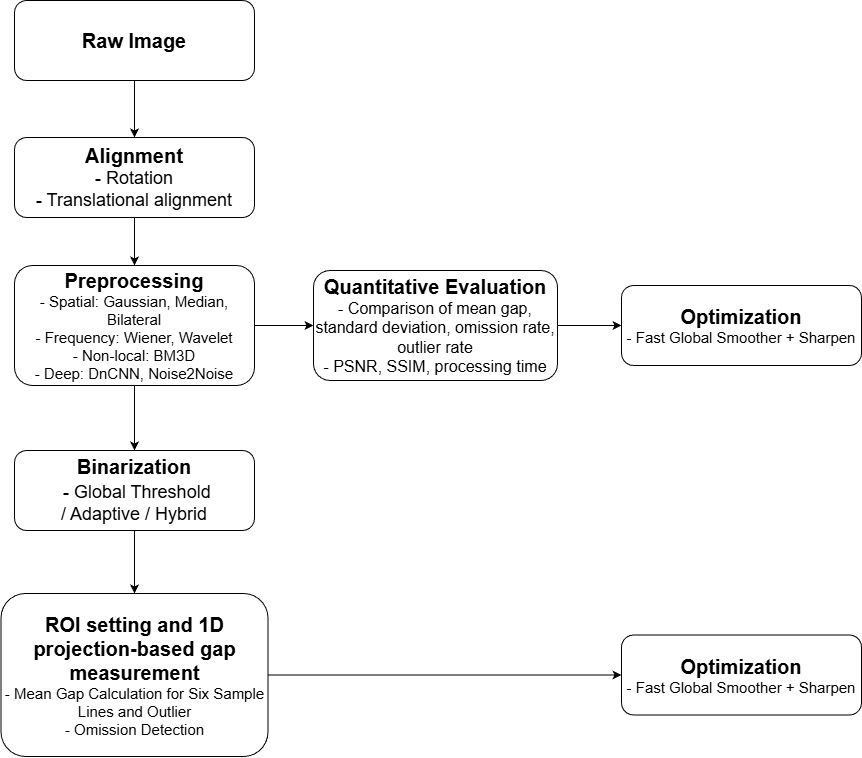
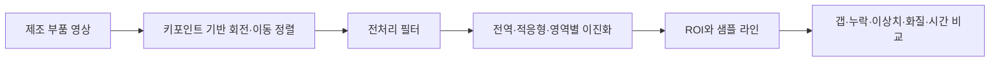

# Camera-Module-Gap-Detection-Project — LEVEL 1 - Beginner

**읽기 수준 선택** · **LEVEL 1 - Beginner** · [LEVEL 2 - Explorer](%EB%A0%88%EB%B2%A82.md) · [LEVEL 3 - Practitioner](%EB%A0%88%EB%B2%A83.md) · [LEVEL 4 - Advanced](%EB%A0%88%EB%B2%A84.md) · [LEVEL 5 - Expert](%EB%A0%88%EB%B2%A85.md)

[같은 수준 프로필](https://github.com/PUVKID/PUVKID/blob/main/docs/읽기안내/레벨1.md) · [저장소 첫 화면](../../README.md)

<a id="guide-intro"></a>

## 프로젝트 소개

**카메라 모듈 사진에서 부품 사이의 틈 길이를 재는 연구입니다.** 사진을 보기 좋게 만드는 일과 틈을 일정하게 재는 일은 다릅니다. **사진 정렬·잡음 제거·흑백 구분·길이 측정**을 연결해 비교합니다.

<a id="guide-problem"></a>

## 문제와 주요 기능

같은 틈도 사진이 기울거나 빛이 반사되면 다르게 보일 수 있습니다. 먼저 부품 위치를 맞추고 재야 할 부분만 골라 비교합니다. 평균 길이뿐 아니라 측정이 빠지거나 크게 벗어난 경우도 봅니다.

<a id="guide-flow"></a>

## 입력·처리·출력

사진의 두 기준점을 찾아 기울기를 맞춘 뒤 측정할 영역을 고릅니다. 그 안에서 여섯 줄을 따라 밝고 어두운 구간을 읽어 틈 길이를 구합니다. 이 순서가 달라지면 서로 다른 위치를 비교할 수 있습니다.

<a id="guide-practice"></a>

## 실험과 사용 흐름

PDF의 정렬 전후 그림을 먼저 보고, 같은 영역이 어떻게 흑백으로 바뀌는지 따라갑니다. 다음에 길이 편차와 누락 표를 확인합니다. 참고노트의 예시는 별도 영상·패키지가 필요하므로 책의 모든 코드를 한꺼번에 실행하는 자료는 아닙니다.

<a id="guide-results"></a>

## 관측 결과와 해석

틈의 평균이 비슷해도 어떤 사진에서 측정이 빠졌다면 좋은 방법이라고 단정할 수 없습니다. 흔들림과 누락·이상치를 함께 봅니다. 원고에는 서로 다른 장수와 시간 설명이 있으므로 한 숫자로 합치지 않습니다.

<a id="guide-architecture"></a>

## 구현과 핵심 파일

이 저장소에는 논문 PDF·편집 원본과 이진화 연구노트가 있습니다. 기준점, 측정 영역, 흑백 변환과 줄 단위 측정이 핵심 구성입니다. 그림이 있다고 해서 실제 검사 장비가 함께 제공되는 것은 아닙니다.

<a id="guide-paper"></a>

## 실제 논문과 원고

현재 최종 전체 원고는 12쪽 PDF와 같은 판의 HWPX로 읽습니다. 84쪽 이진화 노트와 21쪽 외부 논문은 공부할 때 함께 보는 자료입니다. 외부 논문은 이 프로젝트 저자의 새 성과가 아닙니다.

<a id="guide-limits"></a>

## 조건·실패·미검증 한계

빛과 위치가 다른 모든 공장 사진에서도 같은 기준이 잘 맞는지는 따로 확인해야 합니다. 임계값이나 5픽셀 기준을 어디서나 정답인 값으로 쓰지 않습니다. 원영상 전체와 장비는 공개 자료에 없습니다.

## 전체 차수

차수는 아래의 실제 자료 구분을 따릅니다. 설명은 현재 선택한 수준으로 열리며, 자료 폴더와 당시 전체 비교도 함께 확인할 수 있습니다.

| 내용 |
| --- |
| **차수·단계**<br>초기 원고 · 번호 없는 원본<br><br>**같은 수준 설명**<br>[LEVEL 1 - Beginner](../revisions/initial.md#reading-level-1)<br><br>**자료 폴더**<br>[자료](../../%EB%85%BC%EB%AC%B8)<br><br>**직전 비교·구성**<br>[전체 비교](../revision-diffs/initial.diff) |
| **차수·단계**<br>최종 원고 · HWP/PDF 단계<br><br>**같은 수준 설명**<br>[LEVEL 1 - Beginner](../revisions/final.md#reading-level-1)<br><br>**자료 폴더**<br>[자료](../../%EB%85%BC%EB%AC%B8)<br><br>**직전 비교·구성**<br>[전체 비교](../revision-diffs/final.diff) |
| **차수·단계**<br>사진 포함 최종 · HWPX 단계<br><br>**같은 수준 설명**<br>[LEVEL 1 - Beginner](../revisions/illustrated.md#reading-level-1)<br><br>**자료 폴더**<br>[자료](../../%EB%85%BC%EB%AC%B8)<br><br>**직전 비교·구성**<br>[전체 비교](../revision-diffs/illustrated.diff) |
| **차수·단계**<br>이진화 연구노트·외부 참고논문<br><br>**같은 수준 설명**<br>[LEVEL 1 - Beginner](../revisions/references.md#reading-level-1)<br><br>**자료 폴더**<br>[자료](../../%EC%B0%B8%EA%B3%A0%EC%9E%90%EB%A3%8C)<br><br>**직전 비교·구성**<br>[전체 비교](../revision-diffs/references.diff) |

## 첫 화면의 모든 설명과 공통 근거

아래는 기존 첫 화면의 실질 구성 전체입니다. 각 항목의 개념은 이 페이지의 풀이와 연결하고, 실제 표·코드·그림·상세 조건은 원문 공통 근거에서 확인합니다. 기존 전체 비교는 문장·주석·파일 단위의 작은 변화까지 보존하는 자료입니다.

| 내용 |
| --- |
| **첫 화면 구성**<br>연구 요약<br><br>**이 수준의 풀이**<br>[프로젝트 소개](#guide-intro)<br><br>**원문 공통 근거**<br>[전체 설명·표·그림](../../README.md#-%EC%97%B0%EA%B5%AC-%ED%95%B5%EC%8B%AC) |
| **첫 화면 구성**<br>입력·처리·출력<br><br>**이 수준의 풀이**<br>[입력·처리·출력](#guide-flow)<br><br>**원문 공통 근거**<br>[전체 설명·표·그림](../../README.md#-%EC%9E%85%EB%A0%A5%EC%B2%98%EB%A6%AC%EC%B6%9C%EB%A0%A5) |
| **첫 화면 구성**<br>논문과 최신 자료<br><br>**이 수준의 풀이**<br>[실제 논문과 원고](#guide-paper)<br><br>**원문 공통 근거**<br>[전체 설명·표·그림](../../README.md#-%EB%85%BC%EB%AC%B8%EA%B3%BC-%EC%B5%9C%EC%8B%A0-%EC%9E%90%EB%A3%8C) |
| **첫 화면 구성**<br>전체 차수<br><br>**이 수준의 풀이**<br>[문제와 주요 기능](#guide-problem)<br><br>**원문 공통 근거**<br>[전체 설명·표·그림](../../README.md#%EF%B8%8F-%EC%B0%A8%EC%88%98%EB%B3%84-%ED%94%84%EB%A1%9C%EC%A0%9D%ED%8A%B8-%EC%95%88%EB%82%B4) |
| **첫 화면 구성**<br>연구 방법<br><br>**이 수준의 풀이**<br>[부품 정렬에서 갭 길이까지](#semantic-alignment-level-1)<br><br>**원문 공통 근거**<br>[전체 설명·표·그림](../../README.md#-%ED%94%84%EB%A1%9C%EC%A0%9D%ED%8A%B8-%EC%86%8C%EA%B0%9C) |
| **첫 화면 구성**<br>저장소 구성<br><br>**이 수준의 풀이**<br>[구현과 핵심 파일](#guide-architecture)<br><br>**원문 공통 근거**<br>[전체 설명·표·그림](../../README.md#-%EC%A0%80%EC%9E%A5%EC%86%8C-%EA%B5%AC%EC%84%B1) |
| **첫 화면 구성**<br>갭 측정과 필터 비교<br><br>**이 수준의 풀이**<br>[5픽셀 규칙과 필터 후보 선택](#semantic-pixel-rules-level-1)<br><br>**원문 공통 근거**<br>[전체 설명·표·그림](../../README.md#-%EA%B0%AD-%EC%B8%A1%EC%A0%95%EA%B3%BC-%ED%95%84%ED%84%B0-%EB%B9%84%EA%B5%90) |
| **첫 화면 구성**<br>원고 읽기<br><br>**이 수준의 풀이**<br>[실제 논문과 원고](#guide-paper)<br><br>**원문 공통 근거**<br>[전체 설명·표·그림](../../README.md#-%EC%9B%90%EA%B3%A0-%EC%9D%BD%EA%B8%B0) |
| **첫 화면 구성**<br>자료 구성과 결과 해석<br><br>**이 수준의 풀이**<br>[관측 결과와 해석](#guide-results)<br><br>**원문 공통 근거**<br>[전체 설명·표·그림](../../README.md#-%EC%9E%90%EB%A3%8C-%EA%B5%AC%EC%84%B1%EA%B3%BC-%EA%B2%B0%EA%B3%BC-%ED%95%B4%EC%84%9D) |
| **첫 화면 구성**<br>문제 해결<br><br>**이 수준의 풀이**<br>[보고 지표와 처리시간의 범위](#semantic-measurements-level-1)<br><br>**원문 공통 근거**<br>[전체 설명·표·그림](../../README.md#-%EB%AC%B8%EC%A0%9C-%ED%95%B4%EA%B2%B0) |
| **첫 화면 구성**<br>최신 문서와 변경 이력<br><br>**이 수준의 풀이**<br>[실제 논문과 원고](#guide-paper)<br><br>**원문 공통 근거**<br>[전체 설명·표·그림](../../README.md#-%ED%98%84%EC%9E%AC-%EC%B2%A8%EB%B6%80-%EB%AC%B8%EC%84%9C) |
| **첫 화면 구성**<br>차수별 방법과 조건<br><br>**이 수준의 풀이**<br>[초기·최종·사진 포함 원고의 차이](#semantic-editions-level-1)<br><br>**원문 공통 근거**<br>[전체 설명·표·그림](../../README.md#-%EC%97%B0%EA%B5%AC%EA%B5%AC%ED%98%84%EC%9D%98-%EC%84%B8%EB%B6%80-%ED%9D%90%EB%A6%84) |

## 이어 읽기

같은 난이도로 다른 프로젝트를 찾으려면 [프로필의 LEVEL 1 - Beginner](https://github.com/PUVKID/PUVKID/blob/main/docs/읽기안내/레벨1.md)를 엽니다. 이 저장소 안에서는 위 전체 차수 표의 같은 수준 설명으로 이동하세요. 단계별 선택표에서 깊이를 바꿀 수 있으며, LEVEL 5 아래에는 기존 상세 전체가 보존되어 있습니다.

<!-- semantic-explanation17:start -->

## LEVEL 1 · 조건과 절차를 상세히 읽기

<a id="semantic-alignment-level-1"></a>

### LEVEL 1 · 부품 정렬에서 갭 길이까지

사진이 기울어 있으면 같은 위치의 틈도 다른 곳에서 재게 됩니다. **기준점 정렬→측정 영역 선택→흑백 변환→길이 읽기** 순서로 보세요. 좋은 화질과 정확한 길이는 같은 뜻이 아니므로 마지막에는 실제 측정의 흔들림을 확인합니다.

<a id="layout18-table-3-row-1"></a>

**left_top/right_top 키포인트**

**조건·자료**

left_top/right_top 키포인트

**의미와 확인 방법**

부품 위의 왼쪽·오른쪽 기준점 두 개를 찾아 회전과 이동을 보정합니다. 사진마다 부품이 기울거나 밀려도 같은 자리를 측정하려는 단계입니다.

<a id="layout18-table-3-row-2"></a>

**6개 ROI·샘플 X좌표**

**조건·자료**

6개 ROI·샘플 X좌표

**의미와 확인 방법**

ROI는 사진 전체 중 실제로 길이를 잴 작은 영역입니다. 원고는 6개 ROI와 ROI별 6개 샘플 X좌표를 설명합니다. 단순히 전체 사진에 줄 여섯 개를 긋는 것과 구분합니다.

<a id="layout18-table-3-row-3"></a>

**이진화·1D 투영·검정 연속 구간**

**조건·자료**

이진화·1D 투영·검정 연속 구간

**의미와 확인 방법**

밝기를 흰색/검정으로 나눈 뒤 지정 좌표에서 픽셀의 연속 구간을 읽어 갭 길이를 구합니다. 1D 투영은 영역 정보를 한 축으로 모아 경계를 살피는 방법입니다.

<a id="layout18-table-3-row-4"></a>

**공간·주파수·비국소 필터**

**조건·자료**

공간·주파수·비국소 필터

**의미와 확인 방법**

주변 픽셀, 주파수 성분, 닮은 무늬를 이용하는 필터군을 비교합니다. 반사·잡음·국부 밝기가 이진화 경계를 흐리는 문제를 다룹니다.


<a id="semantic-pixel-rules-level-1"></a>

### LEVEL 1 · 5픽셀 규칙과 필터 후보 선택

작은 검정 점은 잡음일 수 있고 하나의 틈이 중간에 끊겨 보일 수도 있습니다. **짧은 조각을 제외하는 규칙과 가까운 조각을 합치는 규칙**을 따로 읽으세요. 상단과 하단의 밝기가 달라 필터·기준값도 다르게 설정한 예가 있습니다.

<a id="layout18-table-4-row-1"></a>

**최소 5픽셀 그룹**

**조건·자료**

최소 5픽셀 그룹

**의미와 확인 방법**

검정 픽셀의 연속 길이가 최소 5픽셀인 그룹을 유효 후보로 보는 규칙입니다.

<a id="layout18-table-4-row-2"></a>

**5픽셀 이하 간격 병합**

**조건·자료**

5픽셀 이하 간격 병합

**의미와 확인 방법**

서로 떨어진 검정 그룹 사이 간격이 5픽셀 이하이면 합치는 별도 규칙입니다. 그룹 최소 길이와 그룹 사이 간격은 다른 값입니다.

<a id="layout18-table-4-row-3"></a>

**상단·하단의 다른 조건**

**조건·자료**

상단·하단의 다른 조건

**의미와 확인 방법**

상단은 Anisotropic 필터·임계값100, 하단은 Wiener 필터·임계값130 예시입니다. 임계값은 흑백을 나누는 밝기 기준이며 영역별로 다릅니다.

<a id="layout18-table-4-row-4"></a>

**순차 조합과 후보 정렬**

**조건·자료**

순차 조합과 후보 정렬

**의미와 확인 방법**

Fast Global Smoother+Sharpen, Bilateral+Sharpen, Median+Sharpen 등의 결과를 ROI 그룹의 평균 차이와 표준편차 합으로 정렬하고 상위 10% 필터군을 고릅니다.

<a id="layout18-table-4-row-5"></a>

**경험적 설정**

**조건·자료**

경험적 설정

**의미와 확인 방법**

5픽셀은 초기 배치 실험에서 정한 값입니다. 통계적으로 모든 환경에서 최적인 값이 아니며 환경별 적응·최적화는 후속 과제입니다.


<a id="semantic-measurements-level-1"></a>

### LEVEL 1 · 보고 지표와 처리시간의 범위

흐림이 줄어 사진이 보기 좋아지는 것과 틈 길이가 안정적으로 나오는 것은 다릅니다. **화질·측정 실패·시간을 따로 확인**하세요. 아래 수치는 원고가 보고한 값이며 이번 안내에서 새로 측정한 성능이 아닙니다.

<a id="layout18-table-5-row-1"></a>

**초록의 갭 편차 28.6% 감소**

**조건·자료**

초록의 갭 편차 28.6% 감소

**의미와 확인 방법**

길이 측정의 편차가 줄었다는 원고 보고입니다. 검사 정확도 28.6%나 모든 샘플의 개선율이 아닙니다.

<a id="layout18-table-5-row-2"></a>

**누락률 3.9→1.2%·이상치율 6.8→2.5%**

**조건·자료**

누락률 3.9→1.2%·이상치율 6.8→2.5%

**의미와 확인 방법**

누락은 측정을 얻지 못한 비율, 이상치는 비정상 측정 비율입니다. 두 실패를 서로 바꾸어 부르지 않습니다.

<a id="layout18-table-5-row-3"></a>

**PSNR 35.2dB·SSIM 0.94**

**조건·자료**

PSNR 35.2dB·SSIM 0.94

**의미와 확인 방법**

영상의 유사도/화질을 보는 원고 보고값입니다. 갭 편차·누락률·이상치율처럼 측정 안정성을 직접 평가하는 지표와 구분합니다.

<a id="layout18-table-5-row-4"></a>

**0.1266 s/image**

**조건·자료**

0.1266 s/image

**의미와 확인 방법**

한 영상의 필터 처리시간입니다. 카메라 입출력·장비 이동 등을 합친 생산라인 전체 지연이 아닙니다.

<a id="layout18-table-5-row-5"></a>

**원문 내 일관성 한계**

**조건·자료**

원문 내 일관성 한계

**의미와 확인 방법**

546장과 약1,000장 서술, Fast Global Smoother가 비용상 가장 우수/가장 느린 조합이라는 상충, 누락률 그림/설명과 시간축/초 단위 차이가 있습니다.


<a id="semantic-editions-level-1"></a>

### LEVEL 1 · 초기·최종·사진 포함 원고의 차이

같은 연구에도 편집본과 읽기용 PDF가 있습니다. **이름에 최종이라고 적혀 있어도 내용이 같은지는 따로 확인**해야 합니다. 현재12쪽 PDF가 맞춰졌다는 사실로 과거 파일의 사사 차이를 지우지 않습니다.

<a id="layout18-table-6-row-1"></a>

**초기 원고**

**조건·자료**

초기 원고

**의미와 확인 방법**

정렬·필터·이진화·갭 측정 설계를 읽는 단계입니다. 뒤 판본의 편집 내용을 초기 판본의 성과로 소급하지 않습니다.

<a id="layout18-table-6-row-2"></a>

**최종 HWP 단계**

**조건·자료**

최종 HWP 단계

**의미와 확인 방법**

사사 자리표시자를 IITP-2024-00436954와 경기대학교 컴퓨터과학연구소 지원 문구로 바꾼 차이가 있습니다. 당시 함께 저장된 초기/최종 PDF 추출 본문은 같고 초기 사사가 남아 있었습니다.

<a id="layout18-table-6-row-3"></a>

**현재 사진 포함 최종**

**조건·자료**

현재 사진 포함 최종

**의미와 확인 방법**

사진·본문·소속·사사를 포함한 HWPX와 같은 판의 12쪽 PDF입니다. 현재의 판본 일치와 과거 HWP/PDF 차이는 서로 다른 시점의 사실입니다.

<a id="layout18-table-6-row-4"></a>

**확인 순서**

**조건·자료**

확인 순서

**의미와 확인 방법**

바로 읽을 때 PDF, 편집 원문이 필요할 때 HWPX를 봅니다. 파일명만으로 같은 판이라 단정하지 말고 본문·그림·사사와 해당 단계 전체 비교를 대조합니다.


<a id="semantic-references-level-1"></a>

### LEVEL 1 · 연구노트와 외부 논문의 역할

노트는 여러 흑백 변환 방법을 배우는 자료이고 외부 논문은 다른 저자의 연구입니다. **참고 자료가 있다고 검사 앱이 완성된 것은 아닙니다.** 원고에서 어려운 임계값·필터·투영 용어를 찾아 노트와 비교해 보세요.

<a id="layout18-table-7-row-1"></a>

**84쪽 Binarization 연구노트**

**조건·자료**

84쪽 Binarization 연구노트

**의미와 확인 방법**

전역 임계값·Otsu·적응형·반전·삼진화, 공간/주파수/BM3D 필터와 흰 픽셀의 1D 투영을 모은 개념·Python 예시 자료입니다. 하나의 완성된 장비 실행 프로젝트가 아닙니다.

<a id="layout18-table-7-row-2"></a>

**21쪽 외부 참고논문**

**조건·자료**

21쪽 외부 참고논문

**의미와 확인 방법**

외부 저자의 Electronics 논문 DOI 10.3390/electronics14173455입니다. 원저자 표시와 CC BY4.0 라이선스를 유지하며 이 저장소 저자의 새 연구 실적으로 합치지 않습니다.

<a id="layout18-table-7-row-3"></a>

**원고와 노트의 연결**

**조건·자료**

원고와 노트의 연결

**의미와 확인 방법**

연구노트는 임계값 선택·필터·투영 개념을 이해하는 보조 자료입니다. 노트의 흰 픽셀 투영 설명과 갭 원고의 검정 연속구간 측정을 같은 구현이라고 단정하지 않습니다.


<!-- semantic-explanation17:end -->

<!-- complete-source-facts17:start -->

## 첫 화면의 세부 사실을 빠짐없이 읽기

위의 수준별 풀이에 대응하는 실제 세부 사실입니다. 입력·조건·수치·표·그림·문서 판본과 작은 변경까지 같은 페이지에서 확인하도록 기존 첫 화면의 내용을 함께 수록했습니다. 각 절은 해당 수준의 앞선 설명과 연결해 읽으며, 원래 실행 코드·전체 비교·원고는 원문 주소로 이어집니다.

<a id="facts-section-0"></a>

### LEVEL 1 · 첫 화면 기본 정보


영상 정렬과 영역별 필터로 카메라 모듈의 틈 위치와 길이를 측정하는 연구입니다.

분야: 컴퓨터 비전 › 기하 정렬·영상 처리 › ROI·이진화·1차원 갭 측정

`논문·연구 자료` `Document`

[원고 읽기](../../README.md#quick-start) · [저장소 구성](../../README.md#structure) · [자료·설정](../../README.md#data)

[핵심 구성](../../README.md#input-processing-output)

<details>
<summary>원고 제목</summary>

Gap Detection for Compact Camera Modules Based on Dynamic ROI Alignment and Optimized Image Binarization

</details>

[PDF로 읽기](../../%EB%85%BC%EB%AC%B8/%EC%B5%9C%EC%A2%85_%EB%85%BC%EB%AC%B8.pdf) · [최신 편집 원문](../../%EB%85%BC%EB%AC%B8/%EC%B5%9C%EC%A2%85_%EB%85%BC%EB%AC%B8.hwpx)


<a id="facts-section-1"></a>

### LEVEL 1 · 연구 요약


정렬·전처리·이진화와 ROI 측정으로 카메라 모듈 갭을 비교하는 원고입니다.

5픽셀 기준은 초기 배치 실험에서 정한 경험적 설정입니다. 환경별 적응 기준의 검증은 후속 과제입니다.

- 관심영역과 측정선을 이용한 갭 측정에서 화질 지표와 실제 갭 오차의 역할을 구분합니다.
- 초기 배치에서 5픽셀 기준을 적용했습니다. 필터 처리시간을 비교하며, 생산라인 전체 지연 평가와 학습 기반 방식은 후속 과제로 남습니다.

**자료별 안내:** [최종 원고](../../docs/versions/final-paper.md) · [전체 기록](../../docs/VERSIONS.md)




**논문 그림** — 공개 HWPX 원고의 처리 흐름도: 정렬·전처리·이진화·ROI 기반 갭 측정 과정입니다.

[최신 편집 원문](../../%EB%85%BC%EB%AC%B8/%EC%B5%9C%EC%A2%85_%EB%85%BC%EB%AC%B8.hwpx)


<a id="facts-section-2"></a>

### LEVEL 1 · 입력·처리·출력


**구분**

문제

**내용**

촬영 위치와 밝기가 달라져도 부품의 틈을 측정할 수 있도록 정렬·이진화 방법을 비교합니다.


**구분**

입력

**내용**

카메라 모듈 검사 영상


**구분**

처리

**내용**

기준 위치 검출·ROI 정렬, 영역별 필터·임계값, 주사선 길이 측정


**구분**

출력

**내용**

갭 위치·길이와 검사 지표


---


<a id="facts-section-3"></a>

### LEVEL 1 · 논문과 최신 자료


| 내용 |
| --- |
| **자료**<br>사진 포함 최종 논문 · 갭 검출<br><br>**원문 파일**<br>[PDF 다운로드](../../%EB%85%BC%EB%AC%B8/%EC%B5%9C%EC%A2%85_%EB%85%BC%EB%AC%B8.pdf) |
| **자료**<br>사진 포함 최종 논문 · 갭 검출<br><br>**원문 파일**<br>[HWPX 다운로드](../../%EB%85%BC%EB%AC%B8/%EC%B5%9C%EC%A2%85_%EB%85%BC%EB%AC%B8.hwpx) |
| **자료**<br>이진화·필터·ROI 연구노트<br><br>**원문 파일**<br>[PDF 다운로드](../../%EC%B0%B8%EA%B3%A0%EC%9E%90%EB%A3%8C/Binarization_%EC%97%B0%EA%B5%AC%EB%85%B8%ED%8A%B8.pdf) |
| **자료**<br>외부 참고논문 · Electronics<br><br>**원문 파일**<br>[PDF 다운로드](../../%EC%B0%B8%EA%B3%A0%EC%9E%90%EB%A3%8C/electronics-14-03455.pdf) |

[자료별 설명](../../docs/PAPERS.md) · [코드 차수와 변경 이력](../../docs/REVISION_INDEX.md)


<a id="facts-section-4"></a>

### LEVEL 1 · 전체 차수


| 내용 |
| --- |
| **차수·단계**<br>[초기 원고 · 번호 없는 원본](../../docs/revisions/initial.md#reading-level-1)<br><br>**주요 내용**<br>필터·이진화 품질을 동적 ROI 정렬과 갭 길이 측정으로 연결한 초기 원고 단계입니다.<br><br>**자료**<br>[폴더](../../%EB%85%BC%EB%AC%B8)<br><br>**직전 비교**<br>[전체 비교](../../docs/revision-diffs/initial.diff) |
| **차수·단계**<br>[최종 원고 · HWP/PDF 단계](../../docs/revisions/final.md#reading-level-1)<br><br>**주요 내용**<br>초기 설계를 유지하면서 최종 HWP의 사사·지원 문구 등을 정리한 원고 단계입니다.<br><br>**자료**<br>[폴더](../../%EB%85%BC%EB%AC%B8)<br><br>**직전 비교**<br>[전체 비교](../../docs/revision-diffs/final.diff) |
| **차수·단계**<br>[사진 포함 최종 · HWPX 단계](../../docs/revisions/illustrated.md#reading-level-1)<br><br>**주요 내용**<br>[상세 설명](#layout18-table-10-row-3-field-1)<br><br>**자료**<br>[폴더](../../%EB%85%BC%EB%AC%B8)<br><br>**직전 비교**<br>[전체 비교](../../docs/revision-diffs/illustrated.diff) |
| **차수·단계**<br>[이진화 연구노트·외부 참고논문](../../docs/revisions/references.md#reading-level-1)<br><br>**주요 내용**<br>[상세 설명](#layout18-table-10-row-4-field-1)<br><br>**자료**<br>[폴더](../../%EC%B0%B8%EA%B3%A0%EC%9E%90%EB%A3%8C)<br><br>**직전 비교**<br>[전체 비교](../../docs/revision-diffs/references.diff) |

<a id="layout18-table-10-row-3-field-1"></a>

**[사진 포함 최종 · HWPX 단계](../../docs/revisions/illustrated.md#reading-level-1)**

**주요 내용**

사진·본문·소속·사사를 포함한 최종 HWPX와 같은 판의 12쪽 PDF로 갭 검출 연구를 읽는 단계입니다.

<a id="layout18-table-10-row-4-field-1"></a>

**[이진화 연구노트·외부 참고논문](../../docs/revisions/references.md#reading-level-1)**

**주요 내용**

84쪽 Binarization 연구노트는 임계값·필터·ROI·프로젝션 관련 개념과 Python 예시를 모은 자료입니다.21쪽 Electronics 논문은 외부 저자의 연구 참고문헌입니다.


<a id="facts-section-5"></a>

### LEVEL 1 · 연구 방법


저자: **곽윤석 · 김남기**

동적 ROI 정렬과 이진화 기반 갭 측정을 다룬 연구 원고입니다.

**항목**

동적 정렬

**원고에서 다루는 내용**

YOLO 키포인트의 left_top/right_top으로 회전·이동을 보정합니다.


**항목**

갭 측정

**원고에서 다루는 내용**

6개 ROI 안의 샘플 라인에서 검정 픽셀 연속 구간을 분석합니다.


**항목**

필터 비교

**원고에서 다루는 내용**

공간·주파수·비국소 필터와 순차 조합을 비교합니다.


**항목**

품질·비용 분석

**원고에서 다루는 내용**

갭 편차·누락률·이상치율·PSNR·SSIM·처리시간을 설명합니다.





<a id="facts-section-6"></a>

### LEVEL 1 · 저장소 구성


```text
.
├── README.md
├── CHANGELOG.md
└── 논문/
    ├── 최종_논문.pdf
    └── 최종_논문.hwpx
```

- [최신 편집 원문](../../%EB%85%BC%EB%AC%B8/%EC%B5%9C%EC%A2%85_%EB%85%BC%EB%AC%B8.hwpx)


<a id="facts-section-7"></a>

### LEVEL 1 · 갭 측정과 필터 비교


원고는 ROI별 6개 샘플 X좌표, 최소 5픽셀의 검정 그룹, 5픽셀 이하 간격의 그룹 병합 규칙을 설명합니다. 상단에는 Anisotropic 필터와 임계값 100, 하단에는 Wiener 필터와 임계값 130을 적용하는 예도 제시합니다.

5픽셀 기준은 초기 배치 실험에서 정한 경험적 설정입니다. 통계적 최적화나 환경별 적응 기준의 검증은 후속 과제로 남아 있으므로, 모든 제조 환경에 통용되는 기준으로 사용하지 않습니다.

Fast Global Smoother+Sharpen, Bilateral+Sharpen, Median+Sharpen 등 조합의 측정 안정성과 연산 비용을 비교합니다. ROI 그룹의 평균 차이와 표준편차 합으로 후보를 정렬하고 상위 10% 필터군을 고르는 절차도 설명합니다.

PSNR·SSIM은 화질 유사도, 갭 편차·누락률·이상치율은 측정 안정성을 보는 지표이므로 서로 대신하지 않습니다. 학습 기반 denoiser는 비교 대상으로 서술한 부분과 향후 연구로 남긴 부분이 있어 실제 수행 범위를 구분해야 합니다.


<a id="facts-section-8"></a>

### LEVEL 1 · 원고 읽기


1. 위의 최종 원고 링크를 엽니다.
2. 서론의 연구 질문과 방법을 먼저 읽습니다.
3. 결과표와 함께 한계·후속 연구를 확인합니다.

동적 ROI 정렬과 이진화를 활용한 카메라 모듈 갭 측정 방법을 담은 연구 논문을 수록했습니다.


<a id="facts-section-9"></a>

### LEVEL 1 · 자료 구성과 결과 해석


PDF와 HWPX 원고에 제조 부품 영상, 이진화 결과, 처리 흐름도와 연구 도표를 수록했습니다. 제조 원데이터는 별도로 관리합니다.


#### LEVEL 1 · 원고가 보고한 결과와 한계

원고 초록은 갭 편차 28.6% 감소, 누락률 3.9→1.2%, 이상치율 6.8→2.5%, PSNR 35.2dB·SSIM 0.94를 보고합니다.

본문에는 546장과 약 1,000장 실험이 함께 서술되어 있습니다. Fast Global Smoother의 처리 비용을 가장 우수하다고 설명한 문장과 가장 느린 조합이라고 설명한 문장이 병존하며, 누락률 도표와 설명에도 차이가 있습니다. 실험 조건과 수치의 일관성은 추가 정리가 필요한 부분입니다.

0.1266 s/image는 필터 처리시간이며, 장비 입출력을 포함한 생산라인 전체 지연은 별도 평가가 필요합니다.


<a id="facts-section-10"></a>

### LEVEL 1 · 문제 해결


**상황**

원고를 바로 읽고 싶습니다.

**확인할 내용**

상단의 PDF 링크로 본문과 도표를 볼 수 있습니다.


**상황**

편집 가능한 원고가 필요합니다.

**확인할 내용**

같은 논문의 HWPX 원본을 함께 제공합니다.


**상황**

처리시간 단위가 혼동됩니다.

**확인할 내용**

일부 그래프 축 숫자와 본문의 초 단위가 달라 원고의 위치를 함께 확인해야 합니다.


<a id="facts-section-11"></a>

### LEVEL 1 · 최신 문서와 변경 이력


현재 제공하는 원문과 직전 공개본의 비교입니다. 이전 원고·발표와 코드는 전체 차수 표에서 확인할 수 있습니다.

| 내용 |
| --- |
| **문서**<br>사진 포함 최종 논문 · 갭 검출<br><br>**자료 폴더**<br>[폴더](../../%EB%85%BC%EB%AC%B8)<br><br>**상세**<br>[설명](../../docs/latest/camera-gap-binarization.md)<br><br>**직전 공개본 전체 비교**<br>[전체 비교](../../docs/changes/2026-11-02-%EC%B5%9C%EC%8B%A0%EB%AC%B8%EC%84%9C-%EC%A0%84%EC%B2%B4%EB%B9%84%EA%B5%90.md) |
| **문서**<br>이진화·필터·ROI 연구노트<br><br>**자료 폴더**<br>[폴더](../../%EC%B0%B8%EA%B3%A0%EC%9E%90%EB%A3%8C)<br><br>**상세**<br>[설명](../../docs/latest/binarization-research-notes.md)<br><br>**직전 공개본 전체 비교**<br>[전체 비교](../../docs/changes/2026-11-02-%EC%B5%9C%EC%8B%A0%EB%AC%B8%EC%84%9C-%EC%A0%84%EC%B2%B4%EB%B9%84%EA%B5%90.md) |
| **문서**<br>외부 참고논문 · Electronics<br><br>**자료 폴더**<br>[폴더](../../%EC%B0%B8%EA%B3%A0%EC%9E%90%EB%A3%8C)<br><br>**상세**<br>[설명](../../docs/latest/external-electronics-reference.md)<br><br>**직전 공개본 전체 비교**<br>[전체 비교](../../docs/changes/2026-11-02-%EC%B5%9C%EC%8B%A0%EB%AC%B8%EC%84%9C-%EC%A0%84%EC%B2%B4%EB%B9%84%EA%B5%90.md) |

[최신 문서 구성 변경](../../docs/changes/2026-11-02-%EC%B5%9C%EC%8B%A0%EB%AC%B8%EC%84%9C.md)


<a id="facts-section-12"></a>

### LEVEL 1 · 차수별 방법과 조건


차수별 입력, 처리 방법, 실행 조건과 결과를 정리했습니다.


<details>
<summary>초기 원고 · 이진화와 갭 측정의 연결</summary>

#### LEVEL 1 · 초기 원고 · 이진화와 갭 측정의 연결

필터·이진화 품질을 동적 ROI 정렬과 갭 길이 측정으로 연결한 초기 원고 단계입니다.

**구성**

초기 설계

**처리 내용**

반사 노이즈와 국부 밝기 변화가 측정에 미치는 영향을 함께 다룹니다.


**구성**

초기 서술의 범위

**처리 내용**

데이터 장수·처리시간·필터 표현의 원고 내부 차이는 이후 단계 값으로 소급해서 바꾸지 않습니다.


**구성**

동적 정렬

**처리 내용**

YOLO 키포인트의 left_top·right_top을 기준으로 회전·위치를 맞춥니다.


**구성**

전처리 비교

**처리 내용**

공간·주파수·비국소 필터와 순차 조합이 이진화에 미치는 영향을 설명합니다.


**구성**

갭 측정

**처리 내용**

ROI의 6개 샘플라인과 1D 투영을 이용해 길이를 산출합니다.


**구성**

평가 지표

**처리 내용**

평균·표준편차·누락률·이상치율과 PSNR·SSIM·처리시간을 구분합니다.


**입력·실행 조건**

자료

**내용**

원고 PDF와 같은 판의 HWPX


**입력·실행 조건**

측정

**내용**

동적 ROI와 6개 샘플라인


**입력·실행 조건**

비교 대상

**내용**

전처리 필터·이진화·순차 조합


**입력·실행 조건**

입력 준비

**내용**

제조 영상과 정렬·임계값 조건은 별도 실험 환경에서 준비


갭 평균만으로 조건을 고르지 않고 표준편차·누락률·이상치율을 함께 읽습니다. PSNR·SSIM이 높아도 갭 경계를 더 안정적으로 찾는지는 측정 결과로 따로 확인합니다.

원고의 장수·시간·필터 서술에는 내부 차이가 있습니다. 이 차이는 원고를 읽는 제약으로 설명하고 숫자를 새 측정값으로 정정하지 않았습니다.

**제약**

자료 수 표기

**확인할 내용**

초록의 약 1000장과 본문의 546장 등 내부 표기를 위치별로 확인합니다.


**제약**

시간 비교

**확인할 내용**

일부 그래프 축과 본문의 초 단위가 달라 해당 그림·문단을 함께 읽습니다.


**제약**

재현 준비

**확인할 내용**

공개 자료는 연구 원고와 그림입니다. 제조 원영상 전체·실행 가중치·장비 설정은 별도로 필요합니다.


[파일 구성·핵심 정의·사용 순서](../../docs/revisions/initial.md#reading-level-1) · [이 단계 전체 비교](../../docs/revision-diffs/initial.diff)


</details>

<details>
<summary>최종 HWP 단계 · 사사와 원고 표현 정리</summary>

#### LEVEL 1 · 최종 HWP 단계 · 사사와 원고 표현 정리

초기 설계를 유지하면서 최종 HWP의 사사·지원 문구 등을 정리한 원고 단계입니다.

<a id="layout18-table-17-row-1"></a>

**지원 문구 개정**

**구성**

지원 문구 개정

**처리 내용**

HWP의 사사 자리표시자를 IITP-2024-00436954와 경기대학교 컴퓨터과학연구소 지원 문구로 바꾼 차이가 있습니다.

<a id="layout18-table-17-row-2"></a>

**편집본과 PDF 구분**

**구성**

편집본과 PDF 구분

**처리 내용**

당시 함께 저장된 초기·최종 PDF의 추출 본문은 같았고 초기 사사 자리표시자가 남았습니다. 파일명만으로 HWP와 같은 판이라고 결론내리지 않습니다.

<a id="layout18-table-17-row-3"></a>

**동적 정렬**

**구성**

동적 정렬

**처리 내용**

YOLO 키포인트의 left_top·right_top을 기준으로 회전·위치를 맞춥니다.

<a id="layout18-table-17-row-4"></a>

**전처리 비교**

**구성**

전처리 비교

**처리 내용**

공간·주파수·비국소 필터와 순차 조합이 이진화에 미치는 영향을 설명합니다.

<a id="layout18-table-17-row-5"></a>

**갭 측정**

**구성**

갭 측정

**처리 내용**

ROI의 6개 샘플라인과 1D 투영을 이용해 길이를 산출합니다.

<a id="layout18-table-17-row-6"></a>

**평가 지표**

**구성**

평가 지표

**처리 내용**

평균·표준편차·누락률·이상치율과 PSNR·SSIM·처리시간을 구분합니다.


**입력·실행 조건**

자료

**내용**

원고 PDF와 같은 판의 HWPX


**입력·실행 조건**

측정

**내용**

동적 ROI와 6개 샘플라인


**입력·실행 조건**

비교 대상

**내용**

전처리 필터·이진화·순차 조합


**입력·실행 조건**

입력 준비

**내용**

제조 영상과 정렬·임계값 조건은 별도 실험 환경에서 준비


갭 평균만으로 조건을 고르지 않고 표준편차·누락률·이상치율을 함께 읽습니다. PSNR·SSIM이 높아도 갭 경계를 더 안정적으로 찾는지는 측정 결과로 따로 확인합니다.

원고의 장수·시간·필터 서술에는 내부 차이가 있습니다. 이 차이는 원고를 읽는 제약으로 설명하고 숫자를 새 측정값으로 정정하지 않았습니다.

**제약**

자료 수 표기

**확인할 내용**

초록의 약 1000장과 본문의 546장 등 내부 표기를 위치별로 확인합니다.


**제약**

시간 비교

**확인할 내용**

일부 그래프 축과 본문의 초 단위가 달라 해당 그림·문단을 함께 읽습니다.


**제약**

재현 준비

**확인할 내용**

공개 자료는 연구 원고와 그림입니다. 제조 원영상 전체·실행 가중치·장비 설정은 별도로 필요합니다.


[파일 구성·핵심 정의·사용 순서](../../docs/revisions/final.md#reading-level-1) · [이 단계 전체 비교](../../docs/revision-diffs/final.diff)


</details>

<details>
<summary>사진 포함 최종 · 정렬부터 측정까지 읽는 원고</summary>

#### LEVEL 1 · 사진 포함 최종 · 정렬부터 측정까지 읽는 원고

사진·본문·소속·사사를 포함한 최종 HWPX와 같은 판의 12쪽 PDF로 갭 검출 연구를 읽는 단계입니다.

<a id="layout18-table-20-row-1"></a>

**삽입 연구 그림**

**구성**

삽입 연구 그림

**처리 내용**

정렬·ROI·필터·이진화의 차이를 사진과 도표로 확인합니다.

<a id="layout18-table-20-row-2"></a>

**최종 원문**

**구성**

최종 원문

**처리 내용**

편집 원본과 PDF의 본문·그림을 같은 연구 단계로 연결하고 저자·소속·사사를 원문 그대로 제공합니다.

<a id="layout18-table-20-row-3"></a>

**동적 정렬**

**구성**

동적 정렬

**처리 내용**

YOLO 키포인트의 left_top·right_top을 기준으로 회전·위치를 맞춥니다.

<a id="layout18-table-20-row-4"></a>

**전처리 비교**

**구성**

전처리 비교

**처리 내용**

공간·주파수·비국소 필터와 순차 조합이 이진화에 미치는 영향을 설명합니다.

<a id="layout18-table-20-row-5"></a>

**갭 측정**

**구성**

갭 측정

**처리 내용**

ROI의 6개 샘플라인과 1D 투영을 이용해 길이를 산출합니다.

<a id="layout18-table-20-row-6"></a>

**평가 지표**

**구성**

평가 지표

**처리 내용**

평균·표준편차·누락률·이상치율과 PSNR·SSIM·처리시간을 구분합니다.


**입력·실행 조건**

자료

**내용**

원고 PDF와 같은 판의 HWPX


**입력·실행 조건**

측정

**내용**

동적 ROI와 6개 샘플라인


**입력·실행 조건**

비교 대상

**내용**

전처리 필터·이진화·순차 조합


**입력·실행 조건**

입력 준비

**내용**

제조 영상과 정렬·임계값 조건은 별도 실험 환경에서 준비


갭 평균만으로 조건을 고르지 않고 표준편차·누락률·이상치율을 함께 읽습니다. PSNR·SSIM이 높아도 갭 경계를 더 안정적으로 찾는지는 측정 결과로 따로 확인합니다.

원고의 장수·시간·필터 서술에는 내부 차이가 있습니다. 이 차이는 원고를 읽는 제약으로 설명하고 숫자를 새 측정값으로 정정하지 않았습니다.

**제약**

자료 수 표기

**확인할 내용**

초록의 약 1000장과 본문의 546장 등 내부 표기를 위치별로 확인합니다.


**제약**

시간 비교

**확인할 내용**

일부 그래프 축과 본문의 초 단위가 달라 해당 그림·문단을 함께 읽습니다.


**제약**

재현 준비

**확인할 내용**

공개 자료는 연구 원고와 그림입니다. 제조 원영상 전체·실행 가중치·장비 설정은 별도로 필요합니다.


[파일 구성·핵심 정의·사용 순서](../../docs/revisions/illustrated.md#reading-level-1) · [이 단계 전체 비교](../../docs/revision-diffs/illustrated.diff)


</details>

<details>
<summary>참고자료 · 이진화 연구노트와 외부 논문</summary>

#### LEVEL 1 · 참고자료 · 이진화 연구노트와 외부 논문

84쪽 Binarization 연구노트는 임계값·필터·ROI·프로젝션 관련 개념과 Python 예시를 모은 자료입니다.

21쪽 Electronics 논문은 외부 저자의 연구 참고문헌입니다.

<a id="layout18-table-23-row-1"></a>

**이진화 종류**

**구성**

이진화 종류

**처리 내용**

전역 임계값·Otsu·적응형·반전·삼진화 등 방법을 비교합니다.

<a id="layout18-table-23-row-2"></a>

**필터와 ROI**

**구성**

필터와 ROI

**처리 내용**

공간·주파수·BM3D 등 필터와 ROI 내 흰 픽셀의 1D 투영 예시를 읽습니다.

<a id="layout18-table-23-row-3"></a>

**외부 연구**

**구성**

외부 연구

**처리 내용**

스마트폰 소형 모듈의 구조 결함을 실시간·노이즈 강건 방식으로 분류한 비지도 연구를 참고합니다.

<a id="layout18-table-23-row-4"></a>

**출처 보존**

**구성**

출처 보존

**처리 내용**

외부 논문의 DOI10.3390/electronics14173455와 CC BY4.0·원저자 표기를 유지합니다.


**입력·실행 조건**

연구노트

**내용**

84쪽 PDF·첫 기록 2025-02-18


**입력·실행 조건**

외부 논문

**내용**

Electronics2025,14,3455·21쪽


**입력·실행 조건**

이용 조건

**내용**

외부 논문 원문의 CC BY4.0와 출처 확인


노트는 개념·코드 예시의 모음이며 하나의 실행 가능한 실험 프로젝트나 새 논문 성과로 세지 않습니다.

외부 논문은 Sehun Lee·Taehoon Kim·Sookyun Kim·Junho Ahn·Namgi Kim의 연구입니다. 예시·인용에는 원저자와 출처를 함께 표시합니다.

**제약**

코드 예시

**확인할 내용**

한 PDF의 여러 예시를 설정 확인 없이 연속 실행하는 구성으로 보지 않습니다.


**제약**

실적 구분

**확인할 내용**

외부 논문을 이 프로젝트 저자의 연구 실적으로 합치지 않습니다.


**제약**

입력 영상

**확인할 내용**

제조 원영상 전체를 제공하는 자료가 아닙니다.


[파일 구성·핵심 정의·사용 순서](../../docs/revisions/references.md#reading-level-1) · [이 단계 전체 비교](../../docs/revision-diffs/references.diff)

[차수별 안내 변경](../../docs/changes/2026-11-03-%EC%B0%A8%EC%88%98%EB%B3%84%ED%94%84%EB%A1%9C%EC%A0%9D%ED%8A%B8%EC%95%88%EB%82%B4.md)

</details>


<!-- complete-source-facts17:end -->
