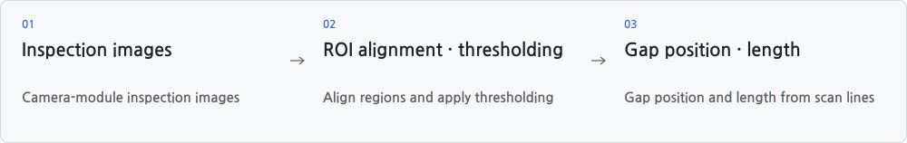
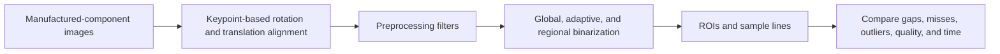

<a name="카메라-모듈-갭-검출"></a>
<a name="동적-roi-정렬과-이진화-기반-카메라-모듈-갭-검출"></a>
<a name="gap-detection-for-compact-camera-modules-based-on-dynamic-roi-alignment-and-optimized-image-binarization"></a>

<a id="-camera-module-gap-project"></a>

<!-- readme-header32:start -->
<a name="camera-module-gap-project"></a>
<p align="center"></p>
<h1 align="center" id="project-title">Camera Module Gap Project</h1>
<p align="center">Finding gaps in inspection images</p>
<p align="center">
  <a href="../README.md"></a>
  <a href="README.md"></a>
</p>
<p align="center">
  <a href="../docs/%EC%9D%BD%EA%B8%B0%EC%95%88%EB%82%B4/%EB%A0%88%EB%B2%A81.md"></a>
  <a href="../docs/%EC%9D%BD%EA%B8%B0%EC%95%88%EB%82%B4/%EB%A0%88%EB%B2%A82.md"></a>
  <a href="../docs/%EC%9D%BD%EA%B8%B0%EC%95%88%EB%82%B4/%EB%A0%88%EB%B2%A83.md"></a>
  <a href="../docs/%EC%9D%BD%EA%B8%B0%EC%95%88%EB%82%B4/%EB%A0%88%EB%B2%A84.md"></a>
  <a href="../docs/%EC%9D%BD%EA%B8%B0%EC%95%88%EB%82%B4/%EB%A0%88%EB%B2%A85.md"></a>
</p>
<p align="center"><small>LEVEL links open the Korean source at the same reading level.</small></p>
<picture>
  <source media="(max-width: 600px) and (prefers-color-scheme: dark)" srcset="../assets/readme/flow-en-dark-mobile.svg" />
  <source media="(max-width: 600px)" srcset="../assets/readme/flow-en-light-mobile.svg" />
  <source media="(prefers-color-scheme: dark)" srcset="../assets/readme/flow-en-dark.svg" />
  <source media="(prefers-color-scheme: light)" srcset="../assets/readme/flow-en-light.svg" />
  
</picture>
<!-- readme-header32:end -->


This study measures the location and length of gaps in camera modules using image alignment and region-specific filters.

<!-- reading-levels17:start -->
| Reading level | What the guide covers |
| --- | --- |
| [LEVEL 1 - Beginner (Korean source)](../docs/%EC%9D%BD%EA%B8%B0%EC%95%88%EB%82%B4/%EB%A0%88%EB%B2%A81.md) | Unfamiliar terms and concrete examples from input to result |
| [LEVEL 2 - Explorer (Korean source)](../docs/%EC%9D%BD%EA%B8%B0%EC%95%88%EB%82%B4/%EB%A0%88%EB%B2%A82.md) | The relationships between key concepts and processing steps |
| [LEVEL 3 - Practitioner (Korean source)](../docs/%EC%9D%BD%EA%B8%B0%EC%95%88%EB%82%B4/%EB%A0%88%EB%B2%A83.md) | Experiment and usage procedures, and how to interpret results |
| [LEVEL 4 - Advanced (Korean source)](../docs/%EC%9D%BD%EA%B8%B0%EC%95%88%EB%82%B4/%EB%A0%88%EB%B2%A84.md) | Code structure, settings, design choices, and constraints |
| [LEVEL 5 - Expert (Korean source)](../docs/%EC%9D%BD%EA%B8%B0%EC%95%88%EB%82%B4/%EB%A0%88%EB%B2%A85.md) | Papers, protocols, denominators, leakage, and unverified scope |
<!-- reading-levels17:end -->

Field: Computer vision › Geometric alignment and image processing › ROI, binarization, and one-dimensional gap measurement

`Paper and research materials` `Document`

[Read the research description](#quick-start) · [Repository structure](#structure) · [Materials and settings](#data)

[Core components](#input-processing-output)

<details>
<summary>Paper title</summary>

Gap Detection for Compact Camera Modules Based on Dynamic ROI Alignment and Optimized Image Binarization

</details>

[Writing and publication status (Korean source)](../docs/%EB%85%BC%EB%AC%B8%EC%83%81%ED%83%9C.md)

<a id="-연구-핵심"></a>

## Research overview

The manuscript compares camera-module gaps through alignment, preprocessing, binarization, and ROI measurement.

The 5-pixel criterion is an empirical setting chosen in the initial batch experiment. Validation of environment-adaptive criteria remains future work.

- In gap measurement using regions of interest and scan lines, image-quality metrics and actual gap errors serve different purposes.
- The initial batch used the 5-pixel criterion. Filter-processing time is compared; full production-line latency evaluation and learning-based methods remain future work.

**Materials:** [Final manuscript (Korean source)](../docs/versions/final-paper.md) · [Complete history (Korean source)](../docs/VERSIONS.md)

<a name="preview"></a>


**Original research diagram** — The separately preserved original processing-flow diagram: alignment, preprocessing, binarization, and ROI-based gap measurement.

[Writing and publication status (Korean source)](../docs/%EB%85%BC%EB%AC%B8%EC%83%81%ED%83%9C.md)

<a name="input-processing-output"></a>

<a id="-입력처리출력"></a>

## Input, processing, and output

| Component | Description |
| --- | --- |
| Problem | Compare alignment and binarization methods for measuring component gaps despite changes in camera position and brightness. |
| Input | Camera-module inspection images |
| Processing | Reference-position detection, ROI alignment, regional filters/thresholds, and scan-line length measurement |
| Output | Gap locations, lengths, and inspection metrics |

---

<a id="-논문과-최신-자료"></a>

## Paper and current materials

| Material | Original source |
| --- | --- |
| Illustrated final manuscript · Gap detection | [Writing and publication status (Korean source)](../docs/%EB%85%BC%EB%AC%B8%EC%83%81%ED%83%9C.md) |
| Binarization, filter, and ROI research notes | [Download PDF](../%EC%B0%B8%EA%B3%A0%EC%9E%90%EB%A3%8C/Binarization_%EC%97%B0%EA%B5%AC%EB%85%B8%ED%8A%B8.pdf) |
| External reference paper · Electronics | [Download PDF](../%EC%B0%B8%EA%B3%A0%EC%9E%90%EB%A3%8C/electronics-14-03455.pdf) |

[Material descriptions (Korean source)](../docs/PAPERS.md) · [Code revisions and change history (Korean source)](../docs/REVISION_INDEX.md)

<a id="️-차수별-프로젝트-안내"></a>

## All revisions

| Revision or stage | Main content | Materials and comparison with the previous version |
| --- | --- | --- |
| [Initial manuscript · Unnumbered original (Korean source)](../docs/revisions/initial.md) | The initial manuscript connects filter/binarization quality with dynamic ROI alignment and gap-length measurement. | [Folder](../%EB%85%BC%EB%AC%B8)<br>[Full comparison](../docs/revision-diffs/initial.diff) |
| [Final manuscript · HWP/PDF stage (Korean source)](../docs/revisions/final.md) | This stage retains the initial design while revising acknowledgments and support statements in the final HWP. | [Folder](../%EB%85%BC%EB%AC%B8)<br>[Full comparison](../docs/revision-diffs/final.diff) |
| [Illustrated final · HWPX stage (Korean source)](../docs/revisions/illustrated.md) | <a id="layout18-table-4-row-3-field-1"></a>This stage organizes the final HWPX, including images, text, affiliations, and acknowledgments, and its corresponding 12-page PDF.<br>Both manuscripts remain local; the public guide provides the research description and writing/publication status. | [Folder](../%EB%85%BC%EB%AC%B8)<br>[Full comparison](../docs/revision-diffs/illustrated.diff) |
| [Binarization notes and external reference (Korean source)](../docs/revisions/references.md) | <a id="layout18-table-4-row-4-field-1"></a>The 84-page Binarization notes collect concepts and Python examples for thresholds, filters, ROI, and projection. The 21-page Electronics paper is a research reference by external authors. | [Folder](../%EC%B0%B8%EA%B3%A0%EC%9E%90%EB%A3%8C)<br>[Full comparison (Korean source)](../docs/revision-diffs/references-%EC%97%B4%EB%9E%8C.md) |


<a id="-프로젝트-소개"></a>

## Research method

Authors: **곽윤석 · 김남기** (names as credited in the manuscript)

The manuscript studies dynamic ROI alignment and binarization-based gap measurement.

| Component | What the manuscript covers |
| --- | --- |
| Dynamic alignment | Correct rotation and translation using YOLO keypoints left_top/right_top. |
| Gap measurement | Analyze consecutive black-pixel runs along sample lines within 6 ROIs. |
| Filter comparison | Compare spatial, frequency-domain, and non-local filters and sequential combinations. |
| Quality and cost | Discuss gap deviation, missing-detection rate, outlier rate, PSNR, SSIM, and processing time. |



<a name="structure"></a>
<a id="-저장소-구성"></a>

## Repository structure

```text
.
├── README.md
├── CHANGELOG.md
└── 논문/
    └── README.md
```

- [Writing and publication status (Korean source)](../docs/%EB%85%BC%EB%AC%B8%EC%83%81%ED%83%9C.md)

<a id="-갭-측정과-필터-비교"></a>

## Gap measurement and filter comparison

The manuscript describes 6 sample X coordinates per ROI, black-pixel groups of at least 5 pixels, and merging groups separated by at most 5 pixels. An example applies an Anisotropic filter with threshold 100 to the upper region and a Wiener filter with threshold 130 to the lower region.

The 5-pixel criterion is an empirical setting from the initial batch experiment. Statistical optimization and environment-adaptive criteria remain future work; it should not be treated as universal across manufacturing environments.

Measurement stability and computational cost are compared for combinations such as Fast Global Smoother+Sharpen, Bilateral+Sharpen, and Median+Sharpen. The manuscript also describes ranking candidates by the sum of ROI-group mean differences and standard deviations, then selecting the top 10% filter group.

PSNR/SSIM measure image similarity, whereas gap deviation, missing-detection rate, and outlier rate assess measurement stability; they are not interchangeable. Learning-based denoisers are described both as comparison targets and as future research, so distinguish what was actually performed.

<a name="quick-start"></a>
<a id="-원고-읽기"></a>

## Reading the research description

1. Check the writing/publication status and public research description above.
2. Read the research question and method in the public description.
3. Review reported values alongside limitations and future work. The unpublished manuscript body and editable originals are not public.

The public description covers camera-module gap measurement using dynamic ROI alignment and binarization. The unpublished manuscript body and editable originals are retained locally and are not published.

<a name="data"></a>
<a id="-자료-구성과-결과-해석"></a>

## Materials and interpretation

The locally preserved PDF/HWPX manuscripts contain manufactured-component images, binarization results, processing diagrams, and research figures. The unpublished manuscript body and editable originals are not public, and original manufacturing data are managed separately.

<a name="원고가-보고한-결과와-한계"></a>

<a id="-원고가-보고한-결과와-한계"></a>

### Reported results and limitations

The abstract reports a 28.6% reduction in gap deviation, missing-detection rate 3.9 →1.2%, outlier rate 6.8 →2.5%, and PSNR 35.2dB·SSIM 0.94.

The body describes both 546-image and approximately 1,000-image experiments. Statements describing Fast Global Smoother as having the best processing cost coexist with statements calling it the slowest combination; missing-detection plots and explanations also differ. Experimental conditions and numerical consistency require further clarification.

The 0.1266 s/image value is filter-processing time. Full production-line latency, including equipment input/output, requires separate evaluation.

<a id="-문제-해결"></a>

## Questions and checks

| Situation | What to check |
| --- | --- |
| You want to read the manuscript directly. | Check the writing/publication status and research description above.<br>The unpublished manuscript PDF body is not public. |
| You need an editable manuscript. | The original HWPX is retained locally and is not public. |
| Processing-time units are confusing. | Some graph-axis values differ from the seconds stated in the text; check the cited manuscript locations together. |

<a id="-현재-첨부-문서"></a>

## Current documents and change history

This compares the current public guide with the previous public version. The all-revisions table covers changes between manuscript stages; unpublished manuscript bodies and editable originals remain local.

| Document | Material folder | Details and full comparison with the previous public version |
| --- | --- | --- |
| Illustrated final manuscript · Gap detection | [Folder](../%EB%85%BC%EB%AC%B8) | [Description (Korean source)](../docs/latest/camera-gap-binarization.md)<br>[Full comparison (Korean source)](../docs/changes/2026-11-02-%EC%B5%9C%EC%8B%A0%EB%AC%B8%EC%84%9C-%EC%A0%84%EC%B2%B4%EB%B9%84%EA%B5%90.md) |
| Binarization, filter, and ROI notes | [Folder](../%EC%B0%B8%EA%B3%A0%EC%9E%90%EB%A3%8C) | [Description (Korean source)](../docs/latest/binarization-research-notes.md)<br>[Full comparison (Korean source)](../docs/changes/2026-11-02-%EC%B5%9C%EC%8B%A0%EB%AC%B8%EC%84%9C-%EC%A0%84%EC%B2%B4%EB%B9%84%EA%B5%90.md) |
| External reference · Electronics | [Folder](../%EC%B0%B8%EA%B3%A0%EC%9E%90%EB%A3%8C) | [Description (Korean source)](../docs/latest/external-electronics-reference.md)<br>[Full comparison (Korean source)](../docs/changes/2026-11-02-%EC%B5%9C%EC%8B%A0%EB%AC%B8%EC%84%9C-%EC%A0%84%EC%B2%B4%EB%B9%84%EA%B5%90.md) |

[Changes to the current document structure (Korean source)](../docs/changes/2026-11-02-%EC%B5%9C%EC%8B%A0%EB%AC%B8%EC%84%9C.md)

<a name="research-details"></a>

<a id="-연구구현의-세부-흐름"></a>

## Methods and conditions by revision

Inputs, processing methods, execution conditions, and results are organized by revision.

<a id="-초기-원고--이진화와-갭-측정의-연결"></a>

<details>
<summary>Initial manuscript · Connecting binarization to gap measurement</summary>

<a id="초기-원고--이진화와-갭-측정의-연결"></a>

The initial manuscript connects filter/binarization quality with dynamic ROI alignment and gap-length measurement.

| Component | Processing |
| --- | --- |
| Initial design | Address how reflection noise and local brightness changes affect measurement. |
| Scope of the initial description | Internal differences in image counts, processing times, and filter descriptions are not retroactively replaced with later-stage values. |
| Dynamic alignment | Align rotation and position using YOLO keypoints left_top·right_top. |
| Preprocessing comparison | Explain how spatial, frequency-domain, and non-local filters and sequential combinations affect binarization. |
| Gap measurement | Calculate lengths using 6 sample lines in the ROI and 1D projection. |
| Evaluation metrics | Distinguish mean, standard deviation, missing-detection rate, and outlier rate from PSNR, SSIM, and processing time. |

| Input or condition | Description |
| --- | --- |
| Material | Research description and writing/publication status for this manuscript stage. Manuscript PDFs and editable originals remain local and private. |
| Measurement | Dynamic ROI and 6 sample lines |
| Comparison | Preprocessing filters, binarization, and sequential combinations |
| Input preparation | Manufacturing images, alignment, and threshold conditions require a separate experiment environment |

Do not choose conditions from mean gap alone; read standard deviation, missing-detection rate, and outlier rate together. Higher PSNR/SSIM does not by itself establish more stable gap-boundary detection; check measurement results separately.

The manuscript has internal differences in image counts, timing, and filter descriptions. These are explained as reading limitations; the numbers have not been corrected into new measurements.

| Constraint | What to check |
| --- | --- |
| Image counts | Check each location, including approximately 1000 in the abstract and 546 in the body. |
| Timing comparisons | Some graph axes differ from the seconds stated in the text; read the figure and paragraph together. |
| Reproduction | Public materials describe the research manuscript and figures.<br>Complete manufacturing images, execution weights, and equipment settings are needed separately. |

[Files, key definitions, and usage order (Korean source)](../docs/revisions/initial.md) · [Full comparison for this stage](../docs/revision-diffs/initial.diff)

<a id="-최종-hwp-단계--사사와-원고-표현-정리"></a>

</details>

<details>
<summary>Final HWP stage · Revising acknowledgments and wording</summary>

<a id="최종-hwp-단계--사사와-원고-표현-정리"></a>

This stage retains the initial design while revising acknowledgments and support statements in the final HWP.

| Component | Processing |
| --- | --- |
| <a id="layout18-table-11-row-1"></a> Support statement revision | The HWP acknowledgment placeholder was replaced with IITP-2024-00436954 and a support statement for Kyonggi University's computer science research institute. |
| <a id="layout18-table-11-row-2"></a> Editable original versus PDF | The initial and final PDFs stored at that time had identical extracted text and retained the initial acknowledgment placeholder.<br>A filename alone does not establish that a PDF matches the HWP version. |
| <a id="layout18-table-11-row-3"></a> Dynamic alignment | Align rotation and position using YOLO keypoints left_top·right_top. |
| <a id="layout18-table-11-row-4"></a> Preprocessing comparison | Explain how spatial, frequency-domain, and non-local filters and sequential combinations affect binarization. |
| <a id="layout18-table-11-row-5"></a> Gap measurement | Calculate lengths using 6 sample lines in the ROI and 1D projection. |
| <a id="layout18-table-11-row-6"></a> Evaluation metrics | Distinguish mean, standard deviation, missing-detection rate, and outlier rate from PSNR, SSIM, and processing time. |


| Input or condition | Description |
| --- | --- |
| Material | Research description and writing/publication status for this manuscript stage. Manuscript PDFs and editable originals remain local and private. |
| Measurement | Dynamic ROI and 6 sample lines |
| Comparison | Preprocessing filters, binarization, and sequential combinations |
| Input preparation | Manufacturing images, alignment, and threshold conditions require a separate experiment environment |

Do not choose conditions from mean gap alone; read standard deviation, missing-detection rate, and outlier rate together. Higher PSNR/SSIM does not by itself establish more stable gap-boundary detection; check measurement results separately.

The manuscript has internal differences in image counts, timing, and filter descriptions. These are explained as reading limitations; the numbers have not been corrected into new measurements.

| Constraint | What to check |
| --- | --- |
| Image counts | Check each location, including approximately 1000 in the abstract and 546 in the body. |
| Timing comparisons | Some graph axes differ from the seconds stated in the text; read the figure and paragraph together. |
| Reproduction | Public materials describe the research manuscript and figures.<br>Complete manufacturing images, execution weights, and equipment settings are needed separately. |

[Files, key definitions, and usage order (Korean source)](../docs/revisions/final.md) · [Full comparison for this stage](../docs/revision-diffs/final.diff)

<a id="-사진-포함-최종--정렬부터-측정까지-읽는-원고"></a>

</details>

<details>
<summary>Illustrated final · Following the manuscript from alignment to measurement</summary>

<a id="사진-포함-최종--정렬부터-측정까지-읽는-원고"></a>

This stage organizes the final HWPX, including images, text, affiliations, and acknowledgments, and its corresponding 12-page PDF. Both manuscripts remain local; the public guide provides the research description and writing/publication status.

| Component | Processing |
| --- | --- |
| <a id="layout18-table-14-row-1"></a> Research figures | Compare alignment, ROI, filters, and binarization through images and diagrams. |
| <a id="layout18-table-14-row-2"></a> Final originals | Organize the editable original and PDF text/figures as the same research stage.<br>Authors, affiliations, and acknowledgments remain in the local originals; the unpublished manuscript body and editable originals are not public. |
| <a id="layout18-table-14-row-3"></a> Dynamic alignment | Align rotation and position using YOLO keypoints left_top·right_top. |
| <a id="layout18-table-14-row-4"></a> Preprocessing comparison | Explain how spatial, frequency-domain, and non-local filters and sequential combinations affect binarization. |
| <a id="layout18-table-14-row-5"></a> Gap measurement | Calculate lengths using 6 sample lines in the ROI and 1D projection. |
| <a id="layout18-table-14-row-6"></a> Evaluation metrics | Distinguish mean, standard deviation, missing-detection rate, and outlier rate from PSNR, SSIM, and processing time. |


| Input or condition | Description |
| --- | --- |
| Material | Research description and writing/publication status for this manuscript stage. Manuscript PDFs and editable originals remain local and private. |
| Measurement | Dynamic ROI and 6 sample lines |
| Comparison | Preprocessing filters, binarization, and sequential combinations |
| Input preparation | Manufacturing images, alignment, and threshold conditions require a separate experiment environment |

Do not choose conditions from mean gap alone; read standard deviation, missing-detection rate, and outlier rate together. Higher PSNR/SSIM does not by itself establish more stable gap-boundary detection; check measurement results separately.

The manuscript has internal differences in image counts, timing, and filter descriptions. These are explained as reading limitations; the numbers have not been corrected into new measurements.

| Constraint | What to check |
| --- | --- |
| Image counts | Check each location, including approximately 1000 in the abstract and 546 in the body. |
| Timing comparisons | Some graph axes differ from the seconds stated in the text; read the figure and paragraph together. |
| Reproduction | Public materials describe the research manuscript and figures.<br>Complete manufacturing images, execution weights, and equipment settings are needed separately. |

[Files, key definitions, and usage order (Korean source)](../docs/revisions/illustrated.md) · [Full comparison for this stage](../docs/revision-diffs/illustrated.diff)

<a id="-참고자료--이진화-연구노트와-외부-논문"></a>

</details>

<details>
<summary>References · Binarization research notes and an external paper</summary>

<a id="참고자료--이진화-연구노트와-외부-논문"></a>

The 84-page Binarization notes collect concepts and Python examples for thresholds, filters, ROI, and projection.

The 21-page Electronics paper is a research reference by external authors.

| Component | Content |
| --- | --- |
| <a id="layout18-table-17-row-1"></a> Binarization methods | Compare global thresholds, Otsu, adaptive, inverted, and ternary methods. |
| <a id="layout18-table-17-row-2"></a> Filters and ROI | Read examples of spatial/frequency-domain/BM3D filters and 1D projection of white pixels within an ROI. |
| <a id="layout18-table-17-row-3"></a> External research | Reference an unsupervised study of real-time, noise-robust structural-defect classification for compact smartphone modules. |
| <a id="layout18-table-17-row-4"></a> Attribution | Retain DOI10.3390/electronics14173455, CC BY4.0, and original author credits. |


| Input or condition | Description |
| --- | --- |
| Research notes | 84-page PDF·first record 2025-02-18 |
| External paper | Electronics2025,14,3455·21 pages |
| Usage conditions | Check the external paper's original CC BY4.0 terms and attribution |

The notes collect concepts and code examples; they are not counted as one executable experiment project or a new paper achievement.

The external paper is by Sehun Lee·Taehoon Kim·Sookyun Kim·Junho Ahn·Namgi Kim. Examples and quotations should credit the original authors and source.

| Constraint | What to check |
| --- | --- |
| Code examples | Examples within one PDF should not be treated as a sequence to execute without reviewing their settings. |
| Research credit | Do not combine the external paper with this project's authors' own research achievements. |
| Input images | These materials do not provide the complete original manufacturing-image dataset. |

[Files, key definitions, and usage order (Korean source)](../docs/revisions/references.md) · [Full comparison for this stage (Korean source)](../docs/revision-diffs/references-%EC%97%B4%EB%9E%8C.md)

[Changes to the revision guides (Korean source)](../docs/changes/2026-11-03-%EC%B0%A8%EC%88%98%EB%B3%84%ED%94%84%EB%A1%9C%EC%A0%9D%ED%8A%B8%EC%95%88%EB%82%B4.md)

</details>
